# Làm chủ Apache Maven toàn diện

* **Kênh:** Coder Army | **Thời lượng:** 1:28:24 | **Ngày:** 2026-06-17
* **Video:** [https://www.youtube.com/watch?v=N2EXGMJVwUU](https://www.youtube.com/watch?v=N2EXGMJVwUU)

---

## Thuật ngữ

| Thuật ngữ | Giải thích bản chất kỹ thuật |
| :--- | :--- |
| **Apache Maven** | Công cụ quản lý dự án và tự động hóa xây dựng phần mềm Java, vận hành theo triết lý Convention over Configuration, quản lý toàn bộ vòng đời phát triển từ biên dịch, kiểm thử đến đóng gói và triển khai. |
| **Java Archive (JAR)** | Định dạng tệp nén dựa trên chuẩn ZIP chứa tập hợp các tập tin Bytecode `.class`, siêu dữ liệu kê khai `META-INF/MANIFEST.MF` và các tài nguyên đi kèm, dùng để phân phối thư viện hoặc thực thi ứng dụng Java. |
| **Project Object Model (POM)** | Đơn vị cấu hình trung tâm trong Maven dưới định dạng tập tin `pom.xml`, mô tả toàn bộ thông tin dự án, cấu hình trình biên dịch, danh sách phụ thuộc, cấu hình plugin và quan hệ kế thừa. |
| **GAV Coordinates** | Bộ ba tọa độ định danh duy nhất cho mọi thành phần phần mềm trong hệ sinh thái Maven gồm `groupId` (tổ chức hoặc tên miền đảo ngược), `artifactId` (tên mô-đun) và `version` (phiên bản). |
| **SNAPSHOT** | Phiên bản đang trong quá trình phát triển (ví dụ: `1.0-SNAPSHOT`), Maven luôn chủ động kiểm tra và tải về bản sửa đổi mới nhất từ kho lưu trữ từ xa khi biên dịch. |
| **RELEASE** | Phiên bản phần mềm chính thức, bất biến và sẵn sàng triển khai sản xuất (ví dụ: `1.0.0`), đã được kiểm thử hoàn tất và không bao giờ bị ghi đè trong kho lưu trữ. |
| **Dependency** | Thư viện bên ngoài (tập tin JAR) mà dự án cần để biên dịch hoặc chạy mã nguồn, được Maven tự động tải về và gắn vào Classpath dựa trên khai báo trong `pom.xml`. |
| **Transitive Dependency** | Phụ thuộc bắc cầu: cơ chế Maven tự động phân tích cây phụ thuộc và kéo về toàn bộ các thư viện cấp dưới mà thư viện chính của bạn yêu cầu, loại bỏ nhu cầu tải thủ công từng gói liên quan. |
| **Dependency Hell** | Tình trạng xung đột phụ thuộc khi dự án kéo về nhiều phiên bản khác nhau của cùng một thư viện từ các nhánh phụ thuộc bắc cầu, dẫn đến lỗi xung đột lớp tại thời điểm chạy. |
| **Dependency Scope** | Phạm vi hiệu lực của một phụ thuộc trên các Classpath khác nhau của Maven, bao gồm `compile` (mặc định cho tất cả), `provided` (máy chủ cung cấp), `runtime`, `test` (chỉ dùng khi kiểm thử), và `system`. |
| **Local Repository** | Kho lưu trữ cục bộ trên máy lập trình viên (mặc định tại thư mục `~/.m2/repository`), đóng vai trò bộ nhớ đệm chứa toàn bộ các tập tin JAR và siêu dữ liệu đã tải từ Internet hoặc được cài đặt từ máy cục bộ. |
| **Central Repository** | Kho lưu trữ công khai của tổ chức Apache (tại `repo.maven.apache.org`), chứa hàng triệu thư viện mã nguồn mở và là điểm đến mặc định của Maven khi tìm kiếm phụ thuộc. |
| **Remote Repository** | Kho lưu trữ từ xa của doanh nghiệp (như Nexus, Artifactory) dùng để lưu trữ các thư viện nội bộ hoặc đóng vai trò máy chủ ủy quyền đệm trung gian giữa nhà phát triển và Central Repository. |
| **Build Lifecycle** | Chu trình xây dựng chuẩn mực của Maven gồm chuỗi các giai đoạn Phase được sắp xếp theo thứ tự thực thi nghiêm ngặt (Clean Lifecycle, Default Lifecycle, Site Lifecycle). |
| **Build Phase** | Một giai đoạn cụ thể trong vòng đời xây dựng (như `compile`, `test`, `package`, `install`, `deploy`). Khi thực thi một giai đoạn, toàn bộ các giai đoạn tiền đề sẽ được tự động kích hoạt trước. |
| **Plugin & Goal** | Kiến trúc module thực thi thực tế của Maven. Một Plugin cung cấp một hoặc nhiều Goal (mục tiêu nhiệm vụ cụ thể). Mỗi Phase trong Lifecycle được liên kết với một danh sách các Goal của Plugin tương ứng. |
| **Super POM** | Tập tin cấu hình gốc cấp hệ thống của Maven (nằm trong nhân Maven runtime), định nghĩa sẵn các giá trị mặc định cho toàn bộ cấu trúc thư mục, phiên bản plugin mặc định và kho lưu trữ trung tâm. Mọi `pom.xml` đều kế thừa ngầm từ Super POM. |
| **Parent POM** | Cơ chế kế thừa cấu hình giữa các dự án Maven. Dự án con kế thừa toàn bộ cấu hình thuộc tính, quản lý phiên bản phụ thuộc và plugin từ dự án cha thông qua thẻ `<parent>`. |
| **Maven Archetype** | Bộ công cụ Project Template Toolkit cung cấp khung xương cấu trúc mã nguồn và tệp `pom.xml` mẫu cho từng loại dự án (như ứng dụng dòng lệnh, ứng dụng Web Servlet, ứng dụng Spring Boot). |
| **Fat JAR / Uber JAR** | Tập tin JAR độc lập chứa toàn bộ mã nguồn của dự án cùng tất cả các tập tin `.class` từ mọi thư viện phụ thuộc và máy chủ nhúng được giải nén và gộp chung, cho phép chạy trực tiếp bằng lệnh `java -jar`. |

---

## Tổng luận chuyên đề

**Chuyên đề 1: Khủng hoảng JAR và nhu cầu quản lý dự án tiêu chuẩn**
Trước khi có công cụ quản lý dự án như Apache Maven, việc phát triển ứng dụng Java đối mặt với khủng hoảng quản lý thư viện thủ công. Kỹ sư phải tự tìm kiếm trên Internet, tải về hàng chục tập tin JAR (như trình điều khiển MySQL, Hibernate, Apache Commons), rồi sao chép thủ công vào thư mục `lib/` và cấu hình biến môi trường Classpath bằng tay. Nếu một thư viện lại phụ thuộc vào ba thư viện cấp dưới Transitive Dependencies, việc thiếu hụt bất kỳ tập tin nào sẽ lập tức ném ra lỗi ngoại lệ `ClassNotFoundException` hoặc `NoClassDefFoundError` khi chạy. Hơn nữa, mỗi lập trình viên tự đặt tên và bố cục thư mục dự án theo ý thích, khiến việc chuyển giao dự án hoặc xây dựng hệ thống tự động hóa CI/CD trở nên hỗn loạn. Maven giải quyết triệt để vấn đề này bằng cách đưa ra cấu trúc Standard Directory Layout thống nhất toàn cầu và cơ chế tự động hóa biên dịch, đóng gói chỉ với một câu lệnh.

**Chuyên đề 2: Quy ước kiến trúc và mô hình Project Object Model**
Trái tim của mọi dự án Maven là tập tin cấu hình `pom.xml` hiện thực hóa nguyên lý Project Object Model. Toàn bộ thông tin định danh của dự án được chuẩn hóa bằng hệ tọa độ ba thành phần GAV (GroupId, ArtifactId, Version). Mọi quy ước về đường dẫn mã nguồn (`src/main/java`), tài nguyên tĩnh (`src/main/resources`), mã kiểm thử (`src/test/java`) và sản phẩm sau biên dịch (`target/`) đều được quy định ngầm thông qua Super POM mà không cần người dùng cấu hình một dòng nào. Khi áp dụng vào Spring Boot, kỹ thuật kế thừa Parent POM (`spring-boot-starter-parent`) giúp quản lý tập trung toàn bộ phiên bản tương thích của hàng trăm thư viện con, loại bỏ hoàn toàn việc chỉ định số phiên bản thủ công trong từng thẻ dependency và ngăn ngừa triệt để hiện tượng Dependency Hell.

**Chuyên đề 3: Mạng lưới Repository và cơ chế phân giải phụ thuộc**
Hệ thống kho lưu trữ của Maven vận hành theo kiến trúc đa tầng đệm thông minh. Đứng ở trung tâm máy trạm là Local Repository (thư mục ẩn `~/.m2/repository`). Khi dự án khai báo một thư viện trong `pom.xml`, Maven sẽ kiểm tra Local Repository đầu tiên. Nếu thư viện đã có trong bộ nhớ đệm cục bộ, quá trình nạp diễn ra tức thì với độ trễ bằng 0. Nếu chưa có, Maven mới gửi yêu cầu mạng tới Central Repository (hoặc Remote Repository riêng của doanh nghiệp), tải toàn bộ gói JAR kèm siêu dữ liệu `.pom` và mã kiểm tra tính toàn vẹn Checksum, sau đó lưu vĩnh viễn vào `~/.m2/repository` theo cấu trúc thư mục phân cấp tương ứng với GroupId. Nhờ đó, nếu mười dự án trên cùng một máy cùng sử dụng chung một phiên bản thư viện, máy tính chỉ tốn dung lượng ổ đĩa cho đúng một bản sao duy nhất.

**Chuyên đề 4: Chu trình Build Lifecycle và hệ thống Plugin tự động hóa**
Khác với các script tự động hóa thô sơ, Maven chuẩn hóa quy trình phát triển thành ba chu trình độc lập: `clean` (dọn dẹp thư mục đầu ra), `default` (chu trình xây dựng cốt lõi từ kiểm tra, biên dịch, kiểm thử, đóng gói, cài đặt đến triển khai) và `site` (sinh tài liệu báo cáo). Điểm cốt lõi về mặt kỹ thuật là tính chất lũy tiến có thứ tự: khi lập trình viên ra lệnh thực thi một giai đoạn (như `package`), Maven bắt buộc phải tuần tự chạy qua toàn bộ các giai đoạn đứng trước nó (`validate` -> `compile` -> `test`). Bản thân Maven chỉ là một khung điều phối nhẹ; mọi hành vi biên dịch Java thực tế đều do các Plugin chuyên trách đảm nhiệm (như `maven-compiler-plugin`, `maven-surefire-plugin`, `maven-jar-plugin`, `spring-boot-maven-plugin`). Mỗi Plugin chứa các Goal cụ thể gắn vào từng Phase của Lifecycle, tạo nên kiến trúc mở cực kỳ linh hoạt và mạnh mẽ.

---

## Bóc tách chi tiết

### [[00:04:30](https://www.youtube.com/watch?v=N2EXGMJVwUU&t=270s)] Bản chất tập tin JAR

Một tập tin `.java` sau khi biên dịch bằng trình biên dịch `javac` sẽ trở thành một tập tin Bytecode `.class`. Tuy nhiên, trong các hệ thống doanh nghiệp thực tế, ứng dụng không chỉ gồm một lớp đơn lẻ mà chứa hàng trăm, hàng nghìn lớp được tổ chức trong nhiều Package khác nhau.

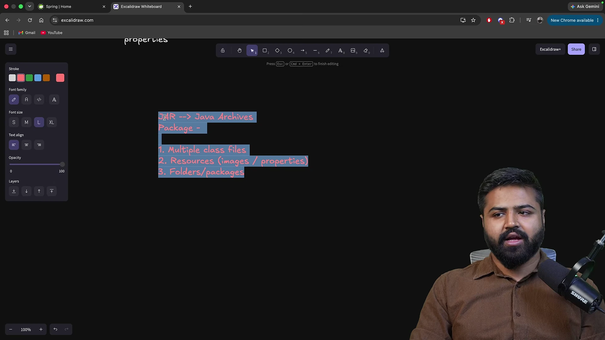

* **Khái niệm tập tin JAR:** JAR (Java Archive) về bản chất là một tập tin nén theo thuật toán ZIP chuẩn, gom toàn bộ các tập tin `.class`, tài nguyên hình ảnh, cấu hình XML/Properties và siêu dữ liệu kê khai vào một tệp duy nhất có phần mở rộng `.jar`.
* **Cấu trúc bên trong tập tin JAR:**
  * Thư mục `META-INF/`: Chứa tập tin `MANIFEST.MF` đặc tả phiên bản Java, lớp chứa hàm `main` khởi chạy (nếu là ứng dụng thực thi) và thông tin chữ ký số.
  * Cây thư mục gói: Các thư mục phản ánh đúng cấu trúc phân cấp gói Java (ví dụ: `com/coderarmy/calculator/Calculator.class`).
* **Lợi ích kỹ thuật:**
  * Giảm kích thước lưu trữ và tăng tốc độ truyền tải qua mạng nhờ nén dữ liệu.
  * Đơn giản hóa việc phân phối mã nguồn nhị phân: chỉ cần chia sẻ một tập tin duy nhất thay vì chuyển hàng trăm thư mục `.class` rời rạc.
  * Bảo toàn tính toàn vẹn cấu trúc gói của ngôn ngữ Java.

---

### [[00:07:20](https://www.youtube.com/watch?v=N2EXGMJVwUU&t=440s)] Phân biệt Library và Application

Một trong những nền tảng quan trọng nhất khi làm việc với các hệ thống xây dựng mã nguồn là phân định rõ sự khác biệt giữa hai hình thái sản phẩm phần mềm: Library và Application.

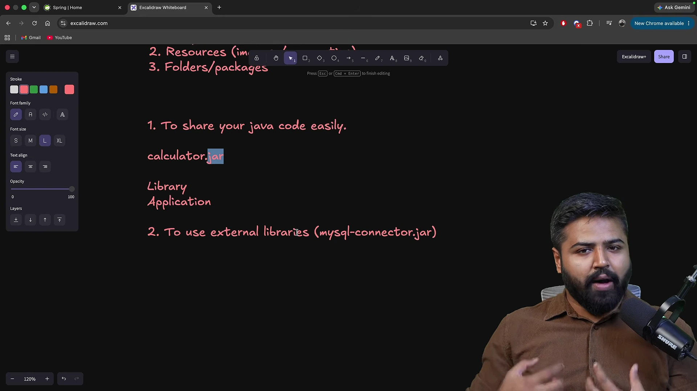

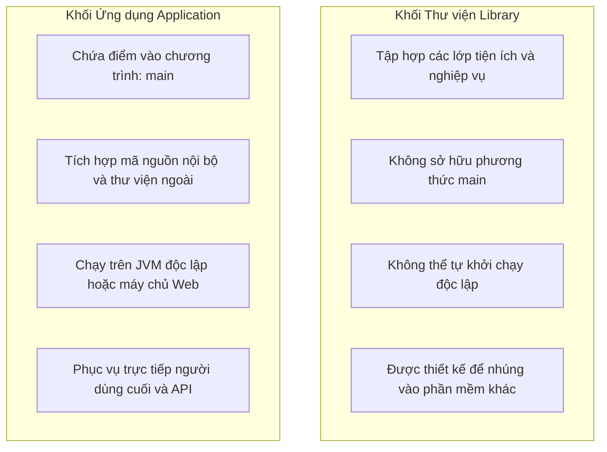

* **Thành phần Library:**
  * Là khối mã nguồn tái sử dụng được đóng gói thành tập tin JAR (ví dụ: `calculator.jar`, `mysql-connector-j.jar`).
  * Không chứa phương thức `public static void main(String[] args)`.
  * Không thể chạy như một tiến trình độc lập trong hệ điều hành; chỉ được nạp vào bộ nhớ khi một ứng dụng khác gọi đến các lớp của nó thông qua Classpath.
* **Thành phần Application:**
  * Là một hệ thống hoàn chỉnh có điểm khởi đầu xác định (`main` method), thiết lập kết nối mạng, khởi tạo vùng chứa đối tượng và phục vụ nghiệp vụ (ví dụ: một ứng dụng Spring Boot REST API).
  * Ứng dụng tự thực thi được trên JVM và tiêu thụ nhiều thư viện bên thứ ba để hoàn thành chức năng.

---

### [[00:11:30](https://www.youtube.com/watch?v=N2EXGMJVwUU&t=690s)] Tích hợp thư viện phụ thuộc

Một ứng dụng doanh nghiệp hiện đại hiếm khi tự viết lại mọi thứ từ đầu. Để kết nối cơ sở dữ liệu, ứng dụng cần thư viện JDBC Driver; để xử lý bảo mật cần thư viện mã hóa; để xuất dữ liệu cần thư viện JSON parser.

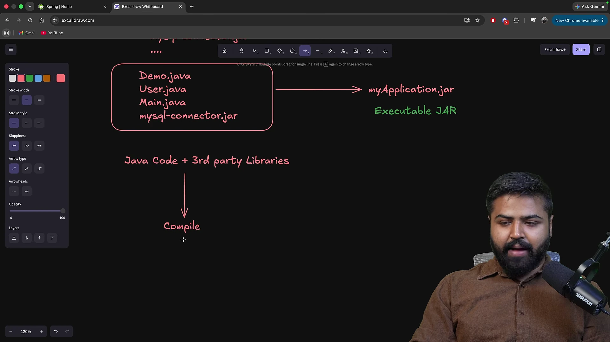

* **Bế tắc của việc tích hợp thủ công:**
  1. Kỹ sư phải truy cập từng trang web của bên thứ ba để tìm liên kết tải tập tin JAR tương ứng.
  2. Nguy cơ tải sai phiên bản không tương thích với phiên bản máy ảo JVM hoặc hệ điều hành.
  3. Khi một thư viện cần nâng cấp phiên bản bảo mật, lập trình viên phải tự xóa JAR cũ, tải JAR mới và cấu hình lại Classpath trên IDE của từng thành viên trong nhóm.
* **Vai trò của tệp định nghĩa đặc biệt:**
  * Giảng viên nhấn mạnh: Cần phải có một tệp cấu hình trung tâm trong dự án để liệt kê toàn bộ danh sách thư viện cần thiết. Khi dự án được chia sẻ qua Git, tệp này sẽ đóng vai trò bản đồ chỉ dẫn để máy tính của bất kỳ ai cũng có thể tự động tải chính xác các thư viện đó.
  * Trong hệ sinh thái Maven, tệp đặc biệt đó chính là `pom.xml`.

---

### [[00:16:30](https://www.youtube.com/watch?v=N2EXGMJVwUU&t=990s)] Sự ra đời của Maven

Trước sự phức tạp ngày càng tăng của các dự án Java, Apache Maven được phát triển như một giải pháp toàn diện cho hai bài toán lớn nhất: Dependency Management và Build Automation.

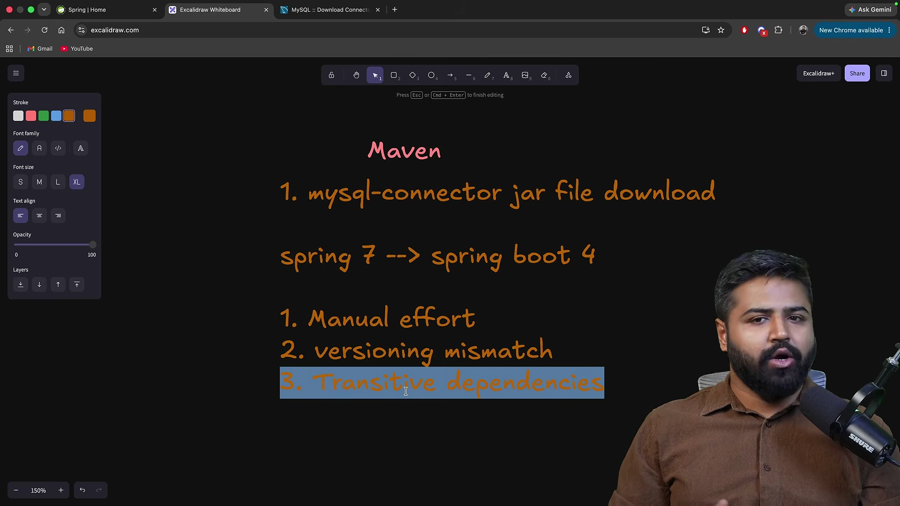

* **Định nghĩa Apache Maven:** Maven là một công cụ quản lý và thấu hiểu dự án phần mềm. Dựa trên khái niệm Project Object Model, Maven có thể quản lý việc xây dựng, báo cáo và tài liệu hóa một dự án từ một thông tin trung tâm.
* **Bốn trụ cột sức mạnh của Maven:**
  1. **Quản lý phụ thuộc tự động:** Tự động tải các gói JAR từ kho lưu trữ trung tâm dựa trên khai báo đơn giản, tự động giải quyết các Transitive Dependencies.
  2. **Quy ước cấu trúc chuẩn Standard Directory Layout:** Định hình một cấu trúc thư mục đồng nhất trên toàn cầu, giúp bất kỳ lập trình viên Java nào khi mở dự án cũng lập tức biết nơi tìm mã nguồn, tệp cấu hình và mã kiểm thử.
  3. **Chu trình Consistent Build Lifecycle:** Cung cấp các lệnh tiêu chuẩn như `compile`, `test`, `package` giống nhau cho mọi dự án, không phụ thuộc vào IDE cụ thể (IntelliJ IDEA, Eclipse hay VS Code).
  4. **Hệ sinh thái Plugin phong phú:** Dễ dàng tích hợp các công cụ kiểm tra chất lượng mã nguồn như SonarQube, công cụ JaCoCo và Spring Boot Maven Plugin.

---

### [[00:20:45](https://www.youtube.com/watch?v=N2EXGMJVwUU&t=1245s)] Khởi tạo dự án Maven

Giảng viên thực hiện thao tác trực tiếp trên giao diện IntelliJ IDEA để tạo mới một dự án sử dụng hệ thống xây dựng Maven từ con số 0.

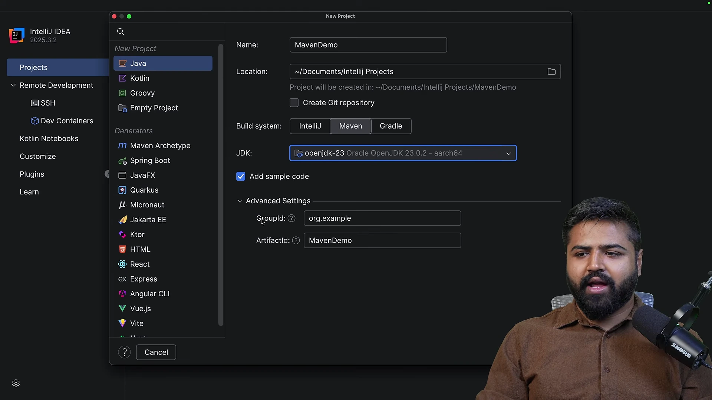

* **Các thông số cấu hình cốt lõi:**
  * **Name:** Tên thư mục dự án (ví dụ: `maven-demo`).
  * **Location:** Đường dẫn thư mục lưu trữ mã nguồn trên ổ đĩa.
  * **Build System:** Chọn `Maven` (thay vì IntelliJ gốc hoặc Gradle). Giảng viên giải thích nếu chọn hệ thống xây dựng riêng của IntelliJ, cấu hình dự án sẽ bị trói chặt vào IDE và không thể chạy được trên các máy trạm khác hoặc máy chủ CI/CD nếu thiếu IntelliJ.
  * **JDK:** Chỉ định phiên bản Java Development Kit (ví dụ: JDK 23 hoặc JDK 21 LTS).
* **Mở rộng Advanced Settings:**
  * `GroupId`: Định danh tổ chức hoặc miền đảo ngược (ví dụ: `org.example` hoặc `com.coderarmy`).
  * `ArtifactId`: Tên định danh của mô-đun ứng dụng (ví dụ: `maven-demo`).
  * `Version`: Phiên bản ban đầu, mặc định là `1.0-SNAPSHOT`.

---

### [[00:24:15](https://www.youtube.com/watch?v=N2EXGMJVwUU&t=1455s)] Cấu trúc thư mục chuẩn

Sau khi khởi tạo, Maven thiết lập cấu trúc Standard Directory Layout chuẩn hóa. Đây là một quy ước bắt buộc giúp công cụ tự động nhận diện đâu là mã nguồn cần biên dịch và đâu là tệp tài nguyên.

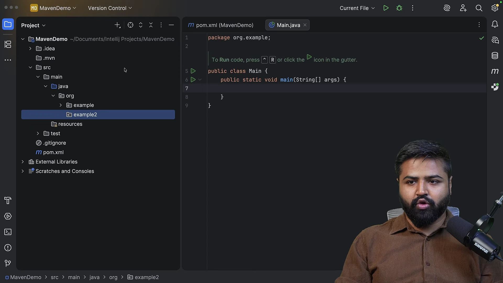

```
maven-demo/
├── pom.xml                     # Tệp cấu hình Project Object Model của Maven
└── src/                        # Thư mục gốc chứa toàn bộ mã nguồn và tài nguyên
    ├── main/                   # Mã nguồn phục vụ logic nghiệp vụ của ứng dụng
    │   ├── java/               # Các gói và tệp mã nguồn Java (.java)
    │   │   └── org/example/
    │   │       └── Main.java
    │   └── resources/          # Tệp cấu hình, file tĩnh (properties, yaml, xml)
    └── test/                   # Mã nguồn phục vụ kiểm thử tự động
        ├── java/               # Các lớp kiểm thử đơn vị JUnit (.java)
        └── resources/          # Tệp tài nguyên dành riêng cho môi trường kiểm thử
```

* **Ý nghĩa của từng phân vùng:**
  * `src/main/java`: Nơi duy nhất chứa mã nguồn Java nghiệp vụ. Trình biên dịch của Maven sẽ quét thư mục này để biên dịch thành Bytecode đưa vào bản phát hành cuối cùng.
  * `src/main/resources`: Chứa các tài nguyên không cần biên dịch như hình ảnh, mẫu email, tệp cấu hình `application.properties`. Toàn bộ nội dung thư mục này sẽ được sao chép nguyên vẹn vào gốc Classpath của tệp JAR.
  * `src/test/java`: Nơi viết các ca kiểm thử tự động (Unit Test, Integration Test). Mã trong thư mục này chỉ được thực thi trong giai đoạn `test` và tuyệt đối không bao giờ bị đóng gói vào sản phẩm phân phối cho khách hàng.

---

### [[00:29:40](https://www.youtube.com/watch?v=N2EXGMJVwUU&t=1780s)] Đối chiếu dự án Spring

Giảng viên mở song song dự án tạo từ Maven thuần và một dự án tải về từ công cụ Spring Initializr ở Bài 02 để phân tích sự tương đồng hoàn hảo về mặt cấu trúc.

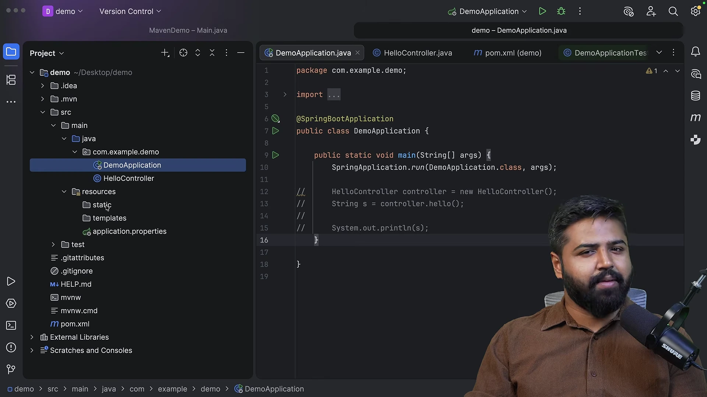

* **Bản chất của dự án Spring Boot:**
  * Dù được gọi là dự án Spring Boot, về bản chất cốt lõi bên dưới, nó vẫn là một dự án **Maven chuẩn mực** 100%.
  * Cả hai đều tuân thủ chính xác cấu trúc `src/main/java`, `src/main/resources`, `src/test/java` và có tập tin `pom.xml` đặt ở thư mục gốc.
* **Điểm khác biệt trong cấu hình Spring Boot:**
  * Trong `src/main/resources`, Spring Initializr tạo sẵn tập tin `application.properties` để cấu hình cổng mạng (`server.port`), kết nối cơ sở dữ liệu.
  * Trong `src/test/java`, Spring Boot sinh sẵn một lớp kiểm thử với chỉ dẫn `@SpringBootTest` để xác nhận Context của ứng dụng có khởi động thành công hay không.
  * Tệp `pom.xml` của Spring Boot chứa thẻ `<parent>` kế thừa từ `spring-boot-starter-parent` và khai báo các phụ thuộc Spring Boot Starters.

---

### [[00:33:30](https://www.youtube.com/watch?v=N2EXGMJVwUU&t=2010s)] Cơ chế biên dịch Target

Trong cửa sổ công cụ Maven của IntelliJ IDEA, giảng viên kích hoạt pha `compile` trong danh mục Lifecycle và quan sát hành vi của hệ thống tệp.

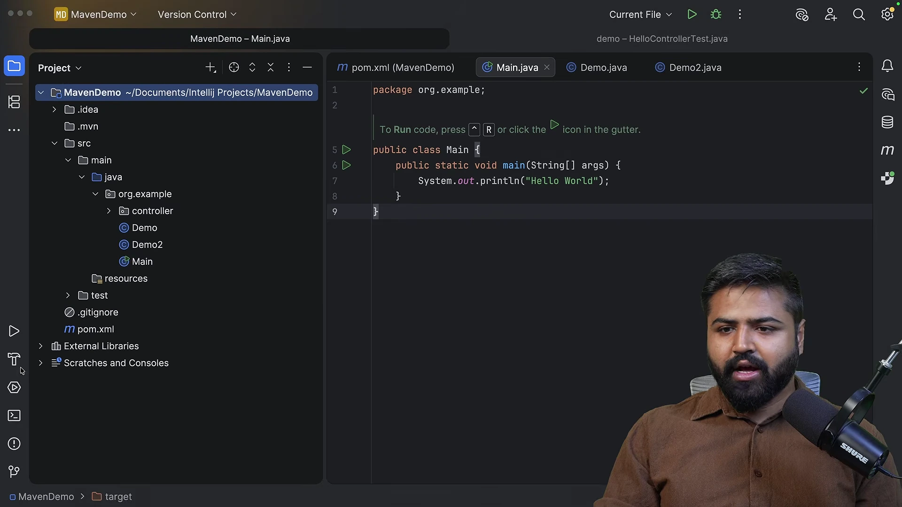

* **Sự xuất hiện của thư mục `target/`:**
  * Trước khi biên dịch, dự án chỉ có thư mục `src/` và tệp `pom.xml`.
  * Khi kích hoạt lệnh biên dịch (`mvn compile`), plugin `maven-compiler-plugin` được kích hoạt. Maven tự động tạo ra một thư mục mới có tên là `target/`.
* **Cấu trúc thư mục đầu ra `target/classes`:**
  * Toàn bộ mã nguồn `.java` trong `src/main/java` được biên dịch thành mã Bytecode `.class` và đặt vào `target/classes/` theo đúng cấu trúc gói (ví dụ: `target/classes/org/example/Main.class`).
  * Tất cả các tệp tài nguyên từ `src/main/resources` được sao chép vào `target/classes/`.
  * Thư mục `target/` là khu vực chứa sản phẩm Build Artifacts và luôn được liệt kê trong tệp `.gitignore` để tránh đẩy các tệp nhị phân lên kho mã nguồn Git.

---

### [[00:35:40](https://www.youtube.com/watch?v=N2EXGMJVwUU&t=2140s)] Quy trình đóng gói JAR

Sau khi mã nguồn đã được biên dịch thành công, bước tiếp theo trong chu trình phát triển là đóng gói toàn bộ các lớp Bytecode thành một sản phẩm phân phối duy nhất.

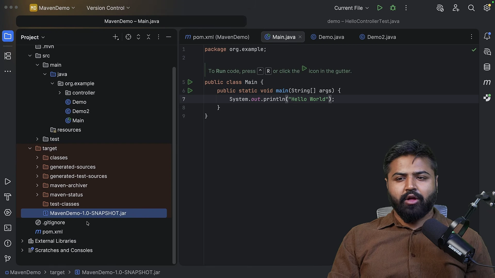

* **Thực thi pha `package`:**
  * Giảng viên bấm đúp chuột vào pha `package` trong bảng điều khiển Maven của IntelliJ (tương đương lệnh CLI `mvn package`).
  * Maven kích hoạt plugin `maven-jar-plugin`.
* **Sản phẩm xuất xưởng:**
  * Trong thư mục `target/`, một tệp nén mới xuất hiện với định dạng: `<artifactId>-<version>.jar` (ví dụ: `maven-demo-1.0-SNAPSHOT.jar`).
  * Tệp JAR này chứa toàn bộ các tệp `.class` từ `target/classes` cùng tệp kê khai `MANIFEST.MF`.
  * Bây giờ, tệp JAR này đã sẵn sàng để gửi cho các thành viên khác trong nhóm hoặc nhúng vào một ứng dụng khác như một thư viện độc lập.

---

### [[00:38:15](https://www.youtube.com/watch?v=N2EXGMJVwUU&t=2295s)] Cấu trúc Project Object Model

Giảng viên mở tệp `pom.xml` của dự án và phân tích chi tiết từng thẻ XML từ cấp độ gốc đến các thuộc tính cấu hình.

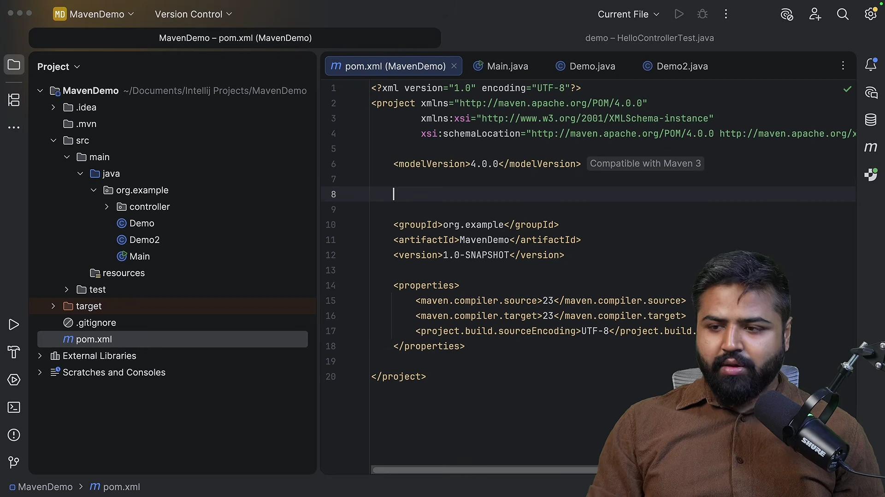

```xml
<?xml version="1.0" encoding="UTF-8"?>
<project xmlns="http://maven.apache.org/POM/4.0.0"
         xmlns:xsi="http://www.w3.org/2001/XMLSchema-instance"
         xsi:schemaLocation="http://maven.apache.org/POM/4.0.0 
                             http://maven.apache.org/xsd/maven-4.0.0.xsd">
    <modelVersion>4.0.0</modelVersion>

    <groupId>org.example</groupId>
    <artifactId>maven-demo</artifactId>
    <version>1.0-SNAPSHOT</version>

    <properties>
        <maven.compiler.source>23</maven.compiler.source>
        <maven.compiler.target>23</maven.compiler.target>
        <project.build.sourceEncoding>UTF-8</project.build.sourceEncoding>
    </properties>
</project>
```

* **Thẻ gốc `<project>` và XML Schema:** Khai báo không gian tên XML và lược đồ xác thực cú pháp (`maven-4.0.0.xsd`) giúp IDE tự động gợi ý cú pháp và kiểm tra lỗi định dạng.
* **Thẻ `<modelVersion>`:** Luôn cố định là `4.0.0`, biểu thị phiên bản mô hình dữ liệu của Maven (đã ổn định từ Maven 2.x đến Maven 3.x).
* **Tọa độ GAV Coordinates:**
  * `<groupId>`: Định danh tên miền ngược của tổ chức phát triển để tránh xung đột tên toàn cầu (`org.example`).
  * `<artifactId>`: Tên định danh mô-đun hoặc tên dự án cụ thể (`maven-demo`).
  * `<version>`: Phiên bản bản dựng hiện tại. Hậu tố `-SNAPSHOT` báo hiệu đây là bản dựng đang trong quá trình phát triển, chưa phải bản phát hành ổn định.
* **Thẻ `<properties>`:** Thiết lập các biến cấu hình tái sử dụng, quy định phiên bản nguồn và đích của trình biên dịch Java (`maven.compiler.source`, `maven.compiler.target`) và bảng mã ký tự tệp nguồn (`UTF-8`).

---

### [[00:48:30](https://www.youtube.com/watch?v=N2EXGMJVwUU&t=2910s)] Khai báo và tải Dependency

Để minh họa cơ chế quản lý phụ thuộc, giảng viên truy cập trang web tìm kiếm Maven Repository (`mvnrepository.com`), tìm kiếm thư viện kết nối cơ sở dữ liệu MySQL (`mysql-connector-j`) và sao chép đoạn mã khai báo vào `pom.xml`.

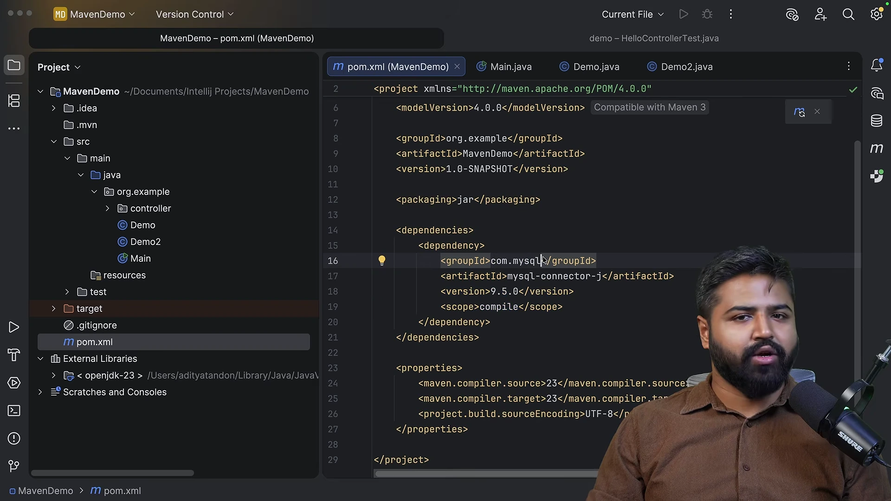

```xml
<dependencies>
    <!-- Khai báo thư viện MySQL JDBC Driver -->
    <dependency>
        <groupId>com.mysql</groupId>
        <artifactId>mysql-connector-j</artifactId>
        <version>8.3.0</version>
        <scope>runtime</scope>
    </dependency>
</dependencies>
```

* **Khối thẻ `<dependencies>` và `<dependency>`:**
  * `<dependencies>` đóng vai trò danh sách vùng chứa toàn bộ các thư viện cần sử dụng trong dự án.
  * Mỗi thẻ `<dependency>` khai báo một gói thư viện cụ thể thông qua bộ tọa độ GAV (`groupId`, `artifactId`, `version`).
* **Biểu tượng làm mới Maven Reload:**
  * Ngay khi sửa đổi `pom.xml`, IntelliJ hiển thị một biểu tượng nút con voi (hoặc biểu tượng chữ `m` có mũi tên xoay tròn) ở góc trên bên phải trình soạn thảo.
  * Bấm nút này sẽ phát tín hiệu cho Maven quét lại `pom.xml`, gửi yêu cầu kết nối tới kho lưu trữ từ xa để tải tệp `.jar` và tự động gắn vào Classpath của dự án mà không cần khởi động lại IDE.

---

### [[00:51:40](https://www.youtube.com/watch?v=N2EXGMJVwUU&t=3100s)] Hiện tượng Transitive Dependency

Sau khi Maven hoàn tất việc tải thư viện `mysql-connector-j`, giảng viên mở rộng mục `External Libraries` trên cây thư mục của IntelliJ để chỉ ra một hiện tượng kỹ thuật vô cùng quan trọng: Phụ thuộc bắc cầu.

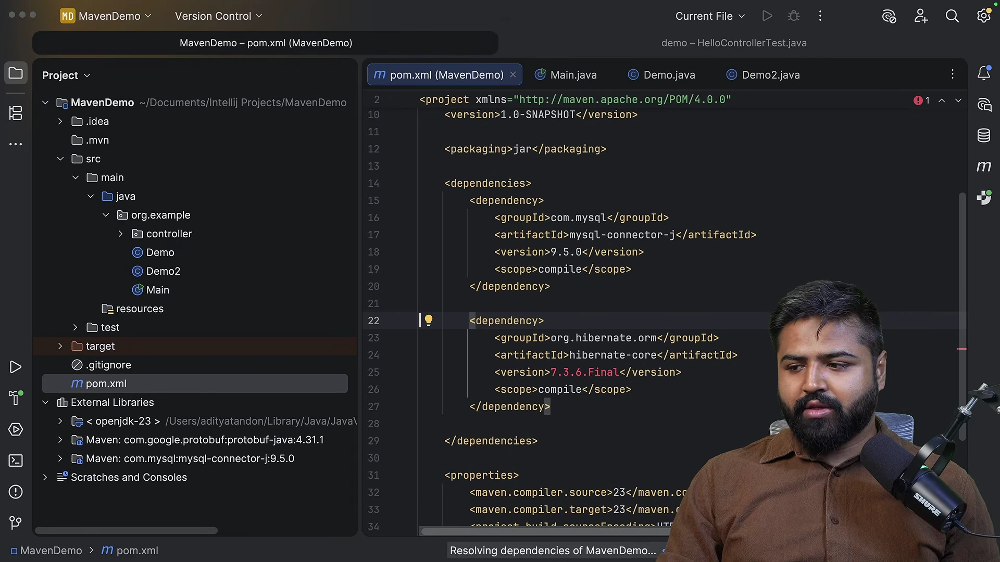

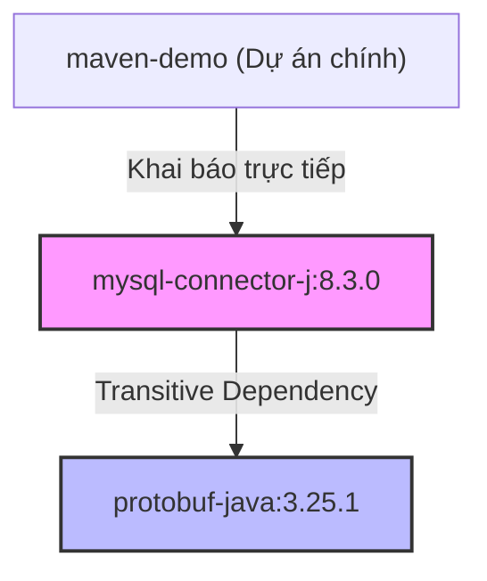

* **Khái niệm Transitive Dependency:**
  * Trong `pom.xml`, dự án chỉ khai báo một phụ thuộc duy nhất là `com.mysql:mysql-connector-j`.
  * Tuy nhiên, bên trong mục `External Libraries`, ngoài tệp JAR của MySQL, xuất hiện thêm tệp JAR `protobuf-java` (Google Protocol Buffers).
  * Lý do: Bản thân mã nguồn của MySQL Connector bên trong cần dùng thư viện Protobuf để giao tiếp nhị phân. Khi xuất bản lên Maven Central, tệp `pom.xml` của MySQL Connector đã khai báo `protobuf-java` là phụ thuộc của nó.
  * Maven tự động đọc cây gia phả phụ thuộc này và tải luôn `protobuf-java` về cho dự án của bạn mà bạn không cần phải biết hay cấu hình thủ công.
* **Ngăn chặn xung đột:** Nếu dự án khác kéo về một phiên bản Protobuf khác dẫn đến xung đột phiên bản, Maven áp dụng quy tắc Nearest-wins strategy hoặc cho phép lập trình viên sử dụng thẻ `<exclusions>` để loại bỏ phiên bản không mong muốn.

---

### [[00:58:30](https://www.youtube.com/watch?v=N2EXGMJVwUU&t=3510s)] Cơ chế kế thừa POM

Khi xem xét tệp `pom.xml` của một ứng dụng Spring Boot thực tế, điểm nổi bật nhất xuất hiện ở ngay đầu tệp: thẻ `<parent>`.

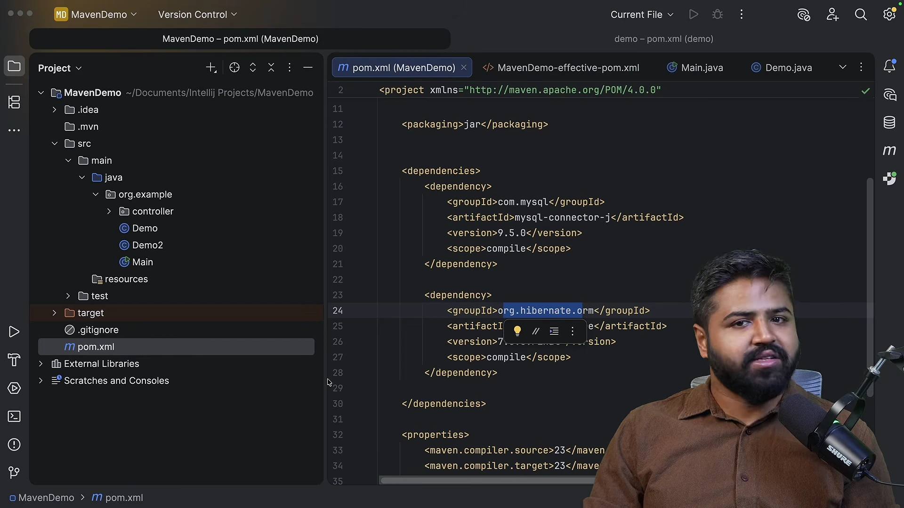

```xml
<!-- Tệp pom.xml của ứng dụng Spring Boot -->
<parent>
    <groupId>org.springframework.boot</groupId>
    <artifactId>spring-boot-starter-parent</artifactId>
    <version>3.2.3</version>
    <relativePath/> <!-- Tìm kiếm trong kho lưu trữ thay vì thư mục cha cục bộ -->
</parent>

<dependencies>
    <!-- Không cần khai báo thẻ version -->
    <dependency>
        <groupId>org.springframework.boot</groupId>
        <artifactId>spring-boot-starter-web</artifactId>
    </dependency>
</dependencies>
```

* **Nguyên lý kế thừa Inheritance:**
  * Tương tự tính kế thừa trong lập trình hướng đối tượng Java, một tệp `pom.xml` có thể kế thừa các cấu hình từ một tệp POM cha.
  * `spring-boot-starter-parent` định nghĩa sẵn hàng loạt cấu hình chuẩn: phiên bản Java mặc định, thiết lập mã hóa UTF-8, cấu hình thực thi plugin đóng gói `spring-boot-maven-plugin`.
* **Phân định phiên bản tập trung:**
  * Điều kỳ diệu là các phụ thuộc con như `spring-boot-starter-web` hoặc `mysql-connector-j` bên dưới **không cần khai báo thẻ `<version>`**.
  * Dự án cha sử dụng khối thẻ `<dependencyManagement>` để quản lý trước danh mục các phiên bản thư viện đã được đội ngũ Spring kiểm thử kỹ lưỡng về tính tương thích. Dự án con chỉ định danh đúng tên thư viện là tự động nhận đúng phiên bản ổn định nhất.

---

### [[01:04:30](https://www.youtube.com/watch?v=N2EXGMJVwUU&t=3870s)] Kiến trúc hệ thống Repository

Giảng viên phác thảo sơ đồ kiến trúc ba tầng kho lưu trữ của Maven trên bảng vẽ để giải thích chi tiết luồng dữ liệu khi một gói JAR được tìm kiếm và phân giải.

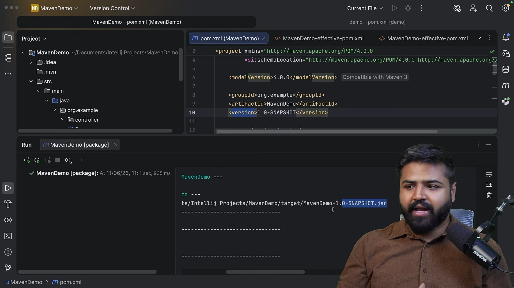

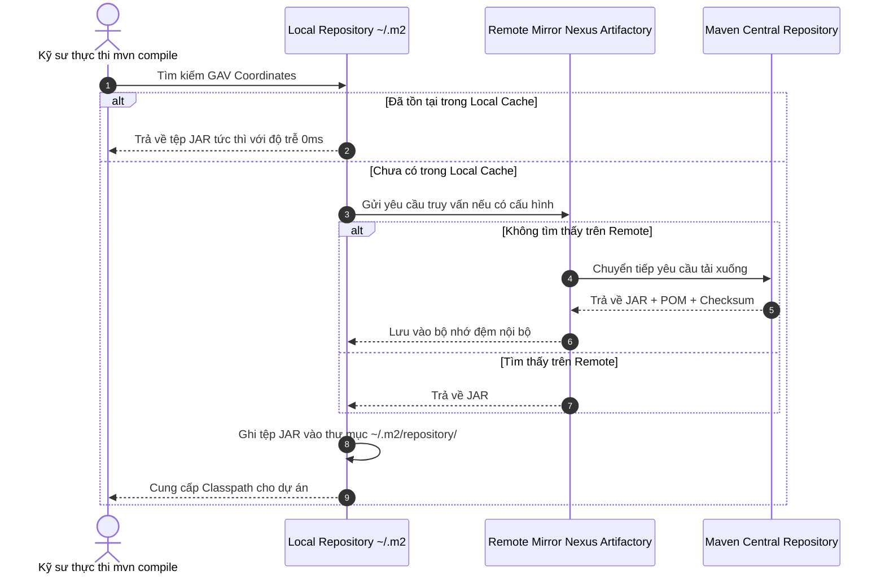

* **Local Repository:** Đặt ngay trên ổ cứng máy tính cá nhân. Là trạm kiểm tra đầu tiên trong mọi tình huống.
* **Central Repository:** Kho lưu trữ mở toàn cầu do Apache tài trợ, địa chỉ `https://repo.maven.apache.org/maven2/`.
* **Remote Repository:** Kho máy chủ riêng do công ty dựng lên (hoặc các kho của bên thứ ba như Spring Milestone Repository).
* **Quy trình hoạt động tối ưu:** Nhờ cơ chế lưu đệm ở Local Repository, lập trình viên chỉ cần tải thư viện một lần duy nhất qua Internet. Từ lần xây dựng thứ hai hoặc ở một dự án khác trên cùng máy tính, Maven sẽ nạp thẳng từ ổ đĩa cục bộ, cho phép làm việc hoàn toàn ở chế độ Offline Mode.

---

### [[01:07:30](https://www.youtube.com/watch?v=N2EXGMJVwUU&t=4050s)] Khảo sát Local Repository

Để chứng minh nguyên lý trên, giảng viên mở cửa sổ Terminal hệ điều hành và trực tiếp khám phá cấu trúc vật lý của thư mục `.m2`.

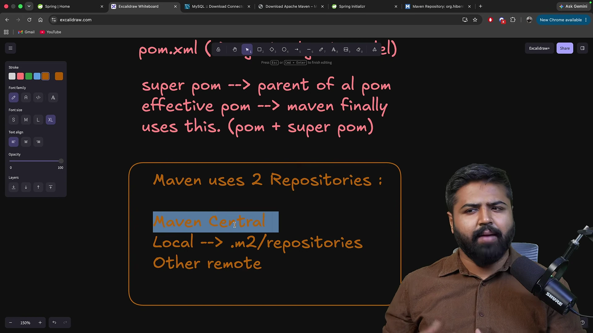

* **Vị trí thư mục:**
  * Trên Linux/macOS: `~/.m2/repository`
  * Trên Windows: `C:\Users\<Tên_Người_Dùng>\.m2\repository`
  * Đây là một thư mục ẩn (bắt đầu bằng dấu chấm) để tránh việc người dùng vô tình chỉnh sửa làm hỏng bộ nhớ đệm.
* **Cấu trúc lưu trữ phân cấp:**
  * Maven ánh xạ trực tiếp `groupId` thành các cấp thư mục lồng nhau.
  * Ví dụ với phụ thuộc `com.mysql:mysql-connector-j:8.3.0`:
    `~/.m2/repository/com/mysql/mysql-connector-j/8.3.0/`
  * Bên trong thư mục phiên bản này sẽ chứa:
    * `mysql-connector-j-8.3.0.jar`: Tập tin nhị phân chứa mã thực thi.
    * `mysql-connector-j-8.3.0.pom`: Tập tin XML mô tả phụ thuộc của chính thư viện này.
    * Các tệp `.sha1` hoặc `.md5`: Mã băm dùng để xác thực tệp tải về không bị lỗi đường truyền hoặc bị chỉnh sửa độc hại.
* **Thử nghiệm xóa bộ đệm:** Nếu xóa thư mục này và quay lại IntelliJ bấm Reload Maven, toàn bộ các tệp sẽ được tải lại từ đầu từ Maven Central.

---

### [[01:14:30](https://www.youtube.com/watch?v=N2EXGMJVwUU&t=4470s)] Vòng đời Maven Lifecycle

Maven tổ chức quy trình phát triển thành ba vòng đời xây dựng tích hợp sẵn: Clean, Default và Site. Giảng viên tập trung phân tích sâu vào Default Lifecycle — chuỗi giai đoạn cốt lõi của mọi dự án Java.

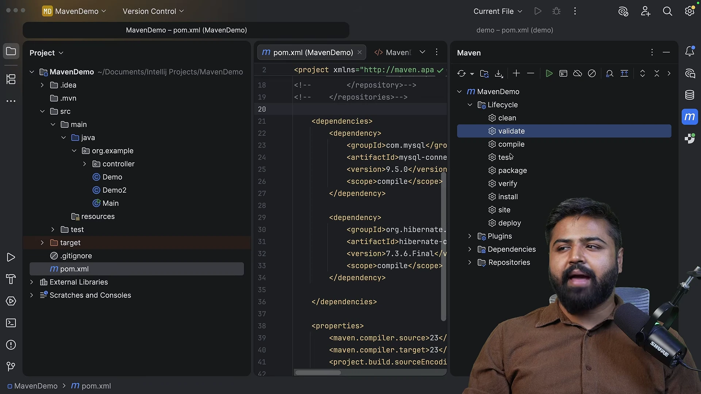

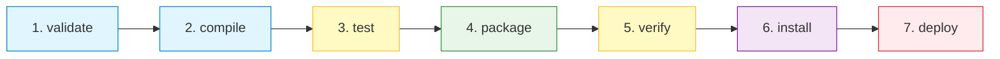

* **Ba vòng đời tích hợp sẵn:**
  1. **Clean Lifecycle:** Chịu trách nhiệm dọn dẹp các tệp sinh ra từ lần xây dựng trước (`pre-clean`, `clean`, `post-clean`). Pha `clean` sẽ xóa bỏ hoàn toàn thư mục `target/`.
  2. **Default Lifecycle:** Chịu trách nhiệm chính cho việc biên dịch và triển khai ứng dụng.
  3. **Site Lifecycle:** Tạo báo cáo tài liệu HTML cho dự án (`site`, `site-deploy`).
* **Bảy giai đoạn trọng yếu của Default Lifecycle:**
  1. `validate`: Xác thực tính hợp lệ của cấu trúc dự án và sự hiện diện của đầy đủ thông tin trong `pom.xml`.
  2. `compile`: Biên dịch toàn bộ mã nguồn Java trong `src/main/java` thành tệp `.class` trong `target/classes`.
  3. `test`: Chạy các ca kiểm thử đơn vị trong `src/test/java` bằng framework kiểm thử (JUnit/TestNG). Nếu có bất kỳ bài kiểm thử nào thất bại, chu trình xây dựng lập tức dừng lại.
  4. `package`: Đóng gói các tệp Bytecode đã biên dịch thành tệp phân phối (JAR hoặc WAR) lưu trong `target/`.
  5. `verify`: Chạy các bài kiểm tra tích hợp để xác thực tệp gói đáp ứng các tiêu chuẩn chất lượng mã nguồn.
  6. `install`: Sao chép gói JAR từ thư mục `target/` vào **Local Repository (`~/.m2/repository`)** của máy trạm để các dự án khác trên cùng máy có thể sử dụng như một phụ thuộc.
  7. `deploy`: Sao chép gói JAR hoàn thiện lên **Remote Repository** của tổ chức hoặc Maven Central để phân phối cho toàn thế giới.
* **Quy tắc thực thi lũy tiến:** Các giai đoạn chạy tuần tự nghiêm ngặt. Khi gọi lệnh `mvn install`, Maven bắt buộc phải tự động chạy qua `validate` -> `compile` -> `test` -> `package` -> `verify` trước khi đến `install`.

---

### [[01:23:00](https://www.youtube.com/watch?v=N2EXGMJVwUU&t=4980s)] Thực thi Clean Install

Giảng viên mở Terminal tích hợp trong IntelliJ IDEA và thực thi câu lệnh kinh điển được sử dụng nhiều nhất bởi các kỹ sư Java: `mvn clean install`.

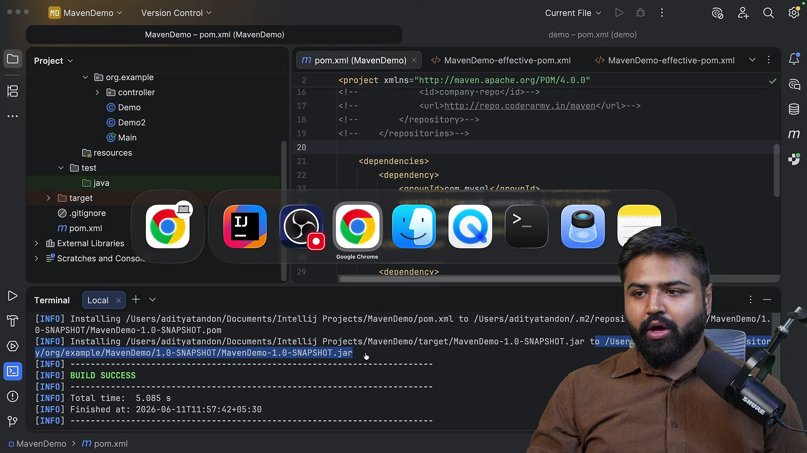

```bash
# Lệnh kết hợp hai pha từ hai vòng đời khác nhau
mvn clean install
```

* **Cơ chế phối hợp hai vòng đời:**
  * `clean` thuộc Clean Lifecycle: Lập tức quét và xóa sạch toàn bộ thư mục `target/`, đảm bảo không có bất kỳ tệp Bytecode cũ nào còn sót lại gây ra lỗi biên dịch ngầm.
  * `install` thuộc Default Lifecycle: Kích hoạt chuỗi tuần tự biên dịch lại từ đầu, chạy toàn bộ kiểm thử đơn vị, tạo ra tệp JAR mới tinh trong `target/`, và cuối cùng cài đặt tệp JAR này vào thư mục `~/.m2/repository/org/example/maven-demo/1.0-SNAPSHOT/`.
* **Kết quả quan sát thực tế:**
  * Giảng viên mở lại thư mục `.m2` và chứng minh tệp `maven-demo-1.0-SNAPSHOT.jar` đã xuất hiện tại đây cùng tệp `maven-demo-1.0-SNAPSHOT.pom`.
  * Từ thời điểm này, nếu bạn tạo một dự án thứ hai trên máy tính, bạn hoàn toàn có thể khai báo phụ thuộc vào `org.example:maven-demo:1.0-SNAPSHOT` và Maven sẽ nạp mã nguồn từ dự án này sang dự án kia dễ dàng.

---

### [[01:26:30](https://www.youtube.com/watch?v=N2EXGMJVwUU&t=5190s)] Khởi tạo bằng Maven Archetype

Trong phần kết của bài giảng, giảng viên giới thiệu một tính năng nâng cao giúp tăng tốc khởi tạo dự án: Maven Archetypes.

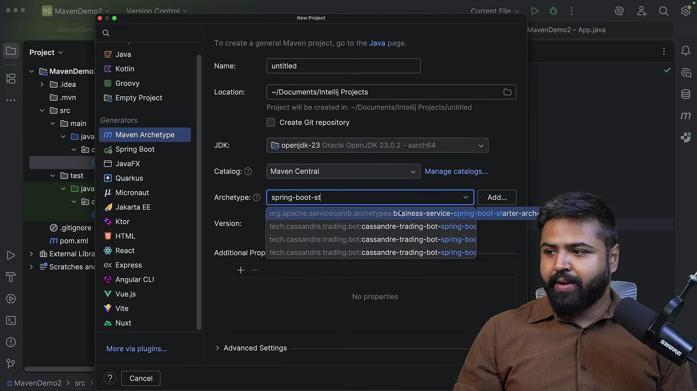

* **Bản chất của Archetype:**
  * Archetype là một bộ công cụ Project Template Toolkit của Maven. Nó là một bản thiết kế sẵn cung cấp khung dự án chuẩn cho từng mục đích cụ thể.
  * Thay vì phải tự tạo từng thư mục `src/main/java` và viết từng dòng `pom.xml`, Archetype tự động sinh toàn bộ bộ khung chỉ bằng một câu lệnh hoặc thao tác chọn trên IDE.
* **Các Archetype thông dụng:**
  * `maven-archetype-quickstart`: Mẫu dự án Java dòng lệnh cơ bản nhất, sinh sẵn một lớp `App.java` chứa hàm `main` in chữ "Hello World" và một lớp `AppTest.java` chứa kiểm thử JUnit mẫu.
  * `maven-archetype-webapp`: Mẫu ứng dụng Web Java cổ điển, sinh sẵn thư mục `src/main/webapp/WEB-INF/web.xml` để chạy trên máy chủ Servlet Container độc lập.
* **Mối liên hệ với Spring Initializr:**
  * Giảng viên giải thích rằng giao diện web Spring Initializr mà chúng ta dùng trong Bài 02 thực chất hoạt động dựa trên cùng triết lý với Maven Archetype: nhận thông số cấu hình người dùng, sinh sẵn cấu trúc thư mục, cấu hình các Starter Dependency vào `pom.xml` và nén lại thành tệp ZIP cho lập trình viên tải về.

---

## Trích dẫn then chốt

* *"Nếu không có Maven, bạn sẽ phải dành 50% thời gian của một kỹ sư chỉ để đi tải các tập tin JAR trên mạng và đau đầu giải quyết các lỗi ClassNotFoundException do thiếu phụ thuộc."* — [[00:16:45](https://www.youtube.com/watch?v=N2EXGMJVwUU&t=1005s)]
* *"Mỗi dự án Java có thể có phong cách viết mã khác nhau, nhưng nhờ cấu trúc thư mục chuẩn của Maven, bất kỳ kỹ sư nào bước vào dự án cũng biết chính xác mã nguồn nằm ở đâu và tài nguyên nằm ở đâu."* — [[00:24:40](https://www.youtube.com/watch?v=N2EXGMJVwUU&t=1480s)]
* *"Đừng bao giờ thêm thẻ version vào các dependency con trong Spring Boot nếu dự án cha đã quản lý nó; việc ép buộc phiên bản thủ công chính là nguyên nhân hàng đầu gây ra hiện tượng xung đột thư viện."* — [[00:59:15](https://www.youtube.com/watch?v=N2EXGMJVwUU&t=3555s)]
* *"Lệnh mvn clean install không chỉ đơn thuần là biên dịch mã nguồn; nó là sự phối hợp của hai chu trình vòng đời độc lập để dọn sạch rác cũ và đưa sản phẩm của bạn vào kho lưu trữ nội bộ."* — [[01:22:50](https://www.youtube.com/watch?v=N2EXGMJVwUU&t=4970s)]
* *"Kho lưu trữ Local Repository là cứu cánh cho băng thông và tốc độ phát triển; nó đảm bảo bạn chỉ tải thư viện qua Internet đúng một lần duy nhất cho toàn bộ các dự án trên máy."* — [[01:05:05](https://www.youtube.com/watch?v=N2EXGMJVwUU&t=3905s)]

---

## Lệnh & Công cụ

#### Lệnh CLI Maven thiết yếu
```bash
# 1. Biên dịch toàn bộ mã nguồn nghiệp vụ trong src/main/java
mvn compile

# 2. Biên dịch và thực thi toàn bộ các ca kiểm thử tự động trong src/test/java
mvn test

# 3. Đóng gói mã nguồn thành tệp JAR hoặc WAR lưu tại thư mục target/
mvn package

# 4. Đóng gói và bỏ qua việc thực thi kiểm thử khi cần tiết kiệm thời gian
mvn package -DskipTests

# 5. Dọn dẹp sạch sẽ toàn bộ thư mục target/ phát sinh từ các lần xây dựng trước
mvn clean

# 6. Cài đặt tệp JAR đã đóng gói vào Local Repository tại ~/.m2/repository
mvn install

# 7. Lệnh kết hợp chuẩn hóa: dọn dẹp sạch sẽ và cài đặt lại gói mới vào Local Repository
mvn clean install

# 8. Xem cây phụ thuộc hoàn chỉnh của dự án để phát hiện xung đột thư viện
mvn dependency:tree

# 9. Hiển thị toàn bộ cấu hình POM thực tế sau khi đã gộp Super POM và Parent POM
mvn help:effective-pom

# 10. Khởi tạo dự án Java mới từ khuôn mẫu Archetype chuẩn
mvn archetype:generate -DgroupId=com.coderarmy -DartifactId=my-app -DarchetypeArtifactId=maven-archetype-quickstart -DinteractiveMode=false
```

#### Tệp và thư mục hệ thống quan trọng
* `pom.xml`: Tệp mô tả cấu hình Project Object Model của dự án.
* `~/.m2/repository/`: Thư mục lưu trữ bộ nhớ đệm Local Repository của Maven trên máy trạm.
* `~/.m2/settings.xml`: Tệp cấu hình toàn cục của Maven (cấu hình máy chủ proxy, chứng thực kho riêng Nexus/Artifactory, đường dẫn kho đệm tùy chỉnh).
* `target/`: Thư mục chứa toàn bộ sản phẩm biên dịch tạm thời (`classes/`, `test-classes/`, `*.jar`).

---

## Đánh đổi & Rủi ro

| Lựa chọn kỹ thuật | Đánh đổi & Rủi ro tiềm ẩn | Biện pháp giảm thiểu |
| :--- | :--- | :--- |
| **Quản lý thủ công vs Apache Maven** | Quản lý JAR thủ công không cần cài đặt thêm công cụ nhưng làm tăng kích thước kho Git, dễ thiếu phụ thuộc bắc cầu và không thể xây dựng CI/CD tự động; Maven yêu cầu học cú pháp XML và quy ước vòng đời nhưng chuẩn hóa 100% quy trình xây dựng dự án. | Chuẩn hóa toàn bộ dự án Java bằng Maven hoặc Gradle; tuyệt đối không lưu trữ các tệp nhị phân `.jar` bên trong hệ thống quản lý phiên bản Git. |
| **Phiên bản SNAPSHOT vs RELEASE** | Dùng SNAPSHOT giúp nhận ngay các cập nhật mới nhất từ nhóm phát triển khác nhưng thiếu tính bất biến, có thể làm hỏng bản dựng vào ngày mai mà không rõ nguyên nhân; RELEASE đảm bảo tính ổn định tuyệt đối nhưng đòi hỏi quy trình phát hành phiên bản nghiêm ngặt. | Chỉ dùng SNAPSHOT trong môi trường phát triển cục bộ nội bộ nhóm; bắt buộc chuyển toàn bộ sang phiên bản RELEASE bất biến trước khi đưa ứng dụng lên môi trường kiểm thử UAT và sản xuất. |
| **Phụ thuộc bắc cầu Transitive Dependencies** | Giúp tiết kiệm công sức khai báo từng thư viện con nhưng tiềm ẩn nguy cơ Dependency Hell khi hai thư viện khác nhau cùng phụ thuộc vào hai phiên bản khác nhau của một bên thứ ba (ví dụ: Log4j hoặc Jackson). | Sử dụng lệnh `mvn dependency:tree` để kiểm tra phân cấp cây phụ thuộc; sử dụng thẻ `<exclusions>` để loại bỏ phiên bản cũ hoặc chỉ định phiên bản ghi đè trong `<dependencyManagement>`. |
| **Chi phí ổ đĩa của Local Repository** | Theo thời gian, thư mục `~/.m2/repository` có thể phình to lên hàng chục gigabyte do lưu giữ mọi phiên bản cũ của hàng trăm thư viện và plugin đã từng tải về máy trạm. | Định kỳ dọn dẹp các thư mục phiên bản cũ không còn dùng trong `~/.m2/repository` bằng lệnh `mvn dependency:purge-local-repository` hoặc script dọn ổ đĩa. |
| **Lạm dụng kế thừa Parent POM** | Kế thừa giúp chia sẻ cấu hình nhanh nhưng tạo ra kết dính chặt giữa dự án con và dự án cha; khi POM cha thay đổi một phiên bản plugin, toàn bộ các dự án con có thể bị ảnh hưởng hành vi xây dựng ngoài ý muốn. | Tách bạch rõ cấu hình chung và cấu hình đặc thù; với các hệ thống lớn dạng Multi-module, sử dụng cơ chế nhập BOM (Bill of Materials) với scope `import` thay vì lạm dụng kế thừa toàn bộ cấu hình. |
