# Dependency Injection và Inversion of Control

* **Kênh:** Coder Army | **Thời lượng:** 39:36 | **Ngày:** 2026-06-20
* **Video:** [https://www.youtube.com/watch?v=dT10m_5POfs](https://www.youtube.com/watch?v=dT10m_5POfs)

---

## Thuật ngữ

| Thuật ngữ | Giải thích bản chất kỹ thuật |
| :--- | :--- |
| **Tight Coupling** | Độ kết dính chặt: trạng thái thiết kế trong đó một lớp tự khởi tạo và phụ thuộc trực tiếp vào triển khai cụ thể của một lớp khác bằng toán tử `new`, khiến bất kỳ sự thay đổi nào ở lớp bị phụ thuộc cũng gây vỡ mã nguồn ở lớp phụ thuộc. |
| **Loose Coupling** | Độ kết dính lỏng: trạng thái thiết kế phân tách các thành phần phần mềm thông qua giao diện trừu tượng Interface, cho phép thay thế hoặc nâng cấp triển khai nội bộ mà không cần sửa đổi mã nguồn của lớp tiêu thụ. |
| **Dependency** | Đối tượng hoặc dịch vụ mà một lớp cần để hoàn thành nhiệm vụ của nó (ví dụ: `OrderService` cần `NotificationService` để gửi thông báo xác nhận đơn hàng). |
| **Dependency Injection (DI)** | Kỹ thuật thiết kế phần mềm trong đó các Dependency được cung cấp từ môi trường bên ngoài vào đối tượng thay vì để đối tượng tự khởi tạo bên trong mã nguồn của nó. |
| **Constructor Injection** | Kỹ thuật tiêm phụ thuộc thông qua hàm khởi tạo Constructor. Đảm bảo phụ thuộc bắt buộc phải tồn tại ngay khi đối tượng được tạo lập, hỗ trợ tính bất biến Immutability và ngăn ngừa lỗi `NullPointerException`. |
| **Setter Injection** | Kỹ thuật tiêm phụ thuộc thông qua các phương thức Setter (`setService`). Phù hợp cho các phụ thuộc tùy chọn Optional Dependencies hoặc khi cần thay đổi đối tượng tại thời điểm chạy. |
| **Field Injection** | Kỹ thuật tiêm phụ thuộc trực tiếp vào biến trường thông qua Reflection (như gắn chỉ dẫn `@Autowired` trên thuộc tính). Tiện lợi nhưng gây khó khăn cho việc viết kiểm thử đơn vị thuần Java nếu không có vùng chứa Spring. |
| **Inversion of Control (IoC)** | Nguyên lý kiến trúc phần mềm đảo ngược quyền kiểm soát luồng thực thi và quản lý vòng đời đối tượng. Quyền khởi tạo và liên kết các thành phần được chuyển giao từ mã ứng dụng thủ công sang một Framework hoặc Container trung tâm. |
| **IoC Container** | Vùng chứa chịu trách nhiệm quét, cấu hình, khởi tạo, lắp ráp và điều phối toàn bộ vòng đời của các đối tượng phần mềm trong ứng dụng (như Spring `ApplicationContext`). |
| **Spring Bean** | Đối tượng Java được quản lý, cấu hình và liên kết hoàn toàn bởi Spring IoC Container, khác với đối tượng Java thông thường do lập trình viên tự tạo bằng toán tử `new`. |
| **Interface** | Hợp đồng trừu tượng định nghĩa danh sách các hành vi (phương thức) mà các lớp thực thi bắt buộc phải tuân thủ, đóng vai trò bản lề cho kiến trúc Loose Coupling. |
| **Open-Closed Principle (OCP)** | Nguyên lý mở để mở rộng nhưng đóng đối với sửa đổi (chữ O trong chuẩn thiết kế SOLID). Khi có yêu cầu mới, hệ thống mở rộng bằng cách thêm lớp mới chứ không sửa mã nguồn đang hoạt động ổn định. |
| **Mocking & Fake Object** | Kỹ thuật giả lập các phụ thuộc ngoài (như mạng, cơ sở dữ liệu, dịch vụ email) trong kiểm thử đơn vị, cho phép kiểm tra logic nghiệp vụ độc lập mà không phát sinh tác dụng phụ thực tế. |

---

## Tổng luận chuyên đề

**Chuyên đề 1: Khủng hoảng kết dính chặt và giới hạn của toán tử new**
Trong lập trình hướng đối tượng cơ bản, khi một lớp cần sử dụng một dịch vụ khác, phản xạ tự nhiên của lập trình viên là sử dụng toán tử `new` ngay trong hàm khởi tạo hoặc thuộc tính (ví dụ: `this.emailService = new EmailService();`). Đây chính là nguồn gốc của thảm họa kiến trúc mang tên Tight Coupling. Lớp tiêu thụ (`OrderService`) lúc này bị gắn chặt vào việc triển khai cụ thể của `EmailService`. Khi doanh nghiệp thay đổi chính sách từ thông báo qua Email sang SMS hoặc thông báo đẩy trên di động, lập trình viên buộc phải mở lớp `OrderService` ra để sửa đổi mã nguồn. Hành vi này vi phạm trực tiếp nguyên lý Open-Closed Principle, tiềm ẩn rủi ro phát sinh lỗi hồi quy trên các chức năng đang vận hành ổn định và biến hệ thống thành một khối nguyên khối mong manh, không thể mở rộng.

**Chuyên đề 2: Lớp trừu tượng Interface và bước đệm phân tách phụ thuộc**
Bước chuyển mình đầu tiên để phá vỡ sự kết dính chặt là áp dụng tính đa hình thông qua Interface. Bằng cách định nghĩa hợp đồng chung `NotificationService` với phương thức `send()`, các lớp cụ thể như `EmailService`, `SmsService` và `PushNotificationService` sẽ đóng vai trò các bản hiện thực hoán đổi cho nhau. Tuy nhiên, nếu lớp `OrderService` vẫn tiếp tục tự khởi tạo `private NotificationService notificationService = new EmailService();`, sự kết dính chặt vẫn tồn tại 100%. Lớp nghiệp vụ vẫn biết đích danh lớp con nào đang được tạo ra và vẫn cần sửa mã nguồn khi đổi dịch vụ. Để đạt được trạng thái Loose Coupling thực sự, quyền khởi tạo đối tượng bắt buộc phải bị tước khỏi tay của lớp tiêu thụ.

**Chuyên đề 3: Kỹ thuật Dependency Injection và đột phá kiểm thử tự động**
Dependency Injection giải quyết bài toán trên bằng một triết lý đơn giản nhưng uy lực: "Đừng tự tạo phụ thuộc, hãy để bên ngoài đưa vào". Thông qua Constructor Injection, `OrderService` chỉ khai báo rằng nó cần một đối tượng tuân thủ hợp đồng `NotificationService` để hoạt động. Việc quyết định truyền `EmailService` hay `SmsService` thuộc về môi trường bên ngoài (lớp `Main` hoặc Container). Lợi ích vượt trội nhất của DI nằm ở năng lực kiểm thử tự động Unit Testing: lập trình viên có thể dễ dàng tạo ra một lớp giả lập `FakeEmailService` và tiêm vào `OrderService`, giúp bài kiểm thử chạy với tốc độ miligiây trong bộ nhớ mà không cần kết nối mạng Internet hay gửi email rác đến người dùng thực tế.

**Chuyên đề 4: Nguyên lý Inversion of Control và sứ mệnh của Spring IoC Container**
Inversion of Control là nguyên lý kiến trúc lớn bao trùm, trong đó Dependency Injection là kỹ thuật cụ thể để hiện thực hóa nguyên lý này. Trong luồng điều khiển truyền thống Control Inside, lớp nghiệp vụ tự nắm quyền quyết định khi nào tạo đối tượng phụ thuộc. Trong luồng đảo ngược Control Outside, quyền kiểm soát này bị đảo ngược hoàn toàn ra bên ngoài. Tuy nhiên, nếu lập trình viên tiếp tục tự khởi tạo và nối dây thủ công hàng trăm đối tượng trong phương thức `main`, mã nguồn khởi động sẽ biến thành một mạng nhện phức tạp. Đây chính là lý do Spring Framework ra đời: Spring IoC Container đóng vai trò một nhà máy tự động hóa hoàn toàn, chịu trách nhiệm đọc cấu hình, tự động khởi tạo các Spring Bean, quản lý vòng đời và tự động tiêm các phụ thuộc vào đúng vị trí một cách trong suốt.

---

## Bóc tách chi tiết

### [[00:02:15](https://www.youtube.com/watch?v=dT10m_5POfs&t=135s)] Khởi tạo dự án Core

Bài giảng bắt đầu bằng việc tạo mới một dự án Maven cơ bản trên IntelliJ IDEA có tên là `core-demo` nhằm khảo sát bản chất của Dependency Injection thuần túy trên ngôn ngữ Java trước khi tìm hiểu các Annotation của Spring Framework.

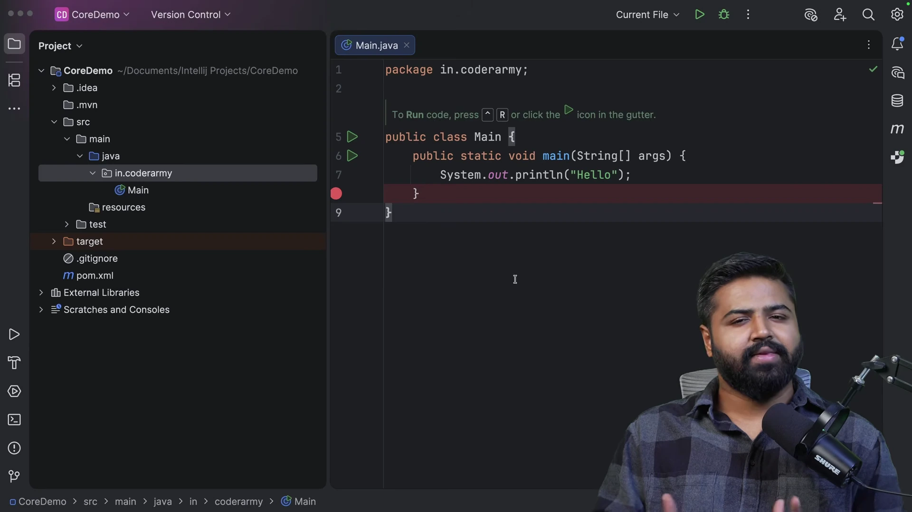

* **Thiết lập môi trường thực nghiệm:**
  * Giảng viên nhấn mạnh: Dependency Injection và Inversion of Control là các nguyên lý thiết kế phần mềm độc lập, không phải phát minh riêng của Spring Boot hay Java.
  * Dự án được tạo dưới dạng Maven thuần túy không chứa bất kỳ thư viện ngoài nào nhằm chứng minh rằng bạn hoàn toàn có thể triển khai Dependency Injection bằng Java tiêu chuẩn.
* **Cấu trúc gói ban đầu:**
  * Tạo gói `org.example` trong `src/main/java`.
  * Chuẩn bị xây dựng một kịch bản kinh điển trong thương mại điện tử: hệ thống xử lý đặt hàng và gửi thông báo xác nhận cho khách hàng.

---

### [[00:04:45](https://www.youtube.com/watch?v=dT10m_5POfs&t=285s)] Thiết kế kết dính chặt

Giảng viên xây dựng hai lớp nghiệp vụ ban đầu: `EmailService` phụ trách gửi thư điện tử và `OrderService` phụ trách xử lý đơn hàng.

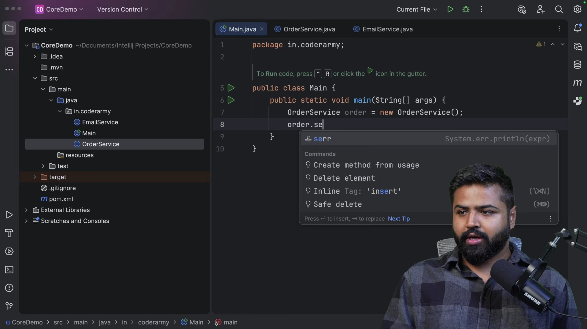

```java
// Lớp dịch vụ gửi thông báo qua Email
public class EmailService {
    public void sendEmail(String message) {
        System.out.println("Email notification sent: " + message);
    }
}

// Lớp xử lý đơn hàng với thiết kế Tight Coupling
public class OrderService {
    private EmailService emailService;

    public OrderService() {
        // Tự khởi tạo trực tiếp phụ thuộc bằng toán tử new
        this.emailService = new EmailService();
    }

    public void placeOrder() {
        System.out.println("Order placed successfully.");
        emailService.sendEmail("Your order has been placed.");
    }
}
```

* **Phân tích thiết kế:**
  * Trong hàm khởi tạo của `OrderService`, câu lệnh `this.emailService = new EmailService();` liên kết cứng hai lớp lại với nhau.
  * `OrderService` không chỉ biết nhiệm vụ gửi thông báo, mà nó còn nắm quyền sinh sát vòng đời của đối tượng `EmailService`.
  * Nếu không có đối tượng `EmailService`, `OrderService` hoàn toàn không thể khởi tạo hoặc vận hành được.

---

### [[00:08:30](https://www.youtube.com/watch?v=dT10m_5POfs&t=510s)] Bế tắc thay đổi nghiệp vụ

Giảng viên đưa ra tình huống thực tế: Doanh nghiệp quyết định ngừng gửi thông báo qua Email để chuyển sang gửi tin nhắn qua điện thoại bằng dịch vụ `SmsService`.

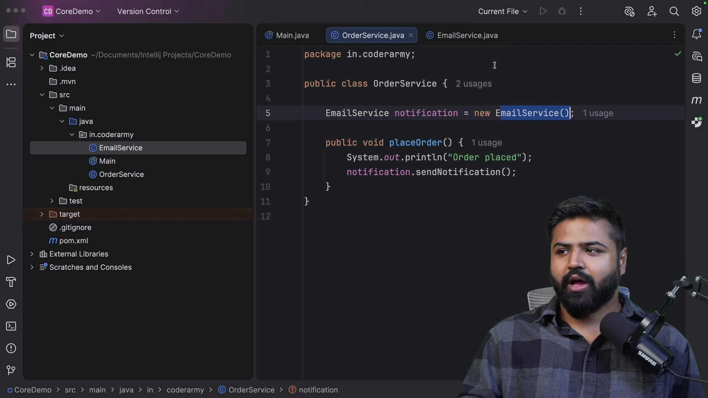

```java
// Lớp dịch vụ mới phát sinh theo yêu cầu nghiệp vụ
public class SmsService {
    public void sendSms(String message) {
        System.out.println("SMS notification sent: " + message);
    }
}
```

* **Nút thắt kỹ thuật phát sinh:**
  1. Lập trình viên bắt buộc phải mở tệp mã nguồn `OrderService.java` ra để chỉnh sửa.
  2. Phải xóa biến `private EmailService emailService` và thay bằng `private SmsService smsService`.
  3. Phải sửa lời gọi phương thức từ `emailService.sendEmail()` thành `smsService.sendSms()`.
* **Hậu quả kiến trúc:**
  * Vi phạm nguyên lý Open-Closed Principle: Mã nguồn cũ đang chạy tốt bị sửa đổi, tiềm ẩn nguy cơ gây lỗi hồi quy.
  * Nếu ngày mai doanh nghiệp muốn hỗ trợ thêm WhatsApp hoặc thông báo đẩy trên ứng dụng di động, quy trình sửa đổi đau đớn này lại lặp lại một lần nữa.

---

### [[00:11:15](https://www.youtube.com/watch?v=dT10m_5POfs&t=675s)] Trừu tượng hóa qua Interface

Để giải quyết vấn đề tên phương thức không đồng nhất (`sendEmail` vs `sendSms`), giải pháp kỹ thuật đầu tiên là đưa vào một giao diện trừu tượng chung: Interface.

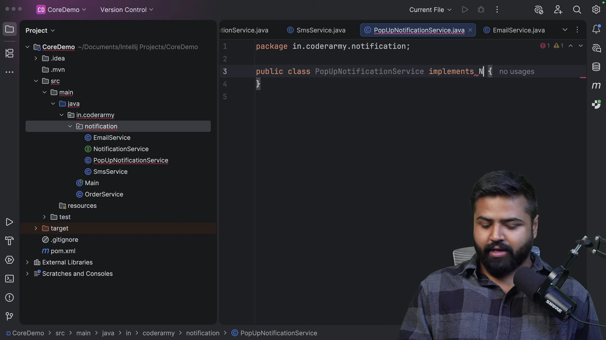

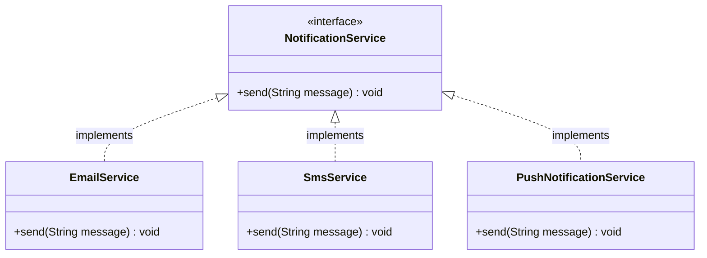

* **Xây dựng hợp đồng Interface:**
  * Tạo giao diện `NotificationService` định nghĩa phương thức chuẩn mực: `void send(String message);`.
  * Cả `EmailService` và `SmsService` đều triển khai giao diện này và ghi đè phương thức `send()`.
* **Lợi ích của đa hình:** Giờ đây, từ góc độ của người nhận thông báo, hệ thống chỉ quan tâm đến hành vi `send()`, không cần bận tâm chi tiết bên trong được gửi qua giao thức SMTP hay mạng viễn thông.

---

### [[00:14:45](https://www.youtube.com/watch?v=dT10m_5POfs&t=885s)] Giới hạn khởi tạo nội bộ

Sau khi có Interface `NotificationService`, giảng viên cập nhật thuộc tính trong `OrderService` nhưng cố tình giữ lại toán tử `new` bên trong hàm khởi tạo để chỉ ra điểm yếu chí mạng.

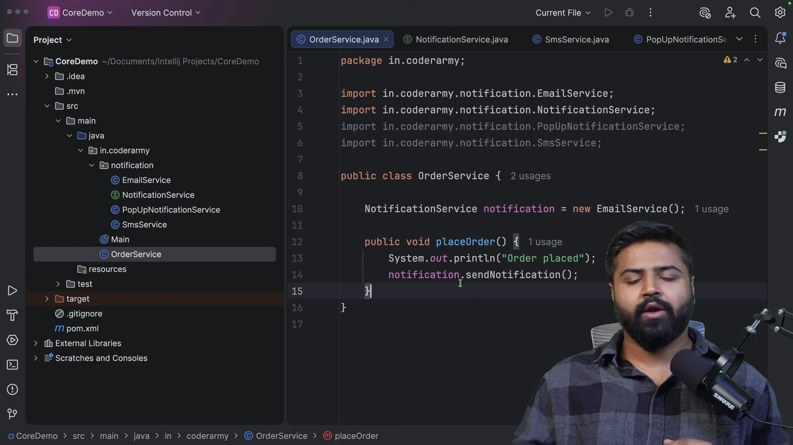

```java
// Phiên bản dùng Interface nhưng VẪN KẾT DÍNH CHẶT
public class OrderService {
    private NotificationService notificationService;

    public OrderService() {
        // Vẫn tự quyết định tạo lớp triển khai cụ thể!
        this.notificationService = new EmailService();
    }

    public void placeOrder() {
        System.out.println("Order placed successfully.");
        notificationService.send("Your order has been placed.");
    }
}
```

* **Phân tích giới hạn:**
  * Dù biến tham chiếu là kiểu Interface `NotificationService`, nhưng vế phải của phép gán vẫn là `new EmailService()`.
  * `OrderService` vẫn biết đích danh sự tồn tại của lớp `EmailService`.
  * Khi muốn chuyển sang `SmsService`, lập trình viên vẫn buộc phải mở tệp `OrderService.java` để sửa dòng lệnh thành `new SmsService()`.
* **Kết luận:** Sử dụng Interface chỉ mới giải quyết được tính nhất quán về hành vi, chưa hề giải quyết được bài toán kết dính chặt nếu quyền tạo đối tượng vẫn nằm bên trong lớp.

---

### [[00:18:30](https://www.youtube.com/watch?v=dT10m_5POfs&t=1110s)] Kỹ thuật Constructor Injection

Giảng viên thực hiện bước đột phá quyết định: Xóa bỏ hoàn toàn toán tử `new` ra khỏi lớp `OrderService` và đưa phụ thuộc vào thông qua hàm khởi tạo Constructor.

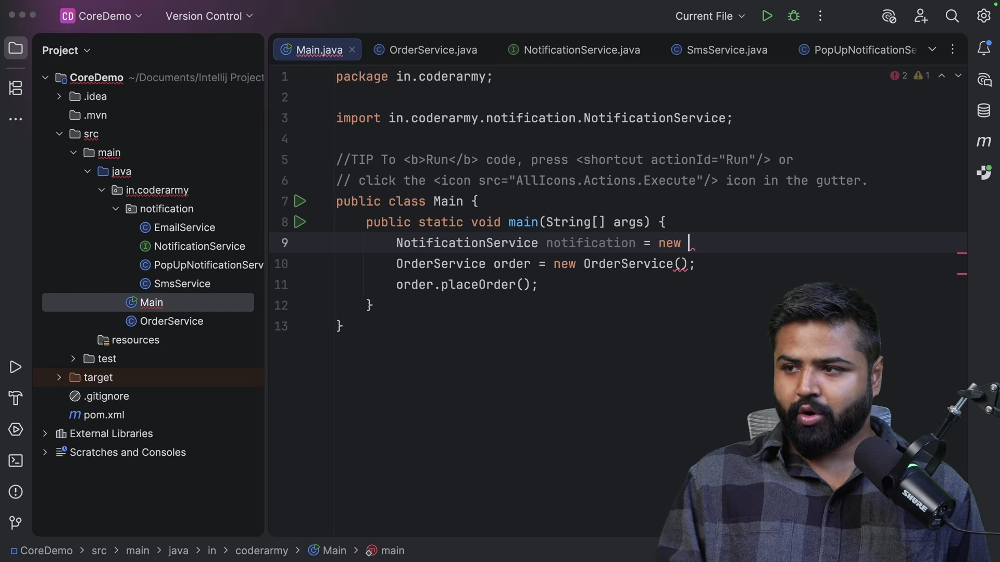

```java
// Hiện thực hóa chuẩn mực của Loose Coupling với Constructor Injection
public class OrderService {
    private final NotificationService notificationService;

    // Phụ thuộc được tiêm từ môi trường bên ngoài vào
    public OrderService(NotificationService notificationService) {
        this.notificationService = notificationService;
    }

    public void placeOrder() {
        System.out.println("Order placed successfully.");
        notificationService.send("Your order has been placed.");
    }
}
```

```java
// Lớp Main đóng vai trò người lắp ráp các thành phần
public class Main {
    public static void main(String[] args) {
        // 1. Tạo phụ thuộc ở bên ngoài
        NotificationService emailService = new EmailService();

        // 2. Tiêm phụ thuộc vào lớp tiêu thụ
        OrderService orderService = new OrderService(emailService);

        // 3. Thực thi nghiệp vụ
        orderService.placeOrder();
    }
}
```

* **Bản chất của Constructor Injection:**
  * `OrderService` hoàn toàn không biết và không quan tâm đối tượng `NotificationService` được tạo ra ở đâu, khi nào và như thế nào.
  * Nó chỉ đưa ra một yêu cầu bắt buộc: "Nếu muốn tạo `OrderService`, bạn phải cung cấp cho tôi một đối tượng tuân thủ hợp đồng `NotificationService`".
  * Quyền quyết định loại thông báo nào được dùng đã được đẩy hoàn toàn ra lớp `Main`.

---

### [[00:21:40](https://www.youtube.com/watch?v=dT10m_5POfs&t=1300s)] Hoán đổi phụ thuộc linh hoạt

Để chứng minh sức mạnh của Loose Coupling, giảng viên thực hiện chuyển đổi toàn bộ cơ chế thông báo từ Email sang SMS mà không cần chạm vào một ký tự nào trong `OrderService.java`.

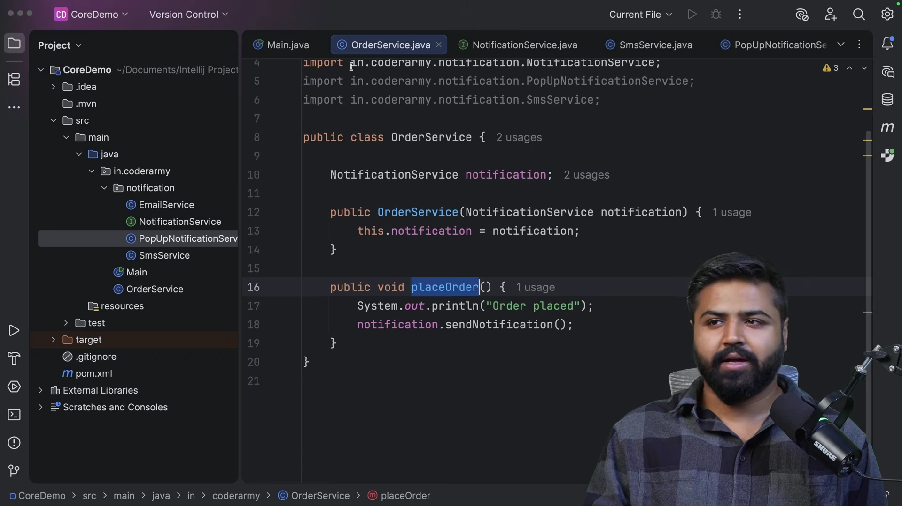

```java
public class Main {
    public static void main(String[] args) {
        // Chuyển đổi sang SMS chỉ bằng cách thay đổi đối tượng tại lớp Main
        NotificationService smsService = new SmsService();
        OrderService orderService = new OrderService(smsService);
        orderService.placeOrder();

        // Hoặc hỗ trợ thêm dịch vụ Pop-up mà không ảnh hưởng OrderService
        NotificationService popUpService = new PopUpNotificationService();
        OrderService mobileOrderService = new OrderService(popUpService);
        mobileOrderService.placeOrder();
    }
}
```

* **Lợi ích đạt được:**
  * Lớp `OrderService` đã đạt trạng thái bất biến đối với sự thay đổi của các phụ thuộc thông báo.
  * Tuân thủ hoàn hảo nguyên lý Open-Closed Principle: Khi có dịch vụ thông báo mới, kỹ sư chỉ việc viết thêm lớp mới triển khai `NotificationService` và truyền vào tại điểm lắp ráp.
  * Tách biệt hoàn toàn logic nghiệp vụ cốt lõi (xử lý đơn hàng) khỏi các chi tiết hạ tầng (kênh gửi thông báo).

---

### [[00:25:10](https://www.youtube.com/watch?v=dT10m_5POfs&t=1510s)] Đột phá kiểm thử Mocking

Giảng viên chỉ ra giá trị thực sự lớn nhất của Dependency Injection trong môi trường doanh nghiệp: Khả năng viết kiểm thử đơn vị độc lập và đáng tin cậy.

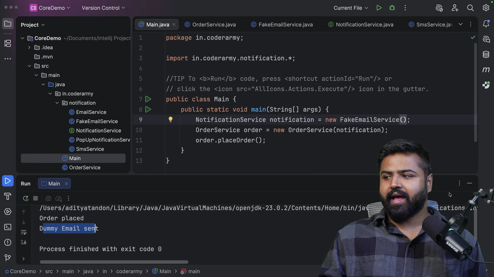

```java
// Lớp triển khai giả lập dùng riêng cho môi trường kiểm thử
public class FakeEmailService implements NotificationService {
    @Override
    public void send(String message) {
        // Không gửi email qua mạng Internet thật, chỉ in thông báo giả lập
        System.out.println("Dummy email call for testing purpose: " + message);
    }
}

// Lớp kiểm thử đơn vị
public class OrderServiceTest {
    public static void main(String[] args) {
        // Tiêm đối tượng giả lập vào OrderService
        NotificationService fakeService = new FakeEmailService();
        OrderService orderService = new OrderService(fakeService);

        // Kiểm thử logic đặt hàng mà không tốn chi phí cước viễn thông hay gửi email rác
        orderService.placeOrder();
    }
}
```

* **Vấn đề khi không có DI:**
  * Nếu `OrderService` tự tạo `new EmailService()`, mỗi lần chạy bài kiểm thử đơn vị, hệ thống sẽ thực sự gọi ra máy chủ SMTP để gửi email thật qua mạng.
  * Nếu mạng bị ngắt hoặc dịch vụ email của bên thứ ba bị sập, bài kiểm thử sẽ báo lỗi dù logic xử lý đơn hàng của bạn hoàn toàn chính xác.
* **Sức mạnh khi có DI:** Lập trình viên có thể tiêm một đối tượng giả lập Mock hoặc Fake vào để kiểm tra riêng rẽ từng nhánh logic của `OrderService` với tốc độ tức thì và độ ổn định 100%.

---

### [[00:29:30](https://www.youtube.com/watch?v=dT10m_5POfs&t=1770s)] Kỹ thuật Setter Injection

Bên cạnh Constructor Injection, giảng viên giới thiệu cơ chế tiêm phụ thuộc thứ hai thông qua phương thức thiết lập: Setter Injection.

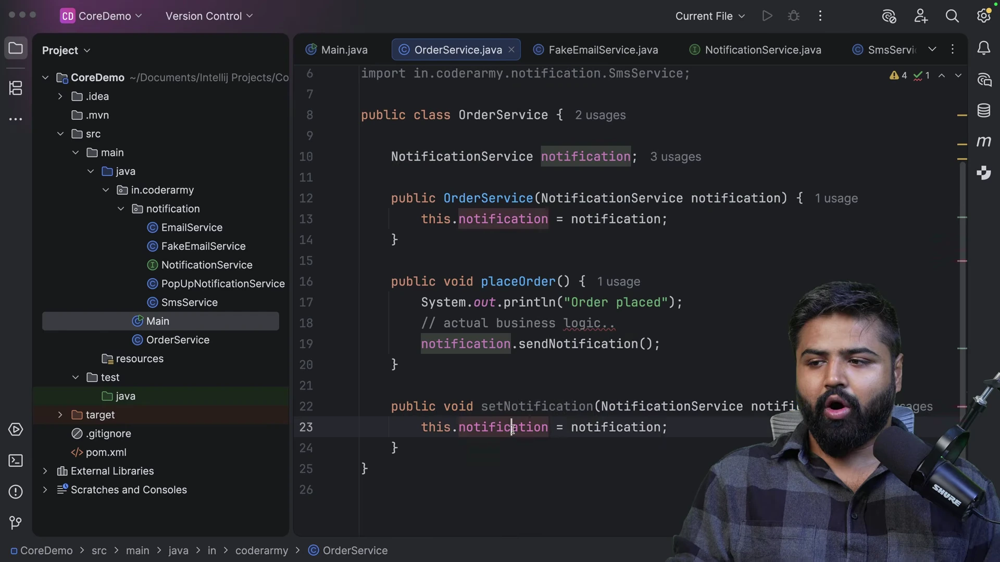

```java
public class OrderService {
    private NotificationService notificationService;

    // Constructor mặc định không tham số
    public OrderService() {}

    // Tiêm phụ thuộc thông qua Setter
    public void setNotificationService(NotificationService notificationService) {
        this.notificationService = notificationService;
    }

    public void placeOrder() {
        if (notificationService != null) {
            notificationService.send("Order placed successfully.");
        }
    }
}
```

```java
public class Main {
    public static void main(String[] args) {
        OrderService orderService = new OrderService();
        
        // Tiêm hoặc thay đổi phụ thuộc linh hoạt tại bất kỳ thời điểm nào
        orderService.setNotificationService(new EmailService());
        orderService.placeOrder();

        // Hoán đổi sang SMS tại thời điểm chạy
        orderService.setNotificationService(new SmsService());
        orderService.placeOrder();
    }
}
```

* **So sánh hai kỹ thuật tiêm:**
  * **Constructor Injection:** Dành cho các phụ thuộc thiết yếu, bắt buộc phải có để đối tượng tồn tại; giúp trường dữ liệu được khai báo `final` bất biến và an toàn tuyệt đối trước đa luồng.
  * **Setter Injection:** Dành cho các phụ thuộc tùy chọn hoặc các phụ thuộc cần thay đổi linh hoạt trong suốt vòng đời của đối tượng.

---

### [[00:33:30](https://www.youtube.com/watch?v=dT10m_5POfs&t=2010s)] Đảo ngược quyền kiểm soát

Giảng viên vẽ sơ đồ trực quan trên bảng trắng để phân tích bản chất triết học của Inversion of Control và lý do tại sao nó được gọi là "Sự đảo ngược".

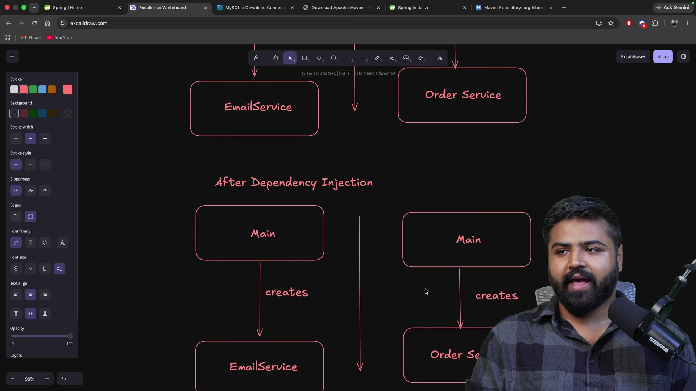

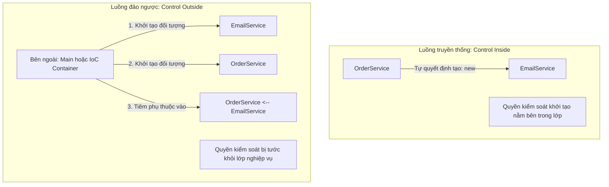

* **Luồng truyền thống Control Inside:**
  * `OrderService` là chủ nhân tự quyết định tạo `EmailService`.
  * Quyền kiểm soát khởi tạo đối tượng phụ thuộc nằm bên trong bản thân `OrderService`.
* **Luồng đảo ngược Control Outside:**
  * Quyền kiểm soát tạo đối tượng bị tước khỏi `OrderService`.
  * Môi trường bên ngoài (lớp `Main` hoặc Container) tạo đối tượng `EmailService` trước, sau đó tiêm vào `OrderService`.
  * Hướng kiểm soát đã bị đảo ngược 180 độ từ trong ra ngoài.

---

### [[00:35:15](https://www.youtube.com/watch?v=dT10m_5POfs&t=2115s)] Tương quan IoC và DI

Rất nhiều kỹ sư phần mềm thường nhầm lẫn hoặc đồng nhất hai thuật ngữ này. Giảng viên làm rõ ranh giới kỹ thuật chính xác giữa IoC và DI.

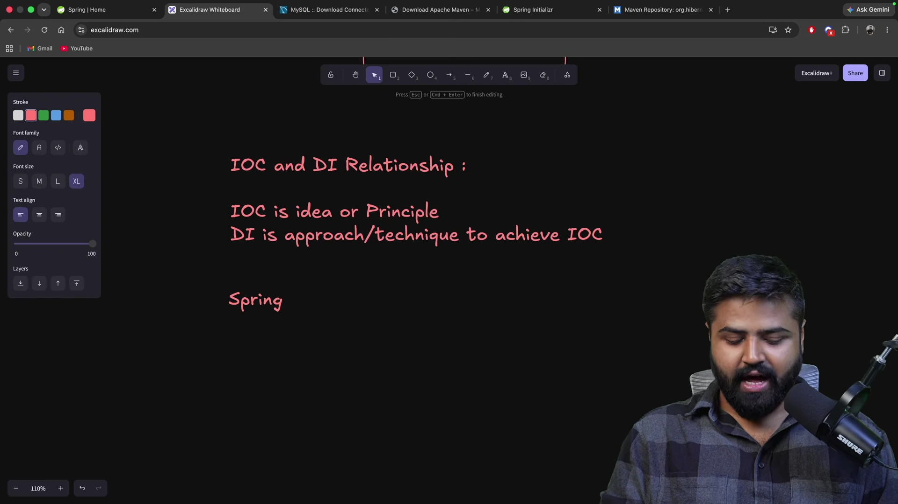

```
        ┌───────────────────────────────────────────────┐
        │        INVERSION OF CONTROL (IoC)             │
        │          (Nguyên lý kiến trúc cốt lõi)        │
        └───────────────────────┬───────────────────────┘
                                │
          Được hiện thực hóa bởi các kỹ thuật cụ thể:
                                │
        ┌───────────────────────┴───────────────────────┐
        │                                               │
 ┌──────▼──────────────┐                      ┌─────────▼─────────────┐
 │ DEPENDENCY          │                      │ SỰ KIỆN / CALLBACK   │
 │ INJECTION (DI)      │                      │ (Event-Driven / Hooks)│
 └─────────────────────┘                      └───────────────────────┘
```

* **IoC là Nguyên lý:**
  * Là một triết lý thiết kế tổng quát nói rằng: Hãy chuyển giao quyền điều khiển luồng thực thi và khởi tạo đối tượng cho một bộ khung khác.
* **DI là Mẫu thiết kế cụ thể:**
  * Là một phương thức hiện thực cụ thể để đạt được IoC, trong đó phụ thuộc được cung cấp từ bên ngoài thông qua Constructor, Setter hoặc Interface.
* **Nói một cách ngắn gọn:** Inversion of Control là mục tiêu cần đạt tới, còn Dependency Injection là con đường kỹ thuật để đi đến mục tiêu đó.

---

### [[00:37:45](https://www.youtube.com/watch?v=dT10m_5POfs&t=2265s)] Sứ mệnh Spring Container

Bài giảng kết thúc bằng việc mở ra bức tranh toàn cảnh: Điều gì sẽ xảy ra khi dự án có 100 lớp phụ thuộc lẫn nhau? Ai sẽ là người thay thế lớp `Main` để thực hiện công việc nối dây thủ công đó?

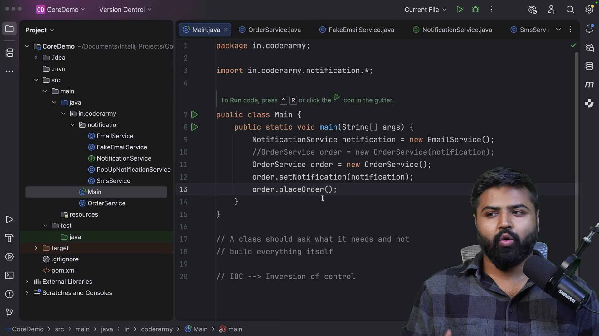

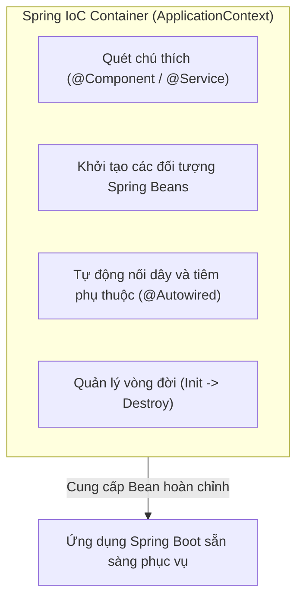

* **Khủng hoảng nối dây thủ công trong phương thức Main:**
  * Nếu dự án có hàng chục lớp nghiệp vụ (`OrderService`, `PaymentService`, `UserService`, `InventoryService`), phương thức `main` sẽ phình to ra với hàng trăm dòng mã khởi tạo và tiêm thủ công.
  * Việc quản lý thứ tự khởi tạo nào trước, đối tượng nào dùng chung (Singleton) sẽ trở thành cơn ác mộng.
* **Sứ mệnh của Spring IoC Container:**
  * Spring IoC Container ra đời để đóng vai trò "Người quản lý vĩ đại" thay thế toàn bộ công việc thủ công của lớp `Main`.
  * **Khái niệm Spring Bean:** Mọi đối tượng Java được vùng chứa Spring quản lý, khởi tạo và tiêm phụ thuộc đều được gọi là một Spring Bean.
  * Container tự động quét các lớp, phân tích cây phụ thuộc, khởi tạo các Bean theo đúng thứ tự và tự động tiêm chúng vào nhau một cách hoàn toàn tự động, mở đường cho Bài 05 về `@Component` và `@Autowired`.

---

## Trích dẫn then chốt

* *"Bất cứ khi nào bạn dùng toán tử new bên trong một lớp để tạo một dịch vụ khác, bạn đang tự tay trói chặt số phận của hai lớp đó lại với nhau."* — [[00:07:35](https://www.youtube.com/watch?v=dT10m_5POfs&t=455s)]
* *"Chỉ tạo Interface thôi là chưa đủ; nếu lớp của bạn vẫn tự mình gọi new thì sự kết dính chặt vẫn tồn tại nguyên vẹn dưới một hình thức khác."* — [[00:15:10](https://www.youtube.com/watch?v=dT10m_5POfs&t=910s)]
* *"Đừng bao giờ tự tạo phụ thuộc cho mình; nếu lớp của bạn cần một thứ gì đó, hãy học cách yêu cầu môi trường bên ngoài cung cấp nó."* — [[00:27:45](https://www.youtube.com/watch?v=dT10m_5POfs&t=1665s)]
* *"Dependency Injection không phải là một phát minh độc quyền của Spring; nó là một nguyên lý thiết kế của ngôn ngữ Java thuần túy mà bạn có thể áp dụng ở mọi nơi."* — [[00:36:20](https://www.youtube.com/watch?v=dT10m_5POfs&t=2180s)]
* *"Mọi Spring Bean đều là một đối tượng Java, nhưng không phải mọi đối tượng Java đều là Spring Bean; chỉ những đối tượng nào được IoC Container quản lý vòng đời mới được trao danh hiệu Bean."* — [[00:38:25](https://www.youtube.com/watch?v=dT10m_5POfs&t=2305s)]

---

## Lệnh & Công cụ

#### Cú pháp tiêm phụ thuộc chuẩn mực trong Java
```java
// 1. Khai báo giao diện trừu tượng
public interface NotificationService {
    void send(String message);
}

// 2. Hiện thực hóa cụ thể 1: Email
public class EmailService implements NotificationService {
    @Override
    public void send(String message) {
        System.out.println("Email: " + message);
    }
}

// 3. Hiện thực hóa cụ thể 2: SMS
public class SmsService implements NotificationService {
    @Override
    public void send(String message) {
        System.out.println("SMS: " + message);
    }
}

// 4. Lớp nghiệp vụ sử dụng Constructor Injection
public class OrderService {
    private final NotificationService notificationService;

    // Tiêm phụ thuộc bắt buộc qua hàm khởi tạo
    public OrderService(NotificationService notificationService) {
        this.notificationService = notificationService;
    }

    public void placeOrder() {
        notificationService.send("Đơn hàng đã được xác nhận.");
    }
}
```

#### Công cụ và thành phần cốt lõi
* **IntelliJ IDEA:** IDE hỗ trợ tái cấu trúc mã nguồn, trích xuất Interface tự động (`Refactor -> Extract -> Interface`).
* **Java Reflection API:** Cơ chế nội tại được Spring sử dụng để can thiệp và tiêm các phụ thuộc vào thuộc tính mà không cần gọi Setter công khai.
* **Spring IoC Container:** Giao diện `org.springframework.context.ApplicationContext` và `org.springframework.beans.factory.BeanFactory`.

---

## Đánh đổi & Rủi ro

| Lựa chọn kỹ thuật | Đánh đổi & Rủi ro tiềm ẩn | Biện pháp giảm thiểu |
| :--- | :--- | :--- |
| **Khởi tạo tự do vs Dependency Injection** | Khởi tạo bằng `new` nhanh gọn cho các lớp tiện ích nhỏ nhưng làm tăng kết dính, không thể viết Unit Test độc lập và khó mở rộng; DI đòi hỏi tạo thêm Interface và thiết lập cơ chế truyền tham số nhưng mang lại kiến trúc lỏng hoàn hảo. | Luôn áp dụng DI cho toàn bộ các lớp dịch vụ nghiệp vụ Service, truy xuất dữ liệu Repository và điều khiển Controller; chỉ dùng `new` cho các đối tượng dữ liệu thuần túy (DTO, Entity, POJO). |
| **Constructor Injection vs Setter Injection** | Constructor Injection đảm bảo đối tượng luôn toàn vẹn và bất biến `final` nhưng có thể khiến hàm khởi tạo quá dài nếu có quá nhiều phụ thuộc; Setter Injection linh hoạt nhưng đối tượng có thể ở trạng thái nửa vời nếu quên gọi Setter trước khi sử dụng. | Mặc định sử dụng Constructor Injection cho 100% các phụ thuộc bắt buộc; nếu một lớp có quá 4-5 phụ thuộc, đó là dấu hiệu vi phạm Single Responsibility Principle và cần được phân rã thành các lớp nhỏ hơn. |
| **Field Injection với `@Autowired`** | Viết mã cực kỳ ngắn gọn nhưng che giấu các phụ thuộc của lớp, không thể truyền phụ thuộc giả lập khi viết kiểm thử đơn vị thuần túy mà không nạp Spring Context nặng nề. | Tránh hoàn toàn Field Injection trong các dự án hiện đại; sử dụng Constructor Injection kết hợp Lombok (`@RequiredArgsConstructor`) để đạt được cả sự ngắn gọn lẫn tính trong sáng kiến trúc. |
| **Tự nối dây thủ công vs Dùng Spring Container** | Tự nối dây trong `main` giúp kiểm soát tường minh từng dòng lệnh nhưng biến mã khởi động thành thảm họa khi hệ thống có hàng trăm lớp; Spring Container tự động hóa hoàn toàn nhưng đòi hỏi chi phí quét Bean tại thời điểm khởi động và tạo cảm giác hộp đen cho người mới học. | Sử dụng Spring IoC Container cho các ứng dụng thực tế; nắm vững nguyên lý hoạt động nội tại của Spring Core để dễ dàng bắt lỗi và cấu hình chính xác các Bean. |
