# Giải chi tiết đề thi TOEIC mới nhất | Anhle TOEIC

* **Kênh:** Anh Le TOEIC | **Thời lượng:** 02:14:40 | **Ngày:** 2026-09-15
* **Video:** https://youtu.be/6QfRZTEK22c

---

## Thuật ngữ

| Thuật ngữ | Tiếng Anh | Giải thích |
| :--- | :--- | :--- |
| Từ loại | Part of Speech | Dạng biến thể của từ (danh từ, động từ, tính từ, trạng từ) nhận diện qua các hậu tố. |
| Đại từ phản thân | Reflexive Pronoun | Đại từ dạng -self / -selves dùng làm tân ngữ hoặc đứng liền sau chủ ngữ để nhấn mạnh chủ thể hành động. |
| Động từ khiếm khuyết | Modal Verb | Nhóm trợ động từ can, could, should, must, may, might; luôn đi kèm động từ nguyên mẫu không chia. |
| Mệnh đề thời gian | Adverbial Clause of Time | Mệnh đề bắt đầu bằng when, before, after, until; chia thì hiện tại đơn khi mệnh đề chính ở tương lai. |
| Rút gọn mệnh đề quan hệ | Reduced Relative Clause | Lược bỏ đại từ quan hệ và to be; động từ chủ động thành V-ing, bị động thành V3/V-ed. |
| Cụm động từ | Phrasal Verb | Động từ kết hợp giới từ (put off, carry out, turn down), mang ngữ nghĩa độc lập. |
| Danh từ ghép | Compound Noun | Hai danh từ ghép lại tạo nên khái niệm nghề nghiệp/kinh doanh mới (employee productivity). |
| Lượng từ | Quantifier | Từ chỉ số lượng (another, other, few, little) với quy tắc ràng buộc loại danh từ chặt chẽ. |
| Tính từ hai mặt | Participial Adjective | Tính từ dạng V-ing (chủ động, bản chất gây tác động) và V-ed (bị động, cảm xúc tiếp nhận). |
| Rút gọn đồng chủ ngữ | Reduced Adverbial Clause | Khi hai vế cùng chủ ngữ, lược bỏ chủ ngữ mệnh đề phụ sau liên từ và đưa động từ về dạng V-ing. |

---

## Tổng luận chuyên đề

Tầng 1 tổng hợp 30 câu hỏi TOEIC Reading Part 5 trong đề thi thành 4 trụ cột chiến lược và quy tắc cốt lõi:

### Nhận diện dạng bài qua phương án

1. **Bốn phương án cùng gốc từ (khác hậu tố):** Dạng bài biến thể từ loại (Word Form). Phân tích cấu trúc vị trí đứng trước và đứng sau khoảng trống để xác định từ loại cần điền, không cần dịch nghĩa toàn bộ câu.
2. **Bốn phương án cùng là đại từ:** Dạng bài đại từ nhân xưng / đại từ phản thân. Xem xét vai trò ngữ pháp: làm chủ ngữ, làm tân ngữ sau ngoại động từ/giới từ, hay đứng giữa chủ ngữ và vị ngữ để nhấn mạnh chính chủ thể thực hiện hành động.
3. **Bốn phương án khác biệt hoàn toàn:** Dạng bài từ vựng hoặc cụm từ cố định (Collocation). Bắt buộc dịch nghĩa theo bối cảnh kinh doanh, thương mại, hợp đồng.
4. **Bốn phương án là liên từ / giới từ:** Xét thành phần phía sau chỗ trống là mệnh đề hoàn chỉnh (S + V) hay cụm danh từ (Noun Phrase) / V-ing.

### Quy tắc chia động từ và thì

- **Hòa hợp thì trong mệnh đề thời gian:**
  $$\text{Mệnh đề chính (Will + V-bare)} \longleftrightarrow \text{Liên từ thời gian (When/Before/After/Until)} + \text{Mệnh đề phụ (Hiện tại đơn: V1/V-s/es)}$$
  Tuyệt đối không dùng thì tương lai với `will` bên trong mệnh đề chỉ thời gian.
- **Rút gọn mệnh đề quan hệ:**
  - Chủ động: $\text{Who / Which} + V \longrightarrow V\text{-ing}$
  - Bị động: $\text{Who / Which} + be + V_3/V\text{-ed} \longrightarrow V_3/V\text{-ed}$
- **Rút gọn đồng chủ ngữ:** Sau các liên từ thời gian như *before, after, when, while*, nếu không có chủ ngữ mới, động từ rút gọn trực tiếp thành $V\text{-ing}$.

### Bẫy từ vựng và ngữ pháp thường gặp

- **Tính từ tận cùng bằng đuôi -ly:** Không phải mọi từ tận cùng bằng *-ly* đều là trạng từ. Các danh từ kết hợp đuôi *-ly* biến thành tính từ: *costly* (đắt đỏ), *friendly* (thân thiện), *timely* (kịp thời).
- **Cặp tính từ dễ nhầm lẫn:**
  - *Comprehensive* (toàn diện, bao quát mọi chi tiết) vs. *Comprehensible* (dễ hiểu).
  - *Successful* (thành công) vs. *Successive* (liên tiếp, liên tục qua các năm).
- **Cặp liên từ tương quan mở rộng:** Bên cạnh *either... or*, *neither... nor*, cấu trúc *whether... or* mang nghĩa "dù là... hay là..." được áp dụng trong tình huống quy định bắt buộc phải thi hành.
- **Quy tắc lượng từ:** *Another* đi với danh từ số ít đếm được; *other* đi với danh từ số nhiều hoặc không đếm được; *the others* đóng vai trò đại từ độc lập (không đi kèm danh từ trực tiếp phía sau).

---

## Bóc tách chi tiết


### [[00:00:35](https://youtu.be/6QfRZTEK22c?t=35s)] Câu 101: Biến thể từ loại

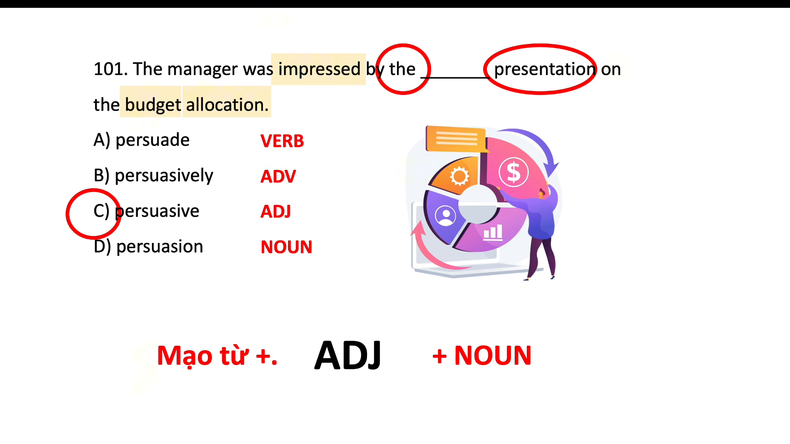

- **Đề bài:** Ms. Gomez gave a very _______ presentation on the quarterly marketing campaign that impressed the executive board.
  - (A) persuade
  - (B) persuasively
  - (C) persuasive
  - (D) persuasion
- **Phân tích phương án:**
  - (A) *persuade* (Động từ nguyên mẫu): thuyết phục -> Loại vì không thể đứng bổ nghĩa cho danh từ.
  - (B) *persuasively* (Trạng từ đuôi -ly) -> Loại vì trạng từ không đứng trực tiếp bổ nghĩa cho danh từ phía sau.
  - (C) *persuasive* (Tính từ đuôi -ive) -> Phù hợp ngữ pháp.
  - (D) *persuasion* (Danh từ đuôi -ion) -> Loại vì không tạo thành cụm danh từ ghép hợp nghĩa.
- **Bản chất ngữ pháp:** Khoảng trống nằm giữa trạng từ chỉ mức độ very và danh từ presentation. Quy tắc cấu trúc cụm danh từ: Mạo từ + Adv + Adj + Noun. Vị trí này bắt buộc phải là một tính từ mang nghĩa chủ động bổ nghĩa cho tính chất của bài thuyết trình.
- **Đáp án đúng:** **(C) persuasive** (đầy sức thuyết phục).
- **Mở rộng kiến thức:**
  - *persuasive presentation:* bài thuyết trình có sức thuyết phục cao.
  - *impress the executive board:* gây ấn tượng với ban điều hành/ban giám đốc.

---

### [[00:05:49](https://youtu.be/6QfRZTEK22c?t=349s)] Câu 102: Đại từ phản thân

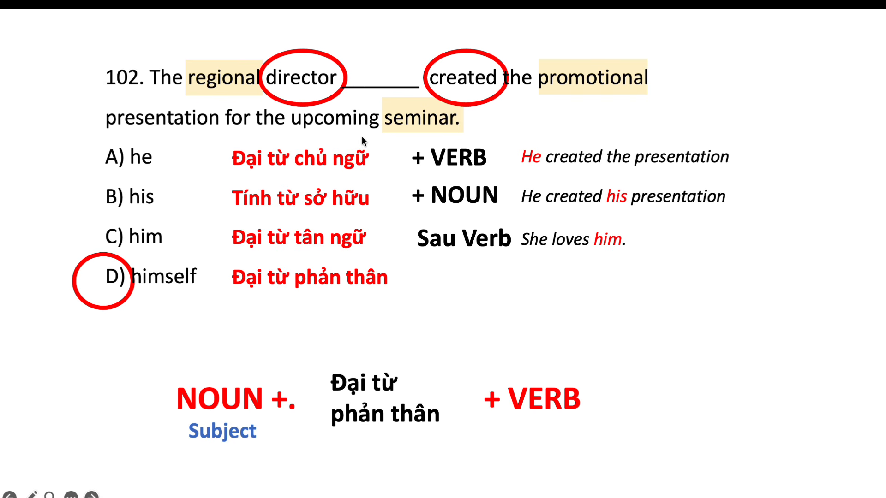

- **Đề bài:** The regional director _______ created the training materials for the upcoming sales workshop.
  - (A) he
  - (B) his
  - (C) him
  - (D) himself
- **Phân tích phương án:**
  - (A) *he* (Đại từ chủ ngữ) -> Loại vì câu đã có chủ ngữ The regional director, không dùng hai chủ ngữ đứng liền kề.
  - (B) *his* (Tính từ sở hữu) -> Loại vì phía sau là động từ created, không có danh từ theo sau.
  - (C) *him* (Đại từ tân ngữ) -> Loại vì tân ngữ chỉ đứng sau ngoại động từ hoặc giới từ.
  - (D) *himself* (Đại từ phản thân) -> Phù hợp quy tắc ngữ pháp.
- **Bản chất ngữ pháp:** Khi khoảng trống nằm xen giữa Chủ ngữ (The regional director) và Động từ chính (created), ta sử dụng đại từ phản thân để nhấn mạnh chính chủ thể đã đích thân thực hiện hành động ("đích thân giám đốc khu vực đã tạo ra tài liệu").
- **Đáp án đúng:** **(D) himself**.
- **Mở rộng kiến thức:**
  - *regional director:* giám đốc khu vực.
  - *upcoming sales workshop:* buổi hội thảo bán hàng sắp diễn ra.

---

### [[00:12:05](https://youtu.be/6QfRZTEK22c?t=725s)] Câu 103: Chia thì quá khứ

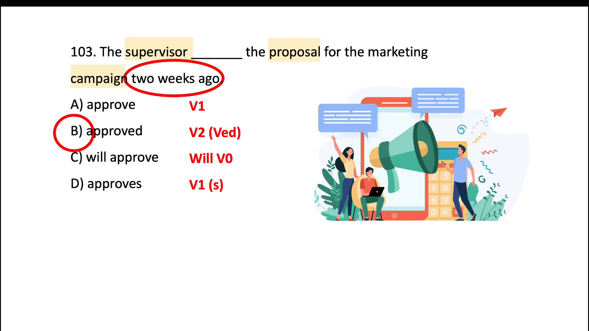

- **Đề bài:** Yesterday, the department supervisor _______ the revised budget proposal for the new advertising campaign.
  - (A) approve
  - (B) approved
  - (C) will approve
  - (D) approves
- **Phân tích phương án:**
  - (A) *approve* (Hiện tại đơn V1) -> Loại vì không phù hợp trạng từ quá khứ.
  - (B) *approved* (Quá khứ đơn V2/V-ed) -> Phù hợp thì của câu.
  - (C) *will approve* (Tương lai đơn) -> Loại vì mâu thuẫn thời gian.
  - (D) *approves* (Hiện tại đơn số ít) -> Loại.
- **Bản chất ngữ pháp:** Trạng từ thời gian đứng đầu câu là Yesterday (ngày hôm qua), xác định hành động đã hoàn tất trong quá khứ. Động từ chính bắt buộc phải chia ở thì Quá khứ đơn (Past Simple).
- **Đáp án đúng:** **(B) approved** (đã phê duyệt).
- **Mở rộng kiến thức:**
  - *department supervisor:* người giám sát / trưởng bộ phận.
  - *budget proposal:* bản đề xuất ngân sách.

---

### [[00:21:08](https://youtu.be/6QfRZTEK22c?t=1268s)] Câu 104: Liên từ tương quan

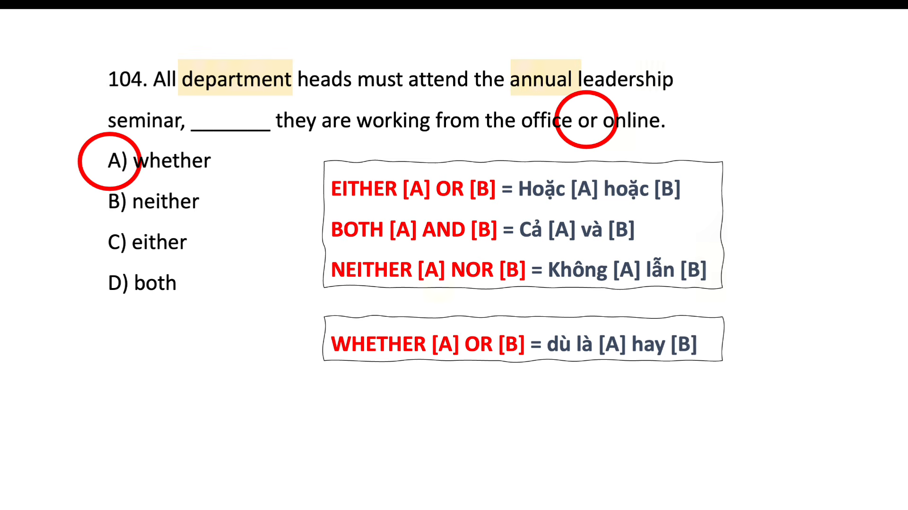

- **Đề bài:** All department heads must attend the annual seminar _______ they work from the main office or remotely.
  - (A) both
  - (B) neither
  - (C) either
  - (D) whether
- **Phân tích phương án:**
  - (A) *both* (đi với and): cả hai -> Loại vì vế sau dùng liên từ or.
  - (B) *neither* (đi với nor): không cái này cũng không cái kia -> Loại.
  - (C) *either* (đi với or): hoặc cái này hoặc cái kia -> Bẫy thường gặp. Nếu chọn either, câu biến thành sự lựa chọn mâu thuẫn với mệnh lệnh bắt buộc ở mệnh đề trước.
  - (D) *whether* (đi với or): dù là... hay là... -> Phù hợp logic nghĩa.
- **Bản chất ngữ pháp:** Cấu trúc whether A or B diễn tả một điều kiện bao quát: "Tất cả trưởng phòng ban bắt buộc phải tham dự hội thảo thường niên, bất kể họ làm việc tại văn phòng chính hay làm việc từ xa".
- **Đáp án đúng:** **(D) whether**.
- **Mở rộng kiến thức:**
  - *department head:* trưởng bộ phận/phòng ban.
  - *work remotely:* làm việc từ xa.
  - *annual seminar:* hội thảo thường niên.

---

### [[00:24:30](https://youtu.be/6QfRZTEK22c?t=1470s)] Câu 105: Giới từ ngữ cảnh

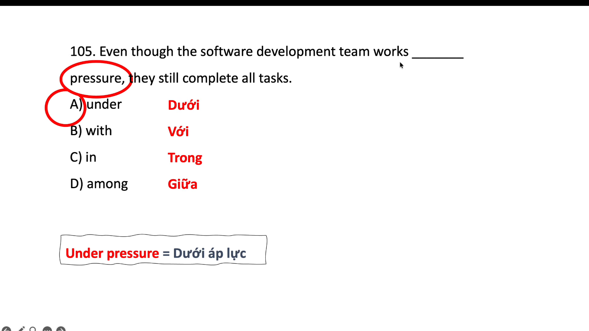

- **Đề bài:** Although the software development team was working _______ tight deadlines and intense pressure, they delivered the project on time.
  - (A) under
  - (B) with
  - (C) in
  - (D) among
- **Phân tích phương án:**
  - (A) *under*: dưới -> Tạo cụm thành ngữ chuẩn: under pressure (chịu áp lực).
  - (B) *with*: với -> Không đi với danh từ áp lực công việc trong ngữ cảnh này.
  - (C) *in*: trong -> Sai giới từ.
  - (D) *among*: giữa nhiều đối tượng -> Chỉ dùng khi đứng trước danh từ đếm được từ 3 đối tượng trở lên.
- **Bản chất ngữ pháp:** Cụm giới từ cố định (Collocation) chỉ trạng thái làm việc: **under pressure** (chịu áp lực) và **under tight deadlines** (dưới áp lực thời gian gấp rút).
- **Đáp án đúng:** **(A) under**.
- **Mở rộng kiến thức:**
  - *tight deadline:* hạn chót gấp rút.
  - *deliver the project on time:* bàn giao dự án đúng hạn.

---

### [[00:30:43](https://youtu.be/6QfRZTEK22c?t=1843s)] Câu 106: Danh động từ

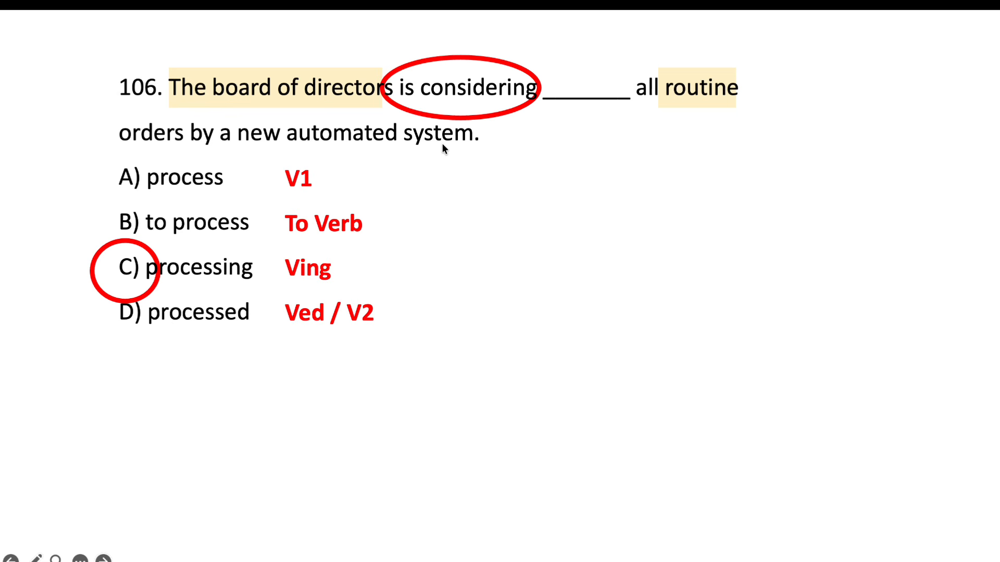

- **Đề bài:** The board of directors discussed several strategies for _______ customer complaints more efficiently.
  - (A) process
  - (B) to process
  - (C) processing
  - (D) processed
- **Phân tích phương án:**
  - (A) *process* (Động từ nguyên mẫu) -> Loại vì sau giới từ không dùng động từ nguyên mẫu.
  - (B) *to process* (To-V) -> Loại vì không đứng sau giới từ for.
  - (C) *processing* (Danh động từ V-ing) -> Phù hợp quy tắc sau giới từ có kéo theo tân ngữ.
  - (D) *processed* (V2/V-ed) -> Loại.
- **Bản chất ngữ pháp:** Sau giới từ (for), nếu có tân ngữ trực tiếp là cụm danh từ (customer complaints), từ cần điền bắt buộc phải là một **Danh động từ (Gerund - V-ing)** để thực hiện hành vi tác động lên tân ngữ đó.
- **Đáp án đúng:** **(C) processing** (việc xử lý).
- **Mở rộng kiến thức:**
  - *board of directors:* hội đồng quản trị.
  - *customer complaints:* các khiếu nại của khách hàng.
  - *efficiently:* một cách hiệu quả, năng suất.

---

### [[00:38:21](https://youtu.be/6QfRZTEK22c?t=2301s)] Câu 107: Từ vựng thương mại

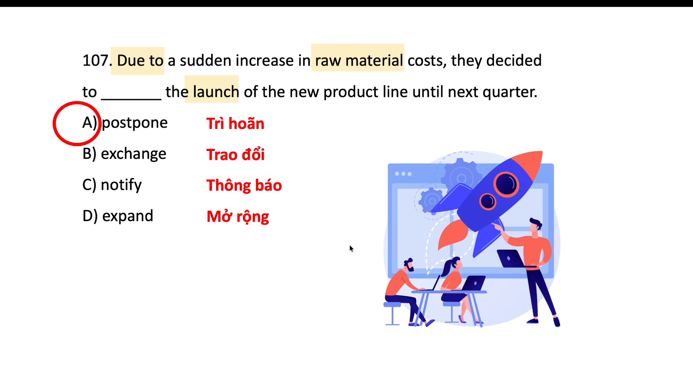

- **Đề bài:** Due to an unexpected increase in the cost of raw materials, the manufacturer had to _______ the launch of its new electronic device.
  - (A) postpone
  - (B) exchange
  - (C) notify
  - (D) expand
- **Phân tích phương án:**
  - (A) *postpone*: trì hoãn, hoãn lại -> Khớp với việc hoãn ra mắt do tăng chi phí.
  - (B) *exchange*: trao đổi, đổi chác -> Không phù hợp ngữ cảnh sự kiện ra mắt.
  - (C) *notify*: thông báo -> Phải có tân ngữ chỉ người nhận thông báo phía sau (*notify somebody of something*).
  - (D) *expand*: mở rộng -> Trái ngược với tình huống gặp khó khăn chi phí.
- **Bản chất ngữ pháp:** Phân tích nguyên nhân - kết quả: Nguyên nhân là giá nguyên liệu thô tăng bất ngờ (unexpected increase in the cost of raw materials), buộc nhà sản xuất phải đưa ra quyết định hoãn việc ra mắt sản phẩm (the launch of its new electronic device).
- **Đáp án đúng:** **(A) postpone** (trì hoãn).
- **Mở rộng kiến thức:**
  - *raw materials:* nguyên liệu thô.
  - *manufacturer:* nhà sản xuất.
  - *postpone the launch:* hoãn buổi ra mắt sản phẩm.

---

### [[00:41:55](https://youtu.be/6QfRZTEK22c?t=2515s)] Câu 108: Hòa hợp chủ vị

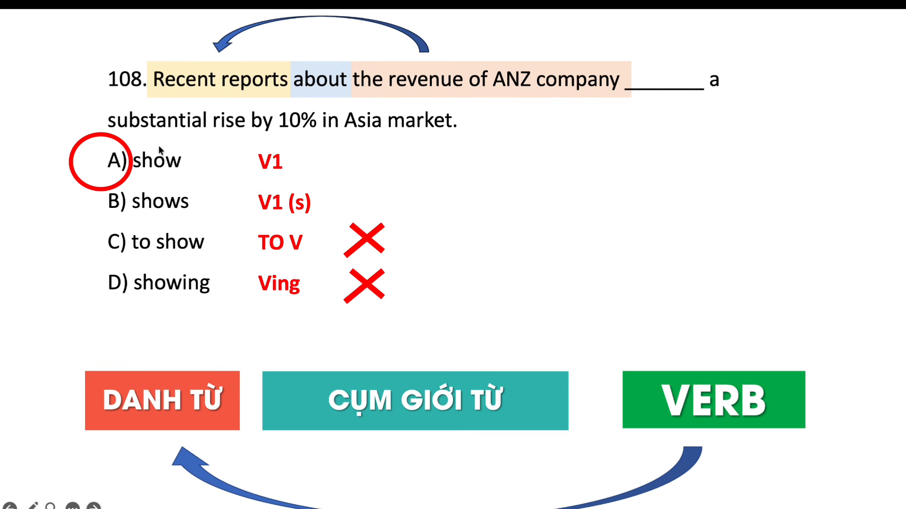

- **Đề bài:** Recent reports on the company's financial performance _______ a significant increase of ten percent in total revenue.
  - (A) show
  - (B) shows
  - (C) to show
  - (D) showing
- **Phân tích phương án:**
  - (A) *show* (Hiện tại đơn số nhiều) -> Phù hợp với chủ ngữ số nhiều.
  - (B) *shows* (Hiện tại đơn số ít) -> Loại vì chủ ngữ có đuôi -s.
  - (C) *to show* (Dạng không chia thì) -> Loại vì câu thiếu động từ vị ngữ chính.
  - (D) *showing* (Dạng phân từ không chia) -> Loại.
- **Bản chất ngữ pháp:** Xác định chủ ngữ chính: Gạch bỏ cụm giới từ xen giữa on the company's financial performance. Chủ ngữ thực sự là danh từ số nhiều **Recent reports**. Động từ chính ở thì hiện tại đơn đi với chủ ngữ số nhiều phải giữ nguyên mẫu không thêm -s.
- **Đáp án đúng:** **(A) show** (cho thấy).
- **Mở rộng kiến thức:**
  - *financial performance:* kết quả/hiệu quả tài chính.
  - *significant increase:* sự gia tăng đáng kể.
  - *revenue:* doanh thu.

---

### [[00:46:13](https://youtu.be/6QfRZTEK22c?t=2773s)] Câu 109: Liên từ chỉ lý do

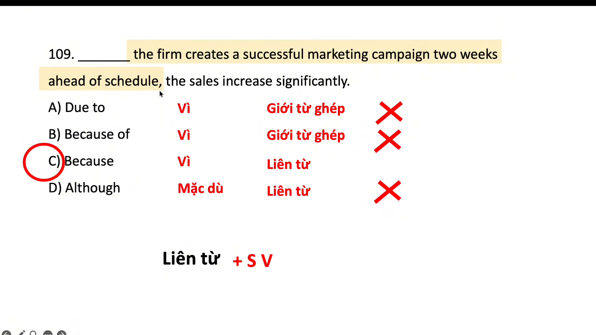

- **Đề bài:** The delivery of the office supplies was delayed _______ the main delivery truck broke down on the highway.
  - (A) owing to
  - (B) due to
  - (C) because
  - (D) although
- **Phân tích phương án:**
  - (A) *owing to* (Giới từ): do, vì -> Loại vì chỉ đi kèm cụm danh từ / V-ing.
  - (B) *due to* (Giới từ): do, bởi vì -> Loại vì chỉ đi kèm cụm danh từ.
  - (C) *because* (Liên từ): bởi vì -> Phù hợp vì theo sau là một mệnh đề hoàn chỉnh (S + V).
  - (D) *although* (Liên từ): mặc dù -> Loại vì sai quan hệ nguyên nhân - kết quả.
- **Bản chất ngữ pháp:** Vế sau chỗ trống là mệnh đề đầy đủ: the main delivery truck (Chủ ngữ) + broke down (Động từ) + on the highway (Trạng ngữ). Đứng trước một mệnh đề chỉ nguyên nhân bắt buộc phải dùng Liên từ (Conjunction) because.
- **Đáp án đúng:** **(C) because** (bởi vì).
- **Mở rộng kiến thức:**
  - *break down:* hỏng hóc giữa đường (xe cộ, máy móc).
  - *office supplies:* văn phòng phẩm.

---

### [[00:52:21](https://youtu.be/6QfRZTEK22c?t=3141s)] Câu 110: Từ vựng điều khoản

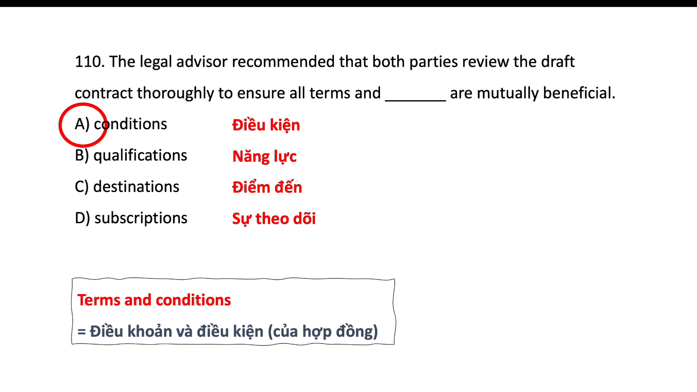

- **Đề bài:** The legal advisor suggested that both parties review the draft carefully to ensure all terms and _______ are mutually beneficial.
  - (A) conditions
  - (B) qualifications
  - (C) destinations
  - (D) subscriptions
- **Phân tích phương án:**
  - (A) *conditions*: điều kiện -> Tạo cụm thuật ngữ pháp lý cố định: terms and conditions.
  - (B) *qualifications*: bằng cấp, trình độ chuyên môn -> Không dùng trong văn cảnh điều khoản hợp đồng.
  - (C) *destinations*: điểm đến du lịch/vận chuyển -> Không phù hợp.
  - (D) *subscriptions*: sự đăng ký theo dõi định kỳ -> Không phù hợp.
- **Bản chất ngữ pháp:** Thành ngữ pháp lý kinh doanh bắt buộc: **terms and conditions** (các điều khoản và điều kiện của hợp đồng thương mại).
- **Đáp án đúng:** **(A) conditions**.
- **Mở rộng kiến thức:**
  - *legal advisor:* cố vấn pháp lý.
  - *mutually beneficial:* đôi bên cùng có lợi.
  - *draft contract:* bản thảo hợp đồng.

---

---

### [[00:54:42](https://youtu.be/6QfRZTEK22c?t=3282s)] Câu 111: Quản trị tài chính

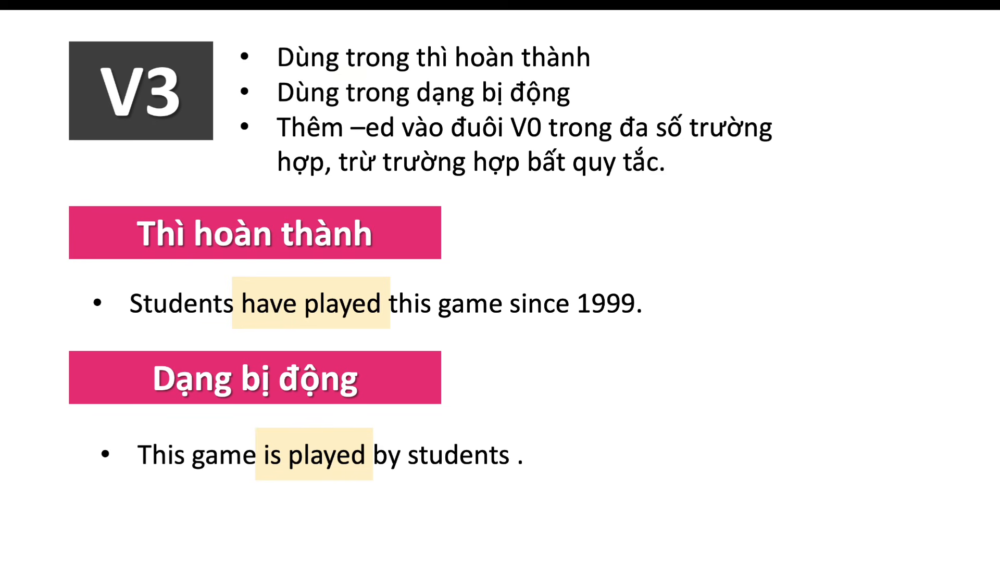

- **Đề bài:** Because the marketing project incurred several unexpected expenses, the finance department was forced to _______ additional funds.
  - (A) allocate
  - (B) navigate
  - (C) generate
  - (D) calculate
- **Phân tích phương án:**
  - (A) *allocate*: phân bổ, cấp phát ngân sách -> Khớp với việc cấp thêm tiền bù chi phí.
  - (B) *navigate*: định hướng, điều hướng -> Không đi với nguồn tiền.
  - (C) *generate*: tạo ra, sinh ra -> Không mang tính thủ tục tài chính doanh nghiệp.
  - (D) *calculate*: tính toán -> Thiếu hành động giải quyết sự cố phát sinh.
- **Bản chất ngữ pháp:** Ngữ cảnh dự án phát sinh chi phí (unexpected expenses), phòng tài chính bắt buộc phải thực hiện hành động phân bổ thêm ngân sách (allocate additional funds).
- **Đáp án đúng:** **(A) allocate** (phân bổ).
- **Mở rộng kiến thức:**
  - *allocate funds:* phân bổ nguồn vốn.
  - *incur expenses:* phát sinh chi phí ngoài ý muốn.

---

### [[01:00:17](https://youtu.be/6QfRZTEK22c?t=3617s)] Câu 112: Lượng từ phân định

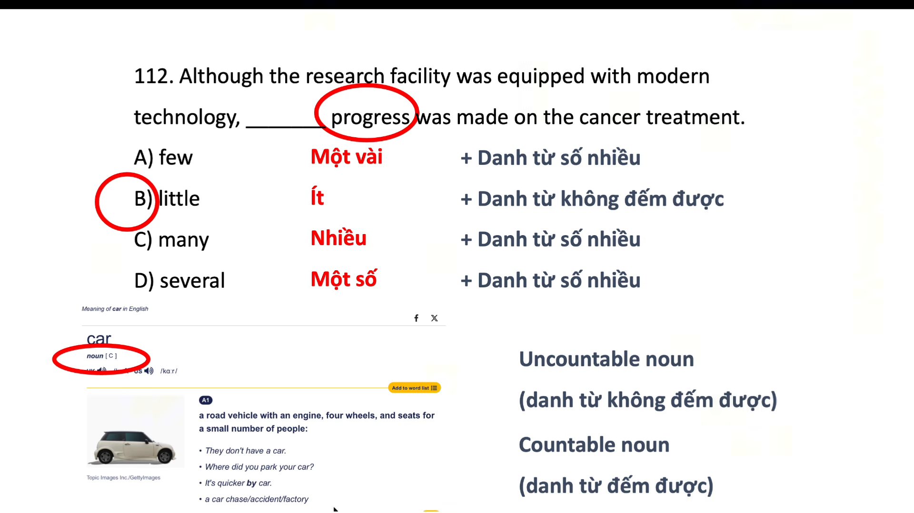

- **Đề bài:** Although the company has expanded its operations overseas, it has _______ experience in managing international branch offices.
  - (A) few
  - (B) little
  - (C) many
  - (D) several
- **Phân tích phương án:**
  - (A) *few*: rất ít -> Chỉ đi với danh từ đếm được số nhiều.
  - (B) *little*: rất ít -> Đi với danh từ không đếm được.
  - (C) *many*: nhiều -> Chỉ đi với danh từ số nhiều đếm được.
  - (D) *several*: một vài -> Chỉ đi với danh từ số nhiều đếm được.
- **Bản chất ngữ pháp:** Danh từ sau chỗ trống là **experience** (kinh nghiệm - danh từ không đếm được). Lượng từ duy nhất đi với danh từ không đếm được và mang nghĩa tương phản với vế nhượng bộ (Although) là *little* (hầu như không có kinh nghiệm).
- **Đáp án đúng:** **(B) little**.
- **Mở rộng kiến thức:**
  - *overseas operations:* hoạt động kinh doanh ở nước ngoài.
  - *branch office:* văn phòng chi nhánh.

---

### [[01:06:34](https://youtu.be/6QfRZTEK22c?t=3994s)] Câu 113: Động từ chiến lược

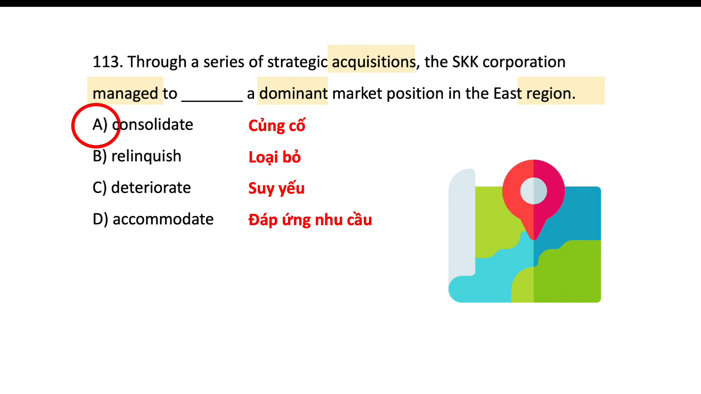

- **Đề bài:** Through a series of strategic acquisitions, the corporation managed to _______ its dominant position in the regional market.
  - (A) consolidate
  - (B) relinquish
  - (C) deteriorate
  - (D) accommodate
- **Phân tích phương án:**
  - (A) *consolidate*: củng cố, làm vững chắc -> Khớp mục tiêu thâu tóm để giữ vị thế.
  - (B) *relinquish*: từ bỏ quyền lợi -> Trái ngược hành động mở rộng.
  - (C) *deteriorate*: làm suy thoái, xuống cấp -> Sai ngữ nghĩa.
  - (D) *accommodate*: cung cấp chỗ ở/đáp ứng -> Không phù hợp vị thế thị trường.
- **Bản chất ngữ pháp:** Cụm từ chiến lược doanh nghiệp: **consolidate position** (củng cố vị thế thống lĩnh thị trường).
- **Đáp án đúng:** **(A) consolidate** (củng cố).
- **Mở rộng kiến thức:**
  - *strategic acquisition:* việc thâu tóm/mua lại có tính chiến lược.
  - *dominant position:* vị thế thống trị thị trường.

---

### [[01:08:54](https://youtu.be/6QfRZTEK22c?t=4134s)] Câu 114: Phân từ hai mặt

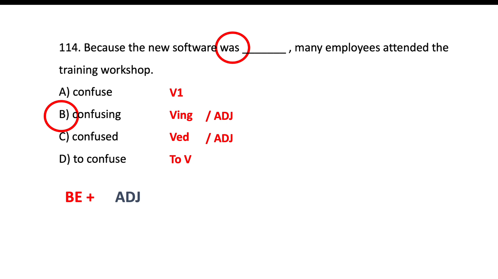

- **Đề bài:** Because the newly installed accounting software was extremely _______, several staff members had to attend training workshops.
  - (A) confuse
  - (B) confusing
  - (C) confused
  - (D) confusion
- **Phân tích phương án:**
  - (A) *confuse* (Động từ nguyên mẫu) -> Loại.
  - (B) *confusing* (Tính từ đuôi -ing): gây bối rối, khó hiểu -> Bản chất của sự vật.
  - (C) *confused* (Tính từ đuôi -ed): cảm thấy bối rối -> Cảm xúc của con người.
  - (D) *confusion* (Danh từ) -> Loại.
- **Bản chất ngữ pháp:** Chủ ngữ là software (phần mềm - vật thể). Phần mềm này mang bản chất phức tạp gây bối rối cho nhân viên nên phải dùng tính từ chủ động tận cùng bằng đuôi -ing (confusing).
- **Đáp án đúng:** **(B) confusing**.
- **Mở rộng kiến thức:**
  - *accounting software:* phần mềm kế toán.
  - *training workshops:* hội thảo đào tạo nghiệp vụ.

---

### [[01:16:22](https://youtu.be/6QfRZTEK22c?t=4582s)] Câu 115: Tính từ nghĩa vụ

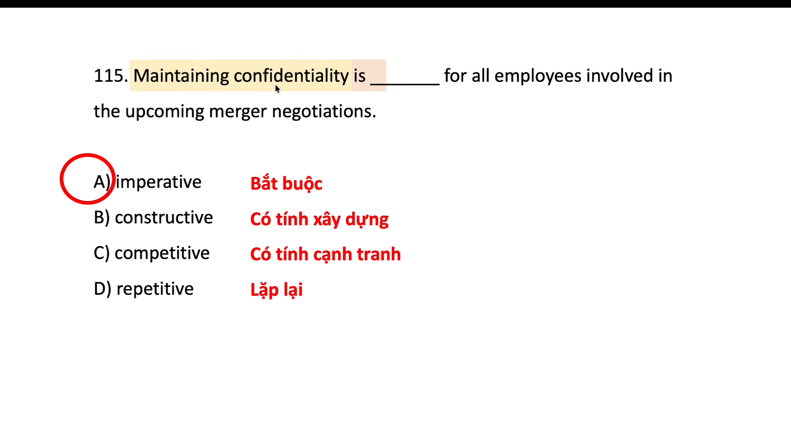

- **Đề bài:** Maintaining strict confidentiality is _______ for all personnel involved in the upcoming merger negotiations.
  - (A) mandatory
  - (B) tentative
  - (C) receptive
  - (D) prospective
- **Phân tích phương án:**
  - (A) *mandatory*: bắt buộc theo quy định pháp lý -> Chuẩn xác cho bảo mật M&A.
  - (B) *tentative*: tạm thời, chưa dứt khoát -> Không dùng cho nghĩa vụ bảo mật.
  - (C) *receptive*: cởi mở tiếp thu -> Thường mô tả thái độ con người.
  - (D) *prospective*: có tiềm năng, triển vọng -> Thường đi với đối tác/khách hàng.
- **Bản chất ngữ pháp:** Trong đàm phán sáp nhập (merger negotiations), việc bảo mật thông tin (maintaining confidentiality) là điều khoản bắt buộc mang tính pháp lý (mandatory).
- **Đáp án đúng:** **(A) mandatory** (bắt buộc).
- **Mở rộng kiến thức:**
  - *strict confidentiality:* sự bảo mật nghiêm ngặt.
  - *merger negotiations:* đàm phán sáp nhập doanh nghiệp.

---

### [[01:21:40](https://youtu.be/6QfRZTEK22c?t=4900s)] Câu 116: Trạng từ bị động

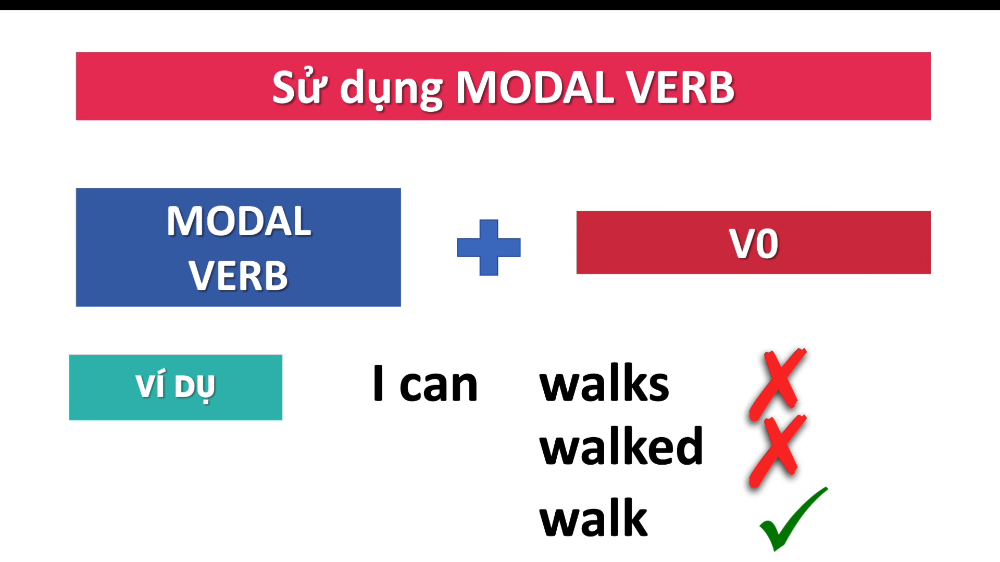

- **Đề bài:** All sensitive financial documents must be _______ shredded before disposal to comply with the firm's strict security regulations.
  - (A) thoroughly
  - (B) highly
  - (C) mutually
  - (D) severely
- **Phân tích phương án:**
  - (A) *thoroughly*: một cách triệt để, hoàn toàn -> Phù hợp hành vi tiêu hủy tài liệu.
  - (B) *highly*: ở mức độ cao -> Thường bổ nghĩa cho tính từ đánh giá.
  - (C) *mutually*: lẫn nhau -> Không phù hợp hành động đơn phương.
  - (D) *severely*: nghiêm trọng -> Thường đi với tổn thất/trừng phạt.
- **Bản chất ngữ pháp:** Cấu trúc bị động: Modal Verb + be + Adv + V3. Trạng từ thoroughly bổ nghĩa cho mức độ thực hiện hành động băm giấy shredded.
- **Đáp án đúng:** **(A) thoroughly** (triệt để).
- **Mở rộng kiến thức:**
  - *shred before disposal:* cắt nhỏ/tiêu hủy trước khi vứt bỏ.
  - *security regulations:* quy định an ninh an toàn.

---

### [[01:26:11](https://youtu.be/6QfRZTEK22c?t=5171s)] Câu 117: Rút gọn quan hệ

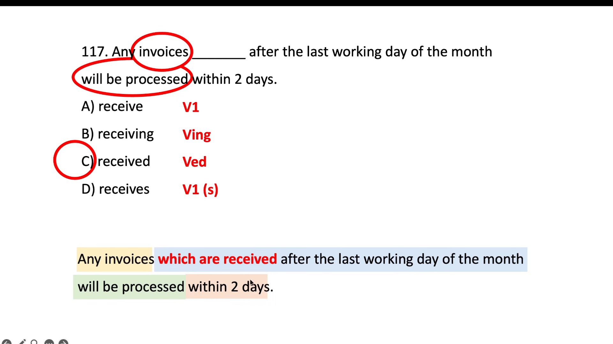

- **Đề bài:** Any invoices _______ after the final working day of the month will be processed during the next billing cycle.
  - (A) receive
  - (B) receiving
  - (C) received
  - (D) receives
- **Phân tích phương án:**
  - (A) *receive* (V1) -> Loại vì câu đã có động từ chính will be processed.
  - (B) *receiving* (V-ing) -> Loại vì hóa đơn mang nghĩa bị nhận, không tự thực hiện hành động nhận.
  - (C) *received* (V3/V-ed) -> Rút gọn mệnh đề quan hệ dạng bị động.
  - (D) *receives* (V-s) -> Loại.
- **Bản chất ngữ pháp:** Mệnh đề quan hệ gốc: Any invoices [which are received] after... Khi rút gọn dạng bị động, ta lược bỏ đại từ quan hệ và trợ động từ to be, giữ lại phân từ hai **V3/V-ed** (received).
- **Đáp án đúng:** **(C) received** (được tiếp nhận).
- **Mở rộng kiến thức:**
  - *billing cycle:* chu kỳ thanh toán cước.
  - *final working day:* ngày làm việc cuối cùng.

---

### [[01:33:15](https://youtu.be/6QfRZTEK22c?t=5595s)] Câu 118: Cặp tính từ

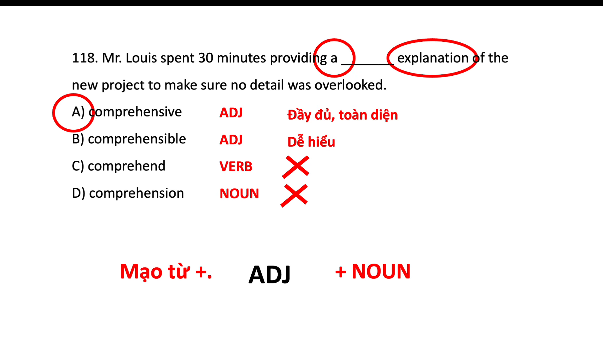

- **Đề bài:** Mr. Lewis spent thirty minutes providing a _______ explanation of the proposal to ensure no details were overlooked.
  - (A) comprehensive
  - (B) comprehensible
  - (C) comprehend
  - (D) comprehension
- **Phân tích phương án:**
  - (A) *comprehensive* (Tính từ): toàn diện, đầy đủ chi tiết -> Khớp với vế "không bỏ sót chi tiết nào".
  - (B) *comprehensible* (Tính từ): dễ hiểu, có thể hiểu được -> Không nhấn mạnh tính bao quát chi tiết.
  - (C) *comprehend* (Động từ) -> Loại vì đứng trước danh từ cần tính từ.
  - (D) *comprehension* (Danh từ) -> Loại.
- **Bản chất ngữ pháp:** Ngữ cảnh chỉ mục đích: to ensure no details were overlooked (để đảm bảo không chi tiết nào bị bỏ sót). Sự bảo đảm này đòi hỏi lời giải thích phải mang tính "toàn diện, bao quát mọi mặt" (comprehensive).
- **Đáp án đúng:** **(A) comprehensive** (toàn diện).
- **Mở rộng kiến thức:**
  - *comprehensive explanation:* sự giải thích toàn diện, chi tiết.
  - *overlook details:* bỏ sót chi tiết.

---

### [[01:35:22](https://youtu.be/6QfRZTEK22c?t=5722s)] Câu 119: Trạng từ bổ nghĩa

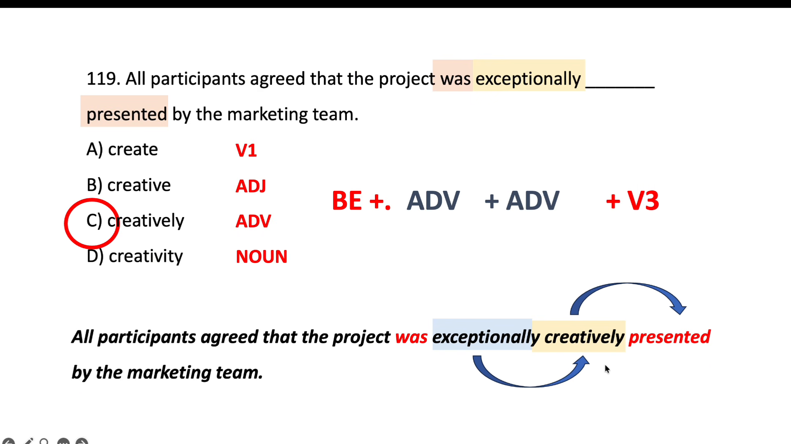

- **Đề bài:** The attendees agreed that the marketing proposal was exceptionally _______ presented by the design team.
  - (A) create
  - (B) creative
  - (C) creatively
  - (D) creation
- **Phân tích phương án:**
  - (A) *create* (Động từ) -> Loại.
  - (B) *creative* (Tính từ) -> Loại vì không bổ nghĩa cho động từ phân từ presented.
  - (C) *creatively* (Trạng từ đuôi -ly) -> Bổ nghĩa cho cách thức thực hiện hành động trình bày.
  - (D) *creation* (Danh từ) -> Loại.
- **Bản chất ngữ pháp:** Cấu trúc vị ngữ bị động: was exceptionally _______ presented. Trạng từ creatively đứng trước phân từ presented để làm rõ phương thức trình bày ("được trình bày một cách vô cùng sáng tạo").
- **Đáp án đúng:** **(C) creatively** (một cách sáng tạo).
- **Mở rộng kiến thức:**
  - *exceptionally creatively:* cực kỳ sáng tạo.
  - *design team:* đội ngũ thiết kế.

---

### [[01:37:53](https://youtu.be/6QfRZTEK22c?t=5873s)] Câu 120: Tính từ đồng căn

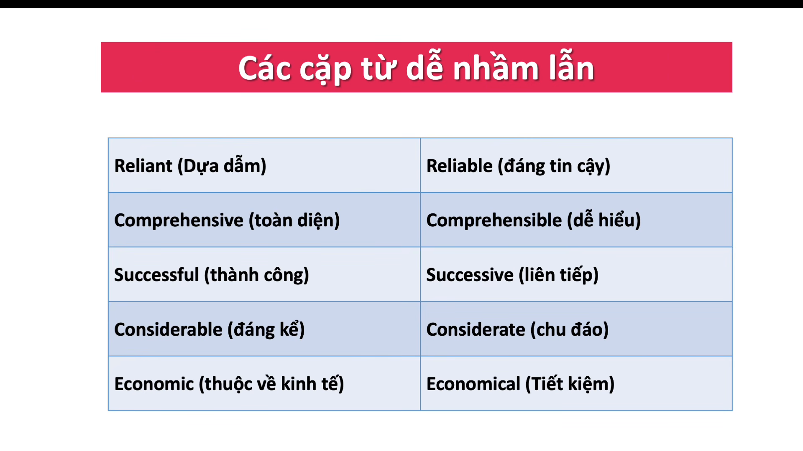

- **Đề bài:** For five _______ years, the manufacturing plant has received the workplace safety award for maintaining an accident-free environment.
  - (A) successful
  - (B) successive
  - (C) temporary
  - (D) urgent
- **Phân tích phương án:**
  - (A) *successful*: thành công -> Bẫy thường gặp. 5 năm thành công không nhấn mạnh tính liên tục để đạt giải an toàn.
  - (B) *successive*: liên tiếp, liền mạch -> five successive years (5 năm liên tục không gián đoạn).
  - (C) *temporary*: tạm thời -> Sai ngữ nghĩa.
  - (D) *urgent*: khẩn cấp -> Không đi với chuỗi năm tháng.
- **Bản chất ngữ pháp:** Cụm từ chỉ thời gian liên tục: **five successive years** (suốt 5 năm liên tiếp).
- **Đáp án đúng:** **(B) successive** (liên tiếp).
- **Mở rộng kiến thức:**
  - *successive years:* các năm liền nhau.
  - *accident-free environment:* môi trường không xảy ra tai nạn.

---

### [[01:40:18](https://youtu.be/6QfRZTEK22c?t=6018s)] Câu 121: Phân biệt lượng từ

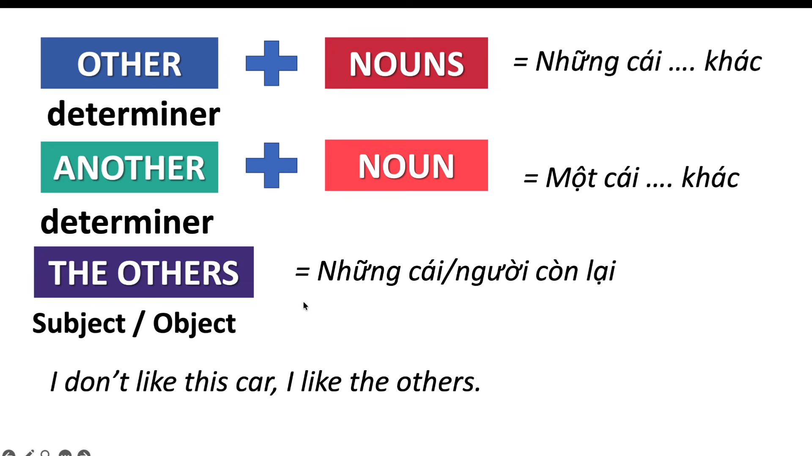

- **Đề bài:** Because the primary logistics vendor encountered severe shipping delays, the manager decided to contact _______ supplier.
  - (A) the others
  - (B) other
  - (C) many
  - (D) another
- **Phân tích phương án:**
  - (A) *the others*: những cái còn lại -> Là đại từ độc lập, không đứng trước danh từ.
  - (B) *other*: khác -> Bắt buộc đi với danh từ số nhiều (other suppliers) hoặc danh từ không đếm được.
  - (C) *many*: nhiều -> Chỉ đi với danh từ số nhiều.
  - (D) *another*: một đối tượng khác -> Đi với danh từ đếm được số ít (another supplier).
- **Bản chất ngữ pháp:** Danh từ theo sau là supplier ở dạng số ít đếm được. Lượng từ duy nhất kết hợp với danh từ số ít là **another**.
- **Đáp án đúng:** **(D) another** (một nhà cung cấp khác).
- **Mở rộng kiến thức:**
  - *logistics vendor:* nhà cung ứng dịch vụ logistics.
  - *shipping delays:* việc giao hàng bị chậm trễ.

---

### [[01:43:59](https://youtu.be/6QfRZTEK22c?t=6239s)] Câu 122: Trạng từ bổ tính

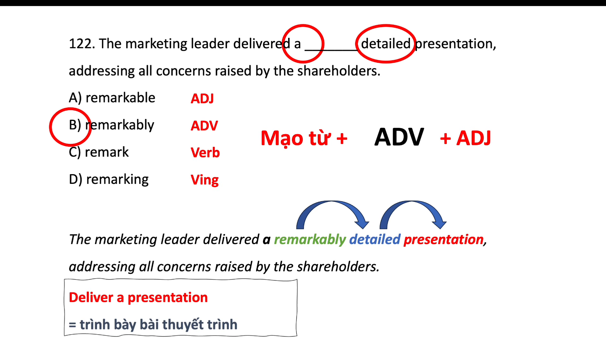

- **Đề bài:** The marketing department achieved _______ positive results from the digital advertising campaign launched last quarter.
  - (A) remarkable
  - (B) remarkably
  - (C) remark
  - (D) remarking
- **Phân tích phương án:**
  - (A) *remarkable* (Tính từ) -> Loại vì không đứng trước tính từ positive để bổ nghĩa.
  - (B) *remarkably* (Trạng từ đuôi -ly) -> Bổ nghĩa mức độ cho tính từ positive.
  - (C) *remark* (Động từ/Danh từ) -> Loại.
  - (D) *remarking* (V-ing) -> Loại.
- **Bản chất ngữ pháp:** Trật tự cụm danh từ: Adv + Adj + Noun -> remarkably positive results (những kết quả tích cực một cách đáng kể).
- **Đáp án đúng:** **(B) remarkably** (đáng chú ý, rõ rệt).
- **Mở rộng kiến thức:**
  - *remarkably positive:* tích cực đáng ghi nhận.
  - *digital advertising campaign:* chiến dịch quảng cáo số.

---

### [[01:47:39](https://youtu.be/6QfRZTEK22c?t=6459s)] Câu 123: Động từ biểu quyết

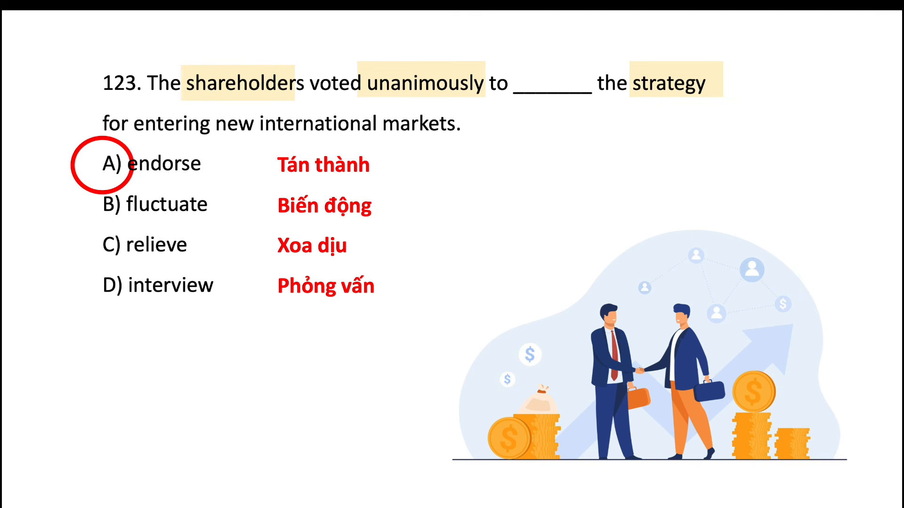

- **Đề bài:** The shareholders voted unanimously to _______ the proposed strategy for entering emerging international markets.
  - (A) endorse
  - (B) fluctuate
  - (C) relieve
  - (D) interview
- **Phân tích phương án:**
  - (A) *endorse*: tán thành, chính thức thông qua -> Khớp với hành động biểu quyết của cổ đông.
  - (B) *fluctuate*: dao động lên xuống -> Chỉ số liệu, giá cả.
  - (C) *relieve*: giải tỏa, làm nhẹ bớt -> Chỉ căng thẳng, đau đớn.
  - (D) *interview*: phỏng vấn -> Sai ngữ cảnh đại hội cổ đông.
- **Bản chất ngữ pháp:** Hành động của cổ đông (shareholders) sau khi biểu quyết nhất trí (voted unanimously) là chính thức tán thành chiến lược (endorse the strategy).
- **Đáp án đúng:** **(A) endorse** (tán thành).
- **Mở rộng kiến thức:**
  - *shareholders:* cổ đông.
  - *unanimously:* một cách nhất trí 100%.
  - *emerging market:* thị trường mới nổi.

---

### [[01:49:01](https://youtu.be/6QfRZTEK22c?t=6541s)] Câu 124: Mệnh đề thời gian

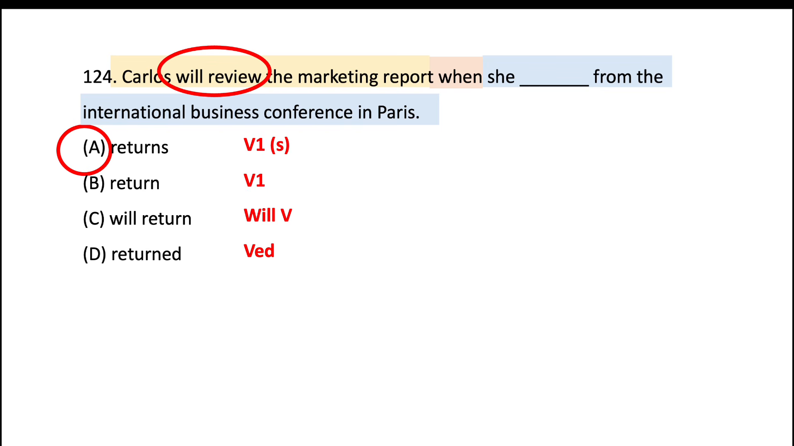

- **Đề bài:** Carlos will review the comprehensive marketing report when she _______ from the international trade symposium.
  - (A) returns
  - (B) return
  - (C) will return
  - (D) returned
- **Phân tích phương án:**
  - (A) *returns* (Hiện tại đơn ngôi thứ 3 số ít) -> Đúng quy tắc hòa hợp thì.
  - (B) *return* (Hiện tại đơn số nhiều / nguyên mẫu) -> Sai hòa hợp chủ ngữ she.
  - (C) *will return* (Tương lai đơn) -> Bẫy ngữ pháp. Mệnh đề chỉ thời gian không dùng will.
  - (D) *returned* (Quá khứ đơn) -> Sai thì so với tương lai của mệnh đề chính.
- **Bản chất ngữ pháp:** Trong mệnh đề trạng ngữ chỉ thời gian bắt đầu bằng liên từ when, động từ bắt buộc chia ở thì **Hiện tại đơn** để diễn tả sự việc sẽ xảy ra trong tương lai khi mệnh đề chính dùng will review.
- **Đáp án đúng:** **(A) returns**.
- **Mở rộng kiến thức:**
  - *trade symposium:* hội thảo chuyên đề thương mại.
  - *review report:* xem xét/rà soát báo cáo.

---

### [[01:54:59](https://youtu.be/6QfRZTEK22c?t=6899s)] Câu 125: Tính từ đuôi -ly

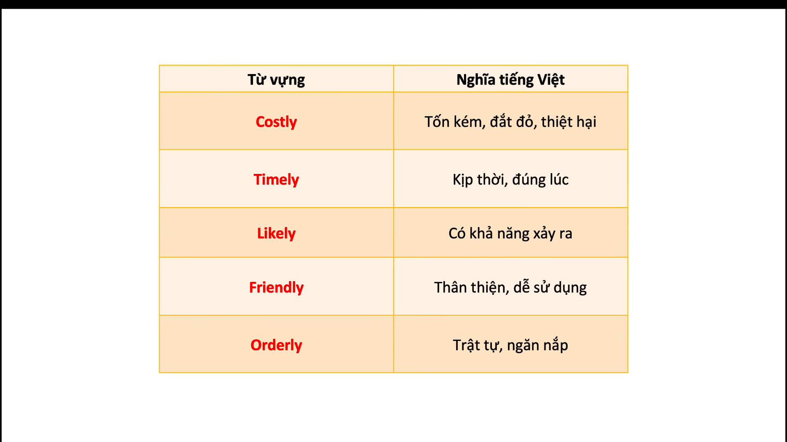

- **Đề bài:** Replacing the outdated manufacturing machinery would require a _______ repair that the current budget cannot accommodate.
  - (A) cost
  - (B) costly
  - (C) costing
  - (D) costliness
- **Phân tích phương án:**
  - (A) *cost* (Danh từ / Động từ) -> Không đứng bổ nghĩa danh từ phía sau.
  - (B) *costly* (Tính từ bất quy tắc đuôi -ly): đắt đỏ, tốn kém -> Phù hợp đứng trước danh từ repair.
  - (C) *costing* (V-ing) -> Không phù hợp nghĩa.
  - (D) *costliness* (Danh từ) -> Không tạo cụm danh từ chuẩn.
- **Bản chất ngữ pháp:** Từ repair trong câu này đóng vai trò danh từ ("khoản sửa chữa/sự sửa chữa"). Đứng trước danh từ cần một tính từ. costly là tính từ có hình thức đuôi -ly, mang nghĩa "tốn kém".
- **Đáp án đúng:** **(B) costly** (đắt đỏ, tốn kém).
- **Mở rộng kiến thức:**
  - *costly repair:* việc sửa chữa vô cùng tốn kém.
  - *outdated machinery:* máy móc lỗi thời.

---

### [[01:56:59](https://youtu.be/6QfRZTEK22c?t=7019s)] Câu 126: Động từ sức chứa

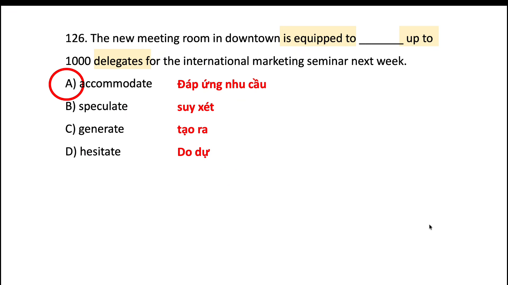

- **Đề bài:** The newly renovated conference center is equipped to _______ up to one thousand delegates for the upcoming convention.
  - (A) accommodate
  - (B) consider
  - (C) create
  - (D) hesitate
- **Phân tích phương án:**
  - (A) *accommodate*: có sức chứa, đáp ứng chỗ ngồi -> Chuẩn xác cho trung tâm hội nghị.
  - (B) *consider*: cân nhắc -> Không đi với số lượng đại biểu để chỉ sức chứa.
  - (C) *create*: tạo ra -> Không hợp ngữ nghĩa.
  - (D) *hesitate*: do dự, ngập ngừng -> Sai nghĩa.
- **Bản chất ngữ pháp:** Động từ chỉ năng lực tiếp nhận số lượng người của một địa điểm: **accommodate delegates** (chứa/đáp ứng chỗ ngồi cho đại biểu).
- **Đáp án đúng:** **(A) accommodate** (đáp ứng sức chứa).
- **Mở rộng kiến thức:**
  - *conference center:* trung tâm hội nghị.
  - *delegates:* đại biểu tham dự.

---

### [[01:58:49](https://youtu.be/6QfRZTEK22c?t=7129s)] Câu 127: Rút gọn đồng chủ ngữ

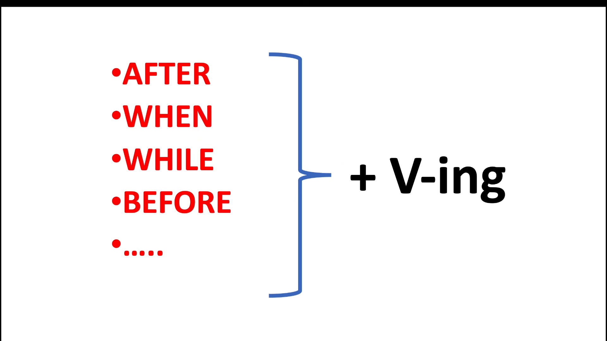

- **Đề bài:** System users should always back up all sensitive files on external drives _______ submitting their laptops to the technical team for repairs.
  - (A) possible
  - (B) either
  - (C) before
  - (D) clear
- **Phân tích phương án:**
  - (A) *possible* (Tính từ) -> Loại vì không đứng trước V-ing làm liên từ nối.
  - (B) *either* (Liên từ đi với or) -> Loại.
  - (C) *before* (Liên từ thời gian): trước khi -> Phù hợp với dạng rút gọn đồng chủ ngữ.
  - (D) *clear* (Tính từ) -> Loại.
- **Bản chất ngữ pháp:** Khi hai mệnh đề có cùng chủ ngữ System users, liên từ thời gian before có thể đi kèm động từ dạng **V-ing** (submitting) do chủ ngữ của mệnh đề phụ đã được lược bỏ.
- **Đáp án đúng:** **(C) before** (trước khi).
- **Mở rộng kiến thức:**
  - *back up files:* sao lưu dữ liệu.
  - *external drives:* ổ cứng gắn ngoài.

---

### [[02:03:08](https://youtu.be/6QfRZTEK22c?t=7388s)] Câu 128: Danh từ ghép

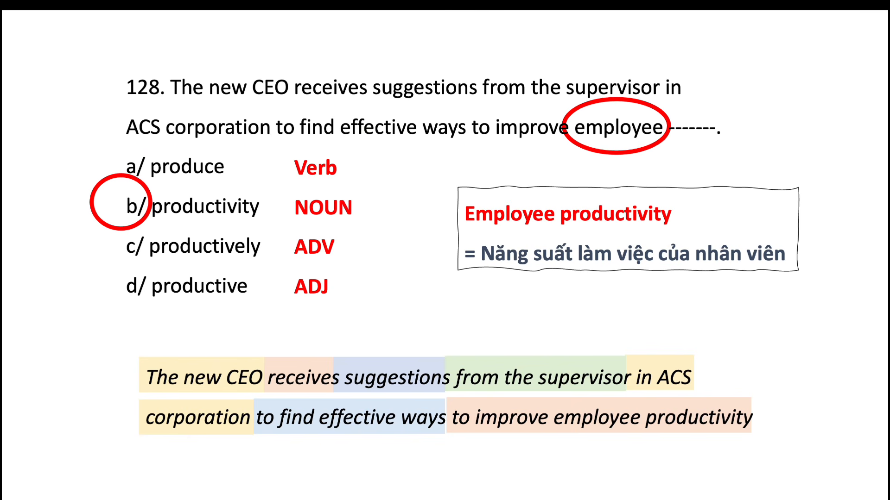

- **Đề bài:** The new chief executive officer welcomed constructive suggestions from staff to improve overall employee _______.
  - (A) produce
  - (B) productivity
  - (C) productively
  - (D) productive
- **Phân tích phương án:**
  - (A) *produce* (Động từ) -> Loại.
  - (B) *productivity* (Danh từ đuôi -ity): năng suất -> Tạo danh từ ghép với employee.
  - (C) *productively* (Trạng từ) -> Loại.
  - (D) *productive* (Tính từ) -> Loại.
- **Bản chất ngữ pháp:** Hai danh từ ghép lại tạo nên thuật ngữ quản trị kinh doanh: **employee productivity** (năng suất làm việc của nhân viên).
- **Đáp án đúng:** **(B) productivity** (năng suất).
- **Mở rộng kiến thức:**
  - *employee productivity:* năng suất của nhân sự.
  - *constructive suggestions:* các đề xuất mang tính xây dựng.

---

### [[02:07:56](https://youtu.be/6QfRZTEK22c?t=7676s)] Câu 129: Đàm phán hợp đồng

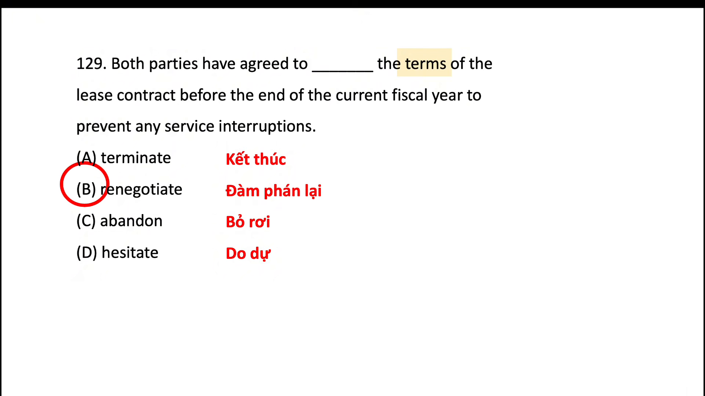

- **Đề bài:** Both parties agreed to _______ the terms of the commercial lease before the end of the current fiscal year to avoid service disruptions.
  - (A) terminate
  - (B) renegotiate
  - (C) abandon
  - (D) hesitate
- **Phân tích phương án:**
  - (A) *terminate*: chấm dứt -> Nếu chấm dứt hợp đồng thì sẽ gây gián đoạn dịch vụ, trái với mục đích to avoid disruptions.
  - (B) *renegotiate*: đàm phán lại các điều khoản -> Hợp lý để tiếp tục duy trì dịch vụ.
  - (C) *abandon*: từ bỏ, bỏ rơi -> Không phù hợp ngữ cảnh hợp đồng.
  - (D) *hesitate*: do dự -> Sai nghĩa.
- **Bản chất ngữ pháp:** Ngữ cảnh nhằm tránh việc ngắt quãng dịch vụ (to avoid service disruptions), hai bên đồng thuận đàm phán lại các điều khoản thuê (renegotiate the terms of the commercial lease).
- **Đáp án đúng:** **(B) renegotiate** (đàm phán lại).
- **Mở rộng kiến thức:**
  - *commercial lease:* hợp đồng thuê mặt bằng kinh doanh.
  - *fiscal year:* năm tài chính.

---

### [[02:10:04](https://youtu.be/6QfRZTEK22c?t=7804s)] Câu 130: Cụm động từ

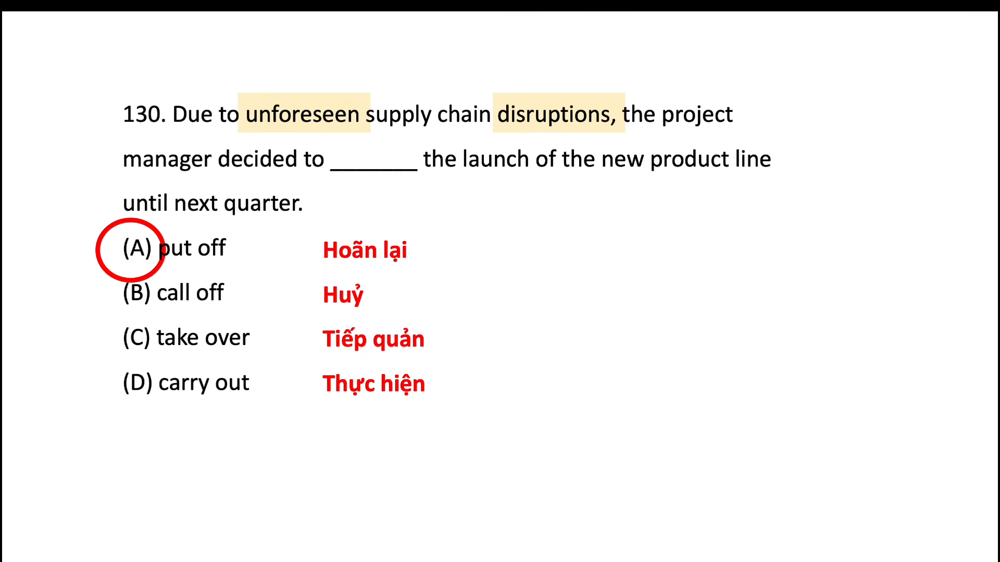

- **Đề bài:** Due to unforeseen supply chain disruptions, the project director decided to _______ the official product launch until next quarter.
  - (A) put off
  - (B) carry out
  - (C) turn down
  - (D) take over
- **Phân tích phương án:**
  - (A) *put off*: hoãn lại (= postpone / delay) -> Phù hợp với việc lùi lịch ra mắt sang quý sau.
  - (B) *carry out*: tiến hành, thực thi -> Mâu thuẫn với sự cố đứt gãy nguồn cung.
  - (C) *turn down*: từ chối -> Không đi với mốc thời gian until next quarter.
  - (D) *take over*: tiếp quản -> Sai nghĩa.
- **Bản chất ngữ pháp:** Cụm động từ (Phrasal Verb) mang nghĩa trì hoãn sự kiện: **put off** = **postpone**.
- **Đáp án đúng:** **(A) put off** (trì hoãn).
- **Mở rộng kiến thức:**
  - *unforeseen disruption:* sự gián đoạn không lường trước.
  - *official product launch:* sự kiện ra mắt sản phẩm chính thức.

---

## Trích dẫn then chốt

> [[00:22:15](https://youtu.be/6QfRZTEK22c?t=1335s)] "Nhiều bạn nhớ công thức *either... or* rất máy móc. Thấy chữ *or* là quất ngay *either* mà không thèm dịch nghĩa của đề. Khi đề thi nói tất cả mọi người bắt buộc phải tham gia dù làm việc trực tiếp hay online thì phải dùng *whether A or B*. Học ngữ pháp phải hiểu bản chất ngữ nghĩa, không được làm vẹt."

> [[00:43:20](https://youtu.be/6QfRZTEK22c?t=2600s)] "Khi xác định chủ ngữ của câu để chia động từ chính, các bạn phải lập tức gạch bỏ các cụm giới từ xen giữa. Cụm giới từ chỉ đứng sau bổ nghĩa cho danh từ chứ không bao giờ làm chủ ngữ chính của câu."

> [[01:28:45](https://youtu.be/6QfRZTEK22c?t=5325s)] "Mệnh đề quan hệ rút gọn là phần ưa thích của đề thi TOEIC. Động từ chủ động rút gọn thành V-ing, bị động rút gọn thành V3/V-ed. Muốn biết chủ động hay bị động, hãy đặt câu hỏi xem đối tượng danh từ đó tự làm hành động hay được/bị người khác tác động vào."

> [[01:51:10](https://youtu.be/6QfRZTEK22c?t=6670s)] "Trong mệnh đề chỉ thời gian bắt đầu bằng *when, before, after, until*, tuyệt đối không bao giờ chia động từ ở tương lai với *will*. Cho dù mệnh đề chính là tương lai, mệnh đề chỉ thời gian bắt buộc phải lùi về thì hiện tại đơn."

> [[01:55:30](https://youtu.be/6QfRZTEK22c?t=6930s)] "Rất nhiều bạn bị điểm mù ở câu hỏi từ loại vì cứ thấy từ đuôi *-ly* là mặc định đó là trạng từ. Những từ như *costly, friendly, timely* xuất phát từ danh từ thêm *-ly*, bản chất của nó là tính từ và đứng trước danh từ để bổ nghĩa."

---

## Lệnh & Công cụ

### Bảng công thức giải nhanh Part 5

```markdown
1. Cụm danh từ mở rộng:
   Mạo từ (a/an/the) + Trạng từ (adv) + Tính từ (adj) + Danh từ chính (Noun)
   Ví dụ: a remarkably positive result

2. Bị động với Trợ động từ:
   Modal Verb + be + Trạng từ (adv) + V3/V-ed
   Ví dụ: must be thoroughly shredded

3. Mệnh đề trạng ngữ chỉ thời gian:
   S + will + V-bare + [When / Before / After / As soon as] + S + V(s/es)
   Ví dụ: will review the report when she returns

4. Rút gọn phân từ:
   - Noun + V-ing + Tân ngữ (chủ động): The man standing next to me
   - Noun + V3/V-ed (bị động): Any invoices received after deadline

5. Lượng từ phân định:
   - Another + Noun (đếm được số ít)
   - Other + Noun (số nhiều / không đếm được)
   - Few / Many / Several + Noun (số nhiều đếm được)
   - Little + Noun (không đếm được)
```

### Bảng đối chiếu Cụm từ cố định (Collocations)

```markdown
- under pressure: chịu áp lực công việc
- terms and conditions: các điều khoản và điều kiện hợp đồng
- allocate funds: phân bổ ngân sách
- strategic acquisition: thâu tóm mang tính chiến lược
- dominant position: vị thế thống lĩnh
- costly repair: việc sửa chữa đắt đỏ
- employee productivity: năng suất của nhân sự
- put off = postpone = delay: trì hoãn lịch trình
```

---

## Đánh đổi & Rủi ro

### Đánh đổi giữa Tốc độ và Độ chính xác

- **Đánh đổi khi làm máy móc:** Dựa vào mẹo nhìn từ liền trước/liền sau giúp tiết kiệm 10-15 giây mỗi câu nhưng mang rủi ro sập bẫy cực cao ở các câu chứa liên từ tương quan (*either* vs. *whether*), tính từ đuôi *-ly* (*costly*), hoặc các câu rút gọn đồng chủ ngữ.
- **Chiến lược tối ưu:** Dành tối đa 15-20 giây cho các câu thuần túy biến thể từ loại (Word Form); dành 30-45 giây cho các câu đòi hỏi dịch thuật bối cảnh thương mại và nhận diện nghĩa cụm từ (*Phrasal Verbs*, *Collocations*).

### Điểm mù nhận diện cấu trúc câu dài

- **Rủi ro xác định sai chủ ngữ:** Các câu TOEIC hiện đại thường cố tình chèn nhiều tầng bổ ngữ: cụm giới từ (), mệnh đề quan hệ rút gọn (), hoặc cụm to-V chỉ mục đích. Nếu thí sinh không tách được cấu trúc xương sống (S - V - O), việc chia thì động từ chính sẽ bị sai lệch hoàn toàn.
