# Giải chi tiết đề thi TOEIC 2025 | Anhle TOEIC

* **Kênh:** Anh Le TOEIC | **Thời lượng:** 02:15:31 | **Ngày:** 2025-02-12
* **Video:** https://youtu.be/xw--klidlFw?si=HGHpLwRf6LL5uLel

---

## Thuật ngữ

| Thuật ngữ | Tiếng Anh | Giải thích |
| :--- | :--- | :--- |
| Hình thái từ loại | Part of Speech | Phân loại từ thành Danh từ, Động từ, Tính từ, Trạng từ dựa trên chức năng và hậu tố nhận diện. |
| Đại từ phản thân | Reflexive Pronoun | Đại từ tận cùng bằng -self hoặc -selves, dùng khi hành động của chủ ngữ tác động ngược lại chính chủ thể đó. |
| Đại từ nhân xưng | Personal Pronoun | Đại từ thay thế cho danh từ, phân định ranh giới giữa đại từ chủ ngữ và đại từ tân ngữ. |
| Động từ khiếm khuyết | Modal Verb | Động từ trợ giúp (can, could, will, would, should, must) bắt buộc đi kèm một động từ nguyên mẫu không chia. |
| Liên từ tương quan | Correlative Conjunction | Cặp liên từ đi liền nhau để liên kết các thành phần ngữ pháp tương đương (either...or, neither...nor, both...and). |
| Trạng từ chỉ cách thức | Adverb of Manner | Trạng từ thường có đuôi -ly, dùng để bổ nghĩa cho động từ, tính từ hoặc trạng từ khác. |
| Danh động từ | Gerund | Động từ thêm đuôi -ing mang chức năng danh từ; khi đứng đầu câu làm chủ ngữ thì động từ chính luôn chia ở dạng số ít. |
| Liên từ phụ thuộc | Subordinating Conjunction | Từ nối kết nối mệnh đề phụ với mệnh đề chính (although, because, while...), theo sau là cấu trúc S + V. |
| Giới từ | Preposition | Từ biểu thị mối quan hệ thời gian, không gian, nguyên nhân (in, on, at, due to, despite...), theo sau là cụm danh từ hoặc V-ing. |
| Ngoại động từ | Transitive Verb | Động từ bắt buộc phải có một tân ngữ trực tiếp đi liền sau để hoàn chỉnh ý nghĩa (discuss, require, achieve...). |
| Nội động từ | Intransitive Verb | Động từ không nhận tân ngữ trực tiếp đi sau; nếu muốn liên kết với danh từ bắt buộc phải có giới từ đi kèm (talk to/about...). |
| Mệnh đề danh từ | Noun Clause | Mệnh đề phụ bắt đầu bằng that, whether, what... đóng vai trò làm chủ ngữ hoặc tân ngữ trong một câu hoàn chỉnh. |
| Động từ liên kết | Linking Verb | Động từ nối chủ ngữ với một tính từ mô tả trạng thái hoặc đặc điểm của chủ ngữ (be, become, feel, remain, seem). |
| Cụm từ cố định | Collocation | Các từ ngữ thường xuyên đi cùng nhau theo tập quán ngôn ngữ của người bản xứ (deliver a presentation, make a reservation). |

---

## Tổng luận chuyên đề

### Hình thái từ loại

Hình thái từ loại là chuyên đề chiếm tỷ trọng câu hỏi lớn nhất trong cấu trúc đề thi TOEIC Part 5. Nguyên lý xử lý cốt lõi của dạng bài này nằm ở việc nhận diện nhanh hậu tố từ loại và vị trí tương quan trong cấu trúc câu:

1. **Vị trí của Danh từ**: Đứng sau mạo từ (a, an, the), tính từ sở hữu (my, your, his, her, their, our, its), tính từ mô tả, hoặc đứng giữa mạo từ và giới từ (The + Noun + of/in/for...).
2. **Vị trí của Trạng từ**: Trạng từ thường kết thúc bằng đuôi `-ly`, có vai trò bổ nghĩa cho động từ thường (S + Adv + V hoặc V + O + Adv), bổ nghĩa cho tính từ (Adv + Adj + N), hoặc bổ trợ cho phân từ trong cấu trúc bị động (be + Adv + V3/ed).
3. **Danh từ ghép**: Trong môi trường giao tiếp văn phòng và thương mại, hai danh từ thường đứng cạnh nhau để tạo thành một khái niệm độc lập (Factory performance, Safety standards, Sales figures). Danh từ đứng trước đóng vai trò bổ nghĩa về mặt phân loại cho danh từ chính đứng sau.

### Động từ và cấu tạo

Hệ thống động từ trong đề thi TOEIC được khảo sát qua bốn bình diện chính: Thời thì, Thể (Chủ động/Bị động), Dạng thức đặc biệt, và Bản chất Ngoại động từ/Nội động từ:

1. **Cấu tạo các dạng thức động từ cơ bản**:
   * Verb 0: Động từ nguyên thể không chia, xuất hiện ngay sau Modal Verbs (can, could, will, would, should, must) hoặc đứng đầu câu mệnh lệnh.
   * Verb 1: Động từ thì hiện tại đơn, chia theo số ít (V-s/es) hoặc số nhiều (V-nguyên mẫu).
   * Verb 2: Động từ thì quá khứ đơn (V-ed hoặc dạng bất quy tắc), nhận biết qua các trạng ngữ chỉ thời gian quá khứ (last month, yesterday, ago, in 2020).
   * Verb-ing: Dạng tiếp diễn khi đi kèm trợ động từ to be, hoặc đóng vai trò Danh động từ (Gerund).
2. **Quy tắc danh động từ làm chủ ngữ**: Khi một cụm V-ing (Danh động từ) đứng đầu câu giữ vai trò làm chủ ngữ (Managing many successful companies...), toàn bộ động từ chính phía sau bắt buộc phải chia ở ngôi thứ ba số ít (Verb 1 thêm s/es).
3. **Phân biệt Ngoại động từ và Nội động từ**:
   * Ngoại động từ đòi hỏi tân ngữ trực tiếp (discuss something).
   * Nội động từ không được nhận tân ngữ trực tiếp mà phải có giới từ bắc cầu (talk about something).

### Cấu trúc liên kết

Phần thi đánh giá năng lực tư duy logic của thí sinh thông qua hệ thống liên từ và giới từ:

1. **Cặp liên từ tương quan**: Xuất hiện theo quy tắc bất biến, nhận biết vế trước để suy ra vế sau mà không cần dịch nghĩa:
   * Either A or B: Hoặc A hoặc B.
   * Neither A nor B: Không A mà cũng không B.
   * Both A and B: Cả A và B.
2. **Phân biệt Liên từ và Giới từ chỉ nguyên nhân - nhượng bộ**:
   * Mệnh đề nhượng bộ: Although / Even though / Though + Clause (S + V) đối lập với In spite of / Despite + Noun phrase / V-ing.
   * Mệnh đề nguyên nhân: Because / Since / As + Clause (S + V) đối lập với Due to / Because of / Owing to + Noun phrase / V-ing.

### Từ vựng và kết hợp

Các câu hỏi thuần từ vựng trong đề thi 2025 không kiểm tra từ ngữ hàn lâm xa rời thực tế mà tập trung trực diện vào các cụm từ thương mại cố định:

1. Cụm động từ - danh từ: deliver a presentation (thuyết trình báo cáo), achieve a goal (đạt mục tiêu), conduct an investigation (tiến hành điều tra), meet requirements (đáp ứng yêu cầu).
2. Cụm danh từ ghép chuyên ngành: marketing campaign (chiến dịch tiếp thị), construction site (công trường xây dựng), account number (số tài khoản), travel arrangements (thu xếp đi lại).

---

## Bóc tách chi tiết

### Câu 101

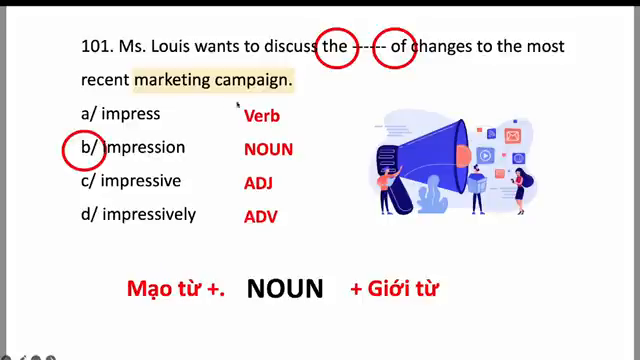

* **Đề bài:** The marketing campaign created a lasting ------- on potential investors.
  * (A) impress
  * (B) impression
  * (C) impressive
  * (D) impressively
* **Dạng bài:** Hình thái từ loại.
* **Phân tích:** Quan sát bốn phương án đều là biến thể của gốc từ impress. Trước khoảng trống là mạo từ *a* và tính từ *lasting* (lâu dài, sâu sắc); sau khoảng trống là giới từ *on*. Theo quy tắc ngữ pháp, sau mạo từ và tính từ bắt buộc phải là một danh từ để tạo thành cụm danh từ làm tân ngữ cho động từ *created*.
  * (A) *impress*: Động từ nguyên thể.
  * (B) *impression*: Danh từ (hậu tố -ion).
  * (C) *impressive*: Tính từ (hậu tố -ive).
  * (D) *impressively*: Trạng từ (hậu tố -ly).
* **Đáp án:** **(B) impression**.
* **Dịch nghĩa:** Chiến dịch tiếp thị đã tạo ra một ấn tượng sâu sắc đối với các nhà đầu tư tiềm năng.
* **Mở rộng:** Cụm từ cố định `marketing campaign` (chiến dịch tiếp thị); cấu trúc `create an impression on somebody` (tạo ấn tượng đối với ai).

---

### Câu 102

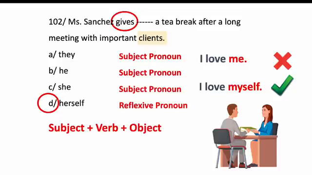

* **Đề bài:** Ms. Sanchez gave ------- a well-deserved tea break after the lengthy client meeting.
  * (A) she
  * (B) her
  * (C) they
  * (D) herself
* **Dạng bài:** Biến thể đại từ.
* **Phân tích:** Câu có cấu trúc Subject (Ms. Sanchez) + Verb (gave) + Object. Động từ *give* diễn tả hành động tự thưởng một khoảng nghỉ giải lao. Khi chủ thể hành động thực hiện một hành động tác động ngược lại chính bản thân mình, ngữ pháp bắt buộc sử dụng đại từ phản thân (reflexive pronoun).
  * (A) *she*: Đại từ chủ ngữ, không đứng sau động từ làm tân ngữ.
  * (B) *her*: Đại từ tân ngữ thông thường, nếu dùng sẽ mang ý nghĩa cô Sanchez thưởng cho một người phụ nữ khác.
  * (C) *they*: Đại từ chủ ngữ số nhiều.
  * (D) *herself*: Đại từ phản thân phù hợp với ngữ cảnh tự thưởng cho chính mình.
* **Đáp án:** **(D) herself**.
* **Dịch nghĩa:** Cô Sanchez đã tự thưởng cho mình một giờ nghỉ uống trà xứng đáng sau cuộc họp kéo dài với khách hàng.
* **Mở rộng:** Phân biệt `client` (khách hàng sử dụng dịch vụ) và `customer` (khách hàng mua sản phẩm hữu hình); cụm từ `well-deserved` (hoàn toàn xứng đáng).

---

### Câu 103

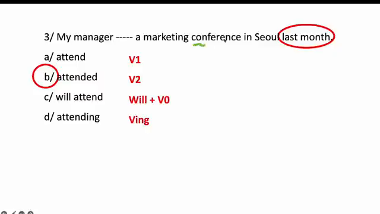

* **Đề bài:** My manager ------- a marketing conference in Seattle last month.
  * (A) attend
  * (B) attended
  * (C) will attend
  * (D) attending
* **Dạng bài:** Biến thể động từ.
* **Phân tích:** Cuối câu xuất hiện trạng ngữ chỉ thời gian xác định trong quá khứ là *last month* (tháng trước). Cấu trúc câu yêu cầu một động từ chính chia ở thì quá khứ đơn (Verb 2 / V-ed).
  * (A) *attend*: Động từ nguyên thể / thì hiện tại đơn đi với chủ ngữ số nhiều.
  * (B) *attended*: Động từ chia ở thì quá khứ đơn (V-ed).
  * (C) *will attend*: Động từ chia ở thì tương lai đơn.
  * (D) *attending*: Dạng V-ing, không thể đứng độc lập làm động từ chính khi thiếu to be.
* **Đáp án:** **(B) attended**.
* **Dịch nghĩa:** Người quản lý của tôi đã tham dự một hội nghị tiếp thị tại Seattle vào tháng trước.
* **Mở rộng:** Danh từ `conference` (hội nghị trang trọng); động từ `attend` là ngoại động từ đi trực tiếp với danh từ, không dùng giới từ `to`.

---

### Câu 104

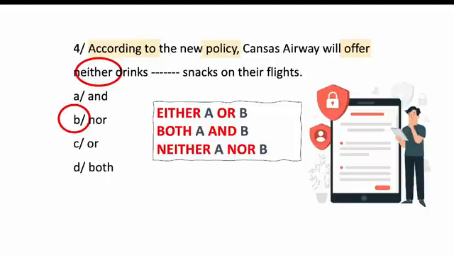

* **Đề bài:** Under the new policy, Kansas Airways will offer ------- meals nor snacks on short domestic flights.
  * (A) either
  * (B) neither
  * (C) both
  * (D) also
* **Dạng bài:** Liên từ tương quan.
* **Phân tích:** Quan sát trong câu xuất hiện liên từ *nor* phía sau tân ngữ thứ nhất (*meals*). Theo quy tắc cặp liên từ tương quan cố định trong tiếng Anh: `neither...nor` (không... cũng không), `either...or` (hoặc... hoặc), `both...and` (cả... và). Do có sự hiện diện của *nor*, từ cần điền bắt buộc là *neither*.
* **Đáp án:** **(B) neither**.
* **Dịch nghĩa:** Theo chính sách mới, hãng hàng không Kansas Airways sẽ không phục vụ bữa ăn chính cũng như đồ ăn nhẹ trên các chuyến bay nội địa chặng ngắn.
* **Mở rộng:** Giới từ ghép `according to` hoặc cụm `under the policy` (theo quy định/chính sách); danh từ `policy` (chính sách ban hành).

---

### Câu 105

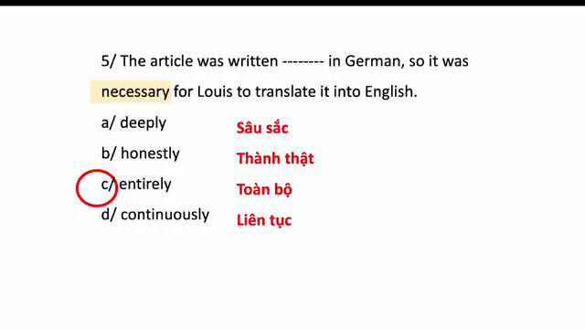

* **Đề bài:** The research report was written ------- in German, so an official translation into English was required.
  * (A) deeply
  * (B) honestly
  * (C) entirely
  * (D) continuously
* **Dạng bài:** Từ vựng trạng từ.
* **Phân tích:** Vị trí cần điền là trạng từ đứng giữa cấu trúc bị động `was written ------- in German`. Vế sau nêu nguyên nhân `so an official translation... was required` (do đó cần có bản dịch chính thức sang tiếng Anh). Điều này chứng minh toàn bộ văn bản được viết bằng tiếng Đức.
  * (A) *deeply*: Một cách sâu sắc.
  * (B) *honestly*: Một cách thành thật.
  * (C) *entirely*: Hoàn toàn, toàn bộ.
  * (D) *continuously*: Một cách liên tục, không ngừng nghỉ.
* **Đáp án:** **(C) entirely**.
* **Dịch nghĩa:** Báo cáo nghiên cứu được viết hoàn toàn bằng tiếng Đức, do đó cần phải có một bản dịch chính thức sang tiếng Anh.
* **Mở rộng:** Tính từ `necessary` (cần thiết); động từ `translate into` (dịch sang ngôn ngữ nào).

---

### Câu 106

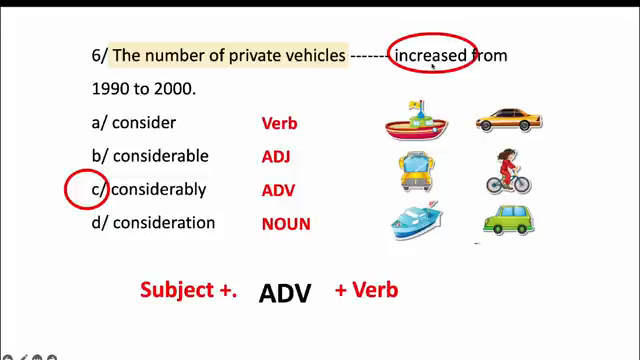

* **Đề bài:** The number of private vehicles has increased ------- between 1990 and 2000.
  * (A) consider
  * (B) considerable
  * (C) considerably
  * (D) consideration
* **Dạng bài:** Hình thái từ loại.
* **Phân tích:** Câu đã có đầy đủ cấu trúc nòng cốt: Chủ ngữ là cụm `The number of private vehicles`, động từ chính là thì hiện tại hoàn thành `has increased`. Khoảng trống đứng sau động từ chính để bổ nghĩa cho hành động tăng lên về số lượng, do đó vị trí này bắt buộc phải là một trạng từ chỉ mức độ.
  * (A) *consider*: Động từ (cân nhắc).
  * (B) *considerable*: Tính từ (đáng kể).
  * (C) *considerably*: Trạng từ (một cách đáng kể).
  * (D) *consideration*: Danh từ (sự cân nhắc).
* **Đáp án:** **(C) considerably**.
* **Dịch nghĩa:** Số lượng phương tiện cá nhân đã gia tăng một cách đáng kể trong giai đoạn từ năm 1990 đến năm 2000.
* **Mở rộng:** Danh từ `vehicle` (phương tiện giao thông nói chung); phân biệt `the number of` (đi với động từ số ít) và `a number of` (đi với động từ số nhiều).

---

### Câu 107

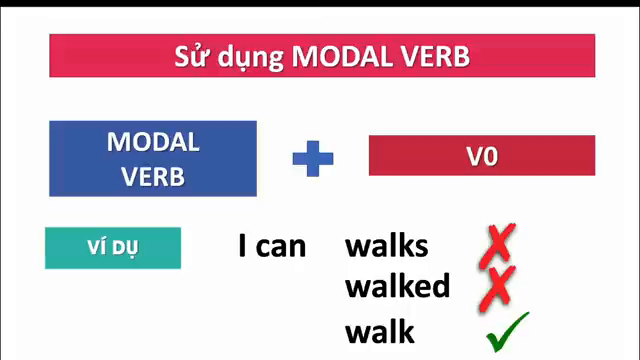

* **Đề bài:** Authorized users can ------- their profile details through the newly designed portal.
  * (A) update
  * (B) updates
  * (C) updated
  * (D) updating
* **Dạng bài:** Động từ khiếm khuyết.
* **Phân tích:** Trước vị trí trống xuất hiện động từ khiếm khuyết *can*. Quy tắc bất biến trong ngữ pháp tiếng Anh: Sau tất cả các động từ khiếm khuyết (can, could, may, might, will, would, shall, should, must) bắt buộc phải là một động từ nguyên mẫu không chia (Verb 0).
  * (A) *update*: Động từ nguyên mẫu (Verb 0).
  * (B) *updates*: Động từ chia ngôi thứ ba số ít.
  * (C) *updated*: Động từ quá khứ / phân từ hai.
  * (D) *updating*: Dạng danh động từ / hiện tại phân từ.
* **Đáp án:** **(A) update**.
* **Dịch nghĩa:** Người dùng được cấp quyền có thể cập nhật thông tin cá nhân của mình thông qua cổng thông tin điện tử mới thiết kế.
* **Mở rộng:** Bản chất Modal Verb là động từ bổ trợ ngữ nghĩa, không thể đứng độc lập làm vị ngữ duy nhất mà luôn cần động từ nguyên mẫu theo sau.

---

### Câu 108

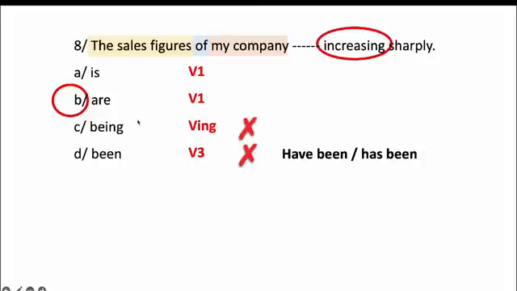

* **Đề bài:** Overall company revenue ------- increasing sharply due to strong international demand.
  * (A) is
  * (B) are
  * (C) being
  * (D) been
* **Dạng bài:** Dạng thức to be.
* **Phân tích:** Phía sau khoảng trống là dạng động từ *increasing* (V-ing). Cấu trúc thì hiện tại tiếp diễn đòi hỏi trợ động từ `to be + V-ing`. Chủ ngữ của câu là `Overall company revenue` (doanh thu công ty), đây là danh từ không đếm được / danh từ số ít. Do đó động từ to be phải chia ở ngôi thứ ba số ít thì hiện tại đơn.
  * (A) *is*: To be số ít thì hiện tại đơn.
  * (B) *are*: To be số nhiều.
  * (C) *being*: Hiện tại phân từ, không làm động từ chính.
  * (D) *been*: Quá khứ phân từ, phải đi kèm have/has/had.
* **Đáp án:** **(A) is**.
* **Dịch nghĩa:** Tổng doanh thu của công ty đang tăng trưởng mạnh mẽ nhờ vào nhu cầu quốc tế tăng cao.
* **Mở rộng:** Trạng từ `sharply` (mạnh mẽ, đột biến); phân biệt động từ to be diễn tả trạng thái đặc trưng của chủ ngữ, khác với động từ thường mô tả tác động vật lý.

---

### Câu 109

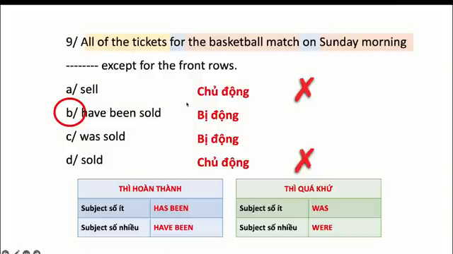

* **Đề bài:** Over ten thousand tickets were ------- within the first two hours of opening.
  * (A) sell
  * (B) sold
  * (C) selling
  * (D) sale
* **Dạng bài:** Thể bị động.
* **Phân tích:** Câu có cấu trúc chủ ngữ chỉ vật `Over ten thousand tickets` (hơn 10.000 vé) kết hợp với trợ động từ `were`. Vé không thể tự thực hiện hành động bán mà phải được bán ra bởi con người. Cấu trúc câu bị động bắt buộc: `S + be + Verb 3/ed`. Động từ *sell* là động từ bất quy tắc có dạng V2/V3 là *sold*.
  * (A) *sell*: Động từ nguyên mẫu.
  * (B) *sold*: Phân từ hai (Verb 3).
  * (C) *selling*: Dạng V-ing (chủ động).
  * (D) *sale*: Danh từ (sự bán hàng, đợt giảm giá).
* **Đáp án:** **(B) sold**.
* **Dịch nghĩa:** Hơn mười nghìn vé đã được bán hết chỉ trong vòng hai giờ đầu tiên mở bán.
* **Mở rộng:** Bảng động từ bất quy tắc thông dụng: `sell -> sold -> sold`, `tell -> told -> told`, `make -> made -> made`.

---

### Câu 110

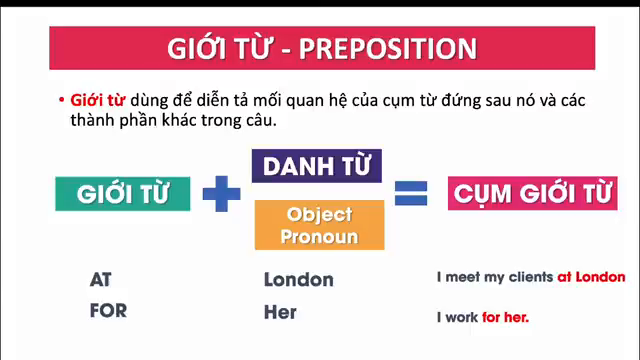

* **Đề bài:** The regional headquarters is located ------- the central business district.
  * (A) in
  * (B) into
  * (C) onto
  * (D) through
* **Dạng bài:** Giới từ chỉ vị trí.
* **Phân tích:** Vị trí trống cần một giới từ chỉ không gian đi liền với cụm danh từ chỉ khu vực địa lý đô thị rộng lớn `the central business district` (khu trung tâm thương mại tài chính). Giới từ chỉ vị trí nằm bên trong một khu vực, thành phố, hoặc quận huyện là *in*. Cụm thành ngữ cố định: `be located in + địa điểm`.
* **Đáp án:** **(A) in**.
* **Dịch nghĩa:** Trụ sở khu vực tọa lạc ngay trong khu trung tâm thương mại và tài chính của thành phố.
* **Mở rộng:** Giới từ *in* dùng cho không gian 3 chiều hoặc diện tích rộng; *into* chỉ phương hướng chuyển động từ ngoài vào trong; *onto* chỉ chuyển động lên bề mặt.

---

### Câu 111

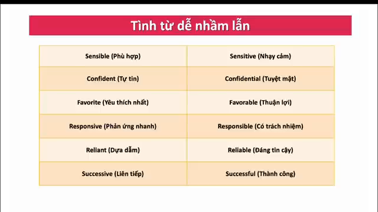

* **Đề bài:** The chief executive delivered a very ------- speech at the annual shareholders conference.
  * (A) persuasive
  * (B) persistent
  * (C) perishable
  * (D) permanent
* **Dạng bài:** Từ vựng tính từ.
* **Phân tích:** Vị trí trống đứng trước danh từ *speech* (bài phát biểu) và sau trạng từ chỉ mức độ *very*. Cần một tính từ mô tả đặc tính tích cực, thuyết phục của bài phát biểu trước đại hội cổ đông.
  * (A) *persuasive*: Mang tính thuyết phục cao (gốc từ *persuade*).
  * (B) *persistent*: Kiên trì, dai dẳng.
  * (C) *perishable*: Dễ hư hỏng (dùng cho thực phẩm).
  * (D) *permanent*: Lâu dài, vĩnh viễn.
* **Đáp án:** **(A) persuasive**.
* **Dịch nghĩa:** Giám đốc điều hành đã có một bài phát biểu vô cùng thuyết phục tại hội nghị cổ đông thường niên.
* **Mở rộng:** Động từ `persuade somebody to do something` (thuyết phục ai làm gì); cụm từ `perishable goods` (hàng hóa dễ ôi thiu).

---

### Câu 112

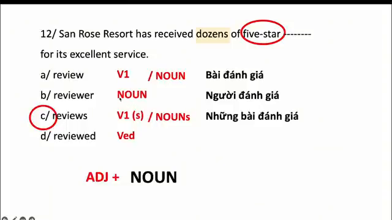

* **Đề bài:** The board received several detailed ------- regarding the proposed acquisition.
  * (A) review
  * (B) reviewer
  * (C) reviews
  * (D) reviewing
* **Dạng bài:** Hình thái từ loại danh từ.
* **Phân tích:** Trước vị trí trống xuất hiện từ chỉ số lượng *several* (một vài, nhiều) kết hợp với tính từ mô tả *detailed* (chi tiết). Quy tắc ngữ pháp: Sau *several* bắt buộc phải là một danh từ đếm được ở dạng số nhiều (several + Plural Noun).
  * (A) *review*: Danh từ số ít / động từ nguyên mẫu.
  * (B) *reviewer*: Danh từ chỉ người ở số ít (người đánh giá).
  * (C) *reviews*: Danh từ số nhiều (các bản đánh giá/nhận xét).
  * (D) *reviewing*: Dạng V-ing.
* **Đáp án:** **(C) reviews**.
* **Dịch nghĩa:** Hội đồng quản trị đã nhận được một số bản đánh giá chi tiết liên quan đến thương vụ mua lại được đề xuất.
* **Mở rộng:** Giới từ `regarding` = `concerning` = `about` (liên quan đến); danh từ `acquisition` (thương vụ mua lại doanh nghiệp).

---

### Câu 113

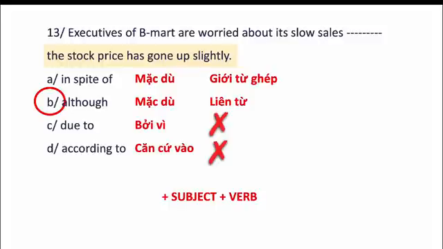

* **Đề bài:** ------- the flight was delayed by inclement weather, all passengers arrived safely.
  * (A) In spite of
  * (B) Although
  * (C) Due to
  * (D) Because of
* **Dạng bài:** Phân biệt liên từ và giới từ.
* **Phân tích:** Phía sau khoảng trống là một mệnh đề hoàn chỉnh có đầy đủ chủ ngữ và vị ngữ: `the flight (S) + was delayed (V)`. Do đó vị trí đầu câu bắt buộc phải là một liên từ liên kết mệnh đề (conjunction), loại ngay các giới từ chỉ đi kèm danh từ/cụm danh từ (*In spite of, Due to, Because of*).
  * (A) *In spite of*: Giới từ chỉ sự nhượng bộ (chỉ đi với Noun/V-ing).
  * (B) *Although*: Liên từ chỉ sự nhượng bộ (đi với S + V).
  * (C) *Due to*: Giới từ chỉ nguyên nhân (đi với Noun/V-ing).
  * (D) *Because of*: Giới từ chỉ nguyên nhân (đi với Noun/V-ing).
* **Đáp án:** **(B) Although**.
* **Dịch nghĩa:** Mặc dù chuyến bay bị hoãn do thời tiết khắc nghiệt, toàn bộ hành khách đều đã đến nơi an toàn.
* **Mở rộng:** Cụm từ `inclement weather` (thời tiết khắc nghiệt); quy tắc chuyển đổi tương đương giữa `Although + S + V` và `In spite of + Noun Phrase`.

---

### Câu 114

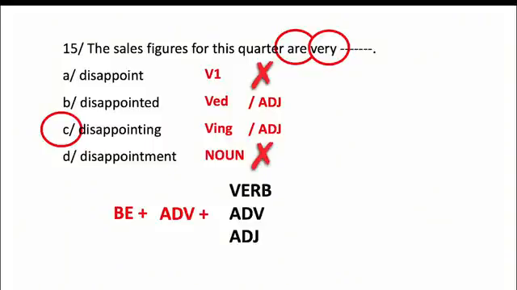

* **Đề bài:** Quarterly revenue figures were ------- to all senior executives at the morning meeting.
  * (A) disappoint
  * (B) disappointed
  * (C) disappointing
  * (D) disappoints
* **Dạng bài:** Phân từ đóng vai trò tính từ.
* **Phân tích:** Vị trí trống đứng sau động từ to be *were* nhằm miêu tả bản chất của chủ ngữ chỉ sự vật `Quarterly revenue figures` (các số liệu doanh thu hàng quý). Quy tắc phân biệt tính từ đuôi *-ing* và *-ed*:
  * Tính từ đuôi *-ed* mô tả cảm xúc chủ quan của con người (bị tác động bởi yếu tố bên ngoài).
  * Tính từ đuôi *-ing* mô tả tính chất, bản chất khách quan của sự vật, sự việc tạo ra cảm xúc đó. Do số liệu không thể tự có cảm xúc thất vọng mà chính nó mang tính chất gây thất vọng, đáp án bắt buộc là dạng tính từ đuôi *-ing*.
* **Đáp án:** **(C) disappointing**.
* **Dịch nghĩa:** Số liệu doanh thu quý đáng thất vọng đối với tất cả các nhà quản lý cấp cao tại cuộc họp buổi sáng.
* **Mở rộng:** Phân biệt `I am disappointed` (tôi cảm thấy thất vọng) và `The result is disappointing` (kết quả đó thật đáng thất vọng).

---

### Câu 115

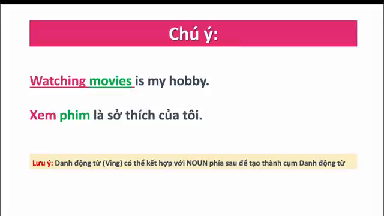

* **Đề bài:** Managing many successful companies ------- tremendous effort and exceptional leadership.
  * (A) require
  * (B) requires
  * (C) requiring
  * (D) requirement
* **Dạng bài:** Danh động từ làm chủ ngữ.
* **Phân tích:** Chủ ngữ của câu là một cụm danh động từ bắt đầu bằng V-ing: `Managing many successful companies` (việc điều hành nhiều công ty thành công). Nhiều thí sinh mắc bẫy nhìn thấy danh từ số nhiều *companies* đứng liền trước nên chia động từ số nhiều. Quy tắc chuẩn: Khi danh động từ làm chủ ngữ, động từ chính luôn chia ở ngôi thứ ba số ít thì hiện tại đơn (Verb 1 thêm s/es).
  * (A) *require*: Động từ số nhiều.
  * (B) *requires*: Động từ ngôi thứ ba số ít.
  * (C) *requiring*: Dạng V-ing, không làm vị ngữ chính.
  * (D) *requirement*: Danh từ.
* **Đáp án:** **(B) requires**.
* **Dịch nghĩa:** Việc điều hành nhiều công ty thành công đòi hỏi nỗ lực phi thường và năng lực lãnh đạo xuất chúng.
* **Mở rộng:** Khái niệm `Gerund phrase` (cụm danh động từ); danh từ `qualifications` (năng lực chuyên môn/bằng cấp).

---

### Câu 116

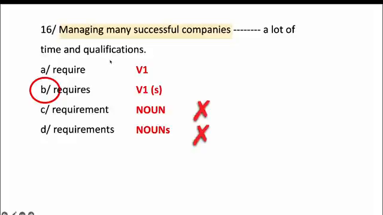

* **Đề bài:** Candidates must submit proof of professional ------- prior to the final interview round.
  * (A) qualify
  * (B) qualified
  * (C) qualifications
  * (D) qualifyings
* **Dạng bài:** Hình thái từ loại danh từ.
* **Phân tích:** Vị trí trống đứng sau tính từ *professional* (chuyên nghiệp) và sau giới từ *of*. Cấu trúc bắt buộc cần một danh từ để tạo thành cụm danh từ làm bổ ngữ cho giới từ *of*.
  * (A) *qualify*: Động từ (đủ điều kiện).
  * (B) *qualified*: Tính từ (có đủ năng lực).
  * (C) *qualifications*: Danh từ số nhiều (bằng cấp, phẩm chất năng lực chuyên môn).
  * (D) *qualifyings*: Dạng từ không chuẩn xác trong từ điển.
* **Đáp án:** **(C) qualifications**.
* **Dịch nghĩa:** Các ứng viên phải nộp bằng chứng về năng lực chuyên môn trước vòng phỏng vấn cuối cùng.
* **Mở rộng:** Giới từ kép `prior to` = `before` (trước thời điểm nào); động từ `submit proof of` (nộp bằng chứng xác thực).

---

### Câu 117

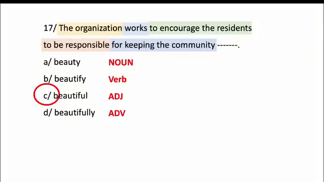

* **Đề bài:** Local residents volunteer regularly to keep their surrounding community -------.
  * (A) beauty
  * (B) beautifully
  * (C) beautiful
  * (D) beautify
* **Dạng bài:** Bổ ngữ cho tân ngữ.
* **Phân tích:** Câu có cấu trúc tác động `keep + Object + Adjective` (giữ cho ai/cái gì ở trạng thái như thế nào). Trong câu này, tân ngữ là cụm danh từ `their surrounding community` (cộng đồng xung quanh họ). Vị trí đứng sau tân ngữ đóng vai trò là bổ ngữ mô tả tính chất của cộng đồng đó, bắt buộc phải là một tính từ.
  * (A) *beauty*: Danh từ (vẻ đẹp).
  * (B) *beautifully*: Trạng từ (một cách tươi đẹp).
  * (C) *beautiful*: Tính từ (xinh đẹp, sạch đẹp).
  * (D) *beautify*: Động từ (làm đẹp, tôn tạo).
* **Đáp án:** **(C) beautiful**.
* **Dịch nghĩa:** Cư dân địa phương thường xuyên tham gia tình nguyện nhằm giữ cho cảnh quan cộng đồng xung quanh luôn tươi đẹp.
* **Mở rộng:** Cấu trúc tương tự: `make + O + Adj` (làm cho ai/cái gì trở nên...), `find + O + Adj` (nhận thấy điều gì như thế nào).

---

### Câu 118

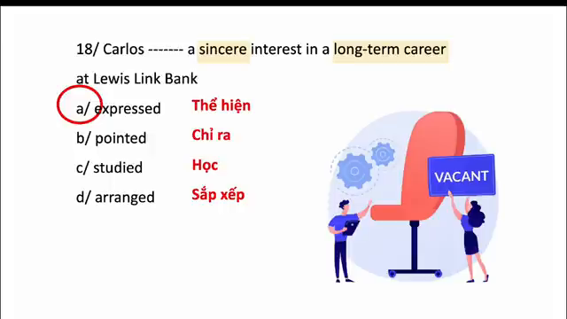

* **Đề bài:** Mr. Evans ------- sincere interest in pursuing a long-term career at the investment firm.
  * (A) expressed
  * (B) expanded
  * (C) expired
  * (D) expected
* **Dạng bài:** Từ vựng động từ.
* **Phân tích:** Khoảng trống là vị ngữ chính của câu đi với tân ngữ `sincere interest` (sự quan tâm chân thành). Cần chọn động từ diễn tả hành động thể hiện hoặc bày tỏ mối quan tâm, nguyện vọng nghề nghiệp.
  * (A) *expressed*: Bày tỏ, thể hiện (cụm: express interest in).
  * (B) *expanded*: Mở rộng quy mô.
  * (C) *expired*: Hết hạn hợp đồng/giấy tờ.
  * (D) *expected*: Kỳ vọng, mong đợi.
* **Đáp án:** **(A) expressed**.
* **Dịch nghĩa:** Ông Evans đã bày tỏ sự quan tâm chân thành đối với việc theo đuổi sự nghiệp lâu dài tại công ty đầu tư.
* **Mở rộng:** Tính từ `sincere` (chân thành); cụm từ cố định `pursue a career` (theo đuổi sự nghiệp).

---

### Câu 119

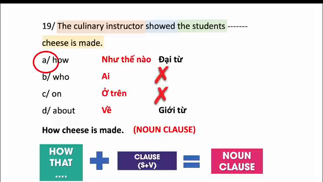

* **Đề bài:** The departmental head assigned ------- the responsibility of organizing the conference.
  * (A) he
  * (B) him
  * (C) his
  * (D) himself
* **Dạng bài:** Động từ hai tân ngữ.
* **Phân tích:** Động từ *assign* tuân theo cấu trúc hai tân ngữ: `assign + Indirect Object (người) + Direct Object (việc)` (giao cho ai trách nhiệm gì). Trưởng phòng giao việc cho một nhân sự khác (anh ấy), do đó vị trí tân ngữ gián tiếp phải dùng đại từ tân ngữ thông thường, không dùng đại từ phản thân (*himself*) vì chủ ngữ và đối tượng nhận việc là hai thực thể khác nhau.
  * (A) *he*: Đại từ chủ ngữ.
  * (B) *him*: Đại từ tân ngữ.
  * (C) *his*: Tính từ sở hữu.
  * (D) *himself*: Đại từ phản thân.
* **Đáp án:** **(B) him**.
* **Dịch nghĩa:** Trưởng bộ phận đã giao cho anh ấy trách nhiệm tổ chức hội nghị khách hàng.
* **Mở rộng:** Cấu trúc tương đương: `assign something to somebody` (giao việc gì cho ai).

---

### Câu 120

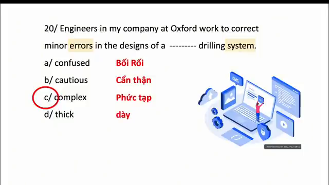

* **Đề bài:** Software engineers implemented a new monitoring ------- to detect security breaches.
  * (A) system
  * (B) systematic
  * (C) systematically
  * (D) systematize
* **Dạng bài:** Danh từ ghép.
* **Phân tích:** Vị trí trống đứng sau mạo từ *a*, tính từ *new*, và danh từ bổ nghĩa *monitoring*. Vị trí này bắt buộc phải là một danh từ chính để hoàn thiện cụm danh từ tân ngữ `a new monitoring system` (một hệ thống giám sát mới).
  * (A) *system*: Danh từ (hệ thống).
  * (B) *systematic*: Tính từ (có tính hệ thống).
  * (C) *systematically*: Trạng từ (một cách có hệ thống).
  * (D) *systematize*: Động từ (hệ thống hóa).
* **Đáp án:** **(A) system**.
* **Dịch nghĩa:** Các kỹ sư phần mềm đã triển khai một hệ thống giám sát mới nhằm phát hiện các lỗ hổng bảo mật.
* **Mở rộng:** Cụm từ `security breaches` (vi phạm/lỗ hổng an ninh mạng); động từ `implement` (triển khai, áp dụng giải pháp).

---

### Câu 121

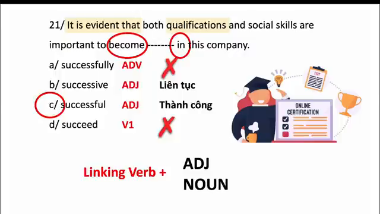

* **Đề bài:** The marketing campaign was highly ------- in attracting international customers.
  * (A) succeed
  * (B) success
  * (C) successful
  * (D) successfully
* **Dạng bài:** Tính từ sau to be.
* **Phân tích:** Động từ to be *was* kết hợp với trạng từ chỉ mức độ *highly*. Theo nguyên tắc, trạng từ bổ nghĩa cho tính từ đứng sau động từ liên kết/to be (be + Adv + Adj). Vị trí này cần một tính từ miêu tả tính chất hiệu quả của chiến dịch.
  * (A) *succeed*: Động từ (thành công).
  * (B) *success*: Danh từ (sự thành công).
  * (C) *successful*: Tính từ (thành công).
  * (D) *successfully*: Trạng từ (một cách thành công).
* **Đáp án:** **(C) successful**.
* **Dịch nghĩa:** Chiến dịch tiếp thị đã vô cùng thành công trong việc thu hút khách hàng quốc tế.
* **Mở rộng:** Cấu trúc `be successful in doing something` (thành công trong việc làm gì); phân biệt họ từ `success (N) - succeed (V) - successful (Adj) - successfully (Adv)`.

---

### Câu 122

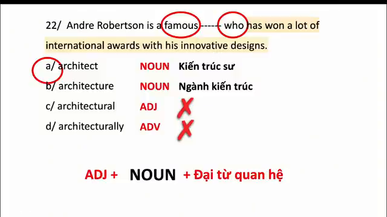

* **Đề bài:** The ------- who designed the cultural center received prestigious international awards.
  * (A) architect
  * (B) architecture
  * (C) architectural
  * (D) architecturally
* **Dạng bài:** Đại từ quan hệ chỉ người.
* **Phân tích:** Phía sau khoảng trống là đại từ quan hệ *who* đi kèm động từ hành động *designed* (đã thiết kế) và vị ngữ chính *received prestigious international awards* (nhận giải thưởng quốc tế). Đại từ *who* chỉ thay thế cho danh từ chỉ người, do đó tiền từ đứng trước bắt buộc phải là danh từ chỉ người (*architect - kiến trúc sư*), không thể là danh từ chỉ vật/ngành học (*architecture - kiến trúc*).
  * (A) *architect*: Danh từ chỉ người (kiến trúc sư).
  * (B) *architecture*: Danh từ chỉ ngành nghề/công trình (kiến trúc).
  * (C) *architectural*: Tính từ.
  * (D) *architecturally*: Trạng từ.
* **Đáp án:** **(A) architect**.
* **Dịch nghĩa:** Vị kiến trúc sư người đã thiết kế trung tâm văn hóa vừa nhận được các giải thưởng quốc tế danh giá.
* **Mở rộng:** Danh từ `award` (giải thưởng được hội đồng trao tặng) khác với `reward` (phần thưởng đền đáp nỗ lực); tính từ `innovative` (sáng tạo, đổi mới).

---

### Câu 123

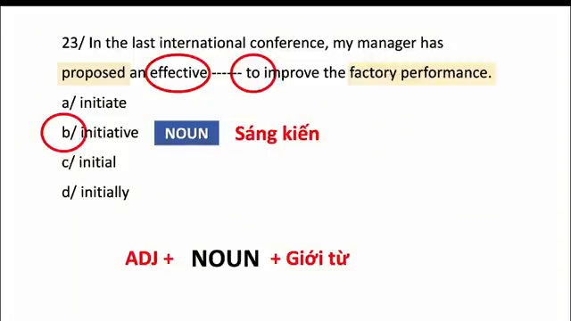

* **Đề bài:** Management introduced an effective ------- to improve overall factory performance.
  * (A) initiate
  * (B) initiative
  * (C) initiation
  * (D) initially
* **Dạng bài:** Danh từ đặc biệt.
* **Phân tích:** Trước vị trí trống có mạo từ *an* và tính từ *effective* (hiệu quả). Vị trí này bắt buộc phải là một danh từ số ít làm tân ngữ cho động từ *introduced*. Từ *initiative* là một ngoại lệ ngữ pháp quan trọng: mang đuôi *-ive* (thường là tính từ) nhưng thực chất là danh từ đếm được mang nghĩa sáng kiến/chiến lược.
  * (A) *initiate*: Động từ (khởi xướng).
  * (B) *initiative*: Danh từ (sáng kiến, giải pháp mới).
  * (C) *initiation*: Danh từ (sự kết nạp, sự bắt đầu).
  * (D) *initially*: Trạng từ (ban đầu).
* **Đáp án:** **(B) initiative**.
* **Dịch nghĩa:** Ban giám đốc đã giới thiệu một sáng kiến hiệu quả nhằm nâng cao năng suất hoạt động của nhà máy.
* **Mở rộng:** Danh từ đuôi *-ive* hay gặp trong TOEIC: `initiative` (sáng kiến), `representative` (người đại diện), `alternative` (phương án thay thế), `executive` (ủy viên quản trị).

---

### Câu 124

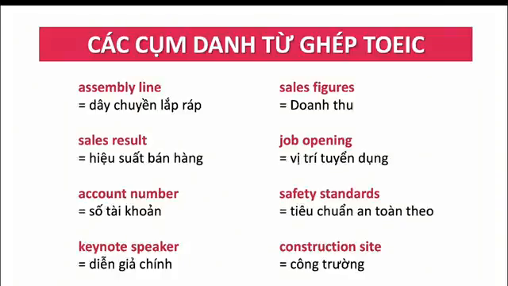

* **Đề bài:** Please ------- your password immediately after logging into the corporate intranet.
  * (A) change
  * (B) changing
  * (C) changed
  * (D) changes
* **Dạng bài:** Câu mệnh lệnh.
* **Phân tích:** Câu bắt đầu bằng từ lịch sự *Please* và đứng trước tân ngữ `your password`. Câu hoàn toàn khuyết thiếu chủ ngữ ngữ pháp. Đây là cấu trúc câu mệnh lệnh hoặc yêu cầu trực tiếp, bắt buộc phải sử dụng động từ nguyên mẫu không chia (Verb 0).
  * (A) *change*: Động từ nguyên thể (Verb 0).
  * (B) *changing*: Dạng V-ing.
  * (C) *changed*: Động từ quá khứ / phân từ hai.
  * (D) *changes*: Động từ chia ngôi thứ ba số ít.
* **Đáp án:** **(A) change**.
* **Dịch nghĩa:** Xin vui lòng thay đổi mật khẩu của bạn ngay sau khi đăng nhập vào mạng nội bộ của công ty.
* **Mở rộng:** Trạng từ `immediately` (ngay lập tức); các cụm danh từ ghép công sở: `safety standards` (tiêu chuẩn an toàn), `construction site` (công trường thi công).

---

### Câu 125

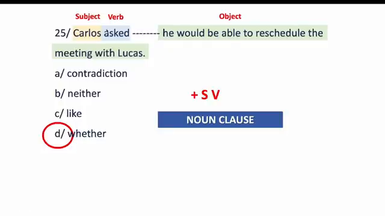

* **Đề bài:** The research team inquired ------- the project funding would be approved before December.
  * (A) what
  * (B) which
  * (C) that
  * (D) whether
* **Dạng bài:** Mệnh đề danh từ.
* **Phân tích:** Động từ vị ngữ là *inquired* (thắc mắc, hỏi thăm). Vế sau là một mệnh đề hoàn chỉnh mang tính nghi vấn liệu một sự việc có xảy ra hay không: `the project funding would be approved before December`. Liên từ dẫn dắt mệnh đề danh từ diễn tả ý nghĩa nghi vấn "liệu... có... hay không" trong câu gián tiếp bắt buộc là *whether* (hoặc *whether... or not*).
  * (A) *what*: Đại từ nghi vấn mang nghĩa cái gì (vế sau phải khuyết tân ngữ hoặc chủ ngữ).
  * (B) *which*: Đại từ nghi vấn lựa chọn trong số lượng hạn định.
  * (C) *that*: Liên từ khẳng định sự thật chắc chắn, không dùng sau động từ thắc mắc/nghi ngờ như *inquire*.
  * (D) *whether*: Liệu rằng... có... hay không.
* **Đáp án:** **(D) whether**.
* **Dịch nghĩa:** Nhóm nghiên cứu đã hỏi xem liệu nguồn kinh phí dự án có được phê duyệt trước tháng 12 hay không.
* **Mở rộng:** Cấu trúc mệnh đề danh từ: Noun Clause = Wh-word / That / Whether + S + V, có thể đóng vai trò làm chủ ngữ hoặc tân ngữ trong câu lớn.

---

### Câu 126

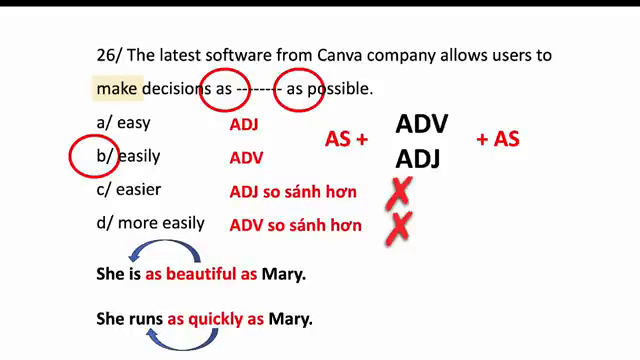

* **Đề bài:** Navigating the updated software application is remarkably ------- for novice users.
  * (A) easy
  * (B) easily
  * (C) ease
  * (D) easiest
* **Dạng bài:** Tính từ vị ngữ.
* **Phân tích:** Chủ ngữ câu là danh động từ `Navigating the updated software application` đi với động từ to be *is* và trạng từ chỉ mức độ *remarkably* (đáng chú ý, rõ rệt). Vị trí trống cần một tính từ đóng vai trò vị ngữ miêu tả đặc tính của việc sử dụng phần mềm (be + Adv + Adj).
  * (A) *easy*: Tính từ nguyên mẫu.
  * (B) *easily*: Trạng từ.
  * (C) *ease*: Danh từ (sự dễ dàng) / động từ (làm dịu đi).
  * (D) *easiest*: Tính từ so sánh nhất (phải có mạo từ *the*).
* **Đáp án:** **(A) easy**.
* **Dịch nghĩa:** Việc điều hướng ứng dụng phần mềm đã cập nhật là vô cùng dễ dàng đối với người dùng mới.
* **Mở rộng:** Lưu ý dịch nghĩa: `the latest product` là sản phẩm mới nhất trên thị trường (ra mắt trễ nhất về mốc thời gian nên là mới nhất).

---

### Câu 127

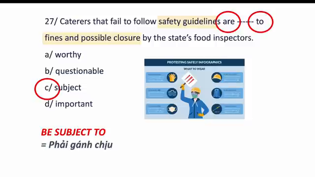

* **Đề bài:** The catering firm was required to comply ------- rigorous food hygiene standards.
  * (A) on
  * (B) at
  * (C) with
  * (D) to
* **Dạng bài:** Giới từ theo sau.
* **Phân tích:** Động từ *comply* (tuân thủ) là nội động từ, quy tắc kết hợp giới từ bất biến trong tiếng Anh thương mại và pháp lý là `comply with + regulations/standards/rules` (tuân thủ quy định/tiêu chuẩn).
* **Đáp án:** **(C) with**.
* **Dịch nghĩa:** Công ty cung cấp dịch vụ tiệc được yêu cầu phải tuân thủ nghiêm ngặt các tiêu chuẩn vệ sinh an toàn thực phẩm.
* **Mở rộng:** Các cặp từ đồng nghĩa chỉ sự tuân thủ: `comply with = abide by = conform to = adhere to = follow`.

---

### Câu 128

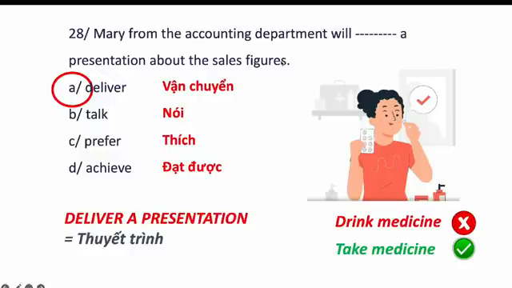

* **Đề bài:** The regional sales director will ------- a comprehensive presentation on Q4 projections.
  * (A) deliver
  * (B) talk
  * (C) prefer
  * (D) achieve
* **Dạng bài:** Cụm từ cố định.
* **Phân tích:** Đằng sau vị trí trống là cụm danh từ tân ngữ `a comprehensive presentation` (bài thuyết trình toàn diện). Trong tiếng Anh thương mại, cụm động từ chuẩn xác để diễn đạt việc thực hiện một bài thuyết trình là `deliver a presentation` (hoặc *give / make a presentation*).
  * (A) *deliver*: Cụm `deliver a presentation` (thuyết trình).
  * (B) *talk*: Nội động từ, không nhận tân ngữ trực tiếp mà phải đi với giới từ *about/to*.
  * (C) *prefer*: Thích cái gì hơn.
  * (D) *achieve*: Đạt được (thường đi với *goal, target, figure*).
* **Đáp án:** **(A) deliver**.
* **Dịch nghĩa:** Giám đốc kinh doanh khu vực sẽ trình bày một bài thuyết trình toàn diện về các dự báo tài chính quý 4.
* **Mở rộng:** Phân biệt ngoại động từ và nội động từ; cụm từ `sales figures` (doanh số bán hàng).

---

### Câu 129

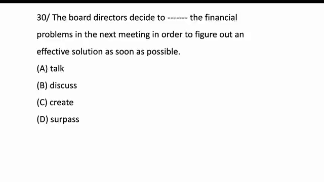

* **Đề bài:** The newly appointed supervisor will be responsible for ------- on-site construction activities.
  * (A) supervise
  * (B) supervises
  * (C) supervising
  * (D) supervised
* **Dạng bài:** Dạng thức sau giới từ.
* **Phân tích:** Vị trí trống đứng ngay sau tính từ và giới từ `responsible for` (chịu trách nhiệm về). Quy tắc ngữ pháp bất biến: Sau tất cả các giới từ (trừ to nguyên mẫu), động từ bắt buộc phải chuyển sang dạng danh động từ (V-ing) khi nhận tân ngữ đi sau (`responsible for + V-ing + Object`).
  * (A) *supervise*: Động từ nguyên mẫu.
  * (B) *supervises*: Động từ chia số ít.
  * (C) *supervising*: Danh động từ (V-ing).
  * (D) *supervised*: Động từ quá khứ / phân từ hai.
* **Đáp án:** **(C) supervising**.
* **Dịch nghĩa:** Người giám sát mới được bổ nhiệm sẽ chịu trách nhiệm giám sát các hoạt động thi công tại công trường.
* **Mở rộng:** Động từ `supervise` (giám sát); cụm từ cố định `be responsible for` = `take charge of` (chịu trách nhiệm cho).

---

### Câu 130

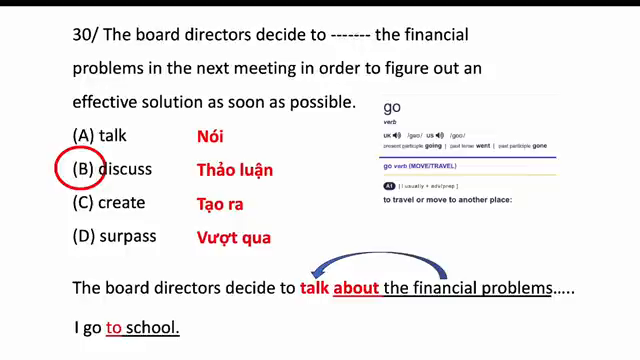

* **Đề bài:** Representatives met earlier today to ------- mutual trade terms and market expansion.
  * (A) talk
  * (B) discuss
  * (C) create
  * (D) surpass
* **Dạng bài:** Ngoại động từ và nội động từ.
* **Phân tích:** Đứng sau khoảng trống là cụm danh từ làm tân ngữ trực tiếp `mutual trade terms and market expansion` (các điều khoản thương mại song phương và việc mở rộng thị trường).
  * *talk* là nội động từ, nếu muốn có tân ngữ bắt buộc phải có giới từ *about/to* phía sau (`talk about something`), không bao giờ đứng trực tiếp trước danh từ.
  * *discuss* là ngoại động từ thuần túy, tác động trực tiếp lên tân ngữ mà không có giới từ đi kèm (`discuss something`).
  * *create* (tạo ra) và *surpass* (vượt qua) không phù hợp về ngữ nghĩa đàm phán trong ngữ cảnh hội nghị đại diện thương mại.
* **Đáp án:** **(B) discuss**.
* **Dịch nghĩa:** Các đại diện đã gặp nhau vào đầu ngày hôm nay để thảo luận về các điều khoản thương mại song phương và việc mở rộng thị trường.
* **Mở rộng:** Lỗi sai kinh điển: người học hay dùng nhầm `discuss about something` (thừa giới từ about); động từ `surpass` = `exceed` (vượt qua chỉ tiêu/kỳ vọng).

---

## Trích dẫn then chốt

* [00:00:46](https://youtu.be/xw--klidlFw?t=46): *"Khi làm bài điền từ part 5, đừng đọc đề trước mà hãy dành 1-2 giây quan sát bốn đáp án ABCD trước. Bốn đáp án cho biết đây là dạng bài gì để từ đó xác định cách giải phù hợp, tối ưu hóa thời gian."*
* [00:08:48](https://youtu.be/xw--klidlFw?t=528): *"Khi chủ ngữ tác động vào chính bản thân mình, bắt buộc phải dùng đại từ phản thân đằng sau động từ. Ví dụ 'I love myself' chứ không được dùng 'I love me'."*
* [00:21:40](https://youtu.be/xw--klidlFw?t=1300): *"Trong tiếng Anh có những cặp liên từ luôn đi chung với nhau: either đi với or, both đi với and, neither đi với nor. Thấy vế sau có nor là nhắm mắt quất ngay neither, đây là câu cho điểm."*
* [00:57:30](https://youtu.be/xw--klidlFw?t=3450): *"Phân biệt liên từ và giới từ là sống còn: Liên từ bắt buộc phải kéo theo một mệnh đề có chủ ngữ và động từ, còn giới từ chỉ được phép đi kèm một cụm danh từ hoặc V-ing."*
* [01:15:40](https://youtu.be/xw--klidlFw?t=4540): *"Khi danh động từ V-ing đứng đầu câu đóng vai trò làm chủ ngữ, nó luôn được tính là chủ ngữ số ít, bất kể danh từ bổ nghĩa phía sau có ở số nhiều đi chăng nữa. Động từ chính bắt buộc phải chia số ít."*

---

## Lệnh & Công cụ

### Bảng nhận diện hậu tố

```
Danh từ:     -tion, -sion, -ment, -ance, -ence, -ity, -ness, -er, -or, -ant
Tính từ:     -able, -ible, -ful, -less, -ive, -ous, -ic, -al
Trạng từ:    -ly (tính từ + ly)
Động từ:     -ize, -ate, -en, -ify
```

### Ma trận liên từ và giới từ

```
+----------------+-------------------------------+-------------------------------+
| Ý nghĩa        | Liên từ (+ Mệnh đề S + V)     | Giới từ (+ Cụm danh từ / V-ing)|
+----------------+-------------------------------+-------------------------------+
| Nhượng bộ      | Although, Even though, Though | In spite of, Despite          |
| Nguyên nhân    | Because, Since, As            | Due to, Because of, Owing to  |
| Trong khi      | While, Whereas                | During                        |
+----------------+-------------------------------+-------------------------------+
```

### Mô hình năm cấu trúc câu cơ bản

```
Mẫu 1: Subject + Intransitive Verb           (The plane arrived.)
Mẫu 2: Subject + Transitive Verb + Object    (She signed the contract.)
Mẫu 3: Subject + Linking Verb + Complement   (The market remains unstable.)
Mẫu 4: Subject + Verb + Indirect O + Direct O(He assigned him the task.)
Mẫu 5: Subject + Verb + Object + Complement  (They keep the park clean.)
```

---

## Đánh đổi & Rủi ro

* **Đánh đổi tốc độ và độ chính xác**: Quét nhanh hình thái từ loại bằng vị trí giúp giải quyết câu hỏi trong 5-10 giây, nhưng tiềm ẩn rủi ro nếu gặp cấu trúc đảo ngữ hoặc từ đa nghĩa. Với các câu hỏi từ vựng, bắt buộc phải dịch nghĩa dựa vào văn cảnh để tránh chọn nhầm từ đồng âm khác nghĩa.
* **Bẫy danh từ tận cùng bằng -ive**: Rủi ro chọn nhầm từ loại khi gặp các danh từ đặc biệt kết thúc bằng đuôi `-ive` như `initiative` (sáng kiến), `representative` (người đại diện). Nếu máy móc xem đuôi `-ive` luôn là tính từ sẽ dẫn đến chọn sai phương án ngữ pháp.
* **Nhầm lẫn tính từ phân từ -ed và -ing**: Thí sinh thường mắc lỗi gán ghép đuôi `-ed` cho người và `-ing` cho vật một cách cơ học. Bản chất chuẩn xác: `-ed` mô tả trạng thái cảm xúc của chủ thể tiếp nhận, trong khi `-ing` mô tả tính chất hoặc nguồn gốc tạo ra cảm xúc đó.
* **Lỗi dịch sai ngoại động từ**: Người học tiếng Việt thường có thói quen chêm giới từ sau ngoại động từ do ảnh hưởng của dịch thô (ví dụ: thảo luận về dịch nhầm thành `discuss about`, đến dịch nhầm thành `attend to`). Cần nắm vững danh sách ngoại động từ đi trực tiếp với tân ngữ danh từ.
