# GIẢI ĐỀ TOEIC 2025 MỚI NHẤT | TEST 5 [VIDEO 1]

* **Kênh:** Anh ngữ Ms Thanh | **Thời lượng:** 01:29:08 | **Ngày:** 2025-11-01
* **Video:** https://youtu.be/UKpsHzUXTSA

---

## Thuật ngữ

| Thuật ngữ | Tiếng Anh | Giải thích |
| :--- | :--- | :--- |
| Động từ hai tân ngữ | Ditransitive Verb | Động từ đòi hỏi cả tân ngữ gián tiếp chỉ người và tân ngữ trực tiếp chỉ vật (give/offer sb sth). |
| Đại từ phản thân | Reflexive Pronoun | Đại từ có đuôi -self/-selves dùng khi chủ ngữ và tân ngữ là cùng một đối tượng, hoặc để nhấn mạnh chủ thể tự thực hiện. |
| Liên từ phụ thuộc | Subordinating Conjunction | Từ dùng để nối mệnh đề phụ thuộc vào mệnh đề chính mà không cần dấu chấm phẩy ngăn cách (because, although). |
| Trạng từ liên kết | Conjunctive Adverb | Trạng từ dùng chuyển ý giữa hai mệnh đề độc lập, luôn cần dấu câu đi kèm như chấm phẩy hoặc phẩy (therefore, however). |
| Tính từ nguyên bản | Base Adjective | Tính từ vốn dĩ sinh ra đã có dạng đuôi -ed hoặc -ing chứ không phải biến thể phân từ của động từ (experienced = seasoned). |
| Câu mệnh lệnh | Imperative Sentence | Câu đưa ra yêu cầu, chỉ dẫn hoặc khuyên bảo bắt đầu bằng động từ nguyên mẫu không có chủ ngữ (use, please take). |
| Bị động rút gọn | Reduced Passive | Mệnh đề quan hệ thể bị động được rút gọn chỉ còn lại quá khứ phân từ V3/ed (spaced at 2-inch intervals). |
| Động từ liên kết | Linking Verb | Động từ nối chủ ngữ với tính từ miêu tả trạng thái thay vì trạng từ (become, seem, appear, remain). |
| Cụm từ cố định | Collocation | Tập hợp các từ thường xuyên đi liền với nhau theo thói quen bản ngữ (in advance, affordable prices). |
| Danh từ tập hợp | Collective Noun | Danh từ chỉ một nhóm đối tượng cùng loại nhưng không đếm được và không thêm -s ở dạng số nhiều (machinery). |

---

## Tổng luận chuyên đề

### Chiến thuật thời gian

Phần thi Đọc TOEIC kéo dài 75 phút cho 100 câu hỏi (từ câu 101 đến 200). Hai phần Part 5 và Part 6 mang tính quyết định việc thí sinh có đủ thời gian làm trọn vẹn Part 7 hay không:
* Tổng thời gian tối đa cho cả Part 5 và Part 6 không được vượt quá 25 phút.
* Riêng Part 5 gồm 30 câu (101 đến 130) phải hoàn thành dưới 15 phút, trung bình tối đa 30 giây mỗi câu.
* Thí sinh cần phân hóa rõ rệt hai nhóm câu hỏi:
  * **Nhóm xử lý thần tốc (5 đến 10 giây):** Nhận diện trực tiếp vị trí ngữ pháp (đại từ, trật tự cụm danh từ, thể bị động thiếu tân ngữ, câu mệnh lệnh chỉ thao tác quy trình).
  * **Nhóm phân tích ngữ cảnh (20 đến 30 giây):** Các câu đòi hỏi phân biệt sắc thái nghĩa giữa các từ đồng nghĩa (distinct vs distinctive, during vs over, now vs however).

### Cấu trúc ngữ pháp

* **Động từ hai tân ngữ:** Các động từ như `give` và `offer` có cấu trúc chuẩn `Give / Offer + Tân ngữ 1 (người) + Tân ngữ 2 (vật)`. Nếu chỗ trống đứng sát sau động từ và trước một danh từ chỉ vật thì chỗ trống bắt buộc là đại từ nhân xưng làm tân ngữ chỉ người (`give us a phone call`).
* **Phân biệt liên từ và trạng từ liên kết:** 
  * `Because` là liên từ kết nối trực tiếp hai mệnh đề (S + V) mà không cần dấu chấm phẩy.
  * Các từ chuyển tiếp như `therefore`, `however`, `for instance`, `in this case` là trạng từ liên kết, bắt buộc phải có dấu chấm phẩy phía trước và dấu phẩy phía sau (`; therefore,` / `; however,`) hoặc đứng đầu câu có dấu phẩy đi kèm (`. Therefore,`).
* **Câu mệnh lệnh mục đích:** Khi đầu câu xuất hiện cụm chỉ mục đích `To + V-inf, ...`, mệnh đề phía sau đóng vai trò là lời khuyên hoặc hướng dẫn thao tác để đạt mục đích đó. Nếu mệnh đề sau chưa có chủ ngữ lẫn động từ chia thì, bắt buộc phải dùng động từ nguyên mẫu câu mệnh lệnh (`(Please) + V-bare`).
* **Quy tắc phân biệt chủ động và bị động:** Hơn 90% các động từ hành động thường ở thể chủ động bắt buộc phải có tân ngữ (cụm danh từ) theo sau. Khi phía sau chỗ trống không có tân ngữ mà đi thẳng vào giới từ hoặc cụm `to + V-inf`, động từ bắt buộc chia ở thể bị động (`be + V3/ed`).

### Biến thể từ loại

* **Trật tự cụm danh từ:** Cụm danh từ có cấu trúc chuẩn `Mạo từ/Sở hữu cách + Trạng từ + Tính từ + Danh từ`. Từ đứng cuối cụm danh từ luôn là danh từ chính. Trước danh từ chính bổ nghĩa bắt buộc là tính từ hoặc tính từ phân từ bị động (`scheduled replacement`).
* **Hậu tố tạo động từ:** Hậu tố `-en` khi ghép vào tính từ hoặc danh từ sẽ tạo thành động từ mang nghĩa "làm cho trở nên như thế nào": `quicken` (làm nhanh hơn), `deepen` (làm sâu hơn), `widen` (nới rộng), `strengthen` (tăng cường, củng cố).
* **Phân biệt cặp tính từ dễ nhầm lẫn:**
  * `Distinct` (adj) = `Clear`: rõ ràng, rành mạch.
  * `Distinctive` (adj) = `Characteristic`: mang tính đặc trưng, riêng biệt.
* **Tính từ gốc đuôi -ed:** Từ `experienced` có thể đóng vai trò là một tính từ nguyên bản mang nghĩa "dạn dày kinh nghiệm, lão luyện", đồng nghĩa với `seasoned`.

### Cụm từ cố định

* **Thư từ thương mại:** Mẫu câu cố định trong thông báo: `We are pleased to inform you that...` (Chúng tôi rất vui mừng thông báo rằng...).
* **Thời gian và sự kiện:**
  * `During` dùng cho cả khoảng thời gian (`during the summer`) và sự kiện/tiến trình (`during the meeting`, `during the planning portion`).
  * `Over` chỉ dùng cho khoảng thời gian thuần túy (`over the weekend`, `over the last three years`).
  * `In advance` = `Beforehand`: trước thời hạn (dùng chỉ việc đặt chỗ, đăng ký trước).
* **Cụm động từ và danh từ ghép:**
  * `Cut down on something` = `Reduce`: cắt giảm chi phí, định mức.
  * `Push back` = `Hold back` = `Postpone` = `Delay`: trì hoãn, dời lại lịch trình.
  * `Socialize with` = `Interact with`: giao lưu, tương tác với ai (bắt buộc đi với giới từ with).
  * `Machinery` (danh từ không đếm được chỉ toàn bộ hệ thống máy móc) tương đương với danh từ số nhiều `machines`.

---

## Bóc tách chi tiết

### [[00:55](https://youtu.be/UKpsHzUXTSA?t=55s)] Câu 101

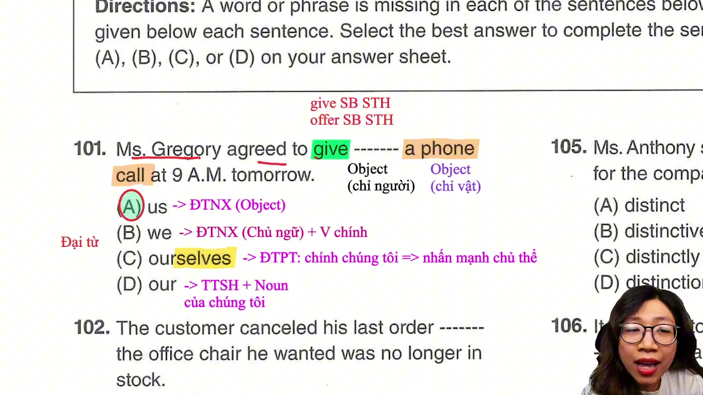

* **Đề bài:** `Ms. Gregory agreed to give ------- a phone call at 9 A.M. tomorrow.`
* **Phương án:**
  * (A) us: Đại từ nhân xưng tân ngữ (Object).
  * (B) we: Đại từ nhân xưng chủ ngữ (Subject), phía sau phải có động từ chính chia thì.
  * (C) ourselves: Đại từ phản thân (Reflexive Pronoun), dùng khi chủ ngữ và tân ngữ cùng là một người, hoặc nhấn mạnh chủ thể tự thực hiện hành động.
  * (D) our: Tính từ sở hữu (Possessive Adjective), bắt buộc phải có danh từ đi kèm phía sau.
* **Phân tích:** 
  * Động từ `give` và `offer` có cấu trúc 2 tân ngữ kinh điển: `Give / Offer somebody something` (trao cho ai cái gì).
  * Tân ngữ 1 đứng sát sau động từ là đối tượng tiếp nhận chỉ người (`somebody`), tân ngữ 2 đứng kế tiếp là danh từ chỉ vật (`something` - ở đây là `a phone call`).
  * Chỗ trống nằm ngay sau động từ `give` và trước tân ngữ chỉ vật `a phone call`, do đó bắt buộc phải là một đại từ nhân xưng đóng vai trò tân ngữ chỉ người (`us`). Chọn (A).
* **Dịch nghĩa:** Cô Gregory đã đồng ý gọi điện thoại cho chúng tôi vào lúc 9 giờ sáng ngày mai.
* **Mở rộng:**
  * `Give somebody a phone call` = `Call somebody` (gọi điện cho ai).
  * Nhận diện đại từ phản thân qua đuôi `-self` (số ít: myself, yourself, himself, herself, itself) hoặc `-selves` (số nhiều: ourselves, yourselves, themselves).
  * Cấu trúc tương đương đảo vị trí tân ngữ: `Give something to somebody` / `Offer something to somebody`.

---

### [[04:31](https://youtu.be/UKpsHzUXTSA?t=271s)] Câu 102

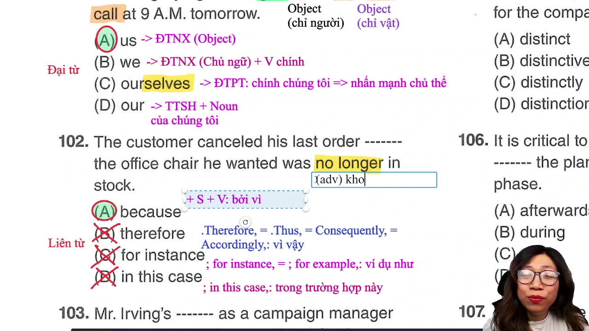

* **Đề bài:** `The customer canceled his last order ------- the office chair he wanted was no longer in stock.`
* **Phương án:**
  * (A) because: Liên từ chỉ nguyên nhân (Conjunction), theo sau là một mệnh đề hoàn chỉnh (S + V).
  * (B) therefore: Trạng từ liên kết (Conjunctive Adverb), đứng đầu câu hoặc mệnh đề và bắt buộc có dấu phẩy đi kèm (`; therefore,` hoặc `. Therefore,`).
  * (C) for instance: Cụm từ liên kết đưa ra ví dụ, yêu cầu có dấu phẩy theo sau (`; for instance,` hoặc `. For instance,`).
  * (D) in this case: Cụm trạng ngữ chỉ trường hợp, yêu cầu có dấu phẩy theo sau (`; in this case,` hoặc `. In this case,`).
* **Phân tích:**
  * Vế trước là một mệnh đề độc lập: `The customer canceled his last order` (S + V + O); vế sau cũng là một mệnh đề hoàn chỉnh: `the office chair he wanted was no longer in stock` (S + V).
  * Để liên kết hai mệnh đề mà không có dấu chấm phẩy hoặc dấu phẩy ngăn cách, vị trí chỗ trống bắt buộc phải là một liên từ phụ thuộc (`because`).
  * Các phương án B, C, D đều là trạng từ chuyển tiếp, không có chức năng ngữ pháp làm liên từ nối trực tiếp hai mệnh đề mà bắt buộc phải có dấu câu ngăn cách. Loại cả ba phương án. Chọn (A).
* **Dịch nghĩa:** Khách hàng đã hủy đơn hàng gần nhất của mình bởi vì chiếc ghế văn phòng mà ông ấy muốn không còn hàng trong kho nữa.
* **Mở rộng:**
  * `Therefore` = `Thus` = `Consequently` = `Accordingly` (trạng từ: vì vậy, do đó - theo sau có dấu phẩy).
  * `For instance` = `For example` (ví dụ như, chẳng hạn như - theo sau có dấu phẩy).
  * `No longer` (adv): không còn nữa (diễn tả trạng thái đã chấm dứt).
  * `In stock` (còn hàng trong kho) đối lập với `Out of stock` (hết hàng).

---

### [[07:40](https://youtu.be/UKpsHzUXTSA?t=460s)] Câu 103

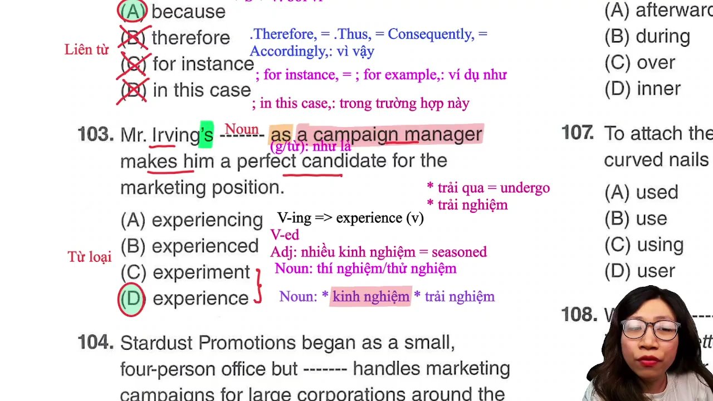

* **Đề bài:** `Mr. Irving's ------- as a campaign manager makes him a perfect candidate for the marketing position.`
* **Phương án:**
  * (A) experiencing: Danh động từ (V-ing), diễn tả hành động đang trải nghiệm.
  * (B) experienced: Tính từ mang nghĩa "nhiều kinh nghiệm, lão luyện" hoặc động từ dạng quá khứ.
  * (C) experiment: Danh từ chỉ "cuộc thí nghiệm, sự thử nghiệm".
  * (D) experience: Danh từ chỉ "kinh nghiệm, trải nghiệm".
* **Phân tích:**
  * Phía trước chỗ trống có sở hữu cách `Mr. Irving's` (dấu phẩy 's), phía sau là giới từ `as` (với tư cách là). Sau sở hữu cách bắt buộc phải là một danh từ để tạo thành chủ ngữ chính cho câu.
  * Loại (A) và (B). Xét hai danh từ (C) và (D): `experiment` mang nghĩa là cuộc thí nghiệm khoa học; `experience` là kinh nghiệm hoặc trải nghiệm làm việc.
  * Ngữ cảnh phía sau nhắc đến chức danh `campaign manager` (người quản lý chiến dịch) và `perfect candidate` (ứng cử viên hoàn hảo), do đó danh từ phù hợp về mặt logic phải là `experience` (kinh nghiệm làm việc). Chọn (D).
* **Dịch nghĩa:** Kinh nghiệm của ông Irving với tư cách là người quản lý chiến dịch giúp ông ấy trở thành một ứng cử viên hoàn hảo cho vị trí tiếp thị.
* **Mở rộng:**
  * `Experience` (v): trải qua, trải nghiệm = `undergo`.
  * `Experienced` (adj): có nhiều kinh nghiệm, dạn dày kinh nghiệm = `seasoned`. Đây là tính từ gốc có đuôi `-ed`, xuất hiện rất nhiều trong đề thi TOEIC.
  * `Candidate` = `Applicant` (ứng viên).

---

### [[12:18](https://youtu.be/UKpsHzUXTSA?t=738s)] Câu 104

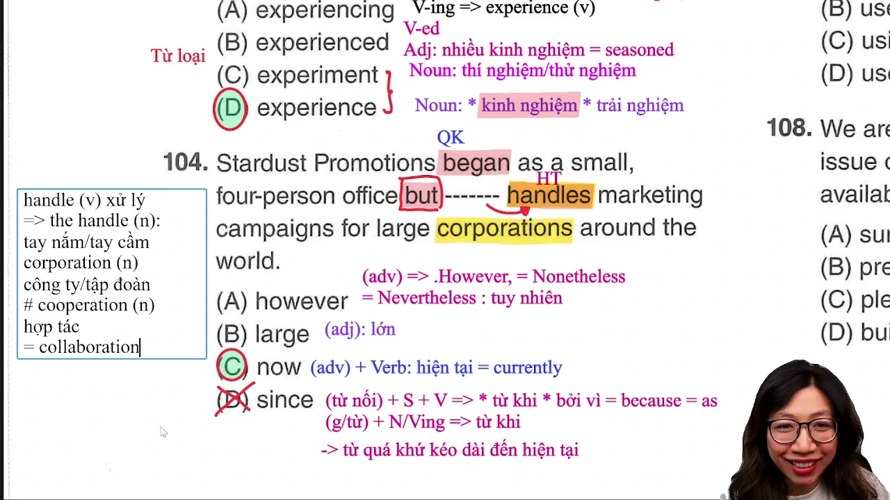

* **Đề bài:** `Stardust Promotions began as a small, four-person office but ------- handles marketing campaigns for large corporations around the world.`
* **Phương án:**
  * (A) however: Trạng từ chuyển tiếp (tuy nhiên), thường đứng độc lập đầu câu có dấu phẩy (`. However,`).
  * (B) large: Tính từ (lớn), không thể đứng trước bổ nghĩa cho động từ `handles`.
  * (C) now: Trạng từ chỉ thời gian (hiện tại, bây giờ), bổ nghĩa cho động từ chia thì hiện tại `handles`.
  * (D) since: Liên từ (bởi vì / từ khi) hoặc giới từ (từ khi - diễn tả hành động bắt đầu từ quá khứ kéo dài đến hiện tại).
* **Phân tích:**
  * Quan sát cấu trúc tương phản thời gian: Vế trước dùng động từ quá khứ đơn `began` (đã bắt đầu), nối bằng liên từ đối lập `but`, vế sau dùng động từ hiện tại đơn `handles` (hiện đang xử lý).
  * Chỗ trống đứng trước động từ thường `handles` cần một trạng từ bổ nghĩa cho hành động ở thì hiện tại và làm rõ tính đối lập với quá khứ.
  * Trạng từ `now` kết hợp với `handles` tạo thế đối lập hoàn hảo: quá khứ khởi đầu là văn phòng nhỏ 4 người nhưng hiện nay xử lý các chiến dịch quy mô toàn cầu. Chọn (C).
* **Dịch nghĩa:** Công ty Quảng bá Stardust đã bắt đầu như một văn phòng nhỏ gồm 4 người nhưng hiện nay đang xử lý các chiến dịch tiếp thị cho các tập đoàn lớn trên khắp thế giới.
* **Mở rộng:**
  * `Now` (adv) = `Currently` = `Presently` (hiện nay, hiện tại).
  * `However` = `Nevertheless` = `Nonetheless` (tuy nhiên).
  * `Handle` (v): xử lý, giải quyết = `deal with` = `address`. Danh từ `the handle`: tay nắm cửa, quai xách.
  * Phân biệt phát âm và nghĩa: `Corporation` (tập đoàn, công ty lớn) khác hoàn toàn `Cooperation` (sự hợp tác = `collaboration`).

---

### [[18:40](https://youtu.be/UKpsHzUXTSA?t=1120s)] Câu 105

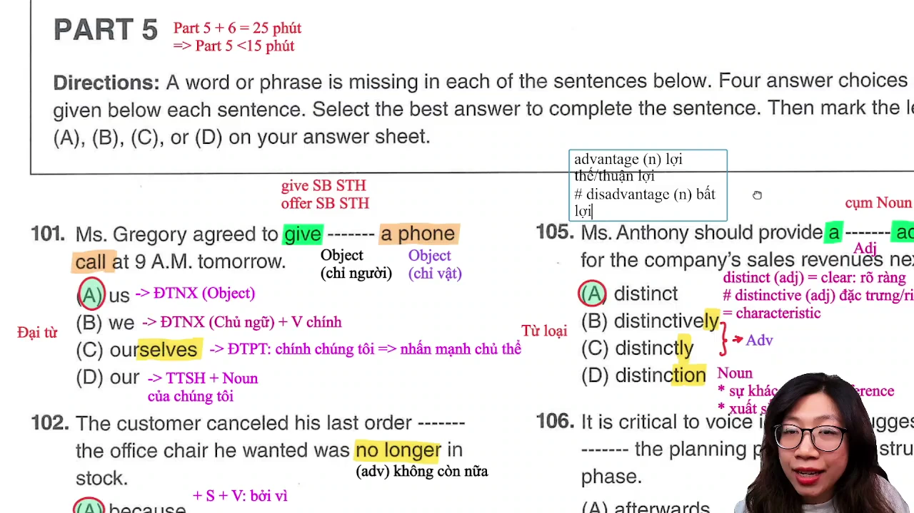

* **Đề bài:** `Ms. Anthony should provide a ------- advantage for the company's sales revenues next year.`
* **Phương án:**
  * (A) distinct: Tính từ, mang nghĩa "rõ ràng, rành mạch" (= clear).
  * (B) distinctively: Trạng từ mang nghĩa "một cách đặc trưng, riêng biệt".
  * (C) distinctly: Trạng từ mang nghĩa "một cách rõ ràng, rành mạch".
  * (D) distinction: Danh từ mang nghĩa "sự khác biệt" hoặc "sự xuất sắc".
* **Phân tích:**
  * Vị trí chỗ trống nằm giữa mạo từ `a` và danh từ `advantage` tạo thành cụm danh từ `a [Adj] advantage`. Vị trí này bắt buộc phải là một tính từ bổ nghĩa cho danh từ `advantage`.
  * Trong các phương án: (B) và (C) là trạng từ (đuôi `-ly`), (D) là danh từ (đuôi `-tion`). Do đó chọn ngay tính từ (A) `distinct`.
* **Dịch nghĩa:** Cô Anthony được kỳ vọng sẽ đem lại một lợi thế rõ rệt cho doanh thu bán hàng của công ty vào năm tới.
* **Mở rộng:**
  * Phân biệt bẫy tính từ cốt lõi trong TOEIC:
    * `Distinct` (adj) = `Clear`: rõ ràng, rành mạch, không thể nhầm lẫn.
    * `Distinctive` (adj) = `Characteristic`: đặc trưng, mang tính riêng biệt, độc đáo.
  * `Advantage` (n: lợi thế, thuận lợi) đối lập với `Disadvantage` (n: sự bất lợi).
  * `Distinction` (n): sự khác biệt (`difference`); tốt nghiệp loại xuất sắc: `graduate with high distinction` (= `excellence`).

---

### [[24:19](https://youtu.be/UKpsHzUXTSA?t=1459s)] Câu 106

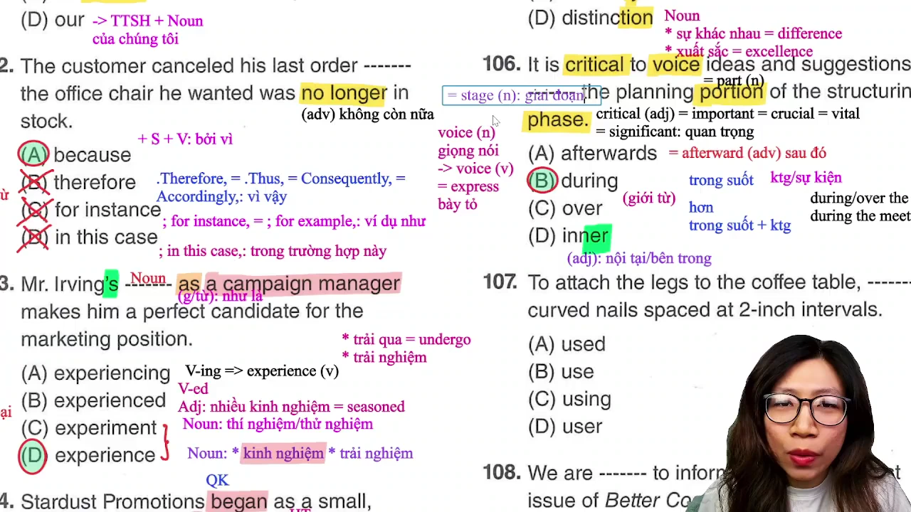

* **Đề bài:** `It is critical to voice ideas and suggestions ------- the planning portion of the structuring phase.`
* **Phương án:**
  * (A) afterwards: Trạng từ (sau đó = afterward), không đứng trước cụm danh từ làm giới từ.
  * (B) during: Giới từ, đi kèm khoảng thời gian hoặc một sự kiện/tiến trình (trong suốt...).
  * (C) over: Giới từ, chỉ đi kèm khoảng thời gian cụ thể (over the summer, over the past few years), không đi với sự kiện/tiến trình trừu tượng.
  * (D) inner: Tính từ (nội tại, bên trong), không thể đứng trước mạo từ `the`.
* **Phân tích:**
  * Phía sau chỗ trống là cụm danh từ `the planning portion of the structuring phase` (phần lập kế hoạch của giai đoạn cấu trúc) - đây là một giai đoạn, tiến trình công việc.
  * Cần một giới từ mang nghĩa "trong suốt". Cả `during` và `over` đều có nghĩa "trong suốt", nhưng quy tắc dùng khác nhau:
    * `During` đi được với cả khoảng thời gian (`during the summer`) và sự kiện/tiến trình (`during the meeting`, `during the planning portion`).
    * `Over` chỉ đi với mốc hoặc khoảng thời gian cụ thể (`over the weekend`, `over the last 3 years`).
  * Vì `the planning portion` là tiến trình/phân đoạn công việc chứ không phải đơn vị thời gian thuần túy, nên bắt buộc dùng `during`. Chọn (B).
* **Dịch nghĩa:** Việc bày tỏ các ý tưởng và đề xuất trong suốt phần lập kế hoạch của giai đoạn tái cấu trúc là cực kỳ quan trọng.
* **Mở rộng:**
  * `Critical` = `Important` = `Crucial` = `Vital` = `Significant` (tính từ: quan trọng, then chốt).
  * `Voice` (danh từ: giọng nói), khi đóng vai trò ngoại động từ mang nghĩa là `express` (bày tỏ, lên tiếng phát biểu ý kiến).
  * `Portion` = `Part` (phần, phân đoạn).
  * `Phase` = `Stage` (giai đoạn).

---

### [[31:53](https://youtu.be/UKpsHzUXTSA?t=1913s)] Câu 107

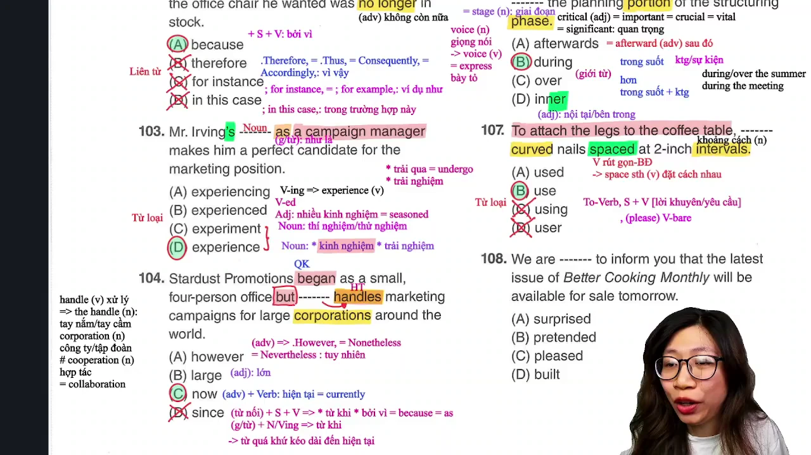

* **Đề bài:** `To attach the legs to the coffee table, ------- curved nails spaced at 2-inch intervals.`
* **Phương án:**
  * (A) used: Động từ dạng quá khứ hoặc quá khứ phân từ.
  * (B) use: Động từ nguyên mẫu (V-bare).
  * (C) using: Danh động từ hoặc hiện tại phân từ (V-ing).
  * (D) user: Danh từ chỉ người (người dùng).
* **Phân tích:**
  * Đầu câu là cụm chỉ mục đích `To attach the legs to the coffee table` theo sau bởi dấu phẩy. Mệnh đề phía sau chưa hề có chủ ngữ lẫn động từ chính.
  * Xét thành phần phía sau chỗ trống: `curved nails` là cụm danh từ (tân ngữ), `spaced at 2-inch intervals` là mệnh đề quan hệ rút gọn ở thể bị động bổ nghĩa cho `curved nails` (được đóng cách nhau khoảng 2 inch - động từ `space sth`: đặt cái gì cách nhau).
  * Cấu trúc câu mệnh lệnh chỉ dẫn kỹ thuật: `To + V-inf, (please) + V-bare + O` (Để làm việc A, hãy thực hiện thao tác B).
  * Do đó, chỗ trống bắt buộc phải là một động từ nguyên mẫu đóng vai trò vị ngữ câu mệnh lệnh. Chọn (B).
* **Dịch nghĩa:** Để gắn các chân vào bàn cà phê, hãy sử dụng những chiếc đinh cong được đặt cách nhau những khoảng 2 inch.
* **Mở rộng:**
  * Động từ `space` (v): đặt cách nhau khoảng cách bao nhiêu (`space sth at intervals`).
  * `Interval` (n): khoảng cách không gian hoặc khoảng thời gian giãn cách.
  * `Curve` (n): đường cong; `curved` (adj/phân từ): bị uốn cong.

---

### [[40:48](https://youtu.be/UKpsHzUXTSA?t=2448s)] Câu 108

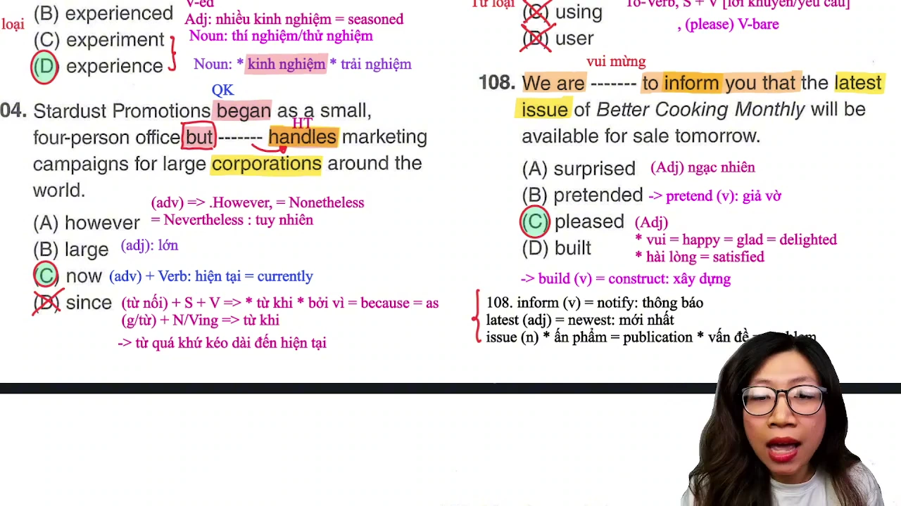

* **Đề bài:** `We are ------- to inform you that the latest issue of Better Cooking Monthly will be available for sale tomorrow.`
* **Phương án:**
  * (A) surprised: Tính từ mang nghĩa "ngạc nhiên".
  * (B) pretended: Động từ quá khứ của pretend (giả vờ).
  * (C) pleased: Tính từ mang nghĩa "vui mừng, hài lòng".
  * (D) built: Phân từ hai của build (xây dựng = construct).
* **Phân tích:**
  * Đây là mẫu câu thông báo thương mại kinh điển trong thư tín: `Be pleased to do something` = `Be happy / glad / delighted to do something` (chúng tôi rất vui mừng / hân hạnh được làm gì).
  * Cụm cố định: `We are pleased to inform you that...` (Chúng tôi rất vui mừng thông báo tới bạn rằng...). Chọn (C).
* **Dịch nghĩa:** Chúng tôi rất vui mừng được thông báo tới bạn rằng ấn phẩm mới nhất của tạp chí Better Cooking Monthly sẽ có sẵn để mở bán vào ngày mai.
* **Mở rộng:**
  * `Pleased` (adj):
    * Nghĩa 1: vui vẻ = `happy` = `glad` = `delighted`.
    * Nghĩa 2: hài lòng = `satisfied`.
  * `Inform` (v) = `Notify` (thông báo).
  * `Latest` (adj) = `Newest` (mới nhất), khác với `late` (trễ).
  * `Issue` (n):
    * Nghĩa 1: số báo, ấn phẩm xuất bản = `publication`.
    * Nghĩa 2: vấn đề cần giải quyết = `problem`.

---

### [[46:45](https://youtu.be/UKpsHzUXTSA?t=2805s)] Câu 109

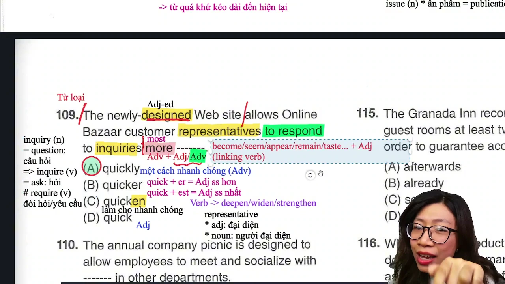

* **Đề bài:** `The newly-designed Web site allows Online Bazaar customer representatives to respond to inquiries more -------.`
* **Phương án:**
  * (A) quickly: Trạng từ (một cách nhanh chóng).
  * (B) quicker: Tính từ so sánh hơn (nhanh hơn).
  * (C) quicken: Động từ (làm cho nhanh chóng hơn).
  * (D) quick: Tính từ (nhanh).
* **Phân tích:**
  * Động từ của mệnh đề mục đích là `to respond` (động từ hành động thường) đi kèm tân ngữ gián tiếp `to inquiries`.
  * Thành phần đứng sau bổ nghĩa cho động từ hành động `respond` bắt buộc phải là một trạng từ.
  * Phía trước có từ chỉ mức độ so sánh hơn `more`. Cấu trúc: `more + Adv` khi bổ nghĩa cho động từ thường. Do đó phải chọn trạng từ `quickly`. Chọn (A).
* **Dịch nghĩa:** Trang web mới được thiết kế cho phép các đại diện chăm sóc khách hàng của Online Bazaar phản hồi các thắc mắc nhanh chóng hơn.
* **Mở rộng:**
  * Đuôi `-en` cấu tạo động từ từ tính từ/danh từ: `deepen` (làm sâu hơn), `widen` (nới rộng), `strengthen` (làm vững mạnh), `quicken` (làm nhanh hơn).
  * `Representative`: vừa là tính từ (mang tính đại diện), vừa là danh từ chỉ người (người đại diện).
  * Phân biệt cặp từ dễ nhầm lẫn:
    * `Inquiry` (n) = `Question` (câu hỏi, thắc mắc) -> `Inquire` (v) = `Ask` (hỏi).
    * `Require` (v) = `Demand` (yêu cầu, đòi hỏi bắt buộc).

---

### [[58:24](https://youtu.be/UKpsHzUXTSA?t=3504s)] Câu 110

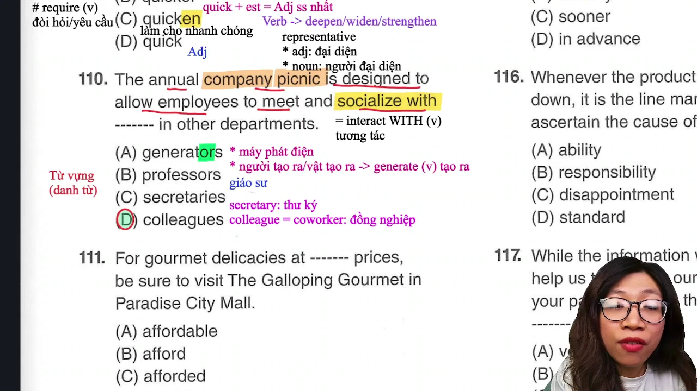

* **Đề bài:** `The annual company picnic is designed to allow employees to meet and socialize with ------- in other departments.`
* **Phương án:**
  * (A) generators: Máy phát điện hoặc người tạo ra (từ động từ generate).
  * (B) professors: Giáo sư.
  * (C) secretaries: Thư ký.
  * (D) colleagues: Đồng nghiệp.
* **Phân tích:**
  * Ngữ cảnh câu nói về sự kiện dã ngoại thường niên của công ty (`annual company picnic`) nhằm tạo cơ hội cho nhân viên gặp gỡ và giao lưu (`meet and socialize with`).
  * Đối tượng giao lưu ở các phòng ban khác (`in other departments`) trong cùng công ty chính là các đồng nghiệp (`colleagues`). Chọn (D).
* **Dịch nghĩa:** Buổi dã ngoại thường niên của công ty được thiết kế để tạo điều kiện cho các nhân viên gặp gỡ và giao lưu với các đồng nghiệp ở những phòng ban khác.
* **Mở rộng:**
  * `Colleague` = `Coworker` (đồng nghiệp).
  * `Socialize with` = `Interact with` (giao lưu, tương tác với ai - bắt buộc đi kèm giới từ `with`).
  * `Generate` (v): phát sinh, tạo ra -> `Generator` (n): máy phát điện hoặc đối tượng tạo ra.

---

### [[01:01:53](https://youtu.be/UKpsHzUXTSA?t=3713s)] Câu 111

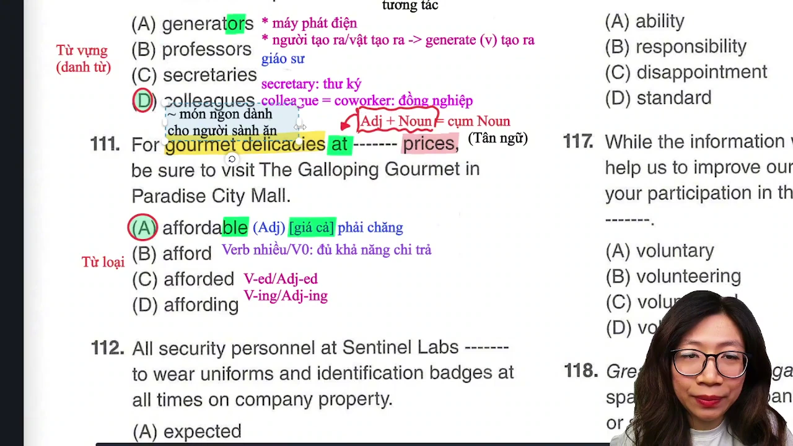

* **Đề bài:** `For gourmet delicacies at ------- prices, be sure to visit The Galloping Gourmet in Paradise City Mall.`
* **Phương án:**
  * (A) affordable: Tính từ (phải chăng, vừa túi tiền).
  * (B) afford: Động từ nguyên mẫu (có khả năng chi trả).
  * (C) afforded: Động từ quá khứ hoặc tính từ phân từ bị động.
  * (D) affording: Động từ dạng V-ing.
* **Phân tích:**
  * Cụm giới từ bắt đầu bằng `at`, phía sau là danh từ số nhiều `prices` (mức giá).
  * Cần một tính từ đứng trước danh từ `prices` để tạo thành cụm danh từ `[Adj] + prices` làm tân ngữ cho giới từ `at`.
  * Nhận diện đuôi tính từ `-able`. `Affordable` là tính từ chỉ giá cả phải chăng, luôn kết hợp cố định với `prices`, `rates` hoặc `costs`. Chọn (A).
* **Dịch nghĩa:** Để thưởng thức những món sơn hào hải vị với mức giá phải chăng, hãy nhớ ghé thăm cửa hàng The Galloping Gourmet tại trung tâm thương mại Paradise City Mall.
* **Mở rộng:**
  * Cụm từ cố định: `Affordable prices` (mức giá phải chăng, hợp lý).
  * `Gourmet delicacies`: đồ ăn ngon, mỹ vị dành cho người sành ăn.
  * `Afford` (v) + to V-inf / Noun: đủ khả năng tài chính để chi trả cho cái gì.

---

### [[01:05:05](https://youtu.be/UKpsHzUXTSA?t=3905s)] Câu 112

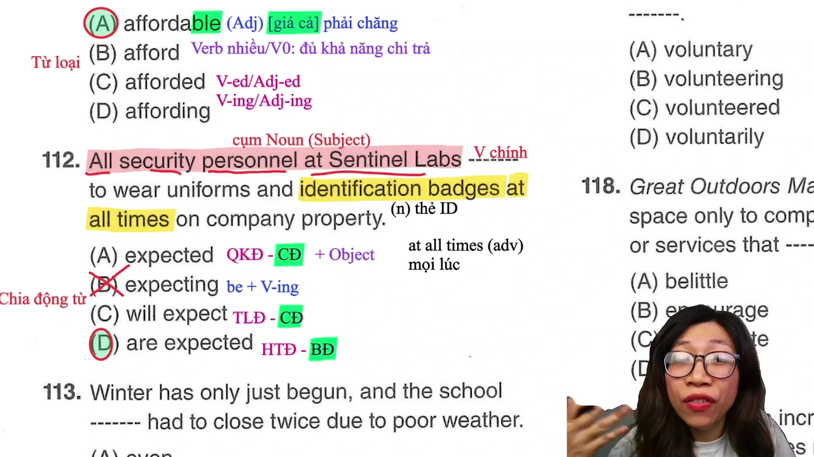

* **Đề bài:** `All security personnel at Sentinel Labs ------- to wear uniforms and identification badges at all times on company property.`
* **Phương án:**
  * (A) expected: Quá khứ đơn chủ động.
  * (B) expecting: Dạng V-ing, không thể đứng một mình làm động từ chính khi thiếu to be.
  * (C) will expect: Thì tương lai đơn chủ động.
  * (D) are expected: Thì hiện tại đơn thể bị động (`be + V3/ed`).
* **Phân tích:**
  * Chủ ngữ là `All security personnel at Sentinel Labs` (toàn bộ nhân viên an ninh tại Sentinel Labs). Mệnh đề chưa có động từ chính chia thì.
  * Loại (B) vì V-ing không làm động từ chính. Xét thể chủ động và bị động giữa các phương án còn lại:
    * Động từ `expect` khi ở thể chủ động là một ngoại động từ cần tân ngữ trực tiếp (`expect somebody to do something`).
    * Phía sau chỗ trống không có tân ngữ danh từ chỉ người mà đi thẳng vào cấu trúc `to wear uniforms`.
    * Cấu trúc bị động tương ứng: `Somebody + be expected to do something` (ai đó được yêu cầu/kỳ vọng phải làm gì). Do đó bắt buộc chọn thể bị động `are expected`. Chọn (D).
* **Dịch nghĩa:** Tất cả các nhân viên an ninh tại Sentinel Labs được yêu cầu phải mặc đồng phục và đeo thẻ tên mọi lúc khi ở trong khuôn viên công ty.
* **Mở rộng:**
  * `Identification badges` = `ID badges`: thẻ định danh, thẻ tên nhân viên.
  * `At all times` (adv) = `Always`: mọi lúc, luôn luôn.
  * `Property` (n): khuôn viên, bất động sản hoặc tài sản của công ty.

---

### [[01:09:49](https://youtu.be/UKpsHzUXTSA?t=4189s)] Câu 113

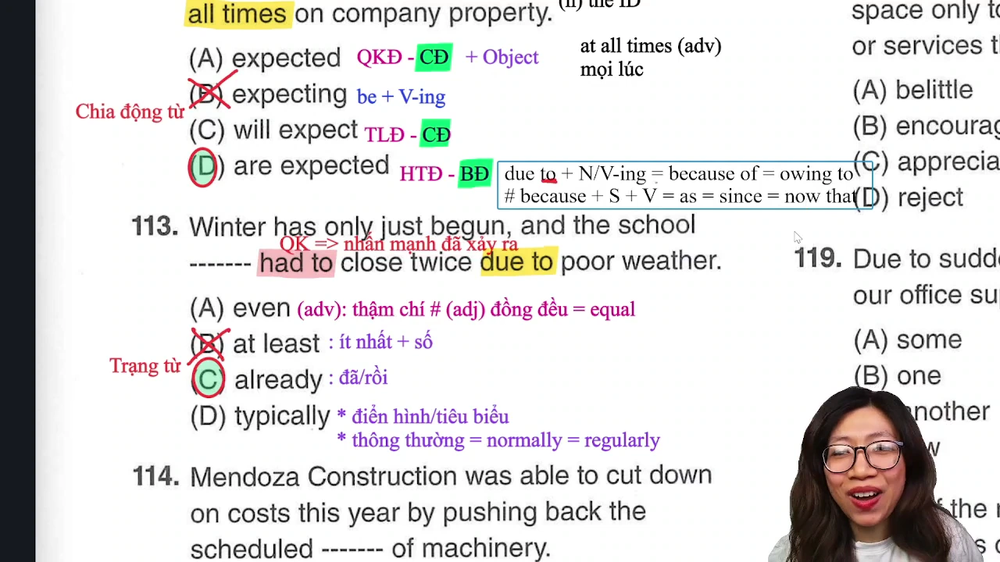

* **Đề bài:** `Winter has only just begun, and the school ------- had to close twice due to poor weather.`
* **Phương án:**
  * (A) even: Trạng từ mang nghĩa "thậm chí", hoặc tính từ mang nghĩa "đồng đều, bằng phẳng".
  * (B) at least: Cụm từ mang nghĩa "ít nhất", bắt buộc đứng trước con số chỉ số lượng.
  * (C) already: Trạng từ mang nghĩa "đã, rồi" (nhấn mạnh hành động đã xảy ra sớm hơn dự kiến).
  * (D) typically: Trạng từ mang nghĩa "thông thường, tiêu biểu" (= normally, regularly).
* **Phân tích:**
  * Vế đầu diễn tả mốc thời gian vừa mới bắt đầu: `Winter has only just begun` (Mùa đông mới chỉ vừa bắt đầu).
  * Vế sau diễn tả sự việc đã xảy ra tới 2 lần: `had to close twice` (đã phải đóng cửa hai lần).
  * Cần một trạng từ đứng giữa chủ ngữ và động từ để nhấn mạnh việc đã xảy ra rồi dù mùa đông mới vừa chớm. Trạng từ `already` hoàn toàn phù hợp với ngữ cảnh tương phản thời gian này.
  * Loại (B) vì nếu dùng `at least` thì phải đứng sát trước số lần (`at least twice`). Chọn (C).
* **Dịch nghĩa:** Mùa đông chỉ mới vừa bắt đầu, vậy mà trường học đã phải đóng cửa tới hai lần do thời tiết xấu.
* **Mở rộng:**
  * Phân biệt nguyên nhân:
    * `Due to` = `Because of` = `Owing to` + Cụm danh từ / V-ing.
    * `Because` = `As` = `Since` = `Now that` + Mệnh đề hoàn chỉnh (S + V).
  * `Even` (adj) = `Equal` (ngang bằng, đồng đều).

---

### [[01:14:32](https://youtu.be/UKpsHzUXTSA?t=4472s)] Câu 114

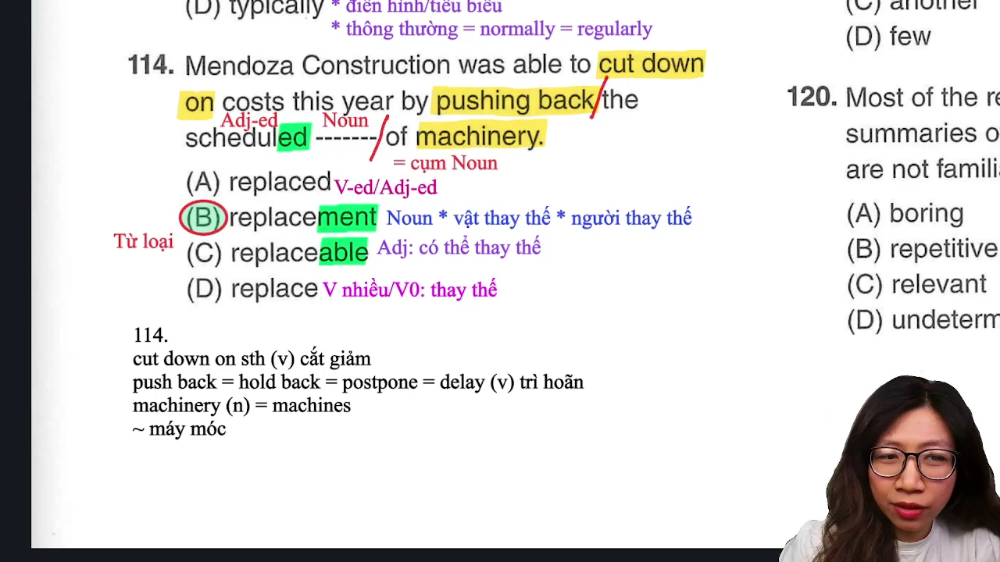

* **Đề bài:** `Mendoza Construction was able to cut down on costs this year by pushing back the scheduled ------- of machinery.`
* **Phương án:**
  * (A) replaced: Động từ quá khứ hoặc tính từ phân từ bị động.
  * (B) replacement: Danh từ (sự thay thế, vật thay thế, người thay thế).
  * (C) replaceable: Tính từ (có thể thay thế được).
  * (D) replace: Động từ nguyên mẫu.
* **Phân tích:**
  * Cụm bắt đầu bằng mạo từ `the`, theo sau là tính từ phân từ `scheduled` (đã được lên lịch).
  * Phía sau chỗ trống là giới từ `of` kết nối với `machinery`.
  * Cấu trúc cụm danh từ chuẩn: `the + [Adj] + [Noun] + of + Noun`. Chỗ trống bắt buộc phải là một danh từ chính đóng vai trò trung tâm của cụm.
  * Nhận diện hậu tố danh từ `-ment`: `replacement`. Chọn (B).
* **Dịch nghĩa:** Công ty Xây dựng Mendoza đã có thể cắt giảm chi phí trong năm nay bằng cách lùi lại lịch thay thế máy móc đã định.
* **Mở rộng:**
  * `Cut down on something` = `Reduce`: cắt giảm (chi phí, tiêu dùng).
  * `Push back` = `Hold back` = `Postpone` = `Delay`: trì hoãn, dời lại lịch trình.
  * Phân biệt danh từ tập hợp:
    * `Machinery` (danh từ không đếm được chỉ tập hợp các loại máy móc, không bao giờ thêm `-s`).
    * `Machine` (danh từ đếm được, số nhiều là `machines`).

---

### [[01:25:16](https://youtu.be/UKpsHzUXTSA?t=5116s)] Câu 115

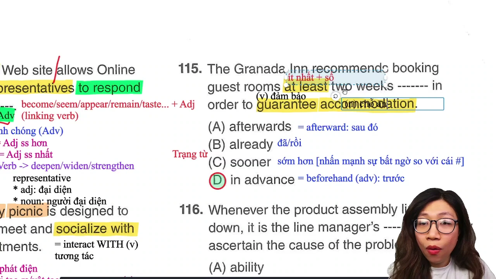

* **Đề bài:** `The Granada Inn recommends booking guest rooms at least two weeks ------- in order to guarantee accommodation.`
* **Phương án:**
  * (A) afterwards: Trạng từ (sau đó = afterward).
  * (B) already: Trạng từ (đã rồi).
  * (C) sooner: Trạng từ so sánh hơn (sớm hơn - chỉ dùng khi nhấn mạnh sự bất ngờ so với dự kiến).
  * (D) in advance: Cụm trạng từ mang nghĩa "trước, trước thời hạn" (= beforehand).
* **Phân tích:**
  * Cụm thời gian `at least two weeks` (ít nhất hai tuần) cần một trạng từ chỉ thời điểm đặt phòng trước.
  * Cụm cố định trong văn cảnh đặt chỗ khách sạn / vé máy bay: `[Khoảng thời gian] in advance` hoặc `book in advance` (đặt trước bao lâu).
  * Phương án (C) `sooner` không dùng được vì ở đây là lời khuyến nghị đặt phòng theo quy chuẩn chứ không có yếu tố bất ngờ so với kế hoạch ban đầu (`sooner than scheduled`). Chọn (D).
* **Dịch nghĩa:** Khách sạn Granada Inn khuyến nghị quý khách nên đặt phòng nghỉ trước ít nhất hai tuần để đảm bảo có chỗ ở.
* **Mở rộng:**
  * `In advance` = `Beforehand` (trạng từ: trước).
  * `Inn` = `Hotel` (nhà trọ, khách sạn).
  * `Guarantee` (v): đảm bảo, cam đoan.
  * `Accommodation` (n): chỗ ở, phòng nghỉ.
  * `At least` + con số: ít nhất bao nhiêu.

---

## Trích dẫn then chốt

* [[00:18](https://youtu.be/UKpsHzUXTSA?t=18s)] "Part 5 và Part 6 sẽ quyết định được là mình có làm kịp hết tới câu 200 hay không. Hai part này cộng lại thời gian làm bài tối đa không quá 25 phút. Part 5 cố gắng làm dưới 15 phút."
* [[20:53](https://youtu.be/UKpsHzUXTSA?t=1253s)] "Distinct cô dịch là clear, rõ ràng. Distinctive cô dịch là đặc trưng hoặc riêng biệt bằng với characteristic. Đây là một trong những cái bẫy đang sử dụng rất nhiều và đa phần 80% các bạn sẽ bị gài ở bẫy này."
* [[26:40](https://youtu.be/UKpsHzUXTSA?t=1600s)] "Over cũng có nghĩa trong suốt, during cũng có nghĩa trong suốt. Thật sự nghĩa giống nhau nhưng cách dùng của during rộng hơn: during vừa đi với khoảng thời gian vừa đi với sự kiện hoặc quá trình."
* [[35:13](https://youtu.be/UKpsHzUXTSA?t=2113s)] "Đây không phải là một dạng học mẹo 100% mà cô cho mình học là ôn cấu trúc của từ và ôn nguyên tắc của phần bị động rút gọn để mai mốt mình gặp mình có thể suy luận ra tất cả những trường hợp khác."
* [[52:16](https://youtu.be/UKpsHzUXTSA?t=3136s)] "Học với cô Thanh là không bao giờ phải học thuộc bài. Mà luôn luôn cô sẽ luyện cho mình một cái phản xạ. Cô nhắc tới nhắc lui, hỏi tới hỏi lui là tự động trong đầu mình hiện ra chữ liền luôn, theo mình suốt cuộc đời."

---

## Lệnh & Công cụ

### Công thức nhận diện nhanh

```text
[Công thức 1: Động từ hai tân ngữ]
Give / Offer + [Tân ngữ người: us/him/them] + [Tân ngữ vật: a phone call / a discount]

[Công thức 2: Phân biệt Liên từ vs Trạng từ liên kết]
Mệnh đề 1 + because + Mệnh đề 2 (Không cần dấu chấm phẩy)
Mệnh đề 1; therefore, + Mệnh đề 2 (Bắt buộc có dấu chấm phẩy và phẩy)

[Công thức 3: Câu mệnh lệnh mục đích]
To + V-inf, (please) + V-bare + Object (Mệnh đề sau dùng động từ nguyên mẫu)

[Công thức 4: Bị động thiếu tân ngữ]
Chủ ngữ + be + V3/ed + [To V-inf / Giới từ] (Không có danh từ tân ngữ phía sau)

[Công thức 5: Hậu tố tạo động từ -en]
Tính từ / Danh từ + en -> Động từ:
wide -> widen (nới rộng)
deep -> deepen (làm sâu hơn)
quick -> quicken (làm nhanh hơn)
strength -> strengthen (củng cố)

[Công thức 6: Cụm từ cố định Part 5 & 7]
We are pleased to inform you that... (Rất vui mừng thông báo rằng...)
At affordable prices / rates (Mức giá phải chăng)
At least + Con số (Ít nhất bao nhiêu)
Book [Khoảng thời gian] in advance (Đặt trước bao lâu)
Cut down on costs (Cắt giảm chi phí)
Push back = Postpone = Delay (Trì hoãn)
Socialize with = Interact with (Tương tác, giao lưu với)
```

---

## Đánh đổi & Rủi ro

### Điểm mù nhận diện từ loại

* **Bẫy đuôi tính từ và trạng từ:** Nhiều thí sinh thấy `distinct` và `distinctive` đều là tính từ liền hoang mang chọn theo cảm tính. Bản chất `distinct` là rõ ràng (`clear`), còn `distinctive` là đặc trưng (`characteristic`). Nhầm lẫn sắc thái nghĩa này sẽ mất điểm ở các câu từ loại nâng cao.
* **Nhầm lẫn danh từ tập hợp:** Từ `machinery` mang nghĩa tập hợp các loại máy móc (`machines`) nhưng là danh từ không đếm được và không có đuôi `-s`. Nếu thí sinh tìm danh từ số nhiều có đuôi `-s` sẽ bị sập bẫy ngữ pháp.
* **Bẫy thì quá khứ đơn vs bị động rút gọn:** Trong câu 107, từ `spaced` dễ bị ngộ nhận là động từ chia thì quá khứ đơn. Nếu là quá khứ đơn chủ động thì bắt buộc phải có tân ngữ trực tiếp (`spaced the nails`). Do phía sau là giới từ `at`, `spaced` thực chất là mệnh đề quan hệ rút gọn dạng bị động (`nails which are spaced at 2-inch intervals`).

### Rủi ro phân bổ thời gian

* **Sa đà vào việc dịch toàn bộ câu:** Với các câu ngữ pháp đại từ (101), liên từ (102), cụm danh từ (105, 111, 114) và câu mệnh lệnh (107), thí sinh chỉ cần quan sát thành phần trước và sau chỗ trống từ 5 đến 10 giây để chọn đáp án. Việc đọc dịch từng từ cả câu sẽ làm tiêu tốn quá 15 phút dành cho Part 5, dẫn đến thiếu hụt nghiêm trọng thời gian xử lý các đoạn văn dài ở Part 7.
