# GIẢI ĐỀ TOEIC 2025 MỚI NHẤT | TEST 5 [VIDEO 2]

* **Kênh:** Anh ngữ Ms Thanh | **Thời lượng:** 01:27:46 | **Ngày:** 2025-11-08
* **Video:** https://youtu.be/TQQW5JjbP9Q

---

## Thuật ngữ

| Thuật ngữ | Tiếng Anh | Giải thích |
| :--- | :--- | :--- |
| Bổ ngữ sau To Be | Subject Complement | Thành phần tính từ hoặc danh từ đứng sau động từ to be để bổ nghĩa cho chủ ngữ. |
| Trạng từ mức độ | Adverb of Degree | Trạng từ đứng trước tính từ hoặc động từ để gia tăng hoặc làm rõ mức độ (completely, sharply). |
| Nội động từ | Intransitive Verb | Động từ tự thân diễn đạt trọn vẹn ý nghĩa, không đòi hỏi tân ngữ trực tiếp và được bổ nghĩa bởi trạng từ (function reliably). |
| Ngoại động từ | Transitive Verb | Động từ bắt buộc phải có tân ngữ trực tiếp đi kèm để tạo thành câu hoàn chỉnh (incorporate sth, appoint sb). |
| Quy tắc cụm danh từ | Head Noun Principle | Trong cụm danh từ dạng A of B, danh từ đứng trước giới từ (A) là danh từ trung tâm quyết định ý nghĩa và dạng số ít/số nhiều. |
| Tính từ ghép | Compound Adjective | Cụm từ được liên kết bằng dấu gạch nối để bổ nghĩa cho danh từ đứng sau (record-breaking, award-winning). |
| Thể bị động | Passive Voice | Cấu trúc Be + V3/ed diễn tả đối tượng chịu sự tác động của hành động. |
| Mệnh đề danh từ | Noun Clause | Mệnh đề bắt đầu bằng liên từ phụ thuộc (whether, that) đóng vai trò như một danh từ làm tân ngữ cho động từ. |
| Giới từ phạm vi | Preposition of Scope | Giới từ biểu thị không gian lan tỏa hoặc phạm vi áp dụng xuyên suốt một hệ thống (across, throughout). |
| Lượng từ bất định | Indefinite Quantifier | Từ chỉ số lượng đặt trước danh từ hoặc đi kèm cụm giới từ để xác định mức độ (some of, few of, one of). |

---

## Tổng luận chuyên đề

### Chiến thuật thời gian

Phần thi Part 5 gồm 30 câu hỏi trắc nghiệm, cần giải quyết dứt điểm trong 12 đến 15 phút (trung bình 25 đến 30 giây mỗi câu). Để tối ưu hóa thời gian và dành trọn vẹn 50 phút cho Part 7, thí sinh cần phân loại tức thì các dạng bài:
* **Nhóm ngữ pháp phản xạ (3 đến 7 giây):** Các câu về từ loại thuần túy như `Be + Adv + [Adj]`, `Be + [V-ed/bị động]`, vị trí bổ nghĩa của nội động từ `Verb + [Adv]`, hoặc lượng từ dựa vào dạng số ít/số nhiều của động từ theo sau. Tuyệt đối không dịch nghĩa toàn câu ở nhóm này.
* **Nhóm cấu trúc cụm từ (10 đến 15 giây):** Các câu đòi hỏi xác định danh từ trung tâm trong cụm mở rộng `A of B`, cấu trúc bổ nhiệm chức vụ `appoint sb as`, hoặc phân biệt liên từ mệnh đề `whether + S + V`.
* **Nhóm phân biệt từ vựng (20 đến 30 giây):** Các câu đòi hỏi xét kỹ đối tượng tác động (chủ thể là người hay vật), sắc thái ý nghĩa của từ (khuyến khích lối sống vs cảm kích con người; trải qua biến động vs vượt qua nghịch cảnh), và các cặp từ đồng âm hoặc dễ gây nhầm lẫn.

### Cấu trúc vị ngữ

* **Bổ ngữ tính từ sau To Be:** Khi câu đã có động từ to be và một trạng từ mức độ xen giữa (`is completely -------`), thành phần bắt buộc để hoàn thiện vị ngữ là một tính từ gốc (`voluntary`). Bẫy phổ biến là thí sinh nhìn trạng từ phía trước rồi vội vàng chọn động từ, hoặc chọn nhầm phân từ bị động khi câu không có nghĩa bị tác động.
* **Bổ nghĩa cho nội động từ:** Các nội động từ chỉ trạng thái vận hành như `function`, `work`, `operate` không nhận tân ngữ trực tiếp phía sau. Thành phần duy nhất có thể đứng sau bổ nghĩa cho các động từ này là trạng từ (`functioning reliably`).
* **Thể bị động thì hoàn thành:** Cấu trúc `has been + V3/ed` dùng khi chủ ngữ là vật vô tri (`logo`) và phía sau không có danh từ làm tân ngữ trực tiếp mà chỉ có cụm chỉ mục đích `to V0`.
* **Mệnh đề danh từ làm tân ngữ:** Ngoại động từ `discuss` đòi hỏi một danh từ hoặc một mệnh đề danh từ làm tân ngữ. Liên từ `whether` dẫn dắt một mệnh đề hoàn chỉnh (`whether recent developments will require further budget cuts`) biểu thị sự việc liệu có xảy ra hay không.

### Cụm danh từ

* **Quy tắc vàng A of B:** Khi gặp một cụm danh từ dài chứa giới từ `of` ở giữa, danh từ trung tâm chi phối toàn bộ ngữ pháp và ý nghĩa của cụm là danh từ A (đứng trước giới từ), hoàn toàn không phải danh từ B (đứng cuối). Khi A là danh từ số ít (`its entire line`), không được dùng các từ chỉ số lượng đòi hỏi danh từ số nhiều như `among`, dù danh từ B (`vehicles`) có đuôi số nhiều.
* **Sự hòa hợp giữa lượng từ và động từ:** Cấu trúc `One of + N số nhiều` đi với động từ số ít; `Some of + N số nhiều` đi với động từ số nhiều. Cần quan sát động từ chính trong câu để suy ngược lại lượng từ chính xác.
* **Tính từ ghép có dấu gạch nối:** Các tổ hợp danh từ ghép với V-ing (`record-breaking`) hoặc danh từ ghép với V-ed (`award-winning`) đóng vai trò là tính từ đứng trước bổ nghĩa cho danh từ chính, không làm thay đổi chức năng từ loại của vị trí cần điền.

### Phân biệt từ vựng

* **Bổ nhiệm và đề cử:** Động từ `appoint` mang nghĩa bổ nhiệm chính thức vào một vị trí, đồng nghĩa với `designate`. Từ này khác với `nominate` (mới chỉ dừng lại ở bước đề cử) và `delegate` (phân công nhiệm vụ).
* **Trải qua và vượt qua:** `Undergo` đồng nghĩa với `experience`, dùng cho các quá trình biến động, tăng giảm dân số, tái cơ cấu hoặc kiểm tra kỹ thuật. Trong khi đó, `overcome` dùng cho việc nỗ lực vượt qua khó khăn, trở ngại tâm lý hoặc thách thức cá nhân.
* **Khuyến khích và cảm kích:** Động từ `encourage` dùng khi hàng hóa/dịch vụ thúc đẩy một lối sống tích cực. Ngược lại, `appreciate` đòi hỏi chủ thể phải là con người có tri giác để cảm kích hoặc đánh giá cao một hành động.
* **Phạm vi không gian và xuyên thấu:** Giới từ `across` mang nghĩa trải khắp toàn bộ một hệ sinh thái, đồng nghĩa với `throughout`. Cần phân biệt với `through` mang nghĩa xuyên qua một vật thể hoặc thông qua một phương tiện trung gian.

---

## Bóc tách chi tiết

### [[00:01](https://youtu.be/TQQW5JjbP9Q?t=1s)] Câu 116

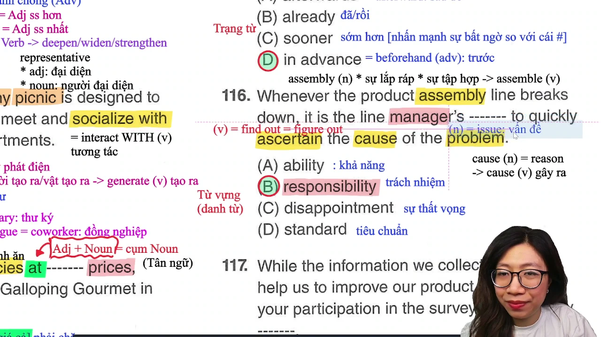

* **Đề bài:** `Whenever the product assembly line breaks down, it is the line manager's ------- to quickly ascertain the cause of the problem.`
* **Phương án:**
  * (A) ability: khả năng, năng lực cá nhân.
  * (B) responsibility: trách nhiệm, nhiệm vụ được giao.
  * (C) disappointment: sự thất vọng, nỗi thất vọng.
  * (D) standard: tiêu chuẩn, chuẩn mực.
* **Phân tích:** Phía trước chỗ trống là sở hữu cách `the line manager's` (của người quản lý dây chuyền), phía sau là cấu trúc nguyên mẫu chỉ mục đích `to quickly ascertain...`. Cấu trúc cố định trong văn phòng: `It is somebody's responsibility to V0` (Đó là trách nhiệm của ai khi phải làm điều gì). Về mặt ngữ cảnh, khi dây chuyền lắp ráp gặp sự cố, việc tìm ra nguyên nhân là trách nhiệm quản lý. Chọn (B).
* **Dịch nghĩa:** Bất cứ khi nào dây chuyền lắp ráp sản phẩm gặp sự cố, trách nhiệm của người quản lý dây chuyền là phải nhanh chóng xác định nguyên nhân của vấn đề.
* **Mở rộng:**
  * `Break down` (phrasal verb): hỏng hóc máy móc, đình trệ hoạt động.
  * `Ascertain` (v) = `find out` = `figure out`: tìm hiểu chắc chắn, xác định bản chất sự việc.
  * `Cause` (n) = `reason`: nguyên nhân. Phân biệt với động từ `cause` (v): gây ra, dẫn đến.
  * `Problem` (n) = `issue`: vấn đề, sự cố.
  * `Assembly line` (n): dây chuyền lắp ráp. Danh từ `assembly` bắt nguồn từ động từ `assemble` (lắp ráp linh kiện hoặc tập hợp con người).
  * Phát âm: Từ `standard` có trọng âm rơi vào âm tiết đầu tiên, phát âm là /ˈstændərd/, tránh đọc nuốt phụ âm cuối.

---

### [[05:24](https://youtu.be/TQQW5JjbP9Q?t=324s)] Câu 117

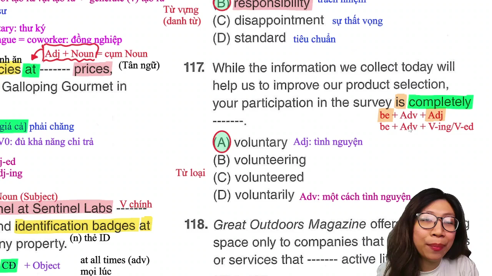

* **Đề bài:** `While the information we collect today will help us to improve our product selection, your participation in the survey is completely -------.`
* **Phương án:**
  * (A) voluntary: (tính từ) tự nguyện, mang tính tình nguyện.
  * (B) volunteering: (danh động từ / V-ing) việc tham gia tình nguyện.
  * (C) volunteered: (phân từ quá khứ / V-ed) đã tình nguyện, bị tình nguyện.
  * (D) voluntarily: (trạng từ) một cách tự nguyện.
* **Phân tích:** Chỗ trống đứng sau động từ to be `is` và trạng từ chỉ mức độ `completely`. Công thức cấu tạo vị ngữ: `Be + Adv + Adj`. Trạng từ `completely` chỉ đóng vai trò bổ nghĩa mức độ cho tính từ đứng sau. Rất nhiều thí sinh nhìn thấy trạng từ liền vội vã áp dụng quy tắc "sau trạng là động" để chọn động từ, nhưng ở đây câu đã có động từ chính `is`. Nếu chọn (C) `volunteered` mang nghĩa bị động "bị tình nguyện" sẽ hoàn toàn sai lệch ngữ nghĩa. Vị trí này cần một tính từ miêu tả tính chất của chủ ngữ `participation`. Chọn (A).
* **Dịch nghĩa:** Mặc dù thông tin chúng tôi thu thập hôm nay sẽ giúp cải thiện danh mục sản phẩm của mình, nhưng sự tham gia của bạn vào cuộc khảo sát này là hoàn toàn tự nguyện.
* **Mở rộng:**
  * Cấu trúc vị ngữ: `Be + Adv + Adj` và `Be + Adv + V-ing/V-ed`. Luôn ưu tiên tính từ gốc khi mô tả tính chất chủ ngữ.
  * `Participation in` (n): sự tham gia vào (= `involvement in`), xuất phát từ động từ `participate in` (= `join` = `take part in`).
  * `Product selection` (n): danh mục lựa chọn sản phẩm.

---

### [[09:31](https://youtu.be/TQQW5JjbP9Q?t=571s)] Câu 118

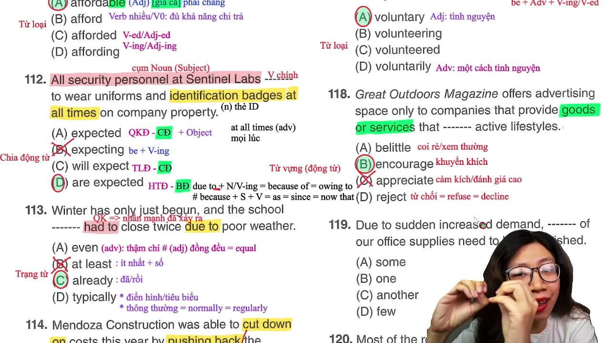

* **Đề bài:** `Great Outdoors Magazine offers advertising space only to companies that provide goods or services that ------- active lifestyles.`
* **Phương án:**
  * (A) belittle: coi nhẹ, xem thường, hạ thấp giá trị.
  * (B) encourage: khuyến khích, cổ vũ, thúc đẩy.
  * (C) appreciate: cảm kích, biết ơn, đánh giá cao.
  * (D) reject: từ chối, bác bỏ (= `refuse` = `decline`).
* **Phân tích:** Đại từ quan hệ `that` thay thế cho cụm danh từ `goods or services` (hàng hóa hoặc dịch vụ). Động từ cần điền phải phù hợp với tân ngữ `active lifestyles` (lối sống năng động). Tạp chí chỉ bán chỗ quảng cáo cho các công ty cung cấp hàng hóa/dịch vụ có tác dụng "khuyến khích lối sống năng động". Bẫy chọn nhầm `appreciate`: Động từ `appreciate` đòi hỏi chủ thể phải là con người có nhận thức để cảm kích hoặc trân trọng điều gì; hàng hóa hay dịch vụ vô tri không thể "cảm kích lối sống". Chọn (B).
* **Dịch nghĩa:** Tạp chí Great Outdoors chỉ cung cấp không gian quảng cáo cho những công ty cung cấp hàng hóa hoặc dịch vụ khuyến khích lối sống năng động.
* **Mở rộng:**
  * Cấu tạo từ: `belittle` gồm tiền tố `be-` kết hợp tính từ `little` (làm cho nhỏ bé lại -> coi rẻ, xem thường).
  * Nhóm từ đồng nghĩa chỉ sự từ chối: `Reject` = `Refuse` = `Decline` = `Turn down`.
  * `Advertising space` (n): diện tích quảng cáo, đất quảng cáo trên báo đài.

---

### [[14:05](https://youtu.be/TQQW5JjbP9Q?t=845s)] Câu 119

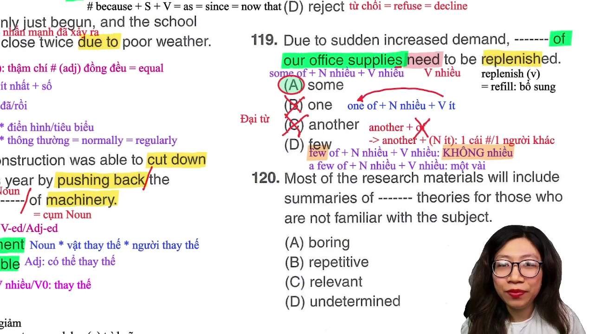

* **Đề bài:** `Due to sudden increased demand, ------- of our office supplies need to be replenished.`
* **Phương án:**
  * (A) some: một vài, một số (đại từ đi với danh từ số nhiều hoặc không đếm được).
  * (B) one: một (đại từ số ít).
  * (C) another: một cái khác (đại từ/tính từ số ít).
  * (D) few: hầu như không có (mang nghĩa phủ định).
* **Phân tích:** 
  * Loại trừ (C) `another`: `Another` chỉ đứng trực tiếp trước danh từ số ít (`another item`), không bao giờ đi với cấu trúc `another of`.
  * Loại trừ (B) `one`: Nếu chọn `one of + N số nhiều`, chủ ngữ ngữ pháp là `one` (số ít), động từ theo sau bắt buộc phải chia số ít có 's' (`needs`). Tuy nhiên, động từ trong đề bài là `need` (nguyên mẫu số nhiều).
  * Phân biệt giữa (A) `some` và (D) `few`: Cả hai đều đi với động từ số nhiều. Tuy nhiên, `few` mang sắc thái phủ định (hầu như không có, quá ít đến mức không đáng kể). Vế trước nêu rõ "Do nhu cầu tăng đột ngột" (`Due to sudden increased demand`), logic thương mại bắt buộc phải là bổ sung một số mặt hàng (`some of`), không thể nói là hầu như không cần bổ sung. Chọn (A).
* **Dịch nghĩa:** Do nhu cầu tăng đột ngột, một số đồ dùng văn phòng của chúng ta cần phải được bổ sung thêm.
* **Mở rộng:**
  * Phân biệt `few` và `a few`: `Few` mang nghĩa tiêu cực (quá ít, gần như không có gì); `A few` mang nghĩa khẳng định (có một vài, đủ dùng).
  * `Replenish` (v) = `refill` = `restock`: làm đầy lại, bổ sung kho hàng.
  * Cụm chỉ nguyên nhân: `Due to` + Cụm danh từ = `Because of` = `Owing to` = `On account of`. Phân biệt với liên từ nối mệnh đề: `Because` / `Since` / `As` / `Now that` + S + V.

---

### [[20:09](https://youtu.be/TQQW5JjbP9Q?t=1209s)] Câu 120

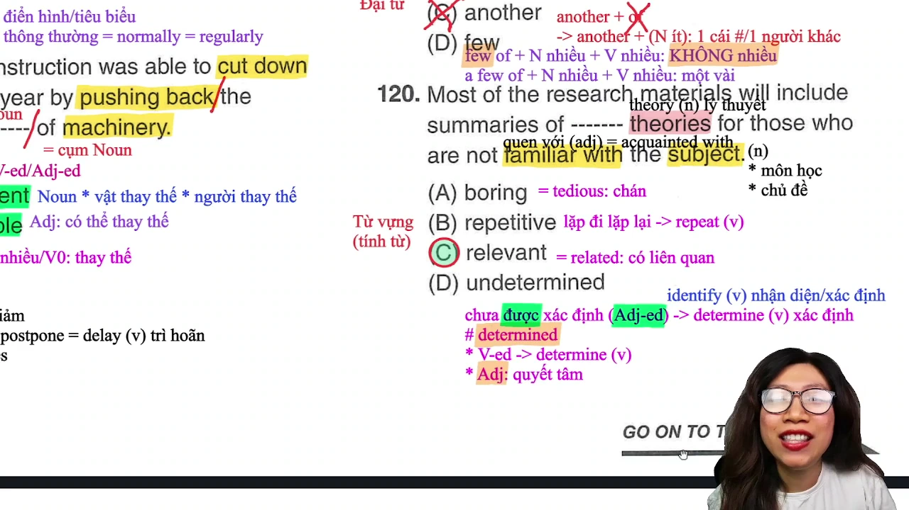

* **Đề bài:** `Most of the research materials will include summaries of ------- theories for those who are not familiar with the subject.`
* **Phương án:**
  * (A) boring: buồn tẻ, nhàm chán (= `tedious`).
  * (B) repetitive: lặp đi lặp lại, đơn điệu (bắt nguồn từ `repeat`).
  * (C) relevant: có liên quan, thích hợp (= `related`).
  * (D) undetermined: chưa được xác định.
* **Phân tích:** Vị trí trước danh từ `theories` cần một tính từ xác định tính chất của các lý thuyết được tóm tắt. Ngữ cảnh phía sau bổ nghĩa: `for those who are not familiar with the subject` (dành cho những người chưa quen với chủ đề này). Để hỗ trợ người chưa quen, tài liệu nghiên cứu cần tóm tắt "các lý thuyết có liên quan" (`relevant theories`). Chọn (C).
* **Dịch nghĩa:** Hầu hết các tài liệu nghiên cứu sẽ bao gồm bản tóm tắt các lý thuyết liên quan dành cho những ai chưa quen thuộc với chủ đề này.
* **Mở rộng:**
  * `Relevant` (adj) = `related` = `applicable`: có liên quan, phù hợp.
  * `Familiar with` = `acquainted with`: quen thuộc với điều gì.
  * `Boring` (adj) = `tedious` (adj): tẻ nhạt, chán ngắt (từ vựng mức độ 750+ thường xuất hiện trong Part 7).
  * Phân biệt dạng từ: `Determine` (v: xác định) -> `Determined` (adj: kiên quyết, quyết tâm) khác hoàn toàn với `Undetermined` (adj: chưa được xác định, chưa rõ ràng).
  * Danh từ đa nghĩa `subject`: trong học thuật là "môn học", trong tài liệu hành chính là "chủ đề" hoặc "đối tượng nghiên cứu".

---

### [[27:39](https://youtu.be/TQQW5JjbP9Q?t=1659s)] Câu 121

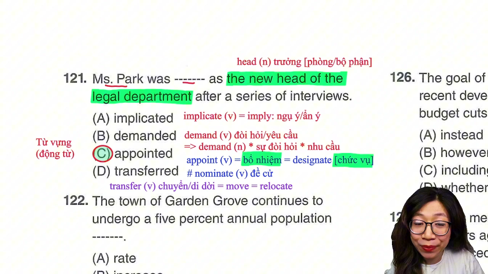

* **Đề bài:** `Ms. Park was ------- as the new head of the legal department after a series of interviews.`
* **Phương án:**
  * (A) implicated: bị ngụ ý, bị liên can (implicate = imply: ngụ ý).
  * (B) demanded: bị đòi hỏi, bị yêu cầu (demand vừa là động từ, vừa là danh từ).
  * (C) appointed: được bổ nhiệm chính thức (= `designated`).
  * (D) transferred: được điều chuyển công tác (= `relocated` = `moved`).
* **Phân tích:** Cấu trúc bổ nhiệm nhân sự quen thuộc trong TOEIC: `Be appointed as + [Chức vụ]` (Được bổ nhiệm làm vị trí nào). Ngữ cảnh nêu rõ sự việc diễn ra "sau một loạt các cuộc phỏng vấn" (`after a series of interviews`), cho thấy đây là quy trình tuyển dụng và bổ nhiệm bà Park vào vị trí trưởng bộ phận pháp lý. Chọn (C).
* **Dịch nghĩa:** Bà Park đã được bổ nhiệm làm người đứng đầu mới của bộ phận pháp lý sau một loạt các cuộc phỏng vấn.
* **Mở rộng:**
  * Cặp từ nhân sự cần phân biệt:
    * `Appoint` (v) = `designate`: chính thức giao chức vụ, bổ nhiệm.
    * `Nominate` (v): chỉ mới đề cử, giới thiệu ứng viên.
    * `Delegate` (v): phân chia quyền hạn, ủy thác công việc.
  * `Head of [department]` (n): trưởng phòng, người đứng đầu một bộ phận.
  * `A series of` + Danh từ số nhiều: một chuỗi, một loạt các sự kiện nối tiếp nhau.
  * `Implicate` (v) = `imply`: ngụ ý, hàm ý; trong pháp lý mang nghĩa khiến ai bị dính líu vào vụ việc.

---

### [[33:05](https://youtu.be/TQQW5JjbP9Q?t=1985s)] Câu 122

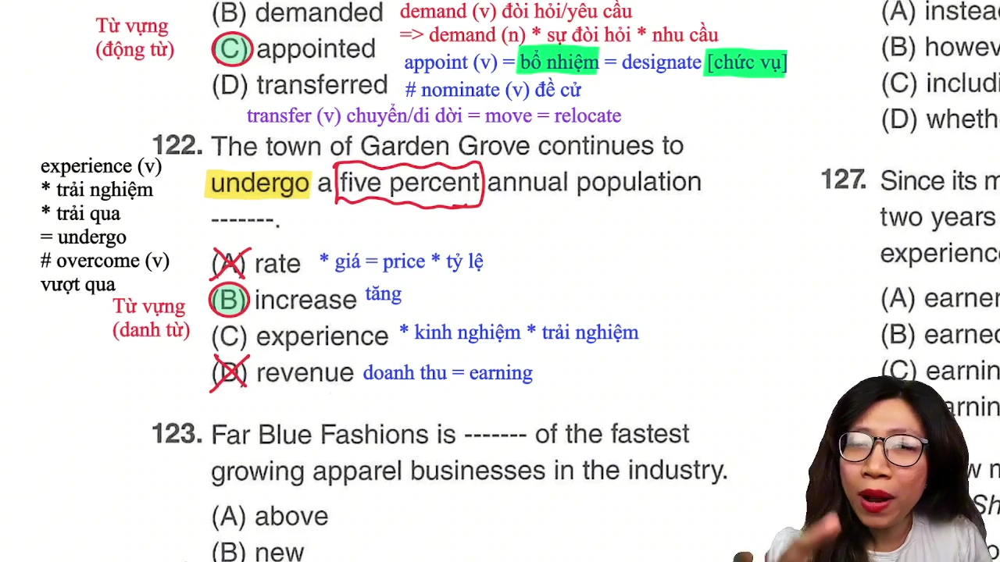

* **Đề bài:** `The town of Garden Grove continues to undergo a five percent annual population -------.`
* **Phương án:**
  * (A) rate: mức giá (= `price`), tỷ lệ phần trăm.
  * (B) increase: sự tăng trưởng, mức gia tăng.
  * (C) experience: kinh nghiệm làm việc, sự trải nghiệm cá nhân.
  * (D) revenue: doanh thu (= `earnings`).
* **Phân tích:** 
  * Chỗ trống đứng sau mạo từ `a` và cụm tính từ bổ nghĩa `five percent annual population -------`, bắt buộc phải là một danh từ đếm được số ít.
  * Bẫy tỷ lệ: Thí sinh thấy con số `five percent` thường phản xạ chọn ngay `rate` (tỷ lệ). Tuy nhiên, nếu dùng `rate`, cấu trúc tiếng Anh chuẩn phải là `a population growth rate of 5%` hoặc `at a rate of 5%`, không ai nói `a five percent population rate`.
  * Động từ chính là `undergo` (trải qua). Cụm danh từ tự nhiên trong báo cáo thống kê là `a 5% population increase` (mức gia tăng dân số 5%). Chọn (B).
* **Dịch nghĩa:** Thị trấn Garden Grove tiếp tục trải qua mức tăng dân số hàng năm là 5%.
* **Mở rộng:**
  * Phân biệt động từ gốc: `Undergo` (v) = `experience`: trải qua (biến động, kiểm tra, đào tạo). Khác với `Overcome` (v): khắc phục, vượt qua (khó khăn, chướng ngại vật).
  * `Annual` (adj) = `yearly`: hàng năm.
  * `Revenue` (n) = `earnings`: doanh thu bán hàng của doanh nghiệp.

---

### [[37:00](https://youtu.be/TQQW5JjbP9Q?t=2220s)] Câu 123

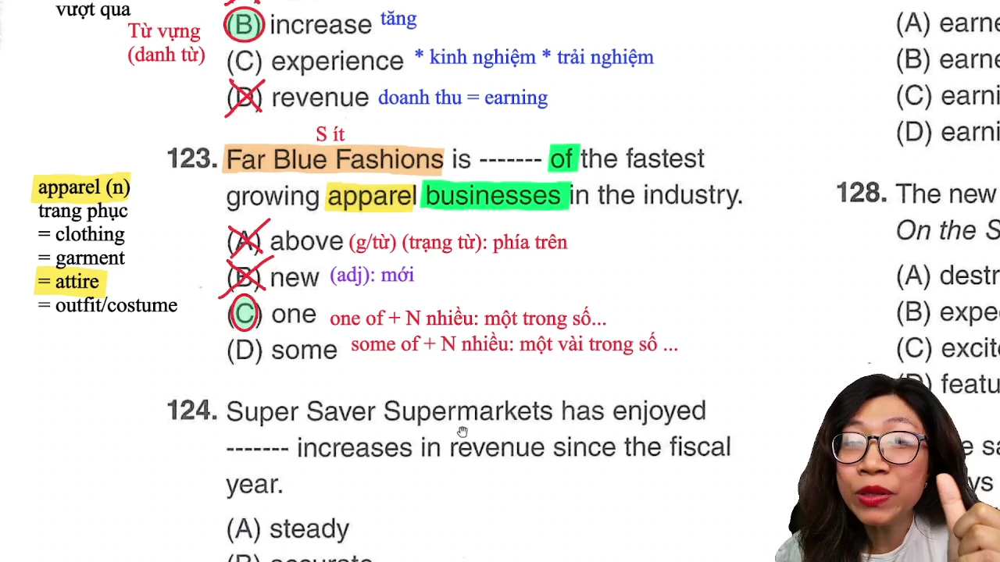

* **Đề bài:** `Far Blue Fashions is ------- of the fastest growing apparel businesses in the industry.`
* **Phương án:**
  * (A) above: phía trên (giới từ hoặc trạng từ chỉ vị trí).
  * (B) new: mới (tính từ).
  * (C) one: một (đại từ số ít).
  * (D) some: một vài, một số (đại từ số nhiều).
* **Phân tích:**
  * Cấu trúc so sánh nhất mở rộng: `[Đại từ] + of the + [Tính từ so sánh nhất] + Danh từ số nhiều`. Cả `one of` và `some of` đều đi được với cụm danh từ số nhiều phía sau.
  * Để phân định, quan sát động từ to be trong câu: `Far Blue Fashions is`. Động từ chia ở số ít `is`, chứng tỏ chủ ngữ là một đơn vị tổ chức duy nhất (tên một thương hiệu thời trang). Do đó, vị ngữ phải là `one of...` (là một trong những doanh nghiệp...). Nếu chọn `some`, chủ ngữ tương đương số nhiều và động từ phải là `are`. Chọn (C).
* **Dịch nghĩa:** Far Blue Fashions là một trong những doanh nghiệp may mặc có tốc độ tăng trưởng nhanh nhất trong ngành.
* **Mở rộng:**
  * Nhóm từ vựng trang phục cực kỳ quan trọng trong cả Listening và Reading:
    * `Apparel` (n) /əˈpærəl/: trang phục, quần áo thương mại.
    * `Attire` (n) /əˈtaɪər/: trang phục chỉnh tề, lễ phục.
    * `Clothing` / `Garment` / `Outfit` / `Costume`: quần áo, y phục biểu diễn.
  * `Fastest growing` (compound adj): phát triển nhanh nhất.
  * `Industry` (n): ngành công nghiệp, lĩnh vực sản xuất kinh doanh.

---

### [[42:16](https://youtu.be/TQQW5JjbP9Q?t=2536s)] Câu 124

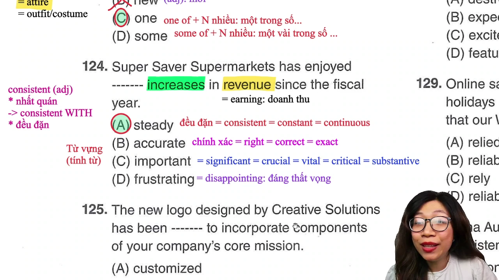

* **Đề bài:** `Super Saver Supermarkets has enjoyed ------- increases in revenue since the fiscal year.`
* **Phương án:**
  * (A) steady: đều đặn, ổn định, liên tục (= `consistent` = `constant`).
  * (B) accurate: chính xác, đúng đắn (= `correct` = `exact` = `precise`).
  * (C) important: quan trọng, trọng đại (= `significant` = `crucial` = `vital`).
  * (D) frustrating: gây thất vọng, bực bội (= `disappointing`).
* **Phân tích:** Chỗ trống đứng trước cụm danh từ `increases in revenue` (sự gia tăng về mặt doanh thu), cần một tính từ miêu tả đặc tính tăng trưởng tài chính. Trong thuật ngữ kinh tế, cụm từ kết hợp tự nhiên (collocation) đi với mức tăng trưởng là `steady increases` (những đợt tăng trưởng đều đặn và bền vững). Động từ `enjoy` khi đi kèm với thành quả kinh tế mang nghĩa "đạt được, có được thành tựu tốt đẹp". Chọn (A).
* **Dịch nghĩa:** Chuỗi siêu thị Super Saver đã đạt được mức tăng trưởng doanh thu đều đặn kể từ năm tài chính.
* **Mở rộng:**
  * Nhóm tính từ mang nghĩa "đều đặn, bền bỉ": `Steady` = `Consistent` = `Constant` = `Continuous`.
  * Tính từ đa nghĩa `consistent`: nghĩa 1 là "nhất quán" (đi với giới từ `with`: `consistent with`); nghĩa 2 là "đều đặn, kiên định".
  * `Revenue` (n) = `earnings`: doanh thu kinh doanh.
  * `Fiscal year` (n): năm tài chính, năm ngân sách.

---

### [[48:13](https://youtu.be/TQQW5JjbP9Q?t=2893s)] Câu 125

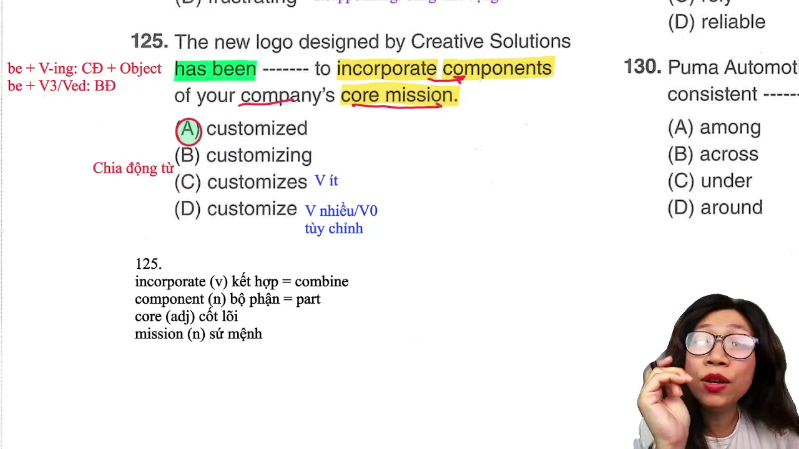

* **Đề bài:** `The new logo designed by Creative Solutions has been ------- to incorporate components of your company's core mission.`
* **Phương án:**
  * (A) customized: đã được tùy chỉnh (thể bị động V-ed).
  * (B) customizing: đang tùy chỉnh (thể chủ động V-ing).
  * (C) customizes: động từ chia số ít thì hiện tại đơn.
  * (D) customize: động từ nguyên mẫu V0.
* **Phân tích:** 
  * Chủ ngữ chính là `The new logo` (vật vô tri), theo sau bởi mệnh đề phân từ rút gọn `designed by Creative Solutions`. Vị ngữ bắt đầu bằng trợ động từ `has been -------`.
  * Sau `has been`, chỉ có hai khả năng: `has been + V-ing` (chủ động thì hiện tại hoàn thành tiếp diễn, đòi hỏi có tân ngữ danh từ theo sau) hoặc `has been + V3/ed` (thể bị động thì hiện tại hoàn thành).
  * Ngay sau chỗ trống là cụm động từ chỉ mục đích `to incorporate...`, không có danh từ làm tân ngữ trực tiếp. Logo không thể tự thực hiện hành động "tùy chỉnh" mà phải "được tùy chỉnh". Chọn (A).
* **Dịch nghĩa:** Logo mới do Creative Solutions thiết kế đã được tùy chỉnh để tích hợp các yếu tố trong sứ mệnh cốt lõi của công ty bạn.
* **Mở rộng:**
  * `Customize` (v): điều chỉnh theo yêu cầu của khách hàng.
  * `Incorporate` (v) = `combine`: kết hợp, lồng ghép, tích hợp.
  * `Component` (n) = `part` = `element`: thành phần, bộ phận cấu thành.
  * `Core mission` (n): sứ mệnh cốt lõi, tôn chỉ hoạt động trọng tâm.

---

### [[52:17](https://youtu.be/TQQW5JjbP9Q?t=3137s)] Câu 126

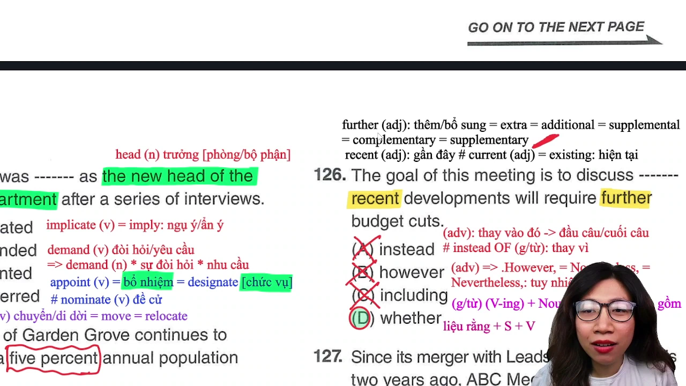

* **Đề bài:** `The goal of this meeting is to discuss ------- recent developments will require further budget cuts.`
* **Phương án:**
  * (A) instead: thay vào đó (trạng từ, đứng độc lập; muốn đi với danh từ phải dùng `instead of`).
  * (B) however: tuy nhiên (trạng từ liên kết, thường đứng đầu câu sau dấu chấm và trước dấu phẩy).
  * (C) including: bao gồm (giới từ, theo sau là danh từ/cụm danh từ, không đi với mệnh đề).
  * (D) whether: liệu rằng (liên từ nối mở đầu cho một mệnh đề danh từ `whether + S + V`).
* **Phân tích:**
  * Phía sau chỗ trống là một mệnh đề hoàn chỉnh có đầy đủ chủ ngữ và vị ngữ: `recent developments` (chủ ngữ) + `will require` (động từ) + `further budget cuts` (tân ngữ).
  * Động từ `discuss` (thảo luận) là một ngoại động từ đòi hỏi một tân ngữ. Một mệnh đề danh từ bắt đầu bằng liên từ `whether` đóng vai trò làm tân ngữ trực tiếp cho động từ `discuss` ("thảo luận xem liệu rằng...").
  * Loại trừ (A) và (B) vì `instead` và `however` là các trạng từ không có chức năng làm liên từ nối mệnh đề phụ vào ngoại động từ. Loại trừ (C) vì `including` là giới từ, không thể đứng trước một mệnh đề có thì chia đầy đủ. Chọn (D).
* **Dịch nghĩa:** Mục tiêu của cuộc họp này là thảo luận xem liệu những diễn biến gần đây có đòi hỏi phải cắt giảm ngân sách thêm nữa hay không.
* **Mở rộng:**
  * `Further` (adj) = `extra` = `additional` = `supplemental`: bổ sung, sâu rộng hơn, thêm nữa.
  * Phân biệt trạng từ thời gian: `Recent` (adj: gần đây, vừa diễn ra) khác với `Current` / `Existing` (adj: hiện hành, đang có sẵn).
  * `Budget cut` (n): việc cắt giảm ngân sách chi tiêu.

---

### [[59:12](https://youtu.be/TQQW5JjbP9Q?t=3552s)] Câu 127

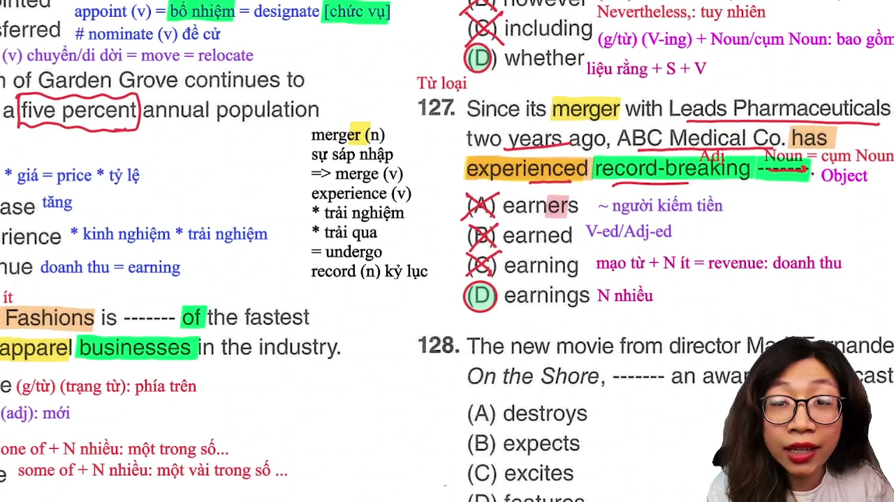

* **Đề bài:** `Since its merger with Leads Pharmaceuticals two years ago, ABC Medical Co. has experienced record-breaking -------.`
* **Phương án:**
  * (A) earners: những người có thu nhập cao (danh từ chỉ người số nhiều).
  * (B) earned: đã kiếm được (V-ed hoặc tính từ phân từ bị động).
  * (C) earning: tiền kiếm được (danh từ số ít mang tính trừu tượng).
  * (D) earnings: lợi nhuận doanh nghiệp, thu nhập ròng (danh từ số nhiều mang nghĩa tài chính).
* **Phân tích:**
  * Cấu trúc câu: Động từ `has experienced` (đã trải qua) đi kèm tính từ ghép `record-breaking` (phá kỷ lục), đòi hỏi một danh từ làm tân ngữ ở vị trí chỗ trống.
  * Phân biệt dạng từ trong kinh doanh:
    * (A) `earners`: chỉ người tạo ra thu nhập, không phù hợp ngữ cảnh sau một thương vụ sáp nhập công ty y tế.
    * (C) `earning` và (D) `earnings`: Trong các văn bản kinh tế và báo cáo tài chính của TOEIC, từ mang nghĩa "lợi nhuận / doanh thu của công ty" bắt buộc phải sử dụng ở dạng danh từ số nhiều có 's' là `earnings` (= `profits`). Dạng danh từ số ít `earning` không đứng độc lập mà không có mạo từ đi kèm.
  * Cụm danh từ hoàn chỉnh: `record-breaking earnings` (mức lợi nhuận kỷ lục). Chọn (D).
* **Dịch nghĩa:** Kể từ khi sáp nhập với Leads Pharmaceuticals hai năm trước, ABC Medical Co. đã đạt được mức lợi nhuận kỷ lục.
* **Mở rộng:**
  * `Merger with` (n): sự sáp nhập với công ty khác, bắt nguồn từ động từ `merge with`.
  * `Record-breaking` (compound adj): mang tính phá vỡ kỷ lục.
  * `Pharmaceuticals` (n): ngành dược, công ty sản xuất dược phẩm.

---

### [[01:07:35](https://youtu.be/TQQW5JjbP9Q?t=4055s)] Câu 128

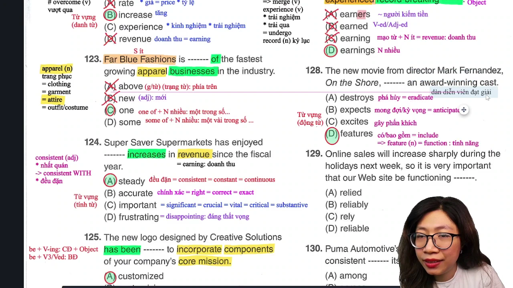

* **Đề bài:** `The new movie from director Mark Fernandez, On the Shore, ------- an award-winning cast.`
* **Phương án:**
  * (A) destroys: phá hủy, tàn phá (= `eradicate` = `devastate`).
  * (B) expects: mong đợi, trông chờ (= `anticipate`).
  * (C) excites: kích thích, làm cho phấn khích.
  * (D) features: có sự tham gia của, quy tụ, bao gồm (= `includes` = `showcases`).
* **Phân tích:** Chủ ngữ là bộ phim mới mang tên `On the Shore`, tân ngữ là `an award-winning cast` (dàn diễn viên từng đoạt giải thưởng). Trong ngành giải trí và điện ảnh, động từ `feature` mang nghĩa chuyên dụng là "quy tụ, có sự góp mặt của các diễn viên hoặc đặc điểm nổi bật". Các phương án khác mang nghĩa phá hủy (`destroys`) hoặc gây kích động (`excites`) hoàn toàn phi logic với tân ngữ chỉ dàn diễn viên. Chọn (D).
* **Dịch nghĩa:** Bộ phim mới của đạo diễn Mark Fernandez, On the Shore, quy tụ một dàn diễn viên từng đoạt giải thưởng.
* **Mở rộng:**
  * Từ đa nghĩa `feature`: Khi là động từ mang nghĩa "quy tụ, bao gồm, làm nổi bật"; khi là danh từ mang nghĩa "tính năng, đặc điểm sản phẩm" (= `function` = `characteristic`).
  * `Award-winning` (compound adj): từng đoạt giải thưởng danh giá.
  * `Cast` (n): tập thể diễn viên tham gia một vở kịch hoặc bộ phim.
  * Nhóm từ phá hủy: `Destroy` = `Eradicate` = `Demolish` = `Devastate`.

---

### [[01:15:53](https://youtu.be/TQQW5JjbP9Q?t=4553s)] Câu 129

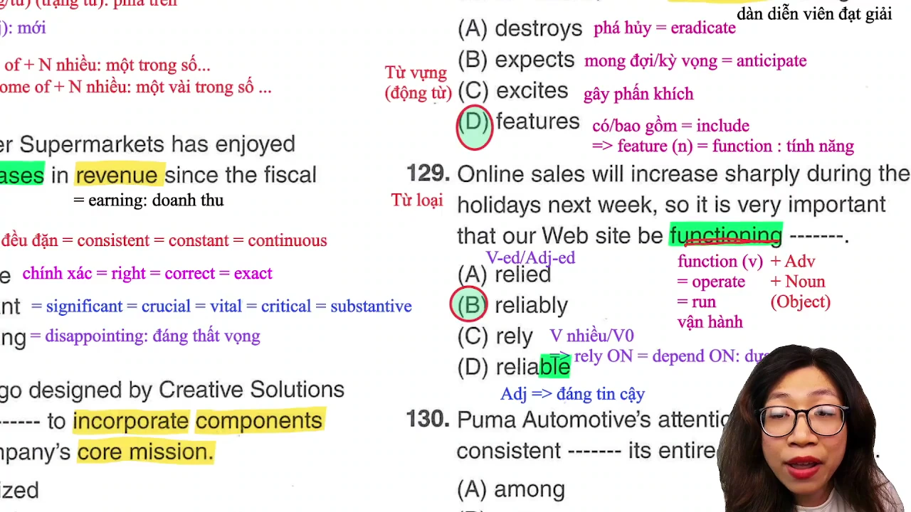

* **Đề bài:** `Online sales will increase sharply during the holidays next week, so it is very important that our Web site be functioning -------.`
* **Phương án:**
  * (A) relied: dạng phân từ V-ed của động từ rely.
  * (B) reliably: (trạng từ) một cách đáng tin cậy, trơn tru, ổn định.
  * (C) rely: (động từ nguyên mẫu) dựa dẫm (luôn đi với giới từ `on`).
  * (D) reliable: (tính từ) đáng tin cậy.
* **Phân tích:** 
  * Xét mệnh đề sau `that`: `our Web site be functioning -------`. Động từ `function` đang ở dạng tiếp diễn `be functioning` (cấu trúc bàng thái cách / giả định thức sau tính từ quan trọng `it is important that S + V0`).
  * `Function` ở đây đóng vai trò là một nội động từ mang nghĩa "vận hành, hoạt động" (= `operate` = `run`). Nội động từ không nhận tân ngữ danh từ và cần một trạng từ đứng sau bổ nghĩa cho phương thức hoạt động: `function reliably` (vận hành một cách ổn định, đáng tin cậy).
  * Bẫy tính từ: Thí sinh nhìn thấy `functioning` nhầm tưởng là danh từ nên chọn tính từ `reliable`, nhưng ở đây `functioning` là động từ vị ngữ của trang web. Chọn (B).
* **Dịch nghĩa:** Doanh số bán hàng trực tuyến sẽ tăng mạnh trong kỳ nghỉ vào tuần tới, vì vậy điều rất quan trọng là trang web của chúng ta phải vận hành một cách ổn định.
* **Mở rộng:**
  * `Function` (v) = `operate` = `work`: vận hành máy móc/hệ thống.
  * `Sharply` (adv): một cách đột ngột, mạnh mẽ (chuyên đi với các động từ tăng giảm như `increase sharply`, `drop sharply`).
  * Phân biệt 2 nghĩa của trạng từ `shortly`:
    * Nghĩa phổ biến: sớm, ngay sau đó (`shortly after`).
    * Nghĩa chuyên sâu trong TOEIC: nhanh chóng (chỉ dùng khi đi kèm các biến động tăng giảm số liệu).
  * `Rely on` (v) = `depend on`: dựa vào, phụ thuộc vào. Tính từ: `Reliable` = `Dependable`: đáng tin cậy.

---

### [[01:22:21](https://youtu.be/TQQW5JjbP9Q?t=4941s)] Câu 130

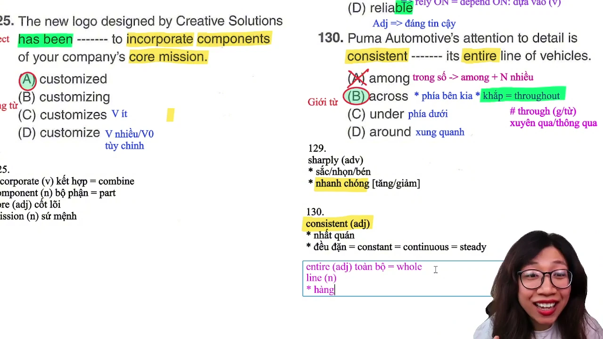

* **Đề bài:** `Puma Automotive's attention to detail is consistent ------- its entire line of vehicles.`
* **Phương án:**
  * (A) among: trong số (chỉ đi với danh từ số nhiều từ 3 đối tượng trở lên: `among + N số nhiều`).
  * (B) across: trên khắp, xuyên suốt toàn bộ (= `throughout`).
  * (C) under: ở dưới, phía dưới.
  * (D) around: xung quanh.
* **Phân tích:**
  * Bẫy danh từ số nhiều: Rất nhiều thí sinh nhìn lướt thấy từ cuối cùng `vehicles` có đuôi 's' (số nhiều) liền áp dụng máy móc quy tắc chọn `among`.
  * Bẻ bẫy bằng quy tắc A of B: Thành phần sau chỗ trống là một cụm danh từ phức: `its entire line (A) of vehicles (B)`. Khi có giới từ `of` ở giữa, danh từ trung tâm nắm giữ ý nghĩa cốt lõi của toàn cụm là danh từ A (`line`), hoàn toàn không phải danh từ B. Do `line` là danh từ số ít (dòng sản phẩm), việc dùng `among` là hoàn toàn sai ngữ pháp.
  * Giới từ `across` mang nghĩa "xuyên suốt, trải khắp" toàn bộ một dòng sản phẩm (`consistent across its entire line`). Chọn (B).
* **Dịch nghĩa:** Sự chú trọng đến từng chi tiết của hãng xe Puma Automotive là hoàn toàn nhất quán xuyên suốt toàn bộ dòng xe của hãng.
* **Mở rộng:**
  * Phân biệt cặp giới từ dễ nhầm lẫn:
    * `Through`: xuyên qua một không gian vật thể hoặc thông qua một trung gian.
    * `Throughout` = `Across`: trải dài khắp một khu vực địa lý hoặc xuyên suốt toàn bộ một hệ thống.
  * Tính từ `consistent`: mang nghĩa nhất quán (`consistent across / with`) hoặc đều đặn (`steady` = `constant`).
  * `Entire` (adj) = `whole`: toàn thể, trọn vẹn.
  * `Line of vehicles` (n): dòng xe, chủng loại phương tiện sản xuất.

---

## Trích dẫn then chốt

* [05:27](https://youtu.be/TQQW5JjbP9Q?t=327s): "Có trạng từ thì đằng sau trạng là động, chọn động liền là sụp đổ thế giới quan luôn. Trạng từ ở đây chỉ là gia vị bổ nghĩa thêm, đằng trước có Be thì bổ ngữ chính phải là tính từ."
* [13:52](https://youtu.be/TQQW5JjbP9Q?t=832s): "Nếu đi thi mình gặp trường hợp dịch nghĩa mà hai đáp án cái nào bỏ vô nghe cũng có vẻ đúng, thì lúc này việc chọn đáp án phụ thuộc vào chủ thể và cách dùng từ."
* [14:16](https://youtu.be/TQQW5JjbP9Q?t=856s): "Thấy Another là gạch ngay lập tức vì không bao giờ có cấu trúc Another of. Còn One of thì động từ phải chia số ít, đề cho động từ số nhiều là loại One ngay trong 3 giây."
* [37:41](https://youtu.be/TQQW5JjbP9Q?t=2261s): "Cả One of và Some of đều đi với danh từ số nhiều, nhưng nhìn lên chủ ngữ của đề bài có động từ 'is' số ít là biết ngay chỉ diễn tả một đối tượng duy nhất."
* [01:23:08](https://youtu.be/TQQW5JjbP9Q?t=4988s): "Bất kỳ khi nào cụm danh từ có giới từ 'of' ở giữa thì nội dung chính là danh từ đầu tiên A chứ không phải danh từ đuôi B. Nhìn danh từ đuôi thấy có 's' rồi chọn Among là dính bẫy ngọt ngào của đề thi."

---

## Lệnh & Công cụ

### Bảng giải nhanh

| Dạng bài | Dấu hiệu nhận diện | Quy tắc xử lý | Thời gian |
| :--- | :--- | :--- | :--- |
| Bổ ngữ sau To Be | Be + Adv + [Chỗ trống] | Điền tính từ gốc (`voluntary`), loại V-ed mang nghĩa bị động | 5 giây |
| Lượng từ bất định | [Chỗ trống] + of + N nhiều + V nhiều | Điền `Some`, loại `One` (đòi hỏi V ít) và `Another` | 5 giây |
| Đại từ so sánh nhất | S (số ít) + is + [Chỗ trống] + of the + N nhiều | Điền `One`, loại `Some` (đòi hỏi động từ số nhiều) | 5 giây |
| Bổ nghĩa nội động từ | Verb (vận hành) + [Chỗ trống] | Điền trạng từ (`reliably`), không điền tính từ | 5 giây |
| Bị động thì hoàn thành | S (vật) + has been + [Chỗ trống] + to V0 | Điền phân từ bị động `customized`, không điền V-ing | 5 giây |
| Mệnh đề danh từ | Ngoại động từ + [Chỗ trống] + S + V | Điền liên từ `whether`, loại các trạng từ `however/instead` | 7 giây |
| Cụm danh từ tài chính | record-breaking + [Chỗ trống] | Điền danh từ số nhiều `earnings`, không dùng `earning` số ít | 5 giây |
| Quy tắc A of B | [Chỗ trống] + Danh từ A (số ít) + of + N nhiều | Điền giới từ phạm vi `across`, cấm chọn `among` | 5 giây |

### Từ đồng nghĩa

* `Ascertain` = `Find out` = `Figure out`: Xác định, tìm ra nguyên nhân
* `Break down` = `Stop working` = `Malfunction`: Hỏng hóc, đình trệ
* `Reject` = `Refuse` = `Decline` = `Turn down`: Từ chối, bác bỏ
* `Replenish` = `Refill` = `Restock`: Bổ sung, làm đầy lại hàng hóa
* `Relevant` = `Related` = `Applicable`: Có liên quan, thích hợp
* `Tedious` = `Boring` = `Monotonous`: Buồn tẻ, nhàm chán
* `Appoint` = `Designate`: Bổ nhiệm chính thức vào chức vụ
* `Undergo` = `Experience`: Trải qua quá trình, biến động
* `Apparel` = `Clothing` = `Garment` = `Attire`: Quần áo, trang phục
* `Steady` = `Consistent` = `Constant` = `Continuous`: Đều đặn, ổn định
* `Incorporate` = `Combine` = `Integrate`: Tích hợp, kết hợp
* `Component` = `Part` = `Element`: Bộ phận, thành phần cấu thành
* `Feature` = `Include` = `Showcase`: Quy tụ, có sự tham gia của
* `Function` = `Operate` = `Work` = `Run`: Vận hành, hoạt động
* `Across` = `Throughout`: Trải khắp, xuyên suốt toàn bộ
* `Entire` = `Whole` = `Complete`: Toàn bộ, trọn vẹn

---

## Đánh đổi & Rủi ro

* **Bẫy dịch nghĩa từng chữ (Word-by-word Translation):** Khi gặp các câu về từ loại và vị ngữ (như câu 117, 125, 129), việc dừng lại dịch nghĩa từng từ gây lãng phí từ 20 đến 30 giây quý giá mà vẫn dễ mắc bẫy chọn nhầm dạng từ. Đánh đổi thời gian này sẽ trực tiếp làm mất điểm ở các đoạn văn đôi và đoạn văn ba trong Part 7.
* **Bẫy nhìn đuôi cụm danh từ (Tail Noun Trap):** Thói quen chỉ nhìn danh từ cuối cùng của cụm danh từ khiến người học dễ dàng sập bẫy ở các câu như 130. Khi cụm có cấu trúc `A of B`, danh từ đầu tiên mới là yếu tố quyết định ngữ pháp; việc nhìn đuôi số nhiều và chọn `Among` là nguyên nhân mất điểm phổ biến nhất ở dải điểm 600-750.
* **Bẫy quy tắc máy móc "sau trạng là động":** Học thuộc vẹt quy tắc ngữ pháp mà không nhìn tổng thể vị ngữ khiến thí sinh chọn nhầm động từ sau trạng từ mức độ ở câu 117, bỏ qua việc câu đã có động từ chính `to be`.
* **Điểm mù từ vựng đa nghĩa:** Nhầm lẫn giữa các nghĩa mở rộng của từ (như `enjoy` là đạt được thành tựu doanh thu chứ không phải thưởng thức; `line` là dòng sản phẩm chứ không chỉ là đường kẻ; `shortly` mang nghĩa nhanh chóng khi đi kèm biến động số liệu) dẫn đến việc hiểu sai hoàn toàn ý nghĩa của cả đoạn văn Reading.
