# GIẢI ĐỀ TOEIC 2025 MỚI NHẤT | TEST 6 [VIDEO 1]

* **Kênh:** Anh ngữ Ms Thanh | **Thời lượng:** 01:43:11 | **Ngày:** 2025-11-30
* **Video:** https://youtu.be/R6l7KYxHaeA

---

## Thuật ngữ

| Thuật ngữ | Tiếng Anh | Giải thích |
| :--- | :--- | :--- |
| Giới từ chỉ đối tượng | Preposition of Purpose | Giới từ chỉ đối tượng thụ hưởng hoặc vị trí trống cần tuyển dụng (vacancies for). |
| Tính từ khoảng cách | Adjective of Proximity | Tính từ miêu tả cự ly không gian đi kèm giới từ quy định (close to = near). |
| Trạng từ bổ nghĩa V-ing | Adverb Modifying Gerund | Trạng từ đứng xen giữa giới từ và danh động từ để bổ nghĩa trực tiếp cho hành động (by actively engaging). |
| Đại từ sở hữu | Possessive Pronoun | Đại từ thay thế cho cả cụm tính từ sở hữu và danh từ, không đi kèm danh từ phía sau (hers, theirs). |
| Tính từ sở hữu | Possessive Adjective | Từ loại bắt buộc đứng trước cụm danh từ để chỉ sự sở hữu (their impressive ability). |
| Đại từ phủ định | Negative Quantifier Pronoun | Đại từ mang hàm ý phủ định hoặc số lượng cực ít đi với động từ số nhiều (few get married). |
| Tính từ phân từ | Participial Adjective | Dạng V-ing hoặc V-ed đóng vai trò tính từ miêu tả tính chất dẫn đầu (leading brands). |
| Trạng từ sau tân ngữ | Post-Object Adverb | Trạng từ đứng sau tân ngữ để bổ nghĩa cho động từ hành động trước đó (connect the camera directly). |
| Cụm từ điều kiện liên từ | Correlative Conjunction Clause | Cụm liên từ ghép quy định điều kiện kích hoạt mệnh đề (only when + S + V). |
| Mệnh đề quan hệ giản lược | Ellipted Relative Clause | Mệnh đề quan hệ lược bỏ đại từ làm tân ngữ (the position [which] he applied for). |

---

## Tổng luận chuyên đề

### Chiến lược thời gian

Part 5 gồm 30 câu trắc nghiệm với mục tiêu hoàn thành dưới 15 phút (trung bình 30 giây mỗi câu). Chiến lược tối ưu được chia thành hai nhóm phản xạ:
* **Nhóm xử lý vị trí không dịch (5 đến 10 giây):** Nhận diện tính từ chỉ khoảng cách (`close to`), cấu trúc trạng từ kẹp giữa giới từ và danh động từ (`by + Adv + V-ing`), tính từ sở hữu trước cụm danh từ (`their + N`), trạng từ sau tân ngữ bổ nghĩa cho động từ chính (`connect O directly`), liên từ điều kiện cố định (`only when`).
* **Nhóm dịch quét bẫy từ vựng (15 đến 25 giây):** Phân biệt cụm danh từ theo ngữ cảnh thực tế (chuyên gia tài chính cung cấp `market forecasts` chứ không phải `market shares`), giải quyết bẫy chủ động / bị động trong mệnh đề rút gọn (`applied for` thay vì `interviewed`).

### Bản chất ngữ pháp

* **Bổ nghĩa cho danh động từ:** Giới từ đi với V-ing tạo thành cụm giới từ hoàn chỉnh (`by engaging`). Yếu tố duy nhất có thể xen vào giữa giới từ và danh động từ để bổ nghĩa cho hành động là một TRẠNG TỪ (`by actively engaging`).
* **Mệnh đề quan hệ rút gọn vị ngữ:** Cụm tính từ có thể đứng ngay sau danh từ để tạo thành mệnh đề quan hệ rút gọn to be: `a country club [which is] close to Hans Corporate Center`.
* **Sự tương phản của liên từ nhượng bộ:** Khi câu mở đầu bằng `Even though`, hai mệnh đề bắt buộc phải trái ngược nhau về logic ngữ nghĩa. Nếu vế đầu mang ý tích cực (`have stable jobs`), vế sau phải mang ý tiêu cực thông qua đại từ phủ định `few` (hầu như không có ai kết hôn).
* **Bẫy chủ động và bị động trong mệnh đề quan hệ:** Khi lược bỏ đại từ quan hệ làm tân ngữ (`the position [which] he applied for`), thí sinh cần xác định rõ chủ ngữ thực hiện hành động hay chịu tác động. Ứng viên là người nộp đơn ứng tuyển (`applied for`), không thể tự mình phỏng vấn chính mình (`interviewed`).

### Phân biệt từ loại

* **Cặp từ dễ nhầm lẫn hình thái:**
  * `Close` vừa là động từ (đóng lại) vừa là tính từ (ở gần, chặt chẽ). `Close to` = `near`. Trong khi đó `Closely` là trạng từ mang nghĩa "một cách chặt chẽ, sát sao" (`closely monitor`), không chỉ khoảng cách địa lý.
  * `Supply` vừa là động từ (cung cấp) vừa là danh từ không đếm được (nguồn cung). Khác với `Supplier` (danh từ đếm được chỉ người: nhà cung cấp).
  * `Professional` vừa là tính từ (chuyên nghiệp) vừa là danh từ đếm được chỉ người (chuyên gia, người có chuyên môn).
  * `Direct` vừa là động từ (hướng dẫn, chỉ đạo) vừa là tính từ (trực tiếp). Dạng trạng từ là `directly` (một cách trực tiếp).

### Cụm từ then chốt

* **Quy chuẩn giới từ và thời gian:**
  * `Within + khoảng thời gian` (trong vòng bao lâu: `within the next two weeks`).
  * `Vacancies for + vị trí công việc` (vị trí tuyển dụng còn trống dành cho ai).
  * `Engage in` = `participate in` = `take part in` (tham gia vào hoạt động).
  * `Only when + S + V` (chỉ khi nào cả hai bên chấp thuận).
* **Cặp từ đồng nghĩa và biến thể:**
  * `Praise` = `Compliment` (động từ: khen ngợi). Phân biệt với `Complement` = `Supplement` (động từ/danh từ: bổ sung).
  * `Withstand` = `Resist` / `Endure` (chống chọi, chịu đựng áp lực).
  * `Volatile` = `Unstable` (tính từ: biến động, không ổn định).
  * `Shortlist` (động từ: đưa vào danh sách rút gọn).

---

## Bóc tách chi tiết

### [[08:12](https://youtu.be/R6l7KYxHaeA?t=492s)] Câu 101

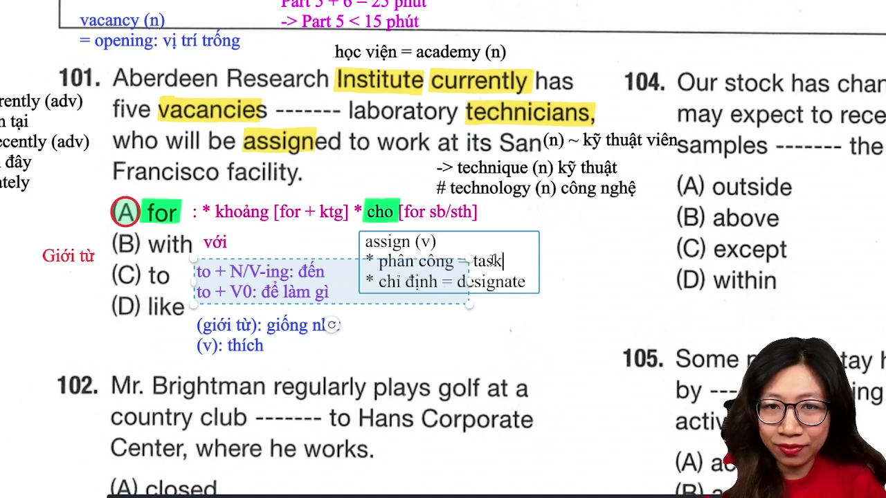

* **Đề bài:** `Aberdeen Research Institute currently has five vacancies ------- laboratory technicians, who will be assigned to work at its San Francisco facility.`
* **Phương án:**
  * (A) for: Giới từ (dành cho ai/cái gì: `for sb/sth`).
  * (B) with: Giới từ (với, cùng với).
  * (C) to: Giới từ (`to + N`: tới đâu; `to + V0`: để làm gì).
  * (D) like: Giới từ (giống như) / Động từ (thích).
* **Phân tích:** Danh từ `vacancies` mang nghĩa các vị trí tuyển dụng còn trống. Cấu trúc ngữ pháp quy chuẩn là `vacancies for sb/sth` (các vị trí trống dành cho chức danh/đối tượng nào). Chọn (A).
* **Dịch nghĩa:** Viện Nghiên cứu Aberdeen hiện đang có năm vị trí trống dành cho kỹ thuật viên phòng thí nghiệm, những người sẽ được phân công làm việc tại cơ sở San Francisco của viện.
* **Mở rộng:**
  * `vacancy` (n) = `opening`: Vị trí tuyển dụng còn trống.
  * `institute` (n): Viện nghiên cứu; phân biệt với `academy` (n: học viện).
  * `currently` (adv): Hiện tại (đi với thì hiện tại đơn hoặc tiếp diễn); phân biệt với `recently` / `lately` (gần đây - đi với hiện tại hoàn thành).
  * `assign` (v): Phân công nhiệm vụ (= `task`) hoặc chỉ định người đảm nhận (= `designate`).
  * `technician` (n): Kỹ thuật viên; phân biệt với `technique` (n: kỹ thuật, phương pháp) và `technology` (n: công nghệ).

---

### [[15:50](https://youtu.be/R6l7KYxHaeA?t=950s)] Câu 102

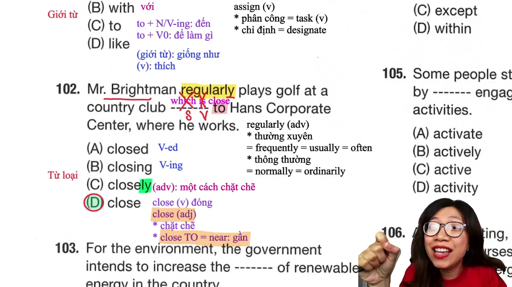

* **Đề bài:** `Mr. Brightman regularly plays golf at a country club ------- to Hans Corporate Center, where he works.`
* **Phương án:**
  * (A) closed: Động từ dạng V-ed / Tính từ (bị đóng cửa).
  * (B) closing: Dạng V-ing / Danh từ (sự đóng cửa).
  * (C) closely: Trạng từ (một cách chặt chẽ, sát sao).
  * (D) close: Tính từ (`close to`: gần với) / Động từ nguyên mẫu (đóng lại).
* **Phân tích:** Câu đã có đầy đủ chủ ngữ `Mr. Brightman` và vị ngữ chính `regularly plays`. Phần đứng sau danh từ `a country club` là mệnh đề quan hệ rút gọn: `a country club [which is] close to Hans Corporate Center`. Từ `close` vừa là động từ vừa là tính từ mang nghĩa "ở gần", đi kèm giới từ `to` (`close to` = `near`). Không chọn trạng từ `closely` vì `closely` chỉ mức độ chặt chẽ/sát sao trong công việc (`closely monitor`, `work closely with`), không dùng chỉ cự ly không gian. Chọn (D).
* **Dịch nghĩa:** Ông Brightman thường xuyên chơi gôn tại một câu lạc bộ đồng quê gần với Trung tâm Tập đoàn Hans, nơi ông ấy làm việc.
* **Mở rộng:**
  * `close to` (adj) = `near`: Gần về vị trí địa lý.
  * `closely` (adv): Chặt chẽ, sát sao (`closely monitor` = theo dõi sát sao).
  * `regularly` (adv): Thường xuyên (= `frequently`, `usually`, `often`) hoặc theo thông lệ (= `normally`, `ordinarily`).

---

### [[23:50](https://youtu.be/R6l7KYxHaeA?t=1430s)] Câu 103

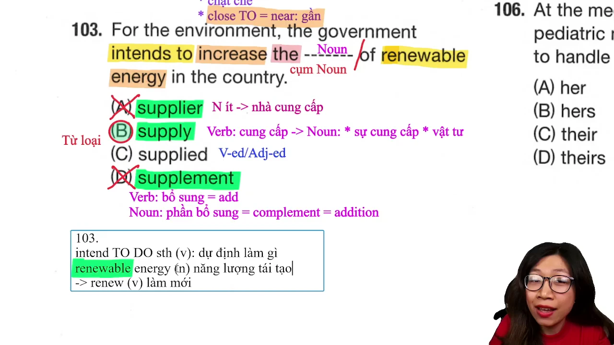

* **Đề bài:** `For the environment, the government intends to increase the ------- of renewable energy in the country.`
* **Phương án:**
  * (A) supplier: Danh từ đếm được số ít (nhà cung cấp - người/công ty).
  * (B) supply: Danh từ không đếm được (nguồn cung cấp, sự cung ứng) / Động từ (cung cấp).
  * (C) supplied: Dạng V-ed / Tính từ bị động.
  * (D) supplement: Danh từ / Động từ (phần bổ sung / bổ sung thêm).
* **Phân tích:** Đứng giữa mạo từ `the` và giới từ `of` bắt buộc là một danh từ (`the + Noun + of`). Loại (C) vì là động từ. Phương án (A) `supplier` là danh từ đếm được số ít, nếu đứng một mình phải có mạo từ hoặc ở dạng số nhiều; đồng thời xét về nghĩa, chính phủ dự định tăng "nguồn cung năng lượng tái tạo" chứ không tăng "nhà cung cấp của năng lượng". Cụm danh từ chuẩn mực: `the supply of renewable energy`. Chọn (B).
* **Dịch nghĩa:** Vì môi trường, chính phủ dự định gia tăng nguồn cung năng lượng tái tạo trong cả nước.
* **Mở rộng:**
  * `intend to V` (v): Có dự định, kế hoạch làm gì.
  * `renewable energy` (n): Năng lượng tái tạo (năng lượng mặt trời, gió, thủy triều).
  * `supply` (n): Nguồn cung cấp, vật tư.
  * `supplement` (n/v) = `complement` = `add` / `addition`: Phần bổ sung, bổ trợ.

---

### [[27:50](https://youtu.be/R6l7KYxHaeA?t=1670s)] Câu 104

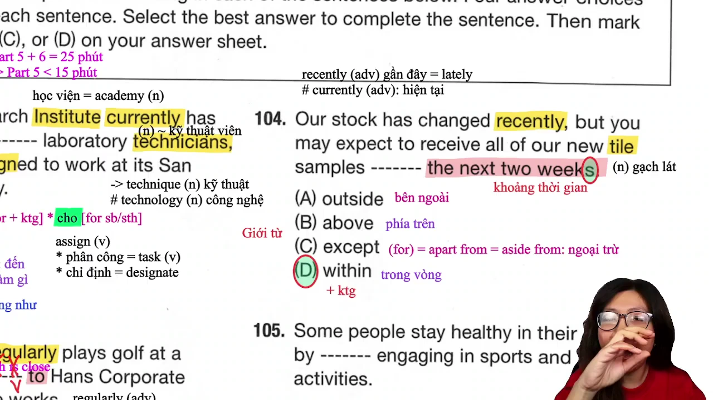

* **Đề bài:** `Our stock has changed recently, but you may expect to receive all of our new tile samples ------- the next two weeks.`
* **Phương án:**
  * (A) outside: Giới từ (ở bên ngoài).
  * (B) above: Giới từ (ở phía trên).
  * (C) except: Giới từ (`except for`: ngoại trừ).
  * (D) within: Giới từ (+ khoảng thời gian: trong vòng).
* **Phân tích:** Phía sau chỗ trống là một cụm danh từ chỉ khoảng thời gian `the next two weeks` (hai tuần tới). Giới từ quy chuẩn đi kèm khoảng thời gian để chỉ một mốc giới hạn hoàn thành hành động là `within` (`within + khoảng thời gian`). Các phương án khác không đi kèm khoảng thời gian với nghĩa phù hợp. Chọn (D).
* **Dịch nghĩa:** Hàng tồn kho của chúng tôi gần đây đã thay đổi, nhưng quý khách có thể dự kiến nhận được toàn bộ các mẫu gạch lát mới trong vòng hai tuần tới.
* **Mở rộng:**
  * `within + khoảng thời gian`: Trong vòng bao lâu (ví dụ: `within the next two weeks`, `within 30 days`).
  * `tile` (n): Gạch dùng để lát (gạch lát sàn: `floor tile`, gạch lát trần: `ceiling tile`).
  * `recently` = `lately` (adv): Gần đây (dấu hiệu nhận biết của thì hiện tại hoàn thành); phân biệt với `currently` (hiện tại).

---

### [[33:45](https://youtu.be/R6l7KYxHaeA?t=2025s)] Câu 105

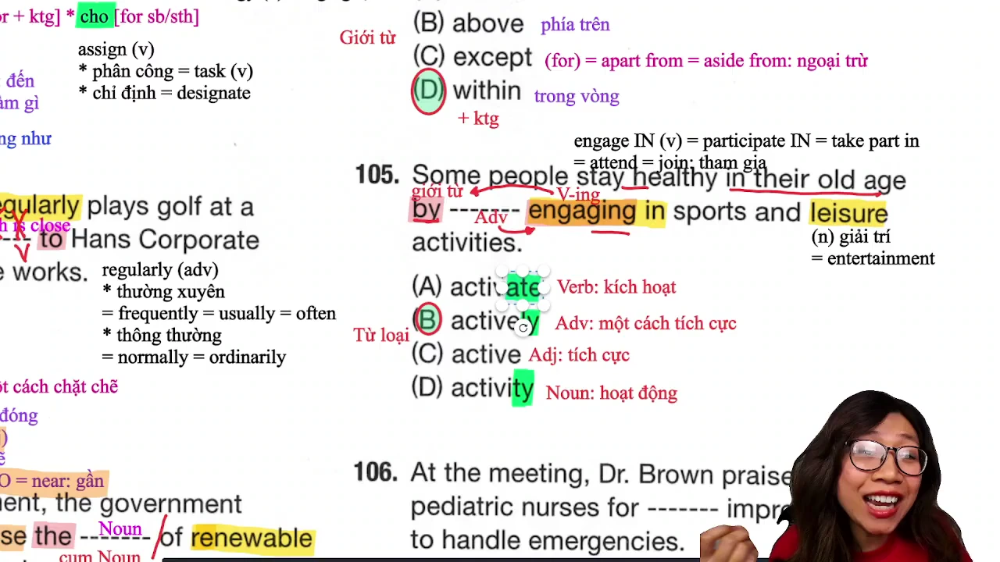

* **Đề bài:** `Some people stay healthy in their old age by ------- engaging in sports and leisure activities.`
* **Phương án:**
  * (A) activate: Động từ nguyên mẫu (kích hoạt).
  * (B) actively: Trạng từ (một cách tích cực, chủ động).
  * (C) active: Tính từ (tích cực, năng động).
  * (D) activity: Danh từ (hoạt động).
* **Phân tích:** Giới từ `by` đã đi kèm với danh động từ `engaging` tạo thành cụm giới từ hoàn chỉnh. Chỗ trống đứng xen giữa giới từ và danh động từ (`by + _______ + engaging`). Thành phần duy nhất có chức năng bổ nghĩa trực tiếp cho động từ hoặc danh động từ là TRẠNG TỪ. Do đó chọn trạng từ có hậu tố `-ly`: `actively`. Không chọn tính từ vì tính từ không bổ nghĩa cho động từ. Chọn (B).
* **Dịch nghĩa:** Một số người vẫn duy trì được sức khỏe khi về già bằng cách tích cực tham gia vào các hoạt động thể thao và giải trí.
* **Mở rộng:**
  * `engage in` = `participate in` = `take part in` = `attend` = `join`: Tham gia vào hoạt động.
  * `leisure` (n) = `entertainment`: Hoạt động giải trí, thư giãn (phát âm chuẩn là /ˈleʒ.ər/).
  * `stay healthy`: Giữ gìn trạng thái sức khỏe tốt.

---

### [[42:05](https://youtu.be/R6l7KYxHaeA?t=2525s)] Câu 106

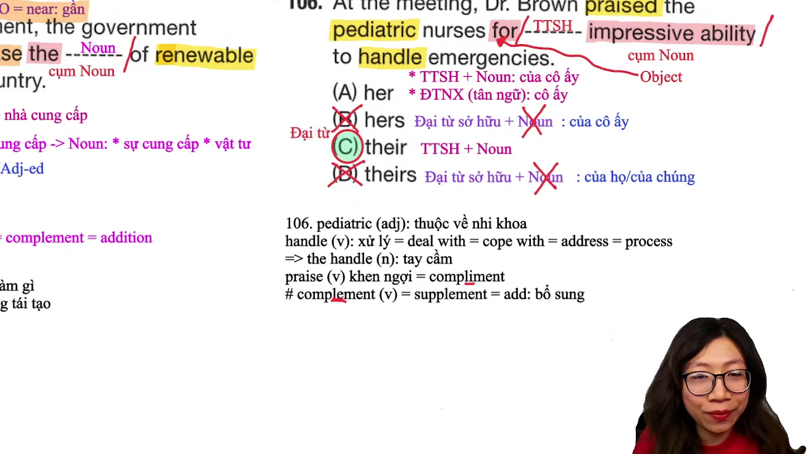

* **Đề bài:** `At the meeting, Dr. Brown praised the pediatric nurses for ------- impressive ability to handle emergencies.`
* **Phương án:**
  * (A) her: Tính từ sở hữu (của cô ấy) / Đại từ tân ngữ (cô ấy).
  * (B) hers: Đại từ sở hữu (của cô ấy - không đi kèm danh từ).
  * (C) their: Tính từ sở hữu (của họ/của chúng - đi kèm danh từ).
  * (D) theirs: Đại từ sở hữu (của họ - không đi kèm danh từ).
* **Phân tích:** Phía sau chỗ trống là cụm danh từ tân ngữ `impressive ability` (khả năng ấn tượng). Vị trí đứng trước cụm danh từ bắt buộc là TÍNH TỪ SỞ HỮU, loại các đại từ sở hữu đứng độc lập có đuôi `-s` là (B) `hers` và (D) `theirs`. Danh từ được khen ngợi phía trước là `the pediatric nurses` (các y tá nhi khoa - danh từ số nhiều), do đó tính từ sở hữu thay thế phải là `their` (của họ). Chọn (C).
* **Dịch nghĩa:** Tại cuộc họp, Bác sĩ Brown đã khen ngợi các y tá nhi khoa vì khả năng ấn tượng của họ trong việc xử lý các tình huống khẩn cấp.
* **Mở rộng:**
  * `praise` (v) = `compliment`: Khen ngợi. Phân biệt `compliment` (khen ngợi) với `complement` (bổ sung).
  * `pediatric` (adj): Thuộc về chuyên khoa nhi.
  * `handle` (v) = `deal with` = `cope with` = `address` = `process`: Xử lý, giải quyết tình huống; danh từ `the handle`: tay cầm.

---

### [[46:58](https://youtu.be/R6l7KYxHaeA?t=2818s)] Câu 107

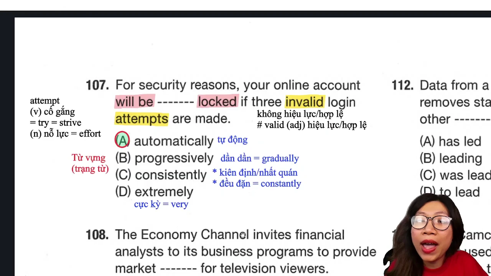

* **Đề bài:** `For security reasons, your online account will be ------- locked if three invalid login attempts are made.`
* **Phương án:**
  * (A) automatically: Trạng từ (một cách tự động).
  * (B) progressively: Trạng từ (dần dần, từng bước = gradually).
  * (C) consistently: Trạng từ (kiên định, nhất quán / đều đặn = constantly).
  * (D) extremely: Trạng từ (cực kỳ = very).
* **Phân tích:** Vị trí trạng từ kẹp giữa trợ động từ bị động `will be` và quá khứ phân từ `locked`. Căn cứ vào điều kiện an toàn thông tin: `if three invalid login attempts are made` (nếu thực hiện ba lần đăng nhập không hợp lệ), hệ thống máy tính sẽ "tự động khóa" tài khoản (`automatically locked`). Chọn (A).
* **Dịch nghĩa:** Vì lý do bảo mật, tài khoản trực tuyến của bạn sẽ tự động bị khóa nếu thực hiện ba lần đăng nhập không hợp lệ.
* **Mở rộng:**
  * `invalid` (adj): Không hợp lệ, vô hiệu lực; trái nghĩa với `valid` (hợp lệ).
  * `attempt` (n/v): Nỗ lực, lần thử sức (= `effort`, `try`, `strive`).
  * `progressively` = `gradually`: Dần dần, lũy tiến.
  * `consistently`: Nhất quán, không thay đổi.

---

### [[51:25](https://youtu.be/R6l7KYxHaeA?t=3085s)] Câu 108

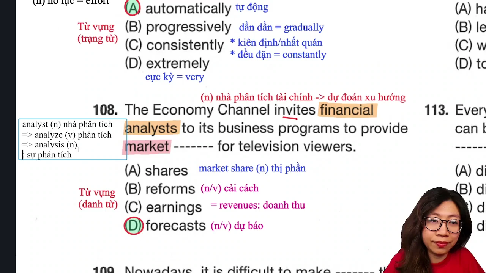

* **Đề bài:** `The Economy Channel invites financial analysts to its business programs to provide market ------- for television viewers.`
* **Phương án:**
  * (A) shares: Danh từ (`market shares`: thị phần).
  * (B) reforms: Danh từ (các cuộc cải cách).
  * (C) earnings: Danh từ (thu nhập, doanh thu = revenues).
  * (D) forecasts: Danh từ (các bản dự báo).
* **Phân tích:** Bẫy cụm từ ghép: Thí sinh band 700+ thường nhìn thấy từ `market` liền chọn ngay `shares` tạo thành `market shares` (thị phần). Tuy nhiên, xét theo logic ngữ nghĩa, các chuyên gia phân tích tài chính (`financial analysts`) tham gia chương trình truyền hình để cung cấp "các dự báo thị trường" (`market forecasts`) cho khán giả xem đài (`television viewers`), chứ không thể phân chia "thị phần" cho khán giả. Chọn (D).
* **Dịch nghĩa:** Kênh Kinh tế mời các chuyên gia phân tích tài chính đến các chương trình kinh doanh của mình để cung cấp các dự báo thị trường cho khán giả truyền hình.
* **Mở rộng:**
  * `financial analyst` (n): Chuyên gia phân tích tài chính (động từ: `analyze`, danh từ: `analysis`).
  * `market forecasts` (n): Các dự báo xu hướng thị trường.
  * `market share` (n): Thị phần (tỷ lệ phần trăm doanh số của một doanh nghiệp trong ngành).

---

### [[56:50](https://youtu.be/R6l7KYxHaeA?t=3410s)] Câu 109

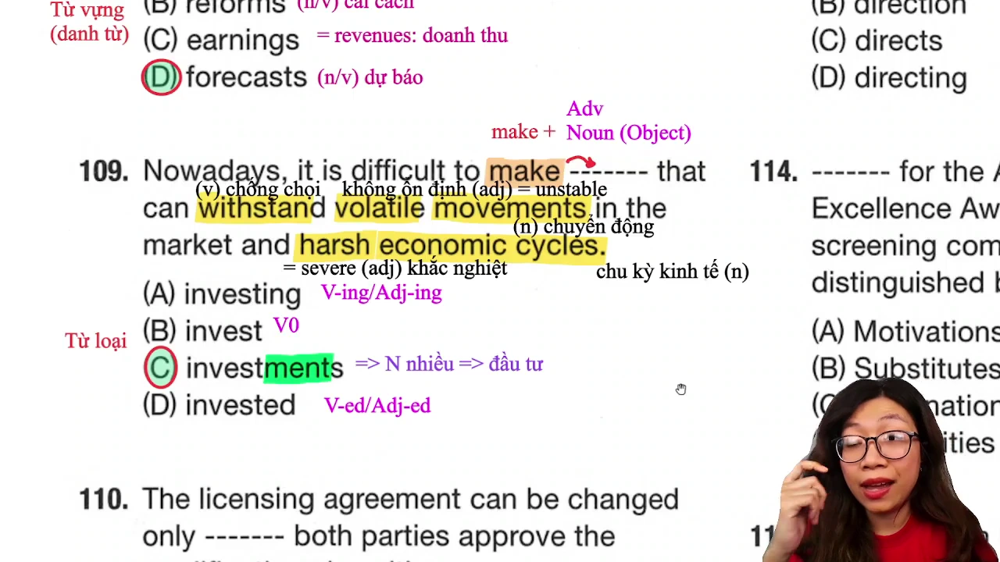

* **Đề bài:** `Nowadays, it is difficult to make ------- that can withstand volatile movements in the market and harsh economic cycles.`
* **Phương án:**
  * (A) investing: Dạng V-ing / Tính từ.
  * (B) invest: Động từ nguyên mẫu.
  * (C) investments: Danh từ đếm được số nhiều (các khoản đầu tư).
  * (D) invested: Dạng V-ed / Tính từ bị động.
* **Phân tích:** Đứng sau ngoại động từ `make` cần một danh từ làm tân ngữ tạo thành cụm kết hợp từ `make investments` (thực hiện các khoản đầu tư). Phía sau có đại từ quan hệ `that` thay thế cho danh từ số nhiều đứng trước để làm chủ ngữ cho vị ngữ `can withstand`. Phương án duy nhất mang hậu tố danh từ `-ment` là (C).
* **Dịch nghĩa:** Ngày nay, thật khó để thực hiện các khoản đầu tư có thể chống chọi được với những biến động khó lường trên thị trường và các chu kỳ kinh tế khắc nghiệt.
* **Mở rộng:**
  * `withstand` (v): Chống chọi, chịu đựng được áp lực (= `resist`, `endure`).
  * `volatile` (adj) = `unstable`: Biến động, không ổn định.
  * `harsh` (adj) = `severe`: Khắc nghiệt, khốc liệt.
  * `economic cycles` (n): Các chu kỳ phát triển của nền kinh tế.

---

### [[01:04:05](https://youtu.be/R6l7KYxHaeA?t=3845s)] Câu 110

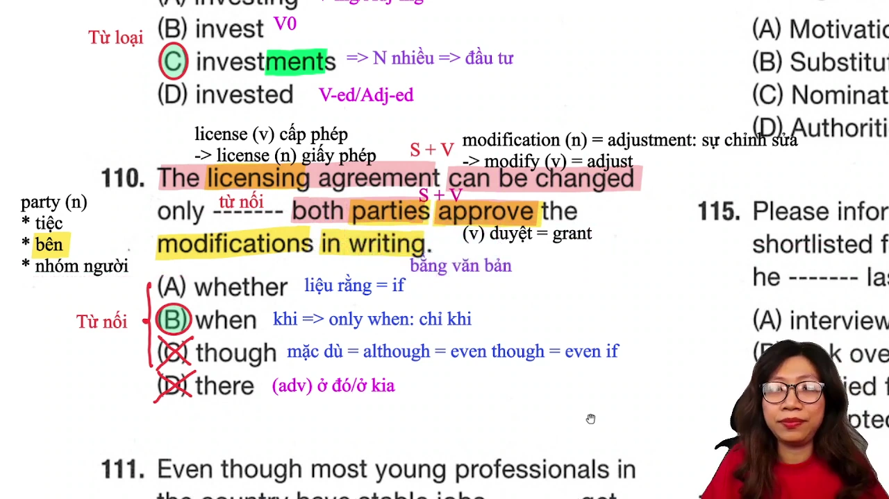

* **Đề bài:** `The licensing agreement can be changed only ------- both parties approve the modifications in writing.`
* **Phương án:**
  * (A) whether: Liên từ (liệu rằng = if).
  * (B) when: Liên từ (khi; cụm `only when`: chỉ khi).
  * (C) though: Liên từ (mặc dù = although, even though).
  * (D) there: Trạng từ chỉ nơi chốn (ở đó/ở kia).
* **Phân tích:** Vị trí nối hai mệnh đề hoàn chỉnh: `The licensing agreement can be changed` và `both parties approve the modifications in writing`. Cần một liên từ nối hai mệnh đề. Loại (D) `there` vì là trạng từ. Loại (C) `though` vì không bao giờ kết hợp với `only` (chỉ có `even though`, không có `only though`). Cụm liên từ điều kiện chuẩn bản ngữ: `only when + S + V` (chỉ khi nào...). Chọn (B).
* **Dịch nghĩa:** Hợp đồng cấp phép chỉ có thể được thay đổi khi cả hai bên chấp thuận các sửa đổi bằng văn bản.
* **Mở rộng:**
  * `only when + S + V`: Chỉ khi nào...
  * `party` (n): Ngoài nghĩa bữa tiệc, trong văn bản pháp lý mang nghĩa "bên tham gia ký kết" (`both parties`: cả hai bên), hoặc nhóm người (`a party of five`).
  * `modification` (n) = `adjustment`: Sự chỉnh sửa, điều chỉnh (động từ: `modify` = `adjust`).
  * `in writing`: Bằng văn bản chính thức có giấy tờ.

---

### [[01:10:28](https://youtu.be/R6l7KYxHaeA?t=4228s)] Câu 111

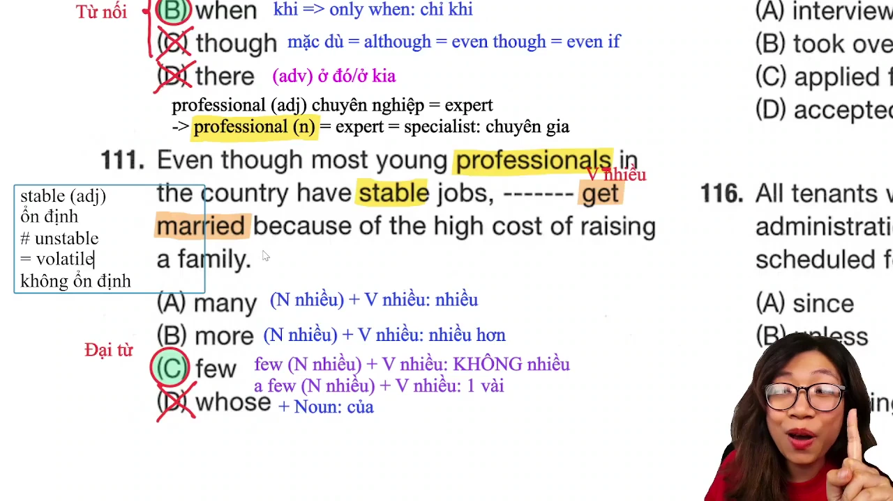

* **Đề bài:** `Even though most young professionals in the country have stable jobs, ------- get married because of the high cost of raising a family.`
* **Phương án:**
  * (A) many: Đại từ (+ V số nhiều: nhiều người).
  * (B) more: Đại từ (+ V số nhiều: nhiều người hơn).
  * (C) few: Đại từ mang nghĩa phủ định (+ V số nhiều: rất ít người, hầu như không có ai).
  * (D) whose: Đại từ quan hệ sở hữu (+ Noun: của ai).
* **Phân tích:** Liên từ nhượng bộ `Even though` đòi hỏi hai vế phải mang ý nghĩa tương phản đối lập: Vế 1 mang nghĩa tích cực (+) khi phần lớn người trẻ có chuyên môn đều có việc làm ổn định (`have stable jobs`), do đó vế 2 bắt buộc phải mang nghĩa tiêu cực (-) để tương phản với chi phí nuôi gia đình quá cao (`high cost of raising a family`). Đại từ `few` mang nghĩa phủ định "rất ít người kết hôn", làm chủ ngữ cho động từ số nhiều `get married`. Nếu chọn `many` hay `more` sẽ làm mất đi quan hệ tương phản bắt buộc của liên từ `Even though`. Loại (D) `whose` vì thiếu danh từ sở hữu theo sau. Chọn (C).
* **Dịch nghĩa:** Mặc dù phần lớn người trẻ có chuyên môn trong nước đều có việc làm ổn định, nhưng rất ít người kết hôn do chi phí nuôi gia đình quá cao.
* **Mở rộng:**
  * Phân biệt `few` và `a few`: `few` mang nghĩa phủ định (= hầu như không có ai, rất ít), còn `a few` mang nghĩa khẳng định (= một vài người).
  * `professional` (n/adj): Vừa là tính từ "chuyên nghiệp", vừa là danh từ chỉ người "chuyên gia, người có trình độ chuyên môn" (= `expert`, `specialist`).
  * `stable` (adj): Ổn định, vững chắc; trái nghĩa với `unstable` / `volatile`.

---

### [[01:15:25](https://youtu.be/R6l7KYxHaeA?t=4525s)] Câu 112

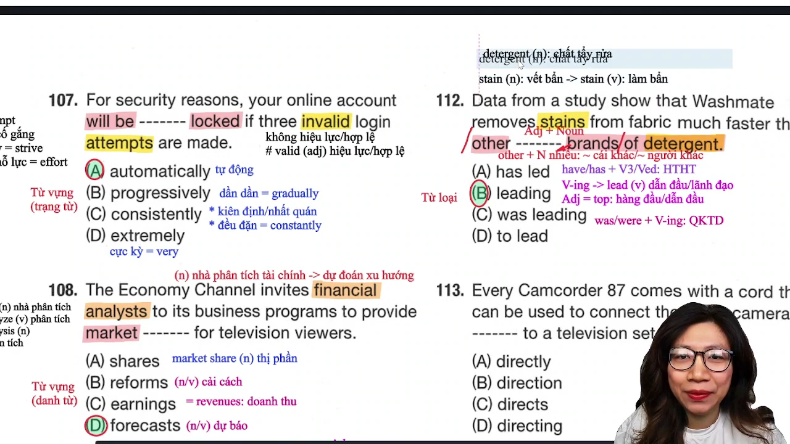

* **Đề bài:** `Data from a study show that Washmate removes stains from fabric much faster than other ------- brands of detergent.`
* **Phương án:**
  * (A) has led: Thì hiện tại hoàn thành.
  * (B) leading: Tính từ phân từ (hàng đầu, dẫn đầu).
  * (C) was leading: Thì quá khứ tiếp diễn.
  * (D) to lead: Dạng To-V.
* **Phân tích:** Cấu trúc so sánh hơn: `much faster than other _______ brands of detergent`. Cụm danh từ phía sau là `brands of detergent` (các thương hiệu chất tẩy rửa). Vị trí đứng sau lượng từ `other` và đứng trước danh từ chính `brands` bắt buộc là một TÍNH TỪ bổ nghĩa cho danh từ. `leading` là tính từ phân từ mang nghĩa "hàng đầu, dẫn đầu thị trường" (`leading brands`: các thương hiệu hàng đầu). Chọn (B).
* **Dịch nghĩa:** Dữ liệu từ một nghiên cứu cho thấy Washmate loại bỏ vết bẩn khỏi vải nhanh hơn nhiều so với các thương hiệu chất tẩy rửa hàng đầu khác.
* **Mở rộng:**
  * `leading` (adj) = `top`: Hàng đầu, dẫn đầu ngành.
  * `stain` (n/v): Vết bẩn, vết ố / làm vấy bẩn.
  * `detergent` (n): Bột giặt, chất tẩy rửa công nghiệp/gia dụng.

---

### [[01:22:20](https://youtu.be/R6l7KYxHaeA?t=4940s)] Câu 113

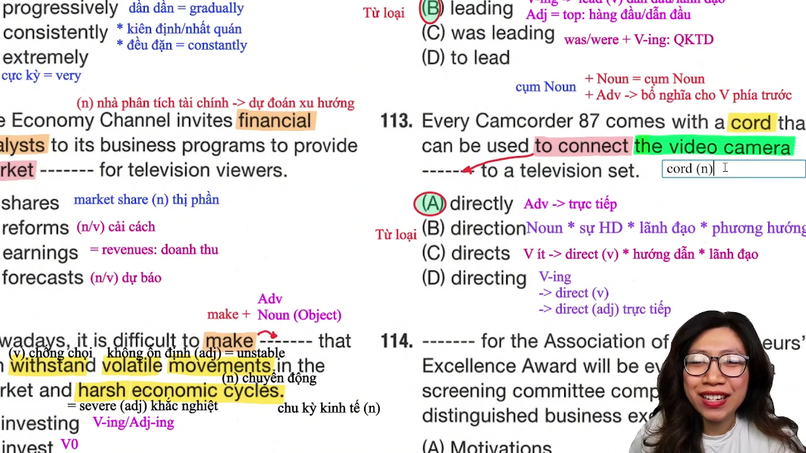

* **Đề bài:** `Every Camcorder 87 comes with a cord that can be used to connect the video camera ------- to a television set.`
* **Phương án:**
  * (A) directly: Trạng từ (một cách trực tiếp).
  * (B) direction: Danh từ (sự hướng dẫn, phương hướng).
  * (C) directs: Động từ chia ngôi thứ ba số ít (chỉ đạo, hướng dẫn).
  * (D) directing: Dạng V-ing.
* **Phân tích:** Mệnh đề mục đích đã có cấu trúc hoàn chỉnh: Động từ `connect` + cụm tân ngữ `the video camera` + cụm giới từ `to a television set`. Vị trí đứng sau tân ngữ và trước giới từ chỉ có thể là TRẠNG TỪ bổ nghĩa cho động từ hành động `connect` (`connect the camera directly to a TV`: kết nối máy quay trực tiếp tới tivi). Chọn (A).
* **Dịch nghĩa:** Mỗi chiếc Máy quay Camcorder 87 đều đi kèm với một sợi dây cáp có thể được sử dụng để kết nối máy quay video trực tiếp với tivi.
* **Mở rộng:**
  * `directly` (adv): Một cách trực tiếp.
  * `direct` (v/adj): Động từ là chỉ đạo, hướng dẫn; tính từ là trực tiếp.
  * `cord` (n): Dây cáp kết nối, dây điện mềm.

---

### [[01:38:08](https://youtu.be/R6l7KYxHaeA?t=5888s)] Câu 114

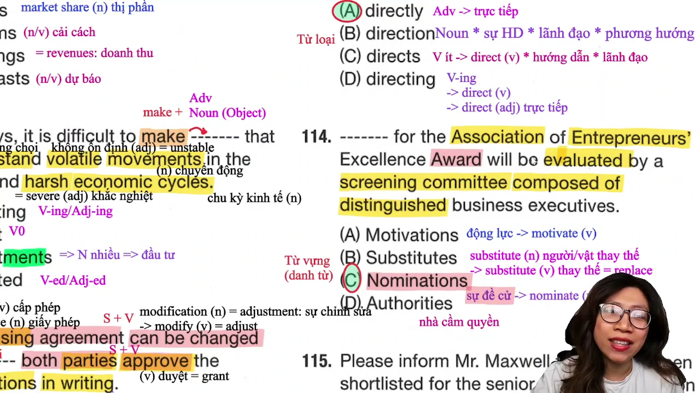

* **Đề bài:** `------- for the Association of Entrepreneurs' Excellence Award will be evaluated by a screening committee composed of distinguished business executives.`
* **Phương án:**
  * (A) Motivations: Danh từ (các nguồn động lực).
  * (B) Substitutes: Danh từ (những người/vật thay thế).
  * (C) Nominations: Danh từ (các sự đề cử, hồ sơ đề cử giải thưởng).
  * (D) Authorities: Danh từ (các nhà cầm quyền, cơ quan chức năng).
* **Phân tích:** Chỗ trống đứng đầu câu làm chủ ngữ cho vị ngữ bị động `will be evaluated by a screening committee` (sẽ được đánh giá bởi hội đồng thẩm định). Căn cứ vào đối tượng của giải thưởng danh giá phía sau: `Excellence Award` (Giải thưởng Xuất sắc), thứ được nộp lên để hội đồng thẩm định xem xét trao giải bắt buộc là "các hồ sơ đề cử" (`Nominations for the Award`). Chọn (C).
* **Dịch nghĩa:** Các hồ sơ đề cử cho Giải thưởng Xuất sắc của Hiệp hội Doanh nhân sẽ được đánh giá bởi một hội đồng thẩm định gồm các nhà điều hành doanh nghiệp lỗi lạc.
* **Mở rộng:**
  * `nomination` (n): Hồ sơ đề cử, sự đề cử (động từ: `nominate`).
  * `screening committee` (n): Hội đồng sàng lọc, ban thẩm định hồ sơ.
  * `composed of`: Được cấu thành từ, bao gồm.
  * `distinguished` (adj) = `acclaimed`: Xuất sắc, lỗi lạc, ưu tú.
  * `substitute` (n/v): Người/vật thay thế / thay thế (= `replace`).

---

### [[01:42:50](https://youtu.be/R6l7KYxHaeA?t=6170s)] Câu 115

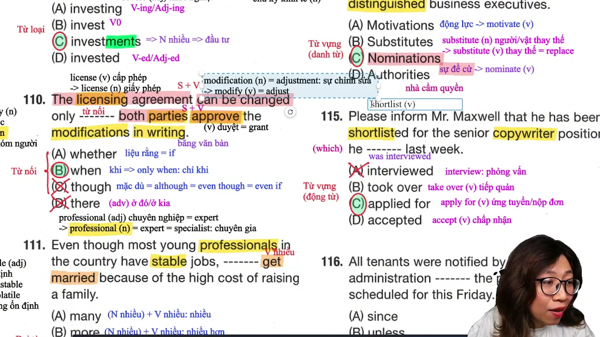

* **Đề bài:** `Please inform Mr. Maxwell that he has been shortlisted for the senior copywriter position he ------- last week.`
* **Phương án:**
  * (A) interviewed: Động từ thì quá khứ đơn (đã phỏng vấn).
  * (B) took over: Cụm động từ thì quá khứ đơn (đã tiếp quản).
  * (C) applied for: Cụm động từ thì quá khứ đơn (đã nộp đơn ứng tuyển cho).
  * (D) accepted: Động từ thì quá khứ đơn (đã chấp thuận).
* **Phân tích:** Bẫy chủ động và bị động trong mệnh đề quan hệ rút gọn: Cụm `the senior copywriter position [which] he _______ last week` lược bỏ đại từ quan hệ `which` làm tân ngữ. Chủ ngữ là `he` (ông Maxwell), người đã "được đưa vào danh sách rút gọn" (`has been shortlisted`). Nếu chọn (A) `interviewed`, câu mang nghĩa chủ động "vị trí mà ông ấy đã đi phỏng vấn người khác" (sai thực tế vì ông Maxwell là ứng viên được nhà tuyển dụng phỏng vấn: nếu dùng phải là `was interviewed for`). Hành động chủ động của ứng viên đối với một vị trí công việc vào tuần trước là "đã nộp đơn ứng tuyển" (`applied for the position`). Chọn (C).
* **Dịch nghĩa:** Xin vui lòng thông báo cho ông Maxwell rằng ông ấy đã được đưa vào danh sách rút gọn cho vị trí biên tập viên quảng cáo cấp cao mà ông ấy đã ứng tuyển vào tuần trước.
* **Mở rộng:**
  * `shortlist` (v): Đưa vào danh sách rút gọn, chọn vào vòng phỏng vấn kế tiếp.
  * `copywriter` (n): Người viết nội dung quảng cáo, biên tập viên quảng cáo.
  * `apply for a position`: Nộp đơn ứng tuyển vào một vị trí công việc.
  * `take over` (v): Tiếp quản công ty, vị trí hoặc quyền quản lý.

---

## Trích dẫn then chốt

* [[07:43](https://youtu.be/R6l7KYxHaeA?t=463s)] "Mình lộn là do mình chưa nắm được hai tầng nghĩa của assign... assign vừa có nghĩa là phân công bằng task, vừa có nghĩa là chỉ định bằng designate."
* [[27:00](https://youtu.be/R6l7KYxHaeA?t=1620s)] "Luyện phản xạ liền chứ... nói chữ gần đây một cái là phải tự động ra từ đồng nghĩa lately liền, để không bị lộn với currently là hiện tại."
* [[34:42](https://youtu.be/R6l7KYxHaeA?t=2082s)] "Đại từ sở hữu có được dùng danh từ phía sau không? Không được dùng danh từ ở phía sau... loại liền hers và theirs."
* [[47:14](https://youtu.be/R6l7KYxHaeA?t=2834s)] "Thấy chữ market là ai cũng sẽ nghĩ tới share... nhưng câu này bẫy các bạn band cao, chuyên gia tài chính lên truyền hình là để cung cấp dự báo thị trường chứ không phân chia thị phần."
* [[01:38:00](https://youtu.be/R6l7KYxHaeA?t=5880s)] "Đọc theo cô là nhớ hai ba đề thôi là tự động từ nó vô đầu luôn... nhớ nguyên tắc học là phải dùng được."

---

## Lệnh & Công cụ

* **Vị trí tuyển dụng:** `vacancies for + Chức danh / Vị trí tuyển dụng`
* **Tính từ cự ly không gian:** `close to + Địa điểm` (= `near`, mệnh đề rút gọn `[which is] close to`)
* **Nguồn cung cấp:** `the supply of + N vật tư / năng lượng` (danh từ không đếm được)
* **Giới hạn thời gian hoàn thành:** `within + khoảng thời gian` (`within the next two weeks`)
* **Trạng từ bổ nghĩa V-ing:** `by + [Trạng từ đuôi -ly] + V-ing` (`by actively engaging`)
* **Tính từ sở hữu:** `[Tính từ sở hữu] + Cụm danh từ` (`their impressive ability`)
* **Trạng từ kẹp giữa bị động:** `will be + [Trạng từ] + V-ed` (`will be automatically locked`)
* **Dự báo thị trường:** `market forecasts` (cung cấp dự báo, phân biệt với `market share`: thị phần)
* **Cụm động từ đầu tư:** `make + investments + that can withstand...`
* **Liên từ điều kiện bắt buộc:** `only when + S + V` (loại bỏ `there`, `only though`)
* **Đại từ phủ định nhượng bộ:** `Even though (+), few + V số nhiều (-)`
* **Tính từ dẫn đầu ngành:** `other + leading + brands / companies`
* **Trạng từ sau tân ngữ:** `connect O + directly + to...`
* **Hồ sơ đề cử giải thưởng:** `Nominations for + Tên giải thưởng`
* **Bẫy chủ động ứng viên:** `the position (which) he + applied for` (loại `interviewed`)

---

## Đánh đổi & Rủi ro

* **Bẫy thói quen kết hợp từ (Collocation Trap):** Thấy từ `market` trong câu 108 liền phản xạ máy móc chọn `shares` thành `market shares` (thị phần), không đọc đối tượng thụ hưởng là khán giả xem truyền hình cần bản tin dự báo xu hướng (`market forecasts`).
* **Bẫy thể chủ động / bị động trong mệnh đề rút gọn:** Thấy câu 115 có hành động phỏng vấn liền chọn `interviewed` theo thói quen dịch nghĩa tiếng Việt, bỏ qua bản chất ngữ pháp ứng viên là người được phỏng vấn (`was interviewed`) và hành động thực tế tuần trước là nộp hồ sơ ứng tuyển (`applied for`).
* **Bẫy từ loại đồng âm / đa chức năng:** Nhầm lẫn `close` chỉ là động từ mà bỏ qua chức năng tính từ chỉ khoảng cách đi với giới từ `to` (`close to`), hoặc chọn nhầm trạng từ `closely` (chỉ mức độ chặt chẽ trong công việc, không dùng cho khoảng cách địa lý).
* **Bẫy ngữ pháp liên từ nhượng bộ:** Khi gặp liên từ `Even though` ở câu 111, chọn các đại từ khẳng định (`many`, `more`) sẽ làm triệt tiêu tính đối lập ngữ nghĩa giữa việc có việc làm ổn định và việc không dám kết hôn vì gánh nặng tài chính.
