# GIẢI ĐỀ TOEIC 2026 MỚI NHẤT | PART 2 [VIDEO 1]

* **Kênh:** Anh ngữ Ms Thanh | **Thời lượng:** 01:42:15 | **Ngày:** 2026-02-26
* **Video:** https://youtu.be/RHPLKHoJcZI

---

## Thuật ngữ

| Thuật ngữ | Tiếng Anh | Giải thích |
| :--- | :--- | :--- |
| Câu hỏi thông tin | Wh-question | Dạng câu hỏi bắt đầu bằng từ để hỏi (Who, Where, When, Why, How) nhằm tìm kiếm thông tin cụ thể, tuyệt đối không trả lời bằng Yes/No. |
| Câu hỏi xác nhận | Yes/No question | Dạng câu hỏi bắt đầu bằng trợ động từ hoặc to be nhằm xác nhận tính đúng sai của thông tin. |
| Câu hỏi đuôi | Tag question | Mệnh đề trần thuật kèm đuôi hỏi xác nhận ngắn ở cuối câu (haven't you, isn't it), có thể trả lời bằng Yes/No kèm mốc giải thích. |
| Câu hỏi lựa chọn | Alternative question | Câu hỏi đưa ra hai hay nhiều phương án nối bằng liên từ "or" (A or B), không trả lời bằng Yes/No. |
| Câu trần thuật | Statement | Câu kể khẳng định hoặc nhận định đưa ra một thông tin hoặc tình huống, đòi hỏi phản hồi đồng tình hoặc giải pháp xử lý. |
| Câu trả lời gián tiếp | Indirect Answer | Phản hồi không trực tiếp chọn đáp án mà cung cấp dữ kiện liên đới hoặc đẩy trách nhiệm sang đối tượng khác (That's what the driver told me). |
| Bẫy lặp từ | Echo Trap | Phương án cố tình lặp lại y nguyên từ vựng xuất hiện trong câu hỏi nhằm đánh lừa thí sinh nghe bắt từ (xác suất sai 80-90%). |
| Bẫy đồng âm | Homophone Trap | Phương án sử dụng từ có cách phát âm tương tự hoặc từ cùng trường nghĩa liên tưởng (fix / fax, report / reporter, umbrella / rain). |
| Sai đối tượng | Pronoun Mismatch | Lỗi logic khi câu hỏi hỏi về một chủ thể (Charles, you) nhưng câu trả lời lại dùng đại từ nhân xưng không tương ứng (she, they, it). |
| Hiện tượng nối âm | Connected Speech | Kỹ thuật phát âm tự nhiên của người bản ngữ nối phụ âm cuối của từ trước với nguyên âm đầu của từ sau (deliver it -> /dɪˈlɪvərɪt/). |

---

## Tổng luận chuyên đề

### Chiến thuật nghe

Phần thi Part 2 gồm 25 câu hỏi (từ câu 7 đến câu 31). Mỗi câu bao gồm 1 câu hỏi/nhận định và 3 phương án phản hồi (A, B, C):
* **Đặc thù thi cử:** Thí sinh thi giấy cần lưu ý tờ phiếu trả lời có đủ 4 ô A, B, C, D nhưng tuyệt đối không được tô ô D ở Part 2. Thí sinh thi máy chỉ hiển thị 3 lựa chọn A, B, C.
* **Độ khó thực tế:** Part 2 hiện là phần thi có tỷ lệ bẫy cao nhất trong bài thi TOEIC Listening, với 13 đến 14 câu khó trên tổng số 25 câu (chiếm trên 50%). Khác với Part 3 và Part 4 có thể đọc trước đề, Part 2 đòi hỏi khả năng xử lý âm thanh tức thời mà không có văn bản hỗ trợ.
* **Quy trình luyện tập 3 bước:**
  * Bước 1: Làm bài trước mà không nhìn phụ đề hay kịch bản.
  * Bước 2: Nghe phân tích, ghi chép từ vựng mở rộng, chiến thuật gài bẫy và hiện tượng nối âm.
  * Bước 3: Luyện nghe lại theo phương pháp đục lỗ và tự dịch nghĩa từng câu.

### Các bẫy kinh điển

* **Bẫy lặp lại từ vựng:** Đa phần các câu trả lời chứa từ vựng giống hệt từ trong câu hỏi đều là bẫy gây nhiễu (tỷ lệ loại trừ thành công 80-90%). Ví dụ: câu hỏi có `sign up` thì phương án chứa `sign-up sheet` là bẫy; câu hỏi có `accounting class` thì phương án chứa `classroom` là bẫy.
* **Bẫy đồng âm và gần âm:** Sử dụng các từ phát âm tương tự nhưng nghĩa hoàn toàn khác nhau để đánh lạc hướng thí sinh nghe không rõ âm cuối: `fix` (sửa chữa) bẫy với `fax` (gửi bản fax); `mail` (gửi thư) bẫy với `mayor` (thị trưởng); `interview` (phỏng vấn) bẫy với `view` (quang cảnh).
* **Bẫy liên tưởng ngữ cảnh:** Đưa ra các từ thuộc cùng trường từ vựng nhưng không trả lời trọng tâm: câu hỏi nhắc đến `umbrella` (cây dù) thì phương án nhắc đến `rain` (trời mưa); câu hỏi nhắc đến `report` (báo cáo) thì phương án nhắc đến `reporter` (phóng viên).
* **Bẫy sai thì và sai chủ ngữ:** Câu hỏi dùng thì quá khứ đơn (`When did you sign up`) nhưng phương án trả lời ở thì tương lai (`It's in August`); câu hỏi hỏi về đối tượng cụ thể (`Charles`) nhưng câu trả lời dùng sai ngôi xưng (`No, it is not`).

### Dạng câu hỏi

* **Câu hỏi thông tin (Wh-questions):**
  * `How long`: Hỏi về khoảng thời gian kéo dài (`About 30 minutes`), phân biệt với mốc thời gian của `When` (`Last week`).
  * `Where`: Hỏi nơi chốn, mở rộng câu trả lời tới cửa hàng (`shop`, `store`) hoặc nền tảng trực tuyến (`online`).
  * `When`: Bắt buộc phải là mốc thời gian tương thích với thì của câu hỏi (quá khứ đơn chọn `Last month`).
  * `Who`: Trả lời bằng tên người, chức danh hoặc chỉ rõ đối tượng đang giữ vật dụng (`I gave it back to Shannon`).
  * `Why`: Hỏi nguyên nhân, thường trả lời bằng mục đích thăng tiến hoặc giải pháp (`It'll help me get a promotion`).
* **Câu hỏi lựa chọn (A or B):**
  * Tuyệt đối không bao giờ trả lời bằng `Yes` hoặc `No`.
  * Có 3 hướng trả lời: Chọn A hoặc B; chọn phương án thứ ba (C) ngoài hai phương án đã nêu; hoặc thông báo chưa đưa ra quyết định được.
* **Câu hỏi mời mọc hoặc đề nghị (Would you like to...):**
  * Thường phản hồi theo 3 hướng: Đồng ý nhận lời; từ chối khéo léo kèm lý do bận; hoặc đề xuất kiểm tra lại lịch trình (`Let me check my calendar`).
* **Câu trần thuật (Statements):**
  * Đây là dạng câu khó nhất đòi hỏi nghe hiểu trọn vẹn ý nghĩa.
  * Khi phân vân giữa hai đáp án: 90% xác suất nghiêng về hướng đồng tình/hưởng ứng thông tin (`Yes, if we want good seats`), chỉ khoảng 10% rơi vào tình huống từ chối/phủ định.

### Quy tắc phản xạ

* Nghe từ đầu tiên để nhận diện ngay loại câu hỏi (Từ để hỏi Wh-, Trợ động từ Yes/No, hay Lời mời).
* Bắt chặt động từ chính và danh từ tân ngữ cốt lõi thay vì cố gắng dịch toàn bộ các từ phụ trợ.
* Áp dụng nguyên tắc loại trừ triệt để: loại ngay phương án lặp từ, phương án sai thì và phương án trả lời Yes/No cho câu hỏi Wh-/Alternative.

---

## Bóc tách chi tiết

### [[00:03](https://youtu.be/RHPLKHoJcZI?t=3s)] Chiến thuật nghe


* **Tổng quan:** Part 2 gồm 25 câu hỏi từ câu 7 đến câu 31. Mỗi câu có 1 câu hỏi và 3 lựa chọn (A, B, C).
* **Thống kê độ khó:** Có từ 13 đến 14 câu khó được thiết kế gài bẫy (chiếm trên 50% tổng số câu).
* **Nguyên tắc xử lý:**
  * Loại bỏ phương án lặp từ (độ chính xác khi loại trừ đạt 80-90%).
  * Câu hỏi lựa chọn A or B không trả lời bằng Yes/No, tập trung nhận diện lựa chọn thay thế.
  * Câu trần thuật ưu tiên hướng phản hồi đồng tình (90% xác suất) hơn là phản hồi từ chối (10% xác suất).
  * Luyện tập phản xạ nối âm và nhận diện bẫy âm thanh tương đồng.

---

### [[12:01](https://youtu.be/RHPLKHoJcZI?t=721s)] Câu 7

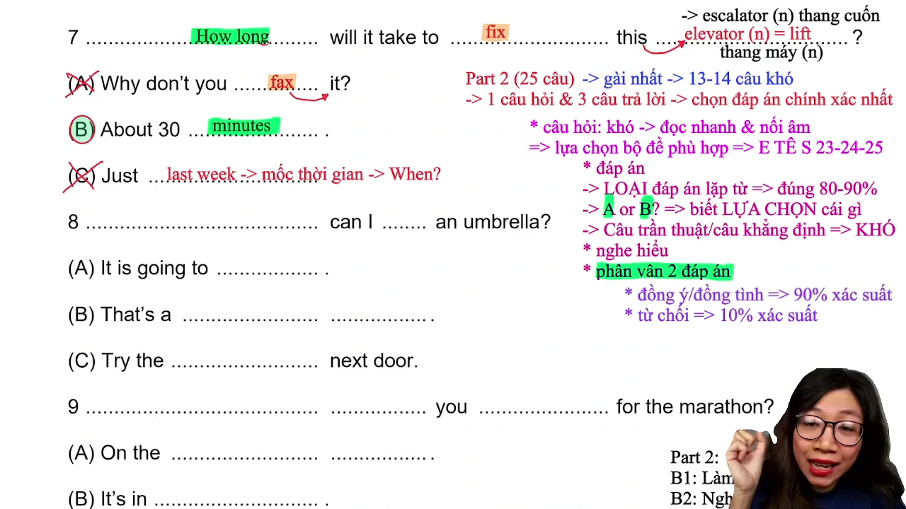

* **Đề bài:** `How long will it take to fix this elevator?`
* **Phương án:**
  * (A) `Why don't you fax it?`: Bẫy đồng âm `fix` / `fax` (/fɪks/ và /fæks/).
  * (B) `About 30 minutes.`: Trả lời chính xác khoảng thời gian cho câu hỏi `How long`.
  * (C) `Just last week.`: Trả lời mốc thời gian quá khứ cho câu hỏi `When`, không phù hợp với `How long`.
* **Phân tích:** 
  * Câu hỏi bắt đầu bằng cụm `How long` nhằm hỏi về độ dài khoảng thời gian cần thiết để sửa thang máy.
  * Phương án (A) gài bẫy phát âm tương đồng giữa hành động sửa chữa (`fix`) và gửi bản fax (`fax`), đồng thời câu trả lời gợi ý không giải quyết câu hỏi thời gian.
  * Phương án (C) đưa ra mốc thời gian `last week` (tuần trước) để bẫy thí sinh nhầm lẫn giữa `When` và `How long`.
  * Phương án (B) đưa ra con số ước tính `About 30 minutes` (Khoảng 30 phút), khớp hoàn toàn với cấu trúc câu hỏi `How long`. Chọn (B).
* **Dịch nghĩa:** Sẽ mất bao lâu để sửa chiếc thang máy này? - Khoảng 30 phút.
* **Mở rộng:**
  * `Elevator` = `Lift` (danh từ: thang máy buồng).
  * `Escalator` (danh từ: thang cuốn tự động).
  * `Fix` = `Repair` (động từ: sửa chữa, khắc phục sự cố).

---

### [[18:24](https://youtu.be/RHPLKHoJcZI?t=1104s)] Câu 8

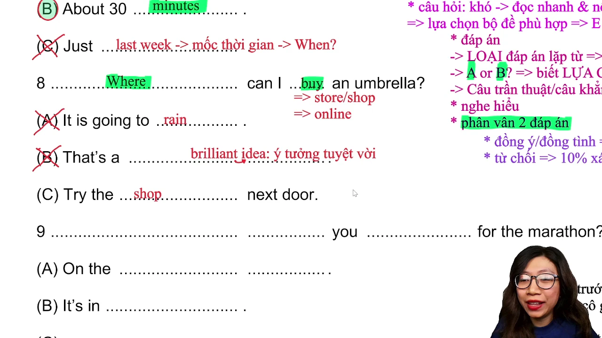

* **Đề bài:** `Where can I buy an umbrella?`
* **Phương án:**
  * (A) `It is going to rain.`: Bẫy liên tưởng ngữ cảnh giữa `umbrella` (cây dù) và `rain` (mưa).
  * (B) `That's a brilliant idea.`: Câu khen ngợi ý tưởng hay, không trả lời vị trí.
  * (C) `Try the shop next door.`: Cung cấp địa điểm cửa hàng mua sắm cụ thể.
* **Phân tích:**
  * Câu hỏi thông tin bắt đầu bằng `Where` kết hợp hành động mua sắm `buy an umbrella`. Câu trả lời cần hướng đến một địa điểm bán hàng (`store`, `shop`, `supermarket` hoặc `online`).
  * Phương án (A) đưa ra nhận định thời tiết trời sắp mưa nhằm bẫy thí sinh liên tưởng cây dù với trời mưa nhưng không trả lời nơi chốn.
  * Phương án (B) đưa ra lời nhận xét "Đó là một ý tưởng tuyệt vời" không liên quan đến thông tin hỏi.
  * Phương án (C) hướng dẫn người hỏi ghé thử cửa hàng ngay bên cạnh (`the shop next door`), giải quyết trọn vẹn câu hỏi `Where`. Chọn (C).
* **Dịch nghĩa:** Tôi có thể mua một cây dù ở đâu? - Hãy thử cửa hàng ngay bên cạnh xem sao.
* **Mở rộng:**
  * `Brilliant idea` = `Great idea` = `Excellent idea` (ý tưởng tuyệt vời).
  * `Next door` (ngay bên cạnh, nhà bên cạnh).

---

### [[22:38](https://youtu.be/RHPLKHoJcZI?t=1358s)] Câu 9

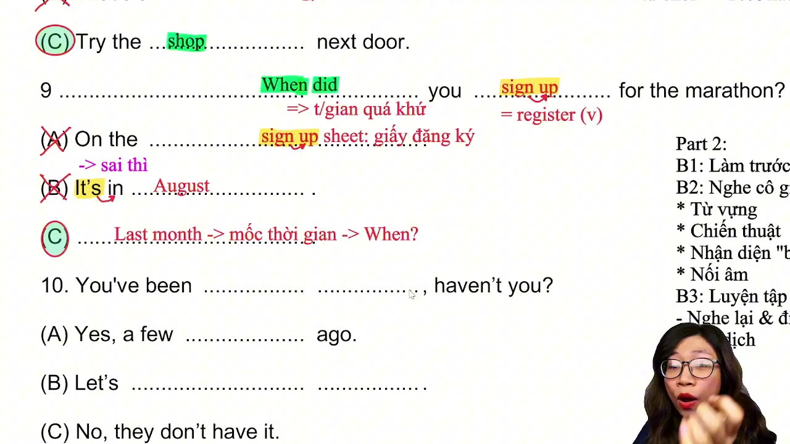

* **Đề bài:** `When did you sign up for the marathon?`
* **Phương án:**
  * (A) `On the sign-up sheet.`: Bẫy lặp từ `sign up` (trên tờ giấy đăng ký).
  * (B) `It's in August.`: Bẫy sai thì (dùng thì hiện tại/tương lai trong khi câu hỏi dùng quá khứ đơn `did`).
  * (C) `Last month.`: Trả lời mốc thời gian quá khứ tương thích với `When did`.
* **Phân tích:**
  * Câu hỏi dùng từ để hỏi `When` kết hợp trợ động từ quá khứ `did`: `When did you sign up...` (Bạn đã đăng ký cuộc chạy marathon khi nào?).
  * Phương án (A) lặp lại cụm từ `sign up` thành danh từ ghép `sign-up sheet` (tờ giấy đăng ký), chỉ nơi chốn thay vì thời gian.
  * Phương án (B) đưa ra mốc thời gian `in August` nhưng lại dùng động từ to be ở hiện tại `It's` (sự kiện diễn ra vào tháng 8), sai lệch về thì ngữ pháp so với câu hỏi hỏi thời điểm đã đăng ký.
  * Phương án (C) đưa ra mốc thời gian quá khứ `Last month` (Tháng trước), khớp hoàn toàn với thì quá khứ đơn của câu hỏi. Chọn (C).
* **Dịch nghĩa:** Bạn đã đăng ký tham gia cuộc chạy marathon khi nào vậy? - Tháng trước.
* **Mở rộng:**
  * `Sign up for` = `Register for` = `Enroll in` (đăng ký tham gia sự kiện/khóa học).
  * `Sign-up sheet` (danh từ: danh sách/tờ giấy đăng ký).

---

### [[28:48](https://youtu.be/RHPLKHoJcZI?t=1728s)] Câu 10

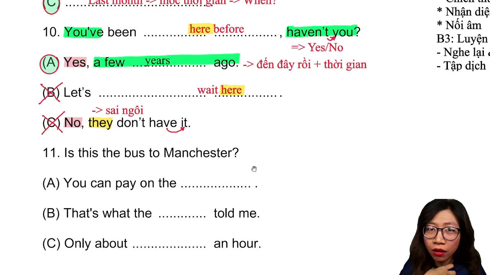

* **Đề bài:** `You've been here before, haven't you?`
* **Phương án:**
  * (A) `Yes, a few years ago.`: Xác nhận đã đến kèm mốc thời gian cụ thể trong quá khứ.
  * (B) `Let's wait here.`: Bẫy lặp từ `here` (chúng ta hãy đợi ở đây).
  * (C) `No, they don't have it.`: Bẫy sai đối tượng xưng hô (`they` thay vì `I/we`).
* **Phân tích:**
  * Đây là câu hỏi đuôi (`Tag question`): `You've been here before, haven't you?` (Bạn đã từng đến đây trước đây rồi, có đúng không?). Dạng câu hỏi này cho phép trả lời bằng `Yes` hoặc `No`.
  * Phương án (B) lặp lại từ chỉ vị trí `here` trong câu đề nghị `Let's wait here` không ăn nhập ngữ nghĩa.
  * Phương án (C) đưa ra lời từ chối nhưng dùng sai chủ ngữ `they` và tân ngữ `it` không liên quan đến trải nghiệm của người được hỏi.
  * Phương án (A) trả lời bằng `Yes` xác nhận thông tin và bổ sung thời điểm cách đây vài năm (`a few years ago`). Chọn (A).
* **Dịch nghĩa:** Bạn đã từng đến đây trước đây rồi, phải không? - Vâng, cách đây vài năm.
* **Mở rộng:**
  * Cấu trúc hiện tại hoàn thành: `Have been to / here` diễn tả trải nghiệm đã từng đến một địa điểm nào đó.
  * `A few years ago` (vài năm trước đây).

---

### [[34:33](https://youtu.be/RHPLKHoJcZI?t=2073s)] Câu 11


* **Đề bài:** `Is this the bus to Manchester?`
* **Phương án:**
  * (A) `You can pay on the bus.`: Bẫy lặp lại danh từ `bus`.
  * (B) `That's what the driver told me.`: Câu trả lời gián tiếp dựa vào lời người tài xế.
  * (C) `Only about once an hour.`: Trả lời tần suất cho câu hỏi `How often`.
* **Phân tích:**
  * Câu hỏi xác nhận danh tính chuyến xe: `Is this the bus to Manchester?` (Đây có phải là chuyến xe buýt đi Manchester không?).
  * Phương án (A) lặp lại từ `bus` trong ngữ cảnh thanh toán vé xe (`pay on the bus`), không giải quyết việc xác nhận tuyến đường.
  * Phương án (C) đưa ra tần suất chuyến đi `once an hour` (mỗi tiếng một lần) dùng để trả lời cho câu hỏi `How often`.
  * Phương án (B) sử dụng cách trả lời gián tiếp: `That's what the driver told me` (Tài xế bảo tôi như vậy đấy). Người nói không dám khẳng định 100% nhưng dẫn lại lời của người có thẩm quyền (`driver`). Chọn (B).
* **Dịch nghĩa:** Đây có phải xe buýt đi Manchester không? - Bác tài xế bảo tôi như thế đấy.
* **Mở rộng:**
  * Hiện tượng câu trả lời gián tiếp: Thay vì nói `Yes` hoặc `No`, người bản ngữ thường đẩy nguồn xác thực thông tin sang người thứ ba (`the driver`, `the manager`, `the schedule`).
  * `Once an hour` (mỗi giờ một lần - cụm từ chỉ tần suất).

---

### [[39:03](https://youtu.be/RHPLKHoJcZI?t=2343s)] Câu 12

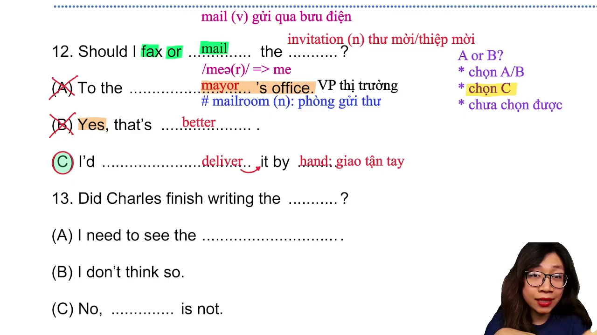

* **Đề bài:** `Should I fax or mail the invitation?`
* **Phương án:**
  * (A) `To the mayor's office.`: Bẫy phát âm gần âm giữa động từ `mail` (/meɪl/) và danh từ `mayor` (/meər/ - thị trưởng).
  * (B) `Yes, that's better.`: Bẫy trả lời `Yes` cho câu hỏi lựa chọn `A or B`.
  * (C) `I'd deliver it by hand.`: Chọn phương án thứ ba vượt ra ngoài hai lựa chọn đề xuất.
* **Phân tích:**
  * Đây là câu hỏi lựa chọn (`Alternative question`): `fax or mail` (gửi fax hay gửi bưu điện thiệp mời?). Nguyên tắc bắt buộc: Câu hỏi lựa chọn không bao giờ trả lời bằng `Yes` hoặc `No`. Loại ngay phương án (B).
  * Phương án (A) đưa ra địa chỉ phòng làm việc của thị trưởng (`mayor's office`) nhằm gài bẫy âm thanh tương đồng với `mailroom` hoặc `mail`.
  * Phương án (C) đưa ra giải pháp thay thế hợp lý: `I'd deliver it by hand` (Tôi sẽ mang giao tận tay). Chọn (C).
* **Dịch nghĩa:** Tôi nên gửi bản fax hay gửi bưu điện thiệp mời này? - Tôi nghĩ nên đem giao tận tay thì hơn.
* **Mở rộng:**
  * `Deliver by hand` = `Hand-deliver` (giao tận tay, phát trực tiếp).
  * `Invitation` (danh từ: thư mời, thiệp mời).
  * `Mayor` (danh từ: thị trưởng thành phố) khác với `Mail` (thư từ, bưu điện).

---

### [[48:56](https://youtu.be/RHPLKHoJcZI?t=2936s)] Câu 13

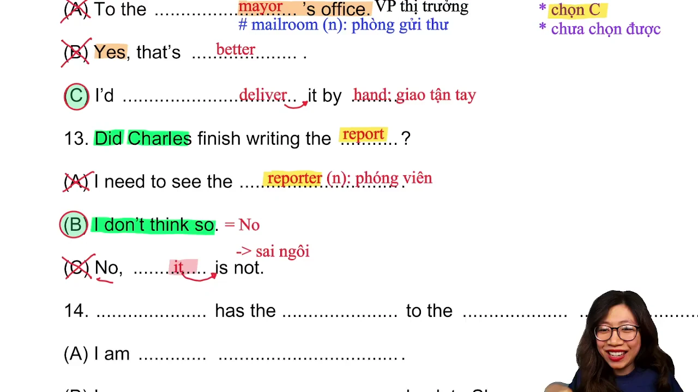

* **Đề bài:** `Did Charles finish writing the report?`
* **Phương án:**
  * (A) `I need to see the reporter.`: Bẫy cùng gốc từ liên tưởng giữa `report` (báo cáo) và `reporter` (phóng viên).
  * (B) `I don't think so.`: Câu trả lời gián tiếp phủ định ý kiến (= No).
  * (C) `No, it is not.`: Bẫy sai đại từ xưng hô (`it` thay vì `he`) và sai trợ động từ (`is` thay vì `did`).
* **Phân tích:**
  * Câu hỏi bắt đầu bằng trợ động từ `Did` hỏi về hành động của một người đàn ông cụ thể: `Did Charles finish writing the report?`.
  * Phương án (A) xuất hiện danh từ chỉ người `reporter` (phóng viên báo chí) nhằm bẫy thí sinh nghe bắt từ `report`.
  * Phương án (C) dù có `No` nhưng lại dùng chủ ngữ `it` (trong khi hỏi về người `Charles`) và to be `is` (trong khi câu hỏi dùng quá khứ `Did`). Nếu đúng ngữ pháp phải là `No, he didn't`.
  * Phương án (B) đưa ra nhận định gián tiếp mang nghĩa phủ định lịch sự: `I don't think so` (Tôi không nghĩ là anh ấy đã xong). Chọn (B).
* **Dịch nghĩa:** Charles đã viết xong bản báo cáo chưa? - Tôi không nghĩ là anh ấy đã xong đâu.
* **Mở rộng:**
  * `I don't think so` là mẫu câu phủ định gián tiếp thông dụng nhất trong TOEIC Listening Part 2, tương đương nghĩa với `No`.
  * Phân biệt: `Report` (bản báo cáo) khác với `Reporter` (phóng viên, nhà báo).

---

### [[54:52](https://youtu.be/RHPLKHoJcZI?t=3292s)] Câu 14

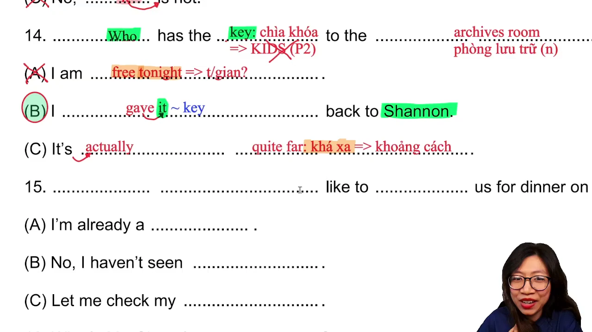

* **Đề bài:** `Who has the key to the archives room?`
* **Phương án:**
  * (A) `I am free tonight.`: Trả lời trạng thái rảnh rỗi vào thời gian ban đêm.
  * (B) `I gave it back to Shannon.`: Chỉ rõ người đang giữ chìa khóa thông qua hành động hoàn trả.
  * (C) `It's actually quite far.`: Trả lời khoảng cách cho câu hỏi `How far`.
* **Phân tích:**
  * Câu hỏi tìm người nắm giữ đồ vật: `Who has the key...?` (Ai đang giữ chìa khóa phòng lưu trữ?).
  * Phương án (A) đưa ra thông tin thời gian rảnh `tonight` không liên quan.
  * Phương án (C) nhận xét về khoảng cách địa lý `quite far` (khá xa) dùng để trả lời cho câu hỏi `How far`.
  * Phương án (B) trả lời gián tiếp: `I gave it back to Shannon` (Tôi đã trả lại nó cho Shannon rồi). Trong đó đại từ `it` thay thế cho `the key`, và `Shannon` chính là câu trả lời đích danh cho câu hỏi `Who`. Chọn (B).
* **Dịch nghĩa:** Ai đang giữ chìa khóa phòng lưu trữ tài liệu vậy? - Tôi đã trả lại nó cho Shannon rồi.
* **Mở rộng:**
  * `Archives room` (danh từ: phòng lưu trữ hồ sơ/tài liệu lịch sử).
  * `Give something back to somebody` (trả lại cái gì cho ai).

---

### [[01:03:13](https://youtu.be/RHPLKHoJcZI?t=3793s)] Câu 15

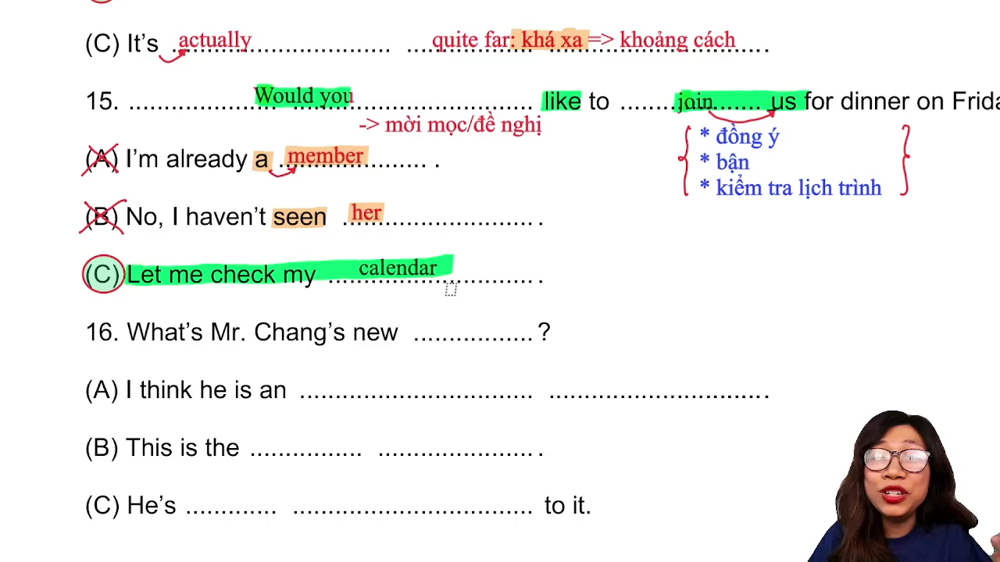

* **Đề bài:** `Would you like to join us for dinner on Friday?`
* **Phương án:**
  * (A) `I'm already a member.`: Không liên quan đến ngữ cảnh ăn tối.
  * (B) `No, I haven't seen her.`: Bẫy sai đối tượng xưng hô (`her`).
  * (C) `Let me check my calendar.`: Câu trả lời hoãn binh để kiểm tra lịch trình cá nhân.
* **Phân tích:**
  * Đây là câu mời mọc/đề nghị lịch sự: `Would you like to join us for dinner on Friday?` (Bạn có muốn đi ăn tối cùng chúng tôi vào thứ Sáu không?).
  * Phương án (A) dùng từ `member` (thành viên) thường dùng cho câu lạc bộ hoặc hội nhóm, không ăn nhập với lời mời ăn tối.
  * Phương án (B) đưa ra thông tin không gặp một người phụ nữ nào đó (`her`), sai lệch hoàn toàn về chủ thể.
  * Phương án (C) đưa ra phản hồi kinh điển khi nhận được lời mời hẹn: `Let me check my calendar` (Để tôi kiểm tra lại lịch của mình đã). Đây là cách đáp lại tự nhiên trước khi đưa ra quyết định nhận lời hay từ chối. Chọn (C).
* **Dịch nghĩa:** Bạn có muốn đi ăn tối cùng chúng tôi vào thứ Sáu này không? - Để tôi kiểm tra lại lịch xem sao đã nhé.
* **Mở rộng:**
  * `Join somebody for dinner` = `Have dinner with somebody` (cùng đi ăn tối với ai).
  * `Check one's calendar / schedule` (kiểm tra lại lịch làm việc cá nhân).

---

### [[01:08:01](https://youtu.be/RHPLKHoJcZI?t=4081s)] Câu 16

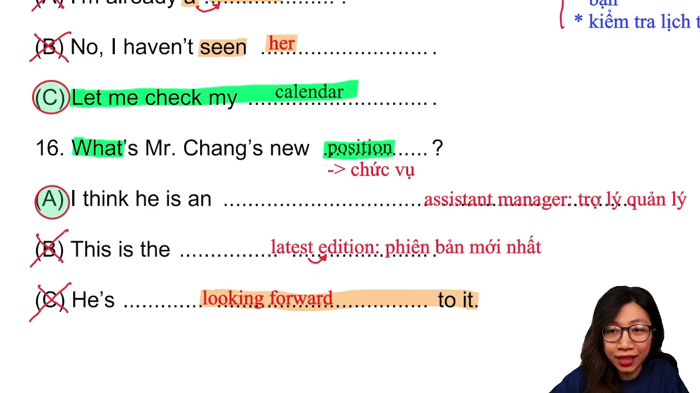

* **Đề bài:** `What's Mr. Chang's new position?`
* **Phương án:**
  * (A) `I think he is an assistant manager.`: Trả lời trực tiếp chức danh công việc mới.
  * (B) `This is the latest edition.`: Đưa ra thông tin về ấn bản sách/tạp chí (`edition`).
  * (C) `He's looking forward to it.`: Bày tỏ tâm trạng trông đợi, không cung cấp chức danh.
* **Phân tích:**
  * Câu hỏi thông tin tìm chức vụ công việc: `What's Mr. Chang's new position?` (Vị trí công tác mới của ông Chang là gì?).
  * Phương án (B) đề cập đến ấn bản mới nhất của tài liệu (`latest edition`), không liên quan đến con người.
  * Phương án (C) miêu tả thái độ háo hức chờ đợi (`looking forward to it`) nhưng không trả lời câu hỏi `What position`.
  * Phương án (A) trả lời chính xác chức danh quản lý: `assistant manager` (trợ lý quản lý) kèm đại từ nhân xưng chuẩn xác `he` ứng với `Mr. Chang`. Chọn (A).
* **Dịch nghĩa:** Chức vụ mới của ông Chang là gì vậy? - Tôi nghĩ ông ấy làm trợ lý quản lý.
* **Mở rộng:**
  * `Position` = `Post` = `Job title` (chức vụ, vị trí công tác).
  * `Assistant manager` (trợ lý giám đốc / phó quản lý).
  * `Look forward to + V-ing / Noun` (trông mong, mong đợi điều gì).

---

### [[01:13:02](https://youtu.be/RHPLKHoJcZI?t=4382s)] Câu 17

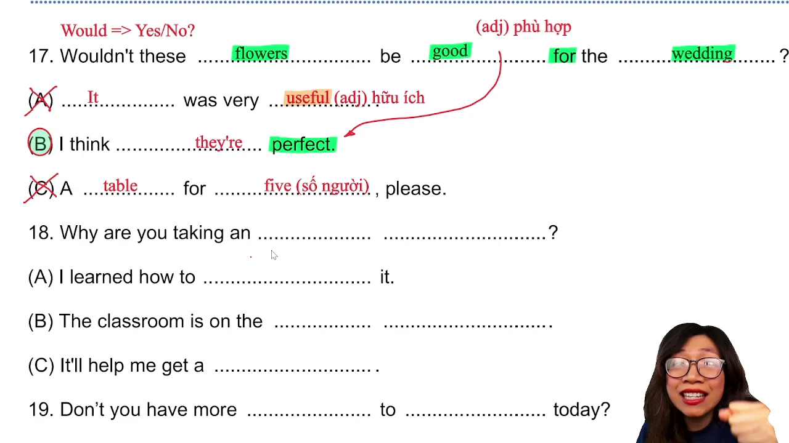

* **Đề bài:** `Wouldn't these flowers be good for the wedding?`
* **Phương án:**
  * (A) `It was very useful.`: Bẫy sai đại từ xưng hô (`it` thay vì `they`) và sai thì quá khứ (`was`).
  * (B) `I think they're perfect.`: Đồng tình và đánh giá cao sự phù hợp của hoa (`they're perfect`).
  * (C) `A table for five, please.`: Câu gọi đặt bàn ở nhà hàng ăn uống.
* **Phân tích:**
  * Câu hỏi xác nhận thể phủ định: `Wouldn't these flowers be good for the wedding?` (Những bông hoa này trông có vẻ rất hợp cho đám cưới đấy chứ?). Chủ ngữ là danh từ số nhiều chỉ vật `these flowers`.
  * Phương án (A) dùng đại từ số ít `It` và động từ quá khứ `was` trong khi câu hỏi hỏi về hoa số nhiều ở hiện tại/tương lai.
  * Phương án (C) đưa ra yêu cầu đặt bàn 5 người (`A table for five, please`) thuộc ngữ cảnh ăn uống tại nhà hàng.
  * Phương án (B) dùng đại từ số nhiều tương ứng `they're` (`they are`) và tính từ tán thành `perfect` (hoàn hảo, cực kỳ phù hợp). Chọn (B).
* **Dịch nghĩa:** Những bông hoa này dùng cho tiệc cưới trông rất hợp phải không? - Tôi thấy chúng hoàn hảo đấy chứ.
* **Mở rộng:**
  * `Be good for` = `Be suitable for` = `Be appropriate for` (phù hợp cho mục đích gì).
  * Cụm từ nhà hàng: `A table for [số người], please` (Cho tôi đặt một bàn dành cho số lượng người tương ứng).

---

### [[01:20:34](https://youtu.be/RHPLKHoJcZI?t=4834s)] Câu 18

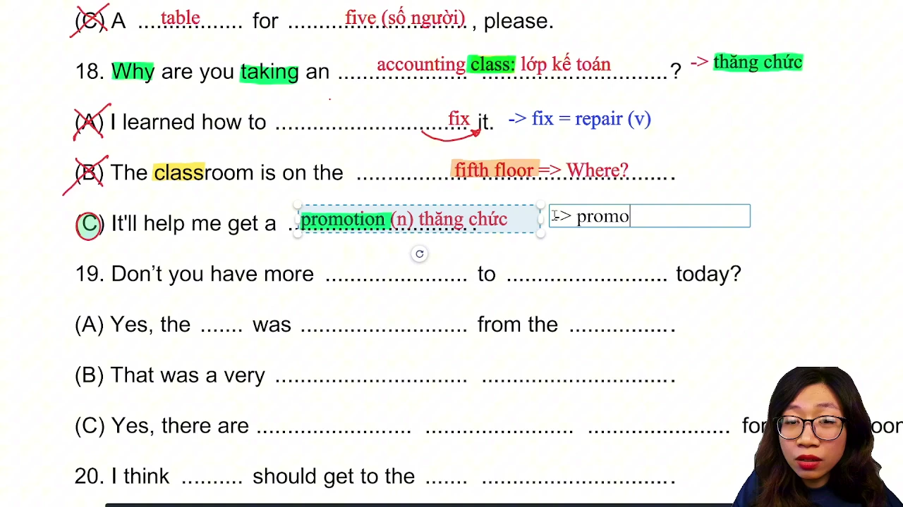

* **Đề bài:** `Why are you taking an accounting class?`
* **Phương án:**
  * (A) `I learned how to fix it.`: Không liên quan đến việc học kế toán.
  * (B) `The classroom is on the fifth floor.`: Bẫy lặp từ `class` / `classroom` và trả lời nơi chốn `Where`.
  * (C) `It'll help me get a promotion.`: Giải thích mục đích học tập nhằm được thăng chức.
* **Phân tích:**
  * Câu hỏi nguyên nhân bắt đầu bằng `Why`: `Why are you taking an accounting class?` (Tại sao bạn lại tham gia lớp học kế toán?).
  * Phương án (A) đề cập việc học cách sửa chữa đồ đạc (`fix it`), lạc đề so với môn kế toán.
  * Phương án (B) lặp từ `class` sang `classroom` và cung cấp vị trí tầng 5 (`fifth floor`), dùng để trả lời cho câu hỏi `Where`.
  * Phương án (C) chỉ rõ động cơ học tập: `It'll help me get a promotion` (Nó sẽ giúp tôi được thăng chức). Chọn (C).
* **Dịch nghĩa:** Tại sao bạn lại đi học lớp kế toán thế? - Nó sẽ giúp tôi có cơ hội thăng chức.
* **Mở rộng:**
  * `Take a class / course` (tham gia một lớp học / khóa học).
  * `Get a promotion` (được thăng chức, đề bạt) -> động từ `promote`.
  * `Accounting` (ngành kế toán, nghiệp vụ kế toán).

---

### [[01:26:11](https://youtu.be/RHPLKHoJcZI?t=5171s)] Câu 19


* **Đề bài:** `Don't you have more candidates to interview today?`
* **Phương án:**
  * (A) `Yes, the view was fantastic from the top.`: Bẫy đồng âm giữa `interview` (/ˈɪntərvjuː/) và `view` (/vjuː/).
  * (B) `That was a very interesting article.`: Nhận xét về một bài báo, không liên quan đến tuyển dụng.
  * (C) `Yes, there are two more scheduled for this afternoon.`: Xác nhận còn 2 ứng viên đã được lên lịch phỏng vấn vào chiều nay.
* **Phân tích:**
  * Câu hỏi xác nhận phủ định: `Don't you have more candidates to interview today?` (Hôm nay bạn không còn ứng viên nào cần phỏng vấn nữa à?).
  * Phương án (A) gài bẫy âm thanh từ danh từ `view` (quang cảnh) với động từ `interview`, kèm tính từ miêu tả `fantastic`.
  * Phương án (B) bình luận về bài viết thú vị (`interesting article`) trong quá khứ, không liên quan đến công tác phỏng vấn.
  * Phương án (C) xác nhận bằng `Yes` và cung cấp chi tiết số lượng còn lại: `there are two more scheduled for this afternoon` (Vẫn còn 2 người nữa được xếp lịch vào chiều nay). Chọn (C).
* **Dịch nghĩa:** Hôm nay bạn không còn ứng viên nào cần phỏng vấn nữa à? - Có chứ, vẫn còn hai người nữa được xếp lịch vào chiều nay.
* **Mở rộng:**
  * `Candidate` = `Applicant` (ứng viên tuyển dụng).
  * `Schedule somebody/something for` (lên lịch, ấn định thời gian cho ai/việc gì).
  * `Fantastic` = `Wonderful` = `Magnificent` (tuyệt vời, tráng lệ).

---

### [[01:35:42](https://youtu.be/RHPLKHoJcZI?t=5742s)] Câu 20

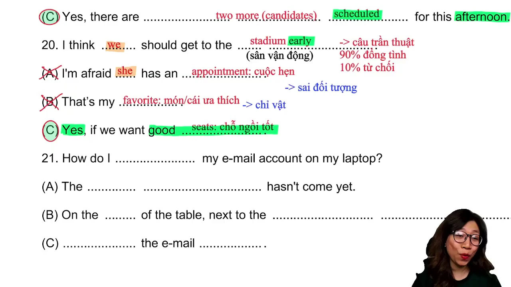

* **Đề bài:** `I think we should get to the stadium early.`
* **Phương án:**
  * (A) `I'm afraid she has an appointment.`: Bẫy sai đối tượng xưng hô (`she` thay vì `we/I`).
  * (B) `That's my favorite.`: Dùng cho danh từ chỉ vật/sở thích, không dùng cho hành vi di chuyển.
  * (C) `Yes, if we want good seats.`: Đồng tình với đề xuất và bổ sung điều kiện để có chỗ ngồi tốt.
* **Phân tích:**
  * Đây là một câu trần thuật đưa ra nhận định đề xuất: `I think we should get to the stadium early` (Tôi nghĩ chúng ta nên đến sân vận động sớm).
  * Quy tắc phản xạ với câu trần thuật: 90% các phương án đúng sẽ mang tính đồng tình, hưởng ứng hoặc giải quyết vấn đề của lời nhận định.
  * Phương án (A) đưa ra lý do một người phụ nữ nào đó bận hẹn (`she has an appointment`), sai lệch về đối tượng được nhắc đến.
  * Phương án (B) nhận xét "Đó là thứ tôi ưa thích nhất", dùng để chỉ món ăn hoặc đồ vật.
  * Phương án (C) thể hiện sự tán thành bằng `Yes` và đưa ra lý do bổ trợ: `if we want good seats` (nếu chúng ta muốn có những chỗ ngồi tốt). Chọn (C).
* **Dịch nghĩa:** Tôi nghĩ chúng ta nên đến sân vận động sớm. - Đúng vậy, nếu chúng ta muốn có chỗ ngồi đẹp.
* **Mở rộng:**
  * `Get to` = `Arrive at / in` = `Reach` (đến một địa điểm).
  * `Stadium` (danh từ: sân vận động thể thao).
  * `Appointment` (danh từ: cuộc hẹn gặp mặt công việc/bác sĩ).
  * Phát âm: Từ `favorite` âm 'o' là âm câm, phát âm chuẩn là /ˈfeɪvrɪt/.

---

## Trích dẫn then chốt

* [[01:17](https://youtu.be/RHPLKHoJcZI?t=77s)] "Hiện tại Part 2 đang là part dài nhất và gài nhất, với 13 tới 14 câu khó trong tổng số 25 câu. Có nghĩa là trên 50% số lượng câu ở Part 2 là câu bẫy, gài nhiều hơn cả Part 3 và Part 4."
* [[04:12](https://youtu.be/RHPLKHoJcZI?t=252s)] "Khi mình phân vân giữa hai đáp án ở câu trần thuật, 90% đáp án sẽ thiên về đồng tình, chỉ có 10% là người ta từ chối hoặc phủ định thôi. Cho nên mình cứ ưu tiên hướng đồng tình."
* [[07:35](https://youtu.be/RHPLKHoJcZI?t=455s)] "Học với cô Thanh là phải luyện nghe phản xạ. Thấy lặp từ trong Part 2 là né liền giùm cô, loại ngay lập tức là tỷ lệ đúng đã lên tới 80-90% rồi."
* [[41:15](https://youtu.be/RHPLKHoJcZI?t=2475s)] "Câu hỏi lựa chọn A or B tuyệt đối không bao giờ được chọn Yes/No. Người ta hỏi ăn cơm hay ăn phở mà trả lời 'Vâng' là sai logic hoàn toàn."
* [[52:10](https://youtu.be/RHPLKHoJcZI?t=3130s)] "Đi thi Part 2 bây giờ người ta không trả lời trực tiếp nữa mà toàn trả lời gián tiếp thôi. Người ta đẩy trách nhiệm qua người khác hoặc nói một thông tin liên đới để mình tự suy luận."

---

## Lệnh & Công cụ

### Công thức nhận diện bẫy Part 2

```text
[Công thức 1: Loại trừ bẫy lặp từ (Echo Trap)]
Câu hỏi: ... Word X ...
-> Loại ngay phương án chứa Word X (Xác suất loại trừ đúng 80-90%)
Ví dụ: Câu hỏi có "sign up" -> Loại phương án có "sign-up sheet"
       Câu hỏi có "accounting class" -> Loại phương án có "classroom"

[Công thức 2: Phản xạ câu hỏi lựa chọn (Alternative: A or B)]
Câu hỏi: Should I [A] or [B] ...?
-> Loại NGAY phương án bắt đầu bằng Yes / No
-> Hướng đúng: Chọn A, Chọn B, hoặc Chọn phương án C (Deliver by hand)

[Công thức 3: Quy tắc câu trần thuật (Statements)]
Câu trần thuật đưa ra đề xuất/ý kiến -> 90% Đáp án đúng là ĐỒNG TÌNH (Yes / That's a good idea / If we want good seats)
                                    -> 10% Đáp án đúng là TỪ CHỐI kèm lý do

[Công thức 4: Phân biệt Thời gian (How long vs When)]
How long -> Khoảng thời gian kéo dài (About 30 minutes, For two days)
When -> Mốc thời gian cụ thể (Last week, In August, Tomorrow)

[Công thức 5: Bẫy đồng âm & gần âm phổ biến]
fix /fɪks/ (sửa chữa)       <->  fax /fæks/ (bản fax)
mail /meɪl/ (bưu điện)      <->  mayor /meər/ (thị trưởng)
interview (phỏng vấn)       <->  view (quang cảnh)
report (báo cáo)            <->  reporter (phóng viên)
umbrella (cây dù)           <->  rain (mưa)

[Công thức 6: Quy tắc câu hỏi lời mời (Would you like to...)]
Phản hồi hợp lệ: 
1. Đồng ý: I'd love to
2. Từ chối kèm lý do: I'm busy
3. Hoãn binh kiểm tra lịch: Let me check my calendar / schedule
```

---

## Đánh đổi & Rủi ro

### Điểm mù nghe hiểu phản xạ

* **Thói quen nghe bắt từ (Keyword Matching):** Đây là nguyên nhân hàng đầu khiến thí sinh mất điểm ở Part 2. Đề thi TOEIC hiện đại khai thác triệt để thói quen này bằng cách chèn từ khóa giống hệt vào các phương án gây nhiễu. Thí sinh chỉ cần nghe thấy từ quen mà vội vàng chọn sẽ rơi vào bẫy lặp từ.
* **Bị động trước câu trả lời gián tiếp:** Hơn 50% câu hỏi ở Part 2 hiện nay không đưa ra câu trả lời trực diện. Thí sinh chờ đợi câu trả lời khuôn mẫu (như hỏi xe buýt trả lời Có/Không, hỏi chìa khóa trả lời Tên người trực tiếp) sẽ bị bất ngờ khi băng đọc câu trả lời vòng vo (`That's what the driver told me` hoặc `I gave it back to Shannon`).
* **Lúng túng trước câu trần thuật:** Khác với câu hỏi có từ để hỏi rõ ràng, câu trần thuật không có dấu hiệu nhận biết ban đầu. Thí sinh phải nắm được nghĩa toàn câu để nhận diện ngữ cảnh, nếu chỉ dịch từng từ rời rạc sẽ không kịp tốc độ đọc của người bản ngữ.

### Rủi ro phòng thi

* **Tô nhầm ô D khi thi giấy:** Thí sinh làm bài thi giấy cần đặc biệt lưu ý Part 2 chỉ có 3 đáp án (A, B, C) nhưng phiếu trả lời vẫn in đủ 4 ô. Tô nhầm ô D không những mất điểm câu đó mà còn dẫn đến nguy cơ lệch toàn bộ hàng đáp án phía sau.
* **Mất tập trung dây chuyền:** Thời gian nghỉ giữa các câu ở Part 2 chỉ khoảng 5 giây. Nếu lỡ không nghe được một câu, thí sinh bắt buộc phải đoán định và bỏ qua ngay lập tức để tập trung cho câu kế tiếp, tránh hiện tượng tiếc nuối dẫn đến mất điểm cả chuỗi 3 đến 4 câu liên tiếp.
