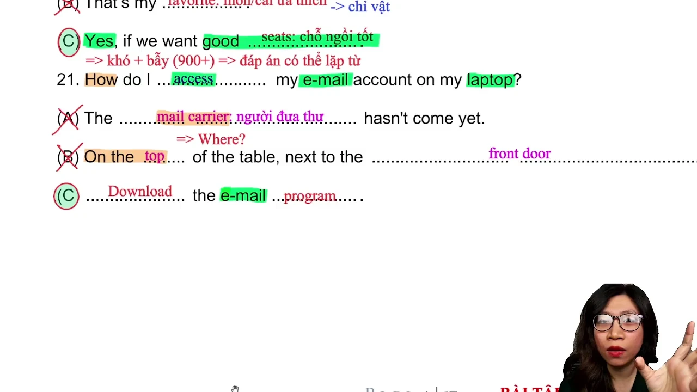
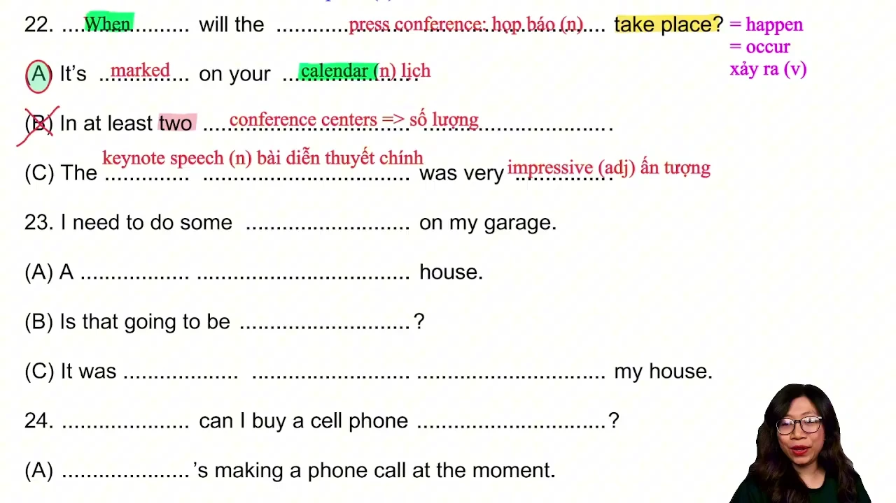
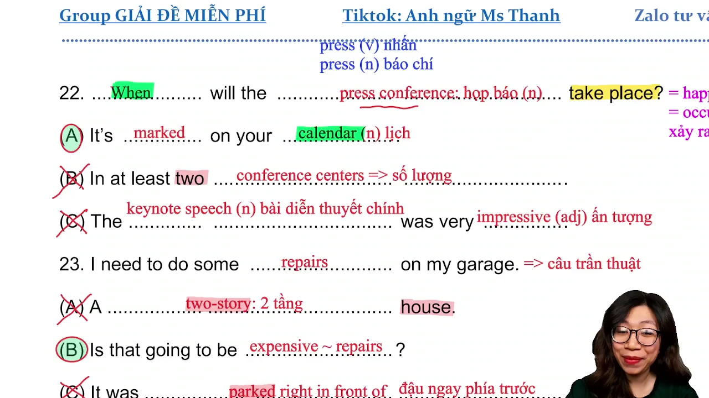
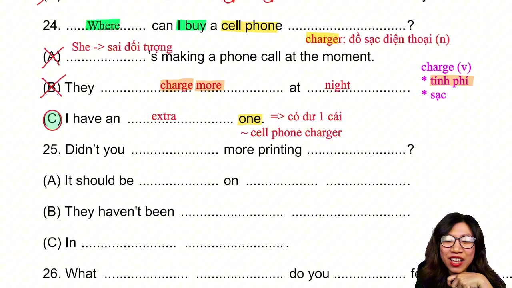
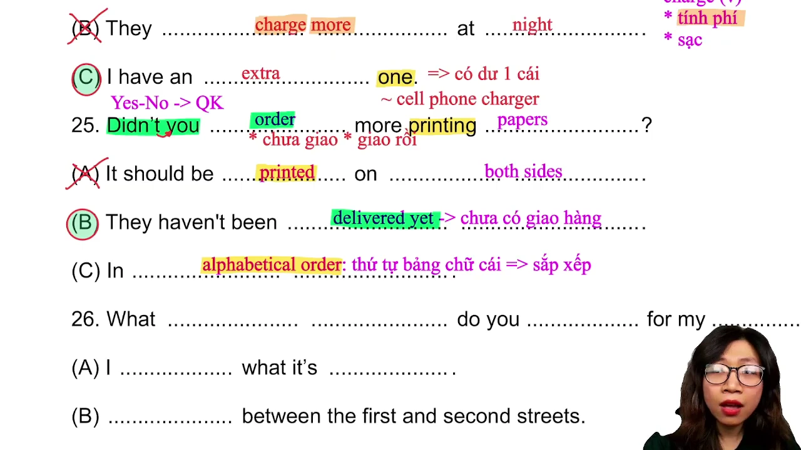
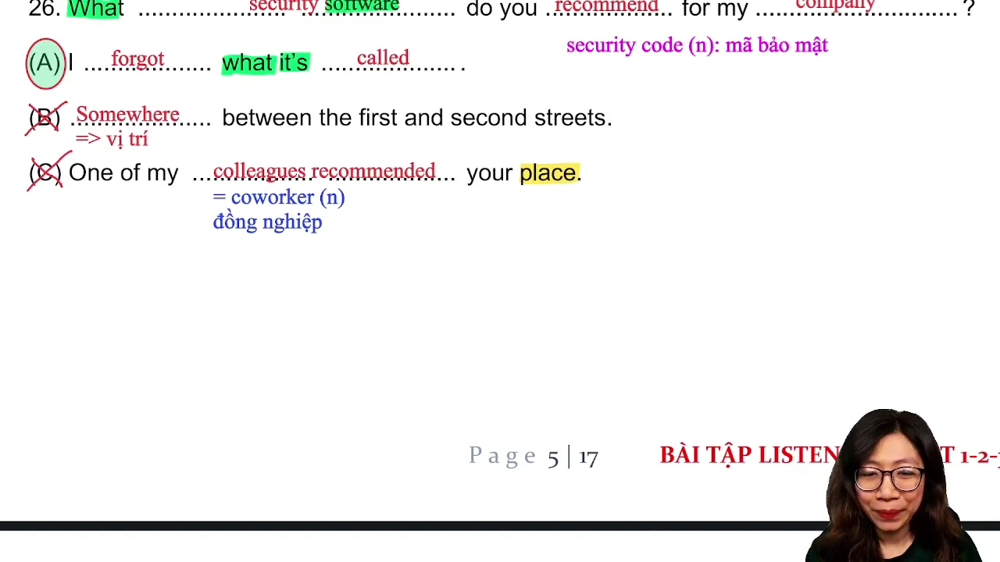
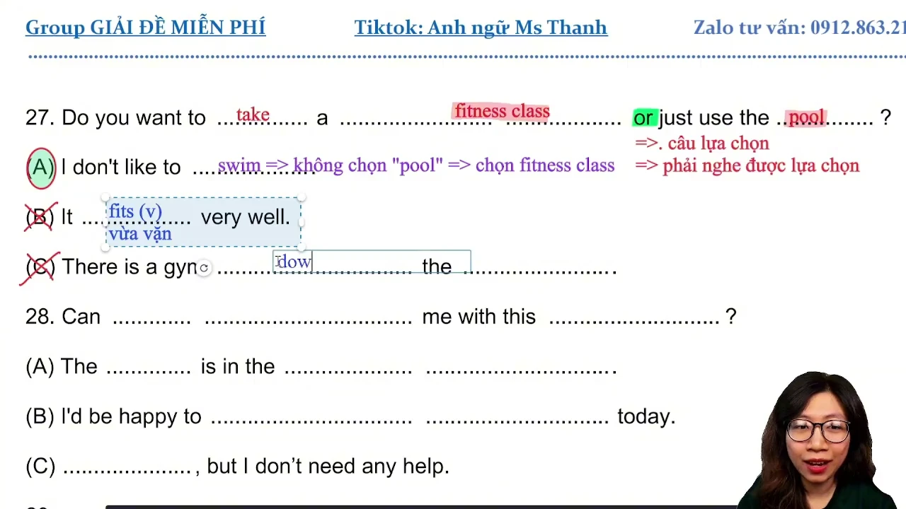
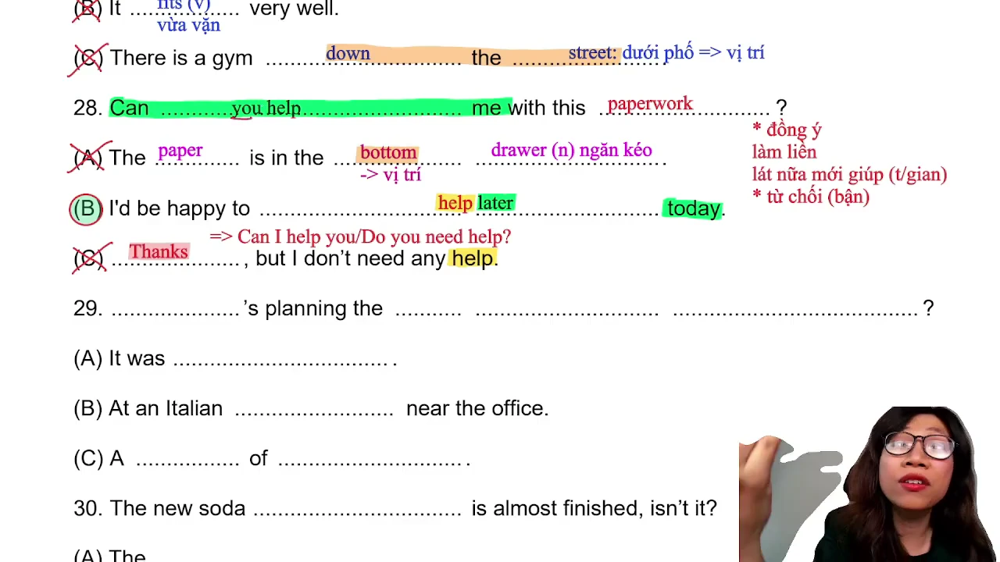
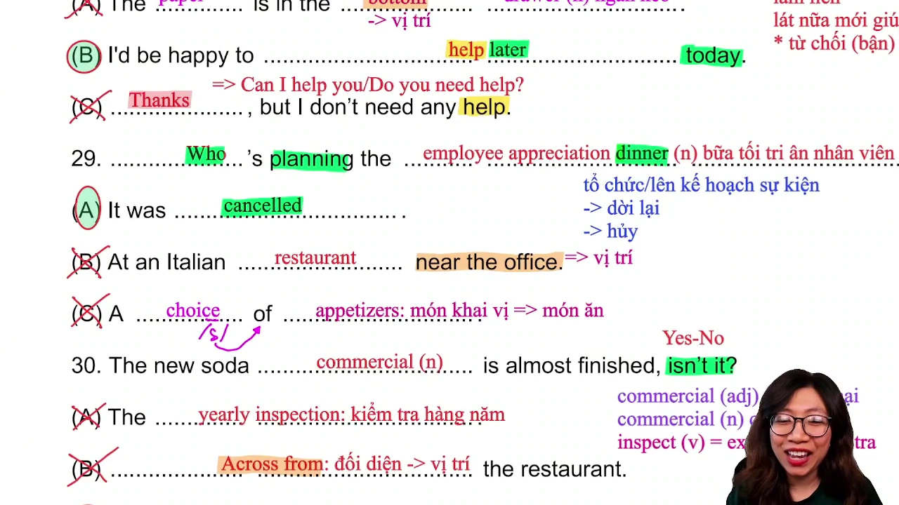
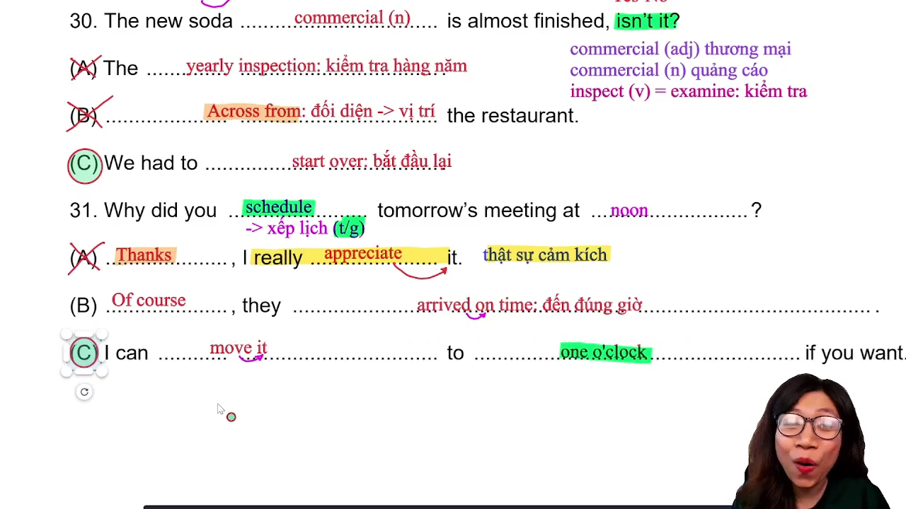

# GIẢI ĐỀ TOEIC 2026 MỚI NHẤT | PART 2 [VIDEO 2]

* **Kênh:** Anh ngữ Ms Thanh | **Thời lượng:** 01:24:26 | **Ngày:** 2026-02-28
* **Video:** https://youtu.be/kCoRDcjknNI

---

## Thuật ngữ

| Thuật ngữ | Tiếng Anh | Giải thích |
| :--- | :--- | :--- |
| Câu hỏi cách thức | How-Question | Dạng câu hỏi phương pháp/cách thức truy cập, thường xuất hiện bẫy lặp từ ở band điểm 900+. |
| Câu hỏi thời gian gián tiếp | Indirect Time Response | Phản hồi không nêu trực tiếp ngày giờ mà quy chiếu đến công cụ lịch biểu (marked on calendar). |
| Câu trần thuật tiếp nối | Statement Follow-up | Câu khẳng định gợi mở phản hồi đồng thuận hoặc truy vấn chi phí/thời gian liên quan. |
| Câu hỏi địa điểm thay thế | Indirect Location Response | Phản hồi câu hỏi Where bằng giải pháp thay thế có sẵn (extra one) thay vì nêu tên cửa hàng. |
| Câu hỏi nghi vấn phủ định | Negative Yes-No Question | Câu hỏi đảo trợ động từ phủ định (Didn't you) đòi hỏi nắm bắt trạng thái hoàn tất đơn hàng. |
| Câu hỏi lựa chọn thay thế | Alternative Question | Câu hỏi chứa liên từ or, phản hồi bằng cách loại trừ một vế để gián tiếp xác nhận vế còn lại. |
| Phản hồi yêu cầu giúp đỡ | Request Response | Phản hồi lời nhờ vả bằng sự đồng thuận kèm mốc thời gian cụ thể trong ngày (help later today). |
| Quy luật hủy sự kiện | Event Cancellation Rule | Phản hồi câu hỏi tổ chức sự kiện bằng trạng thái đã hủy bỏ (it was canceled) hoặc dời lịch. |
| Câu hỏi xác nhận đuôi | Tag Question Confirmation | Câu hỏi đuôi xác nhận tiến độ dự án, phản hồi phủ định thực tế qua hành động làm lại từ đầu. |
| Động từ dời lịch hẹn | Reschedule Verb | Động từ move mang nghĩa dời lịch họp sang khung giờ khác thay vì di chuyển vị trí cơ học. |

---

## Tổng luận chuyên đề

### Chiến lược phản xạ

Part 2 gồm 25 câu hỏi phản xạ trực tiếp từ câu 7 đến 31. Càng tiến dần về các câu cuối (từ câu 21 đến 31), tần suất bẫy và mức độ trả lời gián tiếp càng tăng cao:
* **Nhóm xử lý câu hỏi sự vụ và thời gian:** Không chờ đợi câu trả lời hiển ngôn về ngày tháng hay nơi chốn. Các câu hỏi `When` thường được trả lời bằng `calendar` (lịch làm việc), câu hỏi `Where` được trả lời bằng giải pháp sở hữu có sẵn (`extra one`), và câu hỏi `Who` về sự kiện thường đi kèm việc sự kiện đã bị hủy (`canceled`).
* **Nhóm xử lý câu trần thuật và nhờ vả:** Câu trần thuật đòi hỏi phản hồi đồng thuận hoặc câu hỏi phụ về chi phí (`expensive`). Lời nhờ vả (`Can you help me`) chỉ có hai hướng: đồng ý kèm thời gian (`later today`) hoặc từ chối do bận việc. Tuyệt đối không chọn phương án cảm ơn (`Thanks`) vì đó là bẫy đảo ngược vai giao tiếp.

### Kỹ thuật bẫy âm

* **Hiện tượng nuốt âm và nối âm:**
  * Nuốt âm trong danh từ: `conference` nuốt âm 'e' thành hai âm tiết gọn, `restaurant` phát âm nuốt thành hai âm tiết kết thúc bằng âm /t/, `drawer` đọc gọn thành một âm tiết /drɔːr/.
  * Nối âm phụ âm sang nguyên âm: `didn't you` biến âm /t/ + /j/ thành âm chờ `/tʃ/`, `choice of` nối thành `/tʃɔɪs əv/`, `arrived on time` nối âm /d/ sang /ɒ/, `move it` nối âm /v/ sang /ɪ/.
  * Nuốt âm 't' thành 'd' trong tiếng Anh-Mỹ: `isn't it` phát âm lướt nhẹ thành `/ˈɪzndɪt/`.

### Bản chất bẫy từ

* **Bẫy từ đa nghĩa và từ đồng âm:**
  * `Charge`: Phân biệt danh từ `charger` (thiết bị sạc pin) với động từ `charge` mang nghĩa tính phí, thu tiền (`charge more at night`).
  * `Commercial`: Phân biệt danh từ `commercial` (đoạn phim quảng cáo truyền hình) với tính từ mang nghĩa thuộc về thương mại.
  * `Fit`: Phân biệt danh từ `fitness` (rèn luyện thể chất) với động từ `fit` (quần áo vừa vặn kích cỡ cơ thể).
  * `Story`: Phân biệt danh từ câu chuyện với danh từ chỉ số tầng của tòa nhà (`two-story house`).
  * `Order`: Phân biệt động từ đặt hàng (`order paper`) với danh từ quy chuẩn trật tự (`in alphabetical order`).
* **Bẫy lặp từ ở band điểm 900+:** Người học theo mẹo thường loại bỏ toàn bộ câu có từ lặp. Ở các câu hỏi khó cuối đề (`How`, `Can you help`), đáp án đúng vẫn có thể lặp từ khóa chính (`email program`, `help later today`) để gài bẫy thí sinh học vẹt.

### So sánh hình thức

Phân tích đối chiếu giữa hai hình thức thi TOEIC dựa trên thực tế:
* **Thi trên giấy:**
  * Ưu điểm: Thí sinh dễ dàng tận dụng thời gian chết để đọc trước câu hỏi và đáp án của Part 3 và Part 4.
  * Nhược điểm: Tốn thời gian tô chì phiếu trả lời, dễ phân tâm bởi tạp âm từ loa phát thanh chung trong phòng thi, phải tự ngước nhìn đồng hồ treo tường để canh giờ làm bài đọc.
* **Thi trên máy tính:**
  * Ưu điểm: Đeo tai nghe chuyên dụng chống ồn và cách âm tốt, nhấp chuột chọn phương án nhanh chóng, đồng hồ đếm ngược trực tiếp trên màn hình, có nút đánh dấu câu phân vân để kiểm tra lại và biết điểm thi ngay lập tức.
  * Nhược điểm: Đòi hỏi kỹ thuật điều tiết mắt để tránh mỏi màn hình, thời gian lướt câu hỏi Part 3 và Part 4 bị giới hạn trong khoảng 5 giây mỗi đoạn.

---

## Bóc tách chi tiết

### [[00:20](https://youtu.be/kCoRDcjknNI?t=20s)] Câu 21

* **Đề bài:** `How do I access my e-mail account on my laptop?`
* **Phương án:**
  * (A) `The mail carrier hasn't come yet.`
  * (B) `On the top of the table next to the front door.`
  * (C) `Download the email program.`
* **Phân tích:**
  * Câu hỏi bắt đầu bằng `How` hỏi về cách thức thao tác kỹ thuật để truy cập tài khoản thư điện tử trên máy tính xách tay.
  * Phương án (A) gài bẫy từ đồng âm `mail` trong cụm `mail carrier` (người đưa thư, bưu tá). Đây là danh từ chỉ người, hoàn toàn sai ngữ nghĩa so với việc truy cập tài khoản số.
  * Phương án (B) gài bẫy câu trả lời nơi chốn cho câu hỏi `Where` với các cụm giới từ chỉ vị trí `on the top of` và `next to`.
  * Phương án (C) đưa ra giải pháp xử lý trực tiếp là tải phần mềm thư điện tử về máy tính. Câu hỏi khó thuộc phân khúc 900+ chấp nhận lặp lại từ khóa `email` để phân loại thí sinh nắm chắc ngữ nghĩa với thí sinh máy móc loại trừ từ lặp. Chọn (C).
* **Dịch nghĩa:** Làm cách nào để tôi có thể truy cập tài khoản thư điện tử trên máy tính xách tay của mình? - Hãy tải phần mềm thư điện tử về máy.
* **Mở rộng:**
  * `access` (v): Truy cập, tiếp cận; (n): Quyền truy cập (`access to`).
  * `mail carrier` (n) = `postman` / `mailman`: Người giao thư, bưu tá.
  * `on the top of` (prep phrase): Ở phía trên cùng; đối lập với `at the bottom of` (ở dưới đáy).

---

### [[08:15](https://youtu.be/kCoRDcjknNI?t=495s)] Câu 22

* **Đề bài:** `When will the press conference take place?`
* **Phương án:**
  * (A) `It's marked on your calendar.`
  * (B) `In at least two conference centers.`
  * (C) `The keynote speech was very impressive.`
* **Phân tích:**
  * Câu hỏi bắt đầu bằng `When` hỏi về mốc thời gian diễn ra cuộc họp báo (`press conference`). Cụm động từ `take place` đồng nghĩa với `occur` hoặc `happen`. Danh từ `conference` có hiện tượng nuốt âm tiết giữa.
  * Phương án (A) là câu trả lời gián tiếp đặc trưng trong đề thi hiện đại: không nêu giờ giấc cụ thể mà dẫn chiếu đến cuốn lịch làm việc cá nhân (`calendar`). Thông tin thời gian đã được ghi chú sẵn trên lịch. Chọn (A).
  * Phương án (B) gài bẫy lặp từ `conference` và bẫy số lượng kết hợp địa điểm (`two conference centers`), chỉ phù hợp cho câu hỏi `How many` hoặc `Where`.
  * Phương án (C) gài bẫy trường từ vựng liên quan đến hội nghị (`keynote speech` = bài diễn thuyết chính; `impressive` = ấn tượng), sai trọng tâm câu hỏi về thời điểm tổ chức họp báo.
* **Dịch nghĩa:** Khi nào thì buổi họp báo sẽ diễn ra? - Thông tin đó đã được đánh dấu trên lịch của bạn rồi.
* **Mở rộng:**
  * `press conference` (n): Cuộc họp báo; `press` (n: báo chí, v: nhấn nút).
  * `take place` (v phr) = `occur` = `happen`: Diễn ra, xảy ra.
  * `keynote speech` (n phr): Bài phát biểu khai mạc, bài diễn thuyết chủ đạo.
  * `impressive` (adj): Gây ấn tượng sâu sắc; bắt nguồn từ động từ `impress`.

---

### [[28:39](https://youtu.be/kCoRDcjknNI?t=1719s)] Câu 23

* **Đề bài:** `I need to do some repairs on my garage.`
* **Phương án:**
  * (A) `A two-story house.`
  * (B) `Is that going to be expensive?`
  * (C) `It was parked right in front of my house.`
* **Phân tích:**
  * Đây là dạng câu trần thuật khẳng định nhu cầu sửa chữa nhà để xe (`repairs on my garage`). Chiến lược xử lý câu trần thuật là tìm kiếm phản hồi thể hiện sự đồng tình, tiếp nối mạch hội thoại hoặc hỏi thăm về phí tổn/thời gian.
  * Phương án (A) gài bẫy từ vựng `story`. Trong ngữ cảnh nhà ở, `two-story house` mang nghĩa nhà hai tầng, không liên quan đến việc sửa chữa gara.
  * Phương án (B) đưa ra câu hỏi tiếp nối hợp lý về chi phí thực hiện: việc sửa chữa gara chắc chắn tốn kém, người nghe hỏi thăm liệu việc đó có đắt đỏ không (`expensive`). Chọn (B).
  * Phương án (C) gài bẫy trường từ vựng xe cộ đỗ trước nhà (`parked right in front of my house`), không phản hồi nhu cầu sửa chữa.
* **Dịch nghĩa:** Tôi cần phải thực hiện một số việc sửa chữa cho nhà để xe của mình. - Việc đó có tốn kém nhiều tiền không?
* **Mở rộng:**
  * `repairs` (n): Hoạt động sửa chữa; `repair` (v): Sửa chữa, khắc phục sự cố.
  * `two-story house` (n phr): Căn nhà hai tầng (tương đương `two-floor house`).
  * `park` (v): Đỗ xe, đậu xe; (n): Công viên.
  * `right in front of`: Ngay phía trước mặt.

---

### [[34:06](https://youtu.be/kCoRDcjknNI?t=2046s)] Câu 24

* **Đề bài:** `Where can I buy a cell phone charger?`
* **Phương án:**
  * (A) `She's making a phone call at the moment.`
  * (B) `They charge more at night.`
  * (C) `I have an extra one.`
* **Phân tích:**
  * Câu hỏi `Where` hỏi địa điểm mua thiết bị sạc điện thoại (`cell phone charger`). Càng về cuối Part 2, các câu hỏi nơi chốn thường được trả lời bằng phương án gián tiếp giải quyết vấn đề thay vì đọc tên địa danh cụ thể.
  * Phương án (A) sai đối tượng chủ ngữ (`She` trong khi câu hỏi là `Where can I buy`), đồng thời gài bẫy lặp từ `phone call`.
  * Phương án (B) gài bẫy từ đồng âm khác nghĩa: `charge` trong câu B là động từ chỉ hành động tính phí, thu tiền (`charge more` = tính phí cao hơn vào ban đêm), không phải danh từ chỉ thiết bị sạc pin.
  * Phương án (C) sử dụng đại từ thay thế `one` đại diện cho `cell phone charger`. Người nói giải quyết trực tiếp nhu cầu bằng cách cho mượn củ sạc có sẵn (`extra one` = có dư một cái). Chọn (C).
* **Dịch nghĩa:** Tôi có thể mua cục sạc điện thoại ở đâu? - Tôi có dư một cái này.
* **Mở rộng:**
  * `charger` (n): Củ sạc, dây cáp sạc điện thoại.
  * `charge` (v): (1) Sạc pin, nạp điện; (2) Tính phí, thu tiền dịch vụ.
  * `extra` (adj): Có dư, bổ sung thêm (`extra one`, `extra charge`).
  * `at the moment` = `currently` = `now`: Vào thời điểm hiện tại.

---

### [[41:10](https://youtu.be/kCoRDcjknNI?t=2470s)] Câu 25

* **Đề bài:** `Didn't you order more printing papers?`
* **Phương án:**
  * (A) `It should be printed on both sides.`
  * (B) `They haven't been delivered yet.`
  * (C) `In alphabetical order.`
* **Phân tích:**
  * Câu hỏi nghi vấn phủ định ở quá khứ (`Didn't you...`) hỏi về việc đặt mua thêm giấy in (`printing papers`). Động từ `Didn't you` có hiện tượng biến âm thành âm chờ `/tʃ/`.
  * Bản chất logic của hành động đặt hàng (`order`) chỉ xoay quanh hai trạng thái: hoặc đã giao hàng, hoặc chưa giao hàng.
  * Phương án (A) gài bẫy lặp gốc từ `print` và lạc đề sang kỹ thuật in hai mặt (`printed on both sides`).
  * Phương án (B) phản hồi chính xác trạng thái tiếp theo của đơn hàng: hàng (giấy in, đại từ `they`) vẫn chưa được đơn vị vận chuyển giao tới (`haven't been delivered yet`). Chọn (B).
  * Phương án (C) gài bẫy từ đa nghĩa `order` trong thành ngữ `in alphabetical order` (theo thứ tự bảng chữ cái). Cụm từ này chỉ dùng để trả lời cho câu hỏi về cách sắp xếp hồ sơ, tài liệu.
* **Dịch nghĩa:** Bạn đã đặt thêm giấy in rồi có phải không? - Họ vẫn chưa giao hàng tới.
* **Mở rộng:**
  * `printing paper` (n): Giấy dùng cho máy in văn phòng.
  * `deliver` (v): Giao hàng, chuyển phát; `delivery` (n): Sự giao hàng.
  * `in alphabetical order` (phr): Theo thứ tự bảng chữ cái alphabet.
  * `on both sides`: Cả hai mặt giấy.

---

### [[46:48](https://youtu.be/kCoRDcjknNI?t=2808s)] Câu 26

* **Đề bài:** `What security software do you recommend for my company?`
* **Phương án:**
  * (A) `I forgot what it's called.`
  * (B) `Somewhere between the first and second streets.`
  * (C) `One of my colleagues recommended your place.`
* **Phân tích:**
  * Câu hỏi `What` đi kèm danh từ chỉ vật `security software` (phần mềm bảo mật nào) được đề xuất (`recommend`) cho công ty.
  * Phương án (A) là câu trả lời tránh né gián tiếp: người được hỏi quên mất tên gọi của phần mềm đó rồi (`forgot what it's called`). Cụm từ `what it's called` thay thế cho tên phần mềm. Cần tránh nghe nhầm phân từ `called` (được gọi tên) thành danh từ `code` (mã số bảo mật `security code`). Chọn (A).
  * Phương án (B) gài bẫy câu trả lời nơi chốn cho câu hỏi `Where` với cụm giới từ `somewhere between the first and second streets`.
  * Phương án (C) gài bẫy lặp động từ `recommended`. Câu này đề cập đến việc đồng nghiệp giới thiệu địa điểm (`your place`), hoàn toàn sai lệch đối tượng phần mềm bảo mật.
* **Dịch nghĩa:** Bạn đề xuất phần mềm bảo mật nào cho công ty của tôi? - Tôi quên mất nó tên là gì rồi.
* **Mở rộng:**
  * `security software` (n phr): Phần mềm bảo vệ an ninh mạng / bảo mật dữ liệu.
  * `recommend` (v): Đề xuất, khuyên dùng, tiến cử.
  * `colleague` (n) = `coworker`: Bạn đồng nghiệp cùng cơ quan.
  * `security code` (n phr): Mã số an toàn, mã xác thực bảo mật.

---

### [[53:08](https://youtu.be/kCoRDcjknNI?t=3188s)] Câu 27

* **Đề bài:** `Do you want to take a fitness class or just use the pool?`
* **Phương án:**
  * (A) `I don't like to swim.`
  * (B) `It fits very well.`
  * (C) `There is a gym down the street.`
* **Phân tích:**
  * Đây là câu hỏi lựa chọn (Alternative Question) với liên từ `or`. Hai đối tượng được đưa ra cân nhắc là: tham gia lớp học thể dục (`fitness class`) hay chỉ sử dụng hồ bơi (`pool`).
  * Phương án (A) sử dụng phương pháp trả lời gián tiếp bằng việc loại trừ: `swim` (bơi lội) gắn liền với đối tượng `pool`. Khẳng định "tôi không thích bơi" đồng nghĩa với việc từ chối dùng hồ bơi, gián tiếp xác nhận lựa chọn tham gia lớp thể dục. Chọn (A).
  * Phương án (B) gài bẫy từ phát âm tương tự: `fit` trong câu B là động từ miêu tả kích thước quần áo vừa vặn với người mặc (`It fits very well`), không liên quan đến tập luyện thể thao.
  * Phương án (C) chứa cụm từ chỉ vị trí địa lý `down the street` (ở phía dưới con phố), chỉ dùng để trả lời cho câu hỏi `Where`.
* **Dịch nghĩa:** Bạn muốn đăng ký lớp học thể dục hay chỉ muốn sử dụng hồ bơi thôi? - Tôi không thích bơi lội.
* **Mở rộng:**
  * `fitness class` (n phr): Lớp học rèn luyện thể hình / thể chất.
  * `pool` = `swimming pool` (n): Bể bơi, hồ bơi.
  * `fit` (v): Vừa vặn kích cỡ; (adj): Thân hình cân đối, khỏe khoắn (`keep fit`).
  * `down the street`: Dọc theo con đường, cùng phía dưới phố.

---

### [[57:58](https://youtu.be/kCoRDcjknNI?t=3478s)] Câu 28

* **Đề bài:** `Can you help me with this paperwork?`
* **Phương án:**
  * (A) `The paper is in the bottom drawer.`
  * (B) `I'd be happy to help later today.`
  * (C) `Thanks, but I don't need any help.`
* **Phân tích:**
  * Câu hỏi là lời đề nghị nhờ vả người khác giúp đỡ xử lý công việc giấy tờ (`Can you help me with this paperwork?`).
  * Phương án (A) gài bẫy lặp từ `paper` và bẫy vị trí ngăn kéo bàn (`bottom drawer`). Danh từ `drawer` có hiện tượng phát âm nuốt âm thành /drɔːr/.
  * Phương án (B) thể hiện sự đồng thuận giúp đỡ nhưng hẹn thời điểm lùi lại vào lát nữa trong ngày (`help later today`). Mặc dù có lặp động từ `help`, câu đáp ứng hoàn hảo cấu trúc đồng ý có điều kiện thời gian. Chọn (B).
  * Phương án (C) gài bẫy đảo ngược vai trò giao tiếp. Phản hồi lời cảm ơn từ chối (`Thanks, but I don't need...`) chỉ xuất hiện khi đối phương chủ động đề nghị giúp đỡ mình (`Can I help you?` / `Do you need help?`), không thể dùng để đáp lại lời nhờ vả từ người khác.
* **Dịch nghĩa:** Bạn có thể giúp tôi một tay với mớ giấy tờ này được không? - Tôi rất sẵn lòng giúp bạn vào lát nữa hôm nay nhé.
* **Mở rộng:**
  * `paperwork` (n): Giấy tờ hành chính, thủ tục văn bản.
  * `drawer` (n): Ngăn kéo tủ bàn; `bottom drawer`: Ngăn kéo dưới cùng.
  * `I'd be happy to + V0`: Tôi rất vui lòng / sẵn lòng hỗ trợ.
  * `later today`: Vào một thời điểm muộn hơn trong ngày hôm nay.

---

### [[01:05:00](https://youtu.be/kCoRDcjknNI?t=3900s)] Câu 29

* **Đề bài:** `Who's planning the employee appreciation dinner?`
* **Phương án:**
  * (A) `It was canceled.`
  * (B) `At an Italian restaurant near the office.`
  * (C) `A choice of appetizers.`
* **Phân tích:**
  * Câu hỏi bắt đầu bằng `Who` hỏi về nhân sự chịu trách nhiệm lên kế hoạch cho bữa tiệc tri ân nhân viên (`employee appreciation dinner`).
  * Quy tắc thực chiến TOEIC: Khi câu hỏi đề cập đến việc tổ chức sự kiện (`planning`, `organizing`, `event`, `dinner`), đáp án gián tiếp có xác suất xuất hiện cực cao là thông báo sự kiện đã bị hủy bỏ (`canceled`) hoặc dời lịch (`postponed`).
  * Phương án (A) thông báo bữa tiệc đã bị hủy bỏ, do đó không còn ai phải chịu trách nhiệm lên kế hoạch cho sự kiện này nữa. Chọn (A).
  * Phương án (B) gài bẫy nơi chốn (Where) với cụm danh từ nhà hàng Ý gần văn phòng (`Italian restaurant near the office`). Danh từ `restaurant` phát âm nuốt âm gọn gàng.
  * Phương án (C) gài bẫy trường từ vựng tiệc tùng ăn uống với cụm từ món khai vị (`choice of appetizers`). Có hiện tượng nối âm `/tʃɔɪs əv/`.
* **Dịch nghĩa:** Ai là người lên kế hoạch cho bữa tiệc tối tri ân nhân viên vậy? - Bữa tiệc đó đã bị hủy bỏ rồi.
* **Mở rộng:**
  * `employee appreciation dinner` (n phr): Tiệc tối liên hoan tri ân công sức nhân viên.
  * `cancel` (v) = `call off`: Hủy bỏ chương trình.
  * `postpone` (v) = `delay` = `put off`: Hoãn lại thời gian tổ chức.
  * `appetizer` (n): Món ăn khai vị; phân biệt với `main course` (món chính) và `dessert` (món tráng miệng).

---

### [[01:11:19](https://youtu.be/kCoRDcjknNI?t=4279s)] Câu 30

* **Đề bài:** `The new soda commercial is almost finished, isn't it?`
* **Phương án:**
  * (A) `The yearly inspection.`
  * (B) `Across from the restaurant.`
  * (C) `We had to start over.`
* **Phân tích:**
  * Đây là dạng câu hỏi đuôi (`isn't it?`) dùng để xác nhận thông tin: đoạn phim quảng cáo nước ngọt mới gần như đã hoàn tất rồi phải không. Danh từ `commercial` đứng trong cụm danh từ mang nghĩa mẫu phim quảng cáo. Câu hỏi đuôi trong tiếng Anh-Mỹ nuốt âm /t/ thành /d/ nhẹ (`/ˈɪzndɪt/`).
  * Phương án (A) đưa ra cụm từ chỉ đợt thanh tra hàng năm (`yearly inspection`), hoàn toàn lạc đề.
  * Phương án (B) gài bẫy giới từ chỉ vị trí `across from` (đối diện với nhà hàng), trả lời cho câu hỏi `Where`.
  * Phương án (C) gián tiếp phủ nhận nhận định hoàn tất bằng cách thông báo nhóm làm việc phải làm lại toàn bộ từ đầu (`had to start over`). Chọn (C).
* **Dịch nghĩa:** Mẫu quảng cáo nước ngọt mới gần như đã hoàn thành rồi đúng không? - Chúng tôi đã phải bắt đầu làm lại từ đầu.
* **Mở rộng:**
  * `commercial` (n): Đoạn phim hoặc mẫu quảng cáo trên truyền hình; (adj): Thuộc về thương mại.
  * `start over` (phr v) = `begin again`: Bắt đầu lại từ con số không.
  * `inspect` (v) = `examine`: Kiểm tra, thanh tra giám sát; `inspection` (n): Đợt thanh tra.
  * `across from` (prep phr) = `opposite`: Ở phía đối diện bên kia đường.

---

### [[01:18:58](https://youtu.be/kCoRDcjknNI?t=4738s)] Câu 31

* **Đề bài:** `Why did you schedule tomorrow's meeting at noon?`
* **Phương án:**
  * (A) `Thanks. I really appreciate it.`
  * (B) `Of course they arrived on time.`
  * (C) `I can move it to one o'clock if you want.`
* **Phân tích:**
  * Câu hỏi mở đầu bằng `Why` nhưng trọng tâm không nhằm tra khảo lý do mà chất vấn về quyết định sắp xếp lịch họp vào lúc 12 giờ trưa (`schedule tomorrow's meeting at noon`).
  * Phương án (A) bày tỏ sự cảm kích và cảm ơn (`Thanks, I really appreciate it`), hoàn toàn lệch ngữ cảnh hỏi lịch trình.
  * Phương án (B) xác nhận việc ai đó đã đến đúng giờ trong quá khứ (`arrived on time`), trong khi cuộc họp được hỏi diễn ra vào ngày mai (`tomorrow's meeting`). Hiện tượng nối âm `/əˈraɪvdɒn taɪm/`.
  * Phương án (C) đưa ra giải pháp thỏa hiệp về mốc thời gian: người nói sẵn sàng dời lịch cuộc họp sang 1 giờ chiều nếu đối phương mong muốn (`move it to one o'clock`). Động từ `move` ở đây mang nghĩa dời lịch họp (`move the meeting`). Có hiện tượng nối âm `move it` thành `/muːvɪt/`. Chọn (C).
* **Dịch nghĩa:** Tại sao bạn lại xếp lịch cuộc họp ngày mai vào lúc 12 giờ trưa vậy? - Tôi có thể dời cuộc họp sang 1 giờ chiều nếu bạn muốn.
* **Mở rộng:**
  * `schedule` (v): Lên lịch trình, sắp xếp giờ giấc; (n): Lịch trình làm việc.
  * `at noon`: Vào lúc 12 giờ trưa chính ngọ.
  * `move a meeting` (v phr): Dời lịch họp sang khung giờ khác.
  * `appreciate` (v): Cảm kích, đánh giá cao; `appreciation` (n): Sự trân trọng, tri ân.
  * `on time`: Đúng giờ theo lịch; phân biệt với `in time`: Kịp giờ trước khi sự việc diễn ra.

---

## Trích dẫn then chốt

* [[06:40](https://youtu.be/kCoRDcjknNI?t=400s)] "Gặp how ở đâu là luôn luôn trong đầu hiện lên: gài nha, khó nha, bẫy nha... những câu 900+ là những câu người ta thường hay chọn đáp án lặp từ để cho chúng ta bị sai."
* [[07:35](https://youtu.be/kCoRDcjknNI?t=455s)] "Đừng bao giờ kỳ vọng là đi thi sẽ nghe hết được câu hỏi... nghe được 100% thì tốt, nghe được 80% cũng được, phải vận dụng bẫy và chiến thuật để vượt qua."
* [[21:40](https://youtu.be/kCoRDcjknNI?t=1300s)] "Khi mình thi giấy mình phải tự canh thời gian ở phần reading bằng đồng hồ treo tường... bạn nào không giỏi là lố thời gian liền, còn thi máy có đồng hồ đếm ngược trực tiếp."
* [[30:30](https://youtu.be/kCoRDcjknNI?t=1830s)] "Câu trần thuật thì thường đáp án sẽ nghiêng về hướng đồng tình hơn... thay vì lụi thì mình nghiêng về đáp án có xác suất cao hơn."
* [[38:40](https://youtu.be/kCoRDcjknNI?t=2320s)] "Càng về gần 31 là người ta càng trả lời gián tiếp... hỏi where người ta sẽ không đọc nơi trốn đâu mà người ta đọc giải pháp có sẵn."
* [[01:06:50](https://youtu.be/kCoRDcjknNI?t=4010s)] "Cứ mỗi lần thấy tổ chức hoặc lên kế hoạch sự kiện là luôn luôn có khả năng đáp án sẽ là dời lại rồi hoặc hủy rồi... đây là câu trả lời gián tiếp rất thường xuyên gặp."

---

## Lệnh & Công cụ

* **Phản xạ câu hỏi phương pháp How:** `How do I access/use...?` -> Giải pháp thao tác (`Download the email program`), chấp nhận lặp từ khóa chính.
* **Dẫn chiếu thời gian gián tiếp:** `When will [event] take place?` -> `It's marked on your calendar` (ngầm định thời gian trên lịch làm việc).
* **Đồng thuận câu trần thuật:** `I need to do some repairs...` -> Truy vấn chi phí thực tế (`Is that going to be expensive?`).
* **Giải pháp thay thế câu hỏi Where:** `Where can I buy [item]?` -> Chia sẻ vật phẩm có sẵn (`I have an extra one`).
* **Trạng thái đơn hàng đặt mua:** `Didn't you order [items]?` -> Xác nhận chưa giao hàng (`They haven't been delivered yet`).
* **Câu hỏi lựa chọn loại trừ:** `Do you want A or B?` -> Phủ định một vế để chọn vế còn lại (`I don't like to swim` -> chọn `fitness class`).
* **Đồng thuận yêu cầu giúp đỡ:** `Can you help me with...?` -> Đồng ý kèm mốc thời gian dời lại (`I'd be happy to help later today`).
* **Quy luật hủy sự kiện gián tiếp:** `Who's planning [event]?` -> Thông báo hủy bỏ sự kiện (`It was canceled`).
* **Phủ định tiến độ hoàn thành:** `[Project] is almost finished, isn't it?` -> Thông báo làm lại từ đầu (`We had to start over`).
* **Dời lịch họp thỏa hiệp:** `Why did you schedule [meeting] at noon?` -> Đề xuất dời khung giờ (`I can move it to 1 o'clock if you want`).

---

## Đánh đổi & Rủi ro

* **Bẫy máy móc loại trừ từ lặp:** Thói quen học mẹo thấy đáp án lặp từ trong câu hỏi liền loại bỏ sẽ khiến thí sinh mất điểm ở các câu hỏi phân loại band 900+ (câu 21 lặp `email`, câu 28 lặp `help`), nơi người ra đề cố tình chọn đáp án đúng có lặp từ khóa.
* **Bẫy từ đồng âm khác nghĩa:** Nhầm lẫn động từ `charge` (tính phí dịch vụ trong câu 24) với thiết bị sạc điện thoại (`charger`), hoặc nhầm lẫn `order` (đặt mua hàng trong câu 25) với trật tự chữ cái (`alphabetical order`).
* **Bẫy đảo ngược vai trò giao tiếp:** Chọn phương án cảm ơn (`Thanks, but I don't need any help` ở câu 28) khi đối phương đang nhờ vả mình, quên mất nguyên tắc lời cảm ơn chỉ dùng khi người khác chủ động ngỏ ý giúp đỡ mình.
* **Bẫy chọn trực tiếp nơi chốn và thời gian:** Cố gắng chờ đợi tên địa danh hoặc mốc giờ cụ thể ở các câu từ 21 đến 31 sẽ bị rơi vào bẫy trả lời gián tiếp hoặc bẫy lặp từ nơi chốn không liên quan.
* **Rủi ro lựa chọn hình thức thi:** Chọn thi giấy mà không luyện kỹ năng canh thời gian bằng đồng hồ treo tường sẽ dễ bị thiếu giờ làm bài đọc; chọn thi máy mà không trang bị kỹ năng nhìn lướt nhanh câu hỏi Part 3-4 (dưới 5 giây) sẽ dễ bị hoảng loạn khi băng tự động chuyển bài.
