# GIẢI ĐỀ TOEIC 2026 - TEST 1 [VIDEO 1]

* **Kênh:** Anh ngữ Ms Thanh | **Thời lượng:** 01:43:08 | **Ngày:** 2026-01-10
* **Video:** https://youtu.be/2zuDwiSgPug

---

## Thuật ngữ

| Thuật ngữ | Tiếng Anh | Giải thích |
| :--- | :--- | :--- |
| Tính từ sở hữu | Possessive Adjective | Từ đứng trước danh từ để chỉ quyền sở hữu (my, your, their, his, her, its, our). |
| Đại từ sở hữu | Possessive Pronoun | Từ thay thế cho cụm Tính từ sở hữu + Danh từ, không đi kèm danh từ phía sau (theirs, mine, hers). |
| Thể bị động | Passive Voice | Cấu trúc Be + V3/ed diễn tả chủ thể chịu tác động của hành động. |
| Từ định lượng | Quantifier | Từ chỉ số lượng đặt trước danh từ (all, every, each, neither). |
| Tính từ ghép | Compound Adjective | Cụm từ kết hợp có dấu gạch nối bổ nghĩa cho danh từ (newly-hired, award-winning). |
| Trạng từ mức độ | Adverb of Degree | Trạng từ đứng trước tính từ hoặc trạng từ khác để bổ nghĩa (unexpectedly, amazingly). |
| Động từ hành động | Action Verb | Động từ chỉ hành động thông thường, đòi hỏi trạng từ bổ nghĩa thay vì tính từ. |
| Liên từ tương quan | Correlative Conjunction | Cặp liên từ đi liền nhau để nối hai mệnh đề hoặc từ loại tương đương (whether... or..., either... or...). |
| Cụm từ cố định | Collocation | Cách kết hợp từ ngữ tự nhiên theo thói quen bản ngữ (provide sth to sb). |

---

## Tổng luận chuyên đề

### Chiến thuật thời gian

Phần thi Đọc TOEIC gồm 100 câu trong 75 phút, trong đó tổng thời gian xử lý Part 5 và Part 6 không được vượt quá 25 phút. Riêng Part 5 cần hoàn thành dưới 15 phút (trung bình 30 giây mỗi câu). Để tối ưu tốc độ, thí sinh cần phân loại tức thì:
* **Nhóm giải nhanh không dịch (5 đến 10 giây):** Các câu về đại từ, chia thể bị động với giới từ chỉ vị trí, từ định lượng dựa theo số ít/số nhiều, từ loại dựa trên vị trí đứng trước/sau chỗ trống.
* **Nhóm câu cần dịch ngữ cảnh (20 đến 30 giây):** Các câu từ vựng thuần túy phân biệt sắc thái nghĩa, chọn trạng từ chỉ thái độ/tình huống, hoặc các cặp từ dễ gây nhầm lẫn.

### Cấu trúc ngữ pháp

* **Đại từ và từ định lượng:** Đại từ nhân xưng chủ ngữ đứng trước động từ chính; tân ngữ đứng sau động từ hoặc giới từ; tính từ sở hữu bắt buộc đi kèm danh từ phía sau; đại từ sở hữu đứng độc lập. Với từ định lượng, `Neither`, `Each`, `Every` đi với danh từ đếm được số ít; `All` đi với danh từ số nhiều hoặc danh từ không đếm được.
* **Cấu trúc tác động:** Cấu trúc `Make + Tân ngữ + Tính từ` (làm cho ai/cái gì trở nên như thế nào). Bẫy thường gặp là người học nhầm đuôi so sánh hơn `-er` (stronger) thành danh từ chỉ người hoặc dùng nhầm trạng từ.
* **So sánh hơn với động từ thường:** Khi động từ trong câu là động từ hành động thường (action verb như `works`), thành phần bổ nghĩa bắt buộc là trạng từ (`more quietly than`), không dùng tính từ.
* **Cặp liên từ song hành:** `Whether... or...` (liệu rằng... hay...), `Neither... nor...` (không... cũng không...), `Either... or...` (hoặc... hoặc...).

### Biến thể từ loại

* **Trật tự cụm danh từ mở rộng:** Công thức `Mạo từ/Giới từ + Trạng từ + Tính từ + Danh từ`. Trạng từ đứng trước để bổ nghĩa trực tiếp cho tính từ theo sau (`amazingly creative art works`).
* **Mệnh đề đồng vị giữa hai dấu phẩy:** Cụm danh từ nằm giữa hai dấu phẩy là thông tin phụ bổ nghĩa cho danh từ đứng trước. Khi danh từ đứng trước là tên riêng người, danh từ chỉ vị trí trong cụm phụ bắt buộc phải là danh từ chỉ người (`journalist`, không chọn `journal` hay `journalism`).

### Cụm từ cố định

* **Cấu trúc cung cấp:** `Provide something to somebody` (cung cấp cái gì cho ai) hoặc `Provide somebody with something`.
* **Cấu trúc bị động vị trí:** Động từ `locate` mang nghĩa tọa lạc luôn ở dạng bị động đi kèm giới từ chỉ nơi chốn (`be located on/in/at`).
* **Cặp từ dễ nhầm lẫn:** 
  * `Relative` (tính từ: tương đối) khác hoàn toàn `Related` (tính từ: liên quan).
  * `Supplementary` (tính từ: bổ sung, phụ thêm) và `Complimentary` (tính từ: miễn phí). Hai từ này đồng âm nhưng mang nghĩa đối lập trong thương mại.
  * `Hold` = `Host` = `Organize` (tổ chức sự kiện).
  * `Luncheon` (tiệc trưa) khác `Banquet` (yến tiệc tối).

---

## Bóc tách chi tiết

### [[07:20](https://youtu.be/2zuDwiSgPug?t=440s)] Câu 101

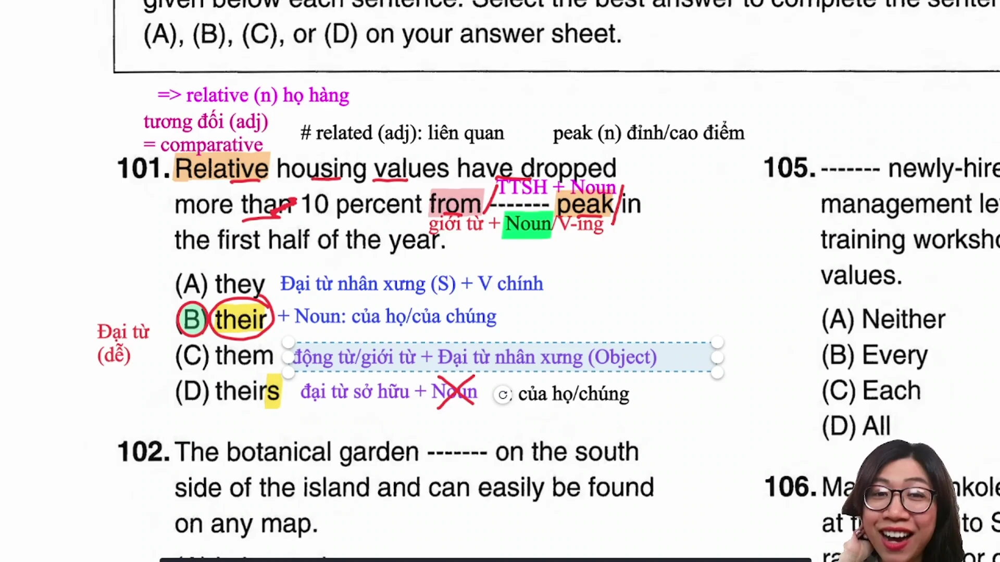

* **Đề bài:** `Relative housing values have dropped more than 10 percent from ------- peak in the first half of the year.`
* **Phương án:**
  * (A) they: Đại từ nhân xưng chủ ngữ (đứng trước động từ chia thì).
  * (B) their: Tính từ sở hữu (đứng trước danh từ).
  * (C) them: Đại từ nhân xưng tân ngữ (đứng sau động từ hoặc giới từ).
  * (D) theirs: Đại từ sở hữu (thay thế cả cụm tính từ sở hữu và danh từ, không đứng trước danh từ).
* **Phân tích:** Phía trước chỗ trống là giới từ `from`, phía sau là danh từ `peak`. Cần một tính từ sở hữu bổ nghĩa cho danh từ phía sau tạo thành cụm danh từ hoàn chỉnh. Chọn (B).
* **Dịch nghĩa:** Giá trị nhà ở tương đối đã giảm hơn 10% từ mức đỉnh điểm của chúng trong nửa đầu năm.
* **Mở rộng:**
  * `Their` mang hai nghĩa: "của họ" (người) hoặc "của chúng" (vật). Part 7 thường dùng `their` thay thế danh từ số nhiều chỉ vật để đánh lạc hướng thí sinh.
  * `Relative` (adj): tương đối, tương ứng (= `comparative`), khác với `related` (adj: liên quan). `Relative` (n): họ hàng.
  * `Peak` (n): đỉnh cao, mức cao điểm.

---

### [[11:55](https://youtu.be/2zuDwiSgPug?t=715s)] Câu 102

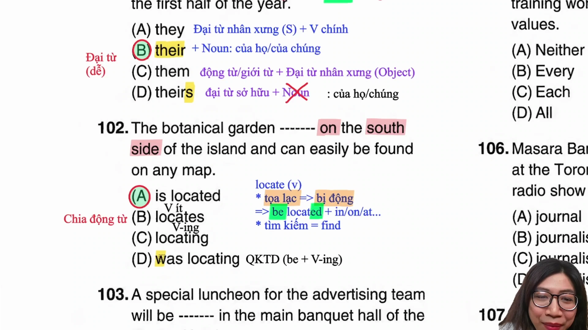

* **Đề bài:** `The botanical garden ------- on the south side of the island and can easily be found on any map.`
* **Phương án:**
  * (A) is located: Thể bị động thì hiện tại đơn.
  * (B) locates: Động từ chủ động số ít.
  * (C) locating: Dạng V-ing (chưa có trợ động từ, không làm vị ngữ chính).
  * (D) was locating: Thì quá khứ tiếp diễn chủ động.
* **Phân tích:** Động từ `locate` có hai nghĩa: "tọa lạc" (luôn ở dạng bị động đi kèm giới từ chỉ nơi chốn in/on/at) và "tìm kiếm" (= `find`). Phía sau có giới từ `on` và vị trí `the south side of the island`, suy ra mang nghĩa "được tọa lạc", bắt buộc dùng thể bị động `be + V3/ed`. Chọn (A).
* **Dịch nghĩa:** Vườn bách thảo tọa lạc ở phía nam của hòn đảo và có thể dễ dàng được tìm thấy trên bất kỳ bản đồ nào.
* **Mở rộng:**
  * Phát âm: Từ `island` có âm 's' câm, phát âm chuẩn là /ˈaɪlənd/, không đọc chêm âm 's'.

---

### [[19:05](https://youtu.be/2zuDwiSgPug?t=1145s)] Câu 103

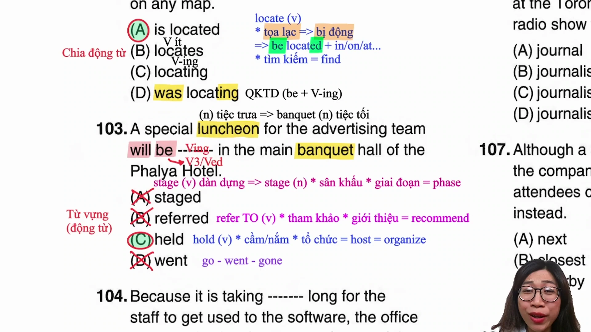

* **Đề bài:** `A special luncheon for the advertising team will be ------- in the main banquet hall of the Phalya Hotel.`
* **Phương án:**
  * (A) staged: Quá khứ phân từ của stage (dàn dựng vở diễn).
  * (B) referred: Quá khứ phân từ của refer (phải đi với giới từ to).
  * (C) held: Quá khứ phân từ của hold (tổ chức sự kiện).
  * (D) went: Động từ V2 của go (sau to be không thể đi kèm động từ V2).
* **Phân tích:** Loại ngay (B) vì `refer` bắt buộc có `to` (`refer to`: tham khảo, giới thiệu). Loại (D) vì sai ngữ pháp (sau `will be` cần V3/ed hoặc V-ing, không dùng V2 `went`). Chủ ngữ là `A special luncheon` (bữa tiệc trưa đặc biệt), không dùng `stage` (dàn dựng sân khấu). Chọn (C) với nghĩa tổ chức.
* **Dịch nghĩa:** Một bữa tiệc trưa đặc biệt dành cho đội ngũ quảng cáo sẽ được tổ chức tại sảnh tiệc chính của khách sạn Phalya.
* **Mở rộng:**
  * `Hold` = `Host` = `Organize` (v: tổ chức).
  * `Stage` (n): sân khấu, giai đoạn (= `phase`).
  * `Luncheon` (tiệc trưa) khác với `Banquet` (yến tiệc tối). Part 7 thường khai thác chi tiết này để bẫy thời gian tổ chức sự kiện trong ngày.

---

### [[26:15](https://youtu.be/2zuDwiSgPug?t=1575s)] Câu 104

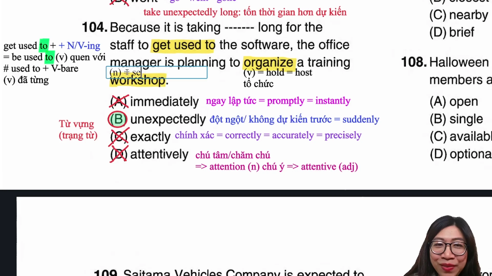

* **Đề bài:** `Because it is taking ------- long for the staff to get used to the software, the office manager is planning to organize a training workshop.`
* **Phương án:**
  * (A) immediately: Ngay lập tức (= promptly, instantly).
  * (B) unexpectedly: Ngoài dự kiến, đột ngột (= suddenly).
  * (C) exactly: Chính xác (= accurately, correctly, precisely).
  * (D) attentively: Chăm chú, chu đáo (từ gốc attention).
* **Phân tích:** Cụm từ `taking unexpectedly long` mang nghĩa diễn đạt tình trạng tốn nhiều thời gian hơn dự kiến ban đầu, dẫn đến việc nhà quản lý phải lên kế hoạch mở buổi đào tạo. Chọn (B).
* **Dịch nghĩa:** Bởi vì nhân viên mất nhiều thời gian hơn dự kiến để làm quen với phần mềm, người quản lý văn phòng đang lên kế hoạch tổ chức một buổi hội thảo đào tạo.
* **Mở rộng:**
  * `Get used to` / `Be used to` + N/V-ing: quen với cái gì (to ở đây là giới từ).
  * `Used to` + V-inf: đã từng làm gì trong quá khứ.
  * `Workshop` = `Seminar` (hội thảo) khác với `Conference` = `Convention` (hội nghị quy mô lớn).

---

### [[33:35](https://youtu.be/2zuDwiSgPug?t=2015s)] Câu 105

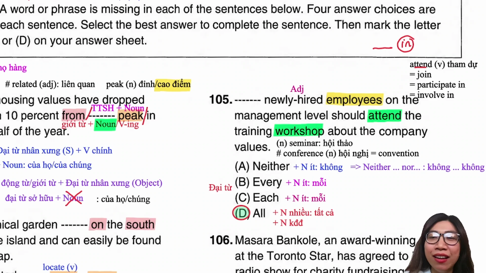

* **Đề bài:** `------- newly-hired employees on the management level should attend the training workshop about the company values.`
* **Phương án:**
  * (A) Neither: Đi với danh từ đếm được số ít (hoặc dùng trong cặp neither... nor...).
  * (B) Every: Đi với danh từ đếm được số ít.
  * (C) Each: Đi với danh từ đếm được số ít.
  * (D) All: Đi với danh từ đếm được số nhiều hoặc danh từ không đếm được.
* **Phân tích:** Phía sau chỗ trống là cụm `newly-hired employees` có danh từ số nhiều `employees`. Ba phương án A, B, C đều chỉ đi với danh từ số ít. Do đó chọn ngay (D) mà không cần dịch.
* **Dịch nghĩa:** Tất cả các nhân viên mới được tuyển dụng ở cấp quản lý nên tham dự buổi hội thảo đào tạo về các giá trị của công ty.
* **Mở rộng:**
  * `Attend` = `Join` = `Participate in` = `Take part in` = `Involve in` (tham dự). Lưu ý động từ `attend` không đi kèm giới từ `in`.

---

### [[41:15](https://youtu.be/2zuDwiSgPug?t=2475s)] Câu 106

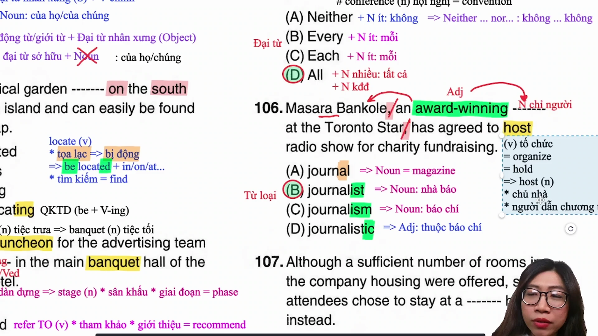

* **Đề bài:** `Masara Bankole, an award-winning ------- at the Toronto Star, has agreed to host a radio show for charity fundraising.`
* **Phương án:**
  * (A) journal: Danh từ chỉ vật (tạp chí = magazine).
  * (B) journalist: Danh từ chỉ người (nhà báo, ký giả).
  * (C) journalism: Danh từ chỉ lĩnh vực (ngành báo chí).
  * (D) journalistic: Tính từ (thuộc về báo chí).
* **Phân tích:** Cụm đứng giữa hai dấu phẩy là thông tin bổ ngữ danh từ cho chủ ngữ `Masara Bankole` (tên riêng người). Sau mạo từ `an` và tính từ ghép `award-winning` cần một danh từ chỉ người. Chọn (B).
* **Dịch nghĩa:** Masara Bankole, một nhà báo từng đạt giải thưởng tại tòa soạn Toronto Star, đã đồng ý dẫn chương trình phát thanh gây quỹ từ thiện.
* **Mở rộng:**
  * `Host` (v): tổ chức, đăng cai; (n): chủ nhà, người dẫn chương trình phát thanh/truyền hình.

---

### [[47:50](https://youtu.be/2zuDwiSgPug?t=2870s)] Câu 107

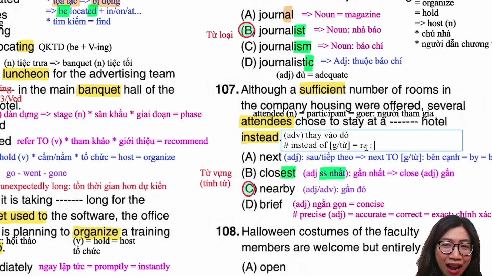

* **Đề bài:** `Although a sufficient number of rooms in the company housing were offered, several attendees chose to stay at a ------- hotel instead.`
* **Phương án:**
  * (A) next: Tính từ (kế tiếp); nếu mang nghĩa bên cạnh phải có to (next to).
  * (B) closest: Dạng so sánh nhất (bắt buộc phải có mạo từ the đứng trước).
  * (C) nearby: Tính từ hoặc trạng từ (gần đó, lân cận).
  * (D) brief: Tính từ (ngắn gọn = concise).
* **Phân tích:** Chỗ trống đứng sau mạo từ `a` và đứng trước danh từ `hotel`. Phương án (B) loại vì có `a` nên không thể dùng so sánh nhất `closest`. Phương án (A) loại vì `next hotel` chỉ thứ tự tiếp theo, không chỉ vị trí không gian. Chọn (C) `a nearby hotel` (một khách sạn gần đó).
* **Dịch nghĩa:** Mặc dù đã có đủ số lượng phòng tại khu nhà ở của công ty, một số người tham dự vẫn chọn ở tại một khách sạn gần đó.
* **Mở rộng:**
  * `Instead` (trạng từ đứng cuối câu: thay vào đó) khác với `Instead of` + N/V-ing (= `Rather than`: thay vì).
  * `Sufficient` (adj) = `Enough` (đủ).

---

### [[54:20](https://youtu.be/2zuDwiSgPug?t=3260s)] Câu 108

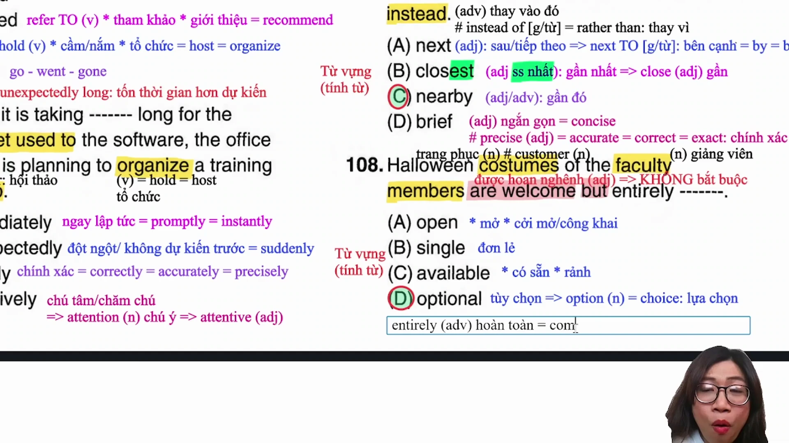

* **Đề bài:** `Halloween costumes of the faculty members are welcome but entirely -------.`
* **Phương án:**
  * (A) open: Mở, cởi mở (open to suggestions).
  * (B) single: Đơn lẻ, độc thân.
  * (C) available: Có sẵn, rảnh rỗi.
  * (D) optional: Tự chọn, không bắt buộc.
* **Phân tích:** Liên từ `but` nối hai vế mang sắc thái đối lập logic: trang phục hóa trang được hoan nghênh (`are welcome`) nhưng hoàn toàn mang tính tự nguyện/không ép buộc (`entirely optional`). Chọn (D).
* **Dịch nghĩa:** Trang phục Halloween của các giảng viên được hoan nghênh nhưng hoàn toàn mang tính tự nguyện.
* **Mở rộng:**
  * `Entirely` = `Completely` (hoàn toàn).
  * `Faculty member` (n): giảng viên đại học, cán bộ giảng dạy.

---

### [[59:45](https://youtu.be/2zuDwiSgPug?t=3585s)] Câu 109

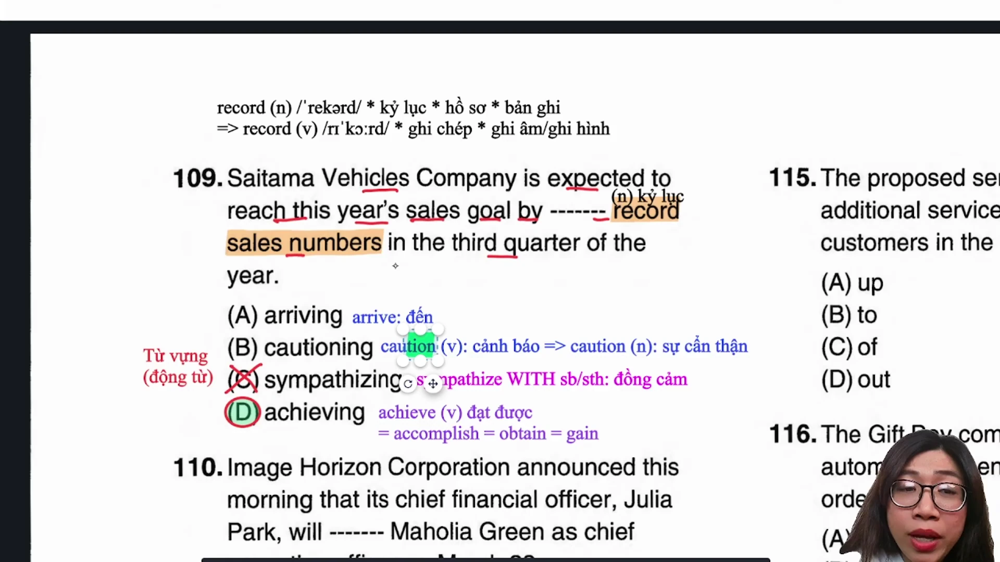

* **Đề bài:** `Saitama Vehicles Company is expected to reach this year's sales goal by ------- record sales numbers in the third quarter of the year.`
* **Phương án:**
  * (A) arriving: Đến nơi (arrive at/in).
  * (B) cautioning: Cảnh báo (caution sb against sth).
  * (C) sympathizing: Cảm thông (sympathize with sb).
  * (D) achieving: Đạt được (= accomplish, obtain, gain).
* **Phân tích:** Sau giới từ `by` cần hành động dẫn đến kết quả đạt mục tiêu doanh số (`reach sales goal`). Cụm kết hợp từ chuẩn xác là `achieve record sales numbers` (đạt doanh số bán hàng kỷ lục). Chọn (D).
* **Dịch nghĩa:** Công ty xe Saitama dự kiến sẽ đạt được mục tiêu doanh số năm nay bằng cách đạt mức doanh số bán hàng kỷ lục trong quý ba của năm.
* **Mở rộng:**
  * `Achieve` = `Accomplish` = `Obtain` = `Gain` (đạt được).
  * `Record` (n): kỷ lục, hồ sơ, bản ghi chép; (v): ghi âm, ghi hình, ghi chép lại.

---

### [[01:06:10](https://youtu.be/2zuDwiSgPug?t=3970s)] Câu 110

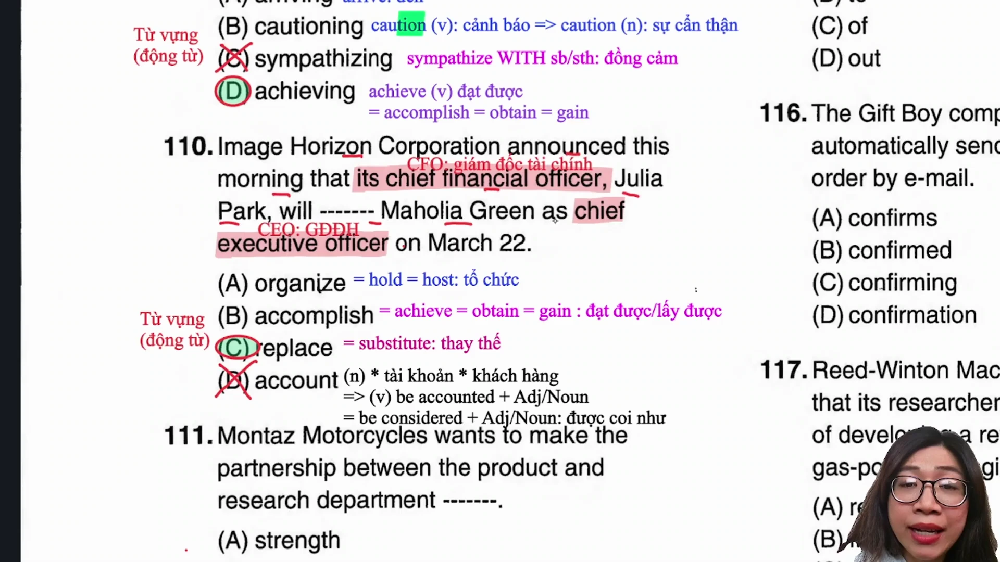

* **Đề bài:** `Image Horizon Corporation announced this morning that its chief financial officer, Julia Park, will ------- Maholia Green as chief executive officer on March 22.`
* **Phương án:**
  * (A) organize: Tổ chức (sự kiện).
  * (B) accomplish: Hoàn thành, đạt được (= achieve).
  * (C) replace: Thay thế ai đó làm nhiệm vụ gì (= substitute).
  * (D) account: Tài khoản; giải thích (account for).
* **Phân tích:** Cấu trúc bổ nhiệm nhân sự: `Replace somebody as [position]` (thay thế ai đó giữ chức vụ gì). Giám đốc tài chính Julia Park sẽ thay thế Maholia Green làm giám đốc điều hành. Chọn (C).
* **Dịch nghĩa:** Tập đoàn Image Horizon thông báo sáng nay rằng giám đốc tài chính Julia Park sẽ thay thế Maholia Green làm giám đốc điều hành vào ngày 22 tháng 3.
* **Mở rộng:**
  * `CFO` (Chief Financial Officer): Giám đốc tài chính.
  * `CEO` (Chief Executive Officer): Giám đốc điều hành.

---

### [[01:12:15](https://youtu.be/2zuDwiSgPug?t=4335s)] Câu 111

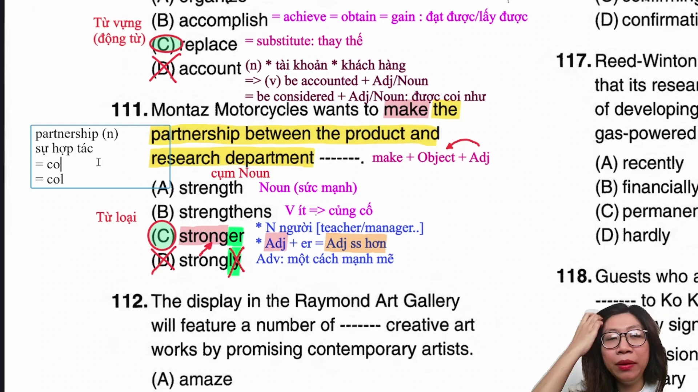

* **Đề bài:** `Montaz Motorcycles wants to make the partnership between the product and research department -------.`
* **Phương án:**
  * (A) strength: Danh từ (sức mạnh).
  * (B) strengthens: Động từ số ít (củng cố, tăng cường).
  * (C) stronger: Tính từ so sánh hơn (mạnh mẽ hơn).
  * (D) strongly: Trạng từ (một cách mạnh mẽ).
* **Phân tích:** Cấu trúc tác động: `Make + Tân ngữ + Tính từ` (làm cho cái gì trở nên như thế nào). Tân ngữ ở đây là cụm danh từ `the partnership between the product and research department`. Vị trí chỗ trống cần một tính từ. Phương án (C) `stronger` là dạng tính từ so sánh hơn (tính từ ngắn thêm đuôi -er). Thí sinh band dưới 800 dễ nhầm lẫn đuôi -er là danh từ chỉ người hoặc chọn nhầm trạng từ `strongly`. Chọn (C).
* **Dịch nghĩa:** Công ty Montaz Motorcycles muốn làm cho mối quan hệ đối tác giữa bộ phận sản phẩm và bộ phận nghiên cứu trở nên vững mạnh hơn.
* **Mở rộng:**
  * `Partnership` = `Cooperation` = `Collaboration` (sự cộng tác, hợp tác).

---

### [[01:21:10](https://youtu.be/2zuDwiSgPug?t=4870s)] Câu 112

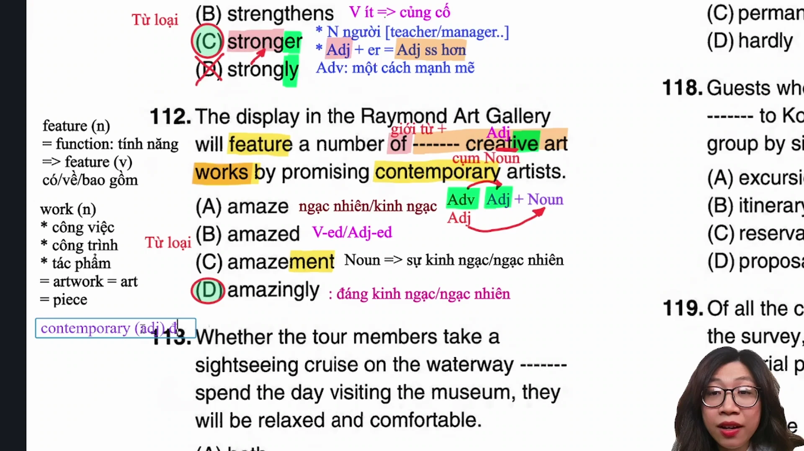

* **Đề bài:** `The display in the Raymond Art Gallery will feature a number of ------- creative art works by promising contemporary artists.`
* **Phương án:**
  * (A) amaze: Động từ nguyên mẫu (làm kinh ngạc).
  * (B) amazed: Tính từ đuôi -ed (chỉ cảm xúc ngạc nhiên của con người).
  * (C) amazement: Danh từ (sự kinh ngạc).
  * (D) amazingly: Trạng từ (một cách đáng kinh ngạc).
* **Phân tích:** Xét trật tự cụm danh từ sau `a number of`: `[chỗ trống] + creative (tính từ) + art works (danh từ)`. Vị trí đứng trước và bổ nghĩa cho một tính từ bắt buộc phải là một trạng từ theo công thức `Trạng từ + Tính từ + Danh từ`. Chọn (D).
* **Dịch nghĩa:** Triển lãm tại phòng trưng bày nghệ thuật Raymond sẽ giới thiệu một số tác phẩm nghệ thuật sáng tạo đáng kinh ngạc của các nghệ sĩ đương đại đầy triển vọng.
* **Mở rộng:**
  * `Work` (danh từ không đếm được: công việc) khác với `Work / Art works` (danh từ đếm được: tác phẩm nghệ thuật, công trình kiến trúc = `piece`, `artwork`).
  * `Contemporary` (adj): đương đại.
  * `Promising` (adj): đầy triển vọng.

---

### [[01:29:40](https://youtu.be/2zuDwiSgPug?t=5380s)] Câu 113

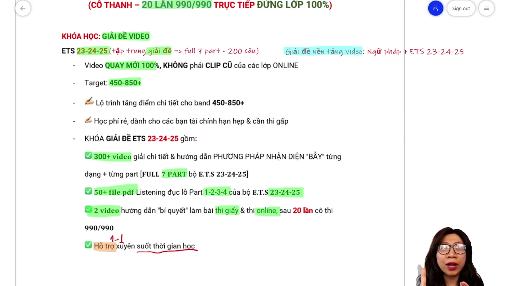

* **Đề bài:** `Whether the tour members take a sightseeing cruise on the waterway ------- spend the day visiting the museum, they will be relaxed and comfortable.`
* **Phương án:**
  * (A) both: Cả hai (đi với cặp both... and...).
  * (B) also: Trạng từ (cũng).
  * (C) nor: Cặp phủ định (neither... nor...).
  * (D) or: Cặp tương quan với whether (whether... or...).
* **Phân tích:** Đầu mệnh đề xuất hiện liên từ `Whether` (liệu rằng), theo cấu trúc liên từ tương quan bắt buộc phải đi kèm với `or` (`Whether A or B`: dù làm A hay làm B). Chọn (D).
* **Dịch nghĩa:** Dù các thành viên trong đoàn tham gia chuyến du ngoạn ngắm cảnh trên đường thủy hay dành cả ngày tham quan bảo tàng, họ đều sẽ cảm thấy thư thái và thoải mái.
* **Mở rộng:**
  * `Tour` = `Excursion` = `Trip` (chuyến tham quan).
  * `Cruise` (n): chuyến du ngoạn bằng thuyền/tàu thủy.

---

### [[01:38:05](https://youtu.be/2zuDwiSgPug?t=5885s)] Câu 114

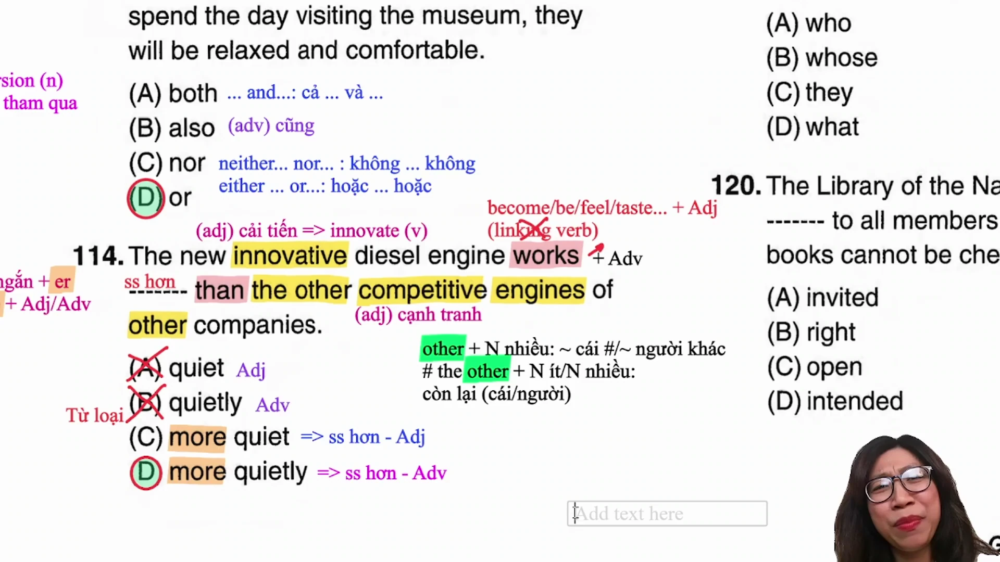

* **Đề bài:** `The new innovative diesel engine works ------- than the other competitive engines of other companies.`
* **Phương án:**
  * (A) quiet: Tính từ nguyên mẫu (yên tĩnh).
  * (B) quietly: Trạng từ nguyên mẫu (một cách êm ái, yên tĩnh).
  * (C) more quiet: Sai ngữ pháp dạng so sánh hơn.
  * (D) more quietly: Dạng so sánh hơn của trạng từ quietly.
* **Phân tích:** Động từ chính là `works` (hoạt động/vận hành) - đây là động từ hành động thông thường, đòi hỏi trạng từ bổ nghĩa. Phía sau có liên từ so sánh `than`, nên cần dạng so sánh hơn của trạng từ `quietly`, tức `more quietly`. Chọn (D).
* **Dịch nghĩa:** Động cơ diesel cải tiến mới vận hành êm ái hơn so với các động cơ cạnh tranh khác của các công ty đối thủ.
* **Mở rộng:**
  * Phân biệt động từ nối (Linking Verb: look, sound, smell, feel, become... đi với tính từ) và động từ hành động thường (Action Verb: work, run, speak... đi với trạng từ).

---

### [[01:43:00](https://youtu.be/2zuDwiSgPug?t=6180s)] Câu 115

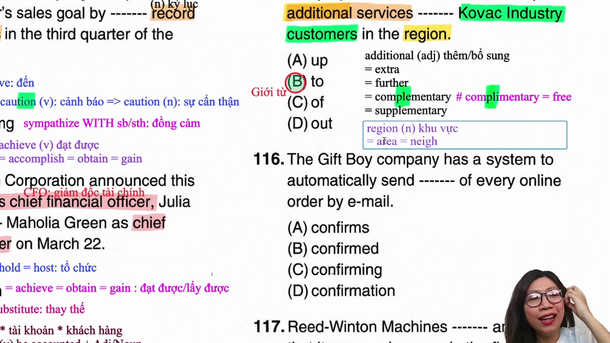

* **Đề bài:** `The proposed service center would provide additional services ------- Kovac Industry customers in the region.`
* **Phương án:**
  * (A) up: Giới từ lên.
  * (B) to: Giới từ tới, cho.
  * (C) of: Giới từ của.
  * (D) out: Giới từ ra ngoài.
* **Phân tích:** Cấu trúc kết hợp từ cố định của động từ `provide`: `Provide something TO somebody` (cung cấp cái gì cho ai). Trong câu, `additional services` là vật được cung cấp (something) và `Kovac Industry customers` là đối tượng nhận (somebody). Do đó giới từ bắt buộc là `to`. Chọn (B).
* **Dịch nghĩa:** Trung tâm dịch vụ được đề xuất sẽ cung cấp các dịch vụ bổ sung cho các khách hàng của tập đoàn Kovac Industry trong khu vực.
* **Mở rộng:**
  * `Additional` = `Extra` = `Further` = `Supplementary` (adj: bổ sung, phụ thêm).
  * `Supplementary` (bổ sung) đồng âm hoàn toàn với `Complimentary` (/ˌkɒmplɪˈmentri/ - tính từ: miễn phí = `free`). Đây là bẫy cực lớn trong cả bài thi Listening và Reading.
  * `Region` = `Area` = `Neighborhood` (n: khu vực, vùng).

---

## Trích dẫn then chốt

* [00:15](https://youtu.be/2zuDwiSgPug?t=15s): "Cái thời gian làm nó sẽ quyết định được là 50% điểm số của mình là có cao hay không. Cho nên Part 5 cộng Part 6 tổng cộng lại chỉ có 25 phút mà thôi."
* [08:35](https://youtu.be/2zuDwiSgPug?t=515s): "Khi mang nghĩa tọa lạc thì luôn ở dạng bị động và thường có giới từ chỉ vị trí theo sau như in, on, at. Thấy giới từ là chọn ngay bị động trong 5 giây, không cần dịch câu."
* [33:55](https://youtu.be/2zuDwiSgPug?t=2035s): "Bất kỳ khi nào thấy có một cụm nằm ở giữa hai dấu phẩy thì cụm đó là thông tin phụ bổ nghĩa cho danh từ phía trước. Phía trước là tên người thì danh từ trong cụm bắt buộc phải là danh từ chỉ người."
* [1:07:45](https://youtu.be/2zuDwiSgPug?t=4065s): "Công thức Make cộng tân ngữ cộng tính từ. Thấy đuôi -er đừng nghĩ ngay đến danh từ chỉ người, đó là tính từ so sánh hơn và là đáp án chuẩn của câu 800+."
* [1:40:15](https://youtu.be/2zuDwiSgPug?t=6015s): "Supplementary và Complimentary đọc giống hệt nhau nhưng nghĩa hoàn toàn khác: một bên là bổ sung, một bên là miễn phí. Đọc đúng âm câm để vừa ăn điểm Reading vừa không bị lừa ở Listening."

---

## Lệnh & Công cụ

### Bảng giải nhanh

| Dạng bài | Dấu hiệu nhận diện | Công thức áp dụng | Thời gian xử lý |
| :--- | :--- | :--- | :--- |
| Đại từ sở hữu | Giới từ + [Chỗ trống] + Danh từ | Điền Tính từ sở hữu (my/your/their...) | 5 giây |
| Thể bị động vị trí | Động từ locate + Giới từ nơi chốn (in/on/at) | Chọn thể bị động `be located` | 5 giây |
| Từ định lượng | Danh từ số nhiều phía sau chỗ trống | Chọn `All`, loại `Each/Every/Neither` | 5 giây |
| Mệnh đề đồng vị | Tên riêng người, [Mạo từ + Tính từ + ...] | Chọn danh từ chỉ người (`journalist`) | 5 giây |
| Bổ ngữ tính từ | Make + Cụm danh từ tân ngữ + [Chỗ trống] | Điền tính từ hoặc tính từ so sánh hơn (`stronger`) | 10 giây |
| Trật tự cụm danh từ | Mạo từ/Giới từ + [Chỗ trống] + Tính từ + Danh từ | Điền trạng từ đuôi -ly (`amazingly`) | 5 giây |
| Động từ hành động | Động từ thường + [Chỗ trống] + than | Chọn trạng từ so sánh hơn (`more quietly`) | 10 giây |
| Giới từ cung cấp | Provide + Danh từ (vật) + [Chỗ trống] + Người | Điền giới từ `to` | 5 giây |

### Từ đồng nghĩa

* `Hold` = `Host` = `Organize`: Tổ chức sự kiện
* `Workshop` = `Seminar`: Buổi hội thảo đào tạo
* `Conference` = `Convention`: Đại hội, hội nghị lớn
* `Immediately` = `Promptly` = `Instantly`: Ngay lập tức
* `Unexpectedly` = `Suddenly`: Đột ngột, ngoài dự kiến
* `Exactly` = `Accurately` = `Correctly` = `Precisely`: Chính xác
* `Attend` = `Join` = `Participate in` = `Take part in`: Tham gia
* `Achieve` = `Accomplish` = `Obtain` = `Gain`: Đạt được thành tựu
* `Replace` = `Substitute`: Thay thế vị trí
* `Partnership` = `Cooperation` = `Collaboration`: Quan hệ hợp tác
* `Additional` = `Extra` = `Further` = `Supplementary`: Bổ sung, thêm vào

---

## Đánh đổi & Rủi ro

* **Bẫy dịch nghĩa từng từ (Word-by-word Translation):** Khi gặp các câu về từ loại và ngữ pháp cố định (như `locate`, `provide... to...`, `make + O + adj`), việc dịch toàn bộ câu tiêu tốn từ 20 đến 30 giây quý giá mà không gia tăng độ chính xác. Đánh đổi thời gian này sẽ làm thiếu hụt nghiêm trọng thời gian đọc hiểu ở Part 7.
* **Bẫy ngữ nghĩa đại từ:** Mặc định dịch `their` là "của họ" sẽ dẫn đến sai lầm nghiêm trọng trong Part 7 khi văn bản đề cập đến tài sản, máy móc hay các thực thể số nhiều chỉ vật.
* **Bẫy nhầm lẫn dạng từ so sánh:** Nhầm lẫn hậu tố so sánh hơn `-er` của tính từ ngắn với hậu tố chỉ người (như teacher, worker) dẫn đến việc loại bỏ đáp án đúng ở các câu đòi hỏi tính từ đứng sau tân ngữ.
* **Mất điểm Listening do phát âm sai:** Đọc sai các âm câm (như đọc âm 's' trong `island` hay đọc sai trọng âm của `complimentary` và `supplementary`) tạo ra điểm mù thính giác, khiến thí sinh không thể bắt kịp từ khóa trong Part 3 và Part 4.
