# GIẢI ĐỀ TOEIC 2026 - TEST 1 [VIDEO 2]

* **Kênh:** Anh ngữ Ms Thanh | **Thời lượng:** 01:49:10 | **Ngày:** 2026-02-15
* **Video:** https://youtu.be/yw4xUVGvexQ

---

## Thuật ngữ

| Thuật ngữ | Tiếng Anh | Giải thích |
| :--- | :--- | :--- |
| Ngoại động từ cần tân ngữ | Transitive Verb Object Requirement | Động từ hành động tác động trực tiếp lên đối tượng khác, bắt buộc phải có một cụm danh từ làm tân ngữ trực tiếp theo sau (`send + confirmation`). |
| Trạng từ thời điểm gần đây | Temporal Adverb of Recency | Trạng từ xác định hành động vừa diễn ra trong thời gian ngắn trước hiện tại, thường đi kèm thì quá khứ đơn hoặc hiện tại hoàn thành (`recently announced`). |
| Đại từ quan hệ chủ ngữ | Subject Relative Pronoun | Đại từ thay thế cho tiền từ chỉ người và đảm nhiệm chức năng làm chủ ngữ trong mệnh đề phụ (`customers who responded`). |
| Giới từ phạm vi thời hạn | Preposition of Time Limit | Giới từ xác lập khung thời gian có hiệu lực hoặc thời hạn hoàn thành công việc (`within the next five working days`). |
| Tính từ bất lợi ngoại cảnh | Adverse Condition Adjective | Tính từ miêu tả điều kiện thời tiết hoặc hoàn cảnh gây trở ngại cho hoạt động giao thông, sản xuất (`unfavorable weather conditions`). |
| Trạng từ bổ nghĩa tính từ | Adverb Modifying Adjective | Trạng từ đứng trước một tính từ để tăng cường hoặc xác định quy mô biên độ tính chất (`remarkably little`). |
| Danh từ trình tự quy trình | Procedural Noun Sequence | Danh từ chỉ thứ tự các bước thao tác kỹ thuật phải tuân thủ nghiêm ngặt theo trình tự (`proper sequence of steps`). |
| Giới từ mốc dời lịch | Preposition of Postponement | Giới từ đi kèm các động từ hoãn lại nhằm xác định mốc thời gian trễ hơn sẽ tiếp tục diễn ra (`postponed until later`). |
| Tính từ phân từ chuyên môn | Specialized Participial Adjective | Tính từ có nguồn gốc từ quá khứ phân từ miêu tả năng lực chuyên biệt của nhân sự (`specialized skills`). |
| Lượng từ phân phối khác biệt | Distributive Quantifier of Difference | Từ hạn định đi kèm danh từ số nhiều nhằm chỉ các đối tượng khác ngoài đối tượng đang đề cập (`other promotional items`). |
| Thể bị động thiếu tân ngữ | Passive Voice Without Object | Động từ khi chuyển sang dạng bị động (`be + V3/ed`) sẽ không còn tân ngữ trực tiếp theo sau mà thường theo sau bởi giới từ (`was honored for`). |
| Cụm từ cố định tăng cường | Atmosphere Enhancement Collocation | Sự kết hợp từ vựng tự nhiên nhằm diễn tả hành động cải thiện, nâng tầm chất lượng không gian (`enhance your home atmosphere`). |

---

## Tổng luận chuyên đề

### Chiến lược thời gian

Phần thi Part 5 gồm 30 câu hỏi trắc nghiệm kiểm tra ngữ pháp và từ vựng cơ bản đến nâng cao. Để bảo toàn tối đa thời gian cho Part 7 với các bài đọc dài, thí sinh cần phân nhóm câu hỏi để giải quyết dứt khoát:
* **Nhóm ngữ pháp phản xạ (dưới 10 giây):** Nhận diện hình thái từ loại bằng cách quan sát hai phía chỗ trống. Khi phía trước là ngoại động từ `send` và phía sau là giới từ `of`, lập tức chọn danh từ `confirmation`. Khi phía sau là danh từ số nhiều `items`, lập tức chọn lượng từ `other` thay vì phân vân `another`. Thấy trước chỗ trống là động từ thì quá khứ và sau chỗ trống là giới từ `for` mà không có tân ngữ, chốt ngay thể bị động `was honored`.
* **Nhóm kết hợp ngữ pháp và quét từ khóa (10 đến 15 giây):** Nhận diện mệnh đề quan hệ chỉ người có chủ ngữ (`customers who responded`), giới từ đi kèm khoảng thời gian xác định (`within the next five working days`), hoặc trạng từ chỉ thời gian gần đây (`recently announced`).
* **Nhóm ngữ cảnh từ vựng chuyên ngành (20 đến 30 giây):** Đòi hỏi đọc hiểu ý nghĩa tổng thể và kết hợp từ vựng chính xác. Phân biệt `unfavorable` trong ngữ cảnh thời tiết làm hoãn tàu thuyền, `sequence` khi nói về quy trình các bước kỹ thuật, `enhance` khi nói về cải thiện không gian sống, và `increase` khi công ty năng lượng đối mặt với chi phí gia tăng.

### Bản chất ngữ pháp

* **Vị trí tân ngữ của ngoại động từ:** Sau các ngoại động từ phổ biến (`send`, `provide`, `receive`), bắt buộc phải có một cụm danh từ làm tân ngữ trực tiếp. Giới từ đứng sau không thể đóng vai trò tân ngữ. Do đó, chỗ trống kẹp giữa ngoại động từ và giới từ luôn là một danh từ (`send confirmation of`).
* **Quy tắc phân biệt đại từ quan hệ chủ ngữ và đại từ nhân xưng:** Khi đứng sau một danh từ chỉ người và đứng trước một động từ vị ngữ của mệnh đề quan hệ, bắt buộc phải dùng đại từ quan hệ `who`. Không được dùng đại từ nhân xưng `they` vì sẽ dẫn đến lỗi ngữ pháp hai mệnh đề độc lập đứng cạnh nhau mà thiếu liên từ nối.
* **Cấu trúc bổ nghĩa đa tầng:** Trong cụm danh từ, trạng từ có thể đứng trước để bổ nghĩa trực tiếp cho một tính từ đứng trước danh từ chính (`there has been [remarkably] [little] [medical research achievement]`). Không được nhầm lẫn động từ `be` mà vội vàng chọn tính từ ở vị trí này.
* **Quy tắc vàng 90% về thể chủ động và bị động:** Ngoại động từ ở thể chủ động bắt buộc phải có một tân ngữ (cụm danh từ) đứng sau. Nếu phía sau chỗ trống không có cụm danh từ mà xuất hiện ngay một giới từ (`for`, `by`, `in`, `at`), xác suất trên 90% động từ đó phải chia ở thể bị động (`be + V3/ed`).
* **Hệ thống lượng từ chỉ sự khác biệt:**
  * `other + Danh từ số nhiều / Danh từ không đếm được`: Những người hoặc vật khác (`other items`).
  * `another + Danh từ số ít`: Một người hoặc vật khác (`another item`).
  * `others`: Đại từ độc lập thay thế cho `other + Danh từ số nhiều`, tuyệt đối không đứng trước danh từ.

### Biến thể từ loại

* **Hậu tố danh từ:** Đuôi `-tion` (`confirmation`), `-ment` (`achievement`), `-ity` (`durability`, `visibility`), `-ence` / `-ance` (`sequence`).
* **Hậu tố tính từ chuyên dụng:** Đuôi `-ed` tạo thành tính từ phân từ miêu tả tính chất được tôi luyện, chuyên môn hóa (`specialized skills`), phân biệt với dạng danh từ đuôi `-tion` (`specialization`).
* **Trạng từ đuôi `-ly`:** Trạng từ cấu tạo từ tính từ thêm đuôi `-ly` (`remarkable` -> `remarkably`, `recent` -> `recently`, `aggressive` -> `aggressively`). Trạng từ có chức năng bổ nghĩa cho động từ, tính từ hoặc một trạng từ khác.
* **Tính từ phái sinh mang tính phủ định:** Tiền tố `un-` kết hợp với tính từ tạo nghĩa trái ngược (`unfavorable` đối lập với `favorable`), tiền tố `in-` tạo nghĩa chưa trọn vẹn (`incomplete` đối lập với `complete`).

### Cụm từ then chốt

* **Cụm từ chỉ thời gian và thời hạn:**
  * `recently announced`: Gần đây đã thông báo.
  * `within + khoảng thời gian`: Trong vòng bao lâu (`within the next five working days`).
  * `postpone until + mốc thời gian`: Hoãn lại cho đến một thời điểm xác định.
* **Cụm từ thương mại và kỹ thuật:**
  * `due to unfavorable weather conditions`: Do điều kiện thời tiết bất lợi.
  * `proper sequence of steps`: Trình tự các bước phù hợp/chuẩn xác.
  * `specialized skills`: Các kỹ năng chuyên môn sâu.
  * `increase the rate`: Tăng giá cước/mức phí.
  * `enhance the atmosphere`: Nâng tầm bầu không khí.
  * `in charge of` = `responsible for`: Phụ trách, chịu trách nhiệm cho.
  * `sign up` = `register` = `enroll [in]`: Đăng ký tham gia.
  * `reception desk` = `front desk`: Quầy lễ tân.

---

## Bóc tách chi tiết

### [[00:01](https://youtu.be/yw4xUVGvexQ?t=1s)] Câu 116

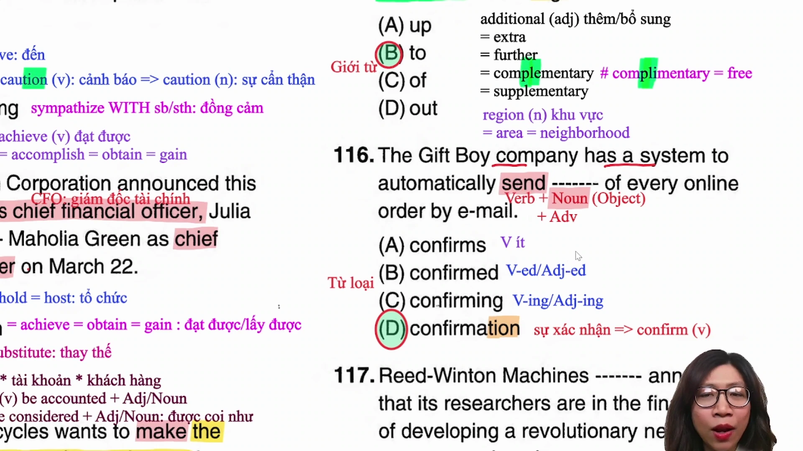

* **Đề bài:** `The Gift Boy company has a system to automatically send ------- of every online order by e-mail.`
* **Phương án:**
  * (A) confirms: Động từ số ít ở thì hiện tại đơn (xác nhận).
  * (B) confirmed: Động từ dạng quá khứ / phân từ hai (đã xác nhận).
  * (C) confirming: Danh động từ hoặc hiện tại phân từ (việc xác nhận / đang xác nhận).
  * (D) confirmation: Danh từ chỉ sự việc/chứng từ (sự xác nhận, giấy xác nhận).
* **Phân tích:**
  * Bốn phương án xuất phát từ cùng một gốc từ `confirm`, đây là câu hỏi thuần túy về hình thái từ loại.
  * Quan sát phía trước chỗ trống: Xuất hiện ngoại động từ `send` (gửi). Một ngoại động từ bắt buộc phải có một tân ngữ (Object) là danh từ theo sau.
  * Quan sát phía sau chỗ trống: Giới từ `of` mở đầu một cụm giới từ phụ (`of every online order`). Giới từ không thể làm tân ngữ trực tiếp cho động từ `send`.
  * Do đó, vị trí chỗ trống bắt buộc phải là một danh từ để hoàn thiện cấu trúc `send + Noun (Object)`.
  * Nhận diện đuôi danh từ: Hậu tố `-tion` trong `confirmation`.
  * Chọn (D).
* **Dịch nghĩa:** Công ty Gift Boy có một hệ thống tự động gửi thư xác nhận cho mỗi đơn hàng trực tuyến qua email.
* **Mở rộng:**
  * `automatically` (adv): Một cách tự động (tính từ: `automatic`).
  * `send confirmation of sth`: Gửi xác nhận về điều gì.
  * `online order`: Đơn đặt hàng trực tuyến.
  * Cụm từ chỉ phương thức liên lạc/vận chuyển: `by e-mail`, `by phone`, `by post`, `by air`.

---

### [[02:30](https://youtu.be/yw4xUVGvexQ?t=150s)] Câu 117

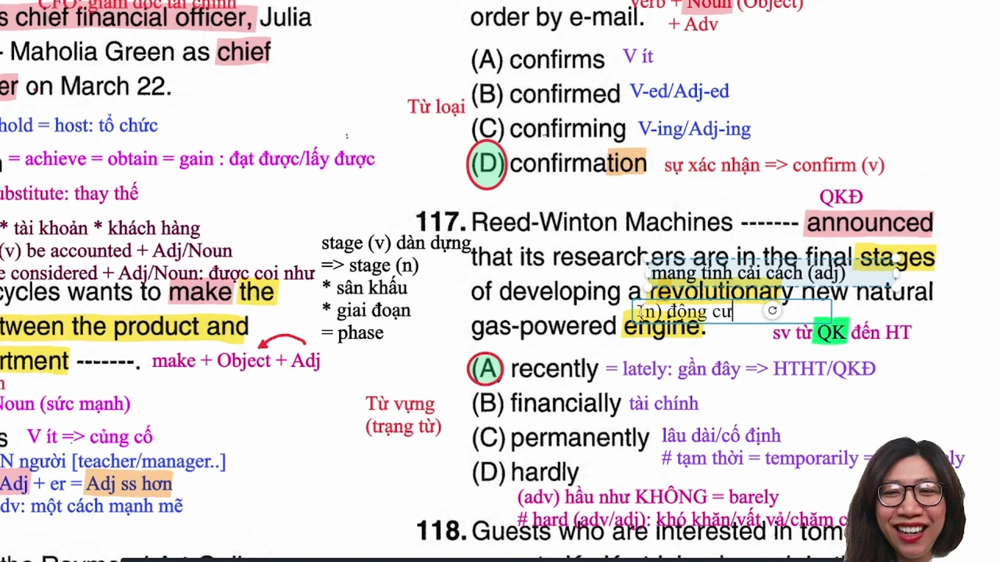

* **Đề bài:** `Reed-Winton Machines ------- announced that its researchers are in the final stages of developing a revolutionary new natural gas-powered engine.`
* **Phương án:**
  * (A) recently: Trạng từ chỉ thời gian (gần đây, mới đây = lately).
  * (B) financially: Trạng từ chỉ lĩnh vực (về mặt tài chính).
  * (C) permanently: Trạng từ chỉ tính chất (vĩnh viễn, lâu dài # temporarily).
  * (D) hardly: Trạng từ chỉ tần suất/mức độ phủ định (hầu như không = barely = scarcely).
* **Phân tích:**
  * Bốn phương án đều là trạng từ đứng trước động từ chính ở thì quá khứ đơn `announced` (đã thông báo) để bổ nghĩa cho hành động.
  * Trong văn phong học thuật và bài thi TOEIC, khi một tổ chức vừa công bố thông tin, trạng từ thời gian đặc trưng nhất đi kèm thì quá khứ đơn hoặc hiện tại hoàn thành là `recently` (`recently announced` = gần đây đã thông báo).
  * Loại (B) vì `financially` thường đi kèm các tính từ hoặc động từ liên quan đến ngân sách, ổn định tài chính (`financially stable`, `support financially`), không phù hợp với việc công bố kết quả nghiên cứu.
  * Loại (C) vì `permanently` mang nghĩa vĩnh viễn, không áp dụng cho hành vi phát biểu thông báo.
  * Loại (D) vì `hardly` mang nghĩa phủ định "hầu như không", nếu ghép vào câu sẽ tạo nghĩa vô lý là công ty hầu như không thông báo điều gì.
  * Chọn (A).
* **Dịch nghĩa:** Công ty Reed-Winton Machines gần đây đã thông báo rằng các nhà nghiên cứu của họ đang ở những giai đoạn cuối cùng của việc phát triển một động cơ chạy bằng khí đốt tự nhiên mang tính cách mạng mới.
* **Mở rộng:**
  * `stage` (n): Giai đoạn (= `phase`), hoặc sân khấu; (v): Dàn dựng, tổ chức một sự kiện.
  * `final stages of + V-ing`: Các giai đoạn cuối cùng của việc thực hiện điều gì.
  * `revolutionary` (adj): Mang tính cách mạng, đột phá (danh từ: `revolution`).
  * `engine` (n): Động cơ (`natural gas-powered engine`: động cơ chạy bằng năng lượng khí đốt tự nhiên).
  * Cặp từ tương phản cần nhớ: `permanently` (vĩnh viễn) >< `temporarily` (tạm thời).

---

### [[12:39](https://youtu.be/yw4xUVGvexQ?t=759s)] Câu 118

* **Đề bài:** `Guests who are interested in tomorrow's ------- to Ko Kret Island may join the tour group by signing up at the reception desk.`
* **Phương án:**
  * (A) excursion: Danh từ (chuyến tham quan ngắn, chuyến dã ngoại = tour / short trip).
  * (B) itinerary: Danh từ (lịch trình chuyến đi, bản ghi lộ trình).
  * (C) reservation: Danh từ (sự đặt chỗ trước = booking; hoặc sự nghi ngờ = doubt).
  * (D) proposal: Danh từ (bản đề xuất, bản kiến nghị). Đuôi `-al` nhưng là danh từ.
* **Phân tích:**
  * Vị trí chỗ trống đứng sau sở hữu cách `tomorrow's` và đứng trước giới từ chỉ điểm đến `to Ko Kret Island` (đến Đảo Ko Kret). Mệnh đề chính phía sau có hành động `join the tour group` (tham gia vào đoàn tham quan).
  * Để kết nối hợp lý với đoàn tham quan đến một hòn đảo, danh từ cần tìm phải mang ý nghĩa một chuyến du ngoạn hoặc chuyến tham quan ngắn ngày: `excursion to somewhere`.
  * Loại (B) vì `itinerary` là bản kế hoạch ghi rõ thời gian và địa điểm, không ai nói "tham gia vào đoàn tour bằng cách đăng ký một bản lịch trình đến đảo".
  * Loại (C) vì `reservation` là việc giữ chỗ trước, thường đi theo cấu trúc `make a reservation for a flight / a hotel room`, không đi kèm `to Island`.
  * Loại (D) vì `proposal` là bản đề xuất kế hoạch kinh doanh hoặc nghiên cứu, không phù hợp với ngữ cảnh du lịch nghỉ dưỡng.
  * Chọn (A).
* **Dịch nghĩa:** Những du khách quan tâm đến chuyến dã ngoại ngày mai đến Đảo Ko Kret có thể tham gia đoàn tham quan bằng cách đăng ký tại quầy lễ tân.
* **Mở rộng:**
  * `sign up` (v) = `register` = `enroll [in]`: Đăng ký tham gia.
  * `reception desk` = `front desk`: Quầy lễ tân.
  * `be interested in + N/V-ing`: Quan tâm, thích thú với điều gì.
  * `excursion` (n) = `tour` = `outing` = `day trip`: Chuyến dã ngoại, chuyến tham quan ngắn.
  * Các danh từ có đuôi `-al` thường gặp trong TOEIC: `proposal` (bản đề xuất), `approval` (sự phê duyệt), `removal` (sự di dời), `refusal` (sự từ chối), `renewal` (sự gia hạn).

---

### [[22:29](https://youtu.be/yw4xUVGvexQ?t=1349s)] Câu 119

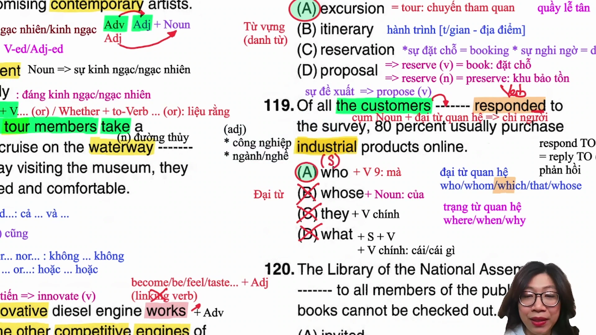

* **Đề bài:** `Of all the customers ------- responded to the survey, 80 percent usually purchase industrial products online.`
* **Phương án:**
  * (A) who: Đại từ quan hệ chỉ người làm chủ ngữ.
  * (B) whose: Đại từ quan hệ sở hữu (theo sau bắt buộc là một danh từ không có mạo từ).
  * (C) they: Đại từ nhân xưng đóng vai trò chủ ngữ mệnh đề chính.
  * (D) what: Đại từ nghi vấn / đại từ quan hệ không có danh từ tiền từ đứng trước.
* **Phân tích:**
  * Phía trước chỗ trống là cụm danh từ chỉ người `the customers` (những khách hàng).
  * Phía sau chỗ trống là động từ `responded` (đã phản hồi) và cụm giới từ `to the survey`.
  * Chỗ trống nằm trong mệnh đề quan hệ bổ nghĩa cho danh từ `customers`. Vị trí này cần một đại từ quan hệ thay thế cho người và làm chủ ngữ cho động từ `responded`.
  * Đại từ quan hệ làm chủ ngữ chỉ người duy nhất trong các lựa chọn là `who`.
  * Loại (B) vì `whose` bắt buộc phải đi liền với một danh từ thuộc quyền sở hữu (`whose + Noun`), trong khi `responded` là một động từ.
  * Loại (C) vì `they` là đại từ nhân xưng, nếu điền `they` câu sẽ mắc lỗi nghiêm trọng khi hai mệnh đề độc lập đứng cạnh nhau mà không có liên từ nối (`run-on sentence`).
  * Loại (D) vì `what` mang nghĩa "điều mà / cái mà", phía trước `what` tuyệt đối không được có tiền từ danh từ.
  * Chọn (A).
* **Dịch nghĩa:** Trong số tất cả các khách hàng đã phản hồi khảo sát, 80 phần trăm thường mua các sản phẩm công nghiệp trực tuyến.
* **Mở rộng:**
  * `respond to` (v) = `reply to`: Phản hồi, giải đáp (danh từ: `response`).
  * `industrial products`: Các sản phẩm công nghiệp (phân biệt `industry`: ngành công nghiệp; `industrious`: chăm chỉ, cần cù).
  * Cấu trúc xác lập tập hợp so sánh: `Of all the + Danh từ số nhiều, S + V...` (Trong số tất cả những...).

---

### [[30:21](https://youtu.be/yw4xUVGvexQ?t=1821s)] Câu 120

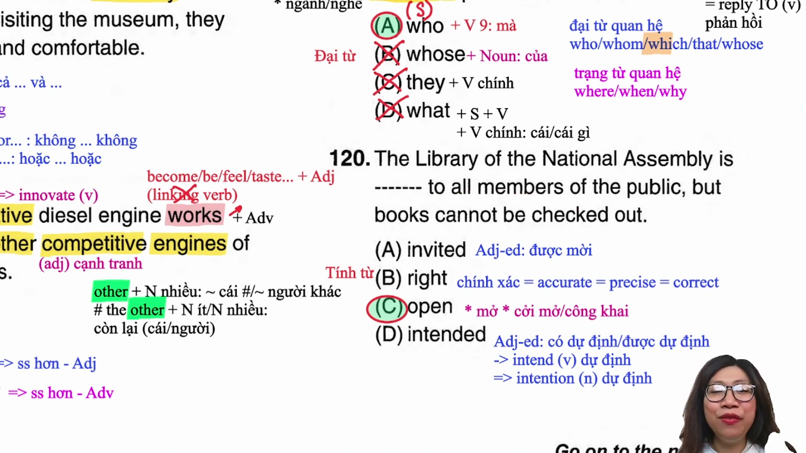

* **Đề bài:** `The Library of the National Assembly is ------- to all members of the public, but books cannot be checked out.`
* **Phương án:**
  * (A) invited: Động từ dạng phân từ hai (được mời).
  * (B) right: Tính từ (chính xác, đúng đắn, ở bên phải).
  * (C) open: Tính từ (mở cửa, cởi mở, không hạn chế tiếp cận).
  * (D) intended: Tính từ / phân từ (được dự định, nhắm đến cho mục đích nào).
* **Phân tích:**
  * Vị trí chỗ trống đứng sau động từ to be `is` và đứng trước giới từ `to all members of the public` (cho tất cả thành viên của công chúng/mọi người dân). Mệnh đề sau có liên từ đối lập `but books cannot be checked out` (nhưng sách không thể mượn mang về).
  * Cụm từ cố định chuẩn xác trong tiếng Anh mô tả một cơ quan, thư viện, công viên mở cửa cho mọi người vào tham quan, đọc sách là `be open to the public / be open to sb`.
  * Loại (A) vì cấu trúc mời mọc là `invite sb to an event` hoặc `sb is invited to do sth`, không thể nói thư viện được mời tới người dân.
  * Loại (B) vì `right` không kết hợp với `to sb` để diễn tả ý mở cửa phục vụ.
  * Loại (D) vì `intended` thường đi với giới từ `for` (`be intended for sb` = được dành riêng cho ai), không đi với `to sb` trong ngữ cảnh này.
  * Chọn (C).
* **Dịch nghĩa:** Thư viện Quốc hội mở cửa cho mọi người dân trong công chúng, nhưng sách không được phép mượn mang về.
* **Mở rộng:**
  * `be open to sb`: Mở cửa đón tiếp ai, sẵn sàng tiếp nhận ai.
  * `members of the public`: Người dân trong công chúng.
  * `check out books`: Mượn sách mang về từ thư viện (ngược lại: `return books` - trả sách).
  * `National Assembly`: Quốc hội.

---

### [[33:56](https://youtu.be/yw4xUVGvexQ?t=2036s)] Câu 121

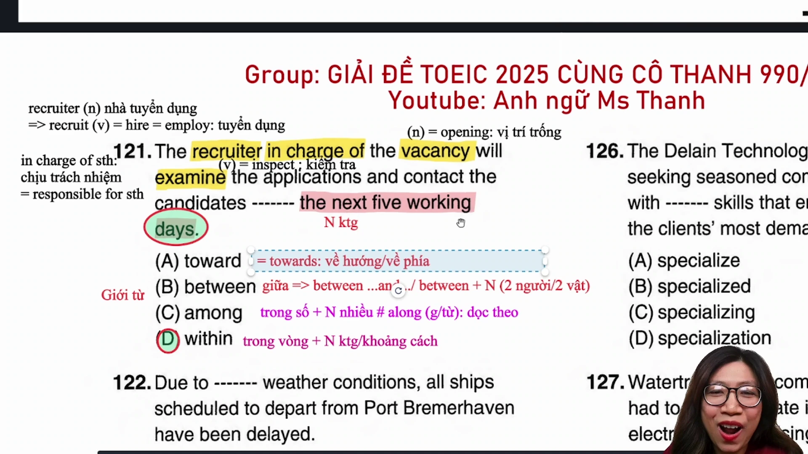

* **Đề bài:** `The recruiter in charge of the vacancy will examine the applications and contact the candidates ------- the next five working days.`
* **Phương án:**
  * (A) toward(s): Giới từ chỉ phương hướng/thái độ (về phía, hướng tới).
  * (B) between: Giới từ chỉ vị trí/mối liên hệ giữa hai đối tượng (`between A and B`).
  * (C) among: Giới từ chỉ vị trí/lựa chọn trong một tập hợp từ ba đối tượng trở lên (`among + N số nhiều`).
  * (D) within: Giới từ chỉ phạm vi thời gian hoặc khoảng cách (trong vòng, trong phạm vi).
* **Phân tích:**
  * Quan sát phía sau chỗ trống: `the next five working days` (năm ngày làm việc tiếp theo). Đây là một khoảng thời gian (period of time).
  * Giới từ dùng để diễn tả một hành động sẽ được hoàn tất trong phạm vi một khoảng thời gian là `within + khoảng thời gian` (`within the next five working days` = trong vòng năm ngày làm việc tới).
  * Loại (A) vì `toward` chỉ hướng chuyển động không gian hoặc thái độ hướng tới ai (`attitude towards employees`), không dùng để chỉ hạn mức hoàn thành công việc.
  * Loại (B) vì `between` bắt buộc phải có hai đối tượng cụ thể đi kèm liên từ `and` (`between Monday and Friday`).
  * Loại (C) vì `among` đòi hỏi danh từ số nhiều chỉ các cá thể hoặc vật thể (`among candidates`), không kết hợp với khoảng thời gian để chỉ hạn mức.
  * Chọn (D).
* **Dịch nghĩa:** Nhà tuyển dụng phụ trách vị trí còn trống sẽ xem xét các hồ sơ ứng tuyển và liên hệ với các ứng viên trong vòng năm ngày làm việc tới.
* **Mở rộng:**
  * `recruiter` (n): Nhà tuyển dụng, chuyên viên tuyển dụng nhân sự.
  * `in charge of` = `responsible for`: Chịu trách nhiệm, phụ trách.
  * `vacancy` (n) = `opening` = `job position`: Vị trí công việc còn trống.
  * `examine` (v) = `inspect` = `review`: Kiểm tra, xem xét kỹ lưỡng.
  * `candidate` (n) = `applicant`: Ứng viên xin việc.
  * `working days` = `business days`: Ngày làm việc (trừ thứ Bảy, Chủ nhật và ngày lễ).

---

### [[41:45](https://youtu.be/yw4xUVGvexQ?t=2505s)] Câu 122

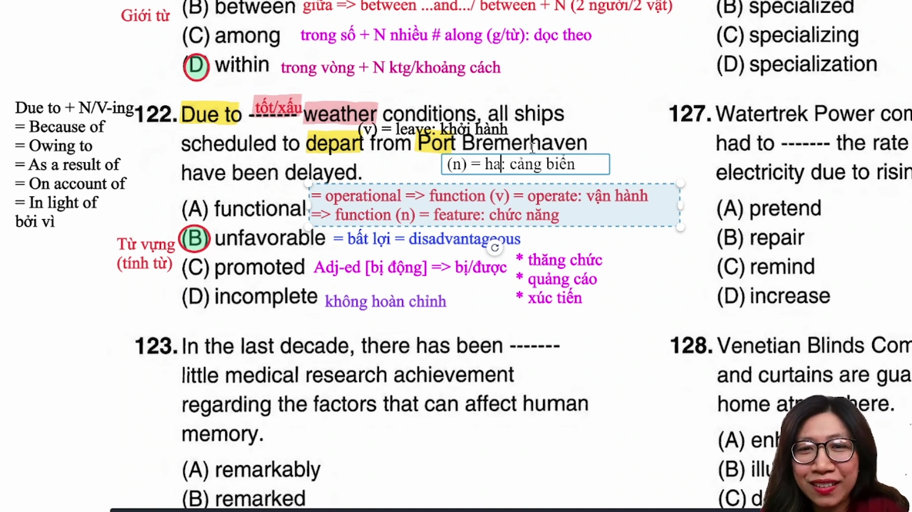

* **Đề bài:** `Due to ------- weather conditions, all ships scheduled to depart from Port Bremerhaven have been delayed.`
* **Phương án:**
  * (A) functional: Tính từ (hoạt động tốt, hữu dụng, mang tính chức năng = operational).
  * (B) unfavorable: Tính từ (bất lợi, không thuận lợi, xấu = disadvantageous / adverse).
  * (C) promoted: Phân từ hai / tính từ (được thăng chức, được quảng bá).
  * (D) incomplete: Tính từ (chưa hoàn thành, còn dang dở, thiếu sót).
* **Phân tích:**
  * Vị trí chỗ trống cần một tính từ bổ nghĩa cho cụm danh từ `weather conditions` (điều kiện thời tiết).
  * Mệnh đề chính phía sau nêu kết quả: `all ships... have been delayed` (tất cả tàu thuyền đã bị hoãn khởi hành).
  * Khi việc khởi hành của phương tiện bị hoãn, nguyên nhân thời tiết phải mang tính chất tiêu cực hoặc bất lợi. Kết hợp từ cố định cực kỳ phổ biến trong đề thi TOEIC là `unfavorable weather conditions` (điều kiện thời tiết bất lợi/xấu).
  * Loại (A) vì `functional` chỉ thiết bị máy móc còn hoạt động bình thường (`functional equipment`).
  * Loại (C) vì `promoted` dùng cho nhân sự được thăng chức (`promoted manager`) hoặc sản phẩm được quảng cáo khuyến mãi.
  * Loại (D) vì `incomplete` dùng cho hồ sơ thủ tục chưa hoàn tất (`incomplete documents`).
  * Chọn (B).
* **Dịch nghĩa:** Do điều kiện thời tiết bất lợi, tất cả các tàu thuyền dự kiến khởi hành từ Cảng Bremerhaven đã bị hoãn.
* **Mở rộng:**
  * Các cụm từ chỉ nguyên nhân đi kèm cụm danh từ: `Due to` = `Because of` = `Owing to` = `On account of` = `As a result of` = `In light of`.
  * `unfavorable` (adj) >< `favorable` (thuận lợi, triển vọng tốt).
  * `scheduled to depart`: Được lên lịch khởi hành (`depart` = `leave`).
  * `port` (n) = `harbor`: Cảng biển.
  * `delay` (v/n) = `postpone` = `put off`: Hoãn lại, trì hoãn.

---

### [[50:03](https://youtu.be/yw4xUVGvexQ?t=3003s)] Câu 123

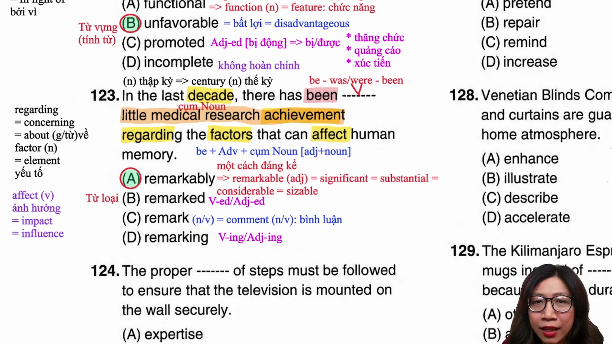

* **Đề bài:** `In the last decade, there has been ------- little medical research achievement regarding the factors that can affect human memory.`
* **Phương án:**
  * (A) remarkably: Trạng từ (đáng kể, rõ rệt, phi thường).
  * (B) remarked: Động từ dạng quá khứ / phân từ hai (đã nhận xét, đã lưu ý).
  * (C) remark: Động từ nguyên mẫu / Danh từ (lời nhận xét, phát biểu).
  * (D) remarking: Hiện tại phân từ / Danh động từ.
* **Phân tích:**
  * Cấu trúc tồn tại: `there has been + Cụm danh từ`.
  * Phía sau chỗ trống là cụm: `little medical research achievement` (rất ít thành tựu nghiên cứu y học). Trong đó `achievement` là danh từ chính, `medical research` là danh từ ghép bổ nghĩa, và `little` là tính từ mang nghĩa phủ định (rất ít, hầu như không có).
  * Để bổ nghĩa cho tính từ `little`, vị trí đứng ngay trước tính từ bắt buộc phải là một TRẠNG TỪ (`Adv + Adj + Noun`).
  * Trạng từ `remarkably` bổ nghĩa cho `little`: `remarkably little` = ít đến mức đáng kinh ngạc, cực kỳ ít.
  * Điểm bẫy tinh vi: Thí sinh thiếu cẩn thận nhìn thấy `has been` (động từ to be) thường vội vàng chọn tính từ hoặc V-ed/V-ing mà không quan sát phía sau đã có sẵn tính từ `little` và danh từ `achievement`. Quy tắc bất biến là phải nhìn cả trước và sau chỗ trống để xác định cấu trúc toàn cụm.
  * Chọn (A).
* **Dịch nghĩa:** Trong thập kỷ qua, có rất ít thành tựu nghiên cứu y học đáng kể liên quan đến các yếu tố có thể ảnh hưởng đến trí nhớ của con người.
* **Mở rộng:**
  * `remarkable` (adj) = `significant` = `substantial` = `considerable`: Đáng kể, nổi bật, phi thường.
  * `regarding` (prep) = `concerning` = `about`: Về, liên quan tới.
  * `affect` (v) = `impact` = `influence`: Tác động, ảnh hưởng đến (danh từ: `effect`).
  * `achievement` (n): Thành tựu, kết quả đạt được (động từ: `achieve`).
  * `decade` (n): Thập kỷ (giai đoạn 10 năm).

---

### [[01:02:12](https://youtu.be/yw4xUVGvexQ?t=3732s)] Câu 124

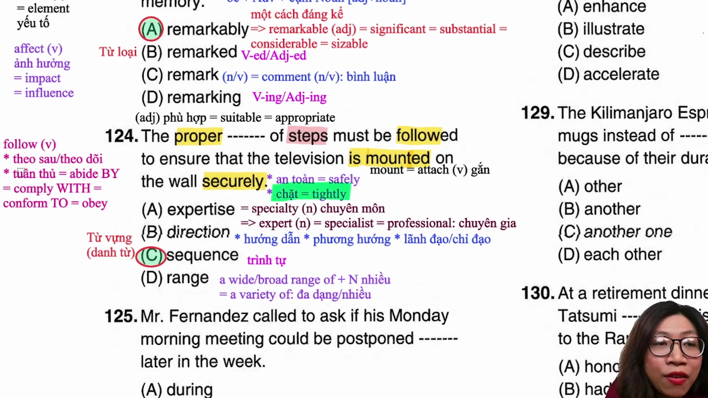

* **Đề bài:** `The proper ------- of steps must be followed to ensure that the television is mounted on the wall securely.`
* **Phương án:**
  * (A) expertise: Danh từ không đếm được (chuyên môn, sự am hiểu sâu rộng).
  * (B) direction: Danh từ (phương hướng, sự chỉ dẫn).
  * (C) sequence: Danh từ (chuỗi, trình tự, thứ tự nối tiếp nhau).
  * (D) range: Danh từ (phạm vi, loạt; thường đi trong cụm `a wide range of + N số nhiều`).
* **Phân tích:**
  * Vị trí chỗ trống là danh từ đứng sau tính từ `proper` (phù hợp, đúng đắn) và đứng trước cụm giới từ `of steps` (của các bước thực hiện). Động từ vị ngữ phía sau là `must be followed` (phải được tuân theo).
  * Khi tiến hành lắp đặt một thiết bị điện tử, người lắp phải tuân thủ đúng trình tự hoặc thứ tự các bước hướng dẫn kỹ thuật. Kết hợp từ chuẩn xác là `sequence of steps` (trình tự các bước).
  * `proper sequence of steps`: Trình tự các bước chuẩn xác/thích hợp.
  * Loại (A) vì `expertise` là kiến thức chuyên môn của con người, không kết hợp với `of steps`.
  * Loại (B) vì `direction` khi dùng với nghĩa chỉ dẫn lắp đặt thường dùng ở số nhiều `directions` (`follow the directions`), không dùng `direction of steps`.
  * Loại (D) vì `range` dùng để chỉ phạm vi đa dạng các chủng loại mặt hàng (`a wide range of products`), không chỉ quy trình từng bước.
  * Chọn (C).
* **Dịch nghĩa:** Trình tự các bước phù hợp phải được tuân theo để đảm bảo rằng chiếc tivi được gắn lên tường một cách chắc chắn.
* **Mở rộng:**
  * `sequence` (n): Trình tự, chuỗi nối tiếp theo thời gian hoặc thứ tự logic.
  * `proper` (adj) = `appropriate` = `suitable`: Phù hợp, đúng đắn.
  * `follow` (v) = `comply with` = `abide by` = `conform to` = `adhere to`: Tuân thủ, nghe theo.
  * `mount` (v) = `attach` = `install`: Gắn, treo cố định lên bề mặt.
  * `securely` (adv): Một cách chắc chắn, an toàn, kiên cố (tính từ: `secure`).

---

### [[01:11:11](https://youtu.be/yw4xUVGvexQ?t=4271s)] Câu 125

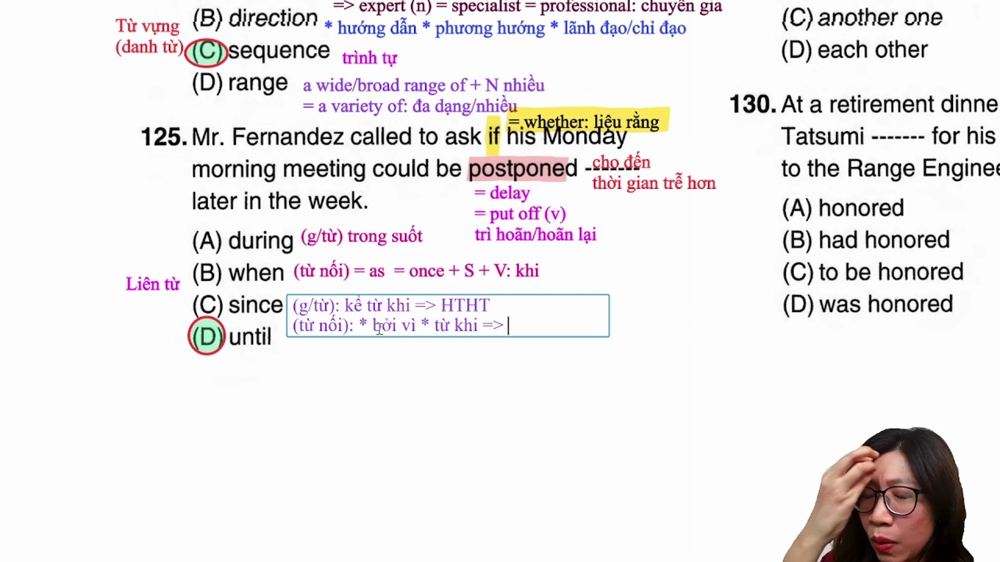

* **Đề bài:** `Mr. Fernandez called to ask if his Monday morning meeting could be postponed ------- later in the week.`
* **Phương án:**
  * (A) during: Giới từ chỉ thời gian (trong suốt một sự kiện: `during the meeting`).
  * (B) when: Liên từ chỉ thời gian (khi nào, vào lúc mà: `when + S + V`).
  * (C) since: Giới từ/liên từ (kể từ khi / bởi vì: thường đi với thì hoàn thành).
  * (D) until: Giới từ/liên từ (cho đến khi, cho tới lúc).
* **Phân tích:**
  * Động từ chính trong mệnh đề phụ là dạng bị động `postponed` (được hoãn lại). Phía sau chỗ trống là cụm từ chỉ mốc thời gian trễ hơn: `later in the week` (vào thời điểm muộn hơn trong tuần).
  * Cấu trúc dời lịch hẹn hoặc hoãn một sự kiện kéo dài đến một thời điểm mới là `postpone / delay / put off sth UNTIL + mốc thời gian` (`postponed until later in the week` = được hoãn lại cho đến cuối tuần / thời điểm muộn hơn trong tuần).
  * Loại (A) vì `during` diễn tả một hành động xảy ra bên trong một khoảng thời gian, không diễn tả ý trì hoãn dời mốc thời gian.
  * Loại (B) vì `when` là liên từ đòi hỏi một mệnh đề có đầy đủ chủ ngữ và vị ngữ (`when + S + V`) theo sau.
  * Loại (C) vì `since` đi với mốc thời gian quá khứ để chỉ điểm khởi đầu của hành động trong thì hiện tại hoàn thành, không dùng cho sự việc dời hẹn đến tương lai.
  * Chọn (D).
* **Dịch nghĩa:** Ông Fernandez đã gọi điện để hỏi liệu cuộc họp sáng thứ Hai của ông có thể được hoãn lại cho đến một thời điểm muộn hơn trong tuần hay không.
* **Mở rộng:**
  * Cụm động từ đồng nghĩa chỉ sự hoãn lại: `postpone` = `delay` = `put off`.
  * Cấu trúc dời lịch: `postpone sth until + mốc thời gian mới`.
  * `if` trong câu gián tiếp = `whether`: Liệu rằng... hay không.
  * `later in the week`: Vào những ngày sau trong tuần.

---

### [[01:20:22](https://youtu.be/yw4xUVGvexQ?t=4822s)] Câu 126

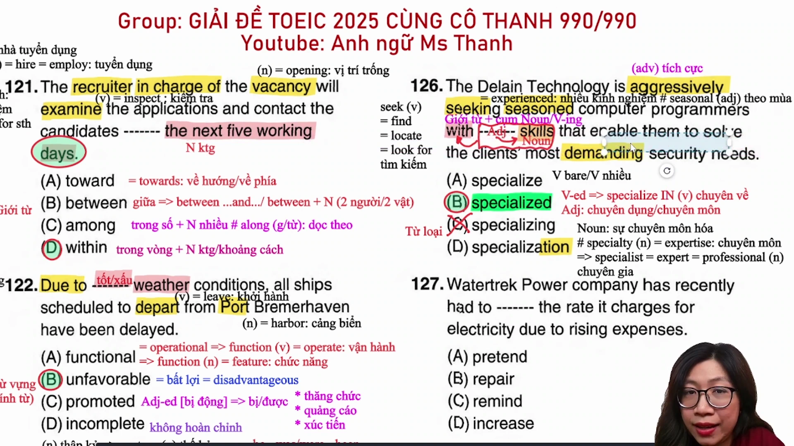

* **Đề bài:** `The Delain Technology is aggressively seeking seasoned computer programmers with ------- skills that enable them to solve the clients' most demanding security needs.`
* **Phương án:**
  * (A) specialize: Động từ nguyên mẫu (chuyên môn hóa, làm chuyên về).
  * (B) specialized: Tính từ / phân từ hai (chuyên dụng, có tính chuyên môn sâu).
  * (C) specializing: Hiện tại phân từ / Danh động từ.
  * (D) specialization: Danh từ (sự chuyên môn hóa, chuyên ngành).
* **Phân tích:**
  * Quan sát phía trước chỗ trống: Giới từ `with` (với).
  * Quan sát phía sau chỗ trống: Danh từ `skills` (các kỹ năng).
  * Cấu trúc sau giới từ là một cụm danh từ hoàn chỉnh: `with + [Tính từ] + skills (Noun)`. Vị trí chỗ trống cần một tính từ bổ nghĩa cho danh từ `skills`.
  * Tính từ dạng quá khứ phân từ `specialized` kết hợp với `skills` tạo thành cụm từ cố định chuẩn xác: `specialized skills` (các kỹ năng chuyên môn sâu / kỹ năng chuyên biệt).
  * Loại (A) vì `specialize` là động từ nguyên mẫu không thể đứng trước danh từ làm bổ ngữ.
  * Loại (D) vì `specialization` là danh từ trừu tượng chỉ ngành học hoặc quá trình chuyên môn hóa, không dùng làm tính từ bổ nghĩa cho `skills`.
  * Phân biệt với (C) `specializing`: Động từ `specialize` thường đi với giới từ `in` ở dạng chủ động (`specializing in security systems`), còn kỹ năng của con người là đối tượng được tôi luyện, mang tính chuyên môn cao nên dùng tính từ `specialized`.
  * Chọn (B).
* **Dịch nghĩa:** Công ty Công nghệ Delain đang ráo riết tìm kiếm những lập trình viên máy tính dày dặn kinh nghiệm với các kỹ năng chuyên môn sâu giúp họ giải quyết các nhu cầu bảo mật khắt khe nhất của khách hàng.
* **Mở rộng:**
  * `aggressively` (adv) = `actively` = `vigorously`: Quyết liệt, ráo riết, tích cực.
  * `seek` (v) = `look for` = `search for`: Tìm kiếm.
  * `seasoned` (adj) = `experienced`: Dày dặn kinh nghiệm (khác với `seasonal`: mang tính mùa vụ).
  * `specialized skills`: Kỹ năng chuyên môn, kỹ năng chuyên sâu.
  * `demanding` (adj) = `exacting` = `challenging`: Khắt khe, đòi hỏi yêu cầu cao.
  * `enable sb to do sth`: Cho phép / tạo điều kiện cho ai làm điều gì.

---

### [[01:29:42](https://youtu.be/yw4xUVGvexQ?t=5382s)] Câu 127

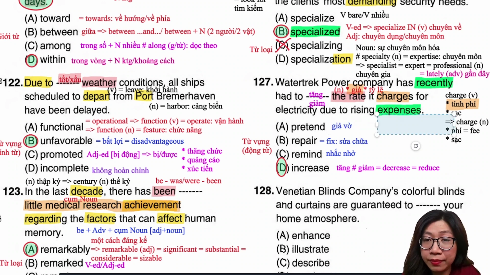

* **Đề bài:** `Watertrek Power company has recently had to ------- the rate it charges for electricity due to rising expenses.`
* **Phương án:**
  * (A) pretend: Động từ (giả vờ, làm ra vẻ).
  * (B) repair: Động từ (sửa chữa = fix / mend).
  * (C) remind: Động từ (nhắc nhở: `remind sb to do sth`).
  * (D) increase: Động từ (tăng lên, nâng cao # decrease / reduce).
* **Phân tích:**
  * Cấu trúc động từ: `had to + V-bare + the rate it charges for electricity` (đã phải làm gì mức cước phí mà công ty thu cho dịch vụ điện).
  * Mệnh đề nguyên nhân: `due to rising expenses` (do các chi phí phát sinh ngày càng tăng cao).
  * Khi chi phí vận hành gia tăng (`rising expenses`), phản ứng tất yếu của doanh nghiệp cung cấp năng lượng là phải TĂNG giá cước dịch vụ (`increase the rate`).
  * Loại (A) vì `pretend` (giả vờ) hoàn toàn vô nghĩa trong văn cảnh điều hành doanh nghiệp.
  * Loại (B) vì `repair` chỉ áp dụng cho việc sửa chữa máy móc hoặc cơ sở vật chất bị hỏng (`repair equipment`), không dùng sửa chữa mức giá tiền.
  * Loại (C) vì `remind` mang nghĩa nhắc nhở ai đó thực hiện việc gì, không dùng với tân ngữ là mức giá cước.
  * Chọn (D).
* **Dịch nghĩa:** Công ty Điện lực Watertrek gần đây đã phải tăng mức cước phí thu cho tiền điện do chi phí phát sinh ngày càng tăng.
* **Mở rộng:**
  * `rate` (n) = `fee` = `price` = `tariff`: Mức giá, mức cước phí.
  * `charge` (v): Thu phí, tính tiền (`charge sb for sth`).
  * `rising expenses` = `increasing costs`: Các khoản chi phí ngày càng gia tăng.
  * Cặp động từ biến động kinh tế: `increase` (tăng) >< `decrease` / `reduce` (giảm).

---

### [[01:33:28](https://youtu.be/yw4xUVGvexQ?t=5609s)] Câu 128

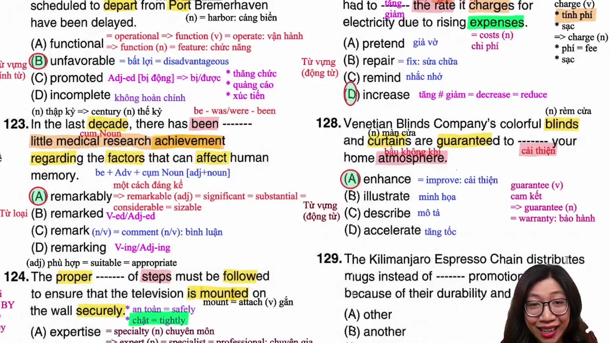

* **Đề bài:** `Venetian Blinds Company's colorful blinds and curtains are guaranteed to ------- your home atmosphere.`
* **Phương án:**
  * (A) enhance: Động từ (nâng cao, tăng cường, cải thiện = improve / elevate / enrich).
  * (B) illustrate: Động từ (minh họa, làm sáng tỏ bằng hình ảnh hoặc ví dụ).
  * (C) describe: Động từ (miêu tả, khắc họa bằng lời).
  * (D) accelerate: Động từ (tăng tốc độ, thúc đẩy tiến độ = speed up).
* **Phân tích:**
  * Chủ ngữ của câu là các sản phẩm nội thất trang trí: `Venetian Blinds Company's colorful blinds and curtains` (màn lá và rèm cửa nhiều màu sắc của Công ty Venetian Blinds).
  * Vị ngữ: `are guaranteed to + V-bare + your home atmosphere` (được bảo đảm sẽ làm gì đối với bầu không khí trong ngôi nhà của bạn).
  * Đồ trang trí nội thất có tính thẩm mỹ cao sẽ giúp làm tôn lên, nâng tầm và làm đẹp thêm không gian sống. Động từ phù hợp nhất về mặt kết hợp từ là `enhance` (`enhance the atmosphere` = nâng tầm/cải thiện bầu không khí).
  * Loại (B) vì `illustrate` dùng trong xuất bản, giảng dạy để minh họa khái niệm (`illustrate a concept`).
  * Loại (C) vì `describe` dùng cho hành động nói hoặc viết nhằm miêu tả đặc điểm đối tượng.
  * Loại (D) vì `accelerate` dùng cho việc tăng tốc độ di chuyển của phương tiện hoặc thúc đẩy tiến độ dự án (`accelerate the process / economic growth`).
  * Chọn (A).
* **Dịch nghĩa:** Những chiếc rèm lá và rèm vải đầy màu sắc của Công ty Venetian Blinds được cam kết sẽ nâng tầm bầu không khí trong ngôi nhà của bạn.
* **Mở rộng:**
  * `blinds` (n): Màn sáo, rèm lá che cửa sổ (bằng nhựa hoặc gỗ xoay lật).
  * `curtains` (n): Rèm vải treo cửa sổ.
  * `enhance` (v) = `improve` = `upgrade`: Nâng cao, tôn lên, gia tăng chất lượng.
  * `atmosphere` (n): Bầu không khí, không gian sống.
  * `guarantee` (v/n) = `warranty`: Bảo đảm, cam kết chất lượng.

---

### [[01:37:34](https://youtu.be/yw4xUVGvexQ?t=5854s)] Câu 129

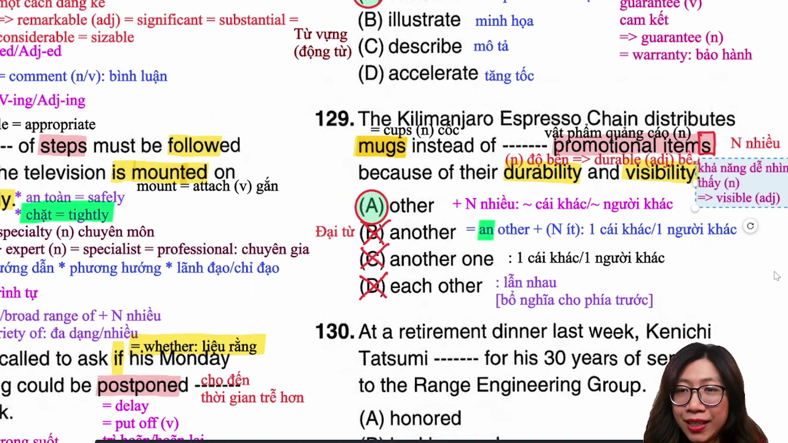

* **Đề bài:** `The Kilimanjaro Espresso Chain distributes mugs instead of ------- promotional items because of their durability and visibility.`
* **Phương án:**
  * (A) other: Tính từ / từ hạn định (những cái khác: đi với danh từ số nhiều hoặc không đếm được).
  * (B) another: Từ hạn định (một cái khác: bắt buộc đi với danh từ đếm được số ít).
  * (C) another one: Đại từ thay thế cho một đối tượng đơn lẻ đã nhắc trước.
  * (D) each other: Đại từ tương hỗ (lẫn nhau: đóng vai trò tân ngữ chỉ hành động qua lại giữa hai bên).
* **Phân tích:**
  * Phía trước chỗ trống là cụm giới từ `instead of` (thay vì).
  * Phía sau chỗ trống là cụm danh từ `promotional items` (các vật phẩm quảng cáo). Danh từ `items` ở dạng số nhiều (có hậu tố `-s`).
  * Áp dụng quy tắc ngữ pháp về lượng từ:
    * `other + Danh từ số nhiều / Danh từ không đếm được`: Những đối tượng khác (`other promotional items`).
    * `another + Danh từ số ít`: Loại (B) vì `items` là số nhiều.
    * `another one` tự nó là một đại từ hoàn chỉnh, không thể đứng trước danh từ số nhiều `promotional items`: Loại (C).
    * `each other` là đại từ tương hỗ làm tân ngữ cho động từ hoặc giới từ (`help each other`), không đứng trước danh từ làm bổ ngữ: Loại (D).
  * Do đó, phương án chính xác duy nhất là (A).
  * Chọn (A).
* **Dịch nghĩa:** Chuỗi cà phê Kilimanjaro Espresso phân phát ly sứ thay vì các vật phẩm quảng bá khác nhờ vào độ bền và khả năng nhận diện cao của chúng.
* **Mở rộng:**
  * Bảng phân biệt hệ thống lượng từ trọng tâm:
    * `other + N số nhiều / N không đếm được`: Những người/vật khác.
    * `another + N số ít`: Một người/vật khác (mang ý nghĩa thêm một đơn vị nữa).
    * `others` = `other + N số nhiều` (đại từ độc lập, không có danh từ theo sau).
    * `the other`: Người/vật còn lại trong hai đối tượng; hoặc những người/vật còn lại trong một nhóm xác định (`the other + N số nhiều`).
  * `durability` (n): Độ bền (tính từ: `durable`).
  * `visibility` (n): Độ nhận diện, khả năng nhìn thấy rõ ràng (tính từ: `visible`).
  * `distribute` (v) = `hand out` = `give out`: Phân phát, phân phối.

---

### [[01:44:16](https://youtu.be/yw4xUVGvexQ?t=6256s)] Câu 130

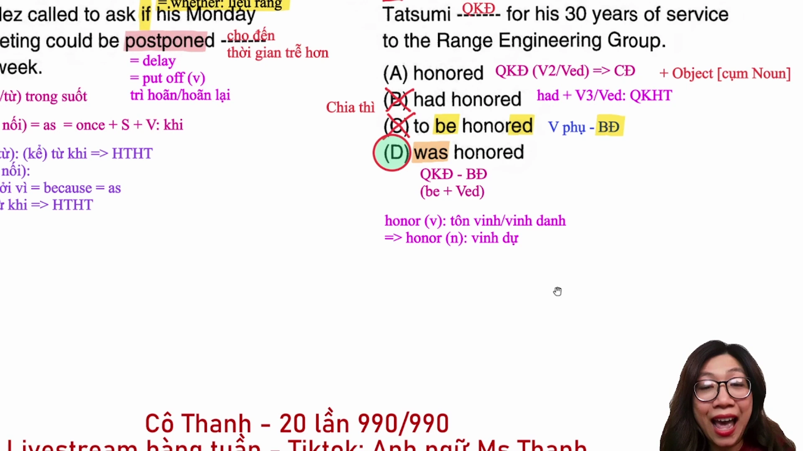

* **Đề bài:** `At a retirement dinner last week, Kenichi Tatsumi ------- for his 30 years of service to the Range Engineering Group.`
* **Phương án:**
  * (A) honored: Động từ thì quá khứ đơn ở thể chủ động (đã vinh danh / đã tôn vinh).
  * (B) had honored: Động từ thì quá khứ hoàn thành ở thể chủ động (đã vinh danh trước một mốc quá khứ).
  * (C) to be honored: Dạng động từ nguyên mẫu có to ở thể bị động (không thể làm động từ vị ngữ chính).
  * (D) was honored: Động từ thì quá khứ đơn ở thể bị động (đã được vinh danh / được tôn vinh).
* **Phân tích:**
  * Xác định thì của câu: Cụm từ chỉ thời gian `last week` (tuần trước) xác định hành động xảy ra và kết thúc trong quá khứ -> động từ vị ngữ chính phải chia ở thì quá khứ đơn (Past Simple).
  * Loại ngay (C) vì `to be honored` là dạng to-infinitive, không thể làm động từ chia thì cho câu.
  * Loại (B) vì thì quá khứ hoàn thành (`had + V3/ed`) chỉ được dùng khi có một hành động khác trong quá khứ làm mốc để xác định hành động nào xảy ra trước. Trong câu chỉ có một mốc thời gian đơn lẻ `last week`.
  * Phân biệt thể Chủ động và Thể bị động giữa (A) và (D):
    * Áp dụng nguyên tắc 90% TOEIC: Ngoại động từ ở thể chủ động bắt buộc phải có một tân ngữ là cụm danh từ theo sau (`honored someone`).
    * Quan sát phía sau chỗ trống là giới từ `for` (`for his 30 years of service`), hoàn toàn không có cụm danh từ làm tân ngữ.
    * Về mặt ngữ nghĩa: Ông Kenichi Tatsumi là người được tôn vinh vì 30 năm cống hiến cho tập đoàn, mang ý nghĩa bị động.
    * Do đó, động từ bắt buộc phải chia ở thể bị động của thì quá khứ đơn: `was honored`.
  * Chọn (D).
* **Dịch nghĩa:** Tại bữa tiệc tối nghỉ hưu vào tuần trước, Kenichi Tatsumi đã được vinh danh vì 30 năm cống hiến cho Tập đoàn Kỹ thuật Range.
* **Mở rộng:**
  * `honor` (v): Tôn vinh, vinh danh; (n): Niềm vinh dự, danh dự.
  * Cấu trúc bị động vinh danh: `be honored for sth` (được tôn vinh vì điều gì).
  * `years of service`: Những năm cống hiến, thời gian công tác tại một đơn vị.
  * `retirement dinner` = `retirement party`: Bữa tiệc mừng nghỉ hưu.
  * Dấu hiệu nhận diện thể bị động nhanh: Sau chỗ trống xuất hiện giới từ và không có tân ngữ danh từ -> ưu tiên chọn dạng bị động `be + V3/ed`.

---

## Trích dẫn then chốt

* [[00:14](https://youtu.be/yw4xUVGvexQ?t=14s)] "Đối với câu về từ loại thì cô dặn là nhìn trước nhìn sau chỗ trống đúng không? Phía sau chỗ trống là giới từ không bao giờ xài cho từ loại, cho nên chúng ta sẽ nhìn vào phía trước."
* [[50:20](https://youtu.be/yw4xUVGvexQ?t=3020s)] "Đối với câu từ loại cô Thanh dặn mình sao? Nhìn trước và nhìn sau chỗ trống... Đừng thấy be mà chọn ngay tính từ, phải nhìn ra phía sau xem cụm danh từ đã có tính từ chưa để chọn trạng từ bổ nghĩa."
* [[01:01:51](https://youtu.be/yw4xUVGvexQ?t=3711s)] "Từ loại chúng ta phải nhìn trước và nhìn sau chỗ trống. Có nghĩa là chúng ta phải đảm bảo thỏa mãn cả hai phía thì mình mới được chọn đáp án."
* [[01:12:37](https://youtu.be/yw4xUVGvexQ?t=4357s)] "Cứ nhớ cho cô cái nguyên tắc hoãn lại cho tới một thời điểm nào đó thì mình sẽ dùng postpone until."
* [[01:42:04](https://youtu.be/yw4xUVGvexQ?t=6124s)] "Cô muốn mình phải đoán ra được cái đáp án chứ không phải câu nào cũng dịch hết thì nó bị uổng thời gian của mình ở Part 5. Đừng bao giờ xài hết quỹ thời gian của mình, mà phải để dư thời gian kiểm tra lại."
* [[01:46:37](https://youtu.be/yw4xUVGvexQ?t=6397s)] "Nguyên tắc này 90% có thể đúng trong đề thi TOEIC: thể chủ động sẽ có một object đứng sau là cụm danh từ. Nếu không có object mà có giới từ, lập tức nghĩ ngay đến bị động."

---

## Lệnh & Công cụ

* **Tân ngữ ngoại động từ:** `S + Ngoại động từ (send / receive / provide) + [Danh từ làm tân ngữ] + Giới từ`
* **Trạng từ thời điểm gần đây:** `S + recently + V-ed / has/have + recently + V3/ed`
* **Mệnh đề quan hệ chỉ người làm chủ ngữ:** `Danh từ chỉ người + who + V vị ngữ + Tân ngữ`
* **Phạm vi thời hạn hiệu lực:** `within + khoảng thời gian` (`within the next five working days`)
* **Thời tiết bất lợi gây đình trệ:** `Due to + unfavorable weather conditions, S + be + delayed / cancelled`
* **Trạng từ bổ nghĩa tính từ trong cụm danh từ:** `there has been + [Trạng từ (-ly)] + [Tính từ] + Danh từ`
* **Quy trình các bước kỹ thuật:** `proper sequence of steps + must be followed`
* **Hoãn lại đến một thời điểm trễ hơn:** `postpone / delay / put off + sth + until + mốc thời gian`
* **Tính từ phân từ chỉ kỹ năng:** `with + specialized skills + that enable...`
* **Tăng mức giá cước do chi phí:** `increase + the rate / price + due to rising expenses`
* **Nâng tầm không gian sống:** `enhance + your home atmosphere / environment`
* **Lượng từ phân phối khác biệt:** `other + Danh từ số nhiều / Danh từ không đếm được`
* **Quy tắc nhận diện thể bị động nhanh:** `S (người/vật) + be + V3/ed + Giới từ (for / by / in) + Cụm danh từ`

---

## Đánh đổi & Rủi ro

* **Bẫy dịch nghĩa toàn câu ở câu từ loại:** Tiêu tốn từ 20 đến 30 giây quý giá để dịch toàn bộ câu 116, 123 hoặc 126, trong khi chỉ cần nhận diện cấu trúc vị trí đứng sau ngoại động từ (`send ------- of -> confirmation`) hoặc vị trí đứng trước tính từ (`------- little achievement -> remarkably`) là có thể chốt đáp án chính xác trong vòng 5 giây.
* **Bẫy nhìn một phía dẫn đến chọn sai từ loại:** Trong câu 123, thí sinh thấy `there has been` liền vội vàng chọn tính từ theo quy tắc sau to be là tính từ, bỏ qua tính từ `little` đã xuất hiện phía sau, dẫn đến việc chọn sai thay vì chọn trạng từ `remarkably` để bổ nghĩa cho tính từ `little`.
* **Bẫy nhầm lẫn lượng từ số ít và số nhiều:** Trong câu 129, thí sinh thấy nghĩa "cái khác" liền chọn ngay `another`, quên mất nguyên tắc ngữ pháp căn bản là `another` bắt buộc đi kèm danh từ số ít, trong khi đề bài cho danh từ số nhiều `items`.
* **Bẫy nhầm lẫn thì hoàn thành và mốc quá khứ đơn:** Trong câu 130, thí sinh nhìn thấy cụm `for his 30 years of service` vội vàng kết luận đây là thì hiện tại hoàn thành hoặc quá khứ hoàn thành (`had honored`), bỏ qua dấu hiệu thời gian tuyệt đối `last week` quyết định thì của câu phải là quá khứ đơn (`was honored`).
* **Bẫy chủ động và bị động khi thiếu tân ngữ:** Chọn thể chủ động `honored` ở câu 130 vì dịch nghĩa theo thói quen mà không kiểm tra xem phía sau có tân ngữ danh từ hay không. Cần khắc ghi quy tắc: không có tân ngữ mà có giới từ thì 90% là thể bị động.
* **Đánh đổi cạn kiệt thời gian cho Part 7:** Lãng phí quá nhiều thời gian dò dẫm ở Part 5 sẽ khiến thí sinh thiếu từ 15 đến 20 phút khi làm Part 7, buộc phải khoanh bừa các đoạn văn kép và đoạn văn ba. Quản lý thời gian dứt khoát tại Part 5 là chìa khóa then chốt để đạt mốc điểm 800-900+.
