# GIẢI ĐỀ TOEIC THÁNG 10/26 [VIDEO 1]

* **Kênh:** Anh ngữ Ms Thanh | **Thời lượng:** 01:35:21 | **Ngày:** 2026-10-07
* **Video:** https://youtu.be/QdBR37h5HGs

---

## Thuật ngữ

| Thuật ngữ | Tiếng Anh | Giải thích |
| :--- | :--- | :--- |
| Giới từ phạm vi thời gian | Preposition of Time Span | Giới từ đi kèm khoảng thời gian để chỉ một hành động hoặc quá trình diễn ra xuyên suốt giai đoạn đó (`over the next few months`). |
| Giới từ tập hợp tuyển chọn | Selective Scope Preposition | Giới từ `Of` đứng trước cụm `the + N số nhiều` để xác lập tập hợp lựa chọn một số lượng cụ thể (`Of the five... only two...`). |
| Trạng từ bổ nghĩa danh động từ | Adverb Modifying Gerund | Trạng từ đứng trước hoặc sau danh động từ (`V-ing`) để xác định cách thức hoặc mức độ của hành động (`carefully weighing`). |
| Danh từ phái sinh đuôi tính từ | Noun with Adjective Suffix | Danh từ có đuôi `-ive` (vốn là hậu tố tính từ phổ biến) nhưng giữ vai trò là danh từ đếm được chỉ sáng kiến (`creative initiatives`). |
| Ngoại động từ đáp ứng nhu cầu | Need Fulfillment Verb | Động từ mang nghĩa đáp ứng, thỏa mãn các tiêu chuẩn hoặc yêu cầu trong quản trị (`meet the healthcare needs`). |
| Động từ phân từ tăng trưởng | Growth Participle Verb | Động từ dạng quá khứ phân từ đi sau trạng từ chỉ quy mô biên độ để miêu tả sự gia tăng số lượng (`have more than doubled`). |
| Cấu trúc câu giả định thức | Subjunctive Mood Structure | Cấu trúc bắt buộc động từ ở mệnh đề sau `that` phải giữ nguyên mẫu không chia sau các động từ chỉ yêu cầu, đề xuất (`requested that staff attend`). |
| Giới từ đi kèm danh từ thông tin | Collocational Information Preposition | Giới từ cố định đi sau danh từ `information` để giới thiệu chủ đề chi tiết được đề cập (`information about travel destinations`). |
| Liên từ chỉ mục đích hành động | Purpose Subordinating Conjunction | Liên từ kết nối mệnh đề yêu cầu với mệnh đề kết quả mong muốn đạt được (`so that we can book`). |
| Trạng từ thời điểm hiện hành | Present Temporal Adverb | Trạng từ đi kèm động từ to be ở thì hiện tại đơn để xác định trạng thái đang diễn ra tức thời (`is currently closed`). |
| Tính từ nguồn gốc hiện tại | Inherent Present Adjective | Tính từ gốc mang đuôi `-ing` miêu tả tính chất tồn tại sẵn có, không phải động từ thêm in (`existing collection`). |
| Trạng từ kỵ giới từ liên kết | Preposition Avoidance Pronoun | Đại từ độc lập không bao giờ đi trực tiếp với giới từ `of` khi đứng trước đại từ quan hệ (`others of which` là lỗi ngữ pháp). |

---

## Tổng luận chuyên đề

### Chiến lược thời gian

Phần thi Part 5 gồm 30 câu hỏi trắc nghiệm kiểm tra ngữ pháp và từ vựng. Để dư từ 8 đến 10 phút kiểm tra lại bài thi Reading, tốc độ xử lý câu hỏi phải được phân cấp khoa học:
* **Nhóm ngữ pháp phản xạ (dưới 5 giây):** Nhận diện cấu trúc cố định mà không cần dịch nghĩa. Khi thấy `information` lập tức chọn giới từ `about`. Thấy `meet the healthcare` lập tức chọn danh từ `needs`. Thấy `is` ở hiện tại đơn và diễn tả sự cố nhà máy lập tức chọn `currently`. Thấy đại từ quan hệ `which` có giới từ `of` phía sau và động từ số nhiều `were`, lập tức loại `others` để chọn `several`.
* **Nhóm cấu trúc phân tích hai phía (5 đến 10 giây):** Thao tác nhìn trước và nhìn sau chỗ trống. Thấy `After` đi với danh động từ `weighing` thì chọn trạng từ `carefully` để bổ nghĩa. Thấy mạo từ `the` đi với danh từ `collection` thì chọn tính từ gốc `existing`. Thấy `are largely` đứng trước `by` thì chốt ngay thể bị động `funded`.
* **Nhóm phân biệt ngữ cảnh chuyên sâu (15 đến 20 giây):** Đọc hiểu ý nghĩa và loại trừ bẫy từ vựng. Phân biệt `Of the five` với bẫy `All` thiếu `of`; phân biệt `initiative` (sáng kiến) với `itinerary` (lịch trình); phân biệt `commended` (khen ngợi) với `commented` (bình luận).

### Bản chất ngữ pháp

* **Cấu trúc giới từ xác lập tập hợp so sánh:** Công thức `Of + the + số lượng / danh từ số nhiều, [số lượng nhỏ hơn] + V...`. Giới từ `Of` ở đầu câu mang ý nghĩa "Trong số tất cả", hoàn toàn khác với nghĩa "của". Tuyệt đối không dùng `All` khi phía sau có mạo từ `the` mà thiếu giới từ `of` (`All of the` mới đúng).
* **Quy tắc câu giả định thức (Subjunctive Mood):** Khi câu xuất hiện các động từ chỉ yêu cầu, đề xuất, kiến nghị (`request`, `require`, `ask`, `suggest`, `recommend`, `demand`), mệnh đề danh từ theo sau bắt buộc dùng liên từ `that` và động từ vị ngữ giữ nguyên dạng nguyên mẫu không to: `S + request + that + S + (should) + V-bare`. Động từ này không chia theo thì hay ngôi của chủ ngữ (`requested that all staff members attend`).
* **Quy tắc kiêng kỵ của lượng từ:**
  * Đại từ `others` mang tính độc lập hoàn toàn, tuyệt đối không bao giờ đi kèm giới từ `of` (`others of which` là lỗi ngữ pháp tuyệt đối).
  * Lượng từ `several` có thể đóng vai trò đại từ và kết hợp tự nhiên với `of`: `several of which + V số nhiều`.
  * Các đại từ bất định kết thúc bằng `-body`, `-one`, `-thing` (`everybody`, `nothing`) luôn được xem là danh từ số ít và đi kèm động từ số ít.
* **Quy tắc thể bị động đi kèm giới từ tác nhân:** Khi vị ngữ có cấu trúc `be + [Trạng từ] + V3/ed + by + Tân ngữ tác nhân`, hành động được thực hiện bởi đối tượng phía sau (`are largely funded by banks`).

### Biến thể từ loại

* **Danh từ có đuôi tính từ:** Từ `initiative` kết thúc bằng hậu tố `-ive` nhưng là một danh từ đếm được chỉ "sáng kiến, đề xuất mới". Cần phân biệt rõ với tính từ `creative` (sáng tạo) đi kèm.
* **Tính từ gốc mang đuôi `-ing`:** Từ `existing` là tính từ độc lập mang nghĩa "hiện có, hiện hành", sinh ra đã là tính từ, không phải động từ `exist` thêm đuôi `-ing` để tạo phân từ bị động.
* **Cặp từ dễ nhầm lẫn về từ loại:**
  * `latest` (tính từ: mới nhất = `newest`) đối lập với `lately` (trạng từ: gần đây = `recently`).
  * `evenly` (trạng từ: đồng đều = `equally`) đối lập với `even` (trạng từ: thậm chí; tính từ: bằng phẳng) và `eventually` (trạng từ: cuối cùng thì = `finally`).
  * `considerate` (tính từ: chu đáo, ân cần = `caring` = `thoughtful`) đối lập với `considerable` (tính từ: đáng kể, to lớn = `significant` = `substantial`).

### Cụm từ then chốt

* **Cụm giới từ và liên từ thời gian:**
  * `over the next few months`: Trong suốt một vài tháng tới.
  * `so that + S + can + V`: Để mà (chỉ mục đích hành động).
  * `since its launch`: Kể từ khi ra mắt sản phẩm.
* **Cụm động từ và kết hợp từ chuyên ngành:**
  * `meet the healthcare needs`: Đáp ứng các nhu cầu chăm sóc sức khỏe.
  * `creative initiatives`: Các sáng kiến mang tính sáng tạo.
  * `double in volume`: Tăng hơn gấp đôi về mặt khối lượng/số lượng.
  * `information about travel destinations`: Thông tin về các điểm đến du lịch.
  * `effective marketing strategies`: Các chiến lược tiếp thị hiệu quả.
  * `track record`: Bề dày thành tích công tác trong quá khứ.
  * `address pollution`: Giải quyết, xử lý vấn đề ô nhiễm.
  * `be opposed to + N/V-ing`: Phản đối, chống lại điều gì.
  * `largely funded by`: Được tài trợ phần lớn bởi.
  * `award-winning bodies`: Các hội đồng, tổ chức trao giải thưởng.

---

## Bóc tách chi tiết

### [[02:28](https://youtu.be/QdBR37h5HGs?t=148s)] Câu 101

* **Đề bài:** `The owner confirmed that the shopping mall's facilities will be upgraded ------- the next few months.`
* **Phương án:**
  * (A) toward: Giới từ chỉ phương hướng/thái độ (về phía, hướng tới).
  * (B) from: Giới từ chỉ điểm khởi đầu thời gian hoặc vị trí (`from + mốc thời gian`).
  * (C) until: Giới từ/liên từ chỉ mốc thời gian kết thúc (`until + mốc thời gian`).
  * (D) over: Giới từ chỉ thời gian hoặc mức độ (`over + khoảng thời gian`: trong suốt, qua).
* **Phân tích:**
  * Quan sát phía sau chỗ trống: Cụm từ `the next few months` (một vài tháng tới). Danh từ `months` có hậu tố `-s` xác định đây là một khoảng thời gian (period of time).
  * Giới từ dùng để diễn tả một hành động hoặc quá trình sẽ diễn ra xuyên suốt một khoảng thời gian là `over + khoảng thời gian` (`over the next few months` = trong suốt vài tháng tới).
  * Giới từ `over` có hai nét nghĩa trọng tâm: (1) Hơn mức số lượng (`over 50%`); (2) Trong suốt khoảng thời gian (`over the past year`, `over the next few months`).
  * Loại (A) vì `toward` chỉ hướng di chuyển không gian hoặc thái độ hướng tới ai (`attitude toward customers`).
  * Loại (B) vì `from` bắt buộc đi kèm mốc thời gian bắt đầu (`from September`, `from Monday`), không đi trực tiếp với khoảng thời gian tương lai đơn lẻ.
  * Loại (C) vì `until` bắt buộc đi kèm mốc thời gian chấm dứt (`until now`, `until next week`).
  * Chọn (D).
* **Dịch nghĩa:** Người chủ sở hữu đã xác nhận rằng các cơ sở vật chất của trung tâm thương mại sẽ được nâng cấp trong suốt một vài tháng tới.
* **Mở rộng:**
  * Phân biệt cặp danh từ kết thúc bằng đuôi `-ity`:
    * `facility` (n): Cơ sở vật chất, cơ sở hạ tầng (thường dùng số nhiều: `facilities`).
    * `amenity` (n): Tiện nghi phục vụ cuộc sống/du lịch (thường dùng số nhiều: `amenities`).
  * `upgrade` (v/n): Nâng cấp, cải tiến chất lượng.
  * `confirm` (v): Xác nhận (danh từ: `confirmation`).

---

### [[07:23](https://youtu.be/QdBR37h5HGs?t=443s)] Câu 102

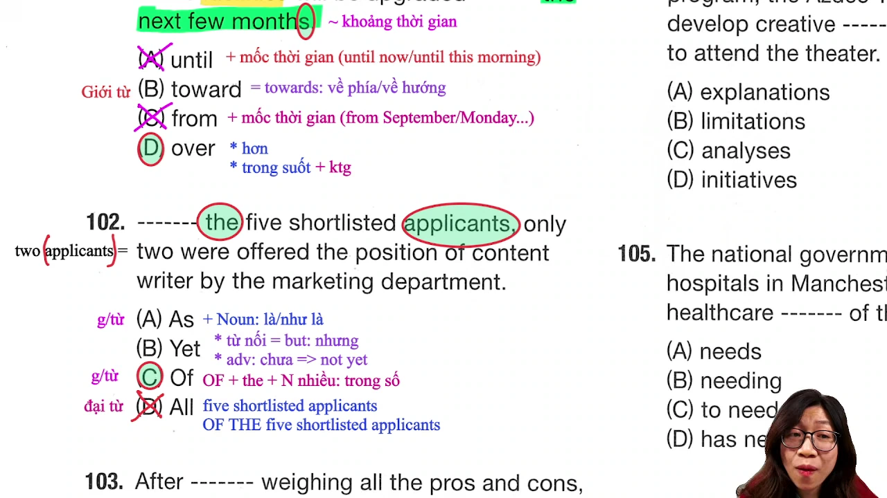

* **Đề bài:** `------- the five shortlisted applicants, only two were invited for the content writer position by the marketing department.`
* **Phương án:**
  * (A) As: Giới từ (với tư cách là) / Liên từ (bởi vì, khi).
  * (B) Yet: Trạng từ (chưa) / Liên từ tương phản (nhưng).
  * (C) Of: Giới từ xác lập tập hợp lựa chọn (trong số).
  * (D) All: Lượng từ (tất cả).
* **Phân tích:**
  * Đây là câu hỏi bẫy rất tinh vi. Thí sinh nhìn thấy `five shortlisted applicants` (danh từ số nhiều) thường vội vàng chọn `All`. Tuy nhiên, ngay sau chỗ trống xuất hiện mạo từ xác định `the`. Cấu trúc của `all` đi với mạo từ bắt buộc phải có `of`: `All of the + N số nhiều` hoặc `All + N số nhiều` (không có the). Vì đề bài có `the` mà thiếu `of`, phương án (D) bị loại ngay lập tức.
  * Quan sát mệnh đề chính phía sau: `only two were invited...` (chỉ có hai người được mời). Cấu trúc ngữ pháp chuẩn để rút ra một số lượng cụ thể từ một tập hợp lớn là: `Of + the + số lượng danh từ số nhiều, [số lượng nhỏ hơn] + V...` (`Of the five... only two...` = Trong số 5 ứng viên... chỉ có 2 người...). Giới từ `Of` đứng trước cụm `the + N số nhiều` mang nghĩa là "Trong số", không mang nghĩa sở hữu "của".
  * Loại (A) vì `As + Danh từ chỉ người` mang nghĩa "với tư cách là". Nếu dùng "Với tư cách là 5 ứng viên" thì mệnh đề chính phía sau phải chỉ toàn bộ 5 người đó, không thể là "chỉ có 2 người" (vi phạm tính tương xứng chủ thể).
  * Loại (B) vì `Yet` không đứng đầu câu làm giới từ chỉ phạm vi tuyển chọn.
  * Chọn (C).
* **Dịch nghĩa:** Trong số năm ứng viên lọt vào danh sách rút gọn, chỉ có hai người được bộ phận tiếp thị mời ứng tuyển vào vị trí biên tập viên nội dung.
* **Mở rộng:**
  * `shortlist` (v): Đưa vào danh sách rút gọn -> `shortlisted applicants`: Các ứng viên lọt vào vòng xét tuyển cuối.
  * `applicant` (n) = `candidate`: Ứng viên xin việc.
  * Đại từ tỉnh lược: `only two` thực chất là `only two applicants` (lược bỏ danh từ để tránh lặp từ đã nêu ở vế trước).
  * `content writer`: Người viết nội dung, biên tập viên nội dung.

---

### [[13:20](https://youtu.be/QdBR37h5HGs?t=800s)] Câu 103

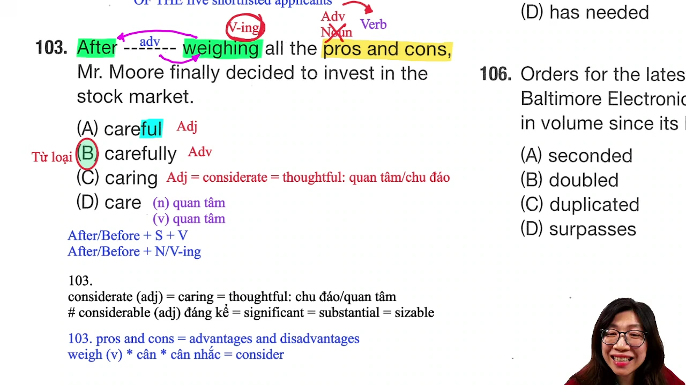

* **Đề bài:** `After ------- weighing the pros and cons, Mr. Moore finally decided to invest in the stock market.`
* **Phương án:**
  * (A) caring: Tính từ (chu đáo, tận tâm = considerate).
  * (B) carefully: Trạng từ (một cách cẩn thận, kỹ lưỡng).
  * (C) careful: Tính từ (cẩn thận).
  * (D) care: Động từ / Danh từ (chăm sóc, sự quan tâm).
* **Phân tích:**
  * Quan sát cấu trúc câu: `After + weighing + the pros and cons...`
  * Liên từ/giới từ `After` đi kèm danh động từ `weighing` (việc cân nhắc). Bản thân `weighing` là một dạng động từ (`V-ing`).
  * Vị trí đứng trước một động từ hoặc danh động từ để bổ nghĩa cách thức, mức độ cho hành động bắt buộc phải là một TRẠNG TỪ (`Adv + V-ing`).
  * Phương án duy nhất là trạng từ trong bốn lựa chọn là `carefully` (`carefully weighing` = cân nhắc một cách cẩn thận).
  * Loại (A) vì `caring` là tính từ mang nghĩa chu đáo, quan tâm (`a caring doctor`).
  * Loại (C) vì `careful` là tính từ, chỉ bổ nghĩa cho danh từ, không bổ nghĩa cho động từ `weighing`.
  * Loại (D) vì `care` là danh từ hoặc động từ nguyên mẫu, không phù hợp vị trí ngữ pháp bổ ngữ.
  * Chọn (B).
* **Dịch nghĩa:** Sau khi cân nhắc cẩn thận tất cả các thuận lợi và bất lợi, ông Moore cuối cùng đã quyết định đầu tư vào thị trường chứng khoán.
* **Mở rộng:**
  * `weigh` (v): Cân trọng lượng; hoặc xem xét, cân nhắc kỹ lưỡng (= `consider`).
  * Cụm từ thành ngữ: `the pros and cons` = `advantages and disadvantages`: Các ưu điểm và nhược điểm, mặt thuận lợi và khó khăn.
  * Phân biệt cặp tính từ phái sinh từ `consider`:
    * `considerate` (adj) = `caring` = `thoughtful`: Chu đáo, ân cần, biết quan tâm tới người khác.
    * `considerable` (adj) = `significant` = `substantial` = `sizable`: Đáng kể, to lớn.
  * `invest in sth`: Đầu tư vào lĩnh vực gì (`stock market`: thị trường chứng khoán).

---

### [[21:21](https://youtu.be/QdBR37h5HGs?t=1281s)] Câu 104

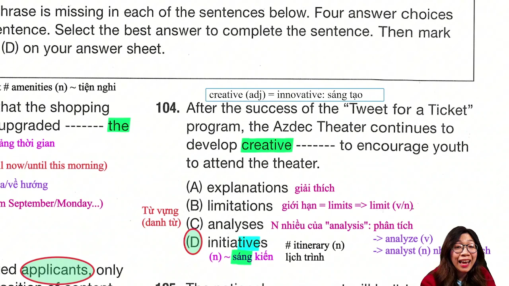

* **Đề bài:** `Following the success of the "Tweet for a Ticket" promotion, the theater continues to develop creative ------- to encourage youth to attend performances.`
* **Phương án:**
  * (A) explanations: Danh từ số nhiều (những lời giải thích).
  * (B) limitations: Danh từ số nhiều (những giới hạn, hạn chế = limits).
  * (C) analyses: Danh từ số nhiều của `analysis` (các phân tích).
  * (D) initiatives: Danh từ số nhiều (những sáng kiến, chương trình khởi xướng mới).
* **Phân tích:**
  * Cả bốn phương án đều là danh từ đứng sau tính từ `creative` (sáng tạo).
  * Ngữ cảnh câu văn: Tiếp nối sự thành công của chương trình khuyến mãi quảng bá, nhà hát tiếp tục phát triển các "sáng kiến sáng tạo" (`creative initiatives`) để khuyến khích giới trẻ đến tham dự các buổi biểu diễn.
  * Kết hợp từ cố định (collocation): `creative initiatives` (những sáng kiến mang tính sáng tạo).
  * Lưu ý đặc biệt về từ loại: Danh từ `initiative` kết thúc bằng đuôi `-ive` (vốn là đuôi phổ biến của tính từ) nhưng lại là DANH TỪ đếm được mang nghĩa sáng kiến.
  * Phân biệt phát âm và nghĩa giữa `initiative` (/ɪˈnɪʃ.ə.tɪv/: sáng kiến) và `itinerary` (/aɪˈtɪn.ər.ər.i/: lịch trình chuyến đi).
  * Loại (A), (B), (C) vì không phù hợp với mục đích phát triển biện pháp thu hút công chúng của nhà hát.
  * Chọn (D).
* **Dịch nghĩa:** Tiếp nối thành công của chương trình quảng bá "Tweet lấy vé", nhà hát tiếp tục phát triển các sáng kiến sáng tạo nhằm khuyến khích thanh thiếu niên đến xem các buổi biểu diễn.
* **Mở rộng:**
  * `creative` (adj) = `innovative`: Mang tính sáng tạo, đổi mới.
  * `encourage sb to do sth`: Khuyến khích ai thực hiện điều gì.
  * `attend performances`: Đi xem các buổi biểu diễn nghệ thuật.
  * Chuyển đổi số ít - số nhiều đặc biệt: `analysis` (danh từ số ít: bản phân tích) -> `analyses` (danh từ số nhiều: các bản phân tích). Động từ: `analyze`; danh từ chỉ người: `analyst` (chuyên viên phân tích).

---

### [[27:08](https://youtu.be/QdBR37h5HGs?t=1628s)] Câu 105

* **Đề bài:** `The national government will build more hospitals to meet the healthcare ------- of the city.`
* **Phương án:**
  * (A) needs: Danh từ số nhiều (các nhu cầu) hoặc động từ ngôi thứ ba số ít (cần).
  * (B) needing: Danh động từ / hiện tại phân từ.
  * (C) to need: Động từ nguyên mẫu có to.
  * (D) has needed: Động từ thì hiện tại hoàn thành.
* **Phân tích:**
  * Quan sát cụm danh từ phía trước: Mạo từ `the` bắt đầu một cụm danh từ và kết thúc trước giới từ `of` (`the healthcare ------- of the city`). Vị trí chỗ trống bắt buộc phải là một DANH TỪ chính của cụm.
  * Từ `need` có hai chức năng từ loại: vừa là động từ (cần), vừa là danh từ (nhu cầu). Ở dạng danh từ số nhiều `needs`, từ này mang nghĩa là "các nhu cầu".
  * Kết hợp từ cố định: `meet the healthcare needs` = đáp ứng các nhu cầu chăm sóc sức khỏe. Động từ `meet` trong ngữ cảnh này mang nghĩa "đáp ứng, thỏa mãn" (= `accommodate` = `satisfy`), không phải nghĩa "gặp gỡ".
  * Loại (B), (C), (D) vì đều là các dạng thức chia thì của động từ, không thể làm danh từ chính trong cụm danh từ bắt đầu bằng mạo từ `the`.
  * Chọn (A).
* **Dịch nghĩa:** Chính phủ quốc gia sẽ xây dựng thêm nhiều bệnh viện để đáp ứng các nhu cầu chăm sóc sức khỏe của thành phố.
* **Mở rộng:**
  * Cụm từ cố định: `meet the needs` = `accommodate the needs`: Đáp ứng các nhu cầu.
  * `national government`: Chính phủ quốc gia, chính quyền trung ương.
  * `healthcare`: Y tế, việc chăm sóc sức khỏe cộng đồng.

---

### [[30:22](https://youtu.be/QdBR37h5HGs?t=1822s)] Câu 106

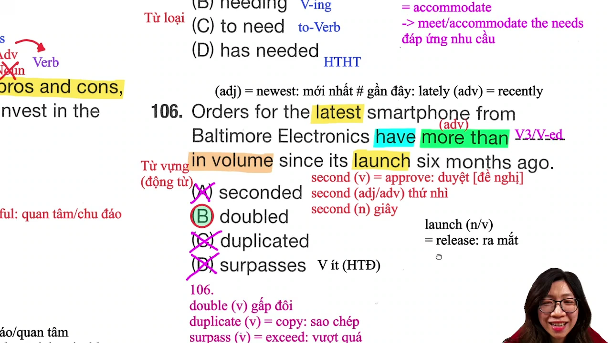

* **Đề bài:** `Orders for the company's latest smartphone have more than ------- in volume since its launch six months ago.`
* **Phương án:**
  * (A) seconded: Động từ dạng V-ed (đã phê duyệt/chấp thuận đề xuất).
  * (B) doubled: Động từ dạng V-ed (đã tăng gấp đôi).
  * (C) duplicated: Động từ dạng V-ed (đã sao chép, nhân bản = copied).
  * (D) surpasses: Động từ chia ở ngôi thứ ba số ít thì hiện tại đơn (vượt quá).
* **Phân tích:**
  * Cấu trúc vị ngữ của câu là thì hiện tại hoàn thành: `have + [Trạng từ: more than] + [V3/ed]`. Trạng từ `more than` đứng kẹp giữa trợ động từ `have` và động từ chính ở dạng quá khứ phân từ.
  * Loại ngay (D) vì `surpasses` là động từ chia ở thì hiện tại đơn (đuôi `-es`), không thể đi sau trợ động từ `have` trong thì hoàn thành.
  * Xét nghĩa kết hợp với cụm `in volume` (về mặt khối lượng/số lượng đơn đặt hàng): Đơn đặt hàng tăng trưởng gấp đôi: `doubled in volume` (tăng hơn gấp đôi về mặt số lượng).
  * Loại (C) vì `duplicate` là sao chép văn bản, tạo bản sao tài liệu (`duplicate a key / document`), không dùng cho số lượng đơn hàng tăng trưởng.
  * Loại (A) vì `second` khi là động từ mang nghĩa phê duyệt hoặc tán thành một đề xuất/kiến nghị (`second a motion`), không mang nghĩa tăng trưởng kinh doanh.
  * Chọn (B).
* **Dịch nghĩa:** Các đơn đặt hàng cho mẫu điện thoại thông minh mới nhất của công ty đã tăng hơn gấp đôi về mặt số lượng kể từ khi ra mắt cách đây sáu tháng.
* **Mở rộng:**
  * Phân biệt cặp từ dễ nhầm lẫn:
    * `latest` (adj) = `newest`: Mới nhất.
    * `lately` (adv) = `recently`: Gần đây.
  - `launch` (v/n) = `release`: Sự ra mắt, đưa sản phẩm mới ra thị trường.
  - `in volume`: Về khối lượng, về quy mô số lượng.
  - `surpass` (v) = `exceed`: Vượt quá, vượt mức kỳ vọng.

---

### [[37:23](https://youtu.be/QdBR37h5HGs?t=2243s)] Câu 107

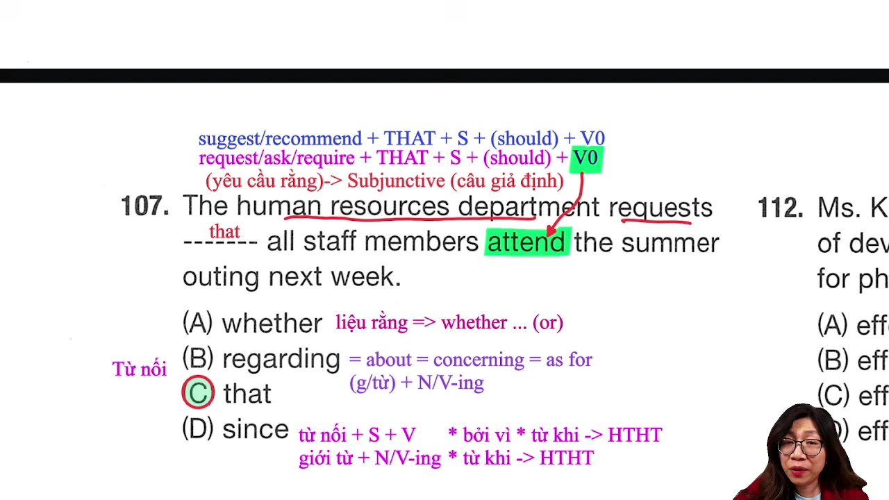

* **Đề bài:** `The human resources department requested ------- all staff members attend the summer outing next week.`
* **Phương án:**
  * (A) whether: Liên từ (liệu rằng: thường đi với `or`).
  * (B) regarding: Giới từ liên kết (về, liên quan tới = about / concerning).
  * (C) that: Liên từ trong cấu trúc giả định thức (`request that...`).
  * (D) since: Liên từ (bởi vì / kể từ khi).
* **Phân tích:**
  * Quan sát động từ mệnh đề trước: `requested` (đã yêu cầu).
  * Quan sát động từ mệnh đề sau: `all staff members attend...`. Động từ `attend` ở dạng nguyên mẫu không chia (V-bare), mặc dù mệnh đề trước ở thì quá khứ đơn `requested`.
  * Đây là dấu hiệu của cấu trúc giả định thức (Subjunctive Mood): Sau các động từ chỉ yêu cầu, đề xuất, khuyến nghị (`request`, `require`, `ask`, `suggest`, `recommend`, `demand`), mệnh đề danh ngữ bắt buộc dùng liên từ `that` và động từ theo sau giữ nguyên mẫu: `S + request + that + S + (should) + V-bare`.
  * Liên từ duy nhất thỏa mãn cấu trúc giả định là `that`.
  * Loại (A) vì `whether` dùng trong câu hỏi gián tiếp thể hiện sự lựa chọn nghi vấn.
  * Loại (B) vì `regarding` là giới từ, sau giới từ là danh từ hoặc V-ing, không đi kèm mệnh đề có động từ nguyên mẫu.
  * Loại (D) vì `since` là liên từ chỉ lý do hoặc thời gian, không chi phối động từ nguyên mẫu `attend`.
  * Chọn (C).
* **Dịch nghĩa:** Phòng nhân sự đã yêu cầu rằng tất cả các thành viên nhân viên phải tham gia buổi dã ngoại mùa hè vào tuần tới.
* **Mở rộng:**
  * Cấu trúc câu giả định thức trọng tâm: `S + recommend / suggest / request / require / demand + that + S + (should) + V-bare`.
  * `summer outing`: Chuyến dã ngoại mùa hè của cơ quan.
  * `human resources department` = `HR department`: Phòng nhân sự.

---

### [[43:01](https://youtu.be/QdBR37h5HGs?t=2581s)] Câu 108

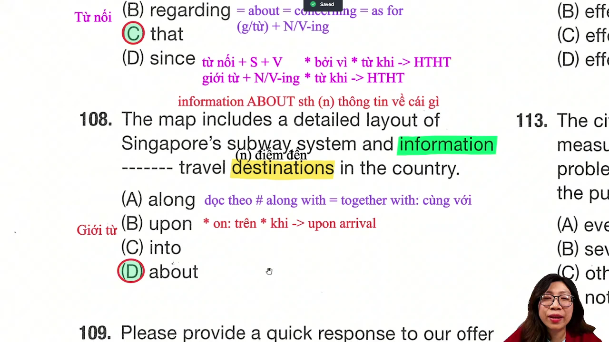

* **Đề bài:** `The map includes a detailed layout of Singapore's subway system and information ------- travel destinations in the country.`
* **Phương án:**
  * (A) along: Giới từ (dọc theo).
  * (B) upon: Giới từ (ngay khi = on / when / upon arrival).
  * (C) during: Giới từ (trong suốt một sự kiện/khoảng thời gian).
  * (D) about: Giới từ (về, liên quan tới).
* **Phân tích:**
  * Quan sát danh từ đứng ngay trước chỗ trống: `information` (thông tin).
  * Cụm từ cố định chuẩn mực trong tiếng Anh là `information about something` (thông tin về điều gì).
  * Phía sau chỗ trống là cụm danh từ `travel destinations in the country` (các điểm đến du lịch trong nước) -> `information about travel destinations` = thông tin về các địa điểm du lịch.
  * Loại (A) vì `along` dùng cho vị trí di chuyển dọc theo con đường, bờ sông (`along the street`). Phân biệt `along` với `along with` (cùng với = `together with`).
  * Loại (B) vì `upon` dùng cho hành động diễn ra ngay lập tức (`upon arrival` = ngay khi vừa tới nơi).
  * Loại (C) vì `during` đi với danh từ chỉ sự kiện hoặc khoảng thời gian (`during the conference`), không kết hợp trực tiếp với danh từ địa điểm.
  * Chọn (D).
* **Dịch nghĩa:** Bản đồ bao gồm sơ đồ chi tiết của hệ thống tàu điện ngầm Singapore và thông tin về các điểm đến du lịch tại quốc gia này.
* **Mở rộng:**
  * Kết hợp từ cố định: `information about sth`: Thông tin về điều gì.
  * `layout` (n): Bản vẽ bố cục, sơ đồ mặt bằng chi tiết.
  * `subway system`: Hệ thống tàu điện ngầm.
  * `destination` (n): Điểm đến (khác với `location`: vị trí, địa điểm tọa lạc).

---

### [[46:45](https://youtu.be/QdBR37h5HGs?t=2805s)] Câu 109

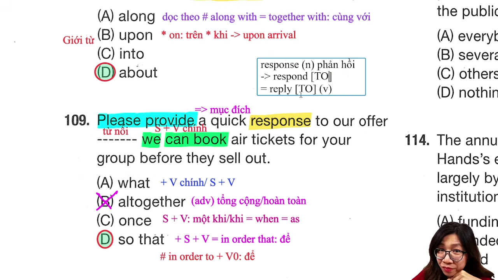

* **Đề bài:** `Please provide a quick response to our offer ------- we can book air tickets for your group before they sell out.`
* **Phương án:**
  * (A) altogether: Trạng từ (tổng cộng, hoàn toàn).
  * (B) what: Đại từ quan hệ / nghi vấn (điều mà, cái gì).
  * (C) once: Liên từ (một khi, ngay khi = when / as soon as).
  * (D) so that: Liên từ chỉ mục đích (để mà = in order that).
* **Phân tích:**
  * Phía sau chỗ trống là một mệnh đề hoàn chỉnh: `we (S) + can book (V) + air tickets (O)...`.
  * Vị trí chỗ trống cần một LIÊN TỪ để kết nối mệnh đề yêu cầu ở trước (`Please provide...`) với mệnh đề chỉ mục đích ở sau.
  * Loại ngay (A) vì `altogether` là trạng từ mang nghĩa "hoàn toàn / tổng cộng", không có chức năng liên từ nối hai mệnh đề.
  * Xét mối quan hệ ý nghĩa: "Vui lòng đưa ra phản hồi nhanh chóng đối với lời đề nghị của chúng tôi ĐỂ MÀ chúng tôi có thể đặt vé máy bay cho đoàn của bạn trước khi hết vé". Liên từ chỉ mục đích hành động là `so that + S + can + V` (= `in order that`).
  * Loại (B) vì `what` làm chủ ngữ hoặc tân ngữ mệnh đề danh từ, không diễn tả ý nghĩa mục đích.
  * Loại (C) vì `once` mang nghĩa "một khi/ngay khi", không thể hiện mục đích giải thích lý do cần phản hồi nhanh.
  * Chọn (D).
* **Dịch nghĩa:** Vui lòng đưa ra phản hồi nhanh chóng đối với lời đề nghị của chúng tôi để chúng tôi có thể đặt vé máy bay cho đoàn của bạn trước khi vé được bán hết.
* **Mở rộng:**
  * Liên từ chỉ mục đích: `so that` = `in order that` (+ Mệnh đề). Phân biệt với `in order to` / `so as to` (+ Động từ nguyên mẫu).
  * `respond to` (v) -> `response to` (n): Sự phản hồi, câu trả lời đối với điều gì.
  * `sell out` (phrasal verb): Bán hết sạch vé hoặc hàng hóa.

---

### [[52:09](https://youtu.be/QdBR37h5HGs?t=3129s)] Câu 110

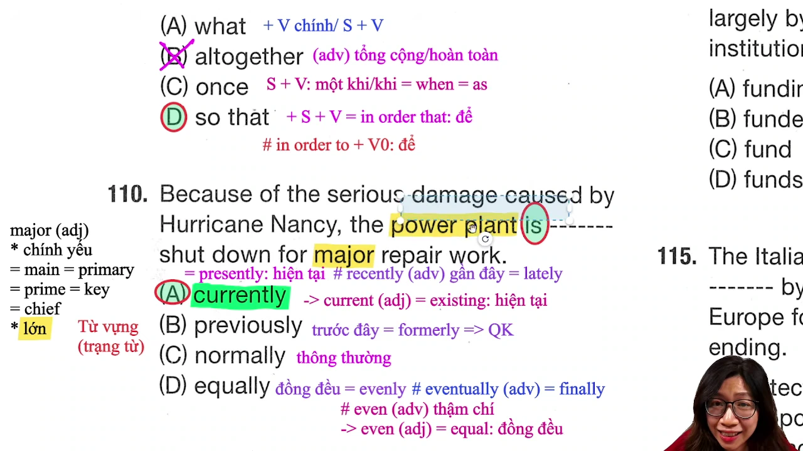

* **Đề bài:** `Due to the severe damage caused by storm Nancy, the power plant is ------- closed for major repair work.`
* **Phương án:**
  * (A) currently: Trạng từ (hiện tại, hiện nay = presently / existing).
  * (B) previously: Trạng từ (trước đây, trước kia = formerly).
  * (C) normally: Trạng từ (thông thường, như thường lệ).
  * (D) equally: Trạng từ (đồng đều, ngang bằng = evenly).
* **Phân tích:**
  * Quan sát động từ to be: `is` (thì hiện tại đơn).
  * Mệnh đề nguyên nhân: `Due to the severe damage...` (Do thiệt hại nghiêm trọng gây ra bởi cơn bão).
  * Ngữ cảnh thực tế: Nhà máy điện HIỆN TẠI đang bị đóng cửa để thực hiện công tác sửa chữa lớn. Trạng từ tương ứng với thì hiện tại đơn `is closed` là `currently` (`is currently closed` = hiện đang đóng cửa).
  * Loại (B) vì `previously` (trước đây) chỉ sự việc trong quá khứ, đi kèm thì quá khứ đơn (`was previously closed`).
  * Loại (C) vì việc đóng cửa do bão là tình huống bất khả kháng, không thể dùng `normally` (thông thường).
  * Loại (D) vì `equally` mang nghĩa đồng đều, không phù hợp bổ nghĩa cho trạng thái đóng cửa của nhà máy.
  * Chọn (A).
* **Dịch nghĩa:** Do thiệt hại nặng nề gây ra bởi cơn bão Nancy, nhà máy điện hiện đang bị đóng cửa để phục vụ công tác sửa chữa lớn.
* **Mở rộng:**
  * Các trạng từ chỉ thời điểm hiện tại: `currently` = `presently` = `at present`.
  * Phân biệt cặp từ dễ nhầm lẫn:
    * `evenly` (adv) = `equally`: Phân bổ đồng đều.
    * `even` (adv: thậm chí; adj: bằng phẳng).
    * `eventually` (adv) = `finally`: Rốt cuộc, cuối cùng thì.
  * Các nghĩa then chốt của `major`:
    * Nghĩa 1: Quy mô lớn (`major repair work` = công việc sửa chữa lớn).
    * Nghĩa 2: Chính yếu, chủ đạo (= `main` = `primary` = `key` = `chief`).
  * `power plant`: Nhà máy phát điện.

---

### [[59:08](https://youtu.be/QdBR37h5HGs?t=3548s)] Câu 111

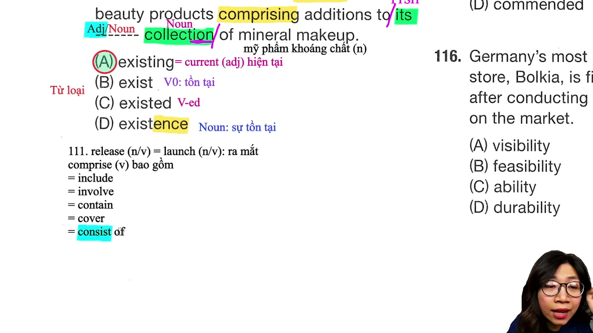

* **Đề bài:** `The cosmetics company will release new beauty items, comprising additions to its ------- collection of mineral makeup products.`
* **Phương án:**
  * (A) existing: Tính từ (hiện có, hiện hành = current).
  * (B) existed: Động từ dạng V-ed (đã tồn tại).
  * (C) exist: Động từ nguyên mẫu (tồn tại).
  * (D) existence: Danh từ (sự tồn tại).
* **Phân tích:**
  * Quan sát cấu trúc cụm danh từ: `to its [Tính từ sở hữu] + ------- + collection [Danh từ chính] of...`.
  * Vị trí đứng kẹp giữa tính từ sở hữu `its` và danh từ chính `collection` bắt buộc phải là một TÍNH TỪ bổ nghĩa cho danh từ.
  * Từ `existing` là tính từ độc lập mang nghĩa "hiện có, hiện tại" (`existing collection` = bộ sưu tập hiện có). Đây là một từ vựng quen thuộc xuất hiện thường xuyên trong đề thi TOEIC.
  * Loại (C) vì `exist` là động từ nguyên mẫu.
  * Loại (D) vì `existence` là danh từ (đuôi `-ence`), không đứng trước danh từ `collection` làm tính từ bổ nghĩa trong ngữ cảnh này.
  * Loại (B) vì động từ `exist` là nội động từ (intransitive verb), không có dạng quá khứ phân từ mang nghĩa bị động `existed`.
  * Chọn (A).
* **Dịch nghĩa:** Công ty mỹ phẩm sẽ ra mắt các sản phẩm làm đẹp mới, bao gồm các sản phẩm bổ sung vào bộ sưu tập mỹ phẩm khoáng chất hiện có của mình.
* **Mở rộng:**
  * `existing` (adj) = `current` = `present`: Hiện có, hiện nay.
  * `release` (v/n) = `launch`: Ra mắt sản phẩm.
  * `comprise` (v) = `include` = `contain` = `cover` = `consist of`: Bao gồm.
  * `mineral makeup`: Mỹ phẩm khoáng chất, sản phẩm trang điểm từ khoáng tự nhiên.

---

### [[01:04:57](https://youtu.be/QdBR37h5HGs?t=3897s)] Câu 112

* **Đề bài:** `Mr. Kennedy has a successful track record of developing ------- marketing strategies for pharmaceutical companies.`
* **Phương án:**
  * (A) effect: Danh từ (tác động, hiệu quả) / Động từ (đem lại).
  * (B) effected: Động từ dạng V-ed.
  * (C) effectively: Trạng từ (một cách hiệu quả).
  * (D) effective: Tính từ (hiệu quả, có hiệu lực).
* **Phân tích:**
  * Quan sát cấu trúc phía sau: `marketing strategies` là cụm danh từ ghép làm tân ngữ cho danh động từ `developing`.
  * Vị trí đứng trước cụm danh từ để bổ nghĩa tính chất cho danh từ chính `strategies` bắt buộc phải là một TÍNH TỪ (`Tính từ + Cụm danh từ`).
  * Hậu tố tính từ: Đuôi `-ive` trong `effective`. Thí sinh có thể áp dụng mẹo bỏ đuôi `-ly` từ trạng từ `effectively` để tìm ra tính từ gốc `effective`.
  * `effective marketing strategies`: Các chiến lược tiếp thị hiệu quả.
  * Loại (A) vì `effect` là danh từ.
  * Loại (C) vì `effectively` là trạng từ, chỉ bổ nghĩa cho động từ hoặc tính từ, không đứng trước cụm danh từ làm bổ ngữ cho danh từ.
  * Chọn (D).
* **Dịch nghĩa:** Ông Kennedy có bề dày thành tích xuất sắc trong việc phát triển các chiến lược tiếp thị hiệu quả cho các công ty dược phẩm.
* **Mở rộng:**
  * Cụm từ cố định: `track record`: Bề dày thành tích công tác trong quá khứ.
  * Hai nét nghĩa của tính từ `effective`:
    * Nghĩa 1: Hiệu quả (= `efficient` = `productive`).
    * Nghĩa 2: Có hiệu lực thi hành (`effective from next month`). Phân biệt với `valid` (có hiệu lực pháp lý).
  * `pharmaceutical companies`: Các công ty sản xuất dược phẩm/thuốc.

---

### [[01:13:12](https://youtu.be/QdBR37h5HGs?t=4392s)] Câu 113

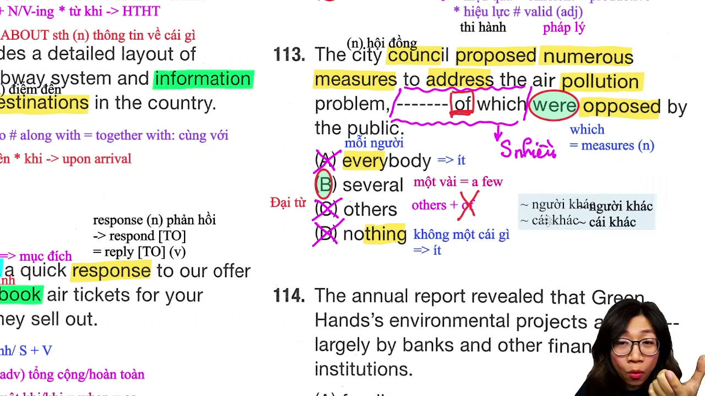

* **Đề bài:** `The city council proposed numerous measures to address pollution, ------- of which were opposed by local residents.`
* **Phương án:**
  * (A) everybody: Đại từ bất định (mỗi người: số ít).
  * (B) several: Đại từ / lượng từ (một vài: số nhiều).
  * (C) others: Đại từ số nhiều (những người/vật khác: không đi với `of`).
  * (D) nothing: Đại từ bất định (không có gì: số ít).
* **Phân tích:**
  * Quan sát động từ trong mệnh đề quan hệ: `were opposed` (chia ở số nhiều). Do đó, chủ ngữ đứng trước bắt buộc phải là một đại từ biểu thị số nhiều.
  * Loại ngay (A) và (D) vì các đại từ kết thúc bằng `-body`, `-one`, `-thing` (`everybody`, `nothing`) luôn được xem là số ít và chia động từ số ít.
  * Giữa (B) `several` và (C) `others`:
    * Quy tắc ngữ pháp nghiêm ngặt trong TOEIC: Đại từ `others` không bao giờ đi trực tiếp với giới từ `of` (`others of which` là cấu trúc sai).
    * Ngược lại, đại từ lượng từ `several` hoàn toàn kết hợp tự nhiên với `of`: `several of which were opposed...` (một vài biện pháp trong số đó đã bị phản đối...).
  * Chọn (B).
* **Dịch nghĩa:** Hội đồng thành phố đã đề xuất nhiều biện pháp nhằm giải quyết tình trạng ô nhiễm, một vài biện pháp trong số đó đã bị người dân địa phương phản đối.
* **Mở rộng:**
  * `city council`: Hội đồng thành phố.
  * `numerous` (adj) = `multiple` = `ample` = `many`: Nhiều, đông đảo.
  * `measure` (n) = `method` = `step`: Biện pháp, giải pháp (khác với động từ `measure`: đo lường).
  * `address` (v) = `handle` = `deal with` = `process`: Giải quyết, xử lý vấn đề.
  * `pollution` (n) = `contamination`: Sự ô nhiễm môi trường.
  * Cấu trúc cố định: `be opposed to + N/V-ing`: Phản đối điều gì.

---

### [[01:24:42](https://youtu.be/QdBR37h5HGs?t=5082s)] Câu 114

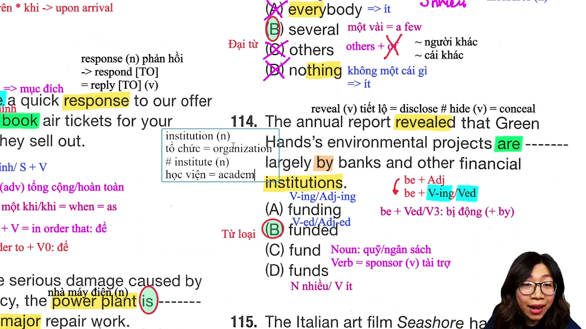

* **Đề bài:** `The annual report revealed that the company's environmental projects are largely ------- by banks and other financial institutions.`
* **Phương án:**
  * (A) funding: Danh động từ / hiện tại phân từ.
  * (B) funded: Quá khứ phân từ / V-ed (được tài trợ vốn).
  * (C) to fund: Động từ nguyên mẫu có to.
  * (D) funds: Danh từ số nhiều (các quỹ) / Động từ số ít (tài trợ).
* **Phân tích:**
  * Quan sát cấu trúc vị ngữ: `are [to be] + largely [Trạng từ] + ------- + by [Giới từ]...`.
  * Động từ to be `are` kết hợp với giới từ `by` chỉ tác nhân ở phía sau (`by banks and other financial institutions`) là công thức đặc trưng của THỂ BỊ ĐỘNG (`be + V3/ed + by`).
  * Động từ `fund` mang nghĩa là cấp kinh phí, tài trợ vốn. Các dự án môi trường được tài trợ vốn bởi các ngân hàng -> bắt buộc dùng thể bị động `funded`.
  * Loại (A) vì `funding` là thể chủ động, đòi hỏi tân ngữ trực tiếp đứng trước `by`.
  * Loại (C) vì `to fund` không tạo thành thì vị ngữ bị động.
  * Loại (D) vì `funds` là danh từ hoặc động từ chia thì hiện tại, không ghép sau `are largely`.
  * Chọn (B).
* **Dịch nghĩa:** Báo cáo thường niên tiết lộ rằng các dự án môi trường của công ty phần lớn được tài trợ bởi các ngân hàng và các tổ chức tài chính khác.
* **Mở rộng:**
  * `fund` (v) = `finance` = `sponsor`: Tài trợ kinh phí, cấp vốn; (n): Quỹ tiền tệ.
  * Phân biệt cặp từ dễ nhầm lẫn:
    * `institution` (n) = `organization`: Tổ chức, định chế (`financial institutions`: các tổ chức tài chính).
    * `institute` (n) = `academy`: Học viện nghiên cứu/đào tạo.
  * Cặp từ trái nghĩa quan trọng:
    * `reveal` (v) = `disclose`: Tiết lộ, công bố.
    * `conceal` (v) = `hide`: Che giấu, giấu kín.

---

### [[01:30:49](https://youtu.be/QdBR37h5HGs?t=5449s)] Câu 115

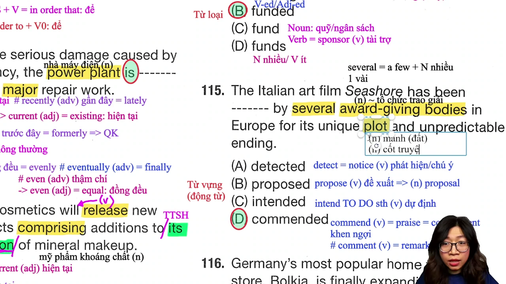

* **Đề bài:** `The Italian art film "Sentieri" was ------- by several European award-winning bodies for its unique plot and unpredictable ending.`
* **Phương án:**
  * (A) detected: Động từ dạng V-ed (đã phát hiện = noticed / discovered).
  * (B) proposed: Động từ dạng V-ed (đã đề xuất = suggested).
  * (C) intended: Động từ dạng V-ed (có dự định: `intend to do sth`).
  * (D) commended: Động từ dạng V-ed (được khen ngợi, ca ngợi = praised / complimented).
* **Phân tích:**
  * Bốn phương án đều là động từ dạng quá khứ phân từ ở thể bị động: `was ------- by several European award-winning bodies...` (đã được... bởi một vài tổ chức trao giải ở Châu Âu vì cốt truyện độc đáo và cái kết khó đoán).
  * Khi một tác phẩm điện ảnh xuất sắc được các hội đồng trao giải thưởng đánh giá cao, hành động tương ứng là ĐƯỢC CA NGỢI, KHEN NGỢI (`commended`).
  * Phân biệt phát âm và ngữ nghĩa cực kỳ quan trọng trong TOEIC:
    * `commend` (v) = `praise` = `compliment`: Khen ngợi, ca ngợi, biểu dương.
    * `comment` (v/n) = `remark`: Bình luận, đưa ra nhận xét.
  * Loại (A) vì `detect` là phát hiện lỗi sai, bệnh tật hoặc dấu vết (`detect mistakes`).
  * Loại (B) vì `propose` là đề xuất dự án/kế hoạch kinh doanh (`propose a proposal`).
  * Loại (C) vì `intend` đi kèm cấu trúc `intend to do sth` (dự định làm gì).
  * Chọn (D).
* **Dịch nghĩa:** Bộ phim nghệ thuật Ý "Sentieri" đã được một vài tổ chức trao giải ở Châu Âu khen ngợi vì cốt truyện độc đáo và cái kết khó đoán.
* **Mở rộng:**
  * `commend` (v) = `praise` = `compliment`: Khen ngợi, tôn vinh.
  * `plot` (n): Cốt truyện (trong phim/tiểu thuyết); hoặc mảnh đất (`a plot of land`).
  * `unpredictable` (adj): Khó đoán, không thể dự đoán trước được (động từ: `predict`).
  * `award-winning bodies`: Các tổ chức, hội đồng trao giải thưởng.

---

## Trích dẫn then chốt

* [[02:35](https://youtu.be/QdBR37h5HGs?t=155s)] "Part 5 cô làm nhanh, Part 6 cũng có cách cô làm nhanh và Part 7 cô cũng có cách làm nhanh luôn... gom lại thì khi đi thi mình mới dư từ 8 đến 10 phút để kiểm tra lại bài."
* [[05:14](https://youtu.be/QdBR37h5HGs?t=314s)] "Khi mình hiểu được lý do tại sao phương án bị loại mà không dính dáng tới dịch nghĩa, lúc đó mình mới thực sự vượt qua được những câu bẫy của TOEIC."
* [[10:14](https://youtu.be/QdBR37h5HGs?t=614s)] "Những câu đề mình thấy càng dễ là càng bẫy, không bao giờ bài thi Reading nó dễ đến mức tặng điểm cho mình đâu."
* [[53:15](https://youtu.be/QdBR37h5HGs?t=3195s)] "Học một chữ với cô Thanh là mở rộng ra tới bảy tám chữ khác... mở rộng tới tận cùng tất cả những bẫy người ta có thể cho ra thì điểm chắc chắn sẽ cao."
* [[01:05:04](https://youtu.be/QdBR37h5HGs?t=3904s)] "Xu hướng đề thi hiện tại đang thiên về ngữ pháp rất nhiều. Bạn nào vững ngữ pháp thì sẽ có lợi thế thời gian cực lớn ở Part 5 để dồn sức cho Part 6 và Part 7."
* [[01:17:15](https://youtu.be/QdBR37h5HGs?t=4635s)] "Có những câu không cần phải dịch nghĩa một miếng nào, nắm chắc nguyên tắc kiêng kỵ và vị trí ngữ pháp là 5 giây nhìn ra đáp án ngay."

---

## Lệnh & Công cụ

* **Giới từ đi với khoảng thời gian:** `over + the next few months / weeks / years` (= trong suốt)
* **Giới từ xác lập tập hợp lựa chọn:** `Of + the + số lượng danh từ số nhiều, [số lượng nhỏ hơn] + V...`
* **Trạng từ bổ nghĩa cho danh động từ:** `After / Before + [Trạng từ] + V-ing + Tân ngữ`
* **Danh từ có đuôi tính từ:** `creative + initiatives` (sáng kiến sáng tạo)
* **Động từ đáp ứng tiêu chuẩn:** `meet / accommodate / satisfy + the needs / requirements`
* **Động từ tăng trưởng phân từ:** `have more than + doubled / tripled + in volume`
* **Cấu trúc câu giả định thức:** `S + request / require / suggest + that + S + (should) + V-bare`
* **Giới từ đi kèm danh từ thông tin:** `information + about + danh từ chủ đề`
* **Liên từ chỉ mục đích:** `Mệnh đề yêu cầu + so that + S + can + V nguyên mẫu`
* **Trạng từ hiện hành đi với to be:** `S + is / are + currently + V3/ed`
* **Tính từ gốc hiện có:** `its + existing + collection / system`
* **Tính từ bổ nghĩa cụm danh từ tiếp thị:** `developing + effective + marketing strategies`
* **Đại từ lượng từ đi với of:** `several + of which + were opposed` (tuyệt đối không dùng `others of which`)
* **Thể bị động đi kèm tác nhân:** `be + largely / fully + funded / sponsored + by + tổ chức tài trợ`
* **Động từ khen ngợi thành tích nghệ thuật:** `be + commended / praised + for + unique plot`

---

## Đánh đổi & Rủi ro

* **Bẫy dịch nghĩa từng chữ ở câu ngữ pháp:** Dành 20 đến 30 giây để dịch toàn bộ câu 101, 103, 108 hay 113 sẽ làm cạn kiệt quỹ thời gian làm bài, trong khi chỉ cần nhận diện cấu trúc vị trí và kết hợp từ là có thể chốt đáp án trong 5 giây.
* **Bẫy lượng từ All đi kèm mạo từ The:** Trong câu 102, thí sinh thấy danh từ số nhiều `applicants` vội vàng chọn `All` mà quên mất rằng cấu trúc bắt buộc phải có `of` (`All of the`) mới được đi với mạo từ `the`. Khi không có `of`, giới từ duy nhất đúng để xác lập tập hợp là `Of the five...`.
* **Bẫy giả định thức chia thì theo chủ ngữ:** Trong câu 107, thấy chủ ngữ số nhiều `staff members` hoặc mệnh đề chính ở quá khứ `requested`, thí sinh chưa nắm vững thể giả định thường chia động từ ở quá khứ `attended` thay vì giữ nguyên mẫu `attend`.
* **Bẫy nhầm lẫn đại từ Others đi với giới từ Of:** Trong câu 113, thí sinh thấy nghĩa "những cái khác" liền chọn `others` mà không biết rằng `others` kỵ giới từ `of` tuyệt đối (`others of which` là lỗi ngữ pháp).
* **Bẫy phát âm dẫn đến chọn sai từ vựng:** Nhầm lẫn `commend` (khen ngợi) với `comment` (bình luận), hoặc nhầm lẫn `initiative` (sáng kiến) với `itinerary` (lịch trình).
* **Đánh đổi tốc độ lấy chiều sâu phân tích:** Học vẹt chỉ ghi nhớ đáp án A, B, C, D sẽ thất bại khi đề thi đổi ngữ cảnh. Ngược lại, nắm chắc bản chất loại trừ phương án sai và hệ thống từ đồng nghĩa mở rộng là con đường an toàn nhất để đạt mốc 800-900+ điểm TOEIC.
