# GIẢI ĐỀ TOEIC THÁNG 10/26 [VIDEO 2]

* **Kênh:** Anh ngữ Ms Thanh | **Thời lượng:** 01:34:08 | **Ngày:** 2026-10-08
* **Video:** https://youtu.be/AeQMXm0ivuM

---

## Thuật ngữ

| Thuật ngữ | Tiếng Anh | Giải thích |
| :--- | :--- | :--- |
| Nghiên cứu khả thi | Feasibility study | Bản phân tích đánh giá toàn diện khả năng thành công và tính khả thi của một dự án kinh doanh trước khi đầu tư. |
| Mệnh đề quan hệ rút gọn | Reduced Relative Clause | Kỹ thuật giản lược đại từ quan hệ và to be, giữ lại V-ing (chủ động), V3/Ved (bị động) hoặc tính từ. |
| Danh động từ mang tân ngữ | Gerund with Object | Dạng động từ thêm đuôi -ing đứng sau giới từ và nhận trực tiếp một danh từ làm tân ngữ phía sau. |
| Đảo ngữ câu điều kiện | Inversion of Conditional | Cấu trúc đưa Had lên đầu câu thay thế cho If trong mệnh đề điều kiện loại 3 (Had + S + V3/ed). |
| Thông tin phụ kẹp phẩy | Parenthetical Information | Cụm từ hoặc trạng từ đứng giữa hai dấu phẩy bổ nghĩa cho toàn bộ cụm danh từ hoặc mệnh đề phía sau. |
| Sự thâu tóm sáp nhập | Acquisition | Hành động một doanh nghiệp mua lại toàn bộ hoặc phần lớn cổ phần của doanh nghiệp khác để giành quyền kiểm soát. |
| Trạng từ bổ nghĩa | Sentence Adverb | Trạng từ đứng độc lập hoặc kẹp giữa hai dấu phẩy bổ nghĩa cho cả một cụm danh từ hoặc toàn thể phát biểu. |
| Tiêu chuẩn đủ điều kiện | Eligibility | Điều kiện, tiêu chuẩn pháp lý hoặc năng lực cần có để được quyền tham gia hoặc thụ hưởng một chính sách. |

---

## Tổng luận chuyên đề

### Chiến thuật làm bài

Phần thi Part 5 gồm 30 câu hỏi (từ câu 101 đến câu 130). Video 2 tập trung giải quyết 15 câu cuối cùng (từ câu 116 đến câu 130), đây là phân đoạn có độ phân hóa cao nhất với nhiều bẫy điểm 800+ và 900+:
* **Phân loại dạng câu hỏi:**
  * *Câu ngữ pháp và từ loại (chiếm 60%):* Không dịch nguyên văn cả câu. Quan sát vị trí trước và sau chỗ trống để xác định từ loại còn thiếu (danh từ, tính từ, trạng từ hay động từ chính).
  * *Câu từ vựng (chiếm 40%):* Dịch nghĩa dựa trên các cụm từ cố định (`collocations`), trường từ vựng chuyên ngành kinh tế và sự kết hợp từ (`word combinations`).
* **Quy tắc phản xạ 5 giây:** Nhận diện ngay dấu hiệu chia thì, cấu trúc đảo ngữ hoặc các giới từ đi kèm để loại trừ phương án sai chớp nhoáng mà không tiêu tốn thời gian đọc hiểu lan man.

### Các bẫy kinh điển

* **Bẫy đại từ Whoever và Anyone:** Thí sinh thường dịch thô cả hai từ là "bất kỳ ai" nên dễ chọn sai. Bản chất ngữ pháp: `Whoever` là đại từ liên hệ bắt buộc đi kèm động từ chia thì hoàn chỉnh (`Whoever + V chia thì`), trong khi `Anyone` đi kèm mệnh đề quan hệ rút gọn (`Anyone desiring...`).
* **Bẫy từ loại sau giới từ:** Khi đứng sau giới từ có trạng từ bổ nghĩa (`after potentially -------`), đa phần thí sinh vội vàng chọn danh từ đuôi `-tion` (`suspension`). Tuy nhiên, nếu phía sau chỗ trống còn có một danh từ làm tân ngữ trực tiếp (`operations`), bắt buộc phải chọn danh động từ `V-ing` (`sustaining`).
* **Bẫy rút gọn liên từ thời gian:** Sau liên từ thời gian (`When`, `While`), nếu câu không có chủ ngữ thì không bao giờ được chọn động từ chia thì (`was inactive`, `is inactive`). Toàn bộ chủ ngữ và to be đã bị giản lược, chỉ còn lại tính từ nguyên bản (`inactive`).
* **Bẫy đảo ngữ điều kiện loại 3:** Câu bắt đầu bằng trợ động từ `Had` đứng đầu câu và kết thúc bằng dấu chấm khẳng định là dạng đảo ngữ thay cho `If`. Vế chính bắt buộc phải tuân theo công thức `would/could have + V3/ed`.

### Bộ từ vựng cốt lõi

* **Họ từ đáng kể / to lớn:** `significant` = `substantial` = `considerable` = `sizable` = `dramatic`.
* **Họ từ đạt được / thâu tóm:** `acquire` = `obtain` = `gain` = `secure` = `accomplish` = `achieve`.
* **Họ từ thực hiện / tiến hành:** `conduct` = `carry out` = `implement` = `perform` = `execute`.
* **Họ từ ngon miệng / xuất sắc:** `delectable` = `delicious` = `exquisite`.
* **Họ từ ngoại trừ / bên cạnh:** `aside from` = `apart from` = `except for` = `other than`.

---

## Bóc tách chi tiết

### [[00:00](https://youtu.be/AeQMXm0ivuM?t=0s)] Câu 116

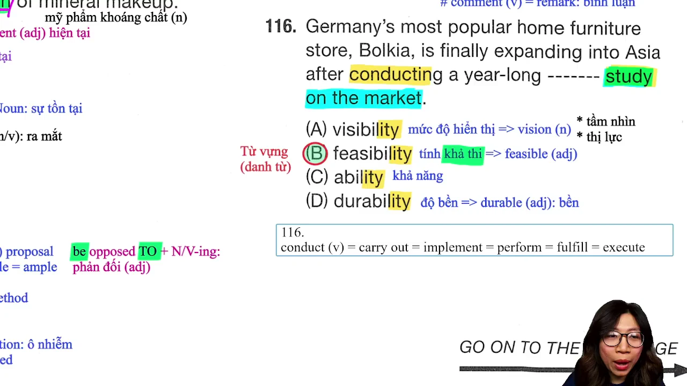

* **Đề bài:** `Germany’s most popular home furniture store, Bolkia, is finally expanding into Asia after conducting a year-long ------- study on the market.`
* **Phương án:**
  * (A) `visibility`: Mức độ hiển thị, tầm nhìn quang học.
  * (B) `feasibility`: Tính khả thi (chọn B: feasibility study).
  * (C) `ability`: Khả năng, năng lực của cá nhân.
  * (D) `durability`: Độ bền của vật liệu, độ bền cơ học.
* **Phân tích:** 
  * Cả 4 đáp án đều có đuôi danh từ `-ity`. Đây là câu hỏi kiểm tra từ vựng danh từ chuyên ngành quản trị kinh doanh.
  * Cụm từ cố định kinh điển trong TOEIC: `feasibility study` mang nghĩa "nghiên cứu tính khả thi". Khi một tập đoàn mở rộng thị trường ra châu lục mới (`expanding into Asia`), họ bắt buộc phải tiến hành khảo sát tính khả thi kéo dài một năm.
  * Phương án (A) `visibility` sai ngữ cảnh kinh doanh. Phương án (C) `ability` chỉ năng lực làm việc của con người, không ghép với study. Phương án (D) `durability` chỉ độ bền của đồ gỗ/vật liệu, không dùng cho khảo sát thị trường.
* **Dịch nghĩa:** Chuỗi cửa hàng nội thất gia đình nổi tiếng nhất nước Đức, Bolkia, cuối cùng cũng đang mở rộng sang châu Á sau khi tiến hành một cuộc nghiên cứu tính khả thi kéo dài một năm trên thị trường.
* **Mở rộng:**
  * `conduct` = `carry out` = `implement` = `perform` = `execute`: Tiến hành, thực hiện nghiên cứu/dự án.
  * `expand into`: Mở rộng sang khu vực/thị trường mới.

---

### [[06:11](https://youtu.be/AeQMXm0ivuM?t=371s)] Câu 117

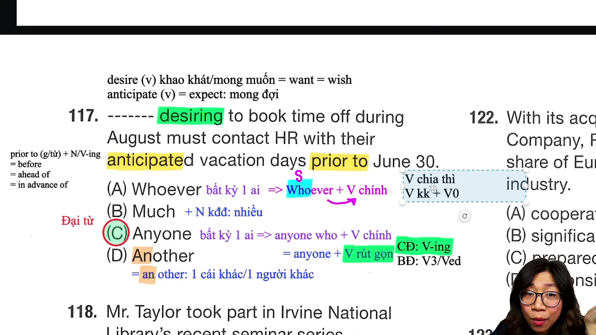

* **Đề bài:** `------- desiring to book time off during August must contact HR with their anticipated vacation days prior to June 30.`
* **Phương án:**
  * (A) `Whoever`: Bất kỳ ai (bắt buộc cộng động từ chia thì phía sau).
  * (B) `Much`: Nhiều (đi với danh từ không đếm được).
  * (C) `Anyone`: Bất kỳ ai (chọn C: Anyone desiring).
  * (D) `Another`: Một người khác / cái khác (đi với danh từ số ít).
* **Phân tích:**
  * Đây là câu kiểm tra đại từ kết hợp mệnh đề quan hệ rút gọn.
  * Phía sau chỗ trống là dạng phân từ chủ động `desiring` (mong muốn). Cấu trúc gốc của câu là: `Anyone who desires...` được rút gọn thành `Anyone desiring...`.
  * Bẫy cực kỳ nguy hiểm: Thí sinh hay chọn (A) `Whoever` vì dịch nghĩa "bất kỳ ai" thấy hợp lý. Tuy nhiên, quy tắc bất biến là `Whoever + V chia thì hoàn chỉnh` (ví dụ `Whoever desires`), tuyệt đối không đi với phân từ rút gọn `V-ing`.
  * Phương án (B) `Much` sai vì động từ chỉ hành động xin nghỉ phép của con người. Phương án (D) `Another` chỉ một cá thể đơn lẻ không xác định. Chọn (C).
* **Dịch nghĩa:** Bất kỳ ai mong muốn đặt lịch nghỉ phép trong suốt tháng Tám phải liên hệ với phòng Nhân sự kèm theo số ngày nghỉ dự kiến trước ngày 30 tháng Sáu.
* **Mở rộng:**
  * `desire (v)` = `want` = `wish`: Khao khát, mong muốn.
  * `anticipate (v)` = `expect`: Dự kiến, mong đợi trước.
  * `prior to` = `before` = `ahead of` = `in advance of`: Trước một mốc thời gian.

---

### [[13:53](https://youtu.be/AeQMXm0ivuM?t=833s)] Câu 118

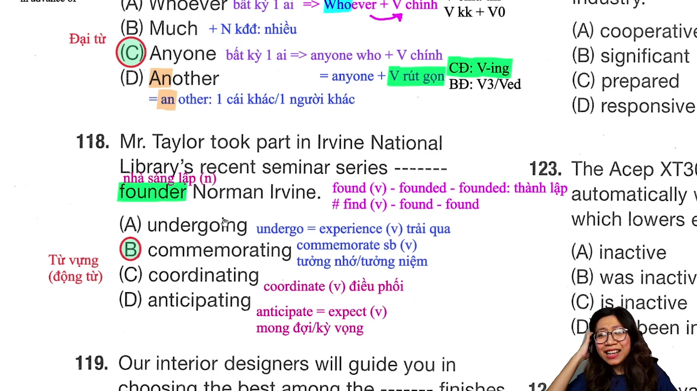

* **Đề bài:** `Mr. Taylor took part in Irvine National Library’s recent seminar series ------- the history of printing.`
* **Phương án:**
  * (A) `undergoing`: Trải qua (chịu đựng khó khăn, kiểm tra, phẫu thuật).
  * (B) `exploring`: Khám phá, tìm hiểu sâu (chọn B).
  * (C) `retaining`: Giữ lại, duy trì.
  * (D) `compiling`: Biên soạn (tài liệu, số liệu).
* **Phân tích:**
  * Câu kiểm tra từ vựng động từ ở dạng phân từ rút gọn bổ nghĩa cho chuỗi hội thảo (`seminar series`).
  * Danh từ phía sau là `the history of printing` (lịch sử ngành in ấn). Trong ngữ cảnh giáo dục và thư viện, một chuỗi hội thảo chuyên đề chỉ có thể là "tìm hiểu, khám phá lịch sử in ấn" (`exploring the history`).
  * Động từ `undergo` đồng nghĩa với `experience` nhưng dùng cho quá trình gian nan, cải tổ hoặc điều trị y tế (`undergo surgery/maintenance`). Chọn (B).
* **Dịch nghĩa:** Ông Taylor đã tham gia vào chuỗi hội thảo gần đây của Thư viện Quốc gia Irvine nhằm tìm hiểu về lịch sử của ngành in ấn.
* **Mở rộng:**
  * `take part in` = `participate in` = `join`: Tham gia vào.
  * `seminar series`: Chuỗi hội thảo chuyên đề.

---

### [[19:55](https://youtu.be/AeQMXm0ivuM?t=1195s)] Câu 119

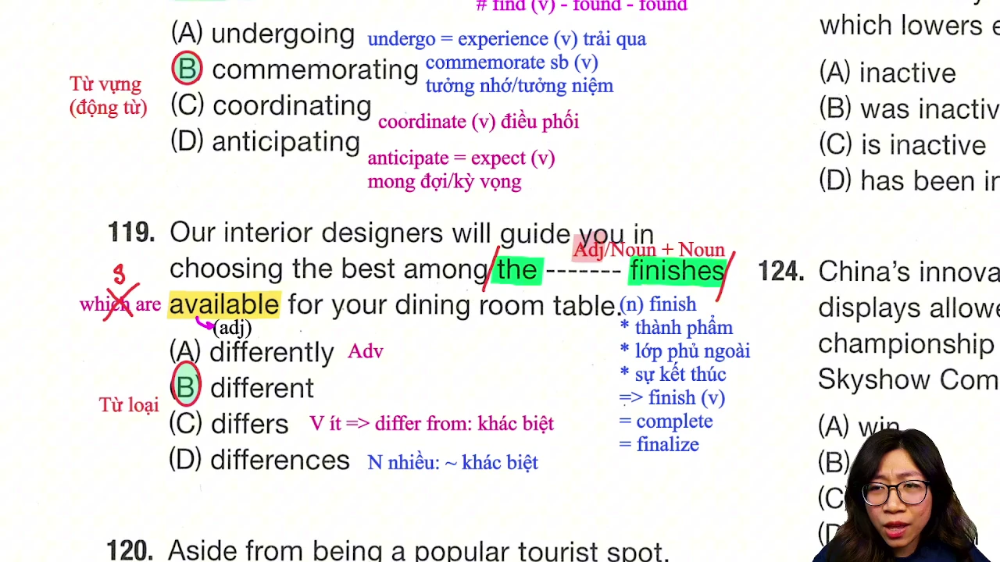

* **Đề bài:** `Our interior designers will guide you in choosing the best among the ------- finishes available for your dining room table.`
* **Phương án:**
  * (A) `differ`: Động từ nguyên mẫu.
  * (B) `different`: Tính từ (chọn B).
  * (C) `differs`: Động từ số ít chia ở thì hiện tại đơn.
  * (D) `differences`: Danh từ số nhiều.
* **Phân tích:**
  * Câu hỏi từ loại kinh điển. Quan sát trước chỗ trống có mạo từ `the` và sau chỗ trống có danh từ số nhiều `finishes` (các thành phẩm, các lớp hoàn thiện).
  * Quy tắc từ loại: Đứng trước danh từ để bổ nghĩa cho danh từ bắt buộc phải là một tính từ. Phương án duy nhất có đuôi tính từ `-ent` là (B) `different`.
  * Từ `available` phía sau là tính từ còn sót lại của mệnh đề rút gọn `that are available`.
* **Dịch nghĩa:** Các nhà thiết kế nội thất của chúng tôi sẽ hướng dẫn bạn trong việc lựa chọn lớp hoàn thiện tốt nhất trong số các thành phẩm khác nhau có sẵn cho chiếc bàn ăn của bạn.
* **Mở rộng:**
  * `interior designer`: Nhà thiết kế nội thất.
  * `differ from (v)`: Khác biệt so với cái gì.
  * `differences (n)`: Những điểm khác biệt.

---

### [[26:28](https://youtu.be/AeQMXm0ivuM?t=1588s)] Câu 120

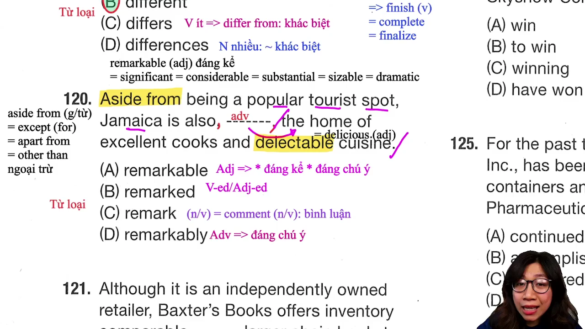

* **Đề bài:** `Aside from being a popular tourist spot, Jamaica is also, -------, the home of excellent cooks and delectable cuisine.`
* **Phương án:**
  * (A) `remarkable`: Tính từ.
  * (B) `remarked`: Động từ dạng quá khứ hoặc phân từ.
  * (C) `remark`: Động từ nguyên mẫu hoặc danh từ.
  * (D) `remarkably`: Trạng từ (chọn D).
* **Phân tích:**
  * Chỗ trống nằm chính giữa hai dấu phẩy `, -------,`. Đây là vị trí của thành phần thông tin phụ (`parenthetical element`).
  * Phía sau dấu phẩy là cụm danh từ hoàn chỉnh `the home of excellent cooks and delectable cuisine`. Để bổ nghĩa cho cả một cụm danh từ hoặc phát biểu đứng sau, bắt buộc phải dùng trạng từ có đuôi `-ly`.
  * Phương án (D) `remarkably` đóng vai trò trạng từ liên kết, mang nghĩa "một cách đáng chú ý". Chọn (D).
* **Dịch nghĩa:** Bên cạnh việc là một địa điểm du lịch nổi tiếng, Jamaica cũng, một cách đáng chú ý, là quê hương của những đầu bếp xuất sắc và nền ẩm thực thơm ngon tuyệt hảo.
* **Mở rộng:**
  * `aside from` = `apart from` = `except for` = `other than`: Ngoại trừ, bên cạnh.
  * `delectable (adj)` = `delicious`: Ngon miệng, thơm ngon.
  * `cuisine (n)`: Nền ẩm thực (phát âm chuẩn: `/kwɪˈziːn/`).
  * Chuỗi từ đồng nghĩa với `remarkable` (đáng kể): `significant`, `considerable`, `substantial`, `sizable`, `dramatic`.

---

### [[33:41](https://youtu.be/AeQMXm0ivuM?t=2021s)] Câu 121

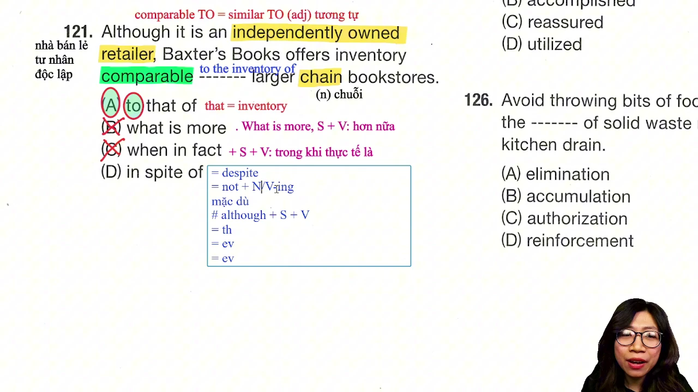

* **Đề bài:** `As an independently owned bookstore, Reader’s Books offers inventory comparable ------- larger chain bookstores.`
* **Phương án:**
  * (A) `to that of`: Cụm đại từ chỉ định thay thế kèm giới từ (chọn A).
  * (B) `what is more`: Hơn nữa, ngoài ra (trạng từ liên kết).
  * (C) `in addition`: Thêm vào đó (cần có to nếu đi với tân ngữ).
  * (D) `such that`: Đến mức mà.
* **Phân tích:**
  * Quan sát tính từ `comparable` đứng ngay trước chỗ trống. Trong ngữ pháp tiếng Anh chuẩn, tính từ `comparable` bắt buộc đi với giới từ `TO` tạo thành cụm `comparable to` (có thể so sánh với, tương đương với).
  * Trong 4 phương án, chỉ duy nhất phương án (A) chứa giới từ `to`. Đại từ `that` đại diện cho danh từ `inventory` (hàng tồn kho / danh mục sách) được nhắc đến phía trước để tránh lỗi lặp từ trong câu so sánh. Chọn (A).
* **Dịch nghĩa:** Là một hiệu sách sở hữu độc lập, Reader’s Books cung cấp danh mục sách phong phú tương đương với danh mục của các chuỗi nhà sách lớn hơn.
* **Mở rộng:**
  * `comparable TO`: Tương đương với, so sánh được với.
  * `similar TO`: Tương tự như.
  * `chain bookstore`: Chuỗi cửa hàng sách quy mô lớn.

---

### [[39:25](https://youtu.be/AeQMXm0ivuM?t=2365s)] Câu 122

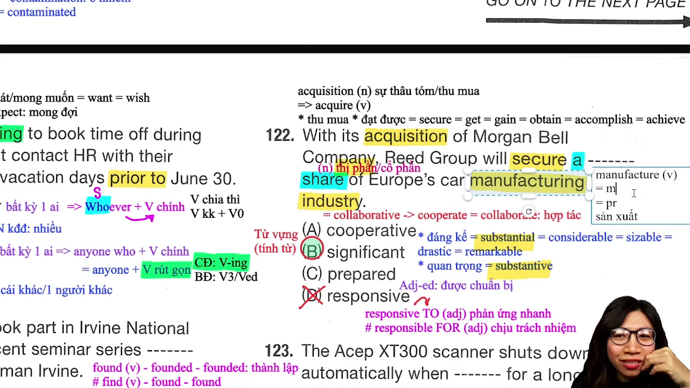

* **Đề bài:** `With its acquisition of Morgan Bell Company, Reed Corporation holds a ------- share of Europe’s automotive industry.`
* **Phương án:**
  * (A) `cooperative`: Mang tính hợp tác.
  * (B) `substantial`: Đáng kể, to lớn (chọn B).
  * (C) `prepared`: Đã chuẩn bị sẵn sàng.
  * (D) `responsive`: Phản hồi nhanh nhạy.
* **Phân tích:**
  * Câu hỏi từ vựng tính từ đi kèm danh từ `share` (thị phần trong ngành kinh doanh).
  * Khi một tập đoàn hoàn tất việc thâu tóm công ty đối thủ (`acquisition of Morgan Bell`), họ sẽ nắm giữ một "thị phần đáng kể" trên thị trường. Cụm từ cố định chuẩn thương mại là `substantial share` hoặc `significant share`.
  * Phương án (A) `cooperative share` không có nghĩa kinh tế. Phương án (D) `responsive` thường đi với giới từ `to` (nhạy bén với phản hồi). Chọn (B).
* **Dịch nghĩa:** Với việc mua lại Công ty Morgan Bell, Tập đoàn Reed sẽ nắm giữ một thị phần đáng kể trong ngành công nghiệp ô tô của châu Âu.
* **Mở rộng:**
  * `acquisition (n)`: Sự mua lại, sự thâu tóm doanh nghiệp (bắt nguồn từ động từ `acquire`).
  * `acquire` = `obtain` = `gain` = `secure` = `achieve`: Thu mua, đạt được, giành được.
  * `automotive industry`: Ngành công nghiệp sản xuất ô tô.

---

### [[48:29](https://youtu.be/AeQMXm0ivuM?t=2909s)] Câu 123

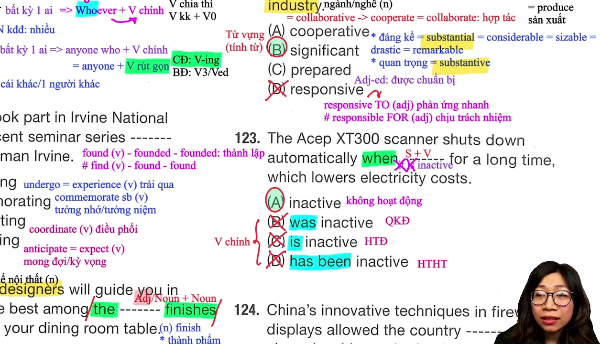

* **Đề bài:** `The office scanner automatically shuts down when -------, which lowers electricity costs.`
* **Phương án:**
  * (A) `inactive`: Tính từ (chọn A: when inactive).
  * (B) `was inactive`: Động từ to be quá khứ + tính từ.
  * (C) `is inactive`: Động từ to be hiện tại + tính từ.
  * (D) `has been inactive`: Thì hiện tại hoàn thành + tính từ.
* **Phân tích:**
  * Câu kiểm tra hiện tượng rút gọn mệnh đề trạng ngữ sau liên từ thời gian `when`.
  * Câu đầy đủ ban đầu là: `when it is inactive` (khi nó không hoạt động). Vì chủ ngữ `it` trùng với chủ ngữ chính `The office scanner`, người ta lược bỏ cả chủ ngữ `it` lẫn động từ to be `is`, chỉ để lại duy nhất tính từ `inactive`.
  * Bẫy phổ biến: Thí sinh chọn (B), (C) hoặc (D) vì thấy có động từ to be. Tuy nhiên, động từ chia thì bắt buộc phải có chủ ngữ đứng trước; nếu không có chủ ngữ mà vẫn để động từ chia thì là sai ngữ pháp nghiêm trọng. Chọn (A).
* **Dịch nghĩa:** Máy quét văn phòng tự động tắt khi không hoạt động, điều này giúp làm giảm chi phí điện năng.
* **Mở rộng:**
  * `shut down`: Tắt máy, ngừng hoạt động.
  * `inactive (adj)`: Không hoạt động, ở trạng thái nghỉ.
  * `lowers electricity costs`: Cắt giảm chi phí tiền điện.

---

### [[52:43](https://youtu.be/AeQMXm0ivuM?t=3163s)] Câu 124

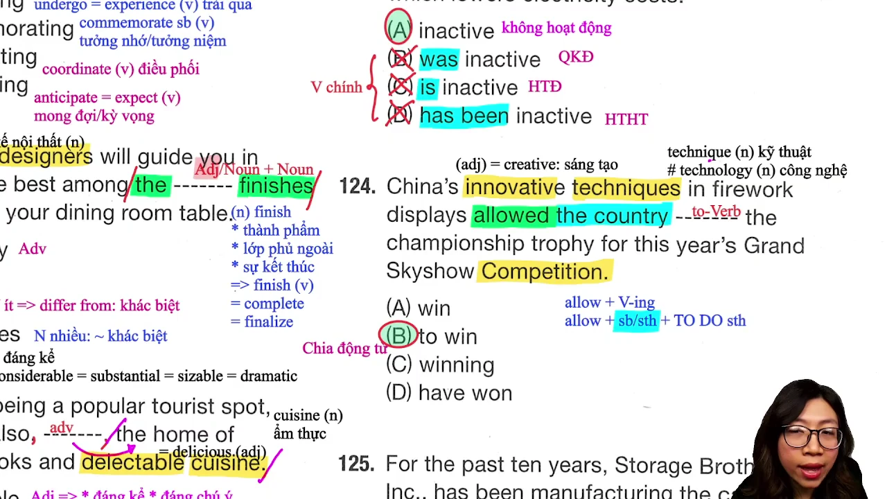

* **Đề bài:** `The superior aerodynamics of the aircraft allowed the pilot ------- the air race easily.`
* **Phương án:**
  * (A) `win`: Động từ nguyên mẫu không to.
  * (B) `to win`: Động từ nguyên mẫu có to (chọn B).
  * (C) `winning`: Danh động từ / hiện tại phân từ.
  * (D) `have won`: Hiện tại hoàn thành.
* **Phân tích:**
  * Đây là câu hỏi ngữ pháp thuần túy kiểm tra cấu trúc động từ đi sau `allow`.
  * Bảng công thức phản xạ kinh điển:
    * `allow + V-ing`: Cho phép làm việc gì (không có tân ngữ chỉ người).
    * `allow + sb + TO V0`: Cho phép ai đó làm việc gì (có tân ngữ chỉ người phía sau).
  * Sau động từ `allowed` có tân ngữ chỉ người là `the pilot` (viên phi công). Theo đúng công thức bắt buộc phải đi với `to win`. Chọn (B).
* **Dịch nghĩa:** Đặc tính khí động học vượt trội của chiếc máy bay đã cho phép viên phi công giành chiến thắng trong cuộc đua trên không một cách dễ dàng.
* **Mở rộng:**
  * `aerodynamics (n)`: Khí động học.
  * `air race`: Cuộc đua máy bay trên không.

---

### [[57:54](https://youtu.be/AeQMXm0ivuM?t=3474s)] Câu 125

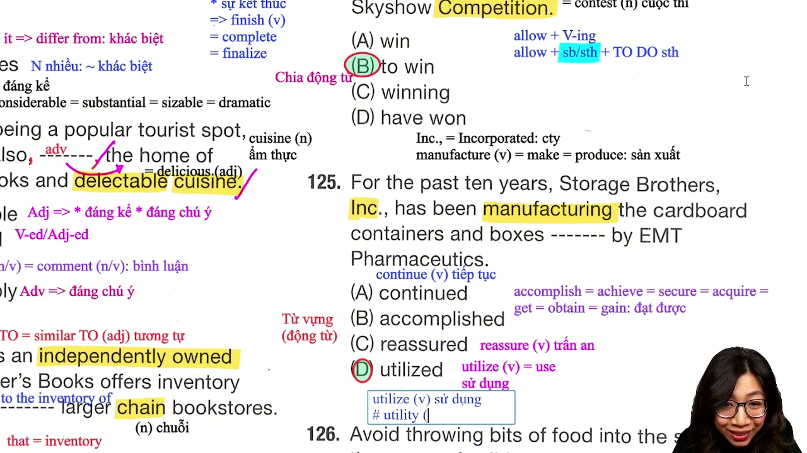

* **Đề bài:** `For the past ten years, Storage Brothers, Inc., has been manufacturing the cardboard containers and boxes ------- by EMT Pharmaceutics.`
* **Phương án:**
  * (A) `continued`: Được tiếp tục.
  * (B) `accomplished`: Được hoàn thành, đạt được.
  * (C) `reassured`: Được trấn an.
  * (D) `utilized`: Được sử dụng (chọn D).
* **Phân tích:**
  * Câu hỏi từ vựng động từ ở dạng quá khứ phân từ mang nghĩa bị động (`which are utilized by...`).
  * Danh từ được bổ nghĩa là `the cardboard containers and boxes` (thùng và hộp bìa cứng) do công ty sản xuất bao bì cung cấp cho hãng dược phẩm EMT. Đồ vật như thùng hộp chỉ có thể "được sử dụng" (`utilized`).
  * Động từ `utilize` là từ đồng nghĩa trang trọng của `use`. Phương án (B) `accomplished` chỉ áp dụng cho mục tiêu, nhiệm vụ (`accomplish a task/goal`). Chọn (D).
* **Dịch nghĩa:** Trong suốt mười năm qua, Công ty Storage Brothers đã sản xuất các loại thùng và hộp bìa cứng được sử dụng bởi Hãng Dược phẩm EMT.
* **Mở rộng:**
  * `utilize (v)` = `use`: Sử dụng, tận dụng.
  * `utility (n)`: Tiện ích (điện, nước, internet).
  * `cardboard container`: Thùng chứa bằng bìa các-tông.

---

### [[63:28](https://youtu.be/AeQMXm0ivuM?t=3808s)] Câu 126

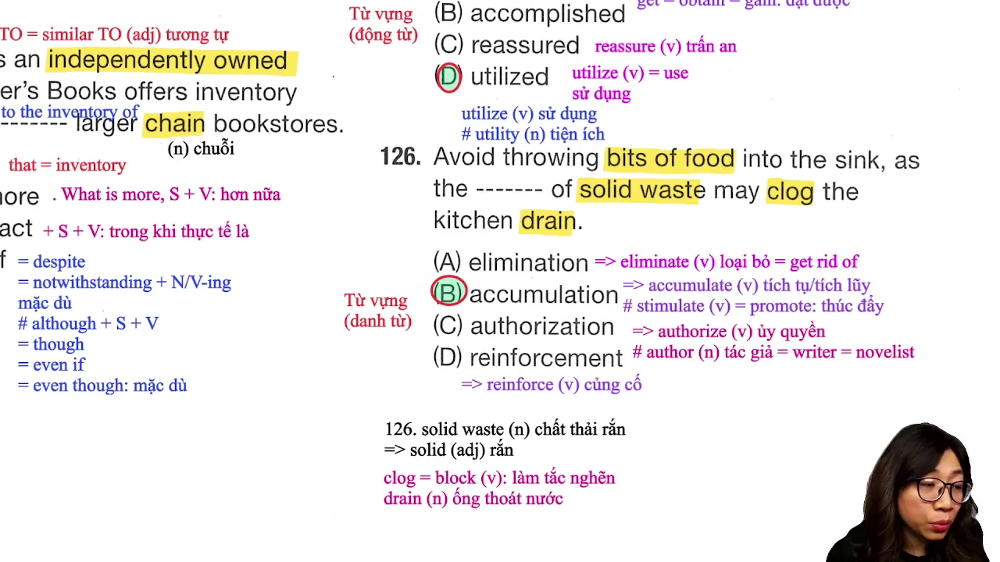

* **Đề bài:** `Avoid throwing bits of food into the sink because they may lead to a ------- in the pipes.`
* **Phương án:**
  * (A) `blockage`: Sự tắc nghẽn (chọn A).
  * (B) `drainage`: Sự thoát nước, hệ thống cống rãnh.
  * (C) `shortage`: Sự thiếu hụt, khan hiếm.
  * (D) `leakage`: Sự rò rỉ chất lỏng/khí.
* **Phân tích:**
  * Sau mạo từ `a` bắt buộc phải là một danh từ đếm được số ít. Cả 4 đáp án đều có đuôi danh từ `-age`.
  * Dựa vào logic ngữ cảnh: Hành động vứt thức ăn thừa vào bồn rửa chén (`throwing bits of food into the sink`) sẽ làm tắc đường ống nước (`pipes`). Do đó danh từ chính xác nhất là `blockage` (sự tắc nghẽn).
  * Phương án (B) `drainage` mang nghĩa tích cực là sự thoát nước. Phương án (C) `shortage` chỉ sự thiếu hụt tài nguyên (thiếu nhân sự, thiếu nước). Phương án (D) `leakage` là sự rò rỉ. Chọn (A).
* **Dịch nghĩa:** Tránh vứt các mẩu thức ăn vụn vào bồn rửa chén vì chúng có thể dẫn đến tình trạng tắc nghẽn trong đường ống dẫn nước.
* **Mở rộng:**
  * `lead to` = `result in` = `cause`: Dẫn đến, gây ra hậu quả gì.
  * `blockage in the pipes`: Sự nghẹt đường ống nước.

---

### [[71:20](https://youtu.be/AeQMXm0ivuM?t=4280s)] Câu 127

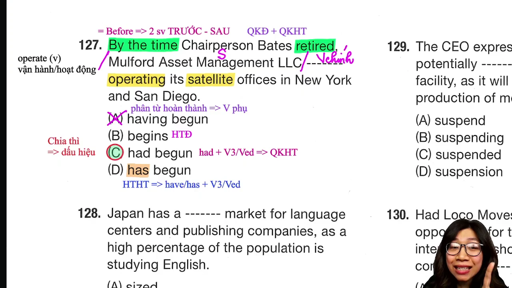

* **Đề bài:** `When the current lease expires in October, the agency ------- for new office space in the downtown area.`
* **Phương án:**
  * (A) `looked`: Quá khứ đơn.
  * (B) `looks`: Hiện tại đơn.
  * (C) `will look`: Tương lai đơn (chọn C).
  * (D) `has looked`: Hiện tại hoàn thành.
* **Phân tích:**
  * Câu kiểm tra quy tắc hòa hợp thì giữa mệnh đề trạng ngữ chỉ thời gian và mệnh đề chính.
  * Mệnh đề thời gian bắt đầu bằng `When` dùng thì hiện tại đơn `expires` để diễn đạt một sự việc sẽ diễn ra trong tương lai (`in October`). Theo quy tắc bất biến, mệnh đề chính bắt buộc phải chia ở thì tương lai đơn `will + V0` (`will look`).
  * Loại ngay (A) và (D) vì sự việc chưa diễn ra trong quá khứ. Chọn (C).
* **Dịch nghĩa:** Khi hợp đồng thuê hiện tại hết hạn vào tháng Mười, cơ quan này sẽ tìm kiếm mặt bằng văn phòng mới tại khu vực trung tâm thành phố.
* **Mở rộng:**
  * `lease expires`: Hợp đồng thuê hết hạn.
  * `downtown area`: Khu vực trung tâm thành phố.

---

### [[77:44](https://youtu.be/AeQMXm0ivuM?t=4664s)] Câu 128

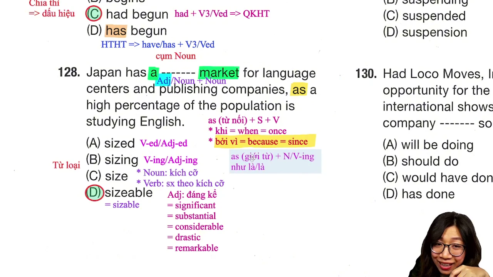

* **Đề bài:** `Employees may request a ------- increase in salary if they take on additional managerial duties.`
* **Phương án:**
  * (A) `proportion`: Danh từ (tỷ lệ).
  * (B) `proportionately`: Trạng từ.
  * (C) `proportions`: Danh từ số nhiều.
  * (D) `proportionate`: Tính từ (chọn D).
* **Phân tích:**
  * Quan sát vị trí chỗ trống: Nằm sau mạo từ `a` và đứng trước danh từ chính `increase` (sự gia tăng).
  * Đứng trước danh từ để bổ nghĩa chỉ có thể là tính từ. Đuôi `-ate` trong `proportionate` là đuôi tính từ mang nghĩa "tương xứng, tỷ lệ thuận".
  * Chọn (D) tạo thành cụm `proportionate increase` (sự tăng lương tương xứng với khối lượng công việc đảm nhận).
* **Dịch nghĩa:** Nhân viên có thể yêu cầu một mức tăng lương tương xứng nếu họ đảm nhận thêm các nhiệm vụ quản lý bổ sung.
* **Mở rộng:**
  * `take on duties`: Đảm nhận thêm trách nhiệm, bổn phận mới.
  * `proportionate to`: Tỷ lệ thuận, tương xứng với.

---

### [[83:29](https://youtu.be/AeQMXm0ivuM?t=5009s)] Câu 129

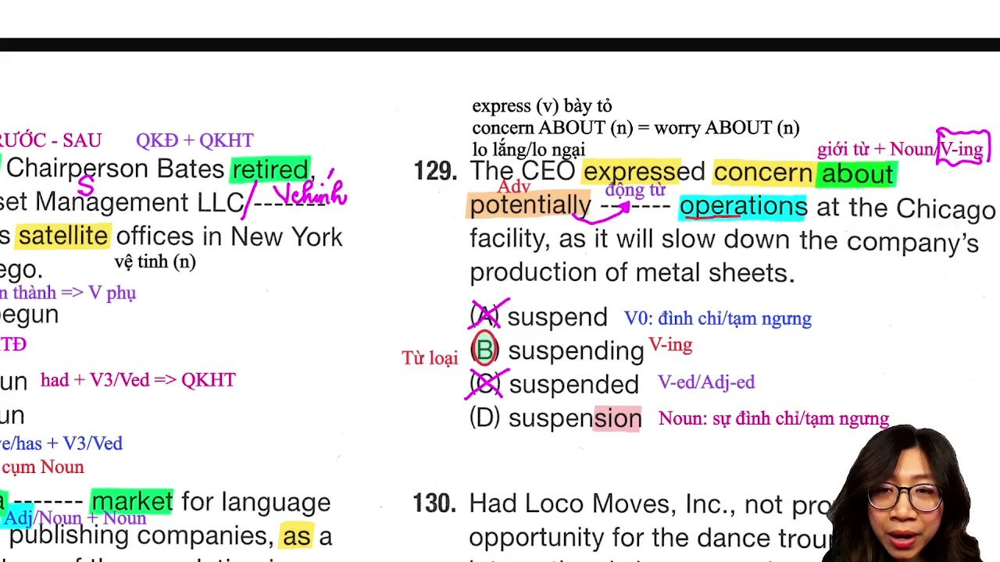

* **Đề bài:** `The CEO expressed concern about potentially ------- operations at the Chicago facility as it will slow down production.`
* **Phương án:**
  * (A) `sustained`: Động từ quá khứ / tính từ bị động.
  * (B) `suspending`: Danh động từ chủ động (chọn B).
  * (C) `suspends`: Động từ chia thì hiện tại đơn số ít.
  * (D) `suspension`: Danh từ chỉ sự đình chỉ.
* **Phân tích:**
  * Đây là câu phân hóa điểm 800+ và 900+ cực kỳ xuất sắc.
  * Phân tích vị trí: Chỗ trống đứng sau giới từ `about` và trạng từ `potentially`. Nhiều thí sinh vội vàng chọn danh từ `suspension` (D). Tuy nhiên, ngay phía sau chỗ trống lại xuất hiện danh từ `operations` (các hoạt động sản xuất).
  * Nếu chọn danh từ `suspension`, ta sẽ có hai danh từ đứng cạnh nhau mà không tạo thành danh từ ghép hợp lệ. Do đó, chỗ trống bắt buộc phải là một danh động từ `V-ing` (`suspending`) để nhận `operations` làm tân ngữ trực tiếp của nó: "đình chỉ các hoạt động" (`suspending operations`). Trạng từ `potentially` bổ nghĩa cho hành động `suspending`. Chọn (B).
* **Dịch nghĩa:** Giám đốc điều hành đã bày tỏ sự lo ngại về việc có thể phải tạm ngưng các hoạt động tại cơ sở Chicago vì điều đó sẽ làm chậm tiến độ sản xuất.
* **Mở rộng:**
  * `express concern about`: Bày tỏ sự lo ngại về vấn đề gì.
  * `suspend operations`: Đình chỉ, tạm ngưng các hoạt động vận hành.

---

### [[90:17](https://youtu.be/AeQMXm0ivuM?t=5417s)] Câu 130

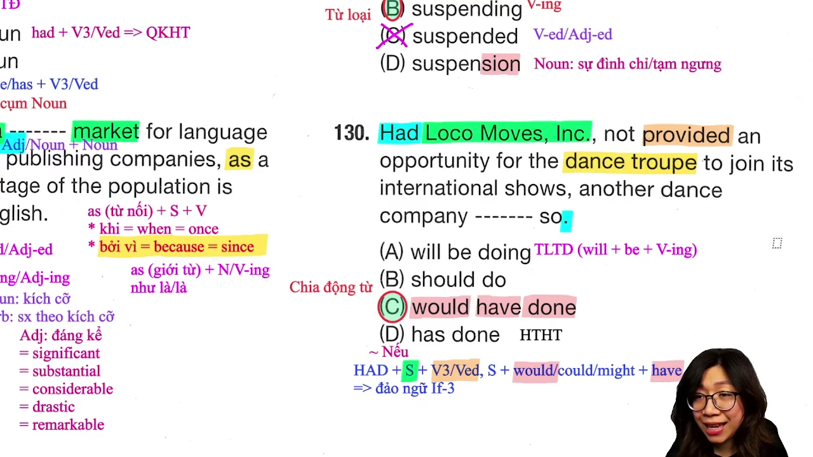

* **Đề bài:** `Had Local Moves, Inc., not provided support for the performance, another dance troupe ------- so.`
* **Phương án:**
  * (A) `will be doing`: Tương lai tiếp diễn.
  * (B) `should do`: Khiếm khuyết + V nguyên mẫu.
  * (C) `would have done`: Điều kiện loại 3 (chọn C).
  * (D) `hasn’t done`: Hiện tại hoàn thành phủ định.
* **Phân tích:**
  * Câu mở đầu bằng trợ động từ `Had` và kết thúc bằng dấu chấm khẳng định `.`. Đây là dấu hiệu nhận biết 100% của cấu trúc đảo ngữ câu điều kiện loại 3 (`Inversion of Conditional Type 3`).
  * Công thức đảo ngữ loại 3: `Had + S + (not) + V3/ed, S + would/could + have + V3/ed`.
  * Mệnh đề điều kiện đã đảo: `Had Local Moves, Inc., not provided...` (Nếu công ty Local Moves không hỗ trợ...). Mệnh đề chính bắt buộc phải có dạng `would have done so`. Phương án duy nhất khớp công thức là (C).
* **Dịch nghĩa:** Nếu Công ty Local Moves không hỗ trợ cho buổi biểu diễn, một đoàn vũ công khác hẳn đã làm như vậy rồi.
* **Mở rộng:**
  * `dance troupe`: Đoàn vũ công, vũ đoàn múa (phát âm: `/truːp/`).
  * Cấu trúc đảo ngữ loại 3 diễn tả giả định trái ngược với quá khứ.

---

## Trích dẫn then chốt

* [[06:40](https://youtu.be/AeQMXm0ivuM?t=400s)] `Whoever là phải đi với động từ chia thì hoàn chỉnh, còn Anyone mới đi được với V-ing rút gọn.`
* [[27:15](https://youtu.be/AeQMXm0ivuM?t=1635s)] `Thông tin kẹp giữa hai dấu phẩy là thông tin phụ, bổ nghĩa cho nguyên cụm danh từ phía sau thì dùng trạng từ.`
* [[50:45](https://youtu.be/AeQMXm0ivuM?t=3045s)] `Sau When mà không có chủ ngữ thì không được chọn to be chia thì, to be đã bị rút gọn chỉ còn lại tính từ.`
* [[86:50](https://youtu.be/AeQMXm0ivuM?t=5210s)] `Sau giới từ có tân ngữ phía sau thì phải chọn V-ing chứ không được chọn danh từ, vì V-ing mới hút được object.`
* [[91:30](https://youtu.be/AeQMXm0ivuM?t=5490s)] `Đầu câu có Had mà cuối câu dấu chấm là đảo ngữ câu điều kiện loại 3, vế sau bắt buộc phải có would have V3.`

---

## Lệnh & Công cụ

### Nhận diện đại từ rút gọn
* `Whoever + Finite Verb (V chia thì)`: Dùng khi phía sau là mệnh đề đầy đủ.
* `Anyone + V-ing / V3-ed`: Dùng khi phía sau là phân từ rút gọn.

### Đảo ngữ câu điều kiện loại 3
* Công thức: `Had + S + (not) + V3/ed, S + would/could + have + V3/ed`
* Dấu hiệu: Chữ `Had` đứng đầu câu, có chủ ngữ theo sau, kết thúc bằng dấu chấm (không phải dấu hỏi).

### Phân biệt V-ing và Danh từ sau giới từ
* `Preposition + V-ing + Object (Noun)`: Dùng khi phía sau chỗ trống có tân ngữ nhận tác động.
* `Preposition + Noun`: Dùng khi sau chỗ trống là dấu phẩy hoặc giới từ khác, không có tân ngữ.

---

## Đánh đổi & Rủi ro

* **Bẫy dịch nghĩa tiếng Việt:** Dịch nghĩa thông thường sẽ không phân biệt được `Whoever` và `Anyone`, hoặc nhầm lẫn giữa tính từ `inactive` và động từ chia thì. Người học cần bám chặt cấu trúc ngữ pháp thay vì chỉ dựa vào dịch thô.
* **Nhầm lẫn từ loại kẹp phẩy:** Khi thấy khoảng trống kẹp giữa hai dấu phẩy `, -------,`, học viên hay nhầm lẫn chọn tính từ. Cần xác định rõ đối tượng bổ nghĩa là danh từ đơn lẻ hay toàn bộ cụm danh từ để chọn trạng từ chuẩn xác.
* **Nguy cơ chọn nhầm danh từ sau giới từ:** Ở các câu band điểm 800+, đề thi luôn cố tình gài danh từ đuôi `-tion` sau giới từ. Nếu không quét mắt nhìn ra tân ngữ phía sau, thí sinh sẽ mất điểm oan ở câu danh động từ.
