# GIẢI ĐỀ TOEIC THÁNG 3-2024 | VIDEO 1 | MS THANH TOEIC [HACKER 1]

* **Kênh:** Anh ngữ Ms Thanh | **Thời lượng:** 02:02:31 | **Ngày:** 2024-03-18
* **Video:** https://youtu.be/Uc_sY2jm2ic

---

## Thuật ngữ

| Thuật ngữ | Tiếng Anh | Giải thích |
| :--- | :--- | :--- |
| Trạng từ kẹp giữa | Intervening Adverb | Trạng từ đứng xen giữa trợ động từ và động từ chính để bổ nghĩa cho hành động. |
| Danh từ tân ngữ | Object Noun | Danh từ đứng sau ngoại động từ hoặc giới từ để hoàn thiện ý nghĩa câu. |
| Tính từ đuôi -ory | Adjective with -ory suffix | Tính từ phái sinh mang ý nghĩa quy định, chức năng (investigatory, mandatory, introductory). |
| Mệnh đề quan hệ rút gọn | Reduced Relative Clause | Dạng lược bỏ đại từ quan hệ và to be, hoặc lược bỏ đại từ làm tân ngữ (Anything [that] workers find). |
| Giới từ tập hợp | Collective Preposition | Giới từ đi với danh từ số nhiều chỉ phạm vi tập hợp từ ba đối tượng trở lên (among + N số nhiều). |
| Liên từ tương phản | Concession Conjunction | Liên từ nối hai mệnh đề mang ý nghĩa trái ngược, nhượng bộ (Although, Even though, Even if). |
| Thể bị động tiếp diễn | Continuous Passive Voice | Cấu trúc Be + being + V3/ed diễn tả hành động đang được thực hiện lên chủ thể tại thời điểm nói. |
| Cụm từ cố định | Collocation | Cách kết hợp từ ngữ tự nhiên theo thói quen của người bản xứ (general consensus, participate in). |
| Danh từ đếm được | Countable Noun | Danh từ có thể đếm trực tiếp và có dạng số nhiều (appliance, tool). |
| Danh từ không đếm được | Uncountable Noun | Danh từ chỉ tập hợp hoặc khối chất thể, không có dạng số nhiều (equipment). |

---

## Tổng luận chuyên đề

### Chiến lược thời gian

Phần thi Part 5 gồm 30 câu hỏi trắc nghiệm, đòi hỏi tốc độ xử lý trung bình dưới 30 giây mỗi câu nhằm dành thời gian cho Part 7. Bài giảng phân hóa rõ hai phương pháp tiếp cận:
* **Nhóm xử lý cấu trúc không dịch (5 đến 10 giây):** Các câu hỏi về từ loại, vị trí kẹp giữa trợ động từ và động từ chính, nhận diện giới từ đi kèm điều kiện (Between cần and, Among đi với danh từ số nhiều), xác định tính từ sau to be.
* **Nhóm kết hợp cấu trúc và dịch quét (15 đến 25 giây):** Các câu hỏi từ vựng chỉ cần dịch quét một cụm tân ngữ hoặc bối cảnh trực tiếp (kitchen appliances on stage -> demonstrate) mà không cần dịch toàn bộ câu.

### Bản chất ngữ pháp

* **Vị trí trạng từ kẹp giữa:** Khi câu đã có cấu trúc động từ hoàn chỉnh gồm trợ động từ và động từ chính (`will + V-bare`, `have + V3/ed`), vị trí đứng giữa bắt buộc là trạng từ nhằm bổ nghĩa cho hành động.
* **Cấu trúc động từ song hành:** Cặp động từ nối bởi liên từ thời gian (`and then`) phải đồng nhất về thì và dạng khi chia sẻ cùng một chủ ngữ và bị chi phối bởi trạng từ chỉ thời gian ở cuối câu.
* **Mệnh đề quan hệ rút gọn làm tân ngữ:** Đại từ bất định đứng đầu câu có thể vừa đóng vai trò chủ ngữ của câu chính, vừa là tân ngữ bị lược bỏ của mệnh đề phụ liền sau (`Anything [that] workers find in the hall will remain...`).
* **Phân biệt chủ động và bị động sau to be:** Nếu sau chỗ trống có cụm danh từ làm tân ngữ trực tiếp (`the details`), động từ bắt buộc ở dạng chủ động (`be + V-ing`). Nếu không có tân ngữ phía sau và đi kèm giới từ, động từ chuyển sang bị động (`be + V-ed`).

### Phân biệt từ loại

* **Họ từ và biến thể hình thái:** 
  * Đuôi `-ory` là đuôi tính từ tương đương đuôi `-ive` (`investigatory` = `investigative`).
  * Đuôi `-ing` trong nhiều trường hợp là danh từ đếm được độc lập (`briefing`: cuộc họp giao ban / buổi hướng dẫn).
  * Đuôi `-ed` trong nhiều ngữ cảnh đóng vai trò tính từ miêu tả điều kiện năng lực (`qualified to do sth`).
* **Trật tự cụm danh từ:** Công thức `Mạo từ + Tính từ + Danh từ`. Khi danh từ chính đã xuất hiện (`consensus`), vị trí đứng sau mạo từ bắt buộc là tính từ gốc (`general`) để bổ nghĩa cho danh từ.

### Cụm từ then chốt

* **Quy chuẩn giới từ:**
  * `Between` bắt buộc đi kèm liên từ `and` (`between A and B`).
  * `Among` đi kèm danh từ số nhiều chỉ phạm vi tập hợp từ ba đối tượng trở lên (`among the top players`).
  * `According to` đi kèm danh từ/cụm danh từ chỉ nguồn tin tức hoặc dữ liệu dự báo.
  * `Participate in` = `take part in` (tham gia vào sự kiện/cuộc thi).
* **Cặp từ dễ gây nhầm lẫn:**
  * `Appliances` (danh từ đếm được: thiết bị điện, đồ gia dụng gia đình) khác với `Equipment` (danh từ không đếm được: trang thiết bị chung) và `Tools` (dụng cụ cơ khí cầm tay).
  * `Comprehensive` (tính từ: toàn diện, sâu rộng) khác với `Throughout` (giới từ: xuyên suốt).
  * `Permanent` (tính từ: cố định, chính thức) đối lập với `Temporary` (tính từ: tạm thời).
  * `Meet` = `Accommodate` (động từ: đáp ứng, thỏa mãn nhu cầu).

---

## Bóc tách chi tiết

### [[05:03](https://youtu.be/Uc_sY2jm2ic?t=303s)] Câu 101

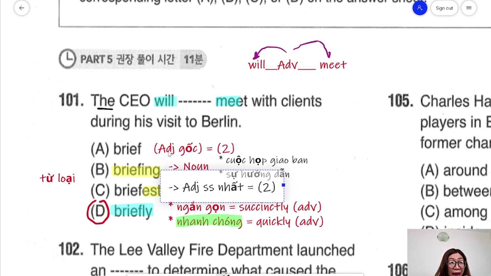

* **Đề bài:** `The CEO will ------- meet with clients during his visit to Berlin.`
* **Phương án:**
  * (A) brief: Tính từ gốc (ngắn gọn, vắn tắt).
  * (B) briefing: Danh từ (cuộc họp giao ban, sự hướng dẫn).
  * (C) briefest: Tính từ so sánh nhất.
  * (D) briefly: Trạng từ (ngắn gọn, nhanh chóng).
* **Phân tích:** Cấu trúc vị ngữ đã có trợ động từ tương lai `will` và động từ nguyên mẫu `meet`. Vị trí đứng xen giữa trợ động từ và động từ chính (`will + Adv + meet`) bắt buộc là trạng từ để bổ nghĩa cho động từ. Chọn (D).
* **Dịch nghĩa:** Giám đốc điều hành sẽ gặp gỡ nhanh chóng các khách hàng trong chuyến công tác đến Berlin của ông ấy.
* **Mở rộng:**
  * `briefly` (adv): Có hai nét nghĩa chính trong bài thi TOEIC — "nhanh chóng" (= `quickly`) và "ngắn gọn, súc tích" (= `succinctly`).
  * `briefing` (n): Là danh từ đếm được chỉ buổi họp ngắn đầu giờ hoặc buổi phổ biến hướng dẫn, không phải là dạng V-ing thông thường.
  * `visit to` (n): Chuyến đi thăm hoặc công tác tới một địa điểm cụ thể.

---

### [[11:38](https://youtu.be/Uc_sY2jm2ic?t=698s)] Câu 102

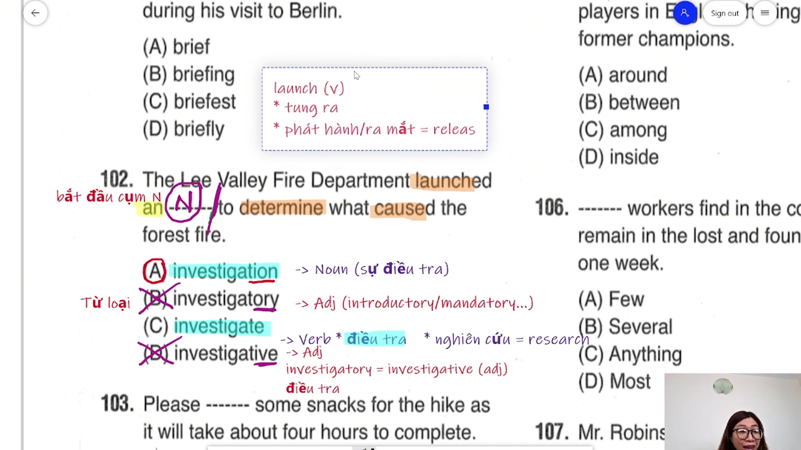

* **Đề bài:** `The Lee Valley Fire Department launched an ------- to determine what caused the forest fire.`
* **Phương án:**
  * (A) investigation: Danh từ (cuộc điều tra, sự nghiên cứu).
  * (B) investigatory: Tính từ (thuộc về điều tra).
  * (C) investigate: Động từ nguyên mẫu (điều tra, nghiên cứu).
  * (D) investigative: Tính từ (thuộc về điều tra).
* **Phân tích:** Mạo từ `an` đứng đầu cụm danh từ tân ngữ của ngoại động từ `launched`, phía sau là cụm mục đích `to determine` làm mốc ngắt cụm. Chỗ trống bắt buộc là danh từ số ít đếm được. Chọn (A).
* **Dịch nghĩa:** Sở cứu hỏa thung lũng Lee đã khởi động một cuộc điều tra để xác định nguyên nhân gây ra vụ cháy rừng.
* **Mở rộng:**
  * `launch` (v) = `release`: Khởi động, tung ra, phát hành.
  * `investigation` (n) / `investigate` (v): Trong các bộ đề thi mới, từ này xuất hiện với hai nghĩa — "điều tra" và "nghiên cứu" (= `research`).
  * Đuôi `-ory`: Là hậu tố tạo tính từ mang tính chức năng tương tự `introductory` (nhập môn), `mandatory` (bắt buộc), `compulsory` (bắt buộc). Do `investigatory` đồng nghĩa với `investigative` nên cả hai phương án tính từ đều bị loại.
  * `determine` (v): Xác định (phát âm chuẩn là /dɪˈtɜːmɪn/).

---

### [[17:05](https://youtu.be/Uc_sY2jm2ic?t=1025s)] Câu 103

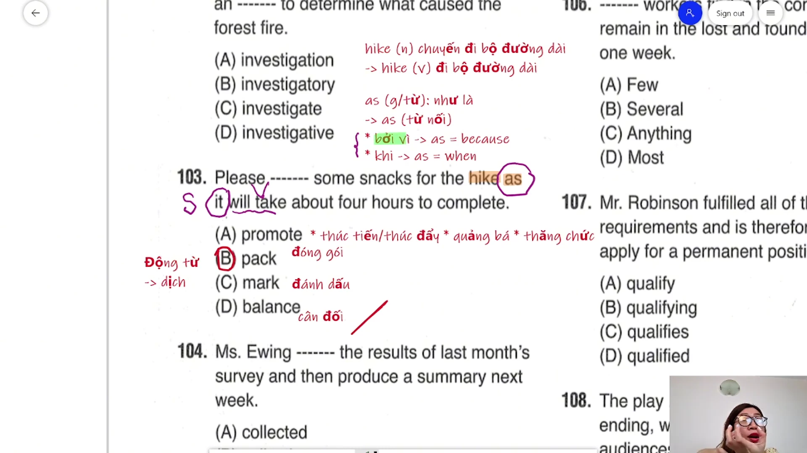

* **Đề bài:** `Please ------- some snacks for the hike as it will take about four hours to complete.`
* **Phương án:**
  * (A) promote: Động từ (thúc đẩy, quảng bá, thăng chức).
  * (B) pack: Động từ (đóng gói, gói ghém đồ ăn/hành lý).
  * (C) mark: Động từ (đánh dấu).
  * (D) balance: Động từ (cân đối, làm cân bằng).
* **Phân tích:** Câu mệnh lệnh có cấu trúc `Please + V-bare`. Căn cứ vào tân ngữ `some snacks` (đồ ăn nhẹ) và ngữ cảnh `for the hike` (cho chuyến đi bộ đường dài), hành động hợp lý nhất là chuẩn bị và đóng gói thức ăn mang theo (`pack some snacks`). Chọn (B).
* **Dịch nghĩa:** Xin vui lòng chuẩn bị một ít đồ ăn nhẹ cho chuyến đi bộ đường dài vì sẽ mất khoảng bốn giờ để hoàn thành.
* **Mở rộng:**
  * `pack` (v): Đóng gói, chuẩn bị hành lý.
  * `hike` (n/v): Chuyến đi bộ đường dài dã ngoại / đi bộ đường dài.
  * `as`: Khi là giới từ mang nghĩa "như là"; khi là liên từ nối hai mệnh đề (S + V) mang hai nghĩa: "bởi vì" (= `because`) hoặc "khi" (= `when`). Trong câu này `as` đóng vai trò liên từ chỉ nguyên nhân.
  * `promote` (v): Ba nghĩa cốt lõi trong TOEIC gồm thúc đẩy tiến độ, tiếp thị/quảng bá sản phẩm, thăng chức nhân sự.

---

### [[24:18](https://youtu.be/Uc_sY2jm2ic?t=1458s)] Câu 104

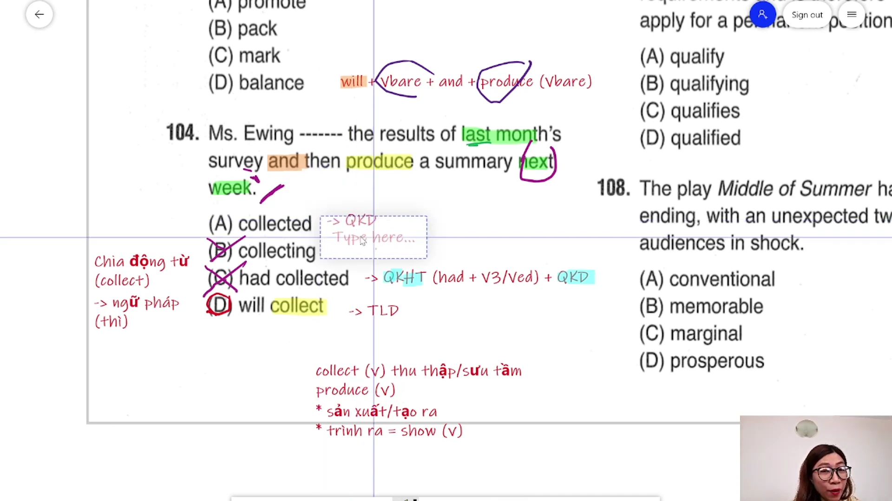

* **Đề bài:** `Ms. Ewing ------- the results of last month's survey and then produce a summary next week.`
* **Phương án:**
  * (A) collected: Thì quá khứ đơn (V2/ed).
  * (B) collecting: Dạng V-ing (không làm vị ngữ chính khi thiếu trợ động từ).
  * (C) had collected: Thì quá khứ hoàn thành (`had + V3/ed`).
  * (D) will collect: Thì tương lai đơn (`will + V-bare`).
* **Phân tích:** Liên từ đẳng lập `and then` nối hai hành động song hành của cùng một chủ ngữ: `[will] + V-bare + and then + produce (V-bare)`. Trạng từ thời gian ở cuối câu là `next week` bổ nghĩa cho toàn bộ chuỗi hành động trong tương lai. Cụm `last month's` chỉ là tính từ sở hữu bổ nghĩa cho danh từ `survey` (khảo sát của tháng trước), không phải mốc thời gian của hành động thu thập. Do đó động từ phải chia ở thì tương lai đơn. Chọn (D).
* **Dịch nghĩa:** Cô Ewing sẽ thu thập kết quả khảo sát của tháng trước và sau đó lập bản tóm tắt vào tuần tới.
* **Mở rộng:**
  * `collect` (v): Thu thập, sưu tầm.
  * `produce` (v): Ngoài nghĩa sản xuất hàng hóa, trong môi trường văn phòng từ này còn mang nghĩa lập ra, trình ra, xuất trình văn bản báo cáo (= `show`).
  * Bẫy thời gian cục bộ: Thí sinh thường nhìn thấy `last month's` rồi chọn ngay thì quá khứ (A) hoặc quá khứ hoàn thành (C), bỏ sót dấu hiệu tương lai `next week` và động từ nguyên mẫu `produce` sau liên từ `and then`.

---

### [[31:25](https://youtu.be/Uc_sY2jm2ic?t=1885s)] Câu 105

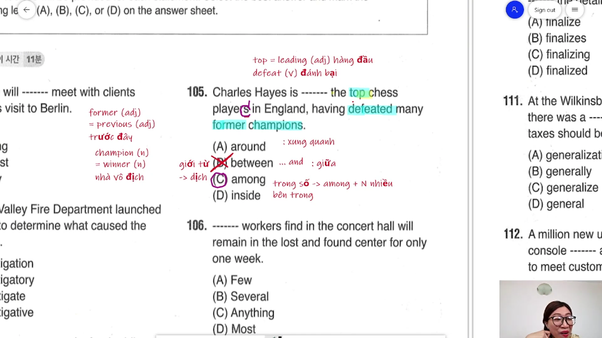

* **Đề bài:** `Charles Hayes is ------- the top chess players in England, having defeated many former champions.`
* **Phương án:**
  * (A) around: Giới từ (xung quanh, xấp xỉ).
  * (B) between: Giới từ (ở giữa hai đối tượng, bắt buộc có cấu trúc `between A and B`).
  * (C) among: Giới từ (trong số, giữa tập hợp từ ba đối tượng trở lên; đi với danh từ số nhiều).
  * (D) inside: Giới từ (bên trong).
* **Phân tích:** Phía sau chỗ trống là cụm danh từ số nhiều `the top chess players` có đuôi `-s`. Ngữ cảnh không xuất hiện liên từ `and` nên loại ngay `between`. Giới từ `among` kết hợp với danh từ số nhiều mang nghĩa "nằm trong số những người giỏi nhất". Chọn (C).
* **Dịch nghĩa:** Charles Hayes nằm trong số những kỳ thủ cờ vua hàng đầu ở nước Anh, sau khi đã đánh bại nhiều cựu vô địch.
* **Mở rộng:**
  * Cặp giới từ `between` và `among`: `between` đòi hỏi hai đối tượng rõ ràng nối bởi `and`; `among` đi kèm danh từ số nhiều biểu thị một tập thể.
  * `top` (adj) = `leading`: Hàng đầu, dẫn đầu.
  * `defeat` (v): Đánh bại đối thủ.
  * `former` (adj) = `previous`: Trước đây, cựu, tiền nhiệm.
  * `champion` (n) = `winner`: Nhà vô địch, quán quân.

---

### [[39:27](https://youtu.be/Uc_sY2jm2ic?t=2367s)] Câu 106

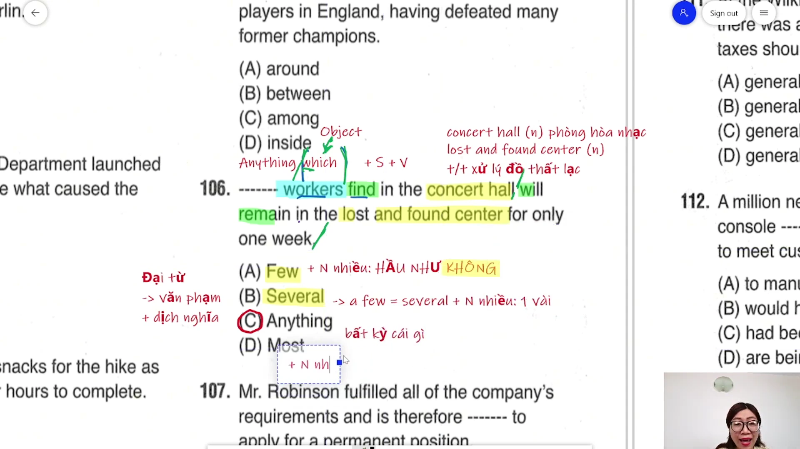

* **Đề bài:** `------- workers find in the concert hall will remain in the lost and found center for only one week.`
* **Phương án:**
  * (A) Few: Lượng từ (hầu như không có, đi với danh từ đếm được số nhiều mang nghĩa phủ định).
  * (B) Several: Lượng từ (một vài, đi với danh từ số nhiều).
  * (C) Anything: Đại từ bất định (bất kỳ thứ gì/đồ vật nào).
  * (D) Most: Lượng từ (hầu hết, đi với danh từ số nhiều hoặc không đếm được).
* **Phân tích:** Câu chứa hai cụm động từ: `find` và `will remain`. Đây là cấu trúc mệnh đề danh ngữ / mệnh đề quan hệ rút gọn làm chủ ngữ: `[Anything that] workers find in the concert hall` làm chủ ngữ cho vị ngữ chính `will remain`. Nếu chọn (A), (B), (D) để bổ nghĩa cho `workers`, câu sẽ thừa động từ và sai logic ngữ nghĩa nghiêm trọng (người công nhân không thể bị cất giữ trong phòng đồ thất lạc). Chọn (C).
* **Dịch nghĩa:** Bất kỳ đồ vật nào nhân viên tìm thấy trong phòng hòa nhạc sẽ được lưu giữ tại trung tâm đồ thất lạc chỉ trong một tuần.
* **Mở rộng:**
  * Bẫy vị trí Part 5: Thí sinh dễ bị đánh lừa bởi vị trí đứng trước danh từ số nhiều `workers` và vội vàng chọn các từ chỉ số lượng mà không nhận ra cấu trúc hai động từ trong câu.
  * `concert hall` (n): Phòng hòa nhạc, khán phòng biểu diễn.
  * `lost and found center` (n): Trung tâm/quầy xử lý đồ thất lạc.
  * `remain` (v): Tiếp tục duy trì, ở lại.

---

### [[44:57](https://youtu.be/Uc_sY2jm2ic?t=2697s)] Câu 107

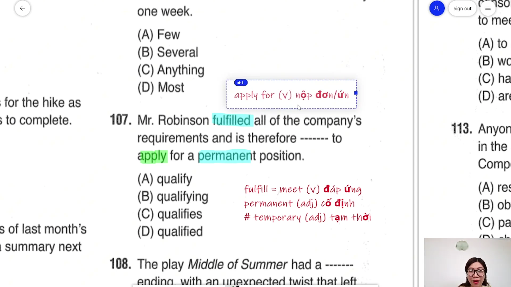

* **Đề bài:** `Mr. Robinson fulfilled all of the company's requirements and is therefore ------- to apply for a permanent position.`
* **Phương án:**
  * (A) qualify: Động từ nguyên mẫu.
  * (B) qualifying: Dạng V-ing / Phân từ hiện tại.
  * (C) qualifies: Động từ chia ngôi thứ ba số ít thì hiện tại đơn.
  * (D) qualified: Tính từ / Quá khứ phân từ (`qualified to do sth`: đủ tiêu chuẩn làm gì).
* **Phân tích:** Sau động từ to be `is` và trạng từ liên kết `therefore`, câu cần một tính từ đóng vai trò vị ngữ miêu tả trạng thái/năng lực của chủ ngữ `Mr. Robinson`. Cấu trúc quy chuẩn là `be qualified to V` (đủ tư cách/điều kiện thực hiện hành động). Chọn (D).
* **Dịch nghĩa:** Ông Robinson đã đáp ứng toàn bộ các yêu cầu của công ty và do đó đủ điều kiện để ứng tuyển vào một vị trí chính thức.
* **Mở rộng:**
  * `fulfill` (v) = `meet`: Đáp ứng, làm thỏa mãn (yêu cầu, tiêu chuẩn: `fulfill/meet requirements`).
  * `qualified to V` (adj): Đủ điều kiện, có năng lực chuyên môn phù hợp.
  * `permanent position` (n): Vị trí công việc chính thức/lâu dài, trái nghĩa với `temporary position` (vị trí tạm thời/thời vụ).
  * `apply for` (v): Nộp hồ sơ ứng tuyển vào vị trí công việc.

---

### [[53:20](https://youtu.be/Uc_sY2jm2ic?t=3200s)] Câu 108

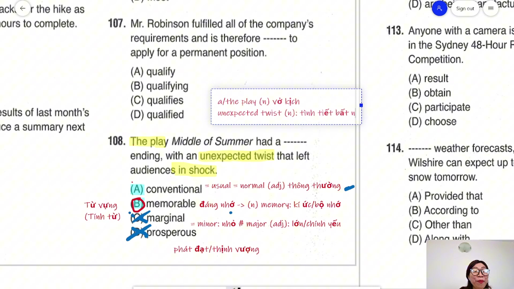

* **Đề bài:** `The play Middle of Summer had a ------- ending, with an unexpected twist that left audiences in shock.`
* **Phương án:**
  * (A) conventional: Tính từ (thông thường, theo quy ước = usual, normal).
  * (B) memorable: Tính từ (đáng nhớ, ấn tượng sâu sắc).
  * (C) marginal: Tính từ (nhỏ, không đáng kể = minor # major).
  * (D) prosperous: Tính từ (thịnh vượng, phát đạt).
* **Phân tích:** Ngữ cảnh vế sau bổ nghĩa chi tiết cho cái kết: `with an unexpected twist that left audiences in shock` (với một nút thắt tình tiết bất ngờ khiến khán giả sững sờ bàng hoàng). Một cái kết mang tính đột phá và chấn động không thể dùng nghĩa "thông thường" hay "không đáng kể", mà bắt buộc là một cái kết "đáng nhớ" (`a memorable ending`). Chọn (B).
* **Dịch nghĩa:** Vở kịch Middle of Summer đã có một cái kết đáng nhớ, với một nút thắt bất ngờ khiến khán giả bàng hoàng.
* **Mở rộng:**
  * `play` (n): Vở kịch (phân biệt với động từ chơi).
  * `unexpected twist` (n): Nút thắt tình tiết bất ngờ, cú bẻ lái kịch bản.
  * `in shock`: Trạng thái sững sờ, choáng váng.
  * `marginal` (adj) = `minor`: Nhỏ, ở mức giới hạn bên lề, trái nghĩa với `major`.
  * `conventional` (adj) = `usual` = `normal`: Thông thường, theo lề lối truyền thống.
  * `prosperous` (adj): Thịnh vượng, phát đạt (dùng cho doanh nghiệp, nền kinh tế).

---

### [[01:04:00](https://youtu.be/Uc_sY2jm2ic?t=3840s)] Câu 109

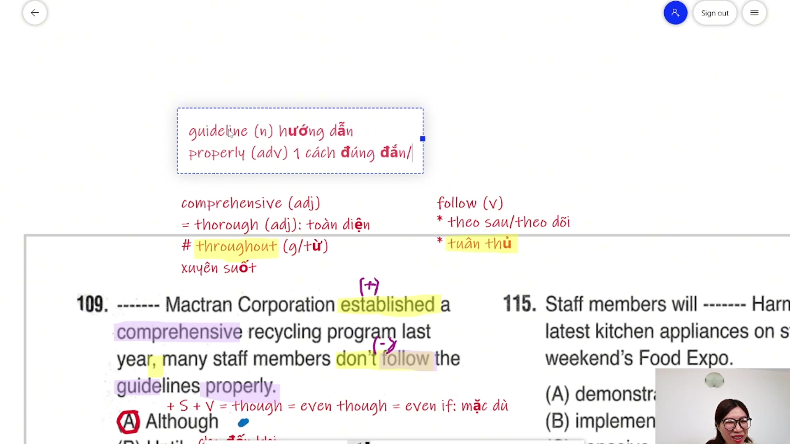

* **Đề bài:** `------- Mactran Corporation established a comprehensive recycling program last year, many staff members don't follow the guidelines properly.`
* **Phương án:**
  * (A) Although: Liên từ chỉ sự nhượng bộ/tương phản (+ S + V: mặc dù).
  * (B) Until: Liên từ / giới từ (+ S + V / mốc thời gian: cho đến khi).
  * (C) If: Liên từ điều kiện (+ S + V: nếu).
  * (D) Before: Liên từ / giới từ (+ S + V / V-ing: trước khi).
* **Phân tích:** Xét mối quan hệ ngữ nghĩa giữa hai mệnh đề: Mệnh đề 1 mang nghĩa tích cực (+) khi công ty thành lập chương trình tái chế toàn diện (`established a comprehensive recycling program`), nhưng mệnh đề 2 mang nghĩa tiêu cực (-) khi nhân viên không tuân thủ quy định một cách đúng đắn (`don't follow the guidelines properly`). Hai mệnh đề mang ý nghĩa tương phản đối lập, đòi hỏi liên từ nhượng bộ `Although` (+ S + V) = `Though` = `Even though` = `Even if`. Chọn (A).
* **Dịch nghĩa:** Mặc dù Tập đoàn Mactran đã thiết lập một chương trình tái chế toàn diện vào năm ngoái, nhiều nhân viên vẫn không tuân thủ các chỉ dẫn một cách đúng đắn.
* **Mở rộng:**
  * `comprehensive` (adj) = `thorough`: Toàn diện, cặn kẽ. Cần phân biệt với giới từ `throughout` (xuyên suốt).
  * `follow` (v): Mang hai nghĩa thông dụng — đi theo/theo sau hoặc tuân thủ quy định (= `comply with`, `adhere to`).
  * `guidelines` (n): Bộ quy chuẩn, chỉ dẫn thực hiện.
  * `properly` (adv): Một cách thích đáng, đúng quy cách.

---

### [[01:10:22](https://youtu.be/Uc_sY2jm2ic?t=4222s)] Câu 110

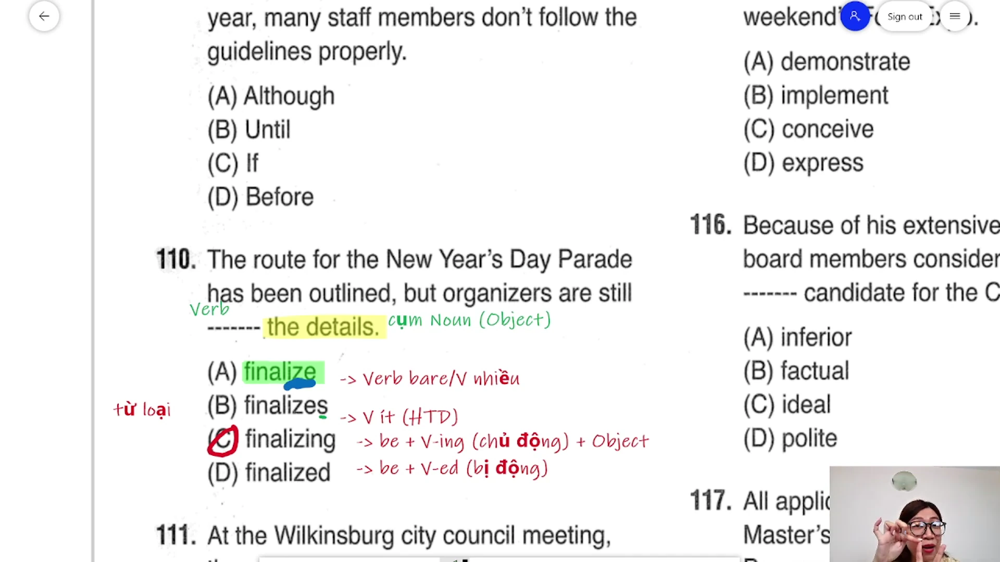

* **Đề bài:** `The route for the New Year's Day Parade has been outlined, but organizers are still ------- the details.`
* **Phương án:**
  * (A) finalize: Động từ nguyên mẫu.
  * (B) finalizes: Động từ chia ngôi thứ ba số ít thì hiện tại đơn.
  * (C) finalizing: Hiện tại phân từ (V-ing) tạo thành thì hiện tại tiếp diễn chủ động.
  * (D) finalized: Quá khứ phân từ (V-ed) tạo thành cấu trúc bị động.
* **Phân tích:** Vị trí đứng sau động từ to be `are` và trạng từ `still`. Phía sau chỗ trống có cụm danh từ làm tân ngữ trực tiếp `the details` (Object). Vì có tân ngữ đón nhận hành động nên động từ phải ở thể CHỦ ĐỘNG (`be + V-ing + Object`), không được chọn thể bị động (`be + V-ed`). Do đó câu chia ở thì hiện tại tiếp diễn chủ động `are still finalizing`. Chọn (C).
* **Dịch nghĩa:** Lộ trình cho Cuộc diễu hành Ngày Đầu năm mới đã được phác thảo, nhưng ban tổ chức vẫn đang hoàn thiện các chi tiết.
* **Mở rộng:**
  * Nguyên tắc phân biệt Chủ động / Bị động sau to be:
    * `be + V-ing + Tân ngữ (Object)`: Thể chủ động.
    * `be + V-ed / V3 + Giới từ / Trạng từ (không có tân ngữ)`: Thể bị động.
  * `outline` (v): Phác thảo khung sườn chính.
  * `finalize` (v): Chốt lại lần cuối, hoàn thiện chi tiết.

---

### [[01:39:00](https://youtu.be/Uc_sY2jm2ic?t=5940s)] Câu 111

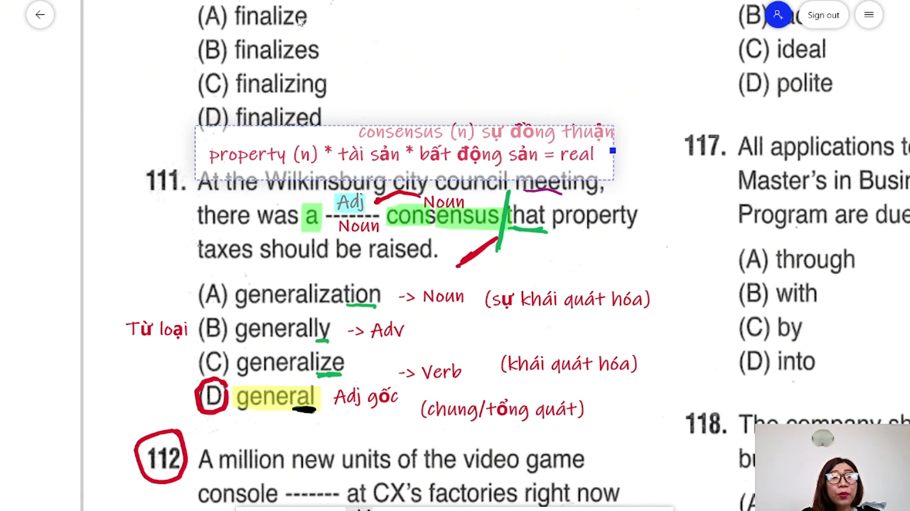

* **Đề bài:** `At the Wilkinsburg city council meeting, there was a ------- consensus that property taxes should be raised.`
* **Phương án:**
  * (A) generalization: Danh từ (sự khái quát hóa).
  * (B) generally: Trạng từ (nhìn chung, thông thường).
  * (C) generalize: Động từ (khái quát hóa).
  * (D) general: Tính từ gốc (chung, tổng thể).
* **Phân tích:** Vị trí đứng sau mạo từ `a` và đứng trước danh từ chính `consensus` (sự đồng thuận). Cấu trúc cụm danh từ chuẩn xác là `Mạo từ + Tính từ + Danh từ`. Cần một tính từ gốc đứng trước bổ nghĩa cho danh từ `consensus`. Cụm từ cố định chuẩn bản ngữ: `a general consensus` (sự đồng thuận chung). Chọn (D).
* **Dịch nghĩa:** Tại cuộc họp hội đồng thành phố Wilkinsburg, đã có một sự đồng thuận chung rằng thuế bất động sản nên được tăng lên.
* **Mở rộng:**
  * `consensus` (n): Sự đồng thuận, nhất trí tập thể.
  * `property` (n): Hai nghĩa trọng tâm trong TOEIC — "tài sản" cá nhân hoặc "bất động sản" (= `real estate`).
  * `raise` vs `rise`: `raise` là ngoại động từ đòi hỏi tân ngữ theo sau (tăng cái gì lên: `raise taxes`), còn `rise` là nội động từ tự tăng lên không có tân ngữ.

---

### [[01:46:58](https://youtu.be/Uc_sY2jm2ic?t=6418s)] Câu 112

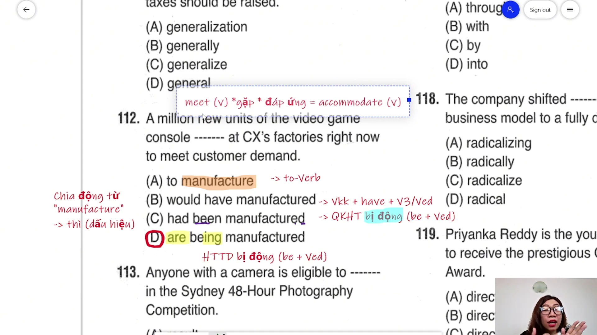

* **Đề bài:** `A million new units of the video game console ------- at CX's factories right now to meet customer demand.`
* **Phương án:**
  * (A) to manufacture: Dạng To-V (không làm vị ngữ chính của câu).
  * (B) would have manufactured: Cấu trúc điều kiện hoàn thành (`would have + V3/ed`).
  * (C) had been manufactured: Thì quá khứ hoàn thành bị động (`had been + V3/ed`).
  * (D) are being manufactured: Thì hiện tại tiếp diễn thể bị động (`are being + V3/ed`).
* **Phân tích:** Dấu hiệu thời gian là cụm trạng từ `right now` (ngay lúc này), đòi hỏi động từ chia ở thì hiện tại tiếp diễn. Chủ ngữ `A million new units of the video game console` (Một triệu máy chơi game mới) là danh từ chỉ vật số nhiều, phải chịu tác động sản xuất của con người nên bắt buộc ở thể BỊ ĐỘNG. Cấu trúc bị động của hiện tại tiếp diễn số nhiều là `are + being + V3/ed`. Chọn (D).
* **Dịch nghĩa:** Một triệu thiết bị máy chơi game mới hiện đang được sản xuất tại các nhà máy của CX ngay lúc này để đáp ứng nhu cầu của khách hàng.
* **Mở rộng:**
  * Dấu hiệu nhận biết thì hiện tại tiếp diễn: `right now`, `at the moment`, `currently`.
  * `meet customer demand`: Đáp ứng nhu cầu khách hàng. Trong đó `meet` (v) đồng nghĩa hoàn toàn với `accommodate`: đáp ứng, thỏa mãn tiêu chuẩn.

---

### [[01:52:55](https://youtu.be/Uc_sY2jm2ic?t=6775s)] Câu 113

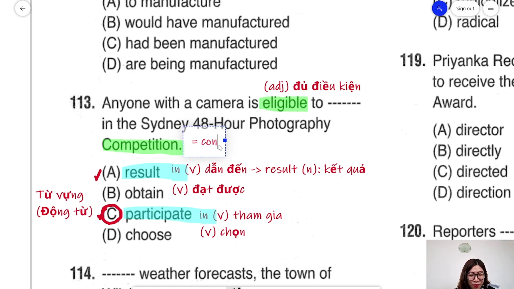

* **Đề bài:** `Anyone with a camera is eligible to ------- in the Sydney 48-Hour Photography Competition.`
* **Phương án:**
  * (A) result: Động từ (`result in`: dẫn đến kết quả / `result from`: bắt nguồn từ).
  * (B) obtain: Động từ (đạt được, giành được = get, acquire).
  * (C) participate: Động từ (`participate in`: tham gia vào).
  * (D) choose: Động từ (lựa chọn).
* **Phân tích:** Đứng sau cấu trúc tính từ `is eligible to + V-bare`. Ngay sau chỗ trống là giới từ `in` đi kèm danh từ chỉ sự kiện thi đua `the Sydney 48-Hour Photography Competition`. Động từ `participate` là nội động từ bắt buộc kết hợp với giới từ `in` tạo thành cụm `participate in` mang nghĩa tham gia vào cuộc thi. Các phương án `obtain` và `choose` là ngoại động từ đi trực tiếp với tân ngữ không có giới từ `in`, còn `result in` mang nghĩa dẫn đến hậu quả gì (hoàn toàn sai nghĩa). Chọn (C).
* **Dịch nghĩa:** Bất kỳ ai có máy ảnh đều đủ điều kiện tham gia vào Cuộc thi Nhiếp ảnh 48 Giờ Sydney.
* **Mở rộng:**
  * `eligible to V` (adj): Đủ tư cách, đủ điều kiện thực hiện hành động.
  * `participate in` = `take part in` = `join`: Tham gia vào hoạt động/sự kiện.
  * `result in` (v): Dẫn đến kết quả trái ngược với `result from` (v): Bắt nguồn từ nguyên nhân.
  * `competition` (n) = `contest`: Cuộc thi tranh tài.

---

### [[01:57:00](https://youtu.be/Uc_sY2jm2ic?t=7020s)] Câu 114

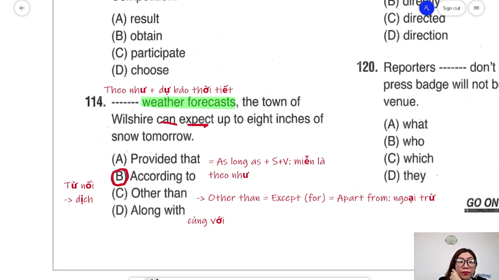

* **Đề bài:** `------- weather forecasts, the town of Wilshire can expect up to eight inches of snow tomorrow.`
* **Phương án:**
  * (A) Provided that: Liên từ điều kiện (= `As long as` + S + V: miễn là).
  * (B) According to: Giới từ (+ Cụm Noun: theo như).
  * (C) Other than: Giới từ (= `Except for` / `Apart from`: ngoại trừ).
  * (D) Along with: Giới từ (+ Cụm Noun: cùng với).
* **Phân tích:** Phía sau chỗ trống là cụm danh từ `weather forecasts` (các bản dự báo thời tiết), được ngăn cách với mệnh đề chính bằng dấu phẩy. Để dẫn xuất nguồn thông tin hoặc số liệu dự báo, cấu trúc giới từ chuẩn mực là `According to + Cụm danh từ` (Theo như dự báo thời tiết). Loại (A) vì `Provided that` là liên từ đòi hỏi một mệnh đề hoàn chỉnh (`S + V`). Loại (C) và (D) vì không phù hợp ngữ cảnh logic. Chọn (B).
* **Dịch nghĩa:** Theo như các dự báo thời tiết, thị trấn Wilshire có thể đón nhận lượng tuyết rơi lên đến tám inch vào ngày mai.
* **Mở rộng:**
  * `According to + N`: Theo như (nguồn báo cáo, dự báo, điều tra).
  * `Provided that` = `Providing that` = `As long as` (+ S + V): Miễn là, với điều kiện là.
  * `Other than` = `Except (for)` = `Apart from`: Ngoại trừ.
  * `Along with`: Cùng với.
  * `up to`: Lên đến (chỉ mức trần tối đa của số lượng).

---

### [[02:02:20](https://youtu.be/Uc_sY2jm2ic?t=7340s)] Câu 115

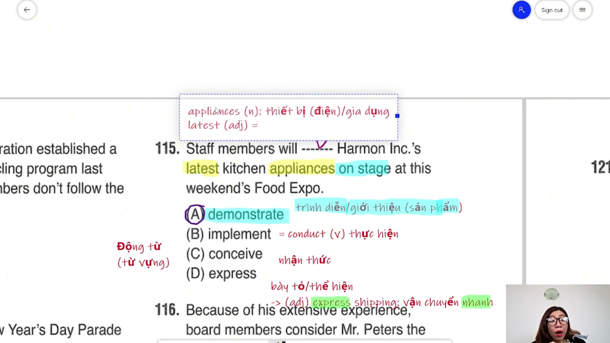

* **Đề bài:** `Staff members will ------- Harmon Inc.'s latest kitchen appliances on stage at this weekend's Food Expo.`
* **Phương án:**
  * (A) demonstrate: Động từ (trình diễn, giới thiệu sản phẩm / chứng minh).
  * (B) implement: Động từ (thực hiện, thi hành = conduct).
  * (C) conceive: Động từ (nhận thức, hình thành ý niệm).
  * (D) express: Động từ (bày tỏ, thể hiện).
* **Phân tích:** Dựa vào các từ khóa then chốt trong câu: tân ngữ `kitchen appliances` (thiết bị nhà bếp), địa điểm `on stage` (trên sân khấu biểu diễn) và sự kiện `at this weekend's Food Expo` (tại triển lãm ẩm thực cuối tuần này). Hành động của nhân viên trên sân khấu trước khách tham quan triển lãm là "trình diễn / giới thiệu sản phẩm" (`demonstrate appliances on stage`). Chọn (A).
* **Dịch nghĩa:** Các nhân viên sẽ trình diễn các thiết bị nhà bếp mới nhất của Harmon Inc. trên sân khấu tại Triển lãm Ẩm thực cuối tuần này.
* **Mở rộng:**
  * `demonstrate` (v): Hai nghĩa chủ đạo — giới thiệu/trình diễn tính năng sản phẩm (product demonstration) hoặc chứng minh tính đúng đắn.
  * `implement` (v) = `conduct`: Thi hành, thực hiện (chính sách, dự án).
  * `appliances` (n): Thiết bị điện gia dụng trong gia đình (tủ lạnh, lò nướng, máy giặt) là danh từ đếm được. Phân biệt với `equipment` (trang thiết bị chung — danh từ không đếm được) và `tools` (dụng cụ cầm tay cơ học: búa, kìm, xẻng).
  * `latest` (adj) = `newest`: Mới nhất (tuyệt đối không dịch là trễ nhất).
  * `express` (v/adj): Động từ là bày tỏ tình cảm/quan điểm; tính từ mang nghĩa hỏa tốc, nhanh chóng (`express shipping`: vận chuyển hỏa tốc).

---

## Trích dẫn then chốt

* [[11:07](https://youtu.be/Uc_sY2jm2ic?t=667s)] "Đừng bao giờ học thuộc, học với cô không bao giờ cô bắt học từ vựng... giải đề nghe cô giảng, cô hỏi mình trả lời, cô ghi một lần mình ghi một lần, đọc theo để kích thích phản xạ."
* [[24:42](https://youtu.be/Uc_sY2jm2ic?t=1482s)] "Trước khi dịch mình loại bớt đi, cho một bé lui cung liền... between là luôn luôn phải có and, không có and thì loại trước không nói nhiều."
* [[31:19](https://youtu.be/Uc_sY2jm2ic?t=1879s)] "Học là phải dùng, chứ học không dùng được học nó bị uổng thời gian... đụng giải đề đọc nó, ghi nó rất dễ nhớ."
* [[01:10:04](https://youtu.be/Uc_sY2jm2ic?t=4204s)] "Ôn TOEIC từ vựng đóng một vai trò chứ không phải đóng 100% dịch nghĩa, nó gồm ba yếu tố chính: phương pháp, từ vựng và dịch nghĩa."
* [[01:38:36](https://youtu.be/Uc_sY2jm2ic?t=5916s)] "Thời gian mình ôn 10 test hay 20 test nhiều hơn thời gian ôn kỹ 2-3 test, cho nên ôn kỹ cho cô là được, nhớ nguyên tắc ôn kỹ."

---

## Lệnh & Công cụ

* **Trạng từ kẹp giữa:** `Trợ động từ (will / can / have) + [Trạng từ] + Động từ chính (V-bare / V3/ed)`
* **Danh từ sau mạo từ:** `a / an / the + [Danh từ] + Giới từ / To-V`
* **Chuỗi động từ song hành:** `[Trợ động từ tương lai] + V1 + and then + V2` (chi phối bởi trạng từ thời gian cuối câu)
* **Giới từ tập hợp:** `Between A and B` (bắt buộc có and) đối chiếu với `Among + N số nhiều` (không cần and)
* **Mệnh đề quan hệ rút gọn làm chủ ngữ:** `[Anything that] + S + V ... + V chính`
* **Cụm tính từ điều kiện:** `be + qualified + to-V`
* **Liên từ tương phản:** `Although / Even though / Even if + Mệnh đề (+), Mệnh đề (-)`
* **Phân biệt chủ động và bị động:** `be + V-ing + Tân ngữ` đối chiếu với `be + V-ed + Giới từ`
* **Cụm danh từ chuẩn tắc:** `Mạo từ + [Tính từ gốc] + Danh từ` (`a general consensus`)
* **Hiện tại tiếp diễn bị động:** `Dấu hiệu right now -> S (vật số nhiều) + are being + V3/ed`
* **Giới từ chỉ sự kiện:** `participate in + Cuộc thi / Sự kiện`
* **Dẫn xuất nguồn tin tức:** `According to + Cụm danh từ nguồn tin`
* **Phân loại thiết bị:** `appliances` (đếm được, đồ điện gia dụng) khác `equipment` (không đếm được, trang thiết bị chung)

---

## Đánh đổi & Rủi ro

* **Bẫy thời gian cục bộ (Local Timestamp Trap):** Nhìn thấy cụm từ thời gian quá khứ `last month's` trong câu 104 liền vội vàng chia thì quá khứ đơn, bỏ qua động từ nguyên mẫu song hành `and then produce` và trạng từ thời gian tương lai `next week` ở cuối câu.
* **Bẫy dịch chay không phân tích cấu trúc:** Nhìn thấy chỗ trống đứng ngay trước danh từ `workers` trong câu 106 liền chọn lượng từ (Few, Several, Most), không nhận diện cấu trúc hai động từ `find` và `will remain`, dẫn đến dịch sai bản chất người bị lưu giữ ở phòng đồ thất lạc.
* **Bẫy hình thái từ vựng:** Nhầm lẫn đuôi tính từ `-ory` (`investigatory`) thành danh từ, hoặc nhầm danh từ chuyên ngành đuôi `-ing` (`briefing`: cuộc họp giao ban) thành động từ thêm in thông thường.
* **Đánh đổi số lượng lấy chất lượng đề giải:** Cố giải số lượng lớn từ 10 đến 20 bộ đề nhưng sửa bài đại khái qua loa sẽ tốn nhiều thời gian hơn và không mang lại hiệu quả bằng việc đào sâu phân tích bản chất ngữ pháp, bẫy cấu trúc và hệ thống từ vựng mở rộng của 2 đến 3 bộ đề trọng điểm.
