# GIẢI ĐỀ TOEIC THÁNG 3-2024 | VIDEO 2 | MS THANH TOEIC [HACKER 1]

* **Kênh:** Anh ngữ Ms Thanh | **Thời lượng:** 01:47:26 | **Ngày:** 2024-03-23
* **Video:** https://youtu.be/dlXA0dw6Lnk

---

## Thuật ngữ

| Thuật ngữ | Tiếng Anh | Giải thích |
| :--- | :--- | :--- |
| Trạng từ kẹp giữa | Intervening Adverb | Trạng từ đứng xen kẽ giữa trợ động từ và động từ chính thì hoàn thành (`have/has + Adv + V3/ed`) để bổ nghĩa cho hành động. |
| Đại từ quan hệ chủ ngữ | Subject Relative Pronoun | Đại từ thay thế cho danh từ chỉ người đứng trước và giữ chức năng làm chủ ngữ của mệnh đề quan hệ (`Reporters who don't carry...`). |
| Cấu trúc song hành | Parallel Structure | Cấu trúc ngữ pháp đòi hỏi các thành phần nối bởi liên từ tương quan phải đồng nhất về dạng thức và chức năng (`may take... as well as earn...`). |
| Ngoại động từ trải qua | Transitive Experience Verb | Động từ đòi hỏi tân ngữ trực tiếp chỉ quá trình thử thách, kiểm định (`undergo testing / inspection`). |
| Giới từ phạm vi so sánh | Preposition of Scope | Giới từ `Of` đứng trước cụm `all the + N số nhiều` nhằm xác lập phạm vi tập hợp để chọn ra đối tượng nổi bật nhất. |
| Mệnh đề danh ngữ bất định | Indefinite Noun Clause | Mệnh đề bắt đầu bằng đại từ nghi vấn/bất định (`whichever + N`) giữ vai trò tân ngữ cho giới từ hoặc động từ. |
| Trạng từ chỉ biên độ | Degree Adverb of Magnitude | Trạng từ bổ nghĩa cho các động từ tăng, giảm, chiết khấu nhằm xác định quy mô biên độ (`discount heavily`). |
| Tính từ phái sinh | Derived Adjective | Tính từ được cấu tạo từ gốc danh từ hoặc động từ thông qua các hậu tố đặc trưng (`continuous` từ gốc `continuity/continue`). |
| Cụm danh từ mở rộng | Expanded Noun Phrase | Cụm từ có cấu trúc bắt đầu bằng tính từ sở hữu, tiếp theo là tính từ bổ nghĩa và kết thúc bằng danh từ chính (`their continuous support`). |
| Cụm từ cố định | Collocation | Cách kết hợp từ vựng tự nhiên theo tập quán ngôn ngữ của người bản xứ (`make progress`, `take advantage of`, `room rates`). |

---

## Tổng luận chuyên đề

### Chiến lược thời gian

Part 5 gồm 30 câu hỏi trắc nghiệm kiểm tra ngữ pháp và từ vựng. Để tối ưu hóa quỹ thời gian 75 phút cho toàn bộ bài thi Đọc (đặc biệt là Part 7 với các đoạn văn dài), tốc độ xử lý Part 5 phải được kiểm soát chặt chẽ:
* **Nhóm xử lý cấu trúc thần tốc (5 đến 10 giây):** Các câu hỏi về hình thái từ loại (nhận diện vị trí kẹp giữa trợ động từ `has` và `V3/ed`, vị trí tính từ đứng sau tính từ sở hữu `their` và trước danh từ `support`), đại từ quan hệ thay thế cho danh từ chỉ người làm chủ ngữ, hoặc liên từ song hành phụ thuộc vào động từ khiếm khuyết `may`. Nhóm này tuyệt đối không dịch nghĩa toàn câu.
* **Nhóm kết hợp cấu trúc và quét từ khóa (10 đến 15 giây):** Các câu hỏi giới từ chỉ thời hạn (`due by + mốc thời gian`), liên từ nhân quả (`Given that = Because`), hoặc cụm cố định (`make progress`). Chỉ cần quét các từ khóa liên kết đứng trước và sau chỗ trống.
* **Nhóm phân biệt ngữ cảnh chuyên sâu (20 đến 30 giây):** Các câu hỏi từ vựng thuần túy đòi hỏi nhận diện sắc thái chính xác (phân biệt `inferior` với `ideal`, `apologetic` trong ngữ cảnh phục vụ chậm trễ, `undergo` đi với quy trình thử nghiệm, `heavily` đi kèm hành động giảm giá phòng).

### Bản chất ngữ pháp

* **Vị trí trạng từ trong thì hoàn thành:** Cấu trúc `S + have/has + [Trạng từ] + V3/ed`. Trạng từ đứng chen vào giữa không làm thay đổi cấu trúc thì mà chỉ mang chức năng bổ nghĩa mức độ hoặc tần suất cho hành động chính (`has repeatedly declined`).
* **Đại từ quan hệ làm chủ ngữ mệnh đề phụ:** Khi danh từ đứng trước là danh từ chỉ người số nhiều (`Reporters`), phía sau chỗ trống là trợ động từ phủ định (`don't carry`) giữ vai trò vị ngữ, đại từ quan hệ bắt buộc phải là `who` (hoặc `that`). Không được dùng đại từ nhân xưng `they` vì sẽ gây lỗi hai mệnh đề độc lập đứng liền nhau không có liên từ nối.
* **Quy tắc song hành với động từ khiếm khuyết:** Khi động từ khiếm khuyết `may` chi phối hai hành động thông qua liên từ `as well as` (mang ý nghĩa tương đương `and`), cả hai động từ đều phải giữ nguyên dạng nguyên mẫu không to: `may [take advantage of...] as well as [earn points...]`.
* **Cấu trúc giới từ xác lập tập hợp so sánh:** Công thức `Of all the + Danh từ số nhiều, S + be + Tính từ so sánh nhất / favorite`. Giới từ `Of` ở đầu câu mang ý nghĩa "Trong số tất cả", khác biệt hoàn toàn với cấu trúc `All of + Danh từ số nhiều` đóng vai trò là cụm chủ ngữ.
* **Từ hạn định và đại từ bất định đi kèm danh từ:** `Either` và `Another` bắt buộc đi kèm danh từ đếm được số ít. Khi phía sau là danh từ số nhiều đi kèm mệnh đề quan hệ xác định (`ingredients they have available`), đại từ lựa chọn thích hợp nhất là `whichever` (bất kỳ thứ nào trong số đó).

### Biến thể từ loại

* **Phân biệt từ loại gốc và từ phái sinh:**
  * Tính từ gốc có đuôi `-ous` (`continuous`) miêu tả tính chất liên tục, không ngắt quãng; danh từ mang đuôi `-ity` (`continuity`) chỉ tính liên tục; trạng từ mang đuôi `-ly` (`continuously`). Khi đứng giữa tính từ sở hữu và danh từ (`their ------- support`), vị trí này ưu tiên tính từ gốc bổ nghĩa cho danh từ.
  * Phân biệt danh từ chỉ người và danh từ chỉ khái niệm: `director` (người đạo diễn / giám đốc) đối lập với `direction` (sự hướng dẫn / phương hướng). Khi đi kèm cụm danh hiệu nghệ thuật và giải thưởng cá nhân (`Clinton Film Award`), danh từ bắt buộc phải là danh từ chỉ người.
  * Phân biệt trạng từ chỉ thái độ và trạng từ tần suất: `repeatedly` (liên tục lặp lại) được cấu tạo từ tính từ `repeated` thêm đuôi `-ly`.
* **Quy tắc bỏ đuôi `-ly` tìm tính từ gốc:** Khi không chắc chắn một từ có phải là tính từ hay không, thí sinh quan sát phương án có đuôi `-ly` (trạng từ). Loại bỏ đuôi `-ly` sẽ lộ ra tính từ gốc (`continuously` -> `continuous`, `radically` -> `radical`).

### Cụm từ then chốt

* **Cụm giới từ và liên từ thời hạn:**
  * `due by + mốc thời gian`: Đến hạn nộp trước thời điểm xác định.
  * `in a timely manner`: Một cách kịp thời, nhanh chóng và đúng lúc.
  * `Given that` = `Because` = `Since` (+ Mệnh đề): Bởi vì, xét thấy rằng.
  * `As though` = `As if` (+ Mệnh đề): Như thể là (diễn tả giả định không có thật).
* **Cụm động từ và kết hợp từ chuyên ngành:**
  * `make progress in sth`: Đạt được tiến bộ, bước phát triển trong lĩnh vực nào đó.
  * `take advantage of sth`: Tận dụng, khai thác triệt để lợi thế hoặc ưu đãi.
  * `undergo testing / inspection / maintenance`: Trải qua quá trình kiểm tra, thanh tra, bảo dưỡng.
  * `discount heavily`: Giảm giá mạnh, chiết khấu sâu.
  * `room rates` = `room prices`: Giá phòng khách sạn, khu nghỉ dưỡng.
  * `appeal to sb` = `attract sb`: Thu hút, lôi cuốn ai đó.

---

## Bóc tách chi tiết

### [[00:02](https://youtu.be/dlXA0dw6Lnk?t=2s)] Câu 116

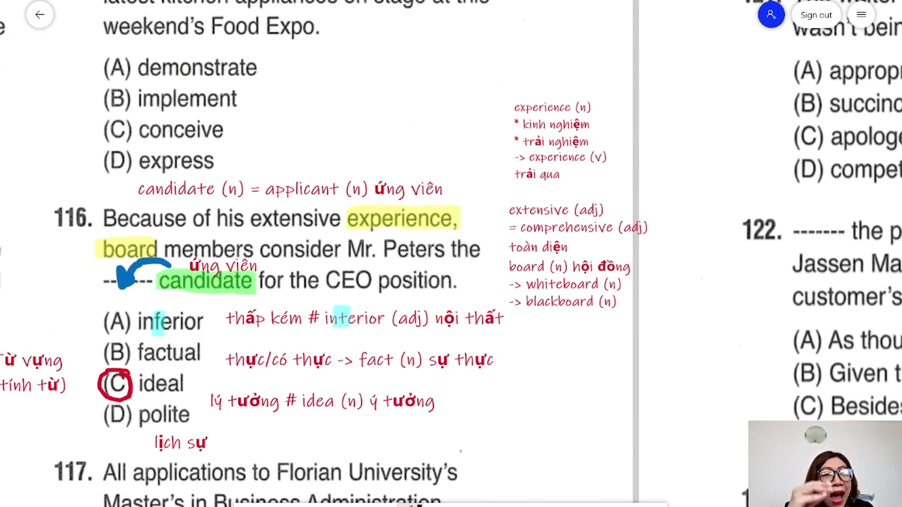

* **Đề bài:** `Because of his extensive experience, board members consider Mr. Peters the ------- candidate for the CEO position.`
* **Phương án:**
  * (A) inferior: Tính từ (thấp kém, kém cỏi hơn).
  * (B) factual: Tính từ (dựa trên sự thật, có thực).
  * (C) ideal: Tính từ (lý tưởng).
  * (D) polite: Tính từ (lịch sự, lễ phép).
* **Phân tích:** 
  * Cả bốn phương án đều là tính từ bổ nghĩa cho danh từ `candidate` (ứng viên).
  * Mệnh đề nguyên nhân mở đầu bằng `Because of his extensive experience` (bởi vì kinh nghiệm sâu rộng của ông ấy). Khi một nhân sự sở hữu kinh nghiệm dày dặn, các thành viên hội đồng quản trị (`board members`) sẽ đánh giá người đó là ứng viên lý tưởng (`ideal candidate`) cho vị trí Tổng giám đốc điều hành (`CEO position`).
  * Loại (A) vì `inferior` mang nghĩa tiêu cực (thấp kém, kém hơn). Cần phân biệt `inferior` với `interior` (tính từ/danh từ: nội thất, xuất hiện thường xuyên trong Part 1 Listening).
  * Loại (B) vì `factual` xuất phát từ danh từ `fact` (sự thật), dùng cho dữ liệu, báo cáo chứng cứ (`factual report`), không dùng miêu tả phẩm chất năng lực của ứng viên.
  * Loại (D) vì `polite` chỉ nét tính cách lịch sự giao tiếp thông thường, không thể hiện năng lực chuyên môn để tương xứng với kinh nghiệm sâu rộng.
  * Chọn (C).
* **Dịch nghĩa:** Nhờ vào kinh nghiệm sâu rộng của mình, các thành viên hội đồng quản trị đánh giá ông Peters là ứng viên lý tưởng cho vị trí Giám đốc điều hành.
* **Mở rộng:**
  * `extensive experience` = `comprehensive experience`: Kinh nghiệm sâu rộng, toàn diện.
  * `candidate` (n) = `applicant`: Ứng viên xin việc.
  * `board` (n): Hội đồng, ban quản trị. Khi đi kèm từ chỉ màu sắc mới mang nghĩa tấm bảng: `whiteboard` (bảng trắng), `blackboard` (bảng đen).
  * `ideal` (adj): Lý tưởng (mẹo ghi nhớ: thêm chữ "l" vào sau `idea` - ý tưởng tạo thành "lý tưởng").

---

### [[10:37](https://youtu.be/dlXA0dw6Lnk?t=637s)] Câu 117

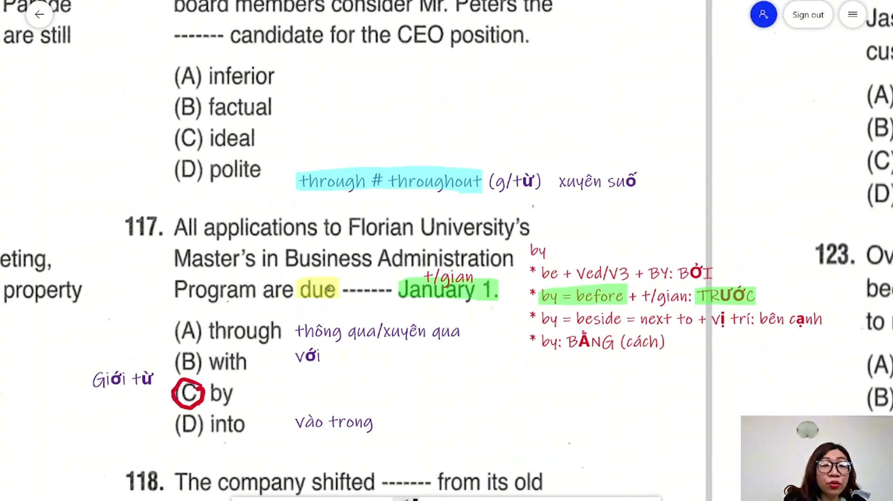

* **Đề bài:** `All applications to Florian University's Master's in Business Administration Program are due ------- January 1.`
* **Phương án:**
  * (A) through: Giới từ (thông qua, xuyên qua).
  * (B) with: Giới từ (với, cùng với).
  * (C) by: Giới từ (trước + mốc thời gian / bởi / bên cạnh).
  * (D) into: Giới từ (vào bên trong).
* **Phân tích:**
  * Phía sau chỗ trống là mốc thời gian cụ thể `January 1` (ngày 1 tháng 1), phía trước là tính từ `due` (đến hạn).
  * Trong tiếng Anh học thuật và thương mại, cấu trúc `be due by + mốc thời gian` mang nghĩa phải nộp hoặc hoàn tất trước thời điểm đó (`by = before + thời gian`).
  * Loại (A) vì `through` mang nghĩa xuyên qua không gian hoặc thông qua phương tiện, không kết hợp với `due` để ấn định hạn chót ngày tháng. Phân biệt với `throughout` (xuyên suốt khoảng thời gian hoặc khắp nơi).
  * Loại (B) và (D) vì không có chức năng thiết lập thời hạn chót cho hồ sơ ứng tuyển.
  * Chọn (C).
* **Dịch nghĩa:** Toàn bộ hồ sơ ứng tuyển vào chương trình Thạc sĩ Quản trị Kinh doanh của Đại học Florian đều phải được nộp trước ngày 1 tháng 1.
* **Mở rộng:**
  * Bốn chức năng cốt lõi của giới từ `by`:
    1. `by = before + mốc thời gian`: Trước thời điểm nào (`due by January 1`).
    2. `be + V3/ed + by`: Bởi ai/cái gì (thể bị động).
    3. `by = beside = next to + địa điểm`: Bên cạnh vị trí nào.
    4. `by + V-ing / phương tiện`: Bằng cách nào, bằng phương tiện gì.
  * `Master's in Business Administration (MBA)`: Bằng Thạc sĩ Quản trị Kinh doanh.

---

### [[20:14](https://youtu.be/dlXA0dw6Lnk?t=1214s)] Câu 118

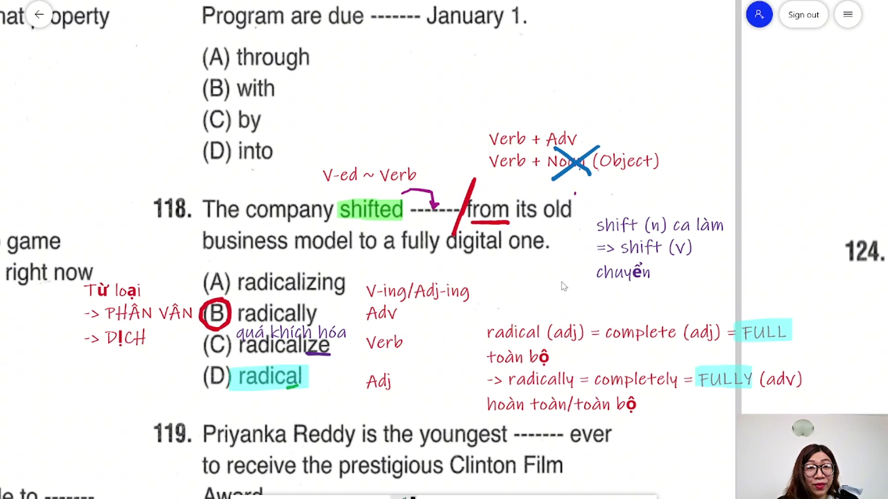

* **Đề bài:** `The company shifted ------- from its old business model to a fully digital one.`
* **Phương án:**
  * (A) radicalizing: Động từ thêm đuôi `-ing` / Tính từ phân từ.
  * (B) radically: Trạng từ (hoàn toàn, triệt để).
  * (C) radicalize: Động từ nguyên mẫu (quá khích hóa, biến đổi căn bản).
  * (D) radical: Tính từ (căn bản, toàn bộ).
* **Phân tích:**
  * Cấu trúc câu: Chủ ngữ `The company` + Động từ quá khứ `shifted` + Chỗ trống + Cụm giới từ `from its old business model to a fully digital one`.
  * Sau động từ `shifted`, nếu là ngoại động từ thì cần tân ngữ trực tiếp. Tuy nhiên phía sau chỗ trống là giới từ `from` (bắt đầu một cụm trạng ngữ chỉ sự chuyển dịch nguồn gốc), do đó vị trí này bắt buộc phải là một **Trạng từ (Adverb)** để bổ nghĩa trực tiếp cho động từ `shifted`.
  * Trạng từ duy nhất trong bốn phương án là (B) `radically` (đuôi `-ly`).
  * Loại (A), (C), (D) do sai lệch về mặt ngữ pháp từ loại.
  * Chọn (B).
* **Dịch nghĩa:** Công ty đã chuyển đổi một cách triệt để từ mô hình kinh doanh cũ sang một mô hình hoàn toàn số hóa.
* **Mở rộng:**
  * `radical` (adj) = `complete` = `total`: Toàn bộ, căn bản, triệt để.
  * `radically` (adv) = `completely` = `fully`: Hoàn toàn, một cách triệt để.
  * `shift` (v): Chuyển đổi, thay đổi hướng đi; `shift` (n): Ca làm việc trong nhà máy/văn phòng (`day shift`, `night shift`).
  * `one` ở cuối câu là đại từ thay thế cho danh từ `business model` đã nhắc tới trước đó để tránh lặp từ.

---

### [[23:00](https://youtu.be/dlXA0dw6Lnk?t=1380s)] Câu 119

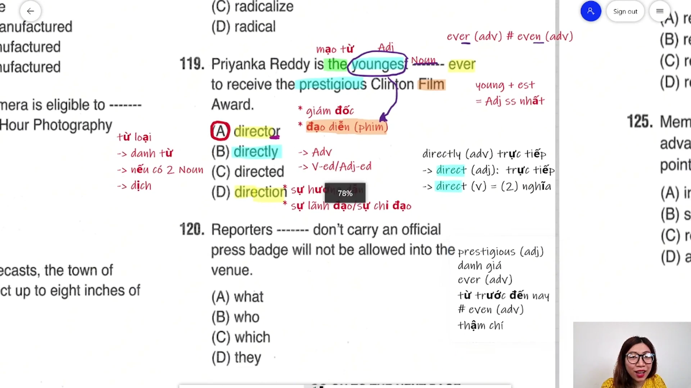

* **Đề bài:** `Priyanka Reddy is the youngest ------- ever to receive the prestigious Clinton Film Award.`
* **Phương án:**
  * (A) director: Danh từ chỉ người (đạo diễn, giám đốc).
  * (B) directly: Trạng từ (một cách trực tiếp).
  * (C) directed: Động từ quá khứ / Phân từ (đã chỉ đạo).
  * (D) direction: Danh từ chỉ sự vật/khái niệm (phương hướng, sự hướng dẫn).
* **Phân tích:**
  * Nhận diện cụm danh từ: `the` (mạo từ) + `youngest` (tính từ so sánh nhất) + Chỗ trống + `ever to receive...`. Vị trí chỗ trống bắt buộc là một **Danh từ (Noun)** làm trung tâm của cụm danh từ.
  * Bốn phương án có hai danh từ: (A) `director` (danh từ chỉ người) và (D) `direction` (danh từ chỉ sự hướng dẫn, chỉ đạo).
  * Xét ngữ cảnh ý nghĩa: Chủ ngữ là tên riêng người `Priyanka Reddy`, hành động phía sau là `to receive the prestigious Clinton Film Award` (nhận giải thưởng điện ảnh Clinton danh giá). Giải thưởng nghệ thuật điện ảnh trao tặng cho cá nhân nhà làm phim, do đó danh từ phù hợp duy nhất là đạo diễn phim (`director`).
  * Loại (D) vì sự hướng dẫn (`direction`) không thể là đối tượng nhận giải thưởng điện ảnh.
  * Loại (B) và (C) vì không phù hợp từ loại.
  * Chọn (A).
* **Dịch nghĩa:** Priyanka Reddy là đạo diễn trẻ tuổi nhất từ trước đến nay nhận được Giải thưởng Điện ảnh Clinton danh giá.
* **Mở rộng:**
  * `prestigious` (adj): Có uy tín cao, danh giá, lừng lẫy.
  * `ever` (adv): Từ trước đến nay (dùng bổ trợ nhấn mạnh trong cấu trúc so sánh nhất). Phân biệt với `even` (adv: thậm chí).
  * `direct` (v): Chỉ đạo, đạo diễn; `direct` (adj): Trực tiếp.
  * `direction` (n): Ngoài nghĩa phương hướng còn mang nghĩa sự chỉ đạo/hướng dẫn chuyên môn.

---

### [[32:58](https://youtu.be/dlXA0dw6Lnk?t=1978s)] Câu 120

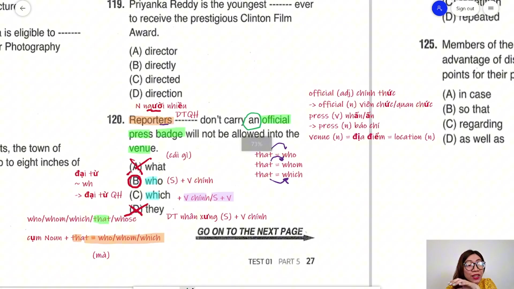

* **Đề bài:** `Reporters ------- don't carry an official press badge will not be allowed into the venue.`
* **Phương án:**
  * (A) what: Đại từ nghi vấn / Từ mở đầu mệnh đề danh ngữ.
  * (B) who: Đại từ quan hệ chỉ người làm chủ ngữ.
  * (C) which: Đại từ quan hệ chỉ vật.
  * (D) they: Đại từ nhân xưng chủ ngữ.
* **Phân tích:**
  * Phân tích cấu trúc câu:
    * Chủ ngữ chính của câu: `Reporters` (các phóng viên - danh từ số nhiều chỉ người).
    * Vị ngữ chính của câu: `will not be allowed into the venue` (sẽ không được phép vào địa điểm).
    * Xen giữa là mệnh đề quan hệ bổ nghĩa: `------- don't carry an official press badge`.
  * Sau chỗ trống là động từ phụ `don't carry`, do đó vị trí này cần một đại từ quan hệ thay thế cho danh từ chỉ người `Reporters` và giữ chức năng làm chủ ngữ trong mệnh đề quan hệ. Đại từ phù hợp duy nhất là `who`.
  * Loại (A) vì `what` không có chức năng làm đại từ quan hệ bổ nghĩa cho danh từ đứng trước.
  * Loại (C) vì `which` chỉ bổ nghĩa cho danh từ chỉ sự vật, hiện tượng.
  * Loại (D) vì nếu điền `they`, câu sẽ có hai chủ ngữ độc lập đứng liền nhau (`Reporters they don't carry...`) tạo thành lỗi ngữ pháp nghiêm trọng.
  * Chọn (B).
* **Dịch nghĩa:** Những phóng viên nào không mang theo thẻ báo chí chính thức sẽ không được phép bước vào địa điểm tổ chức.
* **Mở rộng:**
  * `that`: Có thể thay thế cho `who`, `whom`, `which` trong mệnh đề quan hệ xác định (không có dấu phẩy ngăn cách).
  * `press badge` (n): Thẻ nhà báo, thẻ phóng viên.
  * `official` (adj): Chính thức; `official` (n): Viên chức, quan chức chính phủ.
  * `press` (n): Báo chí, giới truyền thông; `press` (v): Nhấn, ấn nút.
  * `venue` (n) = `location`: Địa điểm tổ chức hội nghị, sự kiện.

---

### [[40:25](https://youtu.be/dlXA0dw6Lnk?t=2425s)] Câu 121

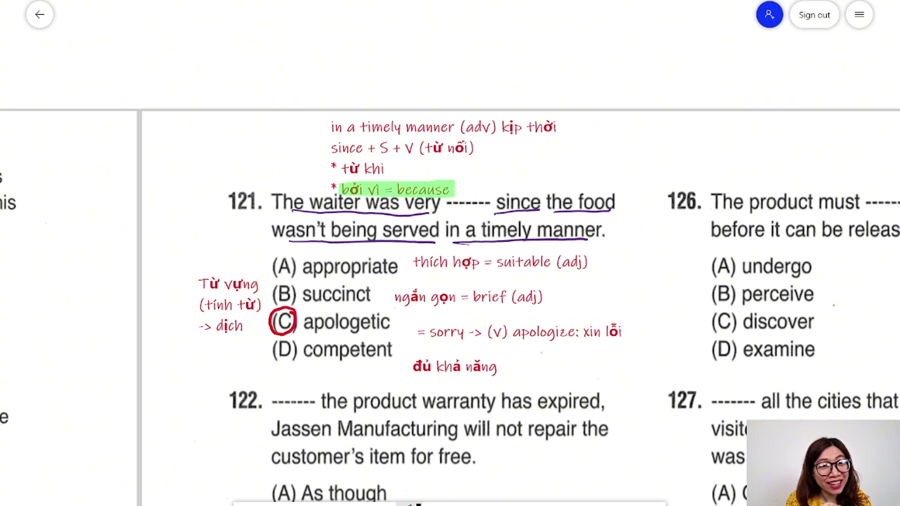

* **Đề bài:** `The waiter was very ------- since the food wasn't being served in a timely manner.`
* **Phương án:**
  * (A) appropriate: Tính từ (thích hợp, phù hợp).
  * (B) succinct: Tính từ (ngắn gọn, súc tích).
  * (C) apologetic: Tính từ (cảm thấy có lỗi, tỏ ý xin lỗi).
  * (D) competent: Tính từ (có đủ năng lực, thành thạo).
* **Phân tích:**
  * Bốn phương án đều là tính từ đứng sau `was very` để miêu tả thái độ của chủ ngữ `The waiter` (người phục vụ bàn).
  * Mệnh đề nguyên nhân phía sau giải thích rõ lý do: `since the food wasn't being served in a timely manner` (vì món ăn đã không được phục vụ kịp thời).
  * Khi thức ăn bị chậm trễ khiến khách hàng phải chờ đợi, phản ứng hợp lý về mặt tâm lý và dịch vụ khách hàng là người phục vụ phải bày tỏ sự hối lỗi, xin lỗi khách (`apologetic`).
  * Loại (A) vì `appropriate` = `suitable` thường miêu tả trang phục, hành vi, biện pháp có phù hợp với hoàn cảnh hay không, không dùng miêu tả thái độ nhận lỗi của con người.
  * Loại (B) vì `succinct` = `brief` dùng miêu tả văn bản, tóm tắt, câu trả lời ngắn gọn.
  * Loại (D) vì `competent` miêu tả người có đủ trình độ chuyên môn để làm việc, không khớp với ngữ cảnh đồ ăn phục vụ chậm.
  * Chọn (C).
* **Dịch nghĩa:** Người phục vụ đã tỏ ra rất hối lỗi vì món ăn đã không được phục vụ một cách kịp thời.
* **Mở rộng:**
  * `in a timely manner` (adv phrase): Một cách kịp thời, đúng lúc.
  * `apologetic` (adj): Tỏ ý xin lỗi -> động từ: `apologize to sb for sth` (xin lỗi ai về điều gì).
  * `since` (+ S + V): Có hai nét nghĩa chính trong TOEIC:
    1. Bởi vì (= `because`, = `as`): Dùng trong câu 121 này.
    2. Kể từ khi: Đi kèm mệnh đề quá khứ đơn, mệnh đề chính chia hiện tại hoàn thành.

---

### [[45:08](https://youtu.be/dlXA0dw6Lnk?t=2708s)] Câu 122

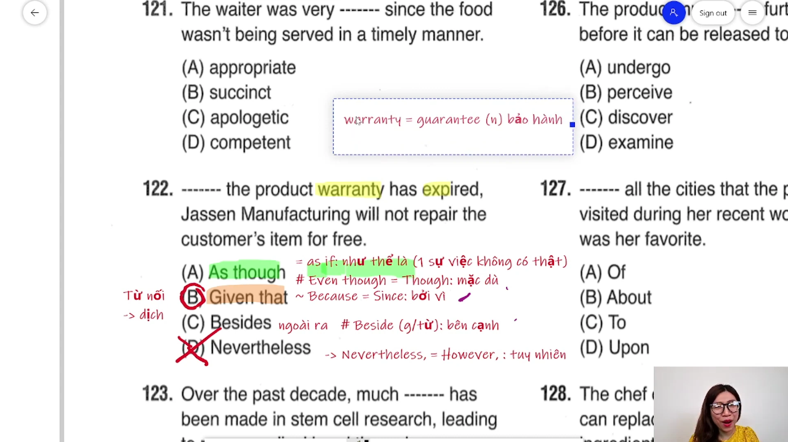

* **Đề bài:** `------- the product warranty has expired, Jassen Manufacturing will not repair the customer's item for free.`
* **Phương án:**
  * (A) As though: Liên từ phụ thuộc (như thể là).
  * (B) Given that: Liên từ phụ thuộc (xét thấy rằng, bởi vì).
  * (C) Besides: Trạng từ liên kết / Giới từ (ngoài ra, bên cạnh đó).
  * (D) Nevertheless: Trạng từ liên kết (tuy nhiên).
* **Phân tích:**
  * Cấu trúc câu gồm hai mệnh đề hoàn chỉnh ngăn cách bởi dấu phẩy: Mệnh đề 1 `the product warranty has expired` (thời hạn bảo hành sản phẩm đã hết) và Mệnh đề 2 `Jassen Manufacturing will not repair the customer's item for free` (Hãng sản xuất Jassen sẽ không sửa miễn phí món đồ của khách).
  * Hai mệnh đề có mối quan hệ nguyên nhân - kết quả trực tiếp: Vì bảo hành hết hạn nên công ty không sửa miễn phí. Cần một liên từ phụ thuộc chỉ nguyên nhân.
  * `Given that` mang nghĩa "xét thấy rằng, bởi vì" (= `Because` = `Since`), đứng đầu mệnh đề phụ chỉ lý do hoàn toàn chính xác.
  * Loại (A) vì `As though` = `As if` (như thể là) dùng miêu tả sự việc giả định không có thật. Tránh nhầm lẫn với `Even though` / `Though` (mặc dù).
  * Loại (C) vì `Besides` mang nghĩa "ngoài ra" (bổ sung thông tin), không diễn đạt nguyên nhân.
  * Loại (D) vì `Nevertheless` = `However` (tuy nhiên) là trạng từ liên kết, khi đứng đầu câu phải có dấu phẩy ngăn cách ngay sau nó (`Nevertheless, S + V`), không dùng làm liên từ nối hai mệnh đề phụ thuộc.
  * Chọn (B).
* **Dịch nghĩa:** Do thời hạn bảo hành của sản phẩm đã hết hạn, Công ty Sản xuất Jassen sẽ không sửa chữa miễn phí món đồ của khách hàng.
* **Mở rộng:**
  * `warranty` = `guarantee` (n): Sự bảo hành, phiếu bảo hành.
  * `expire` (v): Hết hiệu lực, hết hạn -> danh từ: `expiration date` (ngày hết hạn).
  * `for free` = `free of charge` = `complimentary`: Miễn phí, không tính tiền.
  * Phân biệt: `Beside` (giới từ: ở bên cạnh vị trí) khác `Besides` (ngoài ra, thêm vào đó).

---

### [[52:40](https://youtu.be/dlXA0dw6Lnk?t=3160s)] Câu 123

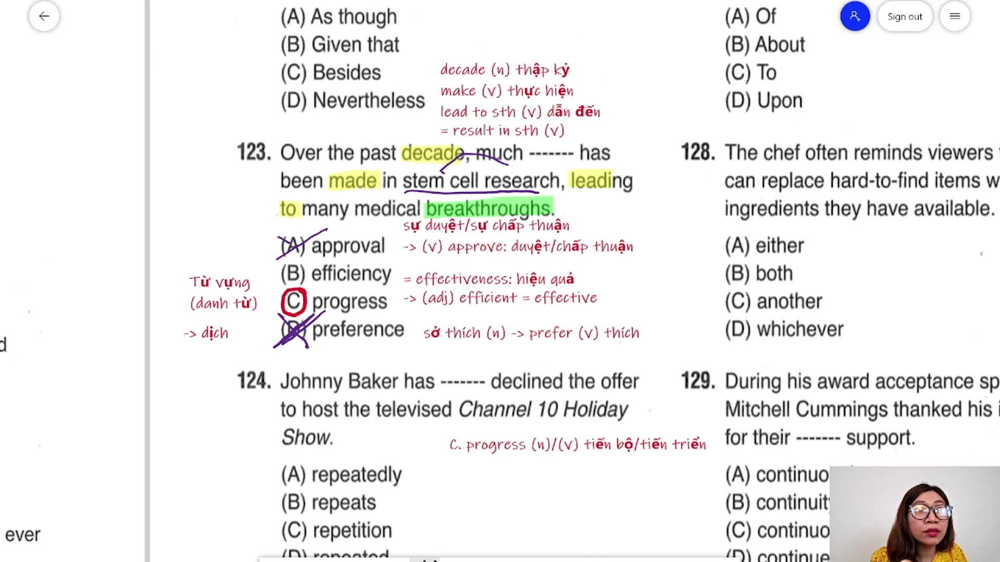

* **Đề bài:** `Over the past decade, much ------- has been made in stem cell research, leading to many medical breakthroughs.`
* **Phương án:**
  * (A) approval: Danh từ (sự phê duyệt, sự chấp thuận).
  * (B) efficiency: Danh từ (tính hiệu quả, năng suất).
  * (C) progress: Danh từ / Động từ (sự tiến bộ, tiến triển).
  * (D) preference: Danh từ (sở thích, sự ưu tiên).
* **Phân tích:**
  * Phía trước chỗ trống có lượng từ `much` (chỉ đi với danh từ không đếm được). Phía sau là cụm động từ bị động `has been made`.
  * Trong tiếng Anh, cụm kết hợp từ cố định là `make progress` (đạt được sự tiến bộ, có bước phát triển). Khi chuyển sang thể bị động sẽ có cấu trúc: `progress has been made`.
  * Xét ngữ cảnh toàn câu: "Trong suốt thập kỷ qua, nhiều tiến bộ đã đạt được trong nghiên cứu tế bào gốc (`stem cell research`), dẫn đến nhiều đột phá y học (`medical breakthroughs`)". Từ duy nhất thỏa mãn ngữ pháp và ngữ nghĩa là `progress`.
  * Loại (A) vì sự chấp thuận (`approval`) không đi với kết quả đột phá y học và không tạo cụm tự nhiên với `make`.
  * Loại (B) vì tính hiệu quả thường dùng cấu trúc `improve efficiency` (cải thiện hiệu quả), không dùng `make efficiency`.
  * Loại (D) vì `preference` (sở thích) xuất phát từ động từ `prefer`, không phù hợp với ngữ cảnh nghiên cứu khoa học.
  * Chọn (C).
* **Dịch nghĩa:** Trong suốt một thập kỷ qua, nhiều tiến bộ vượt bậc đã đạt được trong nghiên cứu tế bào gốc, dẫn đến nhiều bước đột phá trong y học.
* **Mở rộng:**
  * `progress` (n/v): Vừa là danh từ không đếm được, vừa là động từ (tiến bộ, tiến triển).
  * `decade` (n): Thập kỷ (giai đoạn 10 năm).
  * `lead to sth` = `result in sth`: Dẫn đến kết quả gì.
  * `breakthrough` (n): Bước đột phá mang tính cách mạng.
  * `efficiency` = `effectiveness` (n): Tính hiệu quả -> tính từ: `efficient` / `effective`.
  * `preference` (n): Phát âm chuẩn là /ˈprefrəns/ (không đọc là /prɪˈfɜːrəns/).

---

### [[01:14:48](https://youtu.be/dlXA0dw6Lnk?t=4488s)] Câu 124

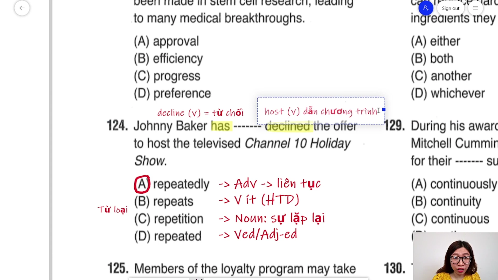

* **Đề bài:** `Johnny Baker has ------- declined the offer to host the televised Channel 10 Holiday Show.`
* **Phương án:**
  * (A) repeatedly: Trạng từ (liên tục, lặp đi lặp lại).
  * (B) repeats: Động từ số ít ở thì hiện tại đơn.
  * (C) repetition: Danh từ (sự lặp lại).
  * (D) repeated: Động từ quá khứ / Tính từ phân từ.
* **Phân tích:**
  * Câu hỏi thuộc nhóm từ loại thuần túy.
  * Cấu trúc vị ngữ: Trợ động từ `has` + Chỗ trống + Động từ quá khứ phân từ `declined`.
  * Quy tắc bất biến trong ngữ pháp: Vị trí đứng xen kẽ giữa trợ động từ và động từ chính (`have/has + Adv + V3/ed`) trong thì hiện tại hoàn thành bắt buộc phải là một **Trạng từ (Adverb)** nhằm bổ nghĩa cho hành động.
  * Trong bốn phương án, chỉ có (A) `repeatedly` có đuôi `-ly` là trạng từ.
  * Loại (B), (C), (D) ngay lập tức mà không cần dịch nghĩa toàn câu.
  * Chọn (A).
* **Dịch nghĩa:** Johnny Baker đã liên tục từ chối lời mời làm người dẫn chương trình cho Chương trình Ngày lễ được phát sóng trên Kênh 10.
* **Mở rộng:**
  * `decline` (v): Có hai nét nghĩa cực kỳ phổ biến trong đề thi:
    1. Từ chối (= `refuse`, `reject`): Từ chối lời đề nghị, thư mời.
    2. Sụt giảm (= `decrease`, `drop`): Giảm sút về số lượng, doanh số.
  * `host` (v): Đăng cai, làm người dẫn chương trình; `host` (n): Chủ nhà, người dẫn chương trình.
  * `televised` (adj): Được ghi hình và phát sóng trên truyền hình.

---

### [[01:19:00](https://youtu.be/dlXA0dw6Lnk?t=4740s)] Câu 125

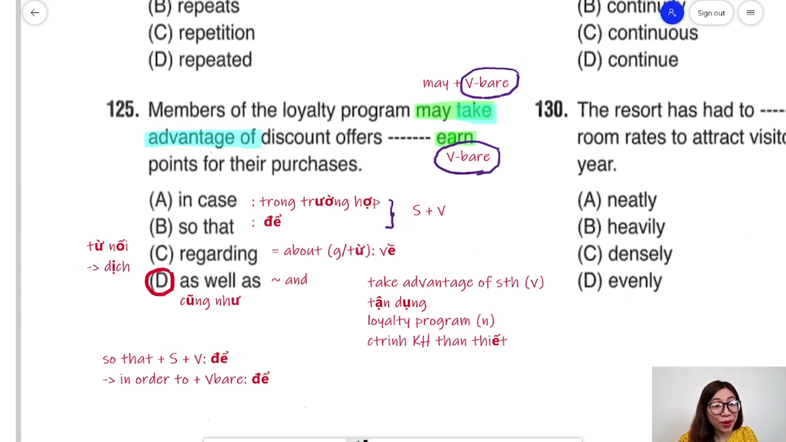

* **Đề bài:** `Members of the loyalty program may take advantage of discount offers ------- earn points for their purchases.`
* **Phương án:**
  * (A) in case: Liên từ (+ Mệnh đề: phòng khi, trong trường hợp).
  * (B) so that: Liên từ (+ Mệnh đề: để mà).
  * (C) regarding: Giới từ (+ Cụm Noun: về, liên quan tới).
  * (D) as well as: Liên từ tương quan (~ `and`: cũng như).
* **Phân tích:**
  * Quan sát động từ trước và sau chỗ trống:
    * Trước chỗ trống: `may take advantage of discount offers` (động từ khiếm khuyết `may` + động từ nguyên mẫu không to `take`).
    * Sau chỗ trống: `earn points for their purchases` (động từ nguyên mẫu không to `earn`).
  * Đây là cấu trúc song hành (Parallel structure) nối hai cụm động từ nguyên mẫu cùng phụ thuộc vào động từ khiếm khuyết `may` (`may [take...] and [earn...]`).
  * Liên từ `as well as` có chức năng tương đương liên từ `and` (cũng như), cho phép liên kết hai động từ nguyên mẫu: `may take... as well as earn...`.
  * Loại (A) và (B) vì `in case` và `so that` là liên từ đòi hỏi một mệnh đề hoàn chỉnh có chủ ngữ và vị ngữ (`S + V`). Nếu muốn dùng chỉ mục đích với động từ nguyên mẫu thì phải là `in order to + V-bare`.
  * Loại (C) vì `regarding` = `about` là giới từ, phía sau phải đi kèm danh từ hoặc danh động từ `V-ing`.
  * Chọn (D).
* **Dịch nghĩa:** Các hội viên của chương trình khách hàng thân thiết có thể tận dụng các ưu đãi giảm giá cũng như tích lũy điểm thưởng cho các lần mua sắm của họ.
* **Mở rộng:**
  * `take advantage of sth`: Tận dụng cơ hội, ưu đãi hoặc lợi thế của cái gì.
  * `loyalty program` (n): Chương trình khách hàng thân thiết (tích điểm đổi quà).
  * `purchase` (n): Món hàng đã mua; `purchase` (v): Mua sắm (= `buy`).
  * `so that + S + V` = `in order that + S + V` (để mà) -> rút gọn sang động từ: `in order to + V-bare` = `so as to + V-bare`.

---

### [[01:25:58](https://youtu.be/dlXA0dw6Lnk?t=5158s)] Câu 126

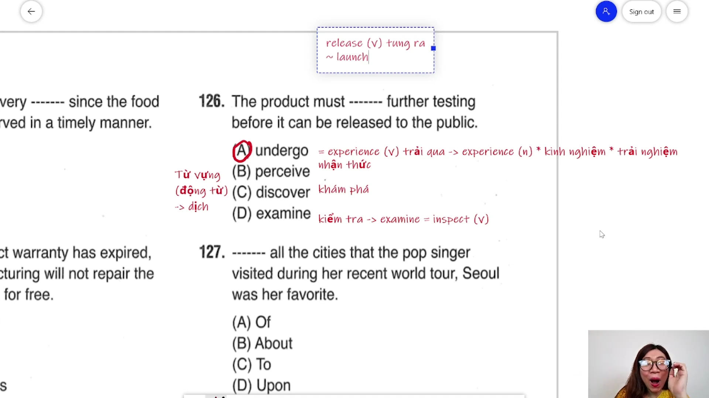

* **Đề bài:** `The product must ------- further testing before it can be released to the public.`
* **Phương án:**
  * (A) undergo: Động từ (trải qua).
  * (B) perceive: Động từ (nhận thức, hiểu thấu).
  * (C) discover: Động từ (khám phá, tìm ra).
  * (D) examine: Động từ (kiểm tra, sát hạch).
* **Phân tích:**
  * Bốn phương án đều là động từ nguyên mẫu đứng sau động từ khiếm khuyết `must`.
  * Tân ngữ phía sau chỗ trống là `further testing` (các bài kiểm tra/thử nghiệm thêm), chủ ngữ là `The product` (sản phẩm).
  * Sản phẩm là đối tượng vô tri vô giác, không thể tự thực hiện hành động "kiểm tra" (`examine`) hay "khám phá" (`discover`). Sản phẩm chỉ có thể "trải qua" một quá trình kiểm định trước khi được phát hành ra thị trường (`undergo testing`).
  * `undergo` = `experience`: Trải qua các quy trình kiểm tra, cải tiến, bảo dưỡng hoặc phẫu thuật.
  * Loại (B) vì `perceive` chỉ hoạt động nhận thức của tâm trí con người.
  * Loại (C) vì `discover` chỉ việc con người tìm thấy vùng đất, quy luật hoặc đồ vật mới.
  * Loại (D) vì `examine` = `inspect` (kiểm tra) chỉ dành cho người thực hiện thao tác kiểm tra, nếu dùng cho sản phẩm phải ở dạng bị động (`must be examined`).
  * Chọn (A).
* **Dịch nghĩa:** Sản phẩm phải trải qua các đợt kiểm nghiệm kỹ hơn trước khi có thể được tung ra thị trường công chúng.
* **Mở rộng:**
  * Các cụm từ kết hợp kinh điển với `undergo`:
    * `undergo testing`: Trải qua kiểm tra.
    * `undergo maintenance`: Trải qua bảo trì.
    * `undergo renovation`: Trải qua nâng cấp, sửa chữa.
    * `undergo inspection`: Trải qua thanh tra.
  * `release` (v) = `launch`: Tung ra thị trường, phát hành sản phẩm.

---

### [[01:30:14](https://youtu.be/dlXA0dw6Lnk?t=5414s)] Câu 127

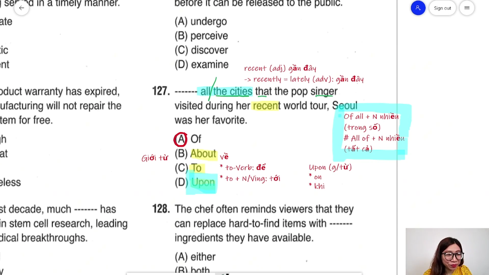

* **Đề bài:** `------- all the cities that the pop singer visited during her recent world tour, Seoul was her favorite.`
* **Phương án:**
  * (A) Of: Giới từ (trong số).
  * (B) About: Giới từ (về).
  * (C) To: Giới từ (đến, tới).
  * (D) Upon: Giới từ (ngay khi, vào lúc).
* **Phân tích:**
  * Quan sát cấu trúc mở đầu câu: Chỗ trống đứng trước cụm `all the cities that the pop singer visited...` và theo sau là mệnh đề chính `Seoul was her favorite` (Seoul là nơi cô ấy yêu thích nhất).
  * Trong ngữ pháp tiếng Anh, cấu trúc `Of all + Danh từ số nhiều` đứng ở đầu câu mang ý nghĩa "Trong số tất cả...", dùng để giới hạn tập hợp đối tượng mà từ đó một đối tượng tiêu biểu được lựa chọn hoặc so sánh cao nhất.
  * Phân biệt rõ rệt hai cấu trúc:
    * `Of all the + N số nhiều`: Đóng vai trò là cụm giới từ chỉ phạm vi (trong số tất cả), theo sau bắt buộc phải có mệnh đề chính riêng biệt (`Of all the cities..., Seoul was...`).
    * `All of the + N số nhiều`: Đóng vai trò là cụm chủ ngữ hoàn chỉnh của câu (`All of the cities were beautiful`).
  * Loại (B), (C), (D) vì không có ý nghĩa thiết lập phạm vi so sánh tuyển chọn.
  * Chọn (A).
* **Dịch nghĩa:** Trong số tất cả các thành phố mà nữ ca sĩ nhạc pop đã ghé thăm trong chuyến lưu diễn thế giới gần đây, Seoul là nơi cô ấy yêu thích nhất.
* **Mở rộng:**
  * Cấu trúc nhận diện nhanh: `Of all + N số nhiều, S + be + (the best / favorite / most...)`.
  * `recent` (adj): Gần đây -> trạng từ: `recently` = `lately`: Dạo gần đây (dấu hiệu nhận biết thì hiện tại hoàn thành).
  * `Upon` (preposition) = `On` / `When`: Ngay khi (`Upon arrival`: ngay khi đến nơi).

---

### [[01:36:49](https://youtu.be/dlXA0dw6Lnk?t=5809s)] Câu 128

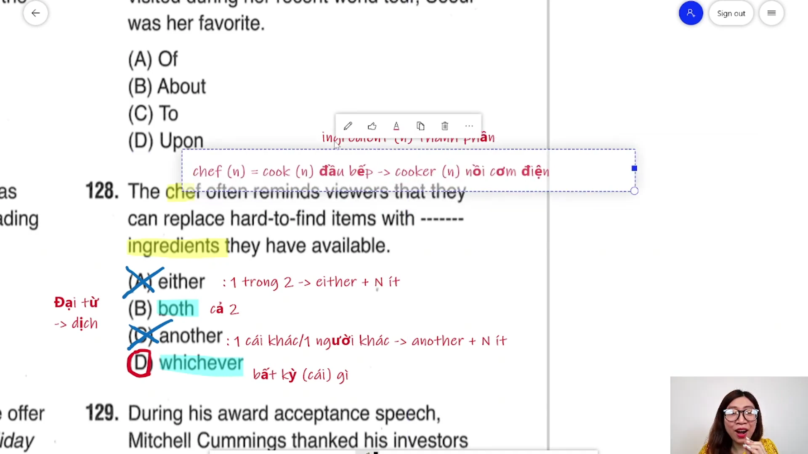

* **Đề bài:** `The chef often reminds viewers that they can replace hard-to-find items with ------- ingredients they have available.`
* **Phương án:**
  * (A) either: Đại từ / Từ hạn định (một trong hai).
  * (B) both: Đại từ / Từ hạn định (cả hai).
  * (C) another: Đại từ / Từ hạn định (một cái khác / một người khác).
  * (D) whichever: Đại từ / Từ hạn định (bất cứ thứ nào).
* **Phân tích:**
  * Phía sau chỗ trống là danh từ số nhiều `ingredients` (các nguyên liệu), theo sau bởi mệnh đề quan hệ xác định `they have available` (họ đang có sẵn).
  * Loại trừ dựa trên ngữ pháp số ít/số nhiều:
    * (A) `either` chỉ đi với danh từ đếm được số ít (`either + N số ít`: 1 trong 2). Loại.
    * (C) `another` chỉ đi với danh từ đếm được số ít (`another + N số ít`: 1 cái khác). Loại.
  * Còn lại (B) `both` và (D) `whichever`:
    * `both` có nghĩa là "cả hai", chỉ được sử dụng khi ngữ cảnh trước đó đã xác định cụ thể chính xác hai nguyên liệu. Câu văn mang tính khái quát chung ("bất kỳ nguyên liệu nào mà người xem có sẵn trong bếp"), không giới hạn số lượng hai.
    * `whichever + N` mang nghĩa "bất kỳ cái gì", hoàn toàn phù hợp với lời khuyên nấu ăn linh hoạt của đầu bếp.
  * Chọn (D).
* **Dịch nghĩa:** Đầu bếp thường nhắc nhở người xem rằng họ có thể thay thế những nguyên liệu khó tìm bằng bất kỳ nguyên liệu nào họ đang có sẵn.
* **Mở rộng:**
  * `chef` (n) = `cook`: Đầu bếp chuyên nghiệp. Tuyệt đối không nhầm với `cooker` (n: nồi nấu, nồi cơm điện).
  * `ingredient` (n): Nguyên liệu, thành phần món ăn hoặc sản phẩm.
  * `hard-to-find` (compound adj): Khó tìm thấy.
  * `available` (adj): Có sẵn, sẵn sàng để sử dụng (thường đứng sau danh từ để bổ nghĩa: `items available`).

---

### [[01:40:17](https://youtu.be/dlXA0dw6Lnk?t=6017s)] Câu 129

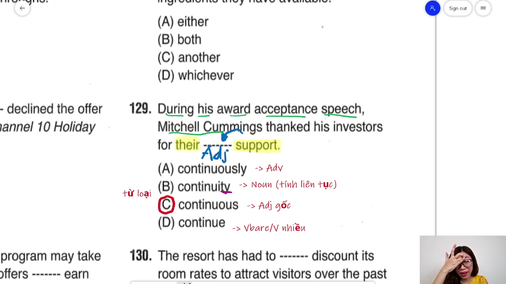

* **Đề bài:** `During his award acceptance speech, Mitchell Cummings thanked his investors for their ------- support.`
* **Phương án:**
  * (A) continuously: Trạng từ (liên tục, không ngớt).
  * (B) continuity: Danh từ (tính liên tục).
  * (C) continuous: Tính từ gốc (liên tục, không gián đoạn).
  * (D) continue: Động từ nguyên mẫu (tiếp tục).
* **Phân tích:**
  * Câu hỏi thuộc nhóm từ loại cơ bản.
  * Cấu trúc cụm danh từ: `their` (tính từ sở hữu - dấu hiệu mở đầu cụm danh từ) + Chỗ trống + `support` (danh từ đóng vai trò trung tâm cụm).
  * Vị trí đứng trước danh từ để bổ nghĩa trực tiếp cho danh từ bắt buộc phải là một **Tính từ (Adjective)**.
  * Phân biệt các hình thái từ:
    * (A) `continuously`: Trạng từ đuôi `-ly`.
    * (B) `continuity`: Danh từ đuôi `-ity`.
    * (C) `continuous`: Tính từ đuôi `-ous` (nhận diện tính từ bằng cách bỏ đuôi `-ly` từ trạng từ `continuously`).
    * (D) `continue`: Động từ.
  * Chọn (C).
* **Dịch nghĩa:** Trong bài phát biểu nhận giải thưởng của mình, Mitchell Cummings đã cảm ơn các nhà đầu tư vì sự ủng hộ liên tục không ngừng của họ.
* **Mở rộng:**
  * `acceptance speech` (compound noun): Bài diễn văn nhận giải thưởng.
  * `investor` (n): Nhà đầu tư -> động từ: `invest in sth` (đầu tư vào cái gì).
  * `continuous support` (collocation): Sự hỗ trợ liên tục, bền bỉ.
  * `during + Cụm danh từ`: Trong suốt (sự kiện, khoảng thời gian diễn ra bài phát biểu).

---

### [[01:42:37](https://youtu.be/dlXA0dw6Lnk?t=6157s)] Câu 130

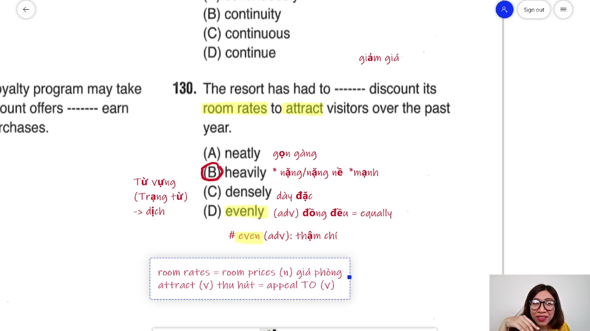

* **Đề bài:** `The resort has had to ------- discount its room rates to attract visitors over the past year.`
* **Phương án:**
  * (A) neatly: Trạng từ (gọn gàng, ngăn nắp).
  * (B) heavily: Trạng từ (mạnh, nặng nề, sâu sắc).
  * (C) densely: Trạng từ (dày đặc, đông đúc).
  * (D) evenly: Trạng từ (đồng đều, bằng nhau).
* **Phân tích:**
  * Bốn phương án đều là trạng từ đứng trước động từ `discount` (giảm giá, chiết khấu) để bổ nghĩa cho hành động.
  * Trong kinh doanh và thương mại, các hành động liên quan đến biến động tài chính, thuế, giảm giá hoặc cắt giảm chi phí khi xảy ra ở mức độ rất lớn sẽ đi kèm trạng từ `heavily` (`discount heavily` = giảm giá sâu/mạnh).
  * Loại (A) vì `neatly` miêu tả việc sắp xếp đồ đạc gọn gàng, chữ viết nắn nót.
  * Loại (C) vì `densely` chủ yếu dùng trong kết hợp `densely populated` (dân cư tập trung đông đúc, mật độ dày đặc).
  * Loại (D) vì `evenly` = `equally` mang nghĩa phân bổ đồng đều (chia đều). Phân biệt với `even` (trạng từ: thậm chí).
  * Chọn (B).
* **Dịch nghĩa:** Khu nghỉ dưỡng đã phải giảm giá mạnh giá phòng để thu hút du khách trong suốt năm vừa qua.
* **Mở rộng:**
  * `room rates` = `room prices`: Giá thuê phòng.
  * `attract` (v) = `appeal to` (v): Thu hút, lôi cuốn sự chú ý của khách hàng.
  * Các kết hợp từ phổ biến với `heavily`:
    * `discount heavily`: Giảm giá mạnh.
    * `rely heavily on sb/sth`: Phụ thuộc nặng nề vào ai/cái gì.
    * `rain heavily`: Mưa nặng hạt, mưa to.
    * `heavily taxed`: Bị đánh thuế rất nặng.

---

## Trích dẫn then chốt

* [[03:38](https://youtu.be/dlXA0dw6Lnk?t=218s)] "Trong TOEIC nó gồm hai yếu tố: Reading là phương pháp và từ vựng; Listening là phương pháp và phản xạ từ... phương pháp là cái cốt lõi để giúp đẩy điểm của mình lên."
* [[10:31](https://youtu.be/dlXA0dw6Lnk?t=632s)] "Quan trọng không phải là số lượng mà quan trọng nhất là đánh vô chất lượng. Giải vài câu thôi nhưng mình sửa kỹ thì mình sẽ cảm nhận được sự khác biệt của nó ngay."
* [[54:06](https://youtu.be/dlXA0dw6Lnk?t=3246s)] "Nhớ cho cô nha: dịch là đứng cuối cùng, học theo đúng ba bước: Đọc - Ghi - Dịch để kích hoạt phản xạ."
* [[01:35:26](https://youtu.be/dlXA0dw6Lnk?t=5727s)] "Một cái combo bất bại luôn là phương pháp và từ vựng, gom hai cái đó lại là mình sẽ đạt được số điểm mình mong muốn."
* [[01:45:18](https://youtu.be/dlXA0dw6Lnk?t=6318s)] "Tất cả mỗi part của TOEIC đều có phương pháp làm bài. Mình chỉ cần đổi cách tiếp cận theo đúng hướng TOEIC đang gài bẫy, mình sẽ vượt qua bẫy rất nhanh chóng."

---

## Lệnh & Công cụ

* **Vị trí trạng từ hoàn thành:** `S + have / has + [Trạng từ] + V3/ed + Tân ngữ`
* **Hạn chót thời gian:** `be + due + by + Mốc thời gian (ngày, giờ, tháng)`
* **Liên từ chỉ lý do:** `Given that + S + V, S + V` (= `Because` / `Since`)
* **Cụm động từ tiến triển:** `make progress in sth` -> Dạng bị động: `much progress has been made`
* **Liên từ song hành:** `may + V-bare (1) + as well as + V-bare (2)`
* **Ngoại động từ kiểm định:** `S (sản phẩm) + undergo + testing / inspection / renovation`
* **Giới từ xác lập phạm vi tuyển chọn:** `Of all the + Danh từ số nhiều, S + be + (most / favorite)`
* **Đại từ lựa chọn mở:** `replace A with + whichever + Danh từ số nhiều + S + have`
* **Vị trí tính từ cụm danh từ:** `Tính từ sở hữu (their / his / her) + [Tính từ gốc] + Danh từ`
* **Mức độ giảm giá thương mại:** `discount + heavily` (= giảm giá mạnh, chiết khấu sâu)
* **Quy tắc nhận diện tính từ nhanh:** `Trạng từ (-ly) bỏ đuôi -ly -> Tính từ gốc` (`continuously` -> `continuous`)

---

## Đánh đổi & Rủi ro

* **Bẫy dịch nghĩa toàn câu ở câu từ loại:** Tiêu tốn từ 20 đến 30 giây quý giá để dịch toàn bộ câu 118, 124 hoặc 129, trong khi chỉ cần nhận diện cấu trúc vị trí kẹp giữa trợ động từ (`has ------- declined -> repeatedly`) hoặc vị trí đứng trước danh từ sau tính từ sở hữu (`their ------- support -> continuous`) là có thể chốt đáp án chính xác trong vòng 5 giây.
* **Bẫy nhầm lẫn giữa `Of all` và `All of`:** Trong câu 127, thí sinh không nắm vững cấu trúc phạm vi tuyển chọn thường lúng túng khi thấy `all the cities` đứng đầu câu mà không có chủ ngữ, từ đó chọn nhầm các giới từ `About` hoặc `To` thay vì giới từ `Of`.
* **Bẫy lượng từ số ít và số nhiều:** Trong câu 128, thí sinh vội vàng nhìn thấy nghĩa "một trong hai" hoặc "cái khác" liền chọn ngay `either` hoặc `another`, bỏ qua quy tắc ngữ pháp nền tảng rằng cả hai từ hạn định này bắt buộc phải đi kèm danh từ số ít, trong khi đề bài cho danh từ số nhiều `ingredients`.
* **Bẫy nhầm lẫn từ đồng âm khác nghĩa:** Nhầm lẫn `inferior` (kém hơn, thấp kém) với `interior` (nội thất), hoặc nhầm lẫn `chef` (đầu bếp) với `cooker` (nồi cơm điện/bếp nấu).
* **Đánh đổi số lượng lấy chiều sâu đề giải:** Giải liên tục 10 đến 20 đề thi mới nhưng chỉ dò đáp án A, B, C, D một cách máy móc sẽ không giúp cải thiện điểm số. Ngược lại, tập trung phân tích triệt để 2 đến 3 đề trọng điểm, nắm chắc phương pháp tránh bẫy và mở rộng hệ thống từ vựng đa tầng nghĩa là con đường tăng điểm bền vững và tiết kiệm thời gian nhất.
