# MAX ĐIỂM LISTENING PART 2 [VIDEO 2]

* **Kênh:** Ms Thanh Toeic | **Thời lượng:** 00:56:59 | **Ngày:** 2026-08-19
* **Video:** https://youtu.be/Y6D_Fv6J_Ss

---

## Thuật ngữ

| Thuật ngữ | Tiếng Anh | Giải thích |
| :--- | :--- | :--- |
| Đề nghị giúp đỡ | Offer of Assistance | Câu chủ động đưa ra đề nghị hỗ trợ bằng cấu trúc I'd be happy to + V, phản hồi thường là chấp nhận lịch sự kèm điều kiện (Only if it's no trouble) hoặc từ chối khéo. |
| Câu trả lời gián tiếp | Indirect Response | Phản hồi không trả lời trực diện vào câu hỏi mà cung cấp thông tin liên đới, phản bác giả định hoặc hỏi ngược lại (Is it working again?). |
| Câu trần thuật | Statement | Câu kể đưa ra thông tin, đánh giá hoặc sự việc; đáp án đúng thường mang tính đồng tình, giải quyết vấn đề hoặc bổ sung nhu cầu thực tế. |
| Thể truyền khiến | Causative Form | Cấu trúc nhờ vả hoặc thuê dịch vụ: have / get + tân ngữ chỉ vật + V3/ed (have your appliance delivered). |
| Chỗ ngồi chỉ định | Assigned Seats | Ghế ngồi có số thứ tự được chỉ định sẵn cho từng người, trái ngược với hình thức ngồi tự do đến trước ngồi trước (first-come, first-served). |
| Bẫy lặp từ | Echo Trap | Phương án cố tình lặp lại từ vựng y hệt trong câu hỏi nhằm đánh lừa thí sinh nghe bắt từ (tỷ lệ sai 80-90%, ngoại trừ một số câu khó cuối đề). |
| Bẫy đồng âm | Homophone Trap | Thủ thuật dùng các từ phát âm tương tự hoặc cùng gốc nhưng mang nghĩa khác biệt hoàn toàn (repaving / repaid, repaired / pairs, in person / personal). |
| Bẫy sai đối tượng | Subject Mismatch | Phương án dùng sai đại từ nhân xưng hoặc lệch chủ thể thực hiện hành động (câu hỏi hỏi you nhưng câu trả lời dùng he/she). |
| Bẫy câu trả lời chung chung | Vague Trap | Phương án đưa ra câu trả lời sáo rỗng không cung cấp nguyên nhân cụ thể (That's why I bought them để bẫy câu hỏi Why). |
| Hiện tượng nối âm | Connected Speech | Hiện tượng phát âm tự nhiên nối phụ âm cuối từ trước với nguyên âm đầu từ sau trong tiếng Anh giao tiếp (take your, visit clients in person, asked for it). |

---

## Tổng luận chuyên đề

### Chiến thuật nghe

Nửa sau của Part 2 (từ Câu 21 đến Câu 31) là phân đoạn có độ phân loại cao nhất trong bài thi TOEIC Listening:
* **Tỷ lệ câu hỏi gián tiếp áp đảo:** Khoảng 70% đến 80% số câu ở chặng cuối không trả lời trực diện. Thí sinh chờ đợi câu trả lời khuôn mẫu (hỏi Who tìm tên người, hỏi Where tìm địa điểm, hỏi Why tìm Because) sẽ bị động hoàn toàn.
* **Quy tắc đồng tình ở câu trần thuật:** Khi gặp câu trần thuật đưa ra nhận định hoặc phương án, xác suất phương án đúng mang tính đồng tình hoặc hưởng ứng thông tin đạt khoảng 90%, trong khi hướng từ chối chỉ chiếm 10%.
* **Tư duy nghe theo cụm nghĩa:** Ở tốc độ nói tự nhiên, thí sinh không thể bắt kịp từng từ đơn lẻ mà phải nghe theo khối kết hợp từ (collocations) như `repaving the roadway`, `assigned seats`, `make space for merchandise`.

### Bẫy phản xạ

* **Bẫy đồng âm và gần âm:** Đề thi khai thác tối đa các cặp từ có âm thanh tương đồng nhưng nghĩa khác nhau để bẫy thí sinh nghe không rõ âm đuôi:
  * `repaving` (trải nhựa mặt đường) đối lập với `repaid` (hoàn trả tiền).
  * `repaired` (sửa chữa) đối lập với `a few pairs` (vài đôi).
  * `in person` (trực tiếp mặt đối mặt) đối lập với `personal invitation` (lời mời cá nhân).
* **Bẫy cùng gốc từ và biến thể từ loại:**
  * Cụm từ `in the end` (cuối cùng) bị bẫy bởi danh từ `ending` (phần kết phim/truyện).
  * Động từ `book` (đặt chỗ) bị bẫy bởi danh từ ghép `booking system` (hệ thống đặt vé).
* **Ngoại lệ lặp từ ở câu phân loại cao:** Mẹo loại trừ từ lặp chỉ chính xác khoảng 80-90%. Ở các câu khó cuối đề (Câu 29), từ khóa (`seats`) vẫn có thể xuất hiện trong đáp án đúng (`assigned seats`) nhằm đánh bẫy những thí sinh áp dụng mẹo một cách máy móc.

### Dạng câu hỏi

* **Câu đề nghị giúp đỡ (`I'd be happy to...`):** Người nói chủ động đề xuất hỗ trợ. Phương án phản hồi tự nhiên là chấp nhận sự giúp đỡ một cách lịch sự (`Only if it's no trouble`) hoặc cảm ơn (`I appreciate that`).
* **Câu hỏi lựa chọn (`Which...`):** Không nhất thiết phải chọn một trong các phương án được nêu. Câu trả lời gián tiếp phủ định hoàn toàn (`Actually, I chose not to get any`) là cấu trúc xuất hiện thường xuyên.
* **Câu hỏi phủ định (`Haven't you...?`, `Shouldn't we...?`):** Bản chất là câu hỏi xác nhận thông tin Yes/No. `No` mang nghĩa chưa làm hoặc không cần làm; `Yes` mang nghĩa đã làm hoặc cần làm.
* **Câu hỏi tần suất (`How often`):** Dấu hiệu nhận diện đáp án là các từ chỉ số lần (`once`, `twice`, `times` kèm theo chu kỳ `a month`, `a week`).
* **Câu hỏi nguyên nhân (`Why`):** Dạng phản hồi chuẩn xác nhất là mệnh đề mục đích bắt đầu bằng `To + V0` (To make space for new merchandise). Cần loại bỏ ngay các câu trả lời sáo rỗng như `That's why...`.

---

## Bóc tách chi tiết

### [[00:08](https://youtu.be/Y6D_Fv6J_Ss?t=8s)] Câu 21

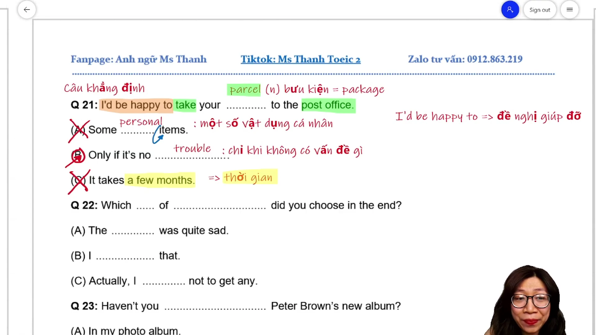

* **Đề bài:** `I'd be happy to take your parcel to the post office.`
* **Các phương án:**
  * (A) `Some personal items.`
  * (B) `Only if it's no trouble.`
  * (C) `It takes a few months.`
* **Phân tích:**
  * (A) `Some personal items`: Bẫy nối âm `personal items` (/ˈpɜːrsənl ˈaɪtəmz/ nối thành "lightoms"), danh từ chỉ vật không trả lời cho câu đề nghị giúp đỡ.
  * (B) `Only if it's no trouble`: Phản hồi lịch sự tiếp nhận sự giúp đỡ chỉ khi việc đó không gây phiền hà cho đối phương.
  * (C) `It takes a few months`: Bẫy động từ `take` (take time = tốn thời gian), trả lời cho câu hỏi khoảng thời gian (`How long`).
  * Đề bài đưa ra một lời đề nghị giúp đỡ với cấu trúc `I'd be happy to + V0` (Tôi rất sẵn lòng đem kiện hàng của bạn ra bưu điện). Đáp lại lời đề nghị này, người nghe phản hồi điều kiện tiếp nhận `Only if it's no trouble` (Chỉ khi điều đó không phiền bạn). Chọn (B).
* **Dịch nghĩa:** Tôi rất sẵn lòng đem kiện hàng của bạn ra bưu điện. - Chỉ khi việc đó không làm phiền bạn thôi nhé.
* **Mở rộng:**
  * `parcel` (/ˈpɑːrsl/) = `package` (/ˈpækɪdʒ/) (danh từ: bưu kiện, kiện hàng).
  * `post office` (danh từ: bưu điện).
  * `I'd be happy to + V0` = `I'd love to help` (cấu trúc đề nghị hỗ trợ).
  * `no trouble` (không có phiền phức, không phiền hà).

---

### [[04:26](https://youtu.be/Y6D_Fv6J_Ss?t=266s)] Câu 22

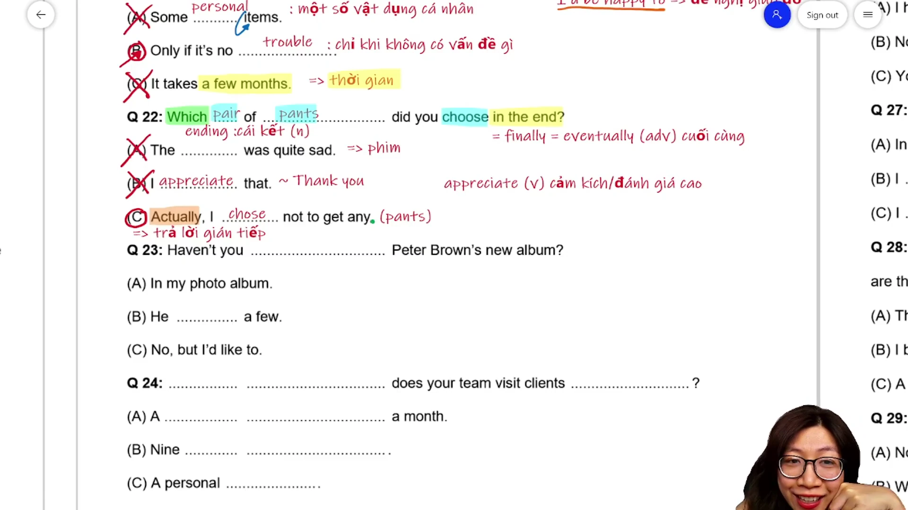

* **Đề bài:** `Which pair of pants did you choose in the end?`
* **Các phương án:**
  * (A) `The ending was quite sad.`
  * (B) `I appreciate that.`
  * (C) `Actually, I chose not to get any.`
* **Phân tích:**
  * (A) `The ending was quite sad`: Bẫy cùng gốc từ `in the end` với `ending` (phần kết phim/truyện), lạc đề sang ngữ cảnh phim ảnh.
  * (B) `I appreciate that`: Bẫy câu cảm ơn/cảm kích, thường dùng để đáp lại lời khen hoặc lời đề nghị giúp đỡ, không trả lời cho câu hỏi lựa chọn món đồ.
  * (C) `Actually, I chose not to get any`: Câu trả lời gián tiếp mở đầu bằng `Actually`, nêu rõ quyết định không mua bất kỳ chiếc quần nào (`any` thay thế cho `any pair of pants`).
  * Câu hỏi dùng từ để hỏi lựa chọn `Which pair of pants... in the end?` (Rốt cuộc bạn đã chọn chiếc quần nào?). Thay vì chọn một chiếc cụ thể, người trả lời phủ định toàn bộ các phương án bằng cách nói `I chose not to get any` (Tôi quyết định không mua cái nào cả). Chọn (C).
* **Dịch nghĩa:** Cuối cùng bạn đã chọn chiếc quần nào? - Thực ra, tôi đã quyết định không mua cái nào cả.
* **Mở rộng:**
  * `pair of pants` (danh từ: chiếc quần dài).
  * `in the end` = `finally` = `eventually` (trạng từ: cuối cùng, rốt cuộc).
  * `ending` (danh từ: phần kết, cái kết của tác phẩm nghệ thuật).
  * `appreciate` (/əˈpriːʃieɪt/) (động từ: cảm kích, đánh giá cao).
  * `choose not to + V0` = `decide not to + V0` = `didn't choose to + V0` (quyết định không làm gì).

---

### [[08:48](https://youtu.be/Y6D_Fv6J_Ss?t=528s)] Câu 23

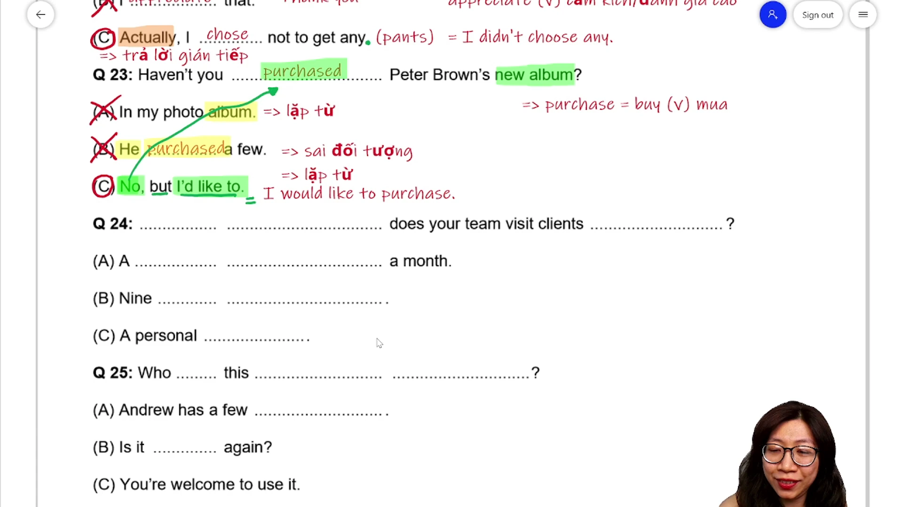

* **Đề bài:** `Haven't you purchased Peter Brown's new album?`
* **Các phương án:**
  * (A) `In my photo album.`
  * (B) `He purchased a few.`
  * (C) `No, but I'd like to.`
* **Phân tích:**
  * (A) `In my photo album`: Bẫy lặp từ `album`, chuyển ngữ cảnh sang album ảnh gia đình (chỉ nơi chốn), không trả lời cho câu hỏi hành vi mua sắm.
  * (B) `He purchased a few`: Vừa bẫy lặp từ `purchased`, vừa bẫy sai chủ ngữ (`He` trong khi câu hỏi hỏi `you`).
  * (C) `No, but I'd like to`: Câu trả lời xác nhận chưa mua (`No`) nhưng bày tỏ mong muốn sẽ mua (`I'd like to purchase it`).
  * Đề bài là câu hỏi Yes/No phủ định ở thì hiện tại hoàn thành `Haven't you purchased...?` (Bạn vẫn chưa mua album mới của Peter Brown à?). Phương án (C) đáp ứng chuẩn mực cấu trúc phản hồi với `No` (chưa mua) và vế bổ sung mong muốn `I'd like to`. Chọn (C).
* **Dịch nghĩa:** Bạn vẫn chưa mua album mới của Peter Brown à? - Chưa, nhưng tôi rất muốn mua đấy.
* **Mở rộng:**
  * `purchase` (/ˈpɜːrtʃəs/) = `buy` (động từ: mua hàng).
  * `album` (/ˈælbəm/) (danh từ: đĩa nhạc, album ca nhạc).
  * `I'd like to` = `I would like to + V0` (tôi muốn làm gì).
  * Quy tắc trả lời câu hỏi phủ định tiếng Anh: Trả lời `No` khi hành động chưa/không xảy ra; trả lời `Yes` khi hành động đã xảy ra.

---

### [[12:52](https://youtu.be/Y6D_Fv6J_Ss?t=772s)] Câu 24

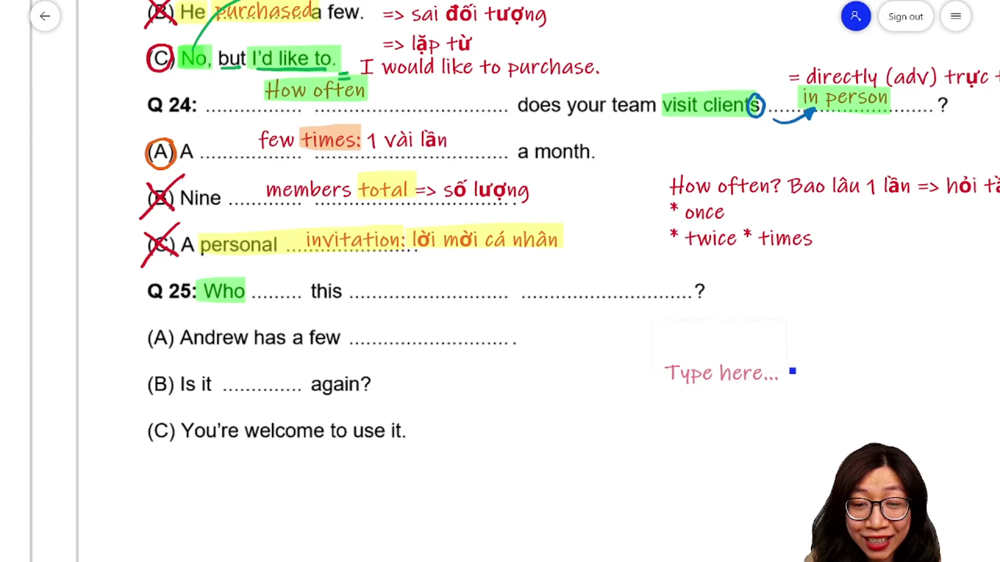

* **Đề bài:** `How often does your team visit clients in person?`
* **Các phương án:**
  * (A) `A few times a month.`
  * (B) `Nine members total.`
  * (C) `A personal invitation.`
* **Phân tích:**
  * (A) `A few times a month`: Cung cấp tần suất chính xác với từ chỉ số lần `times` đi kèm khoảng thời gian `a month`.
  * (B) `Nine members total`: Bẫy trả lời cho câu hỏi số lượng thành viên (`How many members...?`), lạc đề.
  * (C) `A personal invitation`: Bẫy đồng âm/cùng gốc từ `in person` (trực tiếp) với tính từ `personal` (cá nhân), hoàn toàn sai nghĩa.
  * Câu hỏi bắt đầu bằng cụm từ để hỏi `How often` (bao lâu một lần) hỏi về tần suất gặp trực tiếp khách hàng (`visit clients in person`). Phương án (A) trả lời chuẩn xác tần suất `A few times a month` (Vài lần mỗi tháng). Chọn (A).
* **Dịch nghĩa:** Đội của bạn đến gặp trực tiếp khách hàng bao lâu một lần? - Một vài lần mỗi tháng.
* **Mở rộng:**
  * `How often` (hỏi tần suất: `once`, `twice`, `three times`, `a few times`).
  * `in person` = `directly` (trạng từ: trực tiếp, đích thân gặp mặt).
  * Hiện tượng nối âm: `visit clients in person` (/klaɪənts ɪn/ nối âm /s/ thành "seen person").
  * `client` (danh từ: khách hàng).
  * `personal invitation` (danh từ: lời mời cá nhân).

---

### [[17:57](https://youtu.be/Y6D_Fv6J_Ss?t=1077s)] Câu 25

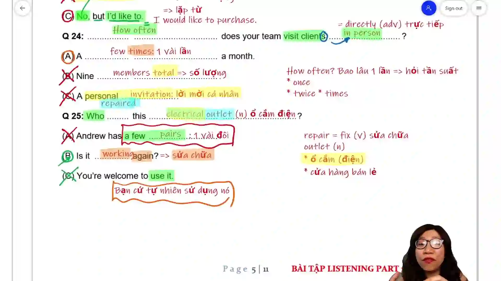

* **Đề bài:** `Who repaired this electrical outlet?`
* **Các phương án:**
  * (A) `Andrew has a few pairs.`
  * (B) `Is it working again?`
  * (C) `You're welcome to use it.`
* **Phân tích:**
  * (A) `Andrew has a few pairs`: Bẫy đồng âm giữa động từ `repaired` (/rɪˈpɛəd/) với danh từ `pairs` (/pɛəz/ - đôi/cặp), vô nghĩa.
  * (B) `Is it working again?`: Câu hỏi ngược lại thể hiện sự bất ngờ, liên kết trực tiếp tới kết quả của việc sửa chữa (`repaired` dẫn tới `working again`).
  * (C) `You're welcome to use it`: Bẫy ngữ cảnh mời mọc sử dụng đồ vật, không liên quan đến việc ai đã sửa chữa.
  * Câu hỏi `Who repaired this electrical outlet?` (Ai đã sửa cái ổ cắm điện này?). Thay vì nêu tên người thợ sửa, người đáp hỏi ngược lại bằng câu hỏi gián tiếp `Is it working again?` (Nó hoạt động lại rồi à?). Đây là xu hướng ra đề gián tiếp điển hình ở các câu cuối Part 2. Chọn (B).
* **Dịch nghĩa:** Ai đã sửa cái ổ cắm điện này vậy? - Nó hoạt động lại được rồi hả?
* **Mở rộng:**
  * `repair` (/rɪˈpɛər/) = `fix` (động từ: sửa chữa).
  * `electrical outlet` (danh từ: ổ cắm điện).
  * Đa nghĩa của từ `outlet`:
    * Ổ cắm điện (`electrical outlet`, `wall outlet`).
    * Cửa hàng bán lẻ, điểm tiêu thụ sản phẩm (`retail outlet`).
  * `work` (nội động từ chỉ máy móc: hoạt động, vận hành tốt).
  * `You're welcome to + V0` (cấu trúc: cứ tự nhiên làm gì).

---

### [[23:12](https://youtu.be/Y6D_Fv6J_Ss?t=1392s)] Câu 26

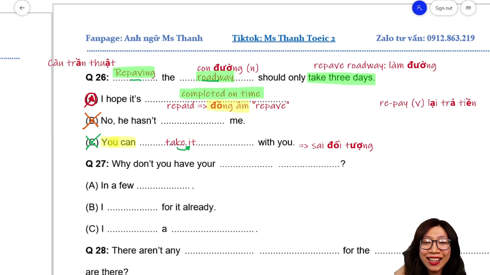

* **Đề bài:** `Repaving the roadway should only take three days.`
* **Các phương án:**
  * (A) `I hope it's completed on time.`
  * (B) `No, he hasn't repaid me.`
  * (C) `You can take it with you.`
* **Phân tích:**
  * (A) `I hope it's completed on time`: Đồng tình và hưởng ứng kỳ vọng tiến độ thi công 3 ngày bằng mong muốn công trình xong đúng hạn.
  * (B) `No, he hasn't repaid me`: Bẫy đồng âm tinh vi giữa `repaving` (/riːˈpeɪvɪŋ/) và `repaid` (/riːˈpeɪd/ - hoàn trả tiền) kèm bẫy sai chủ ngữ `he`.
  * (C) `You can take it with you`: Bẫy lặp động từ `take` (câu hỏi là `take three days` - tốn thời gian; phương án là `take with you` - mang theo đồ), sai lệch đối tượng `you`.
  * Đề bài là câu trần thuật đưa ra nhận định về tiến độ: `Repaving the roadway should only take three days` (Việc trải nhựa lại mặt đường chỉ nên mất 3 ngày thôi). Theo quy tắc 90% câu trần thuật hướng tới sự đồng tình, phương án (A) thể hiện sự tán thành và hy vọng hoàn thành đúng hạn (`completed on time`). Chọn (A).
* **Dịch nghĩa:** Việc trải nhựa lại mặt đường chỉ nên mất 3 ngày thôi. - Tôi hy vọng nó được hoàn thành đúng hạn.
* **Mở rộng:**
  * `repave` (/riːˈpeɪv/) (động từ: lát lại, trải nhựa lại mặt đường).
  * `roadway` (/ˈroʊdweɪ/) (danh từ: lòng đường, mặt đường xe chạy).
  * Collocation: `repaving the roadway` (trải nhựa mặt đường).
  * `on time` (đúng giờ theo lịch trình). Phân biệt với `in time` (kịp giờ trước khi muộn).
  * `repay` -> quá khứ `repaid` (động từ: trả nợ, hoàn tiền lại).

---

### [[27:40](https://youtu.be/Y6D_Fv6J_Ss?t=1660s)] Câu 27

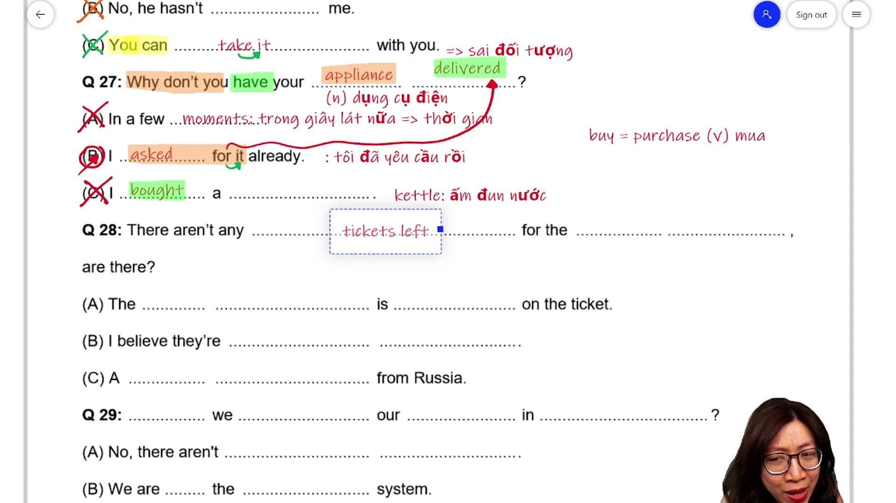

* **Đề bài:** `Why don't you have your appliance delivered?`
* **Các phương án:**
  * (A) `In a few moments.`
  * (B) `I asked for it already.`
  * (C) `I bought a kettle.`
* **Phân tích:**
  * (A) `In a few moments`: Bẫy câu trả lời thời gian (trong chốc lát nữa), trả lời cho câu hỏi `When`.
  * (B) `I asked for it already`: Giải thích trực tiếp rằng bản thân đã yêu cầu dịch vụ giao hàng rồi, không cần người kia phải gợi ý.
  * (C) `I bought a kettle`: Bẫy liên tưởng chủ đề đồ dùng gia đình (`appliance` liên tưởng tới `kettle` ấm nước), lạc đề.
  * Đề bài đưa ra lời gợi ý sử dụng thể truyền khiến: `Why don't you have your appliance delivered?` (Tại sao bạn không nhờ người ta giao thiết bị đến tận nơi?). Phương án (B) phản hồi hợp lý bằng việc khẳng định mình đã thực hiện hành động đó từ trước (`I asked for it already` - Tôi đã yêu cầu giao rồi). Hiện tượng nối âm: `asked for it` (/æskt fər ɪt/). Chọn (B).
* **Dịch nghĩa:** Sao bạn không nhờ người ta giao thiết bị đến tận nơi? - Tôi đã yêu cầu giao rồi mà.
* **Mở rộng:**
  * Thể truyền khiến: `have / get + sth + V3/ed` (thuê hoặc nhờ ai làm việc gì cho mình).
  * `appliance` (/əˈplaɪəns/) (danh từ: thiết bị điện gia dụng trong nhà như tủ lạnh, máy giặt).
  * `deliver` (/dɪˈlɪvər/) (động từ: giao hàng, vận chuyển tận nơi).
  * `ask for sth` (cụm động từ: yêu cầu, đề nghị xin cái gì).
  * `kettle` (/ˈketl/) (danh từ: ấm đun nước).

---

### [[32:15](https://youtu.be/Y6D_Fv6J_Ss?t=1935s)] Câu 28

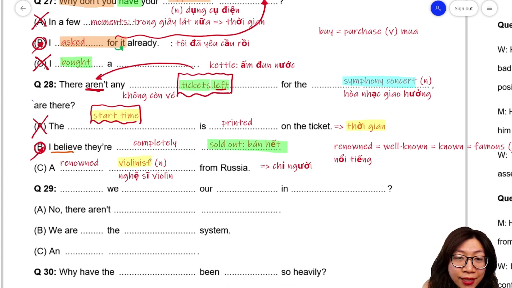

* **Đề bài:** `There aren't any tickets left for the symphony concert, are there?`
* **Các phương án:**
  * (A) `The start time is printed on the ticket.`
  * (B) `I believe they're completely sold out.`
  * (C) `A renowned violinist from Russia.`
* **Phân tích:**
  * (A) `The start time is printed on the ticket`: Bẫy lặp từ `ticket`, nội dung nói về thời gian bắt đầu in trên vé, không trả lời về số lượng vé còn lại.
  * (B) `I believe they're completely sold out`: Đồng nghĩa hoàn toàn với thông tin ở câu hỏi (`no tickets left` tương đương với `completely sold out`). Đại từ `they` thay thế cho `tickets`.
  * (C) `A renowned violinist from Russia`: Bẫy liên tưởng chủ đề âm nhạc cổ điển (`symphony concert` gợi nhớ `violinist`), trả lời cho câu hỏi người (`Who`).
  * Đề bài là câu hỏi đuôi xác nhận: `There aren't any tickets left..., are there?` (Không còn chiếc vé nào cho buổi hòa nhạc giao hưởng nữa phải không?). Phương án (B) xác nhận chính xác tình trạng vé bằng cụm từ `completely sold out` (đã bán hết sạch hoàn toàn). Chọn (B).
* **Dịch nghĩa:** Không còn chiếc vé nào cho buổi hòa nhạc giao hưởng nữa phải không? - Tôi tin là chúng đã bán hết sạch rồi.
* **Mở rộng:**
  * `tickets left` (cụm từ: số vé còn lại; thường đi với dạng phủ định `no tickets left` = hết vé).
  * `symphony concert` (/ˈsɪmfəni ˈkɑːnsərt/) (danh từ: buổi hòa nhạc giao hưởng).
  * `sold out` (tính từ: bán hết vé, cháy hàng).
  * `renowned` (/rɪˈnaʊnd/) = `famous` = `well-known` (tính từ: nổi tiếng, lừng danh).
  * `violinist` (/ˌvaɪəˈlɪnɪst/) (danh từ: nghệ sĩ vĩ cầm/violin).

---

### [[38:55](https://youtu.be/Y6D_Fv6J_Ss?t=2335s)] Câu 29

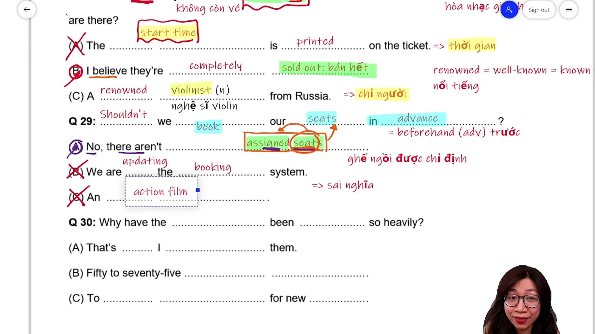

* **Đề bài:** `Shouldn't we book our seats in advance?`
* **Các phương án:**
  * (A) `No, there aren't assigned seats.`
  * (B) `We are updating the booking system.`
  * (C) `An action film.`
* **Phân tích:**
  * (A) `No, there aren't assigned seats`: Giải thích lý do không cần đặt trước vì ở đó không có ghế chỉ định sẵn (ngồi tự do). Dù lặp lại từ `seats` nhưng đây là đáp án đúng ở câu phân loại cao.
  * (B) `We are updating the booking system`: Bẫy cùng gốc từ `book` -> `booking system` (hệ thống đặt chỗ), sai ngữ cảnh giao tiếp của khán giả đi xem phim.
  * (C) `An action film`: Bẫy liên tưởng ngữ cảnh rạp phim, trả lời cho câu hỏi thể loại phim (`What kind of film...?`).
  * Đề bài đưa ra đề xuất phủ định: `Shouldn't we book our seats in advance?` (Chẳng phải chúng ta nên đặt chỗ ngồi trước hay sao?). Phương án (A) trả lời `No` (không cần đặt) và nêu nguyên nhân `there aren't assigned seats` (không có chỗ ngồi chỉ định trước). Đây là minh chứng cho thấy bẫy lặp từ ở các câu cuối đề vẫn có thể rơi vào phương án đúng. Chọn (A).
* **Dịch nghĩa:** Chẳng phải chúng ta nên đặt chỗ trước hay sao? - Không cần đâu, ở đó không có chỗ ngồi chỉ định sẵn.
* **Mở rộng:**
  * `book` = `reserve` (động từ: đặt chỗ trước).
  * `in advance` = `beforehand` (cụm trạng từ: trước, làm trước).
  * `assigned seats` (danh từ: chỗ ngồi được chỉ định sẵn, có số ghế cụ thể).
  * `booking system` (danh từ: hệ thống đặt vé trực tuyến).

---

### [[44:32](https://youtu.be/Y6D_Fv6J_Ss?t=2672s)] Câu 30

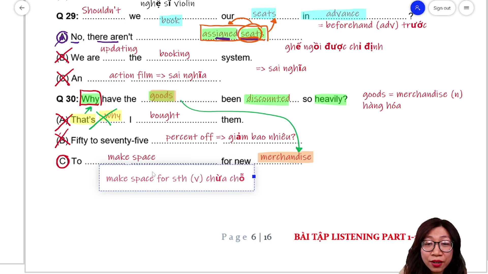

* **Đề bài:** `Why have the goods been discounted so heavily?`
* **Các phương án:**
  * (A) `That's why I bought them.`
  * (B) `Fifty to seventy-five percent off.`
  * (C) `To make space for new merchandise.`
* **Phân tích:**
  * (A) `That's why I bought them`: Bẫy lặp từ `why`. Đây là câu trả lời sáo rỗng thường gặp trong đề thi, không hề cung cấp nguyên nhân thực tế mà chỉ nói chung chung "Đó là lý do tại sao...".
  * (B) `Fifty to seventy-five percent off`: Bẫy trả lời cho câu hỏi giảm giá bao nhiêu (`How much are they discounted?`), không trả lời cho nguyên nhân.
  * (C) `To make space for new merchandise`: Dùng mệnh đề chỉ mục đích `To + V0` để trả lời trực tiếp cho câu hỏi `Why`. Cặp từ đồng nghĩa then chốt: `goods` = `merchandise`.
  * Câu hỏi bắt đầu bằng `Why` về nguyên nhân hàng hóa bị giảm giá sâu: `Why have the goods been discounted so heavily?`. Phương án (C) đáp ứng chính xác cấu trúc mục đích `To make space for new merchandise` (Để chừa chỗ cho hàng hóa mới). Chọn (C).
* **Dịch nghĩa:** Tại sao hàng hóa lại được giảm giá sâu đến như vậy? - Để chừa chỗ cho lô hàng mới về.
* **Mở rộng:**
  * `goods` = `merchandise` (/ˈmɜːrtʃəndaɪs/) (danh từ: hàng hóa).
  * `discount so heavily` (cụm từ: giảm giá rất sâu, đại hạ giá).
  * `make space for sth` = `make room for sth` (cụm động từ: dành chỗ, chừa chỗ trống cho cái gì).
  * Quy tắc vàng cho câu hỏi `Why`: Ưu tiên tuyệt đối phương án bắt đầu bằng `To + V0`, loại ngay phương án chứa `That's why...`.

---

### [[48:27](https://youtu.be/Y6D_Fv6J_Ss?t=2907s)] Câu 31

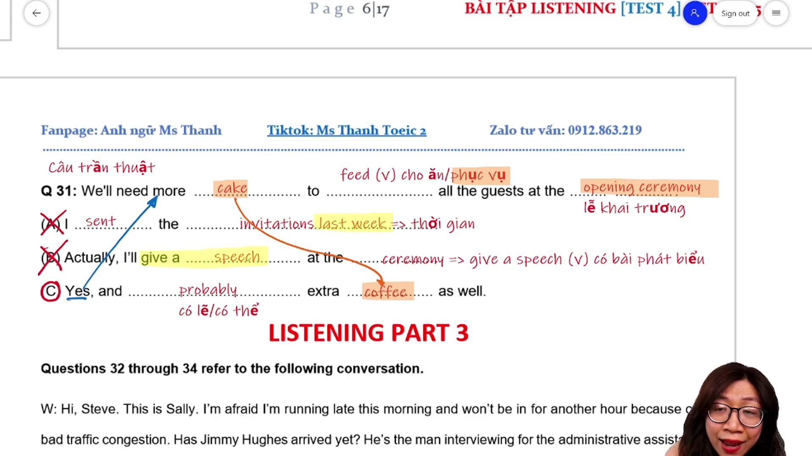

* **Đề bài:** `We need more cake to feed all the guests at the opening ceremony.`
* **Các phương án:**
  * (A) `I sent the invitations last week.`
  * (B) `I'll give a speech at the ceremony.`
  * (C) `Yes, and probably extra coffee as well.`
* **Phân tích:**
  * (A) `I sent the invitations last week`: Bẫy liên tưởng khách mời (`guests` gợi nhớ `invitations`), dùng thì quá khứ không giải quyết vấn đề thiếu thức ăn hiện tại.
  * (B) `I'll give a speech at the ceremony`: Bẫy lặp từ `ceremony`, nói về bài phát biểu cá nhân, lạc đề.
  * (C) `Yes, and probably extra coffee as well`: Thể hiện sự tán thành (`Yes`) và bổ sung nhu cầu ẩm thực tương thích (`more cake` đi kèm với `extra coffee as well`).
  * Đề bài là câu trần thuật nêu nhu cầu phục vụ tiệc: `We need more cake to feed all the guests at the opening ceremony` (Chúng ta cần thêm bánh kem để phục vụ tất cả các vị khách ở lễ khai trương). Phương án (C) thể hiện sự đồng tình và bổ sung nhu cầu đồ uống đi kèm một cách hợp lý. Chọn (C).
* **Dịch nghĩa:** Chúng ta cần thêm bánh kem để phục vụ tất cả khách mời tại lễ khai trương. - Đúng vậy, và có lẽ cần thêm cả cà phê nữa.
* **Mở rộng:**
  * `feed` (/fiːd/) (động từ: phục vụ ăn uống, cung cấp thức ăn cho ai).
  * `guest` (danh từ: khách mời).
  * `opening ceremony` (danh từ: lễ khai mạc, lễ khai trương).
  * `give a speech` = `deliver a speech` (cụm động từ: phát biểu diễn văn).
  * `extra` = `additional` = `more` (tính từ: thêm vào, bổ sung).
  * `as well` = `too` = `also` (cụm trạng từ: cũng, thêm vào đó).

---

## Trích dẫn then chốt

* [[18:50](https://youtu.be/Y6D_Fv6J_Ss?t=1130s)] "Đề thi hiện tại 70 tới 80% là trả lời gián tiếp. Càng gần câu 31 thì sẽ càng khó, càng gián tiếp, cho nên xác suất trả lời trực diện rất là ít."
* [[23:45](https://youtu.be/Y6D_Fv6J_Ss?t=1425s)] "Trong câu trần thuật, đa phần đáp án đúng sẽ có xu hướng thiên về đồng tình. Mình cứ ưu tiên tìm phương án thể hiện sự đồng tình trước."
* [[26:20](https://youtu.be/Y6D_Fv6J_Ss?t=1580s)] "Nghe repaving mà thấy câu kia đọc repaid là bẫy đồng âm liền. Không cần phải giống y chang, giống 90% cách phát âm là đã phải loại ngay lập tức rồi."
* [[41:20](https://youtu.be/Y6D_Fv6J_Ss?t=2480s)] "Lặp từ giúp mình loại trừ được 90% bẫy, nhưng những câu khó về cuối đề thi vẫn có thể lặp từ ở đáp án đúng, như assigned seats. Phải nghe hiểu được ngữ cảnh chứ không bắt từ máy móc."
* [[45:45](https://youtu.be/Y6D_Fv6J_Ss?t=2745s)] "Người ta hỏi Why mà trả lời That's why là loại liền giùm cô. Hỏi tại sao thì phải trả lời lý do hoặc mục đích To làm gì đó, chứ That's why không có giá trị thông tin gì hết."

---

## Lệnh & Công cụ

### Công thức nhận diện

```text
[Công thức 1: Đề nghị giúp đỡ (Offer of Assistance)]
Câu hỏi: I'd be happy to / Let me help / Can I take...
-> Đáp lại: Đồng ý lịch sự (Only if it's no trouble / That would be great)
            Cảm ơn (I appreciate that / Thank you)

[Công thức 2: Phản xạ câu trần thuật (Statements)]
Câu trần thuật đưa ra nhận định hoặc nhu cầu:
-> 90% Đáp án đúng: ĐỒNG TÌNH hoặc HƯỞNG ỨNG (Yes / I hope it's completed on time / Extra coffee as well)
-> 10% Đáp án đúng: TỪ CHỐI kèm lý do thực tế

[Công thức 3: Quy tắc câu hỏi Why]
Câu hỏi: Why + Trợ động từ + S + V...?
-> ƯU TIÊN: To + V0 (Chỉ mục đích: To make space for new merchandise)
-> LOẠI BỎ: That's why... (Bẫy lặp từ, không có giá trị thông tin)

[Công thức 4: Bẫy đồng âm & gần âm cuối đề]
repaving /riːˈpeɪvɪŋ/ (tráng nhựa đường)   <->  repaid /riːˈpeɪd/ (hoàn tiền)
repaired /rɪˈpɛəd/ (sửa chữa)             <->  a few pairs /pɛəz/ (vài đôi)
in person /pɜːrsn/ (trực tiếp)            <->  personal /ˈpɜːrsənl/ (cá nhân)
in the end (cuối cùng)                     <->  ending (kết thúc phim)

[Công thức 5: Cặp từ đồng nghĩa kinh điển Part 2]
goods                   =  merchandise          (hàng hóa)
parcel                  =  package              (kiện hàng)
in person               =  directly             (trực tiếp)
in the end              =  finally / eventually (cuối cùng)
in advance              =  beforehand           (làm trước)
book                    =  reserve              (đặt chỗ)
repair                  =  fix                  (sửa chữa)
renowned                =  famous / well-known  (nổi tiếng)
no tickets left         =  sold out             (hết vé)
```

---

## Đánh đổi & Rủi ro

### Điểm mù nghe hiểu phản xạ

* **Bắt từ máy móc ở câu phân loại cao:** Mặc dù mẹo loại trừ bẫy lặp từ hoạt động hiệu quả ở các câu đầu Part 2 (80-90%), việc áp dụng rập khuôn ở 10 câu cuối đề sẽ dẫn đến việc loại bỏ nhầm đáp án đúng (như trường hợp từ `seats` lặp lại trong `assigned seats` ở Câu 29). Thí sinh cần kết hợp phân tích ngữ cảnh thay vì chỉ nghe bắt từ đơn lẻ.
* **Ảo tưởng câu trả lời trực tiếp:** Tâm lý mong đợi câu trả lời hiển nhiên (hỏi Who phải nghe ra tên người, hỏi Why phải nghe ra Because) khiến thí sinh mất cảnh giác trước các câu trả lời gián tiếp hoặc câu hỏi ngược lại (`Is it working again?` cho câu hỏi sửa ổ cắm điện).
* **Mất tập trung dây chuyền:** Thời gian nghỉ giữa hai câu ở Part 2 chỉ có 5 giây. Nếu phân vân quá lâu ở một câu khó, thí sinh sẽ đánh mất lượt nghe từ đầu của câu tiếp theo, dẫn đến chuỗi sụp đổ điểm số liên tiếp từ 2 đến 3 câu.

### Rủi ro phòng thi

* **Tô nhầm ô trên phiếu trả lời:** Bài thi giấy TOEIC thiết kế phiếu trả lời có đủ 4 ô (A, B, C, D) cho toàn bộ 100 câu nghe. Riêng Part 2 chỉ có 3 phương án (A, B, C). Thí sinh mất tập trung có thể tô nhầm vào ô D, dẫn đến sai lệch vị trí hàng loạt cho các câu kế tiếp.
* **Áp lực tâm lý cuối chặng nghe:** Part 2 là phần thi có mật độ bẫy dày đặc nhất. Việc gặp liên tục 4-5 câu hỏi gián tiếp từ Câu 25 đến Câu 31 dễ gây hoang mang tâm lý. Chiến thuật đúng đắn là dứt khoát chọn đáp án khả dĩ nhất và hướng toàn bộ sự chú ý sang câu kế tiếp ngay khi người đọc kết thúc phương án C.
