# MAX ĐIỂM READING PART 5 [VIDEO 1]

* **Kênh:** Anh ngữ Ms Thanh | **Thời lượng:** 01:08:14 | **Ngày:** 2026-08-16
* **Video:** https://youtu.be/JIVXPafQFKk

---

## Thuật ngữ

| Thuật ngữ | Tiếng Anh | Giải thích |
| :--- | :--- | :--- |
| Cụm danh từ | Noun Phrase | Nhóm từ có danh từ làm thành phần chính, có thể đứng trước bởi mạo từ, sở hữu cách, trạng từ và tính từ. |
| Mệnh đề rút gọn | Reduced Relative Clause | Dạng rút gọn của mệnh đề quan hệ bằng cách bỏ đại từ quan hệ và trợ động từ, giữ lại V-ing (chủ động) hoặc V3/ed (bị động). |
| Câu mệnh lệnh | Imperative Sentence | Câu không có chủ ngữ, mở đầu bằng động từ nguyên mẫu (Bare Infinitive) dùng để đưa ra yêu cầu, chỉ dẫn hoặc quy định. |
| Hậu tố từ loại | Part of Speech Suffix | Phần đuôi gắn vào sau gốc từ để xác định từ loại (-tion cho danh từ, -ble/-ic cho tính từ, -en/-ize cho động từ, -ly cho trạng từ). |
| Danh từ số ít đếm được | Singular Countable Noun | Danh từ đếm được ở dạng số ít, bắt buộc phải có mạo từ (a/an/the) hoặc đại từ/tính từ sở hữu đứng trước. |
| Danh từ đồng hình động từ | Homograph Noun-Verb | Từ vựng vừa có chức năng làm danh từ vừa làm động từ với hình thái viết giống nhau (supply, record, launch, produce). |
| Giới từ cố định | Dependent Preposition | Giới từ bắt buộc đi liền sau một động từ, tính từ hoặc danh từ nhất định để tạo nghĩa chuẩn xác (rely on, close to, in time for). |
| Liên từ điều kiện | Conditional Conjunction | Từ nối biểu thị điều kiện thực thi của hành động (provided that, as long as). |
| Thì tương lai tiếp diễn | Future Continuous | Thì diễn tả hành động đang diễn ra tại một thời điểm hoặc sự kiện cụ thể trong tương lai (will be + V-ing). |
| Thể bị động hoàn thành | Future Perfect Passive | Cấu trúc will have been + V3/ed diễn tả hành động sẽ được hoàn tất trước một mốc thời gian trong tương lai. |

---

## Tổng luận chuyên đề

### Chiến thuật thời gian

Phần thi TOEIC Reading gồm 100 câu trong 75 phút. Toàn bộ phần Part 5 gồm 30 câu bắt buộc hoàn thành trong khoảng 10 đến 12 phút (tối đa 15 phút, trung bình 20 đến 25 giây mỗi câu). Để tối ưu hóa điểm số, cần phân tách triệt để hai nhóm câu hỏi:
* **Nhóm xử lý siêu tốc không dịch câu (5 đến 10 giây):** Các câu hỏi về vị trí từ loại trong cụm danh từ (mạo từ + tính từ + danh từ), cấu trúc ngữ pháp cố định (`in time for`, `up to`), liên từ điều kiện đi với mệnh đề, và câu mệnh lệnh đầu câu. Nhóm này chỉ cần nhìn trước và nhìn sau chỗ trống để xác định cấu trúc ngữ pháp.
* **Nhóm phân tích loại trừ và dịch ngữ cảnh (15 đến 25 giây):** Các câu hỏi từ vựng thuần túy đòi hỏi chọn đúng sắc thái (phân biệt `trial` và `sample`, `arrive` và `ship`), hoặc câu từ loại nâng cao có cả danh từ và trạng từ đứng sau động từ.

### Cấu trúc ngữ pháp

* **Trật tự vị trí cụm danh từ:** Cấu trúc tiêu chuẩn gồm `Mạo từ/Sở hữu cách + (Trạng từ) + (Tính từ) + Danh từ chính`. Danh từ luôn nằm ở vị trí tận cùng của cụm. Đứng trước danh từ bắt buộc ưu tiên tính từ gốc (`reliable`, `geographic`) hơn là tính từ phân từ đuôi -ing/-ed.
* **Quy tắc danh từ số ít đếm được:** Một danh từ số ít đếm được (như `region`) không bao giờ được phép đứng trơ trọi một mình trong câu mà bắt buộc phải có mạo từ (`a/an/the`) hoặc từ hạn định (`my/this`) đứng trước. Do đó, nếu chỗ trống đứng sau động từ mà không có mạo từ, phương án danh từ số ít bị loại bỏ hoàn toàn, phải chọn trạng từ.
* **Câu mệnh lệnh không chủ ngữ:** Khi chỗ trống đứng đầu câu hoặc đầu một phân cú pháp (sau dấu phẩy) mà mệnh đề hoàn toàn không có chủ ngữ và động từ chính, vị trí này yêu cầu một động từ nguyên mẫu không chia (`Bare Infinitive`) để tạo thành câu mệnh lệnh hoặc lời hướng dẫn (`Allow up to 5 minutes...`).
* **Mệnh đề quan hệ rút gọn giữa hai dấu phẩy:** Thành phần nằm giữa hai dấu phẩy cung cấp thông tin phụ bổ nghĩa cho danh từ đứng trước. Khi không có đại từ quan hệ (`which/who`), cấu trúc chuyển sang rút gọn:
  * Rút gọn chủ động: Dùng `V-ing` (theo sau thường có tân ngữ trực tiếp).
  * Rút gọn bị động: Dùng `V3/ed` (theo sau là giới từ chỉ nơi chốn/nguồn gốc, ví dụ: `imported from`).
* **Liên từ điều kiện:** `Provided that` (= `As long as`) mang nghĩa "miễn là", đứng đầu một mệnh đề hoàn chỉnh (`S + V + O`). Phân biệt với `In fact` (luôn có dấu phẩy ngăn cách: `In fact, ...`) và `Owing to` (đi với cụm danh từ, không đi với mệnh đề).

### Biến thể từ loại

* **Hậu tố nhận diện động từ:** Các đuôi `-en` (`lengthen`, `deepen`, `widen`, `brighten`) và `-ize` (`organize`, `regionalize`) là dấu hiệu đặc trưng của động từ, biểu thị hành động làm cho trở nên hoặc biến đổi theo tính chất của gốc từ.
* **Hậu tố nhận diện tính từ:** Các đuôi `-able/-ible` (`reliable`), `-ic` (`geographic`, `specific`), `-y` (`lengthy`). Cần lưu ý tính từ `lengthy` xuất phát từ danh từ `length`, không tuân theo quy tắc biến đổi thông thường.
* **Hậu tố nhận diện danh từ:** Đuôi `-tion` (`distribution`, `organization`), `-er/-or` chỉ người (`organizer`), và gốc từ danh từ trừu tượng chỉ độ dài (`length`).
* **Động từ và danh từ đồng hình:** Cần nhận biết các từ có thể đảm nhiệm cả hai vai trò:
  * `Supply`: Động từ mang nghĩa "cung cấp"; danh từ mang nghĩa "nguồn cung" hoặc "vật tư, trang thiết bị".
  * `Produce`: Động từ mang nghĩa "sản xuất"; danh từ không đếm được mang nghĩa "nông sản".
  * `Record`: Động từ mang nghĩa "ghi chép, ghi âm"; danh từ mang nghĩa "hồ sơ, kỷ lục, bản ghi".
  * `Launch`: Động từ mang nghĩa "phát hành, khởi chạy"; danh từ mang nghĩa "buổi ra mắt sản phẩm".

### Cụm từ cố định

* **Giới từ đi kèm cố định:**
  * `In time for something`: Kịp lúc cho sự kiện gì.
  * `Rely on` = `Depend on`: Phụ thuộc vào, dựa vào.
  * `Devoted to something`: Cống hiến, tận tâm cho điều gì (sau `to` là danh từ hoặc V-ing, không phải động từ nguyên mẫu).
  * `Attention to something`: Sự chú tâm, chú ý đến vấn đề gì.
  * `Close to` = `Near`: Gần sát bên (tính từ `close` bắt buộc có `to` khi chỉ khoảng cách không gian).
  * `Next to` = `Beside` = `By`: Kế bên, ngay cạnh (bắt buộc có `to`).
  * `Arrive in` (thành phố, quốc gia) / `Arrive at` (địa điểm cụ thể): Động từ `arrive` không đi trực tiếp với `to`.
* **Cụm đo lường và định lượng:**
  * `Up to` [con số/thời gian]: Tối đa lên đến (trái nghĩa với `At least`: tối thiểu).
  * `A number of + Danh từ số nhiều + Động từ số nhiều`: Một số lượng những...
  * `A sample of something`: Mẫu dùng thử (áp dụng cho thực phẩm, hàng hóa tiêu dùng).
  * `Trial`: Sự dùng thử (áp dụng cho phần mềm, dịch vụ, thử nghiệm lâm sàng, không dùng cho món ăn).

---

## Bóc tách chi tiết

### [[04:22](https://youtu.be/JIVXPafQFKk?t=262s)] Câu 101

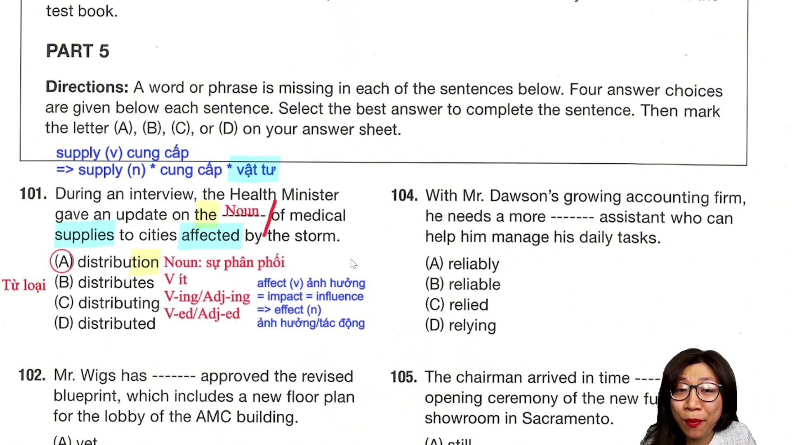

* **Đề bài:** `During an interview, the Health Minister updated on the ------- of medical supplies to cities affected by the storm.`
* **Phương án:**
  * (A) distribution: Danh từ (sự phân phối, sự phân bổ).
  * (B) distributes: Động từ chia thì hiện tại đơn ngôi thứ ba số ít.
  * (C) distributing: Dạng V-ing hoặc tính từ phân từ.
  * (D) distributed: Động từ quá khứ (V2) hoặc quá khứ phân từ (V3/ed).
* **Phân tích:** Phía trước chỗ trống có mạo từ xác định `the`, phía sau là giới từ `of`. Theo quy tắc cấu trúc cụm danh từ, sau mạo từ bắt buộc phải có một danh từ chính đóng vai trò trung tâm ngữ. Hậu tố `-tion` là dấu hiệu nhận diện của danh từ. Chọn (A).
* **Dịch nghĩa:** Trong suốt buổi phỏng vấn, Bộ trưởng Bộ Y tế đã cập nhật về sự phân bổ các vật tư y tế đến các thành phố bị ảnh hưởng bởi cơn bão.
* **Mở rộng:**
  * `Supply` vừa là động từ (cung cấp), vừa là danh từ. Danh từ `supply` có hai tầng nghĩa chính: (1) nguồn cung ứng; (2) vật tư, trang thiết bị, nhu yếu phẩm (thường ở dạng số nhiều `supplies`).
  * `Affect` (v): Gây ảnh hưởng, tác động lên (= `influence`, `impact`). Tránh nhầm lẫn với danh từ `effect` (n: sự ảnh hưởng, kết quả) và cụm `have an effect on`.
  * `Affected by the storm` là mệnh đề quan hệ rút gọn dạng bị động từ `cities which were affected by the storm`.

---

### [[09:25](https://youtu.be/JIVXPafQFKk?t=565s)] Câu 102

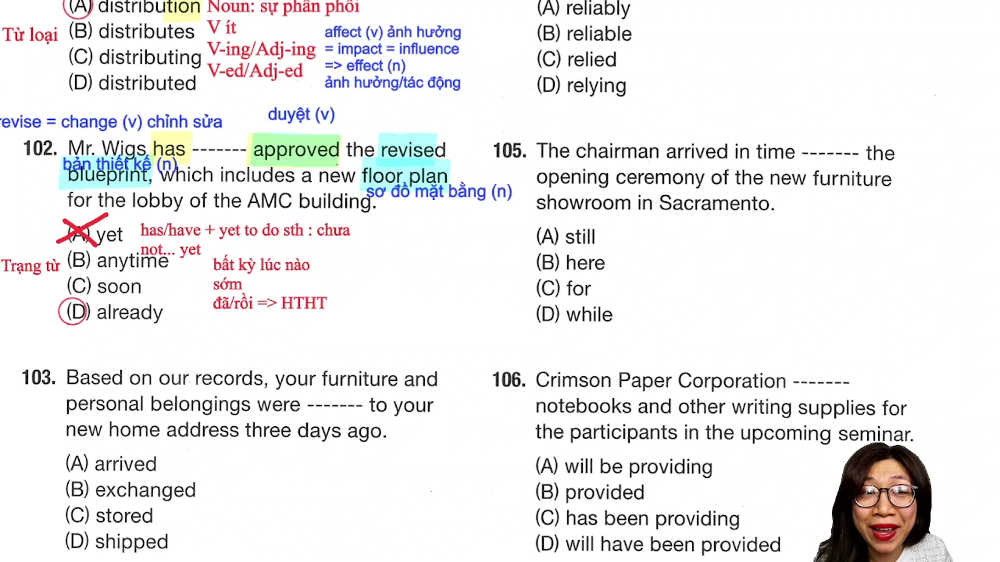

* **Đề bài:** `Mr. Weeks has ------- approved the revised blueprint that includes the new floor plan for the AMC building lobby.`
* **Phương án:**
  * (A) yet: Trạng từ chỉ thời gian (chưa).
  * (B) anytime: Trạng từ (bất kỳ lúc nào).
  * (C) soon: Trạng từ (sớm, sắp tới).
  * (D) already: Trạng từ (đã, rồi).
* **Phân tích:** 
  * Về mặt ngữ pháp, chỗ trống nằm giữa trợ động từ `has` và quá khứ phân từ `approved` trong thì hiện tại hoàn thành (`Present Perfect`).
  * Loại (A) vì `yet` chỉ dùng trong câu phủ định (`have not yet + V3/ed` hoặc `not... yet`) hoặc cấu trúc khẳng định mang tính phủ định `have/has yet to do something` (vẫn chưa làm gì).
  * Loại (B) và (C) vì không tương thích ngữ nghĩa với hành động đã hoàn tất trong hiện tại hoàn thành.
  * `Already` là trạng từ chỉ hành động đã xảy ra trước thời điểm hiện tại, thường đứng giữa trợ động từ và động từ chính trong thì hiện tại hoàn thành. Chọn (D).
* **Dịch nghĩa:** Ông Weeks đã phê duyệt bản thiết kế chỉnh sửa bao gồm sơ đồ mặt bằng mới cho sảnh tòa nhà AMC.
* **Mở rộng:**
  * `Approve` (v): Phê duyệt, chấp thuận (= `accept`, `endorse`).
  * `Revise` (v): Chỉnh sửa, sửa đổi (= `change`, `modify`, `alter`).
  * `Blueprint` (n): Bản vẽ thiết kế kỹ thuật, bản thiết kế chi tiết.
  * `Floor plan` (n): Sơ đồ bố trí mặt bằng các tầng.

---

### [[13:30](https://youtu.be/JIVXPafQFKk?t=810s)] Câu 103

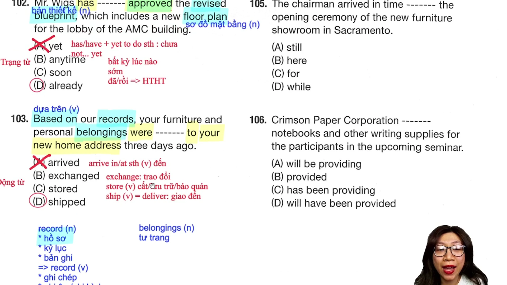

* **Đề bài:** `Based on our records, your furniture and personal belongings were ------- to your new home address three days ago.`
* **Phương án:**
  * (A) arrived: Quá khứ phân từ của nội động từ arrive (đến).
  * (B) exchanged: Quá khứ phân từ của exchange (trao đổi).
  * (C) stored: Quá khứ phân từ của store (lưu trữ, cất trữ).
  * (D) shipped: Quá khứ phân từ của ship (vận chuyển, giao hàng).
* **Phân tích:** 
  * Căn cứ vào ngữ cảnh phía trước là `furniture and personal belongings` (đồ đạc và tư trang cá nhân) và phía sau là giới từ chỉ hướng đích `to your new home address` (đến địa chỉ nhà mới của bạn).
  * Động từ `arrive` là nội động từ, không bao giờ dùng ở thể bị động (`were arrived` là sai ngữ pháp), đồng thời `arrive` đi với giới từ `in/at`, không đi với `to`.
  * `Exchange` (trao đổi) và `store` (cất giữ trong kho) không kết hợp logic với hành động chuyển tới địa chỉ nhà riêng.
  * `Ship` (= `deliver`) mang nghĩa vận chuyển, giao hàng đến địa chỉ đích. Cấu trúc bị động: `be shipped to + địa chỉ`. Chọn (D).
* **Dịch nghĩa:** Dựa trên hồ sơ của chúng tôi, đồ đạc và vật dụng cá nhân của bạn đã được chuyển đến địa chỉ nhà mới cách đây ba ngày.
* **Mở rộng:**
  * `Based on` (adj/prep phrase): Dựa trên, căn cứ vào.
  * `Record` vừa là danh từ (hồ sơ, kỷ lục, bản ghi), vừa là động từ (ghi chép, thu âm, ghi hình). Trọng âm: danh từ /ˈrek.ɔːd/, động từ /rɪˈkɔːd/.
  * `Belongings` (n số nhiều): Đồ đạc cá nhân, tư trang (từ này luôn xuất hiện ở dạng số nhiều có đuôi -s).

---

### [[16:58](https://youtu.be/JIVXPafQFKk?t=1018s)] Câu 104

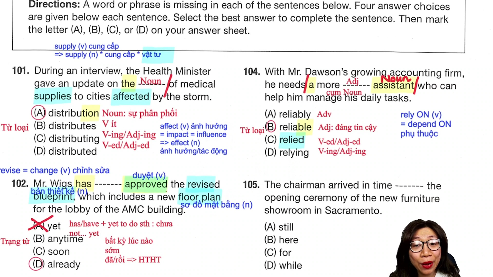

* **Đề bài:** `With Mr. Dawson's growing accounting firm, he needs a more ------- assistant who can help him manage his daily tasks.`
* **Phương án:**
  * (A) reliably: Trạng từ đuôi -ly (một cách đáng tin cậy).
  * (B) reliable: Tính từ đuôi -able (đáng tin cậy).
  * (C) relied: Động từ quá khứ hoặc tính từ phân từ.
  * (D) relying: Dạng V-ing hoặc tính từ phân từ chủ động.
* **Phân tích:** 
  * Cụm danh từ bắt đầu từ mạo từ `a` kéo dài đến danh từ trung tâm `assistant`. Cấu trúc cụm: `a + more + [Chỗ trống] + assistant`.
  * Đứng trước danh từ để bổ nghĩa trực tiếp, quy tắc bắt buộc ưu tiên tính từ gốc có đuôi nhận diện rõ ràng (`reliable`) thay vì tính từ phân từ (`relied/relying`).
  * `More` kết hợp với tính từ dài `reliable` tạo thành dạng so sánh hơn: `a more reliable assistant` (một trợ lý đáng tin cậy hơn). Chọn (B).
* **Dịch nghĩa:** Cùng với việc công ty kế toán của ông Dawson ngày càng phát triển, ông ấy cần một trợ lý đáng tin cậy hơn để có thể giúp quản lý các công việc hàng ngày.
* **Mở rộng:**
  * Gốc động từ: `Rely` đi kèm giới từ `on` (`rely on` = `depend on`: phụ thuộc vào, dựa vào).
  * Tính từ: `Reliable` (= `dependable`, `trustworthy`: đáng tin cậy).
  * Trạng từ: `Reliably` (chính xác, chắc chắn).

---

### [[19:48](https://youtu.be/JIVXPafQFKk?t=1188s)] Câu 105

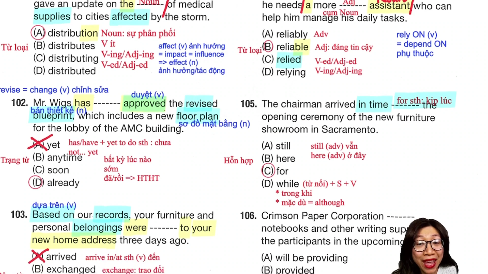

* **Đề bài:** `The chairman arrived in time ------- the opening ceremony of the new furniture showroom in Sacramento.`
* **Phương án:**
  * (A) still: Trạng từ (vẫn, vẫn còn).
  * (B) here: Trạng từ chỉ nơi chốn (ở đây).
  * (C) for: Giới từ (cho, dành cho).
  * (D) while: Liên từ (trong khi, mặc dù).
* **Phân tích:** 
  * Cụm từ cố định trong tiếng Anh: `in time for something` mang nghĩa "kịp lúc / đúng giờ cho một sự kiện nào đó". Phía sau chỗ trống là một cụm danh từ chỉ sự kiện (`the opening ceremony`).
  * `While` là liên từ bắt buộc theo sau bởi một mệnh đề (`S + V`) hoặc V-ing, không đi trực tiếp với cụm danh từ làm tân ngữ.
  * `Still` và `here` là trạng từ, không thể đóng vai trò liên kết ngữ pháp giữa cụm `in time` và danh từ phía sau. Chọn (C).
* **Dịch nghĩa:** Chủ tịch đã đến kịp lúc cho buổi lễ khai trương phòng trưng bày nội thất mới tại Sacramento.
* **Mở rộng:**
  * Phân biệt `In time` (kịp lúc trước khi sự việc bắt đầu) và `On time` (đúng giờ theo lịch trình ấn định sẵn).
  * Cấu trúc: `In time for + Noun` hoặc `In time to + V-infinitive`.
  * Liên từ `While` có hai nghĩa trong đề thi TOEIC: (1) Trong khi (chỉ hành động diễn ra đồng thời); (2) Mặc dù (= `Although`, diễn tả sự tương phản giữa hai mệnh đề).

---

### [[23:38](https://youtu.be/JIVXPafQFKk?t=1418s)] Câu 106

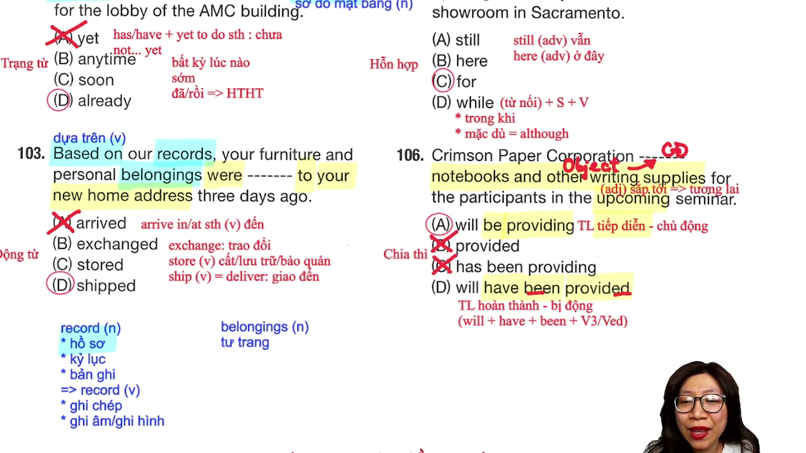

* **Đề bài:** `Dreamson Paper Corporation ------- notebooks and other writing supplies for the participants in the upcoming seminar.`
* **Phương án:**
  * (A) will be providing: Thì tương lai tiếp diễn thể chủ động.
  * (B) provides: Thì hiện tại đơn ngôi thứ ba số ít.
  * (C) provide: Động từ nguyên mẫu thì hiện tại đơn.
  * (D) will have been provided: Thì tương lai hoàn thành thể bị động.
* **Phân tích:** 
  * Dấu hiệu nhận biết thời gian là tính từ `upcoming` (sắp tới) nằm ở cuối câu, báo hiệu một hành động sẽ diễn ra trong tương lai. Loại phương án thì hiện tại (B, C).
  * Xét thể chủ động và bị động: Phía sau chỗ trống có cụm danh từ `notebooks and other writing supplies` làm tân ngữ trực tiếp chịu tác động của hành động. Do đó, động từ bắt buộc phải ở thể chủ động.
  * Phương án (D) mang cấu trúc bị động (`will have been + V3/ed`), không thể có tân ngữ trực tiếp theo sau. Phương án (A) là thì tương lai tiếp diễn ở thể chủ động (`will be + V-ing`). Chọn (A).
* **Dịch nghĩa:** Tập đoàn Dreamson Paper sẽ cung cấp sổ tay và các đồ dùng viết khác cho những người tham dự hội thảo sắp tới.
* **Mở rộng:**
  * `Participant` (n): Người tham dự sự kiện (= `attendee`). Động từ: `participate in` (= `take part in`, `join`).
  * `Seminar` (n): Hội thảo chuyên đề, lớp tập huấn (= `workshop`).
  * `Upcoming` (adj): Sắp tới, sắp diễn ra (= `forthcoming`, `approaching`).

---

### [[27:56](https://youtu.be/JIVXPafQFKk?t=1676s)] Câu 107

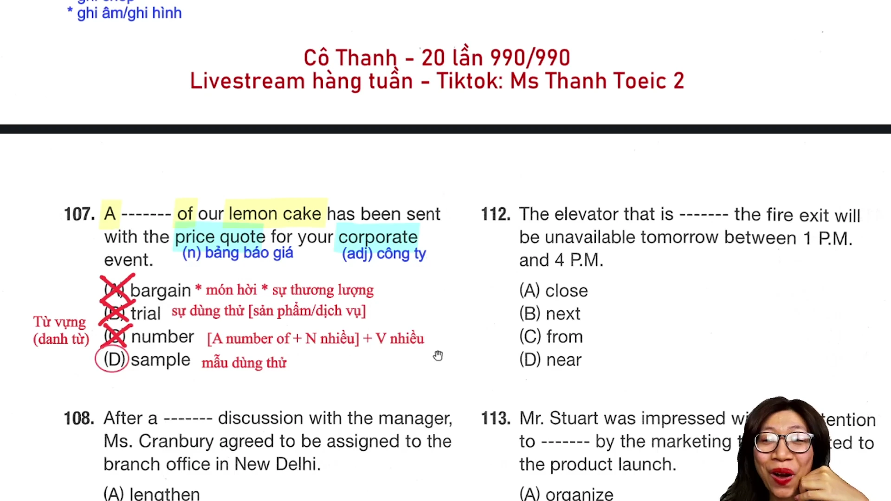

* **Đề bài:** `A ------- of our lemon cake has been sent with the price quote for your corporate event.`
* **Phương án:**
  * (A) bargain: Danh từ (món hời, sự thương lượng).
  * (B) trial: Danh từ (sự dùng thử, cuộc thử nghiệm).
  * (C) number: Danh từ (số lượng, con số).
  * (D) sample: Danh từ (mẫu dùng thử, vật mẫu).
* **Phân tích:** 
  * Bẫy ngữ pháp với từ `number`: Cấu trúc `A number of` bắt buộc phải đi với danh từ số nhiều và động từ chia ở số nhiều (`A number of + N số nhiều + V số nhiều`). Trong đề bài, `lemon cake` là danh từ số ít và động từ chia số ít `has been sent`. Do đó phương án (C) hoàn toàn sai cấu trúc ngữ pháp.
  * Phân biệt giữa `trial` và `sample`: `Trial` là quá trình dùng thử, thử nghiệm áp dụng cho dịch vụ, phần mềm, thiết bị công nghệ hoặc thử nghiệm lâm sàng (`clinical trial`, `free trial period`). `Sample` là mẫu phẩm vật lý, mẫu dùng thử đồ ăn thức uống, nước hoa, mỹ phẩm hoặc hàng mẫu để khách hàng đánh giá trước khi đặt số lượng lớn. Vì đối tượng ở đây là `lemon cake` (bánh chanh), chỉ có `sample` là phù hợp. Chọn (D).
* **Dịch nghĩa:** Một mẫu bánh chanh của chúng tôi đã được gửi kèm bản báo giá cho sự kiện công ty của bạn.
* **Mở rộng:**
  * `Price quote` (n): Bản báo giá chi tiết (= `quotation`, `estimate`).
  * `Corporate event` (n): Sự kiện doanh nghiệp, sự kiện công ty.
  * `Bargain` (n): Món hàng mua được giá rẻ, món hời. Động từ `bargain` mang nghĩa đàm phán, mặc cả giá cả.

---

### [[32:12](https://youtu.be/JIVXPafQFKk?t=1932s)] Câu 108

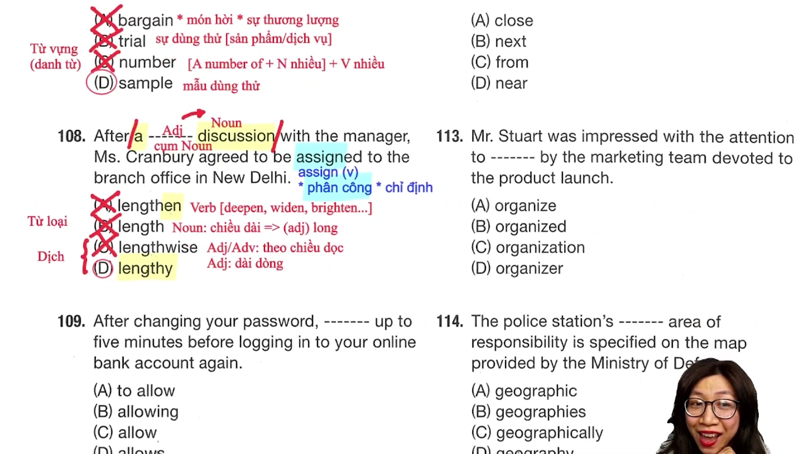

* **Đề bài:** `After a ------- discussion with the manager, Ms. Cranberry agreed to be assigned to the branch office in New Delhi.`
* **Phương án:**
  * (A) lengthen: Động từ nguyên mẫu (kéo dài ra).
  * (B) length: Danh từ (chiều dài, độ dài).
  * (C) lengthwise: Tính từ / Trạng từ (theo chiều dọc).
  * (D) lengthy: Tính từ (dài dòng, kéo dài thời gian).
* **Phân tích:** 
  * Cụm danh từ: `a + [Chỗ trống] + discussion`. Cần một tính từ đứng trước danh từ `discussion` (cuộc thảo luận) để bổ nghĩa.
  * Loại (A) vì đuôi `-en` trong `lengthen` là đuôi động từ (tương tự `widen`, `deepen`, `brighten`).
  * Loại (B) vì `length` là danh từ.
  * Xét hai tính từ (C) và (D): `Lengthwise` là từ chỉ hướng không gian vật lý (theo chiều dài, theo chiều dọc). `Lengthy` là tính từ trừu tượng chỉ thời gian kéo dài, mang nghĩa cuộc thảo luận diễn ra rất lâu hoặc dài dòng. Chọn (D).
* **Dịch nghĩa:** Sau một cuộc thảo luận kéo dài với người quản lý, cô Cranberry đã đồng ý được điều động đến văn phòng chi nhánh tại New Delhi.
* **Mở rộng:**
  * Động từ `Assign` có hai nghĩa quan trọng: (1) Phân công, giao nhiệm vụ (`assign tasks`); (2) Điều động, bổ nhiệm công tác (`be assigned to a branch`).
  * Đuôi `-en` tạo động từ: `Deep` (sâu) -> `deepen` (làm sâu thêm); `Wide` (rộng) -> `widen` (mở rộng); `Bright` (sáng) -> `brighten` (làm rạng rỡ).

---

### [[35:48](https://youtu.be/JIVXPafQFKk?t=2148s)] Câu 109

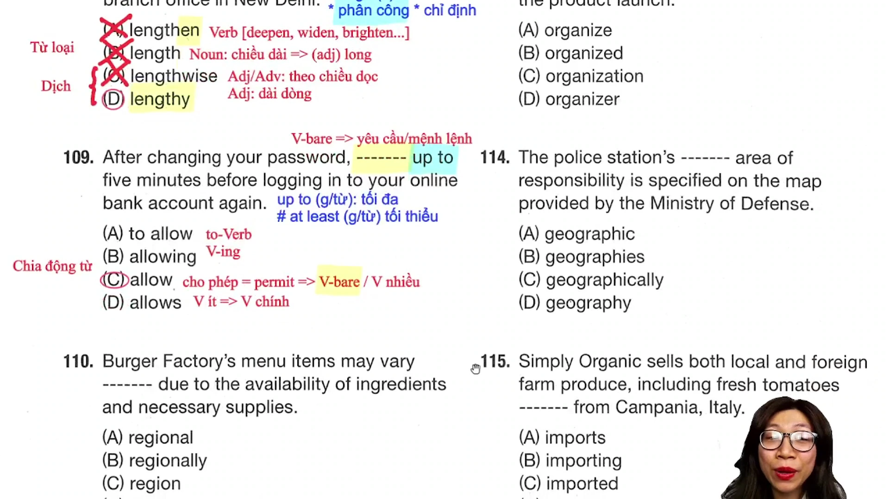

* **Đề bài:** `After changing your password, ------- up to 5 minutes before logging into your online bank account.`
* **Phương án:**
  * (A) to allow: Động từ dạng To-infinitive.
  * (B) allowing: Dạng V-ing.
  * (C) allow: Động từ nguyên mẫu không to (Bare Infinitive).
  * (D) allows: Động từ chia ngôi thứ ba số ít.
* **Phân tích:** 
  * Câu mở đầu bằng cụm giới từ chỉ thời gian `After changing your password,` (sau dấu phẩy).
  * Phân tích mệnh đề chính phía sau: Hoàn toàn không có chủ ngữ và chưa có động từ chính được chia thì. Trong tiếng Anh, khi một mệnh đề đứng đầu không có chủ ngữ, hình thức câu bắt buộc là câu mệnh lệnh hoặc câu hướng dẫn, yêu cầu sử dụng động từ nguyên mẫu không chia (`Bare Infinitive`).
  * Phương án (A), (B), (D) không thể tạo thành vị ngữ hoàn chỉnh cho câu mệnh lệnh. Chọn (C).
* **Dịch nghĩa:** Sau khi thay đổi mật khẩu, hãy đợi tối đa 5 phút trước khi đăng nhập vào tài khoản ngân hàng trực tuyến của bạn.
* **Mở rộng:**
  * `Allow` (= `permit`): Cho phép, dành ra. Cấu trúc `Allow somebody to do something` hoặc `Allow + khoảng thời gian`.
  * Giới từ `Up to`: Tối đa lên đến (mốc giới hạn trên).
  * Cụm trái nghĩa: `At least`: Tối thiểu, ít nhất (mốc giới hạn dưới).
  * `Log into` / `Log in to`: Đăng nhập vào hệ thống điện tử.

---

### [[43:28](https://youtu.be/JIVXPafQFKk?t=2608s)] Câu 110

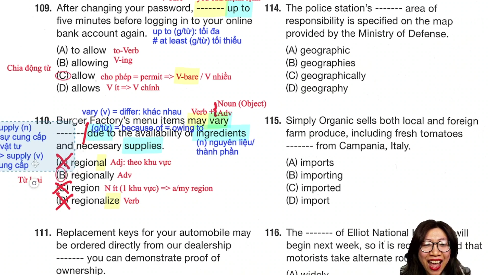

* **Đề bài:** `Burger Factory's menu items may vary ------- due to the availability of ingredients and necessary supplies.`
* **Phương án:**
  * (A) regional: Tính từ đuôi -al (thuộc về khu vực).
  * (B) regionally: Trạng từ đuôi -ly (theo từng khu vực).
  * (C) region: Danh từ số ít (khu vực, vùng miền).
  * (D) regionalize: Động từ đuôi -ize (khu vực hóa).
* **Phân tích:** 
  * Phía trước chỗ trống là cụm động từ `may vary` (có thể thay đổi/khác biệt), phía sau là cụm giới từ chỉ nguyên nhân `due to`.
  * Sau một động từ, về nguyên tắc có thể điền tân ngữ danh từ hoặc trạng từ bổ nghĩa.
  * Tuy nhiên, nếu điền danh từ `region`, đây là danh từ đếm được số ít, bắt buộc phải có mạo từ (`a/the`) hoặc từ hạn định đứng trước (`a region`, `our region`). Vì chỗ trống không có mạo từ, phương án danh từ (C) bị loại trừ.
  * Động từ `vary` ở đây là nội động từ mang nghĩa "khác nhau, dao động", đòi hỏi một trạng từ cách thức đứng sau để bổ nghĩa cho hành động (`vary regionally` = thay đổi theo từng khu vực). Chọn (B).
* **Dịch nghĩa:** Các món ăn trong thực đơn của Burger Factory có thể khác nhau tùy theo khu vực do tính sẵn có của nguyên liệu và các vật tư cần thiết.
* **Mở rộng:**
  * Động từ: `Vary` (= `differ`). Tính từ: `Various` (đa dạng), `Variable` (có thể biến đổi). Trạng từ: `Regionally`.
  * Cụm giới từ chỉ nguyên nhân: `Due to` = `Because of` = `Owing to` + Noun/V-ing.
  * `Availability` (n): Tính sẵn có, tình trạng có sẵn để sử dụng. Tính từ: `available`.
  * `Ingredients` (n số nhiều): Thành phần nguyên liệu (chế biến thực phẩm).

---

### [[47:24](https://youtu.be/JIVXPafQFKk?t=2844s)] Câu 111

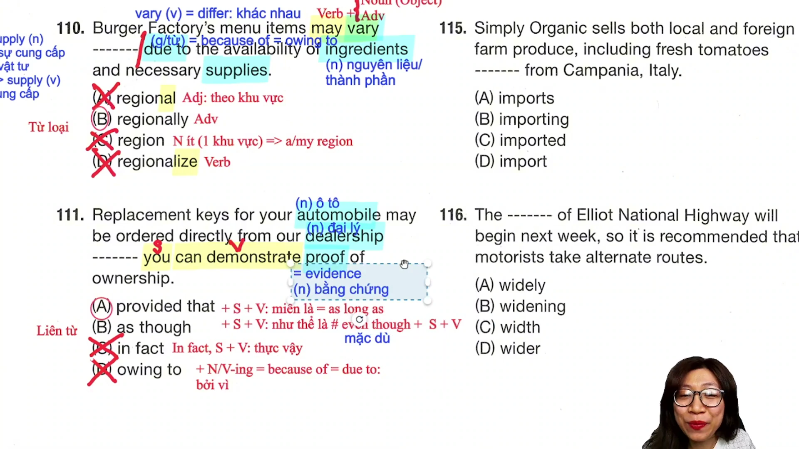

* **Đề bài:** `Replacement keys for automobiles can be ordered directly from our dealership ------- you can demonstrate proof of ownership.`
* **Phương án:**
  * (A) provided that: Liên từ phụ thuộc (miễn là, với điều kiện là).
  * (B) as though: Liên từ phụ thuộc (như thể là).
  * (C) in fact: Trạng từ liên kết (thực tế là, thật vậy).
  * (D) owing to: Giới từ chỉ nguyên nhân (bởi vì).
* **Phân tích:** 
  * Phía sau chỗ trống là một mệnh đề hoàn chỉnh gồm chủ ngữ `you` và vị ngữ `can demonstrate proof of ownership` (`S + V + O`).
  * Loại (D) vì `owing to` là giới từ, chỉ đi kèm cụm danh từ hoặc V-ing, không đi kèm mệnh đề.
  * Loại (C) vì `in fact` là trạng từ liên kết, khi đứng đầu mệnh đề bắt buộc phải có dấu phẩy ngăn cách (`In fact, you can...`).
  * Xét nghĩa giữa (A) và (B): `As though` (= `as if`) diễn tả tình huống giả định không có thật (như thể là). `Provided that` (= `as long as`, `providing that`) là liên từ chỉ điều kiện, mang nghĩa "miễn là / với điều kiện là", hoàn toàn ăn khớp về mặt logic điều kiện đặt hàng. Chọn (A).
* **Dịch nghĩa:** Chìa khóa thay thế cho ô tô có thể được đặt trực tiếp từ đại lý của chúng tôi miễn là bạn có thể xuất trình bằng chứng quyền sở hữu.
* **Mở rộng:**
  * `Provided that` = `Providing that` = `As long as`: Miễn là, với điều kiện là.
  * Phân biệt: `Even though` (mặc dù) khác hoàn toàn `As though` (như thể là).
  * `Proof` (n): Bằng chứng, chứng từ (= `evidence`). Động từ: `Prove` (chứng minh).
  * `Dealership` (n): Đại lý ủy quyền (thường dùng cho ngành kinh doanh ô tô, xe máy).
  * `Demonstrate` (v): Chứng minh, giải thích, làm mẫu (= `show`, `prove`).

---

### [[50:48](https://youtu.be/JIVXPafQFKk?t=3048s)] Câu 112

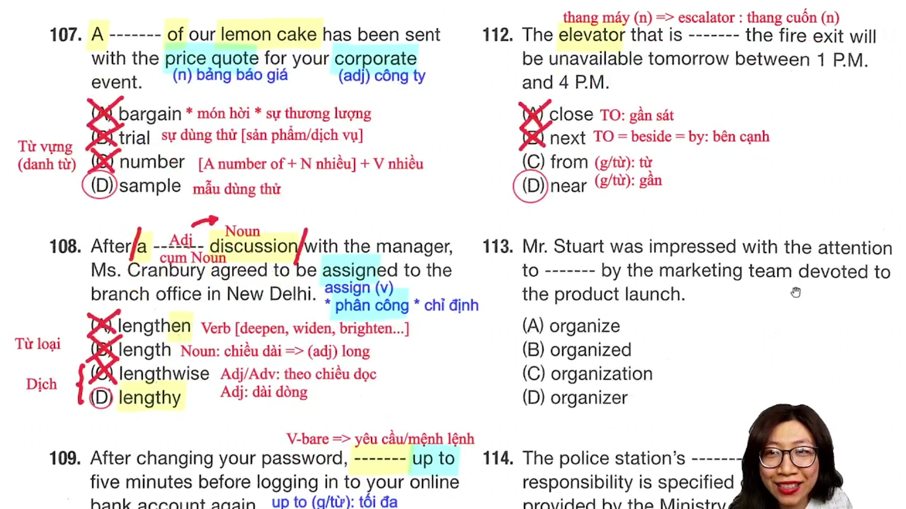

* **Đề bài:** `The elevator that is ------- the fire exit will be unavailable tomorrow between 1 and 4 p.m.`
* **Phương án:**
  * (A) close: Tính từ / Trạng từ (gần).
  * (B) next: Tính từ / Trạng từ (kế tiếp).
  * (C) from: Giới từ (từ, bắt nguồn từ).
  * (D) near: Giới từ chỉ vị trí (gần, ở gần).
* **Phân tích:** 
  * Chỗ trống đứng sau động từ to be `is` và đứng trước cụm danh từ chỉ vị trí `the fire exit` (lối thoát hiểm chống cháy).
  * Để chỉ mối quan hệ vị trí không gian:
    * Từ `close` khi đóng vai trò tính từ hoặc trạng từ bắt buộc phải có giới từ `to` đi kèm: `close to something` (= gần cái gì). Vì câu không có `to`, phương án (A) bị loại.
    * Từ `next` bắt buộc phải có giới từ `to` đi kèm: `next to something` (= `beside`, `by`: bên cạnh cái gì). Không có `next the fire exit`, loại (B).
    * Giới từ `from` (từ) ghép vào câu tạo thành nghĩa vô lý ("thang máy mà xuất phát từ lối thoát hiểm").
  * Từ `near` bản thân nó là một giới từ hoàn chỉnh, có thể đứng trực tiếp trước một cụm danh từ mà không cần giới từ phụ trợ: `near the fire exit` (ở gần lối thoát hiểm). Chọn (D).
* **Dịch nghĩa:** Chiếc thang máy ở gần lối thoát hiểm sẽ tạm ngừng hoạt động vào ngày mai từ 1 giờ đến 4 giờ chiều.
* **Mở rộng:**
  * Cụm từ vị trí: `Near + Noun` = `Close to + Noun`.
  * Cụm từ bên cạnh: `Next to + Noun` = `Beside + Noun` = `By + Noun`.
  * Từ vựng di chuyển: `Elevator` / `Lift` (thang máy buồng); `Escalator` (thang cuốn tự động).
  * `Unavailable` (adj): Không có sẵn, tạm thời không sử dụng được, bận. Trái nghĩa: `Available`.

---

### [[55:20](https://youtu.be/JIVXPafQFKk?t=3320s)] Câu 113

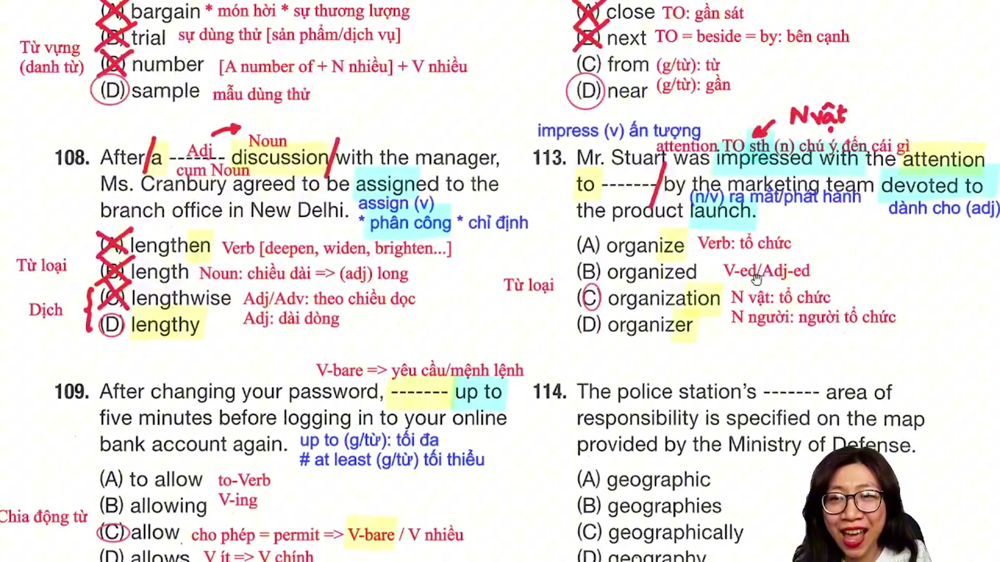

* **Đề bài:** `Mr. Stuart was impressed with the attention to ------- by the marketing team devoted to the product launch.`
* **Phương án:**
  * (A) organize: Động từ nguyên mẫu đuôi -ize (tổ chức).
  * (B) organized: Động từ quá khứ hoặc tính từ phân từ.
  * (C) organization: Danh từ chỉ vật / khái niệm (sự tổ chức, khâu tổ chức).
  * (D) organizer: Danh từ chỉ người (người tổ chức, ban tổ chức).
* **Phân tích:** 
  * Cấu trúc cố định: `Pay attention to something` hoặc cụm danh từ `attention to something` (sự chú tâm, chú ý đến vấn đề gì). Trong cấu trúc này, `to` đóng vai trò là giới từ, bắt buộc theo sau bởi danh từ hoặc V-ing.
  * Loại (A) vì `to` ở đây không phải là to-infinitive.
  * Phân biệt giữa hai danh từ (C) và (D): `Organizer` là danh từ đếm được chỉ người (người tổ chức sự kiện). `Organization` là danh từ chỉ sự việc/khái niệm (công tác tổ chức, khâu sắp xếp trật tự). Trong ngữ cảnh ông Stuart ấn tượng với sự cẩn trọng, tỉ mỉ trong "khâu tổ chức" của đội ngũ tiếp thị, danh từ chỉ sự việc `organization` là đáp án chính xác. Chọn (C).
* **Dịch nghĩa:** Ông Stuart rất ấn tượng với sự chú tâm đến khâu tổ chức của đội ngũ tiếp thị dành cho buổi ra mắt sản phẩm.
* **Mở rộng:**
  * Cấu trúc: `Be impressed with / by something`: Bị ấn tượng bởi điều gì.
  * Cụm tính từ: `Devoted to something / V-ing`: Hết lòng, cống hiến, tận tâm cho điều gì.
  * `Launch`: Vừa là động từ (ra mắt, phát hành sản phẩm mới, phóng tên lửa), vừa là danh từ (buổi ra mắt sản phẩm = `product launch`).

---

### [[58:38](https://youtu.be/JIVXPafQFKk?t=3518s)] Câu 114

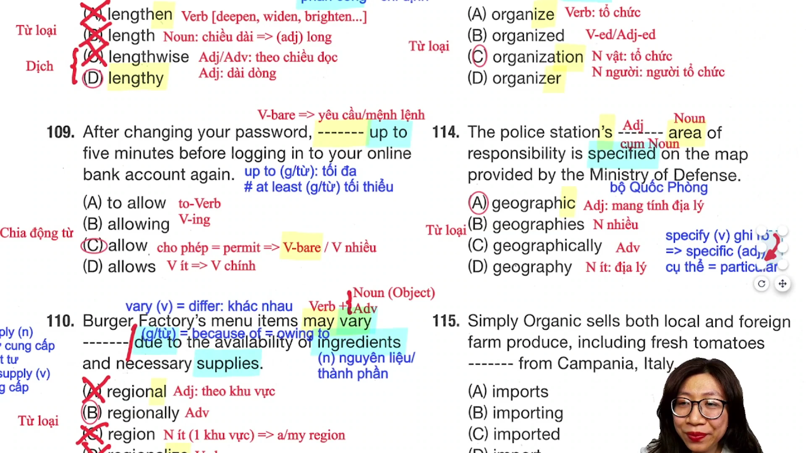

* **Đề bài:** `The police station's ------- area of responsibility is specified on the map provided by the Ministry of Defense.`
* **Phương án:**
  * (A) geographic: Tính từ đuôi -ic (thuộc về địa lý).
  * (B) geographies: Danh từ số nhiều (các nền địa lý).
  * (C) geographically: Trạng từ đuôi -ly (về mặt địa lý).
  * (D) geography: Danh từ số ít (môn địa lý, địa thế).
* **Phân tích:** 
  * Phía trước chỗ trống có sở hữu cách `The police station's`, phía sau chỗ trống có danh từ chính `area` kết hợp với cụm giới từ `of responsibility` tạo thành cụm danh từ lớn: `The police station's + [Chỗ trống] + area of responsibility`.
  * Đứng trước danh từ `area` để bổ nghĩa tính chất phạm vi cho khu vực đó, cần một tính từ.
  * Đuôi `-ic` trong `geographic` là dấu hiệu nhận diện tiêu chuẩn của tính từ. Chọn (A).
* **Dịch nghĩa:** Khu vực phụ trách theo địa lý của đồn cảnh sát được quy định cụ thể trên bản đồ do Bộ Quốc phòng cung cấp.
* **Mở rộng:**
  * Động từ: `Specify` (ghi rõ, định rõ, chỉ định cụ thể).
  * Tính từ: `Specific` (= `particular`: cụ thể, đặc thù).
  * Cụm danh từ: `Area of responsibility`: Khu vực chịu trách nhiệm, phạm vi quản lý.
  * Cụm cơ quan nhà nước: `Ministry of Defense` (Bộ Quốc phòng).

---

### [[01:08:10](https://youtu.be/JIVXPafQFKk?t=4090s)] Câu 115

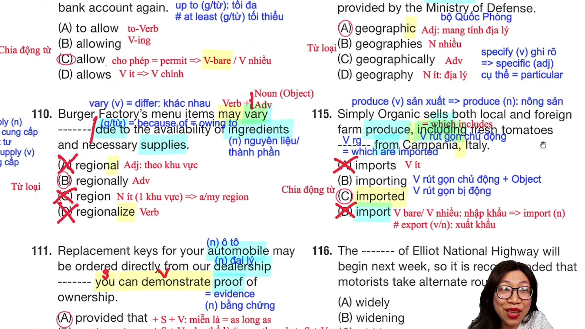

* **Đề bài:** `Simply Organic sells both local and foreign farm produce including fresh tomatoes ------- from Campania, Italy.`
* **Phương án:**
  * (A) imports: Động từ chia ngôi thứ ba số ít hoặc danh từ số nhiều.
  * (B) importing: Dạng V-ing (chủ động).
  * (C) imported: Quá khứ phân từ V3/ed (bị động).
  * (D) import: Động từ nguyên mẫu hoặc danh từ số ít.
* **Phân tích:** 
  * Phân tích thành phần câu chính: Chủ ngữ `Simply Organic`, động từ chính `sells`, tân ngữ `both local and foreign farm produce`.
  * Cụm phụ phía sau `including fresh tomatoes ------- from Campania, Italy` là thành phần bổ ngữ mở rộng giải thích cho danh từ `produce`.
  * Cụm này có động từ rút gọn bổ nghĩa cho danh từ `fresh tomatoes`. Ban đầu mệnh đề có dạng đầy đủ: `which are imported from Campania, Italy`.
  * Vì cà chua được nhập khẩu (thể bị động), khi rút gọn mệnh đề quan hệ dạng bị động, ta lược bỏ đại từ quan hệ `which` và trợ động từ `are`, chỉ giữ lại quá khứ phân từ `V3/ed` (`imported`).
  * Phía sau chỗ trống có giới từ `from` chỉ nguồn gốc xuất xứ chứ không có tân ngữ, củng cố quy tắc thể bị động. Chọn (C).
* **Dịch nghĩa:** Cửa hàng Simply Organic bán cả nông sản trang trại trong nước và nước ngoài, bao gồm cả cà chua tươi được nhập khẩu từ vùng Campania nước Ý.
* **Mở rộng:**
  * Từ đa nghĩa cực hay `Produce`:
    * Khi là động từ: /prəˈdjuːs/ mang nghĩa sản xuất, chế tạo.
    * Khi là danh từ không đếm được: /ˈprɒd.juːs/ mang nghĩa nông sản (hoa quả, rau củ thu hoạch từ nông trại). Đây là bẫy từ vựng then chốt xuất hiện liên tục trong Part 5, Part 6 và Part 7.
  * Cặp từ trái nghĩa thương mại: `Import` (nhập khẩu) và `Export` (xuất khẩu). Cả hai từ đều vừa là động từ vừa là danh từ.

---

## Trích dẫn then chốt

* [04:10](https://youtu.be/JIVXPafQFKk?t=250s): "Effect mới là danh từ là ảnh hưởng, tác động. Còn động từ là affect, nó bằng với impact và bằng với influence. Đi thi gặp chữ nào cũng phải nhận diện ra ngay để không bị bẫy từ loại."
* [10:35](https://youtu.be/JIVXPafQFKk?t=635s): "Cuộc đời của in time không thích cho quả quýt, mà nó chỉ thích cho for thôi. Cứ thấy in time là đi kiếm ngay chữ for để tạo thành cụm in time for something, chọn đáp án trong 3 giây không cần dịch cả câu."
* [24:35](https://youtu.be/JIVXPafQFKk?t=1475s): "Đừng thấy chữ a rồi vội vàng chọn a number of. A number of bắt buộc phải đi với danh từ số nhiều và động từ số nhiều. Nhìn kỹ danh từ phía sau là món bánh chanh số ít thì chỉ có sample mới dùng được cho cả đồ ăn lẫn sản phẩm."
* [36:35](https://youtu.be/JIVXPafQFKk?t=2195s): "Sau động từ có tới hai trường hợp: một là danh từ làm tân ngữ, hai là trạng từ bổ nghĩa. Ai mà chỉ nhớ trạng từ thôi thì chỉ làm được câu band 500-600, lên câu 700-800 gặp ngoại động từ cần tân ngữ là sai sạch."
* [1:04:15](https://youtu.be/JIVXPafQFKk?t=3855s): "Cứ thấy cụm nằm ở giữa hai dấu phẩy thì nhớ ngay đó là mệnh đề quan hệ rút gọn. Không có đại từ quan hệ wh- thì chỉ còn V-ing cho chủ động và V-ed cho bị động. Nhìn phía sau có giới từ from không có tân ngữ thì quất ngay V-ed."
* [1:07:55](https://youtu.be/JIVXPafQFKk?t=4075s): "Produce danh từ là nông sản chứ không phải sản phẩm. Từ này cực kỳ hay, xuất hiện xuyên suốt từ Part 5 qua Part 7 và cả trong phần Nghe. Phải học chuẩn nghĩa này để không bị mất điểm oan."

---

## Lệnh & Công cụ

### Bảng giải nhanh

| Dạng bài | Dấu hiệu nhận diện | Công thức áp dụng | Thời gian xử lý |
| :--- | :--- | :--- | :--- |
| Cụm danh từ cơ bản | Mạo từ (the/a/an) + [Chỗ trống] + Giới từ | Điền Danh từ đuôi -tion (`distribution`) | 5 giây |
| Trạng từ hoàn thành | have/has + [Chỗ trống] + V3/ed | Điền Trạng từ `already` | 5 giây |
| Bị động vận chuyển | be + [Chỗ trống] + to your address | Chọn động từ giao hàng `shipped` | 5 giây |
| Bổ nghĩa danh từ | a more + [Chỗ trống] + Danh từ | Ưu tiên Tính từ gốc đuôi -able (`reliable`) | 5 giây |
| Cụm giới từ thời gian | in time + [Chỗ trống] + Sự kiện | Điền Giới từ `for` | 3 giây |
| Chia thì tương lai | upcoming + [Chỗ trống] + Tân ngữ | Chọn Tương lai tiếp diễn chủ động (`will be providing`) | 10 giây |
| Mẫu thử thực phẩm | A + [Chỗ trống] + of món ăn + V số ít | Chọn `sample`, loại trừ `number` và `trial` | 5 giây |
| Tính từ trừu tượng | a + [Chỗ trống] + discussion | Điền Tính từ thời gian dài `lengthy` | 10 giây |
| Câu mệnh lệnh | [Chỗ trống] đứng đầu mệnh đề, không có chủ ngữ | Điền Động từ nguyên mẫu (`allow`) | 5 giây |
| Bổ nghĩa động từ | Động từ + [Chỗ trống] (không có mạo từ danh từ) | Điền Trạng từ đuôi -ly (`regionally`) | 10 giây |
| Liên từ điều kiện | [Chỗ trống] + Mệnh đề hoàn chỉnh | Chọn `provided that`, loại trừ `in fact` và `owing to` | 5 giây |
| Giới từ vị trí | be + [Chỗ trống] + Danh từ (không có 'to') | Điền `near`, loại trừ `close` và `next` | 5 giây |
| Giới từ cố định | attention to + [Chỗ trống] (khâu tổ chức) | Điền Danh từ chỉ sự việc `organization` | 5 giây |
| Sở hữu cách | N's + [Chỗ trống] + Danh từ | Điền Tính từ đuôi -ic (`geographic`) | 5 giây |
| Mệnh đề rút gọn | Danh từ + [Chỗ trống] + Giới từ (from) | Chọn Quá khứ phân từ bị động (`imported`) | 5 giây |

### Từ đồng nghĩa

* `Affect` = `Influence` = `Impact`: Ảnh hưởng, tác động lên
* `Approve` = `Accept` = `Endorse`: Phê duyệt, chấp thuận
* `Revise` = `Modify` = `Change` = `Alter`: Chỉnh sửa, sửa đổi
* `Ship` = `Deliver`: Giao hàng, vận chuyển
* `Rely on` = `Depend on`: Dựa vào, phụ thuộc vào
* `Reliable` = `Dependable` = `Trustworthy`: Đáng tin cậy
* `Upcoming` = `Forthcoming` = `Approaching`: Sắp tới, sắp diễn ra
* `Participant` = `Attendee`: Người tham gia
* `Seminar` = `Workshop`: Hội thảo, buổi tập huấn
* `Price quote` = `Quotation` = `Estimate`: Bản báo giá
* `Assign` = `Designate` = `Allocate`: Phân công, điều động, chỉ định
* `Allow` = `Permit`: Cho phép, dành ra
* `Vary` = `Differ`: Khác biệt, dao động
* `Due to` = `Because of` = `Owing to`: Bởi vì, do
* `Provided that` = `As long as` = `Providing that`: Miễn là, với điều kiện là
* `Proof` = `Evidence`: Bằng chứng, chứng từ
* `Near` = `Close to`: Ở gần
* `Beside` = `Next to` = `By`: Ở bên cạnh
* `Specify` = `State clearly`: Quy định rõ, ghi rõ
* `Specific` = `Particular`: Cụ thể, đặc thù

---

## Đánh đổi & Rủi ro

* **Bẫy dịch từng từ ở các câu từ loại (Word-by-word Translation):** Đối với các câu hỏi cấu trúc ngữ pháp và vị trí từ loại thuần túy (như câu 101, 104, 105, 114), việc dừng lại đọc dịch toàn bộ câu sẽ làm lãng phí 20 đến 30 giây quý giá cho mỗi câu. Tích lũy qua 30 câu Part 5 sẽ làm mất từ 5 đến 7 phút đọc hiểu quan trọng của Part 7.
* **Bẫy máy móc sau động từ luôn chọn trạng từ:** Thí sinh chỉ học vẹt quy tắc "sau động từ là trạng từ" sẽ gặp thất bại ở các câu nâng cao (như câu 110) hoặc các câu đòi hỏi tân ngữ danh từ. Phải phân biệt rõ ràng: nếu danh từ là số ít đếm được thì bắt buộc phải có mạo từ đi kèm, nếu không có mạo từ mới chắc chắn chọn trạng từ.
* **Bẫy khuyết giới từ đi kèm (`close` vs `near`, `next` vs `beside`):** Cả `close`, `next` và `near` đều mang nghĩa vị trí gần kề, nhưng `close` và `next` bắt buộc phải có giới từ `to` đi liền phía sau (`close to`, `next to`). Chọn nhầm do chỉ dịch nghĩa tiếng Việt mà không đối soát giới từ là lỗi sai phổ biến nhất ở câu 112.
* **Bẫy dùng thử giữa `trial` và `sample`:** Cả hai từ đều được dịch sang tiếng Việt là "dùng thử", nhưng `trial` là quá trình thử nghiệm vô hình dành cho dịch vụ/phần mềm, còn `sample` là vật phẩm hữu hình dùng cho thực phẩm và hàng hóa tiêu dùng.
* **Bẫy từ đa nghĩa `produce`:** Mặc định dịch `produce` là động từ "sản xuất" sẽ gây tắc nghẽn hoàn toàn tư duy ngữ pháp khi từ này xuất hiện trong vai trò danh từ "nông sản" ở Part 5 và Part 7.
