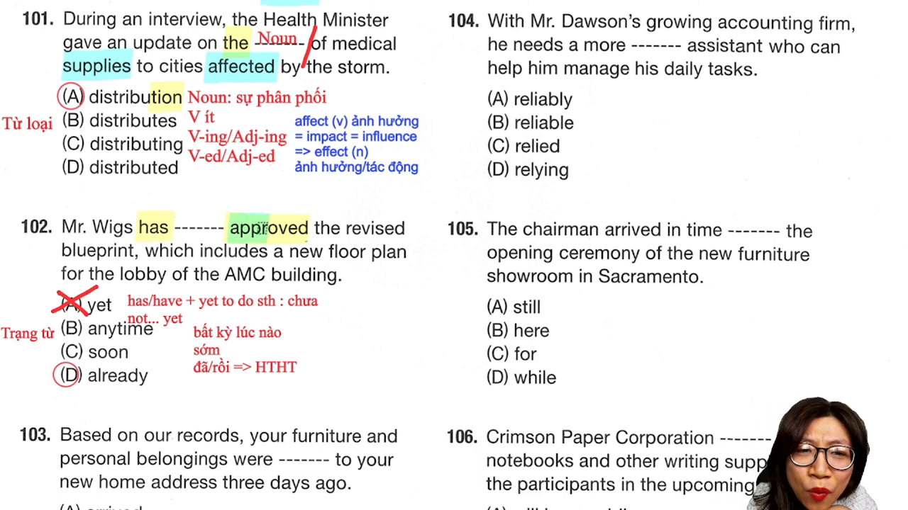
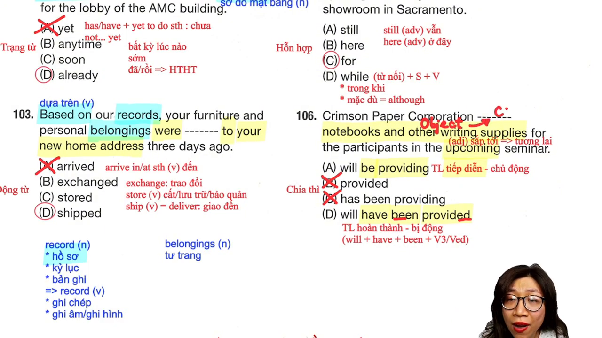
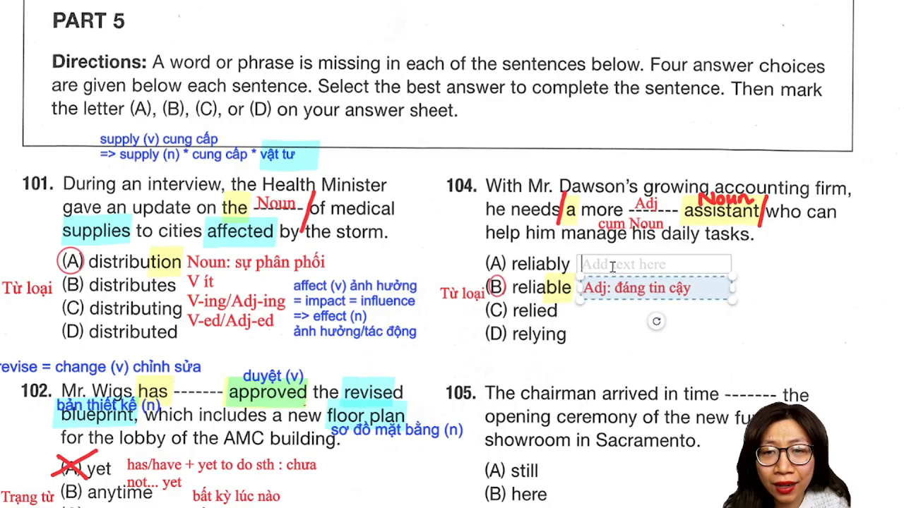
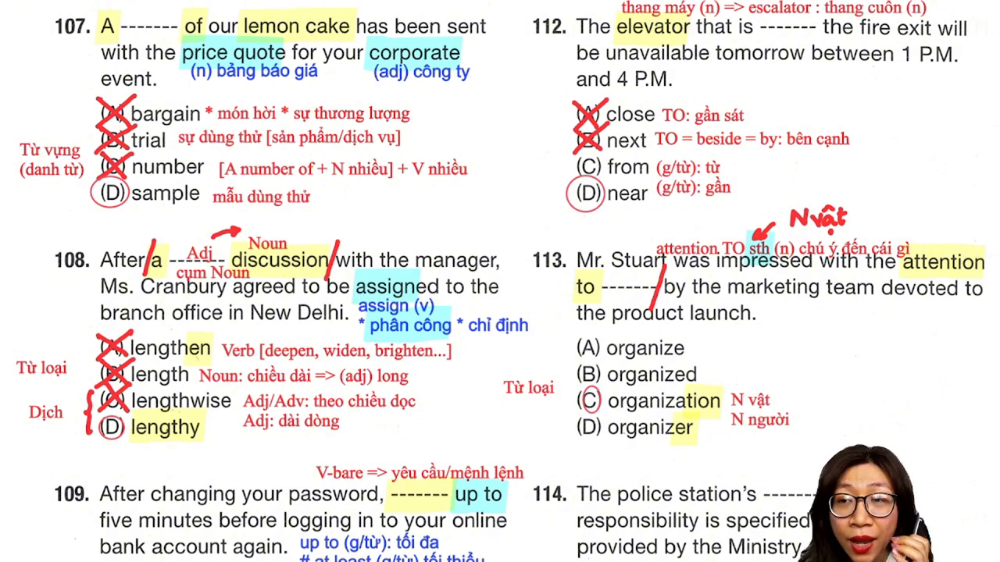
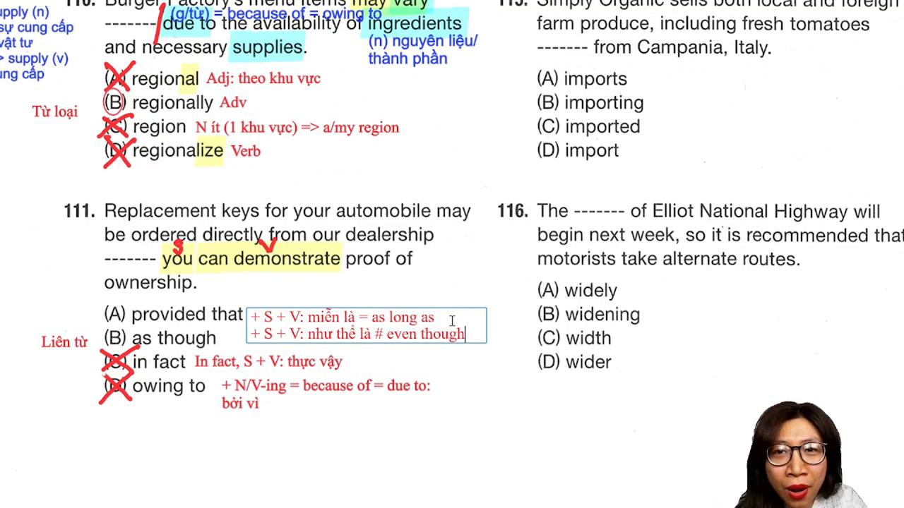
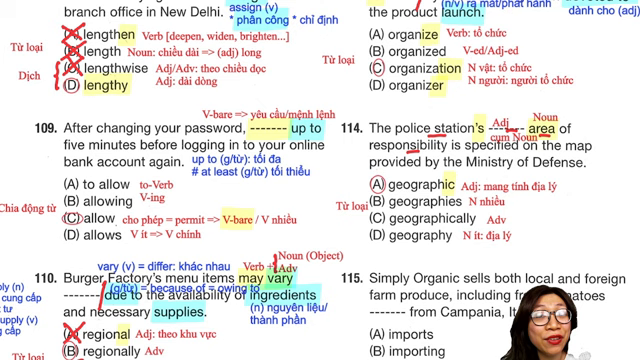
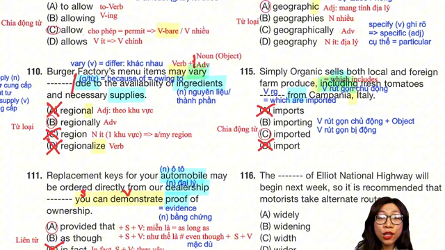

# Giải đề TOEIC Reading Part 5

* **Kênh:** Ms Thanh Toeic | **Thời lượng:** 01:08:14 | **Ngày:** 2026-03-24
* **Video:** https://www.youtube.com/watch?v=JIVXPafQFKk

---

## Thuật ngữ

| Thuật ngữ             | Tiếng Anh                 | Giải thích bản chất                                                                            |
| :-------------------- | :------------------------ | :--------------------------------------------------------------------------------------------- |
| **Cụm danh từ**       | Noun Phrase               | Trật tự chuẩn: `Mạo từ + (Trạng từ) + Tính từ + Danh từ chính`. Danh từ đứng cuối làm mốc.     |
| **Ngoại động từ**     | Transitive Verb           | Động từ bắt buộc có tân ngữ (Object) đi sau. Khi thiếu tân ngữ thì câu chia ở thể bị động.     |
| **Nội động từ**       | Intransitive Verb         | Động từ không nhận tân ngữ (như *arrive*, *happen*), tuyệt đối không bao giờ chia bị động.     |
| **Rút gọn mệnh đề**   | Reduced Clause            | Lược bỏ đại từ quan hệ và to-be: Dùng `V-ing` (chủ động, có tân ngữ) hoặc `V3/V-ed` (bị động). |
| **Liên từ phụ thuộc** | Subordinating Conjunction | Từ nối dẫn đầu một mệnh đề hoàn chỉnh gồm `S + V` (như *provided that*, *as though*).          |
| **Giới từ kép**       | Compound Preposition      | Cụm giới từ chỉ đi với danh từ hoặc V-ing (như *due to*, *owing to*, *because of*).            |
|                       |                           |                                                                                                |

---

## Tổng luận chuyên đề

### Chuyên đề 1: Cụm danh từ và trật tự từ loại
* **Quy tắc cốt lõi:** Luôn nhìn từ phải qua trái để xác định đuôi của cụm danh từ. Nếu sau chỗ trống đã có Danh từ chính, từ đứng trước bắt buộc là Tính từ bổ nghĩa, không được chọn Danh từ tiếp trừ trường hợp danh từ ghép đặc biệt.
* **Bẫy mạo từ và trạng từ:** Khi thấy `more`, không vội chọn trạng từ đuôi `-ly`. Cấu trúc `a more + [Adj] + [Noun]` là dạng so sánh hơn của tính từ dài đứng trước danh từ.
* **Quy tắc đuôi từ vựng (Suffixes):**
  * Đuôi `-en` (*lengthen*, *widen*, *deepen*) là Động từ mang nghĩa "làm cho...".
  * Đuôi `-wise` (*lengthwise*, *clockwise*) là Trạng từ chỉ phương hướng/chiều hướng.
  * Đuôi `-y` (*lengthy*) là Tính từ mang nghĩa "dài dòng, lê thê".

### Chuyên đề 2: Động từ, thì và thể bị động
* **Quy tắc xét động từ 3 bước:**
  1. *Bước 1 (Vị trí):* Câu đã có động từ chính chưa? Nếu chưa -> chia thì; nếu đã có -> rút gọn mệnh đề hoặc to-V/V-ing.
  2. *Bước 2 (Chủ - Vị):* Chủ ngữ số ít hay số nhiều để loại trừ các phương án sai hòa hợp.
  3. *Bước 3 (Chủ động hay Bị động):* Nhìn sau chỗ trống: Có tân ngữ danh từ -> ưu tiên Chủ động; không có tân ngữ (có giới từ/dấu chấm) -> ưu tiên Bị động.
* **Nội động từ cấm chia bị động:** Các từ như `arrive`, `occur`, `remain`, `expire` không nhận tân ngữ trực tiếp, do đó không bao giờ có dạng `was/were arrived`.

### Chuyên đề 3: Mệnh đề quan hệ rút gọn
* **Công thức nhận diện:** Một câu đơn chỉ được phép có 1 động từ chính chia thì. Nếu xuất hiện động từ thứ hai mà không có liên từ nối (*which*, *that*, *who*), đó bắt buộc là dạng rút gọn:
  * Chủ động: `[Noun] + V-ing + [Tân ngữ]`.
  * Bị động: `[Noun] + V3/V-ed + [Giới từ / Cụm trạng ngữ]`.

### Chuyên đề 4: Phân biệt liên từ và giới từ
* **Cặp điều kiện:** `provided that` = `as long as` = "miễn là" (+ `S + V`), tương đương cấu trúc câu điều kiện loại 1.
* **Cặp nguyên nhân:** `due to` = `because of` = `owing to` (+ `Noun / V-ing`), khác hoàn toàn với `because` (+ `S + V`).
* **Giới từ vị trí:** `close to` (gần sát), `next to = beside = by` (bên cạnh), `near` (gần - đi trực tiếp với danh từ, không có *to*).

---

## Bóc tách chi tiết từng câu

### Câu 101 - Từ loại danh từ

* **Đề bài:** *During an interview, the Health Minister gave an update on the ------- of medical supplies to cities affected by the storm.*
* **Dịch nghĩa:** Trong một cuộc phỏng vấn, Bộ trưởng Bộ Y tế đã cập nhật về việc phân phối vật tư y tế đến các thành phố bị ảnh hưởng bởi cơn bão.
* **Phân tích 4 phương án:**
  * `(A) distribution (Noun)`: **ĐÁP ÁN ĐÚNG.** Cấu trúc `the + [Noun] + of`, chỗ trống cần một danh từ chỉ sự phân phối.
  * `(B) distributes (Verb số ít)`: Loại vì vị trí đứng sau mạo từ *the* không thể là động từ chia thì.
  * `(C) distributing (V-ing)`: Loại vì sau mạo từ *the* ưu tiên danh từ gốc hơn danh động từ.
  * `(D) distributed (V-ed)`: Loại vì không thể đứng làm tân ngữ sau *the*.
* **Họ từ mở rộng:**
  * `distribute (v)`: phân phối, phân phát.
  * `distributor (n)`: nhà phân phối.
  * `affect (v)`: tác động, ảnh hưởng (= `impact = influence`).
  * `effect (n)`: sự ảnh hưởng, hiệu lực.

---

### Câu 102 - Trạng từ chỉ thời gian

* **Đề bài:** *Mr. Wigs has ------- approved the revised blueprint, which includes a new floor plan for the lobby of the AMC building.*
* **Dịch nghĩa:** Ông Wigs đã phê duyệt bản thiết kế sửa đổi, bao gồm sơ đồ mặt bằng mới cho sảnh tòa nhà AMC.
* **Phân tích 4 phương án:**
  * `(A) yet (Trạng từ)`: Loại. *Yet* chỉ dùng trong câu phủ định (`not... yet`) hoặc cấu trúc `have/has yet to do sth` (vẫn chưa làm gì).
  * `(B) anytime (Trạng từ)`: Loại vì mang nghĩa "bất kỳ lúc nào", không hợp nghĩa câu.
  * `(C) soon (Trạng từ)`: Loại vì *soon* đi với thì tương lai, không đi với hiện tại hoàn thành `has approved`.
  * `(D) already (Trạng từ)`: **ĐÁP ÁN ĐÚNG.** Đứng giữa trợ động từ `has` và động từ V3 `approved` mang nghĩa "đã/rồi".
* **Họ từ mở rộng:**
  * `revise (v)`: chỉnh sửa, sửa đổi.
  * `revision (n)`: bản chỉnh sửa.
  * `blueprint (n)`: bản thiết kế chi tiết.
  * `floor plan (n)`: sơ đồ mặt bằng.

---

### Câu 103 - Thể bị động của ngoại động từ

* **Đề bài:** *Based on our records, your furniture and personal belongings were ------- to your new home address three days ago.*
* **Dịch nghĩa:** Dựa trên hồ sơ của chúng tôi, đồ đạc và tư trang cá nhân của bạn đã được chuyển đến địa chỉ nhà mới cách đây ba ngày.
* **Phân tích 4 phương án:**
  * `(A) arrived (Nội động từ)`: Loại tuyệt đối vì *arrive* là nội động từ, không bao giờ dùng dạng bị động `were arrived`.
  * `(B) exchanged (Verb)`: Loại vì nghĩa "được trao đổi" không phù hợp với ngữ cảnh chuyển nhà.
  * `(C) stored (Verb)`: Loại vì đồ đạc chuyển tới nhà mới chứ không phải được lưu trữ/bảo quản tới nhà mới.
  * `(D) shipped (Verb)`: **ĐÁP ÁN ĐÚNG.** Cụm `were shipped to` = được vận chuyển/giao đến (= `delivered`).
* **Họ từ mở rộng:**
  * `record (n)`: hồ sơ, kỷ lục, bản ghi; `record (v)`: ghi chép, thu âm.
  * `belongings (n)`: đồ dùng cá nhân, tư trang.

---

### Câu 104 - Vị trí tính từ trong cụm danh từ

* **Đề bài:** *With Mr. Dawson’s growing accounting firm, he needs a more ------- assistant who can help him manage his daily tasks.*
* **Dịch nghĩa:** Với công ty kế toán ngày càng phát triển của ông Dawson, ông ấy cần một trợ lý đáng tin cậy hơn để giúp quản lý công việc hàng ngày.
* **Phân tích 4 phương án:**
  * `(A) reliably (Adv)`: Loại vì đứng trước danh từ *assistant* không thể dùng trạng từ.
  * `(B) reliable (Adj)`: **ĐÁP ÁN ĐÚNG.** Cụm danh từ: `a more + [Adj] + assistant (Noun)`.
  * `(C) relied (Verb)`: Loại vì không có cấu trúc so sánh hơn với động từ chia quá khứ ở đây.
  * `(D) relying (V-ing)`: Loại vì *relying* cần đi với giới từ *on* mang nghĩa phụ thuộc.
* **Họ từ mở rộng:**
  * `rely on (v)`: tin cậy, phụ thuộc vào.
  * `reliability (n)`: sự đáng tin cậy.

---

### Câu 105 - Giới từ chỉ mục đích

* **Đề bài:** *The chairman arrived in time ------- the opening ceremony of the new furniture showroom in Sacramento.*
* **Dịch nghĩa:** Chủ tịch đã đến kịp giờ cho buổi lễ khai trương phòng trưng bày nội thất mới tại Sacramento.
* **Phân tích 4 phương án:**
  * `(A) still (Trạng từ)`: Loại vì không thể đứng trước một cụm danh từ nối câu.
  * `(B) here (Trạng từ)`: Loại vì thừa từ chỉ nơi chốn và sai ngữ pháp.
  * `(C) for (Giới từ)`: **ĐÁP ÁN ĐÚNG.** Cấu trúc `in time for sth` = kịp giờ cho sự kiện/cái gì.
  * `(D) while (Liên từ)`: Loại vì *while* bắt buộc phải đi với một mệnh đề `S + V` hoặc rút gọn `V-ing`.
* **Họ từ mở rộng:**
  * `in time for`: kịp giờ cho việc gì (khác với `on time`: đúng giờ).
  * `opening ceremony (n)`: lễ khai mạc / lễ khai trương.

---

### Câu 106 - Thì tương lai tiếp diễn thể chủ động

* **Đề bài:** *Crimson Paper Corporation ------- notebooks and other writing supplies for the participants in the upcoming seminar.*
* **Dịch nghĩa:** Tập đoàn Giấy Crimson sẽ cung cấp sổ tay và các vật tư văn phòng khác cho người tham dự trong hội thảo sắp tới.
* **Phân tích 4 phương án:**
  * `(A) will be providing (Thì TL tiếp diễn - Chủ động)`: **ĐÁP ÁN ĐÚNG.** Có dấu hiệu `upcoming` (tương lai) và có tân ngữ `notebooks...` phía sau nên chọn thể chủ động.
  * `(B) provided (Quá khứ đơn)`: Loại vì mâu thuẫn với trạng từ chỉ tương lai `upcoming`.
  * `(C) has been providing (Hiện tại hoàn thành tiếp diễn)`: Loại vì nói về hành động chưa diễn ra.
  * `(D) will have been provided (TL hoàn thành - Bị động)`: Loại vì là thể bị động trong khi câu có tân ngữ phía sau.
* **Họ từ mở rộng:**
  * `upcoming (adj)`: sắp tới, chuẩn bị diễn ra.
  * `participant (n)`: người tham gia; `participate in (v)`: tham gia vào.

---

### Câu 107 - Từ vựng danh từ

* **Đề bài:** *A ------- of our lemon cake has been sent with the price quote for your corporate event.*
* **Dịch nghĩa:** Một mẫu bánh chanh của chúng tôi đã được gửi kèm với bảng báo giá cho sự kiện công ty của bạn.
* **Phân tích 4 phương án:**
  * `(A) bargain (Noun)`: Món hời / sự thương lượng (không hợp nghĩa).
  * `(B) trial (Noun)`: Sự dùng thử phần mềm/dịch vụ (không dùng cho đồ ăn/thực phẩm).
  * `(C) number (Noun)`: Cụm `A number of` đi với danh từ đếm được số nhiều, trong khi *lemon cake* ở đây là số ít.
  * `(D) sample (Noun)`: **ĐÁP ÁN ĐÚNG.** Mẫu dùng thử sản phẩm thực phẩm.
* **Họ từ mở rộng:**
  * `price quote (n)`: bảng báo giá.
  * `corporate (adj)`: thuộc về doanh nghiệp/công ty.

---

### Câu 108 - Phân biệt họ từ tính từ

* **Đề bài:** *After a ------- discussion with the manager, Ms. Cranbury agreed to be assigned to the branch office in New Delhi.*
* **Dịch nghĩa:** Sau một cuộc thảo luận kéo dài với người quản lý, cô Cranbury đã đồng ý được phân công đến văn phòng chi nhánh tại New Delhi.
* **Phân tích 4 phương án:**
  * `(A) lengthen (Verb)`: Động từ làm cho dài ra (loại vì đứng giữa `a` và danh từ *discussion* cần một tính từ).
  * `(B) length (Noun)`: Danh từ chiều dài (loại).
  * `(C) lengthwise (Adj/Adv)`: Theo chiều dọc (loại vì sai nghĩa).
  * `(D) lengthy (Adj)`: **ĐÁP ÁN ĐÚNG.** Tính từ mang nghĩa dài dòng, kéo dài.
* **Họ từ mở rộng:**
  * `assign (v)`: phân công, chỉ định.
  * `assignment (n)`: nhiệm vụ được giao.

---

### Câu 109 - Câu mệnh lệnh bắt đầu bằng động từ nguyên mẫu

* **Đề bài:** *After changing your password, ------- up to five minutes before logging in to your online bank account again.*
* **Dịch nghĩa:** Sau khi đổi mật khẩu, vui lòng chờ tối đa năm phút trước khi đăng nhập lại vào tài khoản ngân hàng trực tuyến của bạn.
* **Phân tích 4 phương án:**
  * `(A) to allow (to-Verb)`: Loại vì không thể đứng đầu làm vị ngữ câu mệnh lệnh.
  * `(B) allowing (V-ing)`: Loại vì không tạo thành mệnh đề chính hoàn chỉnh.
  * `(C) allow (V-bare)`: **ĐÁP ÁN ĐÚNG.** Câu mệnh lệnh / yêu cầu bắt đầu bằng động từ nguyên mẫu không chia.
  * `(D) allows (Verb số ít)`: Loại vì câu không có chủ ngữ số ít.
* **Họ từ mở rộng:**
  * `allow (v)`: cho phép, dành ra (= `permit`).
  * `up to`: tối đa (trái ngược với `at least`: tối thiểu).

---

### Câu 110 - Trạng từ bổ nghĩa cho động từ

* **Đề bài:** *Burger Factory’s menu items may vary ------- due to the availability of ingredients and necessary supplies.*
* **Dịch nghĩa:** Các món trong thực đơn của Burger Factory có thể khác nhau theo từng khu vực do tính sẵn có của nguyên liệu và vật tư cần thiết.
* **Phân tích 4 phương án:**
  * `(A) regional (Adj)`: Loại vì không thể bổ nghĩa cho động từ *vary*.
  * `(B) regionally (Adv)`: **ĐÁP ÁN ĐÚNG.** Trạng từ đứng sau bổ nghĩa cho động từ *vary* (khác nhau theo vùng).
  * `(C) region (Noun số ít)`: Loại vì danh từ đếm được số ít không thể đứng trơ trọi không có mạo từ.
  * `(D) regionalize (Verb)`: Loại vì câu đã có cụm động từ chính `may vary`.
* **Họ từ mở rộng:**
  * `vary (v)`: thay đổi, khác nhau (= `differ`).
  * `ingredient (n)`: nguyên liệu, thành phần món ăn.
  * `supplies (n số nhiều)`: vật tư, hàng cung cấp.

---

### Câu 111 - Liên từ điều kiện

* **Đề bài:** *Replacement keys for your automobile may be ordered directly from our dealership ------- you can demonstrate proof of ownership.*
* **Dịch nghĩa:** Chìa khóa thay thế cho ô tô của bạn có thể được đặt trực tiếp từ đại lý của chúng tôi miễn là bạn có thể xuất trình bằng chứng sở hữu.
* **Phân tích 4 phương án:**
  * `(A) provided that (Liên từ)`: **ĐÁP ÁN ĐÚNG.** Bằng nghĩa với *as long as* (miễn là), nối hai mệnh đề điều kiện.
  * `(B) as though (Liên từ)`: Nghĩa là "như thể là" (sai logic ngữ cảnh).
  * `(C) in fact (Trạng từ liên kết)`: Cần có dấu phẩy đứng sau (`in fact, S + V`) và mang nghĩa "thực ra".
  * `(D) owing to (Giới từ)`: Loại vì *owing to* chỉ đi với cụm danh từ, không đi với mệnh đề `S + V`.
* **Họ từ mở rộng:**
  * `dealership (n)`: đại lý phân phối xe.
  * `proof of ownership (n)`: bằng chứng sở hữu (= `evidence`).

---

### Câu 112 - Giới từ chỉ vị trí

* **Đề bài:** *The elevator that is ------- the fire exit will be unavailable tomorrow between 1 P.M. and 4 P.M.*
* **Dịch nghĩa:** Thang máy ở gần lối thoát hiểm sẽ tạm ngừng hoạt động vào ngày mai từ 1 giờ chiều đến 4 giờ chiều.
* **Phân tích 4 phương án:**
  * `(A) close (Tính từ)`: Bắt buộc phải có *to* đi kèm (`close to`).
  * `(B) next (Tính từ)`: Bắt buộc phải có *to* đi kèm (`next to = beside`).
  * `(C) from (Giới từ)`: Không hợp nghĩa vị trí thang máy.
  * `(D) near (Giới từ)`: **ĐÁP ÁN ĐÚNG.** Đi trực tiếp với cụm danh từ `the fire exit` mang nghĩa "ở gần".
* **Họ từ mở rộng:**
  * `elevator (n)`: thang máy buồng (khác với `escalator (n)`: thang cuốn).
  * `fire exit (n)`: lối thoát hiểm khi có hỏa hoạn.

---

### Câu 113 - Phân biệt danh từ chỉ vật và danh từ chỉ người

* **Đề bài:** *Mr. Stuart was impressed with the attention to ------- by the marketing team devoted to the product launch.*
* **Dịch nghĩa:** Ông Stuart rất ấn tượng với sự chú trọng đến khâu tổ chức của đội ngũ tiếp thị dành cho buổi ra mắt sản phẩm.
* **Phân tích 4 phương án:**
  * `(A) organize (Verb)`: Loại vì sau giới từ *to* cần một danh từ hoặc V-ing.
  * `(B) organized (Verb/Adj)`: Loại vì không thể đứng làm tân ngữ cho giới từ *to*.
  * `(C) organization (Noun chỉ vật)`: **ĐÁP ÁN ĐÚNG.** Cụm `attention to organization` = sự chú trọng đến việc tổ chức/sắp xếp.
  * `(D) organizer (Noun chỉ người)`: Loại vì danh từ đếm được số ít chỉ "người tổ chức" cần có mạo từ `an organizer`.
* **Họ từ mở rộng:**
  * `attention to sth`: sự chú ý/chú trọng đến cái gì.
  * `devoted to (adj)`: cống hiến, tận tụy cho.
  * `launch (n/v)`: buổi ra mắt / tung ra sản phẩm.

---

### Câu 114 - Vị trí tính từ trong cụm danh từ sở hữu cách

* **Đề bài:** *The police station’s ------- area of responsibility is specified on the map provided by the Ministry of Defense.*
* **Dịch nghĩa:** Khu vực trách nhiệm theo địa lý của đồn cảnh sát được nêu rõ trên bản đồ do Bộ Quốc phòng cung cấp.
* **Phân tích 4 phương án:**
  * `(A) geographic (Adj)`: **ĐÁP ÁN ĐÚNG.** Đứng trước danh từ *area* để tạo thành cụm `geographic area` (khu vực địa lý).
  * `(B) geographies (Noun số nhiều)`: Loại vì không ghép hai danh từ mang nghĩa này.
  * `(C) geographically (Adv)`: Loại vì không dùng trạng từ bổ nghĩa trực tiếp cho danh từ *area*.
  * `(D) geography (Noun số ít)`: Loại vì không đúng dạng cụm danh từ cố định.
* **Họ từ mở rộng:**
  * `specify (v)`: chỉ rõ, nêu rõ.
  * `specific (adj)`: cụ thể (= `particular`).

---

### Câu 115 - Rút gọn mệnh đề quan hệ thể bị động

* **Đề bài:** *Simply Organic sells both local and foreign farm produce, including fresh tomatoes ------- from Campania, Italy.*
* **Dịch nghĩa:** Cửa hàng Simply Organic bán cả nông sản địa phương lẫn ngoại nhập, bao gồm cà chua tươi được nhập khẩu từ Campania, Ý.
* **Phân tích 4 phương án:**
  * `(A) imports (Verb số ít)`: Loại vì câu đã có động từ chính `sells`, không thể có động từ chia thì thứ hai không có liên từ.
  * `(B) importing (V-ing)`: Loại vì cà chua không thể tự nhập khẩu (dạng chủ động cần có tân ngữ).
  * `(C) imported (V3/V-ed)`: **ĐÁP ÁN ĐÚNG.** Mệnh đề quan hệ rút gọn thể bị động: `which are imported from...` rút về `imported from...`.
  * `(D) import (Verb nguyên mẫu)`: Loại.
* **Họ từ mở rộng:**
  * `produce (n)`: nông sản (danh từ không đếm được); `produce (v)`: sản xuất.
  * `including`: bao gồm (đóng vai trò như một giới từ nối).

---

## Trích dẫn then chốt

> "Động từ arrive là nội động từ, tuyệt đối không bao giờ chia ở dạng bị động." — [10:45](https://youtu.be/JIVXPafQFKk?t=645s)

> "Thấy more đừng vội vàng đánh đuôi ly, phải nhìn xem phía sau có danh từ hay không để xác định cụm danh từ." — [14:15](https://youtu.be/JIVXPafQFKk?t=855s)

> "Provided that bằng nghĩa với as long as, mang nghĩa là miễn là và luôn đi với một mệnh đề hoàn chỉnh S + V." — [44:30](https://youtu.be/JIVXPafQFKk?t=2670s)

> "Danh từ produce mang nghĩa là nông sản và là danh từ không đếm được, rất hay thi trong Part 5." — [1:03:15](https://youtu.be/JIVXPafQFKk?t=3795s)

---

## Đánh đổi & Rủi ro

* **Bẫy dịch nghĩa từng chữ:** Dịch nghĩa trong Part 5 làm tiêu tốn từ 40 đến 60 giây mỗi câu, khiến thí sinh không còn đủ thời gian để đọc hiểu các đoạn văn dài ở Part 7.
* **Bẫy đuôi từ vựng gây nhầm lẫn:** Rất nhiều thí sinh nhầm đuôi `-en` (*lengthen*, *widen*) là tính từ/phân từ, trong khi bản chất là động từ; hoặc nhầm `-ly` luôn là trạng từ mà quên mất các tính từ đuôi `-ly` như *friendly*, *timely*, *costly*.
* **Bẫy rút gọn mệnh đề quan hệ:** Khi thấy danh từ phía trước, vội vàng chọn `V-ing` theo cảm tính mà không kiểm tra xem đối tượng đó là chủ thể thực hiện hành động hay bị tác động bởi hành động.
