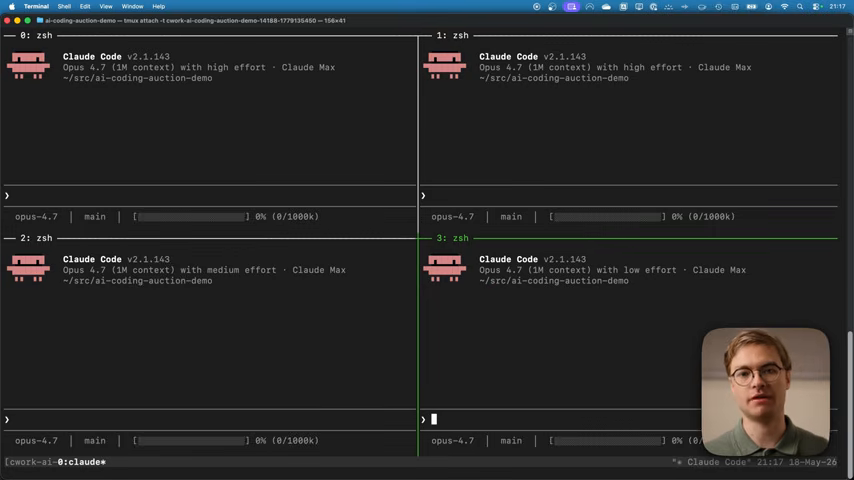
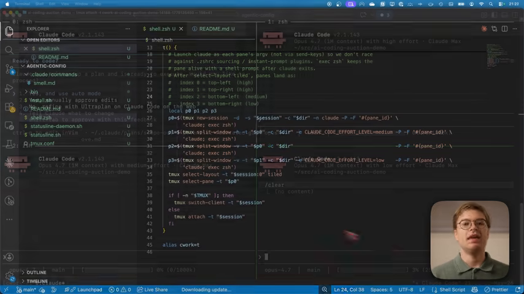
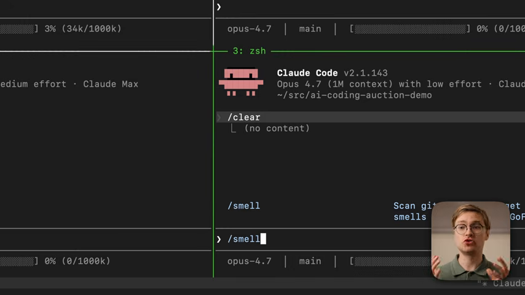
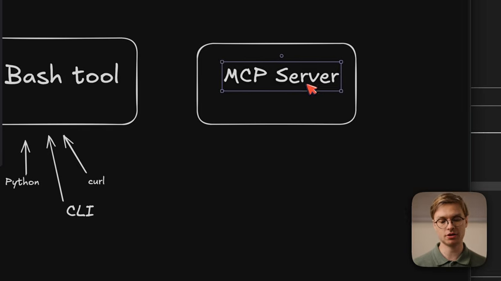
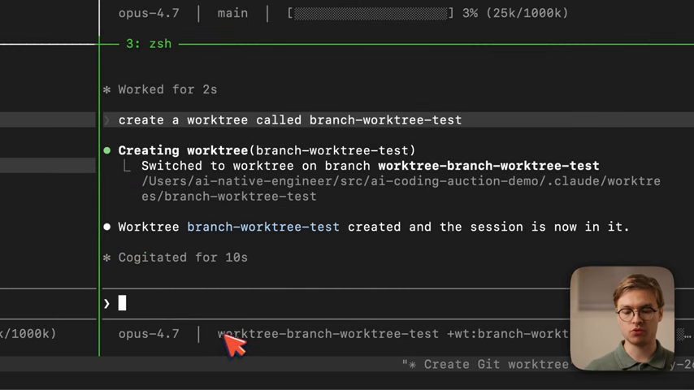
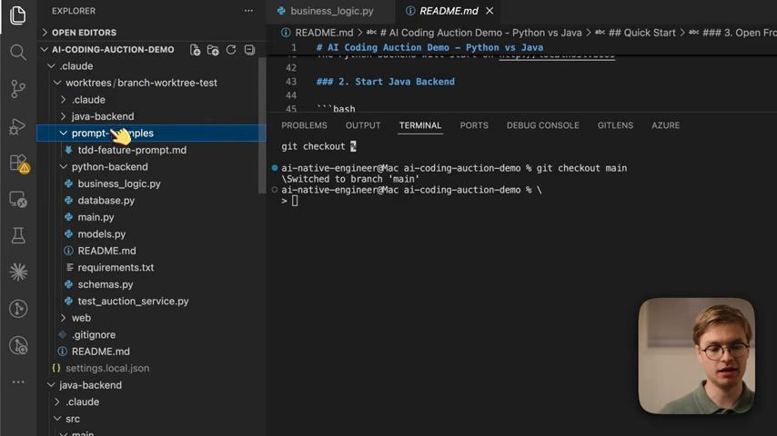

# Quy trình kỹ sư Agentic năm 2026

* **Kênh:** IndyDevDan | **Thời lượng:** 18:24 | **Ngày:** 2026-03-20
* **Video:** https://www.youtube.com/watch?v=ElYxdpYi4U0

---

## Thuật ngữ

| Thuật ngữ | Tiếng Anh | Giải thích |
| :--- | :--- | :--- |
| **Quy trình Agentic** | Agentic Workflow | Mô hình phát triển phần mềm để AI agent tự đọc file, chạy lệnh và sửa code |
| **Git Worktree** | Git Worktree | Tính năng Git cho phép mở đồng thời nhiều nhánh ở các thư mục riêng |
| **Trôi ngữ cảnh** | Context Window Drift | Hiện tượng AI giảm độ chính xác khi hội thoại bị tích tụ quá nhiều log |
| **Giao thức MCP** | Model Context Protocol | Chuẩn kết nối giữa mô hình AI với công cụ và dịch vụ bên ngoài |
| **Công cụ tất định** | Deterministic Tool | Lệnh trả về kết quả cố định đúng/sai (linter, unit test) để kiểm chứng AI |

---

## Tổng quan

* **Bài toán:** Lập trình viên code thủ công không theo kịp tốc độ. Dùng chat web thì hay gặp ảo giác, trôi ngữ cảnh và dễ xung đột code khi làm nhiều việc cùng lúc.
* **Giải pháp:** Chuyển từ gõ code sang điều phối hệ thống. Dùng Git Worktree để tách riêng không gian làm việc cho từng agent chạy terminal (Claude Code), dùng bộ kiểm thử tự động làm cổng nghiệm thu.
* **10 giây đầu:** Tác giả khẳng định kỷ nguyên "thợ gõ code" đã hết; kỹ sư hiện đại là kiến trúc sư điều hành nhiều agent làm việc song song.

---

## Chi tiết theo khung hình

### 00:00 - Tư duy kỹ sư Agentic
*(Tác giả chia sẻ trực tiếp, không có màn hình code)*

* **Nội dung:** Kỹ sư hiện đại không cạnh tranh bằng tốc độ gõ phím mà bằng khả năng định nghĩa bài toán, thiết kế kiến trúc và viết tiêu chí kiểm thử.
* **Chia sẻ thực tế:** Dùng giao diện web để code dự án lớn là sai lầm vì mất toàn bộ ngữ cảnh repository, buộc người dùng phải copy-paste thủ công.

---

### 01:00 - Thiết lập 4 cửa sổ song song



* **Màn hình:** 4 ô terminal chạy Claude Code v2.1.143 Opus 4.7 (1M context) phân chia bằng tmux. Thanh trạng thái dưới đáy hiển thị model, branch Git (`main`) và tỷ lệ sử dụng context (`0% (0/1000k)`).
* **Nội dung:** Chia nhỏ công việc thành nhiều luồng chạy độc lập để xử lý song song các tác vụ khác nhau.
* **Chia sẻ thực tế:** Thiết lập status line rõ ràng giúp lập trình viên kiểm soát nhanh cửa sổ nào đang dùng bao nhiêu token và chạy trên nhánh nào.

---

### 03:15 - Kịch bản tự động hóa tmux



* **Màn hình:** Mã nguồn file `shell.zsh` của tác giả. Dùng `tmux new-session` và `tmux split-window` chia 4 ô theo dạng `tiled`, gán biến `CLAUDE_CODE_EFFORT_LEVEL=medium` và `low` cho từng ô.
* **Nội dung:** Phân bổ mức độ suy nghĩ (effort level) phù hợp cho từng cửa sổ thay vì để tất cả ở mức cao nhất nhằm tiết kiệm chi phí và thời gian.
* **Chia sẻ thực tế:** Tự động hóa việc dựng môi trường bằng script shell giúp mở lại không gian làm việc đa luồng chỉ trong một lệnh.

---

### 05:15 - Lệnh kiểm tra chất lượng code



* **Màn hình:** Tác giả gõ lệnh tùy biến `> /smell` trên Claude Code kèm mô tả `Scan git smells`.
* **Nội dung:** Tạo lệnh riêng để agent tự động rà soát lại toàn bộ thay đổi vừa tạo ra trước khi tạo PR, tìm các đoạn code rác hoặc thiết kế sai lệch.
* **Chia sẻ thực tế:** Không bao giờ tin tưởng tuyệt đối code do agent sinh ra; luôn phải có lệnh quét riêng để phát hiện logic thừa.

---

### 07:35 - Quản lý ngữ cảnh và GitHub CLI


* **Màn hình:** Cửa sổ terminal với lệnh `> /clear` và thanh trạng thái hiển thị tỷ lệ ngữ cảnh `3% (34k/1000k)`.
* **Nội dung:** Khi hoàn thành một mốc công việc, chủ động xóa sạch phiên bằng `/clear` trước khi kết nối GitHub CLI (`gh`) để mở PR.
* **Chia sẻ thực tế:** Không để context window tích lũy quá nhiều log trung gian; dọn dẹp phiên thường xuyên là cách tốt nhất để chống ảo giác.

---

### 08:55 - So sánh Bash Tool và MCP Server



* **Màn hình:** Sơ đồ vẽ tay của tác giả: khối `Bash tool` (Python, CLI, curl) đặt cạnh khối `MCP Server`.
* **Nội dung:** Bash tool tối ưu cho các thao tác hệ thống nhanh và script nội bộ; MCP Server phù hợp cho các kết nối dịch vụ chuẩn hóa bên ngoài hoặc chẩn đoán phức tạp.
* **Chia sẻ thực tế:** Tránh việc bọc mọi thứ vào MCP Server khi chỉ cần một lệnh shell đơn giản là đủ giải quyết vấn đề.

---

### 10:32 - Áp dụng theo quy mô dự án
*(Tác giả chia sẻ trực tiếp, không có màn hình code)*

* **Nội dung:** Ba cấp độ ứng dụng: Freelance, Startup và Enterprise. Dự án càng lớn thì vai trò của kiểm thử tự động và phân lập môi trường càng mang tính sống còn.
* **Chia sẻ thực tế:** Ở quy mô doanh nghiệp, nếu không có bộ test tự động ngăn chặn, agent sẽ nhanh chóng phá vỡ kiến trúc hệ thống hiện có.

---

### 14:25 - Tạo Git Worktree bằng Claude Code



* **Màn hình:** Lệnh `create a worktree called branch-worktree-test`. Claude Code tự động tạo thư mục `.claude/worktrees/branch-worktree-test` và chuyển phiên làm việc vào đó. Status line đổi sang `+wt:branch-workt...`.
* **Nội dung:** Nhờ Git Worktree, agent có thể thử nghiệm 3 hướng giải quyết khác nhau cho một bài toán trên 3 nhánh độc lập mà không bị xung đột code.
* **Chia sẻ thực tế:** Phân lập vật lý bằng worktree là chìa khóa để chạy nhiều agent song song an toàn.

---

### 14:55 - Cấu trúc thư mục Worktree trong VS Code



* **Màn hình:** File Explorer của VS Code hiển thị thư mục `.claude/worktrees/branch-worktree-test/` chứa toàn bộ bản sao dự án (`java-backend`, `python-backend`, `prompt-samples`).
* **Nội dung:** Trực quan hóa cách Git Worktree tạo bản sao thư mục riêng biệt trên ổ đĩa.
* **Chia sẻ thực tế:** Sau khi hoàn thành và merge code xong, cần xóa ngay thư mục worktree để tránh làm đầy dung lượng ổ cứng.

---

### 15:56 - Bài học về năng suất thực tế
*(Tác giả chia sẻ trực tiếp, không có màn hình code)*

* **Nội dung:** Tạo code nhanh không đồng nghĩa với tạo code tốt. Tác giả từng bị từ chối PR vì code chạy được nhưng thiếu tư duy kiến trúc dài hạn.
* **Chia sẻ thực tế:** Đừng làm lập trình viên "vibe code" đẩy hàng nghìn dòng AI code không kiểm chứng lên production mỗi ngày; hãy là kỹ sư hiểu rõ toàn bộ hệ thống mình đang quản lý.

---

## Trích dẫn then chốt

> "Bạn muốn làm một vibe coder đẩy hàng nghìn dòng AI code lên production mỗi ngày, hay muốn làm kỹ sư thực thụ vừa tận dụng AI vừa làm chủ toàn bộ hệ thống?" — [16:20](https://youtu.be/ElYxdpYi4U0?t=980s)

> "Dùng web chat để code cho dự án lớn là sai lầm phổ biến nhất; nó cắt đứt ngữ cảnh thực tế của mã nguồn." — [01:15](https://youtu.be/ElYxdpYi4U0?t=75s)

> "Git Worktree cho phép bạn chạy 3 hướng tiếp cận khác nhau cho cùng một bài toán trên các agent độc lập mà không bao giờ bị xung đột code." — [14:07](https://youtu.be/ElYxdpYi4U0?t=847s)

---

## Lệnh & Công cụ

```bash
# Tạo worktree mới cho agent xử lý nhánh tính năng
git worktree add ../project-feature-auth -b feature/auth-oauth2

# Chuyển vào thư mục riêng của agent và chạy lệnh
cd ../project-feature-auth
claude

# Sau khi agent làm xong và test pass, quay về repo chính để merge
cd ../project-main
git merge feature/auth-oauth2

# Xóa worktree sau khi hoàn tất
git worktree remove ../project-feature-auth
git branch -d feature/auth-oauth2
```

| Công cụ / Khái niệm | Thể loại | Vai trò |
| :--- | :--- | :--- |
| `[[Git Worktree]]` | Công cụ Git | Tách riêng môi trường thư mục cho từng agent chạy song song |
| `[[Claude Code]]` | CLI Agent | Agent chạy trên terminal của Anthropic |
| `[[Antigravity]]` | Nền tảng Agent | Hệ thống điều phối agent và skill của Google |
| `[[GitHub CLI]]` | Công cụ dòng lệnh | Tự động hóa tạo issue và mở PR trực tiếp từ terminal |

---

## Đánh đổi & Rủi ro

* **Tốn dung lượng đĩa:** Mỗi worktree tạo ra một bản sao thư mục; dự án có `node_modules` nặng sẽ tốn thêm dung lượng nếu không có cơ chế dọn dẹp hoặc chia sẻ.
* **Chi phí token:** Chạy 4 agent song song có thể tiêu tốn token rất nhanh nếu các tác vụ không được giới hạn rõ ràng.
* **Nguy cơ code rác:** Nếu thiếu bộ kiểm thử tự động canh chừng, agent sẽ tạo ra code trông có vẻ đúng nhưng chứa nhiều lỗi logic tiềm ẩn.
